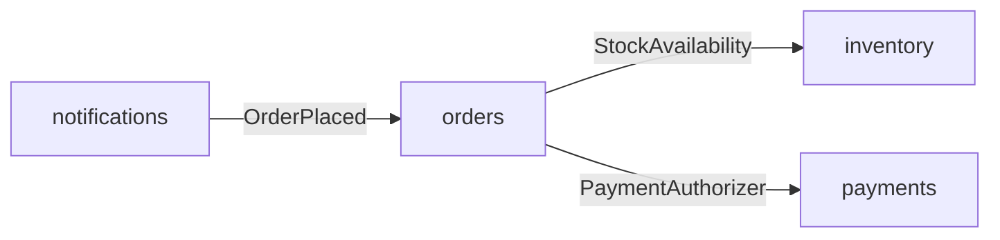
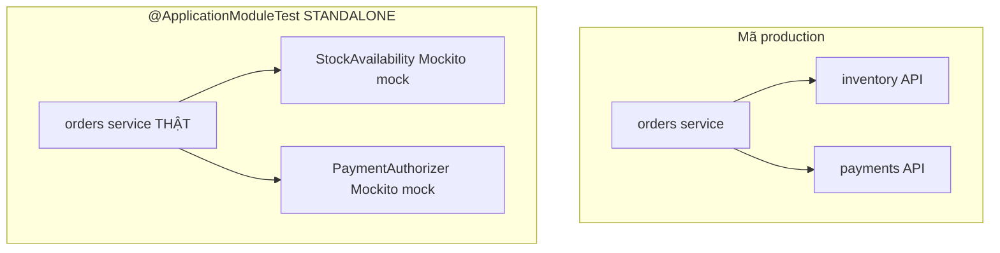
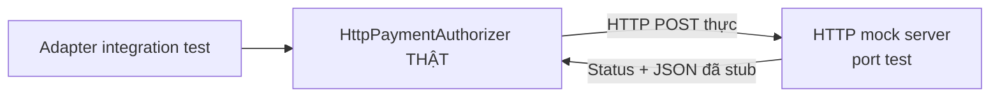
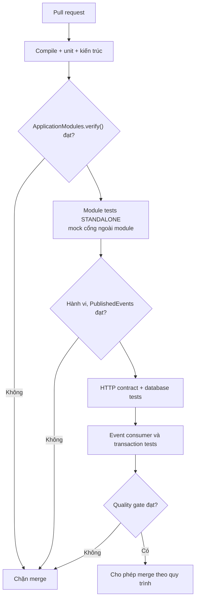

# MockBean và giới hạn của mock trong module test

Khi kiểm thử riêng một application module bằng Spring Modulith, chúng ta thường gặp một tình huống: mã của module `orders` cần gọi cổng `StockAvailability` của module `inventory` và cổng `PaymentAuthorizer` của module `payments`, nhưng bài test chỉ muốn kiểm tra **logic đặt đơn**, không muốn khởi động database tồn kho hoặc gọi cổng thanh toán thật.

Mock là giải pháp hữu ích: Spring Test có thể cung cấp một Mockito mock làm **Spring bean** để service thật của `orders` được inject dependency và chạy trong một `ApplicationContext` giới hạn. Tuy nhiên, **test xanh khi các dependency được mock không có nghĩa các module phối hợp thật đã chạy đúng**. Nếu mock quá nhiều, ta có thể bỏ qua lỗi wiring, hợp đồng HTTP, mapping database, transaction, consumer event và thậm chí hiểu sai về các ranh giới kiến trúc.

Bài học thuộc chương **Test configuration** của **SPRING_MODULITH_VERIFICATION_TESTING**. Ta sẽ làm rõ cách dùng `@MockBean` trong các phiên bản Spring Boot cũ, `@MockitoBean` trong Spring Framework hiện đại, cách phối hợp với `@ApplicationModuleTest`, giới hạn của mock, phương án kiểm thử thật và quality gate CI có `ApplicationModules.verify()`.

## 1. Mục tiêu học tập

Sau bài này, bạn có thể:

1. Phân biệt **Mockito mock thuần**, `@MockBean`, `@MockitoBean` và một bean fake qua `@TestConfiguration`.
2. Giải thích vì sao mock cần được **đăng ký vào Spring `ApplicationContext`** để một bean production inject được nó.
3. Viết `@ApplicationModuleTest` ở chế độ `STANDALONE`, mock các cổng của module phụ thuộc và kiểm tra logic thật của module đang test.
4. Hiểu khác biệt giữa **tạo thêm mock khi bean chưa tồn tại** với **thay thế bean thực sự đã tồn tại**.
5. Tránh lỗi do nhiều bean cùng kiểu, qualifier không khớp, mock mặc định trả `false`/`null` và Mockito verification quá gắn với implementation.
6. Nhận diện những thứ mock **không kiểm chứng được**: SQL, giao dịch, HTTP, serialize JSON, listener, event sau commit, retry và concurrency.
7. Dùng `PublishedEvents` và `ApplicationModules.verify()` để kiểm tra hai loại hợp đồng khác nhau.
8. Thiết kế bộ test nhiều tầng và quality gate CI để hạn chế hồi quy khi refactor module.

## 2. Từ khóa dễ nhầm: @Mock, @MockBean và @MockitoBean

`Mockito` có thể tạo mock Java thuần, nhưng Spring không tự biết phải dùng mock đó làm dependency của bean.

| Công cụ | Nơi thuộc về | Tác động chính |
| --- | --- | --- |
| `Mockito.mock(StockAvailability.class)` | Mockito API | Tạo một mock object, **không tự đăng ký Spring bean** |
| `@Mock` | Mockito/JUnit extension | Tạo mock field cho test thuần, **không tự thay Spring bean** |
| `@InjectMocks` | Mockito | Tạo/inject dependency vào object đang test theo cơ chế Mockito, không bootstrap Spring context |
| `@MockBean` | Spring Boot 3.x, package `org.springframework.boot.test.mock.mockito` | Thêm hoặc thay bean bằng Mockito mock trong Spring Test context; **legacy** |
| `@MockitoBean` | Spring Framework TestContext 6.2+, package `org.springframework.test.context.bean.override.mockito` | Thêm hoặc thay bean bằng Mockito mock theo cơ chế bean override mới |
| `@MockitoSpyBean` | Spring Framework TestContext 6.2+ | Bọc một bean hiện có bằng Mockito spy, code thật vẫn có thể chạy |
| `@TestConfiguration` + `@Bean` | Spring Boot | Đăng ký bean/fake do test khai báo; **không tự override** bean cũ |

### Vì sao bài có tên “MockBean” nhưng ví dụ dùng @MockitoBean?

`@MockBean` là tên annotation quen thuộc trong nhiều hệ thống Spring Boot 2.x/3.x. Từ **Spring Boot 3.4**, API này được đánh dấu **deprecated, dự kiến loại bỏ ở Boot 4.0**, thay bằng `@MockitoBean` và `@MockitoSpyBean` của Spring Framework. Vì vậy khi đọc codebase cũ phải hiểu `@MockBean`, nhưng khi viết test cho stack hiện đại hỗ trợ Spring Framework 6.2+, hãy ưu tiên `@MockitoBean`.

Không trộn import:

```java
// Spring Boot cũ (legacy):
import org.springframework.boot.test.mock.mockito.MockBean;

// Spring Framework hiện đại:
import org.springframework.test.context.bean.override.mockito.MockitoBean;
```

**Quan trọng:** hai annotation không phải chỉ khác tên hoàn toàn. Chúng có khác biệt về thuộc tính, phạm vi khai báo và cơ chế bean override. Khi nâng cấp version, không nên tìm-và-thay tên một cách mù quáng; cần chạy lại test và kiểm tra cụ thể cách resolve candidate.

## 3. Tại sao @Mock thuần không đủ trong module test?

Xét một đoạn code trong `@ApplicationModuleTest`:

```java
@ApplicationModuleTest
class OrdersModuleTest {

    @Mock
    StockAvailability stock;

    @Autowired
    OrderOperations orders;
}
```

Đây là **minh họa lỗi nhận thức**, không phải một class test hoàn chỉnh. `@Mock` (khi được Mockito extension xử lý) chỉ tạo một field mock cho test. Nó **không tự đưa field đó vào bean factory** của Spring. Nếu `OrderOperations` cần `StockAvailability` và trong test context không có bean tương ứng, Spring có thể báo `NoSuchBeanDefinitionException` dù field `stock` đã được Mockito tạo.

Với Spring module integration test, cần một trong các phương án:

- Dùng `@MockitoBean` hoặc `@MockBean` tương thích phiên bản để đăng ký mock trong Spring context.
- Dùng `@TestConfiguration` tạo bean fake rồi import/đặt nested đúng cách.
- Mở rộng phạm vi `@ApplicationModuleTest` để nạp module cung cấp implementation thật.

Ngược lại, trong **unit test thuần** không cần Spring context, `@Mock` + `@InjectMocks` hoặc constructor thủ công hoàn toàn hợp lý và thường chạy nhanh hơn.

## 4. Mô hình xuyên suốt: orders, inventory, payments, notifications

Giả sử ứng dụng bán hàng:

```text
src/main/java/
└── com/acme/shop/
    ├── ShopApplication.java
    ├── orders/
    │   ├── OrderId.java
    │   ├── OrderReceipt.java
    │   ├── OrderOperations.java
    │   ├── events/
    │   │   ├── OrderPlaced.java
    │   │   └── package-info.java
    │   └── internal/
    │       └── DefaultOrderOperations.java
    ├── inventory/
    │   ├── StockAvailability.java
    │   └── internal/
    │       └── DatabaseStockAvailability.java
    ├── payments/
    │   ├── PaymentAuthorizer.java
    │   └── internal/
    │       └── HttpPaymentAuthorizer.java
    └── notifications/
        └── internal/
            └── OrderPlacedListener.java

src/test/java/
└── com/acme/shop/
    ├── ArchitectureVerificationTest.java
    └── orders/
        ├── OrdersModuleTest.java
        ├── OrdersLegacyMockBeanTest.java
        └── OrdersWithRealDependenciesTest.java
```

Lớp ứng dụng:

```java
// src/main/java/com/acme/shop/ShopApplication.java
package com.acme.shop;

import org.springframework.boot.autoconfigure.SpringBootApplication;

@SpringBootApplication
public class ShopApplication {
}
```

Với phát hiện module mặc định, bốn package con trực tiếp dưới `com.acme.shop` được xem là bốn application module. Mã `orders` import hai interface công khai của `inventory` và `payments`. Listener `notifications` tham chiếu một event của `orders`.



**Đây là đồ thị phụ thuộc kiểu Java**, không phải sơ đồ bean nào đang có mặt trong một Spring Test context. Mock chỉ thay **cách cung cấp bean**; nó không thay quyền truy cập package hoặc hướng phụ thuộc production.

## 5. Những hợp đồng production sẽ được kiểm thử

### 5.1. Public API của inventory

```java
// src/main/java/com/acme/shop/inventory/StockAvailability.java
package com.acme.shop.inventory;

public interface StockAvailability {
    boolean available(String sku, int quantity);
}
```

Triển khai database thật có thể nằm tại `inventory.internal.DatabaseStockAvailability`. Module `orders` chỉ dùng interface ở **base package** của `inventory`, không import repository nội bộ.

### 5.2. Public API của payments

```java
// src/main/java/com/acme/shop/payments/PaymentAuthorizer.java
package com.acme.shop.payments;

public interface PaymentAuthorizer {

    Authorization authorize(String sku, int quantity);

    record Authorization(boolean approved, String reference) {
    }
}
```

`payments.internal.HttpPaymentAuthorizer` có thể gọi HTTP thật và xử lý JSON, timeout, retry. `orders` chỉ biết hợp đồng `PaymentAuthorizer`; đó là ranh giới thuận tiện để mock khi kiểm tra logic đặt đơn.

### 5.3. Public API của orders

```java
// src/main/java/com/acme/shop/orders/OrderId.java
package com.acme.shop.orders;

import java.util.UUID;

public record OrderId(UUID value) {
}
```

```java
// src/main/java/com/acme/shop/orders/OrderReceipt.java
package com.acme.shop.orders;

public record OrderReceipt(
        OrderId orderId,
        String authorizationReference
) {
}
```

```java
// src/main/java/com/acme/shop/orders/OrderOperations.java
package com.acme.shop.orders;

public interface OrderOperations {
    OrderReceipt place(String sku, int quantity);
}
```

### 5.4. Event do orders phát

```java
// src/main/java/com/acme/shop/orders/events/OrderPlaced.java
package com.acme.shop.orders.events;

import com.acme.shop.orders.OrderId;

public record OrderPlaced(
        OrderId orderId,
        String sku,
        int quantity,
        String authorizationReference
) {
}
```

Nếu `notifications` phải import `OrderPlaced`, module `orders` công khai package sự kiện bằng named interface:

```java
// src/main/java/com/acme/shop/orders/events/package-info.java
@org.springframework.modulith.NamedInterface("events")
package com.acme.shop.orders.events;
```

### 5.5. Triển khai thật của orders

```java
// src/main/java/com/acme/shop/orders/internal/DefaultOrderOperations.java
package com.acme.shop.orders.internal;

import com.acme.shop.inventory.StockAvailability;
import com.acme.shop.orders.OrderId;
import com.acme.shop.orders.OrderOperations;
import com.acme.shop.orders.OrderReceipt;
import com.acme.shop.orders.events.OrderPlaced;
import com.acme.shop.payments.PaymentAuthorizer;
import java.util.UUID;
import org.springframework.context.ApplicationEventPublisher;
import org.springframework.stereotype.Service;

@Service
class DefaultOrderOperations implements OrderOperations {

    private final StockAvailability stock;
    private final PaymentAuthorizer payments;
    private final ApplicationEventPublisher events;

    DefaultOrderOperations(
            StockAvailability stock,
            PaymentAuthorizer payments,
            ApplicationEventPublisher events
    ) {
        this.stock = stock;
        this.payments = payments;
        this.events = events;
    }

    @Override
    public OrderReceipt place(String sku, int quantity) {
        if (sku == null || sku.isBlank() || quantity <= 0) {
            throw new IllegalArgumentException("Đơn hàng không hợp lệ");
        }
        if (!stock.available(sku, quantity)) {
            throw new IllegalStateException("Không đủ tồn kho");
        }

        PaymentAuthorizer.Authorization authorization =
                payments.authorize(sku, quantity);

        if (!authorization.approved()) {
            throw new IllegalStateException("Thanh toán bị từ chối");
        }

        OrderId id = new OrderId(UUID.randomUUID());
        OrderReceipt receipt = new OrderReceipt(
                id, authorization.reference());

        events.publishEvent(new OrderPlaced(
                id, sku, quantity, authorization.reference()));

        return receipt;
    }
}
```

Service trên là **bean production thật**. Nó kiểm tra input, gọi cổng tồn kho, yêu cầu thanh toán, tạo receipt và publish event. Để tập trung vào mocking, ví dụ chưa persist đơn vào database hoặc quản lý transaction phân tán; vì thế **không được suy ra tính nhất quán dữ liệu** từ kết quả test của service này.

## 6. @ApplicationModuleTest giới hạn những bean nào?

`@ApplicationModuleTest` của Spring Modulith bootstrap Spring Boot context theo ranh giới module chứa package của test.

| Bootstrap mode | Phạm vi module được nạp | Ý nghĩa với `orders` |
| --- | --- | --- |
| `STANDALONE` (mặc định) | Chỉ module đang test | Có service thật `DefaultOrderOperations`, nhưng không tự nạp implementation của `inventory`/`payments` |
| `DIRECT_DEPENDENCIES` | Module đang test và các module nó phụ thuộc trực tiếp | Có thể có `DatabaseStockAvailability` và `HttpPaymentAuthorizer` thật |
| `ALL_DEPENDENCIES` | Module đang test và toàn cây dependency | Phạm vi rộng, có thể cần nhiều DB/broker/external client |

Ở chế độ `STANDALONE`, Spring tạo `DefaultOrderOperations` và nhận ra constructor cần hai interface thuộc module ngoài. Nếu không có bean cho những interface đó, context có thể fail vì **không thỏa mãn dependency**.



**Lưu ý:** Mockito mock không làm application module `inventory` hoặc `payments` “được bootstrap”. Chỉ có **mock object mang interface của các module ấy** được đăng ký trong `ApplicationContext` của bài test.

## 7. Bài test hoàn chỉnh với @MockitoBean hiện đại

Đặt test trong `src/test/java/com/acme/shop/orders`:

```java
// src/test/java/com/acme/shop/orders/OrdersModuleTest.java
package com.acme.shop.orders;

import com.acme.shop.inventory.StockAvailability;
import com.acme.shop.orders.events.OrderPlaced;
import com.acme.shop.payments.PaymentAuthorizer;
import org.junit.jupiter.api.Test;
import org.springframework.beans.factory.annotation.Autowired;
import org.springframework.modulith.test.ApplicationModuleTest;
import org.springframework.modulith.test.PublishedEvents;
import org.springframework.test.context.bean.override.mockito.MockitoBean;

import static org.assertj.core.api.Assertions.assertThat;
import static org.junit.jupiter.api.Assertions.assertThrows;
import static org.mockito.Mockito.verify;
import static org.mockito.Mockito.verifyNoInteractions;
import static org.mockito.Mockito.when;

@ApplicationModuleTest
class OrdersModuleTest {

    @Autowired
    OrderOperations orders;

    @MockitoBean
    StockAvailability stock;

    @MockitoBean
    PaymentAuthorizer payments;

    @Test
    void createsOrderAndPublishesEvent(PublishedEvents events) {
        when(stock.available("SKU-1", 2)).thenReturn(true);
        when(payments.authorize("SKU-1", 2))
                .thenReturn(new PaymentAuthorizer.Authorization(
                        true, "PAY-001"));

        OrderReceipt receipt = orders.place("SKU-1", 2);

        assertThat(receipt.orderId()).isNotNull();
        assertThat(receipt.authorizationReference())
                .isEqualTo("PAY-001");
        verify(stock).available("SKU-1", 2);
        verify(payments).authorize("SKU-1", 2);

        assertThat(events.ofType(OrderPlaced.class)
                .matching(OrderPlaced::orderId, receipt.orderId()))
                .hasSize(1);

        assertThat(events.ofType(OrderPlaced.class)
                .matching(OrderPlaced::authorizationReference, "PAY-001"))
                .hasSize(1);
    }

    @Test
    void rejectsUnavailableStockWithoutCallingPayment(
            PublishedEvents events) {
        when(stock.available("SKU-1", 9)).thenReturn(false);

        assertThrows(IllegalStateException.class,
                () -> orders.place("SKU-1", 9));

        verify(stock).available("SKU-1", 9);
        verifyNoInteractions(payments);
        assertThat(events.ofType(OrderPlaced.class)).isEmpty();
    }

    @Test
    void rejectsDeclinedPaymentWithoutPublishingOrder(
            PublishedEvents events) {
        when(stock.available("SKU-1", 2)).thenReturn(true);
        when(payments.authorize("SKU-1", 2))
                .thenReturn(new PaymentAuthorizer.Authorization(
                        false, "DECLINED"));

        assertThrows(IllegalStateException.class,
                () -> orders.place("SKU-1", 2));

        verify(payments).authorize("SKU-1", 2);
        assertThat(events.ofType(OrderPlaced.class)).isEmpty();
    }
}
```

### Test thật sự chạy phần nào?

1. `@ApplicationModuleTest` bootstrap module `orders` ở `STANDALONE`.
2. `@MockitoBean StockAvailability` tạo một **mock Spring bean** cho dependency thuộc module `inventory` không có trong context.
3. `@MockitoBean PaymentAuthorizer` tương tự, cho dependency thuộc `payments`.
4. Spring inject hai mock vào **service thật** `DefaultOrderOperations`.
5. Test thiết lập kết quả bằng `when(...).thenReturn(...)`, gọi `orders.place(...)`.
6. Assert nghiệp vụ kiểm tra receipt, nhánh thành công/thất bại và lời gọi ra cổng.
7. `PublishedEvents` của Spring Modulith xác nhận event được **publish bởi producer `orders`**.

**Điều test chưa làm:** không gọi database inventory, không gửi request HTTP thanh toán, không khởi động listener `notifications`, không chạy transaction lưu đơn hoặc chứng minh retry. Các phần đó cần test chuyên biệt.

### Vì sao kiểm tra cả kết quả và tương tác?

Kiểm tra `verify(payments).authorize(...)` bảo đảm cổng thanh toán đã được gọi với input đúng. Nhưng chỉ `verify` có thể cho test xanh dù kết quả nghiệp vụ bị tính sai. Ngược lại, chỉ assert receipt có thể bỏ sót việc service gọi payment nhiều lần.

Vì vậy trong một **module test quan trọng**, hãy kết hợp:

- Assertion về **output** và tình huống lỗi.
- Assertion về **event payload** khi publish event là hợp đồng.
- Mockito verification tại **điểm giao tiếp thiết yếu** như payment hoặc inventory.

Tránh verify mọi getter, mọi lời gọi nội bộ không cần thiết: test càng gắn với chi tiết cài đặt, càng dễ vỡ khi refactor hợp lệ.

## 8. @MockBean legacy: cách đọc và chuyển đổi

Với Spring Boot 3.x cũ, nhiều dự án viết:

```java
// Mẫu legacy, sử dụng với Spring Boot còn hỗ trợ @MockBean.
import org.springframework.boot.test.mock.mockito.MockBean;

@ApplicationModuleTest
class OrdersLegacyMockBeanTest {

    @MockBean
    StockAvailability stock;

    @MockBean
    PaymentAuthorizer payments;

    // @Autowired OrderOperations orders;
    // @Test ... khi mock ... rồi assert ...
}
```

Hai field `@MockBean` được tích hợp vào Spring Boot Test để tạo hoặc thay Spring beans trong test context. Với codebase này, **ý tưởng kiến trúc không thay đổi**: mock cổng phụ thuộc ngoài module để `orders` thật chạy trong `STANDALONE`.

Khi migrate sang Spring Framework hỗ trợ `@MockitoBean`:

```java
import org.springframework.test.context.bean.override.mockito.MockitoBean;

@MockitoBean
StockAvailability stock;

@MockitoBean
PaymentAuthorizer payments;
```

Kiểm tra thêm:

1. Spring Boot/Spring Framework version đã hỗ trợ API mới chưa.
2. Annotation mới được đặt ở field hoặc class-level theo cú pháp framework tương ứng; đừng giả định mọi thuộc tính cũ còn nguyên.
3. Có nhiều bean cùng kiểu hoặc qualifier/name đặc biệt không.
4. Có bài test đang dựa vào reset policy, AOP proxy hoặc test context caching không.
5. Chạy lại những module tests, event tests và architecture tests sau chuyển đổi.

**Lựa chọn khuyến nghị:** dự án đã lên stack mới thì sử dụng `@MockitoBean`; dự án cũ chưa hỗ trợ thì dùng `@MockBean` tương thích phiên bản, tránh copy import mới vào project chưa có API đó.

## 9. Quan trọng: tạo mock mới khác với override bean thật

Theo mặc định, `@MockitoBean` dùng chiến lược **replace-or-create**:

- Nếu test context có **một bean phù hợp**, mock có thể **thay bean ấy**.
- Nếu test context **không có bean phù hợp**, framework có thể **tạo một mock bean mới**.

Trong `OrdersModuleTest` ở `STANDALONE`, implementation production của `inventory` và `payments` không được bootstrap. Vì vậy hai annotation ở mục 7 **tạo các mock bean mới để lấp dependency**, chứ không phải thay `DatabaseStockAvailability` hoặc `HttpPaymentAuthorizer` đang tồn tại trong context.

### enforceOverride = true không phải lúc nào cũng đúng

Spring Framework cho phép:

```java
@MockitoBean(enforceOverride = true)
StockAvailability stock;
```

Với `enforceOverride = true`, test **yêu cầu có bean phù hợp để thay thế**. Nếu chỉ bootstrap `orders` ở `STANDALONE` và không có bean `StockAvailability` trong context, test có thể **thất bại ngay khi tạo context**.

| Hoàn cảnh | `@MockitoBean` mặc định | `@MockitoBean(enforceOverride = true)` |
| --- | --- | --- |
| `STANDALONE`, interface ngoài module chưa có bean | Tạo mock để module khởi động | **Fail** vì không có bean để thay |
| `DIRECT_DEPENDENCIES`, có bean thật phù hợp | Thay bean thật | Thay bean thật và bảo đảm mục tiêu tồn tại |
| Có nhiều bean phù hợp, không định danh | Có thể báo ambiguity | Cũng cần chỉ rõ bean |
| Mục đích đảm bảo production bean hiện diện | Có thể vô tình che bean thiếu | Cung cấp kiểm chứng chặt hơn |

**Kết luận:** `enforceOverride = true` rất hữu ích để phát hiện một bean production bị mất hoặc đổi tên trong test **có nạp bean ấy**. Nhưng không áp dụng nó máy móc cho mock dependency nằm ở **module không được bootstrap**.

## 10. Bean name, @Qualifier và nhiều implementation

Trong một ứng dụng thực, có thể có nhiều `PaymentAuthorizer`:

```java
@Component("primaryPaymentAuthorizer")
class PrimaryPaymentAuthorizer implements PaymentAuthorizer {
    // ...
}

@Component("fallbackPaymentAuthorizer")
class FallbackPaymentAuthorizer implements PaymentAuthorizer {
    // ...
}
```

Ví dụ chỉ minh họa **hai bean cùng interface**, không phải class hoàn chỉnh. Nếu test context có cả hai, một `@MockitoBean PaymentAuthorizer payments` không thể mặc định biết nên thay bean nào.

Spring Test hỗ trợ chọn theo tên hoặc qualifier khi cần:

```java
@MockitoBean(name = "primaryPaymentAuthorizer")
PaymentAuthorizer primaryPayment;
```

Hoặc:

```java
@MockitoBean
@Qualifier("primaryPaymentAuthorizer")
PaymentAuthorizer primaryPayment;
```

Trong bài test thật, thêm import `Qualifier` và bảo đảm production service inject đúng candidate cần mock. Không nên đặt qualifier tùy ý chỉ để context khởi động; **tên bean trong test phải phản ánh contract của runtime**.

### Mặc định dựa vào field name có nguy cơ gì?

Khi resolve theo kiểu và có nhiều candidate, Spring Test có thể xét qualifier và **field name làm fallback qualifier**. Hai test class dùng tên field khác nhau cho cùng một mock cũng có thể tạo khác biệt metadata ảnh hưởng **context cache key**.

Vì vậy với test dùng lại fixture:

- Đặt tên field nhất quán.
- Ưu tiên bean name/`@Qualifier` khi cần nhắm tới implementation cụ thể.
- Không dùng `@Primary` như phương án “chữa cháy” cho một mock sai phạm vi.
- Nếu sản phẩm thật có hai implementation cùng tồn tại, viết rõ **bean nào thực sự là dependency của service**.

## 11. Bẫy nguy hiểm: mock mặc định trả false, null hoặc 0

Mockito không tự biết nghiệp vụ “còn hàng” hoặc “thanh toán thành công”.

Với method trả kiểu primitive boolean, một mock chưa stub thường trả `false`:

```java
@MockitoBean
StockAvailability stock;

// Không có when(stock.available(...)).
// stock.available("SKU-1", 1) thường trả false.
```

Đây là bẫy của **negative test xanh giả**:

```java
// RỦI RO: test có thể xanh chỉ vì mock chưa được cấu hình.
assertThrows(IllegalStateException.class,
        () -> orders.place("SKU-1", 1));
```

Tại sao nguy hiểm? Test mong “payment từ chối”, nhưng có thể thất bại **trước đó do tồn kho mặc định false**. Nó vẫn ném cùng một loại exception và test vẫn xanh, mặc dù nhánh payment chưa hề chạy.

### Chặn bằng stubbing và interaction assertion

```java
when(stock.available("SKU-1", 1)).thenReturn(true);
when(payments.authorize("SKU-1", 1))
        .thenReturn(new PaymentAuthorizer.Authorization(
                false, "DECLINED"));

assertThrows(IllegalStateException.class,
        () -> orders.place("SKU-1", 1));

verify(stock).available("SKU-1", 1);
verify(payments).authorize("SKU-1", 1);
```

Mỗi test phải **tạo rõ điều kiện của nhánh cần kiểm tra**, không dựa vào default behavior. Nếu exception type có thể phát sinh từ nhiều nhánh, kiểm tra thêm **exception message/error code** hoặc một tác động nghiệp vụ đủ đặc trưng để tránh false positive.

### Mockito strictness không sửa được tất cả

Mockito strict stubbing có thể phát hiện một số stub thừa hoặc mismatch, nhưng không tự xác định test đã chọn đúng **nhánh nghiệp vụ**. Assertion về output và interaction vẫn cần thiết. Ngược lại, không nên bật verify mọi lời gọi chỉ để khiến test “trông chặt chẽ”; điều đó tạo coupling với implementation.

## 12. Không mock service đang được kiểm thử

Giả sử mục tiêu là kiểm tra `DefaultOrderOperations`, nhưng test viết:

```java
@MockitoBean
OrderOperations orders;

@Test
void createsOrder() {
    when(orders.place("SKU-1", 2))
            .thenReturn(new OrderReceipt(
                    new OrderId(UUID.randomUUID()), "PAY-001"));

    assertThat(orders.place("SKU-1", 2)).isNotNull();
}
```

Test này về cơ bản chỉ xác minh **Mockito đã trả về dữ liệu do chính test cấu hình**. Nó không chạy validation, không gọi cổng tồn kho, không yêu cầu payment thật và không publish event từ service production. Một thay đổi sai ở `DefaultOrderOperations` có thể không khiến test thất bại.

**Nguyên tắc:** giữ **bean nghiệp vụ thuộc module đang test là thật**; chỉ mock **những cổng ra ngoài phạm vi cần kiểm chứng**. Nếu phải mock chính bean nghiệp vụ vì test không thể khởi động, cần xem lại mục tiêu test và khả năng module bị phụ thuộc quá chặt.

## 13. Mock không chứng minh wiring và startup thực

Một module test `STANDALONE` có hai mock không biết `inventory` và `payments` triển khai interface bằng bean nào ở production. Ví dụ:

- Một developer xóa `@Service` khỏi `DatabaseStockAvailability`.
- Một bean `HttpPaymentAuthorizer` cần property mới nhưng production thiếu.
- Có hai implementation `PaymentAuthorizer` và injection tại runtime trở nên ambiguous.
- Một `@Configuration` production bị chuyển package nên không còn được scan.

`OrdersModuleTest` với `@MockitoBean` vẫn có thể **khởi động bình thường**, bởi Spring đã có mock để inject, không cần tạo những bean thật ở module khác.

Vì vậy phải có test startup/integration **có nạp module phụ thuộc thật** ở cấp phù hợp:

```java
import org.springframework.modulith.test.ApplicationModuleTest;
import org.springframework.modulith.test.ApplicationModuleTest.BootstrapMode;

@ApplicationModuleTest(mode = BootstrapMode.DIRECT_DEPENDENCIES)
class OrdersWithRealDependenciesTest {
    // Cần datasource, payment endpoint test và các fixture thật.
    // Viết assertion tích hợp khi triển khai.
}
```

Đây là **skeleton**, không chạy độc lập nếu thiếu hạ tầng. Không phải mọi bài test đều phải dùng `DIRECT_DEPENDENCIES`; tăng phạm vi sẽ tăng chi phí và có thể nạp nhiều dependency không thuộc mục tiêu.

Một bộ test tốt thường **kết hợp cả test hẹp và test tích hợp**, thay vì ép mọi kịch bản vào một kiểu test duy nhất.

## 14. Khi mock làm mất AOP, transaction hoặc cache

`@MockitoBean` thay bean bằng Mockito mock theo cơ chế bean override. Mock được đăng ký trực tiếp; nó **không mặc nhiên là Spring AOP proxy** mang advice của bean production.

Ví dụ production service:

```java
@Service
class PaymentSettlementService {

    @Transactional
    public void settlePayment() {
        // Thao tác database trong transaction thực.
    }
}
```

Nếu mock `PaymentSettlementService` rồi verify `settlePayment()` được gọi, test **không chứng minh transaction đã bắt đầu, DB commit/rollback đúng hoặc advice `@Transactional` thực thi**.

Tương tự, mock một bean có:

- `@Cacheable`: không đo cache hit/miss thật.
- `@Retryable`: không chạy retry logic/advice production.
- `@Async`: không xác nhận scheduling và exception handling của async runtime.
- Security method interceptor: có thể không thực hiện authorization như production.

**Cẩn trọng với phạm vi mock:** nếu mục tiêu là transaction, retry, cache hay security, giữ bean mang aspect là **bean thật**, dùng mock ở dependency phù hợp (hoặc hạ tầng test thật khi cần).

### @MockitoSpyBean có phải cách thay thế hoàn hảo?

`@MockitoSpyBean` dùng chiến lược **bọc bean hiện có bằng spy**, nên có thể quan sát lời gọi trong khi code thật vẫn chạy. Nó yêu cầu có bean phù hợp và có thể giữ nhiều side effects không mong muốn.

Không nên dùng spy mặc định cho mọi test. Spy phức tạp hơn khi có AOP proxy, self-invocation, method final hoặc bean state. Khi muốn kiểm tra hành vi thật, phần lớn trường hợp **assert state/output và dùng dependency mock ở ranh giới** sẽ dễ hiểu hơn.

## 15. Mock không test database, schema và concurrency

Nếu mục tiêu là kiểm tra `inventory.internal.DatabaseStockAvailability` sử dụng repository/JPA, thì:

```java
@MockitoBean
StockAvailability stock;
```

không kiểm tra được:

- SQL query đúng hay sai.
- Entity mapping, foreign key, unique constraint.
- Migration/schema có chạy đủ không.
- Transaction isolation, optimistic/pessimistic locking.
- Deadlock/concurrency, dữ liệu tồn kho bị tranh chấp.
- Kết nối thật tới PostgreSQL/MySQL hoặc driver.

Một test phù hợp cho persistence nên bootstrap **module sở hữu repository** và cung cấp **test database** thích hợp, chẳng hạn Testcontainers.

### Mức mock trong một bài test database

Giả sử `orders` có `OrderRepository` riêng và `inventory` cung cấp `StockAvailability`:

| Mục tiêu | Giữ thật | Có thể mock |
| --- | --- | --- |
| Quy tắc đặt đơn, không xét persistence | `OrderOperations` | `StockAvailability`, `PaymentAuthorizer` |
| Ghi đơn vào database của `orders` | `OrderOperations`, `OrderRepository`, DB | Cổng payment/tồn kho ngoài module |
| SQL tồn kho của `inventory` | `DatabaseStockAvailability`, repository, DB | External API ngoài mục tiêu |
| Tích hợp `orders → inventory` | Hai module và DB cần thiết | Một số hệ thống ngoài phạm vi |
| Tính duy nhất/lock/transaction | Repository và DB thật | Không mock phần đang cần kiểm chứng |

**Một mock trả `true` không bảo đảm tồn kho thật có đủ hàng**. Đây là quyết định có chủ đích để test *logic phía module gọi*, không phải lời cam kết về hệ thống tích hợp.

## 16. Mock không test HTTP contract, serialization và timeout

Mock `PaymentAuthorizer` trong mục 7 bypass hoàn toàn implementation `HttpPaymentAuthorizer`. Do đó các lỗi sau có thể lọt qua:

- HTTP method sai (GET thay vì POST), path sai.
- JSON request thiếu một trường hoặc sai field name.
- Response mapping, status code 4xx/5xx, lỗi decode.
- Authentication header và content type.
- Timeout, retry, circuit breaker hoặc idempotency.
- DNS/TLS, connection pool và giới hạn network.

Muốn bảo vệ HTTP adapter, viết bài **contract/integration test** giữ `HttpPaymentAuthorizer` thật và dùng mock HTTP server với endpoint có thể dự đoán:



### Đăng ký URL động nếu mock server dùng cổng ngẫu nhiên

```java
// Mảnh minh họa, mockServer phải được khởi động trước khi URL được resolve.
@DynamicPropertySource
static void paymentProperties(DynamicPropertyRegistry registry) {
    registry.add("shop.payment.base-url",
            () -> mockServer.baseUrl());
}
```

`mockServer` là abstraction minh họa, **không phải một class có sẵn từ Spring**. Cần WireMock hoặc mock web server thực tế, lifecycle phù hợp, và import `DynamicPropertySource`/`DynamicPropertyRegistry`.

`@DynamicPropertySource` chỉ cung cấp property; **không khởi động server** hay stub HTTP response. HTTP test còn cần assert request body và response behavior.

## 17. Mock không chứng minh consumer event đã chạy

`DefaultOrderOperations` publish `OrderPlaced`. Bài `OrdersModuleTest` ở `STANDALONE` kiểm tra bằng `PublishedEvents`:

```java
assertThat(events.ofType(OrderPlaced.class)
        .matching(OrderPlaced::orderId, receipt.orderId()))
        .hasSize(1);
```

Kết quả này chứng minh **producer `orders` đã phát sự kiện phù hợp trong test context**. Nó không chứng minh:

1. Module `notifications` có được bootstrap không.
2. Listener có đăng ký đúng event type không.
3. Listener có ghi database/gửi email thành công không.
4. Event bất đồng bộ có hoàn tất và được xử lý lỗi/retry đúng không.
5. Listener `AFTER_COMMIT` có chạy sau transaction thật không.

Nếu mục tiêu là phía consumer, dùng `@ApplicationModuleTest` tại `notifications` và các tiện ích test sự kiện/`Scenario` thích hợp, hoặc integration test nhiều module. Không mock listener rồi suy ra listener thật đã xử lý.

### Tại sao không mock ApplicationEventPublisher luôn?

Nếu thay `ApplicationEventPublisher` bằng mock, `verify(publisher).publishEvent(...)` có thể cho biết service gọi API, nhưng đường đi event thực qua Spring không diễn ra như production. Khi đang kiểm tra `PublishedEvents`, **giữ publisher thật** sẽ tốt hơn.

## 18. Event sau commit và database transaction

Trong ứng dụng thực, tạo đơn có thể chạy trong `@Transactional`, còn consumer dùng `@TransactionalEventListener(phase = AFTER_COMMIT)` hoặc `@ApplicationModuleListener`. Mock một repository hoặc listener có thể khiến test bỏ qua chính phần cần kiểm tra.

Đặc biệt:

- Test method `@Transactional` thường rollback tự động; listener đợi **commit** có thể không chạy.
- Mock repository không lưu bản ghi thật và không chạy unique constraint.
- `PublishedEvents` đếm event **được publish**, không đồng nghĩa event được xử lý sau commit.
- Với broker/event publication registry, cần test delivery, retry và idempotency ở cấp phù hợp.

### Phương án test đa tầng

| Tầng | Mục đích | Thành phần thật |
| --- | --- | --- |
| Module producer test | `orders` phát payload đúng | `OrderOperations`, publisher Spring |
| Module consumer test | `notifications` xử lý event đúng | Listener, dependency cốt lõi |
| Transaction integration test | Giao dịch và `AFTER_COMMIT` | Repository/DB/transaction manager |
| Event reliability test | Retry và delivery sau lỗi | Event infrastructure/broker/registry phù hợp |

**Không cần Docker trong mọi module test**, nhưng những yêu cầu runtime có transaction hoặc broker thật phải có test chứng minh chúng ở mức phù hợp.

## 19. Mock có thể che mất coupling kiến trúc

Spring Modulith tập trung kiểm chứng **ranh giới kiến trúc**. Giả sử service `orders` tham chiếu sai trực tiếp tới `inventory.internal.InventoryRepository`. Một mock cho `InventoryRepository` có thể giúp context khởi động nếu interface Java cho phép tham chiếu, nhưng không làm mối quan hệ đó thành hợp lệ.

### Khai báo giới hạn phụ thuộc

Trong module `orders`:

```java
// src/main/java/com/acme/shop/orders/package-info.java
@org.springframework.modulith.ApplicationModule(
        allowedDependencies = {"inventory", "payments"}
)
package com.acme.shop.orders;
```

Trong `notifications`, nếu chỉ cần dùng nhóm event công khai của `orders`:

```java
// src/main/java/com/acme/shop/notifications/package-info.java
@org.springframework.modulith.ApplicationModule(
        allowedDependencies = "orders :: events"
)
package com.acme.shop.notifications;
```

Annotation `allowedDependencies` giới hạn **mã module nguồn được phép tham chiếu API module đích**. Nó không tự tạo bean và cũng không xác nhận các API runtime luôn sẵn sàng.

### Bài test verify() độc lập với mock

```java
// src/test/java/com/acme/shop/ArchitectureVerificationTest.java
package com.acme.shop;

import org.junit.jupiter.api.Test;
import org.springframework.modulith.core.ApplicationModules;

import static org.junit.jupiter.api.Assertions.assertTrue;

class ArchitectureVerificationTest {

    @Test
    void discoversRequiredModules() {
        ApplicationModules modules =
                ApplicationModules.of(ShopApplication.class);

        assertTrue(modules.getModuleByName("orders").isPresent());
        assertTrue(modules.getModuleByName("inventory").isPresent());
        assertTrue(modules.getModuleByName("payments").isPresent());
        assertTrue(modules.getModuleByName("notifications").isPresent());
    }

    @Test
    void verifiesAllModuleDependencies() {
        ApplicationModules.of(ShopApplication.class).verify();
    }
}
```

`ApplicationModules.verify()` giúp bảo vệ những quy tắc cấu trúc như:

1. Không tồn tại **phụ thuộc vòng** giữa các module.
2. Không tham chiếu **kiểu nội bộ** của application module khác trong mô hình module đóng.
3. Tuân thủ `allowedDependencies` nếu đã khai báo.

**Giới hạn của verify():** nó không kiểm tra SQL/HTTP, Mockito stubbing hoặc event được consumer xử lý. **Giới hạn của mock test:** nó không chứng minh mọi Java import và module dependency production hợp lệ.

Ở những phiên bản Spring Modulith hiện đại, `@ApplicationModuleTest` có hỗ trợ kiểm chứng module structure tự động theo cấu hình, nhưng một `ArchitectureVerificationTest` dành riêng cho **toàn bộ tập module** vẫn hữu ích để làm quality gate độc lập.

## 20. Dấu hiệu module đang bị mock quá nhiều

Spring Modulith khuyến khích dependency rõ ràng giữa các module. Nếu test `orders` cần mock hàng chục bean của module khác chỉ để context khởi động, đó có thể là dấu hiệu **high coupling**, chứ không đơn thuần là thiếu test configuration.

Các triệu chứng:

- Service của `orders` inject nhiều repository/implementation nằm trong `inventory.internal` hoặc `payments.internal`.
- Có mock cho từng lớp sâu trong đồ thị dependency, thay vì một cổng public API ổn định.
- Một thay đổi nội bộ của module `inventory` khiến rất nhiều module tests khác phải sửa stubbing.
- Test cần `@MockBean`/@MockitoBean cho cả transaction manager, event bus, repository, mapper, HTTP client và scheduler.
- Muốn test một hành vi đơn giản nhưng cần cấu hình hàng chục kết quả mock và thứ tự gọi.

### Cách cải thiện thiết kế

1. Xem lại ranh giới public API của module đích.
2. Chuyển dependency từ nhiều kiểu kỹ thuật sang **một use-case interface rõ ràng** khi phù hợp.
3. Xem xét dùng **domain event** để giảm phụ thuộc đồng bộ không cần thiết.
4. Giữ internal package đóng, không để module ngoài phụ thuộc repository trực tiếp.
5. Phân loại test: test logic thì mock cổng, test integration thì giữ implementation thật.
6. Chạy `verify()` và review chiều phụ thuộc, thay vì cứ thêm mock để context startup.

Không phải mọi mock đều xấu. Mock **đúng hợp đồng** thường giúp một test ngắn, nhanh và tập trung. Vấn đề xuất hiện khi mock khiến team **không còn biết thành phần nào thật sự được kiểm chứng**.

## 21. Reset mock, context cache và test chạy song song

Spring TestContext cache `ApplicationContext` để tránh bootstrap lại liên tục. Do đó một Mockito mock có thể là **singleton trong context** và được dùng qua nhiều test method.

Spring Test cung cấp cơ chế reset mock theo lifecycle; với `@MockitoBean`, mặc định reset sau mỗi test method theo cơ chế quản lý của framework. Tuy nhiên:

- Cần dùng version và TestExecutionListener tương thích.
- Nếu thay reset policy, state từ test trước có thể còn lại.
- Khi context được chia sẻ giữa nhiều class, cách đặt tên field, qualifier và cấu hình mock có thể ảnh hưởng cache key.
- Các test chạy song song trên cùng context/mock dễ tương tác với nhau nếu stubbing thay đổi đồng thời.
- Các dependency fake có trạng thái do `@TestConfiguration` tạo không tự hưởng cơ chế reset của Mockito.

### Không lạm dụng @DirtiesContext

`@DirtiesContext` buộc Spring tạo lại context, có thể làm test chậm. Thường nên:

1. Để mỗi test method thiết lập rõ stubbing cần dùng.
2. Tránh static/shared mutable fixture.
3. Để Spring Test reset Mockito mock theo lifecycle chuẩn.
4. Tách class khi cần cấu hình bean khác nhau.
5. Chỉ dùng `@DirtiesContext` khi context thực sự bị thay đổi mà không reset an toàn được.

### Mock và concurrency

Mockito mock có thể được gọi từ nhiều thread trong một số tình huống, nhưng **thay đổi stubbing hoặc verify trong khi những thread khác vẫn đang sử dụng mock** có thể làm test không ổn định. Với event async, dùng cơ chế chờ/`Scenario` phù hợp và tránh assertion chạy quá sớm.

## 22. Chọn đúng loại test thay vì mock mọi thứ

| Cấp độ | Công cụ gợi ý | Hợp đồng bảo vệ | Những gì chưa được chứng minh |
| --- | --- | --- | --- |
| **Unit test** | Mockito `@Mock`/`@InjectMocks` hoặc constructor | Thuật toán/hàm thuần, rất nhanh | Spring bean wiring, event infrastructure |
| **Module test cô lập** | `@ApplicationModuleTest` `STANDALONE` + `@MockitoBean` | Service thật trong ranh giới module, event producer | Bean thật ở module phụ thuộc, SQL/HTTP |
| **Module + direct deps** | `DIRECT_DEPENDENCIES` | Bean wiring và hợp tác giữa dependency trực tiếp | Toàn bộ cây dependency/production |
| **HTTP adapter test** | Mock server + adapter thật | Serialization, route, response/error handling | Hệ thống đối tác thật |
| **Database integration** | Testcontainers + repository thật | SQL, schema, transactions, constraints | Mọi điều kiện tải/concurrency production |
| **Event consumer/integration** | `Scenario`, DB/broker phù hợp | Listener, delivery và side effects | Toàn bộ hệ phân tán nếu không chạy end-to-end |
| **Architecture verification** | `ApplicationModules.verify()` | Dependency graph, module API và allowlist | Hành vi runtime |

Đây không phải “kim tự tháp” buộc mỗi dự án đều có đúng từng tầng với số lượng bằng nhau. Hãy **chọn test theo loại rủi ro** và độ đắt của hạ tầng. Ranh giới module là một trục, còn mức sử dụng dependency thật là trục khác.

## 23. Chẩn đoán lỗi thường gặp

| Triệu chứng | Nguyên nhân khả dĩ | Hướng xử lý |
| --- | --- | --- |
| `NoSuchBeanDefinitionException` trong `STANDALONE` | Dependency nằm ở module khác và không có mock/fake | `@MockitoBean` hoặc `@TestConfiguration` cho cổng cần thiết |
| Dùng `@Mock` nhưng Spring vẫn thiếu bean | Mock field không đăng ký vào context | Dùng `@MockitoBean`/`@MockBean` phù hợp |
| `@MockitoBean(enforceOverride=true)` fail | Bean mục tiêu không có trong context, thường vì `STANDALONE` | Bỏ enforceOverride khi chủ đích create, hoặc nạp module thật |
| Bean mock không đúng implementation | Có nhiều bean cùng kiểu hoặc qualifier sai | Chỉ rõ `name`/`@Qualifier` và soát injection |
| Context khởi động nhưng test gọi mạng thật | Đã mock sai interface hoặc service inject client khác | Kiểm tra bean thực sự được inject |
| Negative test xanh dù payment chưa chạy | Stock mock mặc định trả `false` | Stub nhánh stock hợp lệ, verify payment call |
| `NullPointerException` từ kết quả payment | Method mock trả `null` do chưa stub | Stub đầy đủ hoặc kiểm tra đối tượng trả về |
| Test chỉ `verify` nhưng logic thực sai | Assertion quá gắn interaction, thiếu output assertions | Assert receipt/event/error theo contract |
| Test startup thật fail nhưng module test xanh | Mock che bean production thiếu hoặc cấu hình sai | Test `DIRECT_DEPENDENCIES`/integration không mock |
| `PublishedEvents` có event nhưng consumer không chạy | `STANDALONE` chỉ kiểm tra producer | Test listener/module consumer riêng |
| Test transaction xanh nhưng rollback sai | Repository/service bị mock | Dùng DB và bean có transaction thật |
| Adapter HTTP gọi sai JSON nhưng module test xanh | Mock interface bỏ qua serialization | Thêm HTTP contract test |
| Test chạy riêng tốt, chạy suite bị flaky | Cache, reset mock, fixture state hoặc async | Kiểm tra lifecycle và test parallelism |
| `verify()` fail dù module test xanh | Sai dependency/internal API/cycle | Sửa ranh giới kiến trúc, không thêm mock để che |

### Trình tự điều tra

1. Xác định **test class nằm trong package module nào**.
2. Xem `@ApplicationModuleTest` ở `STANDALONE`, `DIRECT_DEPENDENCIES` hay `ALL_DEPENDENCIES`.
3. Xác định dependency nào có bean thật, dependency nào cần mock hoặc fake.
4. Phân biệt `@Mock` thuần với mock đã **đăng ký vào Spring context**.
5. Nếu bean không đúng, kiểm tra `name`, qualifier, số candidate và `enforceOverride`.
6. Kiểm tra stubbing bảo đảm test chạm **đúng nhánh logic**.
7. Assert kết quả nghiệp vụ, event và interaction thiết yếu.
8. Khi cần HTTP/DB/consumer thật, chuyển sang bài test cấp phù hợp.
9. Chạy `ApplicationModules.verify()` để phân biệt lỗi kiến trúc và lỗi runtime.

## 24. Quality gate CI: cho mock test chạy nhanh, nhưng không dừng ở đó

Một pipeline hữu ích có thể chia tầng:



### Điều nên kiểm tra trên pull request

- **Kiến trúc:** `ApplicationModules.verify()` đạt và tập module quan trọng vẫn được phát hiện.
- **Module:** `@ApplicationModuleTest` có assertion về logic, error branch và event payload.
- **Độ phủ runtime:** có ít nhất test phù hợp cho các dependency thật quan trọng (payment HTTP, stock DB, event consumer).
- **Mocking:** không mock chính service đang kiểm tra; không thêm mock chỉ để che lỗi thiết kế.
- **CI:** test bắt buộc không bị `@Disabled`/skip vô tình; build quản lý đúng version của Spring Boot, Spring Modulith và Mockito.
- **Hạ tầng:** integration tests dùng database/HTTP stub/broker test, không kết nối production.

Lệnh minh họa:

```bash
# Maven Wrapper: chạy các bước đã được gắn vào lifecycle phù hợp.
./mvnw verify

# Gradle Wrapper: chạy những test suites gắn vào check.
./gradlew check
```

**Lưu ý:** những lệnh này không tự động bao gồm mọi integration test nếu dự án chưa cấu hình các plugin/task cần thiết. Việc tạo bài học này **không thực thi Maven/Gradle hay STEP 6 QA chuyên môn**.

## 25. Bài thực hành: mock đúng cổng, chọn đúng mức tin cậy

Một ứng dụng đặt vé có:

```text
com.example.ticket
├── TicketApplication.java
├── booking/
│   ├── BookingOperations.java
│   ├── events/BookingConfirmed.java
│   └── internal/DefaultBookingOperations.java
├── seats/
│   ├── SeatAvailability.java
│   └── internal/DatabaseSeatAvailability.java
├── payments/
│   ├── PaymentGateway.java
│   └── internal/HttpPaymentGateway.java
└── notifications/
    └── internal/BookingConfirmedListener.java
```

`DefaultBookingOperations` phải kiểm tra ghế trống, gọi payment, lưu booking và phát `BookingConfirmed`. Test class nằm trong package `com.example.ticket.booking`.

### Câu hỏi

1. `@ApplicationModuleTest` mặc định bootstrap module nào?
2. Nếu thiếu `SeatAvailability` và `PaymentGateway`, test context có thể báo lỗi gì?
3. Vì sao `@Mock SeatAvailability seats` không tự cấp bean cho service Spring?
4. Với Spring Framework 6.2+, annotation nào phù hợp để tạo mock bean cho hai cổng ngoài module?
5. Trong `STANDALONE`, `@MockitoBean(enforceOverride = true)` có phải lựa chọn mặc định tốt cho hai cổng này không?
6. Nếu không stub `seats.available(...)`, một test “payment bị từ chối” có thể xanh giả như thế nào?
7. Tại sao cần cả `assertThrows`, `verify(paymentGateway)` và assertion event?
8. Nếu mock `BookingOperations` thay vì `PaymentGateway`, test còn kiểm tra logic thật không?
9. `PublishedEvents` ở module `booking` có xác nhận listener `notifications` đã gửi email chưa?
10. Test `DatabaseSeatAvailability` cần dùng mock `SeatAvailability` hay database thật?
11. Test HTTP mapping của `HttpPaymentGateway` cần triển khai thật nào và mock ở tầng nào?
12. Nếu `booking` import `seats.internal.SeatRepository`, mock repository có làm dependency hợp lệ không?
13. Nếu chạy `DIRECT_DEPENDENCIES` và có bean thật, `enforceOverride = true` giúp phát hiện điều gì?
14. Nhóm dự kiến chạy mọi test song song; vấn đề gì có thể xảy ra với mock state hoặc fixture dùng chung?
15. Hãy đề xuất một quality gate ngăn cả dependency sai và hồi quy hành vi.

### Đáp án gợi ý

1. **`booking`**, vì `STANDALONE` là chế độ mặc định.
2. Có thể là `NoSuchBeanDefinitionException` hoặc lỗi unsatisfied dependency khi tạo `DefaultBookingOperations`.
3. `@Mock` tạo object Mockito cho test, không tự đăng ký object vào Spring bean factory.
4. `@MockitoBean` ở field tương ứng, hoặc `@MockBean` nếu project dùng phiên bản Boot cũ chưa hỗ trợ API mới.
5. **Không nhất thiết.** Hai module ngoài chưa được bootstrap, nên không có bean thật để thay. Dùng `@MockitoBean` mặc định để tạo mock, hoặc bootstrap module thật nếu muốn bảo đảm override.
6. Mockito mặc định trả `false`, service từ chối vì **không còn ghế** trước khi gọi payment; một assertion chỉ kiểm tra exception chung sẽ xanh sai mục tiêu.
7. Assert nghiệp vụ cho biết kết quả đúng, `verify` kiểm tra cổng payment thực sự được gọi, event assertion bảo vệ việc publish đúng payload và không publish khi thất bại.
8. **Không.** Khi mock service đang test, chỉ có code stubbing chạy, logic production bị bỏ qua.
9. **Không.** Đó là kiểm chứng producer; consumer cần test module hoặc integration riêng.
10. **Database thật** (test DB/Testcontainers) nếu mục tiêu là SQL, mapping, transaction và constraints.
11. Giữ `HttpPaymentGateway` thật, chạy HTTP mock server ở cổng động và assert request/response mapping cùng trường hợp lỗi.
12. **Không.** Phụ thuộc vào internal API vẫn sai; phải sửa code đi qua public API và chạy `ApplicationModules.verify()`.
13. Bảo đảm bean mục tiêu thật sự tồn tại trước khi được thay, tránh test vô tình tạo mock cho một bean đã bị xóa/đổi tên.
14. Mock bị stub/verify đồng thời hoặc singleton fixture có state có thể khiến test phụ thuộc thứ tự; dùng reset đúng lifecycle, tránh shared mutable state và tách context khi cần.
15. Architecture `verify()` + module test cô lập có assertion rõ + HTTP/DB integration tests + consumer/transaction event tests tương ứng, tất cả nằm trong các job CI bắt buộc.

### Bài nâng cao

Viết ba bài test riêng:

- **A — BookingModuleTest:** `STANDALONE`, `@MockitoBean SeatAvailability` và `@MockitoBean PaymentGateway`; xác nhận đặt vé thành công phát đúng `BookingConfirmed`.
- **B — SeatRepositoryIntegrationTest:** chạy module `seats` với PostgreSQL Testcontainers và repository thật; kiểm tra số ghế, unique constraint và transaction.
- **C — PaymentHttpContractTest:** chạy `HttpPaymentGateway` thật với mock server, kiểm tra JSON, 4xx/5xx và timeout.

Sau đó thêm bài test event consumer của `notifications` và `ApplicationModules.verify()`. Giải thích **vì sao cả bốn nhóm bảo đảm khác nhau và không thể thay bằng một bài test mock duy nhất**.

## 26. Checklist trước khi merge module test có mock

- [ ] Biết rõ version Spring Boot/Spring Framework và annotation `@MockBean` hay `@MockitoBean` tương thích.
- [ ] Không nhầm `@Mock` Mockito với mock được đăng ký trong Spring bean factory.
- [ ] Test class nằm trong đúng package module `@ApplicationModuleTest` cần kiểm thử.
- [ ] Biết mode bootstrap `STANDALONE`/`DIRECT_DEPENDENCIES`/`ALL_DEPENDENCIES` và bean thật nào sẽ có mặt.
- [ ] Mock chỉ thay cổng phụ thuộc ngoài phạm vi, giữ service nghiệp vụ của module đang test là bean thật.
- [ ] Dùng `enforceOverride=true` chỉ khi cần bảo đảm một bean mục tiêu đã tồn tại; không áp dụng mù quáng cho bean ngoài module vắng mặt trong `STANDALONE`.
- [ ] Khi nhiều implementation cùng interface, chỉ rõ `name`/`@Qualifier`.
- [ ] Stubbing định nghĩa đúng kịch bản, không dựa vào giá trị Mockito mặc định.
- [ ] Test xác nhận output/error cùng những interaction và event thiết yếu.
- [ ] Không verify mọi method nội bộ làm test phụ thuộc quá chặt vào implementation.
- [ ] Không mock transaction/AOP/repository/HTTP adapter khi chính chúng đang là đối tượng cần kiểm chứng.
- [ ] Test event giữ `ApplicationEventPublisher` thật nếu dùng `PublishedEvents`.
- [ ] Consumer event và giao dịch sau commit có bài test riêng khi có yêu cầu.
- [ ] Có test startup/integration với dependency thật cho những điểm quan trọng.
- [ ] Mock reset, context cache và chạy song song không tạo state leakage.
- [ ] `ApplicationModules.verify()` và assertion tập module nằm trong CI.
- [ ] CI chạy những test HTTP, DB, event và integration phù hợp; không chỉ một nhóm mock tests.

**Ghi nhớ:** `@MockBean` (Spring Boot legacy) và `@MockitoBean` (Spring Framework hiện đại) giúp **cung cấp Mockito mock dưới dạng Spring bean** trong `@ApplicationModuleTest`. Ở `STANDALONE`, mock dependency của module ngoài thường là **bean được tạo mới**, không phải bean production đã được nạp rồi thay. Mock rất tốt để cô lập logic và kiểm soát điều kiện test, nhưng **không kiểm chứng hợp đồng tích hợp thật, transaction, database, HTTP hay consumer event**. Hãy kết hợp mock có chủ đích với `PublishedEvents`, test tích hợp phù hợp và `ApplicationModules.verify()` để bảo vệ cả hành vi lẫn ranh giới kiến trúc.

## Tài liệu tham khảo

- [Spring Modulith Reference — Integration Testing Application Modules](https://docs.spring.io/spring-modulith/reference/testing.html)
- [Spring Modulith Reference — Working with Application Events](https://docs.spring.io/spring-modulith/reference/events.html)
- [Spring Modulith Reference — Verifying Application Module Structure](https://docs.spring.io/spring-modulith/reference/verification.html)
- [Spring Framework Reference — @MockitoBean và @MockitoSpyBean](https://docs.spring.io/spring-framework/reference/testing/annotations/integration-spring/annotation-mockitobean.html)
- [Spring Framework Reference — Bean Overriding in Tests](https://docs.spring.io/spring-framework/reference/testing/testcontext-framework/bean-overriding.html)
- [Spring Framework Reference — Context Caching](https://docs.spring.io/spring-framework/reference/testing/testcontext-framework/ctx-management/caching.html)
- [Spring Boot 3.5 API — @MockBean (deprecated)](https://docs.spring.io/spring-boot/3.5/api/java/org/springframework/boot/test/mock/mockito/MockBean.html)
- [Spring Boot Reference — Testing Spring Boot Applications](https://docs.spring.io/spring-boot/reference/testing/spring-boot-applications.html)
- [Mockito Documentation](https://site.mockito.org/)
