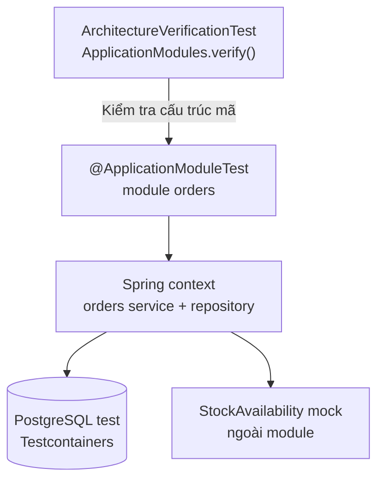
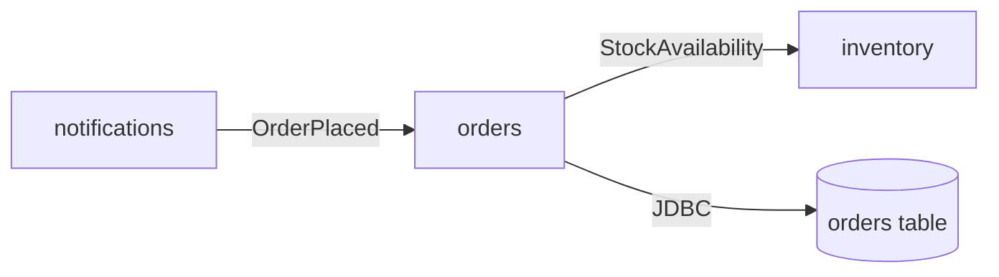
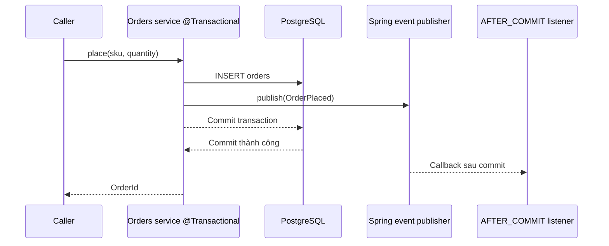
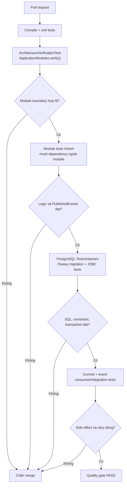

# Cấu hình database test và transaction

Kiểm thử ranh giới module bằng Spring Modulith không dừng ở câu hỏi “module nào được phép gọi module nào?”. Một application module có thể tuân thủ đúng `ApplicationModules.verify()` nhưng vẫn ghi sai dữ liệu, thiếu transaction, không chạy migration, hoặc phát sự kiện tại thời điểm không đúng. Ngược lại, một bài kiểm thử database chạy xanh không bảo đảm code không phụ thuộc vào package nội bộ của module khác.

Chương **Test configuration** của **SPRING_MODULITH_VERIFICATION_TESTING** kết hợp hai loại bảo đảm: **kiến trúc** bằng `ApplicationModules` và quy tắc phụ thuộc; **runtime** bằng `@ApplicationModuleTest`, kiểm thử repository, transaction, event và tích hợp. Bài này tập trung vào **cấu hình database dành riêng cho test**, cách hiểu commit/rollback, lựa chọn Testcontainers, cùng cách kiểm chứng sự kiện gắn với transaction trong quality gate CI.

Ví dụ xuyên suốt là module `orders` ghi đơn vào PostgreSQL bằng Spring JDBC. Module `orders` phụ thuộc interface `StockAvailability` của module `inventory`. Khi cần kiểm tra **persistence riêng của orders**, ta giữ database/repository của `orders` thật nhưng có thể mock cổng tồn kho của `inventory`. Khi cần kiểm tra **tích hợp orders–inventory**, ta mở rộng phạm vi bootstrap và dùng phần database tương ứng của cả hai module.

## 1. Mục tiêu học tập

Sau bài này, bạn có thể:

1. Phân biệt test logic với mock repository, test database của một module, và test tích hợp nhiều application module.
2. Chọn phạm vi `@ApplicationModuleTest` (`STANDALONE`, `DIRECT_DEPENDENCIES`, `ALL_DEPENDENCIES`) phù hợp với mục tiêu persistence.
3. Cấu hình PostgreSQL Testcontainers qua `@ServiceConnection` hoặc `@DynamicPropertySource` mà không hard-code URL/cổng.
4. Quản lý schema với Flyway/Liquibase và nạp/làm sạch dữ liệu test để chạy lặp lại.
5. Viết module test dùng **repository và transaction manager thật**, chỉ mock dependency ngoài phạm vi.
6. Hiểu sự khác nhau giữa transaction của **service `@Transactional`** và transaction của **test method `@Transactional`**.
7. Kiểm tra rollback khi phát sinh lỗi, lưu ý mặc định với runtime/checked exception và vấn đề self-invocation.
8. Kiểm thử `@TransactionalEventListener(phase = AFTER_COMMIT)` mà không suy luận sai từ test tự rollback.
9. Tránh test xanh giả do H2 thay PostgreSQL, mock quá rộng hoặc assertion chỉ kiểm tra context khởi động.
10. Đưa kiểm chứng module, database, transaction và event vào CI như những quality gate độc lập.

## 2. Ba phạm vi phải tách bạch

| Phạm vi | Câu hỏi | Công cụ phù hợp |
| --- | --- | --- |
| **Cấu trúc module** | `orders` có dùng API công khai của `inventory` không? Có cycle/vi phạm `allowedDependencies` không? | `ApplicationModules.of(...).verify()` |
| **Spring context của module test** | Những bean của application module nào thực sự được bootstrap? | `@ApplicationModuleTest` và bootstrap mode |
| **Database và transaction runtime** | Repository có ghi SQL đúng? Dữ liệu commit/rollback như dự kiến? | `DataSource`, JdbcTemplate/JPA, transaction manager, Testcontainers, assertions |

Ba phạm vi này không tự suy ra lẫn nhau. Có mock repository vẫn có thể kiểm tra logic service, nhưng **không kiểm tra database**. Có PostgreSQL thật vẫn có thể vi phạm kiến trúc Spring Modulith. Có `@ApplicationModuleTest` chỉ mở context cho `orders` cũng không có nghĩa tự khởi động mọi external dependency.



Sơ đồ thể hiện **hai nhóm phép kiểm tra bổ sung cho nhau**, không phải `verify()` tự gọi JUnit module test hoặc dựng database.

## 3. Mô hình ứng dụng và cấu trúc mã

Ví dụ sử dụng project Spring Boot với package gốc `com.acme.shop`:

```text
src/main/java/com/acme/shop/
├── ShopApplication.java
├── orders/
│   ├── OrderId.java
│   ├── OrderOperations.java
│   ├── events/
│   │   ├── OrderPlaced.java
│   │   └── package-info.java
│   └── internal/
│       ├── DefaultOrderOperations.java
│       └── JdbcOrderRepository.java
├── inventory/
│   ├── StockAvailability.java
│   └── internal/
│       └── JdbcStockAvailability.java
└── notifications/
    └── internal/
        └── OrderPlacedListener.java

src/main/resources/
├── application.yml
└── db/migration/
    └── V1__create_orders_table.sql

src/test/java/com/acme/shop/
├── ArchitectureVerificationTest.java
└── orders/
    ├── OrdersDatabaseModuleTest.java
    ├── OrdersDynamicDatabaseTest.java
    └── OrdersAfterCommitTest.java

src/test/resources/
└── application-integration.yml
```

Lớp ứng dụng:

```java
// src/main/java/com/acme/shop/ShopApplication.java
package com.acme.shop;

import org.springframework.boot.autoconfigure.SpringBootApplication;

@SpringBootApplication
public class ShopApplication {
}
```

Theo quy ước phát hiện mặc định, `orders`, `inventory` và `notifications` là application modules. Package `orders.internal` thuộc module `orders`; nó **không tự là module mới**.



Đường `orders → inventory` là phụ thuộc kiểu Java giữa module. Kết nối `orders → orders table` là quan hệ với hạ tầng dữ liệu. Hai đường này cần được kiểm thử bằng **hai cơ chế khác nhau**.

## 4. Đặt public API đúng ranh giới module

### 4.1. Cổng tồn kho thuộc inventory

```java
// src/main/java/com/acme/shop/inventory/StockAvailability.java
package com.acme.shop.inventory;

public interface StockAvailability {
    boolean available(String sku, int quantity);
}
```

Interface ở base package `inventory` là public API mặc định của application module đóng. Repository hoặc adapter `inventory.internal.JdbcStockAvailability` là **chi tiết triển khai**, `orders` không nên import trực tiếp.

### 4.2. API của orders

```java
// src/main/java/com/acme/shop/orders/OrderId.java
package com.acme.shop.orders;

import java.util.UUID;

public record OrderId(UUID value) {
}
```

```java
// src/main/java/com/acme/shop/orders/OrderOperations.java
package com.acme.shop.orders;

public interface OrderOperations {
    OrderId place(String sku, int quantity);
}
```

### 4.3. Sự kiện thuộc orders

```java
// src/main/java/com/acme/shop/orders/events/OrderPlaced.java
package com.acme.shop.orders.events;

import com.acme.shop.orders.OrderId;

public record OrderPlaced(
        OrderId orderId, String sku, int quantity
) {
}
```

Với consumer `notifications` cần import event type, ta khai báo named interface:

```java
// src/main/java/com/acme/shop/orders/events/package-info.java
@org.springframework.modulith.NamedInterface("events")
package com.acme.shop.orders.events;
```

**`@NamedInterface` chỉ công khai API của module, không thay đổi transaction, schema hoặc khả năng truy cập database.**

## 5. Migration: schema test phải có nguồn gốc rõ

Ví dụ dùng Flyway để tạo bảng lưu đơn:

```sql
-- src/main/resources/db/migration/V1__create_orders_table.sql
CREATE TABLE orders (
    id UUID PRIMARY KEY,
    sku VARCHAR(80) NOT NULL,
    quantity INTEGER NOT NULL CHECK (quantity > 0),
    created_at TIMESTAMPTZ NOT NULL
);
```

Trong trường hợp này, bảng `orders` thuộc trách nhiệm persistence của module `orders`. File migration ở `src/main/resources` là **schema được sử dụng bởi cả môi trường phù hợp và test**, không phải schema test tự bịa một hình dạng khác.

### Ba chiến lược tạo schema

| Chiến lược | Ưu điểm | Giới hạn |
| --- | --- | --- |
| **Flyway/Liquibase migration thật** | Phát hiện lỗi migration, schema gần production; phù hợp integration test | Cần quản lý version, dependency và môi trường chạy migration |
| Hibernate `ddl-auto=create-drop` | Nhanh khi thử nghiệm JPA đơn giản | Không chứng minh migration SQL thật đúng; có thể khác production |
| `schema.sql`/`@Sql` riêng cho test | Đơn giản cho mẫu học tập hoặc test rất hẹp | Nguy cơ schema test lệch schema triển khai |

Nếu mục tiêu là **bắt hồi quy schema/migration**, nên dùng cùng migration tool và script phù hợp với production. Với một dự án đã có Liquibase, không tự thêm Flyway chỉ để viết test minh họa.

### Cấu hình cho profile integration

```yaml
# src/test/resources/application-integration.yml
spring:
  flyway:
    enabled: true
  sql:
    init:
      mode: never
```

Config Data này được xét khi Spring Test context kích hoạt profile `integration`. `spring.sql.init.mode=never` giúp tránh vô tình chạy `schema.sql`/`data.sql` song song khi **Flyway chịu trách nhiệm schema**. Đây là cấu hình lựa chọn cho ví dụ, không phải bắt buộc với mọi dự án.

**Không hard-code `spring.datasource.url` trỏ production vào test resources.** Kết nối PostgreSQL test sẽ được cấp từ Testcontainers ở mục sau.

## 6. Repository thật của module orders

Mã production dùng `JdbcTemplate` để ghi đơn:

```java
// src/main/java/com/acme/shop/orders/internal/JdbcOrderRepository.java
package com.acme.shop.orders.internal;

import java.sql.Timestamp;
import java.time.Instant;
import java.util.UUID;
import org.springframework.jdbc.core.JdbcTemplate;
import org.springframework.stereotype.Repository;

@Repository
class JdbcOrderRepository {

    private final JdbcTemplate jdbc;

    JdbcOrderRepository(JdbcTemplate jdbc) {
        this.jdbc = jdbc;
    }

    void insert(UUID id, String sku, int quantity, Instant createdAt) {
        jdbc.update(
                "INSERT INTO orders (id, sku, quantity, created_at) " +
                "VALUES (?, ?, ?, ?)",
                id, sku, quantity, Timestamp.from(createdAt)
        );
    }
}
```

Repository được đặt trong `orders.internal` vì implementation persistence không phải một phần API mặc định mà module `inventory` hoặc `notifications` cần import.

`JdbcTemplate` thực thi SQL thông qua `DataSource` của Spring. Khi có transaction manager phù hợp và một transaction đang hoạt động, connection được dùng trong transaction đó để cùng commit hoặc rollback với các thao tác liên quan.

### Không fake repository nếu mục tiêu là database

```java
// Một test như thế này KHÔNG kiểm chứng SQL của JdbcOrderRepository.
@MockitoBean
JdbcOrderRepository repository;
```

Mock có thể trả dữ liệu đã được lập trình trước nhưng không thực hiện `INSERT`, không kiểm tra unique key và không chứng minh kết nối đến PostgreSQL. Có thể mock repository khi kiểm tra **logic thuần của service**, nhưng không khi câu hỏi là “dữ liệu đã được lưu thật chưa?”.

## 7. Service có ranh giới transaction rõ

```java
// src/main/java/com/acme/shop/orders/internal/DefaultOrderOperations.java
package com.acme.shop.orders.internal;

import com.acme.shop.inventory.StockAvailability;
import com.acme.shop.orders.OrderId;
import com.acme.shop.orders.OrderOperations;
import com.acme.shop.orders.events.OrderPlaced;
import java.time.Instant;
import java.util.UUID;
import org.springframework.context.ApplicationEventPublisher;
import org.springframework.stereotype.Service;
import org.springframework.transaction.annotation.Transactional;

@Service
class DefaultOrderOperations implements OrderOperations {

    private final JdbcOrderRepository repository;
    private final StockAvailability stock;
    private final ApplicationEventPublisher publisher;

    DefaultOrderOperations(
            JdbcOrderRepository repository,
            StockAvailability stock,
            ApplicationEventPublisher publisher
    ) {
        this.repository = repository;
        this.stock = stock;
        this.publisher = publisher;
    }

    @Override
    @Transactional
    public OrderId place(String sku, int quantity) {
        if (sku == null || sku.isBlank() || quantity <= 0) {
            throw new IllegalArgumentException("Đơn hàng không hợp lệ");
        }
        if (!stock.available(sku, quantity)) {
            throw new IllegalStateException("Không đủ tồn kho");
        }

        UUID id = UUID.randomUUID();
        repository.insert(id, sku, quantity, Instant.now());
        publisher.publishEvent(new OrderPlaced(
                new OrderId(id), sku, quantity));

        return new OrderId(id);
    }
}
```

Đây là code production rút gọn để minh họa **transaction khi ghi database và publish sự kiện**. `@Transactional` đặt ở method public được gọi qua Spring-managed bean/proxy. Trong cấu hình bình thường, Spring transaction interceptor mở hoặc tham gia một transaction trước khi chạy logic.

**Quan trọng:** `publisher.publishEvent(...)` được gọi **khi method đang ở trong transaction**; điều đó không có nghĩa mọi listener đã chạy hoặc event đã được giao an toàn sang hệ thống khác. Listener `AFTER_COMMIT` chỉ thực hiện khi transaction thực sự commit; listener đồng bộ thông thường có thể được gọi ngay trong transaction.

### Phân biệt việc “đã publish” và “đã commit”



Sơ đồ thể hiện **ý nghĩa logic của transaction và after-commit**. Thứ tự callback cụ thể với proxy, event dispatch, listener async và event publication registry còn phụ thuộc cấu hình. Không coi sơ đồ là bảo đảm về thời gian hoàn tất của một listener bất đồng bộ.

## 8. Chọn bootstrap mode của @ApplicationModuleTest

Khi class test đặt tại `com.acme.shop.orders`:

| Mode | Phạm vi bootstrap | Cách xử lý `StockAvailability` |
| --- | --- | --- |
| `STANDALONE` (mặc định) | Bean thuộc `orders` | Mock/fake interface `StockAvailability`, **giữ repository orders thật** |
| `DIRECT_DEPENDENCIES` | `orders` và module phụ thuộc trực tiếp như `inventory` | Có thể dùng implementation inventory thật; cần database/schema/fixture tương ứng |
| `ALL_DEPENDENCIES` | `orders` cùng cây module phụ thuộc | Phạm vi rộng hơn, có thể kéo thêm broker, client, repository |

**Chọn mode theo yêu cầu test**, không phải theo số bean thiếu. Nếu chỉ muốn kiểm tra `JdbcOrderRepository`, không cần boot cả `inventory`. Khi muốn chứng minh `orders` phối hợp với inventory database thật, cần một test riêng không mock đường tích hợp đó.

### @ApplicationModuleTest có tự tạo PostgreSQL không?

**Không.** Annotation chọn Spring module và khởi tạo Spring Test context. Database cần được cấp bởi cấu hình test: có thể là một database nhúng, một service CI, hoặc PostgreSQL Testcontainers. Nếu JDBC/JPA configuration yêu cầu `DataSource` nhưng không có URL/driver hợp lệ, context có thể fail.

Trong bài này dùng **PostgreSQL Testcontainers** để tránh khác biệt dialect và constraint giữa H2 với PostgreSQL production.

## 9. Cấu hình PostgreSQL bằng @ServiceConnection

Từ những dòng Spring Boot hỗ trợ tích hợp Testcontainers service connection, có thể gắn `@ServiceConnection` lên một `PostgreSQLContainer<?>`:

```java
@Testcontainers
@ApplicationModuleTest
@ActiveProfiles("integration")
class OrdersDatabaseModuleTest {

    @Container
    @ServiceConnection
    static PostgreSQLContainer<?> postgres =
            new PostgreSQLContainer<>("postgres:16-alpine");

    // Inject test dependencies và viết các method @Test.
}
```

Các annotation ở ví dụ:

```java
import org.junit.jupiter.api.Test;
import org.springframework.boot.testcontainers.service.connection.ServiceConnection;
import org.springframework.modulith.test.ApplicationModuleTest;
import org.springframework.test.context.ActiveProfiles;
import org.testcontainers.containers.PostgreSQLContainer;
import org.testcontainers.junit.jupiter.Container;
import org.testcontainers.junit.jupiter.Testcontainers;
```

`@ServiceConnection` cho phép Spring Boot tạo **`ConnectionDetails`** thích hợp từ container mà nó nhận diện. Auto-configuration có thể dùng thông tin đó thay vì yêu cầu tự truyền `spring.datasource.url`.

### Điều kiện trước khi sử dụng

- Dự án phải có Spring Boot version hỗ trợ `@ServiceConnection` (được giới thiệu trong dòng Boot 3.1) và dependency `spring-boot-testcontainers` phù hợp.
- Có PostgreSQL JDBC driver và Testcontainers modules cho PostgreSQL/JUnit Jupiter.
- Có Spring JDBC hoặc Spring Data/JPA starter theo repository thực tế.
- Docker/container runtime có sẵn trên máy chạy test và CI.
- Flyway hoặc Liquibase đã được cấu hình phù hợp; database mới cần nhận schema trước khi test truy vấn.

**Không cần đồng thời gắn `@ServiceConnection` và `@DynamicPropertySource` để cấp cùng một kết nối**, trừ khi biết rõ lý do và thứ tự ưu tiên. Khi có `ConnectionDetails`, đừng chỉ nhìn `Environment.getProperty("spring.datasource.url")` rồi kết luận đó chắc chắn là endpoint được dùng.

## 10. Bài kiểm thử hoàn chỉnh: ghi orders thật

Ví dụ tiếp theo dùng `@ServiceConnection`; khi chạy với project đã cấu hình dependency/migration như trên, Spring Boot tạo `DataSource`, `JdbcTemplate` và transaction manager phù hợp. `@MockitoBean` tạo mock cho cổng `inventory` vốn không được nạp trong `STANDALONE`.

```java
// src/test/java/com/acme/shop/orders/OrdersDatabaseModuleTest.java
package com.acme.shop.orders;

import com.acme.shop.inventory.StockAvailability;
import com.acme.shop.orders.events.OrderPlaced;
import java.sql.Timestamp;
import java.time.Instant;
import java.util.UUID;
import org.junit.jupiter.api.BeforeEach;
import org.junit.jupiter.api.Test;
import org.springframework.beans.factory.annotation.Autowired;
import org.springframework.boot.testcontainers.service.connection.ServiceConnection;
import org.springframework.dao.DataIntegrityViolationException;
import org.springframework.jdbc.core.JdbcTemplate;
import org.springframework.modulith.test.ApplicationModuleTest;
import org.springframework.modulith.test.PublishedEvents;
import org.springframework.test.context.ActiveProfiles;
import org.springframework.test.context.bean.override.mockito.MockitoBean;
import org.springframework.transaction.PlatformTransactionManager;
import org.springframework.transaction.support.TransactionTemplate;
import org.testcontainers.containers.PostgreSQLContainer;
import org.testcontainers.junit.jupiter.Container;
import org.testcontainers.junit.jupiter.Testcontainers;

import static org.assertj.core.api.Assertions.assertThat;
import static org.assertj.core.api.Assertions.assertThatThrownBy;
import static org.mockito.Mockito.when;

@Testcontainers
@ApplicationModuleTest
@ActiveProfiles("integration")
class OrdersDatabaseModuleTest {

    @Container
    @ServiceConnection
    static PostgreSQLContainer<?> postgres =
            new PostgreSQLContainer<>("postgres:16-alpine");

    @Autowired
    OrderOperations orders;

    @Autowired
    JdbcTemplate jdbc;

    @Autowired
    PlatformTransactionManager transactionManager;

    @MockitoBean
    StockAvailability stock;

    @BeforeEach
    void clearOrders() {
        jdbc.update("DELETE FROM orders");
    }

    @Test
    void persistsARealRowAndPublishesAnEvent(
            PublishedEvents events) {
        when(stock.available("SKU-42", 2)).thenReturn(true);

        OrderId id = orders.place("SKU-42", 2);

        Integer quantity = jdbc.queryForObject(
                "SELECT quantity FROM orders WHERE id = ?",
                Integer.class, id.value()
        );

        assertThat(quantity).isEqualTo(2);
        assertThat(events.ofType(OrderPlaced.class)
                .matching(OrderPlaced::orderId, id)).hasSize(1);
    }

    @Test
    void doesNotPersistWhenStockIsUnavailable(
            PublishedEvents events) {
        when(stock.available("SKU-42", 8)).thenReturn(false);

        assertThatThrownBy(() -> orders.place("SKU-42", 8))
                .isInstanceOf(IllegalStateException.class);

        Long rows = jdbc.queryForObject(
                "SELECT COUNT(*) FROM orders",
                Long.class
        );

        assertThat(rows).isZero();
        assertThat(events.ofType(OrderPlaced.class)).isEmpty();
    }

    @Test
    void databaseConstraintFailureRollsBackWholeTransaction() {
        UUID duplicateId = UUID.randomUUID();
        TransactionTemplate tx =
                new TransactionTemplate(transactionManager);

        assertThatThrownBy(() -> tx.executeWithoutResult(status -> {
            jdbc.update(
                    "INSERT INTO orders (id, sku, quantity, created_at) " +
                    "VALUES (?, ?, ?, ?)",
                    duplicateId, "SKU-42", 1,
                    Timestamp.from(Instant.now())
            );
            jdbc.update(
                    "INSERT INTO orders (id, sku, quantity, created_at) " +
                    "VALUES (?, ?, ?, ?)",
                    duplicateId, "SKU-42", 1,
                    Timestamp.from(Instant.now())
            );
        })).isInstanceOf(DataIntegrityViolationException.class);

        Long rows = jdbc.queryForObject(
                "SELECT COUNT(*) FROM orders WHERE id = ?",
                Long.class, duplicateId
        );
        assertThat(rows).isZero();
    }
}
```

### Test này xác nhận những gì?

1. `OrdersDatabaseModuleTest` boot **module `orders`** và dùng `StockAvailability` mock để không kéo triển khai của `inventory` vào context.
2. `JdbcOrderRepository` của `orders` vẫn là **bean thật**, kết nối PostgreSQL qua `JdbcTemplate`.
3. Flyway tạo bảng theo migration; test không tự thay repository bằng Mockito.
4. Method thành công assert trực tiếp **hàng trong bảng orders**, không chỉ assert `OrderId` trả về.
5. `PublishedEvents` kiểm tra phía producer có publish `OrderPlaced`.
6. Method không đủ tồn kho kiểm tra **không ghi hàng** và **không publish event**.
7. Method constraint tạo **hai insert trùng khóa** trong cùng `TransactionTemplate`. PostgreSQL báo lỗi ở insert thứ hai; transaction rollback, nên insert thứ nhất cũng không còn.

### Giới hạn của bài test

- Phép kiểm tra `TransactionTemplate` xác nhận **JDBC và transaction manager có thể rollback cả nhóm thao tác**, chưa thay cho bài test mọi nhánh rollback của service production.
- Bài test dùng mock tồn kho, nên chưa kiểm tra SQL của `inventory`.
- `PublishedEvents` xác nhận publication; chưa bảo đảm consumer của `notifications` xử lý event, đặc biệt nếu listener chạy bất đồng bộ hoặc sau commit.
- Không có test kiểm tra contention/concurrency hay mức isolation production ở đây.
- Mỗi test dùng `@BeforeEach DELETE FROM orders`. Mẫu này phù hợp với database test được cô lập; khi suite chạy song song trên cùng database/schema, cần chiến lược isolation tốt hơn.

## 11. Thay thế bằng @DynamicPropertySource

Nếu dự án chưa dùng `@ServiceConnection` hoặc cần cấp những property custom, ta có thể lấy thông tin runtime từ container qua `@DynamicPropertySource`:

```java
// Ví dụ lựa chọn KHÁC, không gắn @ServiceConnection cùng lúc.
@Testcontainers
@ApplicationModuleTest
@ActiveProfiles("integration")
class OrdersDynamicDatabaseTest {

    @Container
    static PostgreSQLContainer<?> postgres =
            new PostgreSQLContainer<>("postgres:16-alpine");

    @DynamicPropertySource
    static void datasourceProperties(DynamicPropertyRegistry registry) {
        registry.add("spring.datasource.url", postgres::getJdbcUrl);
        registry.add("spring.datasource.username", postgres::getUsername);
        registry.add("spring.datasource.password", postgres::getPassword);
    }

    // Các bean thật và assertions JDBC tương tự OrdersDatabaseModuleTest.
}
```

Những import thêm trong project:

```java
import org.springframework.test.context.DynamicPropertyRegistry;
import org.springframework.test.context.DynamicPropertySource;
```

### Vì sao phải truyền Supplier?

`registry.add("spring.datasource.url", postgres::getJdbcUrl)` đăng ký supplier để Spring **lấy giá trị khi resolve property**. Trái lại, cách viết `registry.add("spring.datasource.url", postgres.getJdbcUrl())` không đúng chữ ký API vì tham số cần Supplier chứ không phải String.

Lợi ích:

- Không hard-code cổng 5432 ngoài host; Testcontainers có thể gán mapped port động.
- Cấu hình chạy được trên laptop/CI có container runtime, bất kể cổng trống cụ thể.
- Có thể đăng ký URL mock HTTP server, Redis/Kafka broker, port dịch vụ test khác.

**Supplier không tự khởi động container.** Khi `DataSource` resolve JDBC URL, container phải sẵn sàng. Phải phối hợp lifecycle `@Testcontainers`/`@Container` và Spring TestContext.

### @ServiceConnection hay @DynamicPropertySource?

| Tiêu chí | `@ServiceConnection` | `@DynamicPropertySource` |
| --- | --- | --- |
| Cơ chế | Tạo `ConnectionDetails` từ container được hỗ trợ | Đăng ký Supplier vào Spring `Environment` |
| Cần biết property key? | Thường không cho loại kết nối được hỗ trợ | **Có** |
| Phù hợp PostgreSQL | Có khi version/dependency tương thích | Có |
| Phù hợp custom endpoint `shop.payment.base-url` | Chỉ khi có integration/service connection phù hợp | **Linh hoạt, trực tiếp** |
| Lỗi thường gặp | Thiếu `spring-boot-testcontainers` hoặc unsupported container | Sai key, resolve URL quá sớm, cache stale |

**Chọn một chiến lược nhất quán cho mỗi kết nối**, và kiểm tra dữ liệu `DataSource` đang sử dụng thực tế nếu có nhiều bean hoặc nhiều nguồn cấu hình.

## 12. H2 có thay được PostgreSQL không?

H2 thường giúp test khởi động nhanh, nhưng không đồng nhất với PostgreSQL. Đặc biệt với các tính năng như:

- Kiểu `UUID`, `JSONB`, `TIMESTAMPTZ`, arrays, enums hoặc functions của PostgreSQL.
- Locking/`SELECT ... FOR UPDATE` và các mức isolation.
- Unique/foreign key/partial index, constraint expression.
- Collation, case sensitivity, SQL dialect và timezone.
- Migration DDL có cú pháp hoặc behavior PostgreSQL đặc thù.

| Lựa chọn | Khi phù hợp | Không nên dùng để kết luận |
| --- | --- | --- |
| Mockito repository | Test logic/hành vi thuần không cần SQL | Query, constraint, transaction đều đúng |
| H2 in-memory | Test nhỏ, schema và SQL độc lập dialect | Mọi thứ giống PostgreSQL production |
| PostgreSQL Testcontainers | Test repository, migration, transaction gần production | Tương đương hoàn toàn production về tải/replication |
| Database test dùng chung trên CI | Test legacy/cần tài nguyên đặc biệt có quản lý | Không có interference giữa các job nếu chia sẻ schema |

**Nếu mục tiêu là bắt lỗi của PostgreSQL, ưu tiên dùng PostgreSQL ở integration test bắt buộc.** H2 có thể là một lớp test nhanh bổ sung, không nên là bằng chứng duy nhất.

## 13. Transaction ở service khác transaction của test method

Đây là phần rất dễ gây sai trong kiểm thử Spring:

```java
// Transaction của NGHIỆP VỤ: chạy khi gọi qua Spring proxy.
@Transactional
public OrderId place(String sku, int quantity) {
    // INSERT, publish event, ...
}
```

so với:

```java
// Transaction của TEST: do Spring TestContext quản lý.
@Test
@Transactional
void shouldPersistOrder() {
    // Gọi service, assert, sau đó test transaction thường rollback.
}
```

Hai annotation giống tên nhưng phạm vi khác nhau:

| Điểm so sánh | Transaction service | Transaction test method |
| --- | --- | --- |
| Ai quản lý? | Spring transaction interceptor trên bean/proxy | Spring TestContext `TransactionalTestExecutionListener` |
| Khi nào bắt đầu? | Khi gọi method `@Transactional` qua proxy phù hợp | Trước test method (bao gồm những callback phù hợp như `@BeforeEach`) |
| Mặc định kết thúc? | Commit nếu thành công; rollback khi rule rollback áp dụng | **Rollback sau test** theo mặc định |
| Service với propagation `REQUIRED` | Có thể mở transaction mới | Thường **join transaction đang có của test** |
| Event listener `AFTER_COMMIT` | Có thể chạy sau commit thật | Thường **không chạy** nếu test rollback |
| Giá trị sử dụng | Kiểm tra nghiệp vụ transaction thật | Giúp cô lập dữ liệu cho test, nhưng phải hiểu giới hạn |

### Bẫy “service commit rồi, nhưng test lại rollback”

Giả sử test method có `@Transactional` và gọi `orders.place(...)`. Với propagation `REQUIRED` thông thường, transaction của service **tham gia transaction do test đã mở**, không tự commit vật lý khi service return. Khi test kết thúc, `TransactionalTestExecutionListener` thường rollback toàn bộ.

Vì vậy:

- Trong method test, một truy vấn trên cùng transaction vẫn **đọc được hàng vừa insert**.
- Nhưng điều đó không chứng minh hàng đã **commit** ra database.
- Listener `@TransactionalEventListener(phase = AFTER_COMMIT)` có thể **không được gọi** nếu transaction test rollback.

**Không dùng “assert SELECT thấy row trong cùng test transaction” làm bằng chứng duy nhất rằng production commit đúng.**

## 14. @Rollback, @Commit và TestTransaction

Spring Test hỗ trợ các cơ chế điều khiển kết thúc transaction:

```java
import org.springframework.test.annotation.Commit;
import org.springframework.test.annotation.Rollback;
import org.springframework.test.context.transaction.TestTransaction;
```

### Rollback theo mặc định

```java
@Test
@Transactional
void readsUncommittedDataInsideTest() {
    // Test transaction thường rollback sau method.
}
```

### Cố ý commit khi cần kiểm tra after-commit

```java
@Test
@Transactional
@Commit
void commitsAfterTestMethod() {
    // Test transaction sẽ được commit khi hoàn tất method,
    // nếu không có lỗi hoặc yếu tố khác làm rollback.
}
```

`@Commit` tương đương về ý định với `@Rollback(false)`. Tuy nhiên, nếu chỉ dùng `@Commit` rồi assert **trong chính test method**, thời điểm assert có thể vẫn **trước khi transaction commit**. Vì vậy không nên nghĩ annotation `@Commit` tự khiến listener `AFTER_COMMIT` chạy trước mọi assertion trong method.

### Kết thúc transaction ngay trong test

```java
@Test
@Transactional
void commitsBeforeCheckingAfterCommitEffects() {
    // Gọi service và thực hiện dữ liệu test.

    TestTransaction.flagForCommit();
    TestTransaction.end();

    // Tại đây transaction test vừa kết thúc bằng commit.
    // Kiểm tra side effects sau commit tại đây.
    // Khi cần transaction test mới:
    // TestTransaction.start();
}
```

**Đây là mảnh minh họa**, phải đặt trong test class có transaction manager và tình huống business cụ thể. `TestTransaction` chỉ hoạt động khi Spring TestContext đang quản lý một test transaction. `TestTransaction.end()` có thể làm commit thật, nên cần dọn dữ liệu và tránh thao tác trên database production.

### Khi nào nên tránh @Transactional ở test?

Nếu mục tiêu là kiểm tra **service thực hiện commit thành công và listener sau commit**, phương án thường đơn giản nhất là **không đặt `@Transactional` lên test method**. Hãy gọi bean `@Transactional` thật để service tự mở/commit transaction; sau khi method return, kiểm tra dữ liệu đã commit hoặc side effect thích hợp.

Đừng dùng `@Rollback(false)` chỉ để “khiến test xanh” nếu bạn chưa rõ hậu quả lên dữ liệu chung giữa test classes.

## 15. Rollback khi có exception

Theo mặc định phổ biến của Spring transaction, một unchecked exception (`RuntimeException`) hoặc `Error` làm transaction rollback; checked exception không mặc nhiên rollback nếu không có rule riêng. Tùy phiên bản/configuration, ứng dụng có thể thiết lập rollback rules toàn cục khác.

Ví dụ:

```java
@Transactional
public void applyChange() {
    repository.insert(...);
    throw new IllegalStateException("Nghiệp vụ thất bại");
}
```

Đoạn là **pseudocode minh họa**; dấu `...` không phải Java có thể biên dịch trực tiếp. Với unchecked exception như `IllegalStateException`, một transaction được interceptor quản lý thường rollback.

Với checked exception theo quy tắc truyền thống:

```java
@Transactional(rollbackFor = IOException.class)
public void importFile() throws IOException {
    // Nhiều thao tác repository, có thể ném IOException.
}
```

Nếu không khai báo `rollbackFor` (hoặc không có chính sách rollback toàn cục phù hợp), checked exception có thể dẫn tới commit thay vì rollback.

### Lỗi phổ biến: nuốt exception

```java
@Transactional
public void createOrder() {
    try {
        doDatabaseWork();
    } catch (Exception ex) {
        log.warn("Bỏ qua lỗi", ex);
    }
}
```

Đây là pseudocode. Khi exception bị bắt rồi method return “thành công”, transaction interceptor có thể **không biết nghiệp vụ đã lỗi**; transaction có thể commit nếu tài nguyên chưa ở trạng thái rollback-only. Nếu muốn rollback, phải truyền lỗi theo đúng contract hoặc đánh dấu rollback phù hợp.

### Lỗi self-invocation

```java
@Service
class OrderService {

    void outer() {
        inner();  // Lời gọi trong cùng object có thể bỏ qua proxy.
    }

    @Transactional
    public void inner() {
        // ...
    }
}
```

Trong chế độ Spring proxy AOP thông thường, gọi `this.inner()` từ cùng object **không đi qua proxy**, nên transaction advice có thể không chạy như mong đợi. Không dùng test có mock repository để kết luận transaction đã hoạt động. Cần test với bean/proxy và database thật hoặc tái cấu trúc ranh giới service.

## 16. Kiểm thử sự kiện khi transaction commit

Ví dụ production `DefaultOrderOperations` publish `OrderPlaced` bên trong `@Transactional`. Để chạy một callback sau commit, Spring hỗ trợ:

```java
@TransactionalEventListener(phase = TransactionPhase.AFTER_COMMIT)
public void on(OrderPlaced event) {
    // Chỉ xử lý theo phase sau commit nếu event được publish trong transaction.
}
```

Các import:

```java
import org.springframework.transaction.event.TransactionPhase;
import org.springframework.transaction.event.TransactionalEventListener;
```

**Phân biệt:**

- `PublishedEvents` giúp xác nhận **producer đã publish** event vào Spring context trong test.
- `@TransactionalEventListener(AFTER_COMMIT)` xác nhận **callback thuộc phase sau commit** khi event được publish trong transaction thực sự commit.
- Nếu listener thực hiện tác vụ async, dùng công cụ chờ hoặc `Scenario` thích hợp; không suy ra hoàn tất ngay khi `orders.place(...)` return.

### Test-only probe để quan sát sau commit

Một cách học dễ hiểu là tạo bean test ghi lại những ID đã tới callback:

```java
// Mảnh ghép bên trong OrdersAfterCommitTest.
@TestConfiguration(proxyBeanMethods = false)
static class ProbeConfiguration {

    @Bean
    AfterCommitProbe afterCommitProbe() {
        return new AfterCommitProbe();
    }
}

static class AfterCommitProbe {

    private final List<UUID> committedIds =
            new CopyOnWriteArrayList<>();

    @TransactionalEventListener(phase = TransactionPhase.AFTER_COMMIT)
    public void on(OrderPlaced event) {
        committedIds.add(event.orderId().value());
    }

    void reset() {
        committedIds.clear();
    }
}
```

Đoạn trên cần `@TestConfiguration`, `@Bean`, `OrderPlaced`, `UUID`, `List`, `CopyOnWriteArrayList` và import event transaction tương ứng. `AfterCommitProbe` ở đây là **bean test**, không phải một consumer production.

Một test không có transaction test bao ngoài:

```java
@Autowired
OrderOperations orders;

@Autowired
AfterCommitProbe probe;

@MockitoBean
StockAvailability stock;

@BeforeEach
void resetProbe() {
    probe.reset();
}

@Test
void notifiesProbeAfterServiceCommits() {
    when(stock.available("SKU-42", 2)).thenReturn(true);

    OrderId id = orders.place("SKU-42", 2);

    assertThat(probe.committedIds).contains(id.value());
}
```

Đây là các field/method bổ sung cho **một class `@ApplicationModuleTest` có `ProbeConfiguration`**, không phải một class biên dịch độc lập. Mẫu giả định listener test xử lý **đồng bộ sau commit**. Nếu event infrastructure cấu hình listener async, phải chờ đúng điều kiện thay vì assert tức thì.

**Chủ đích không đặt `@Transactional` lên test method**: service sẽ mở/commit transaction của nó khi được gọi qua Spring proxy. Nếu test method tự mở một transaction rồi rollback, `AFTER_COMMIT` thường không chạy trong kịch bản này.

### Khi AFTER_COMMIT listener ghi database

Một chi tiết quan trọng của Spring transaction: sau callback `AFTER_COMMIT`, tài nguyên transaction có thể vẫn còn gắn với thread trong thời gian ngắn, nhưng **không còn commit mới cho giao dịch đã kết thúc**. Nếu listener phải ghi dữ liệu mới, có thể cần một transaction riêng, ví dụ đặt logic ghi vào bean khác có `@Transactional(propagation = REQUIRES_NEW)` được gọi qua proxy.

Không suy từ “listener đã được gọi” rằng một `INSERT` bên trong callback chắc chắn đã commit. Cần **assert dữ liệu được persist thật** trong integration test.

## 17. @Sql, dữ liệu seed và cleanup

`@Sql` của Spring Test hỗ trợ chạy script trước/sau test method:

```java
@Sql(
    scripts = "/sql/orders-seed.sql",
    executionPhase = Sql.ExecutionPhase.BEFORE_TEST_METHOD
)
@Test
void queriesSeededOrders() {
    // Query repository thật.
}
```

File `orders-seed.sql` phải có trên test classpath, thường ở `src/test/resources/sql/orders-seed.sql`. Ví dụ:

```sql
INSERT INTO orders (id, sku, quantity, created_at)
VALUES (
    '00000000-0000-0000-0000-000000000001',
    'SKU-SEED',
    2,
    '2026-01-01T00:00:00Z'
);
```

**Cảnh báo:** `@Sql` tuân thủ chiến lược transaction của Spring Test và `@SqlConfig`. Nếu bạn chạy script trong test transaction vốn rollback thì seed cũng có thể bị rollback. Nếu muốn seed dữ liệu **được commit độc lập** với transaction của test, xem `@SqlConfig(transactionMode = ISOLATED)`; việc đó thay đổi isolation/cleanup và phải dùng có chủ đích.

### Những lựa chọn fixture phổ biến

| Cách seed | Phù hợp | Cần lưu ý |
| --- | --- | --- |
| `@BeforeEach` + `JdbcTemplate` | Ít dữ liệu, muốn nhìn rõ setup | Khi test được `@Transactional` bọc, callback có thể cùng transaction |
| `@Sql` từ file | Dữ liệu mẫu lớn hơn, SQL rõ | Location, thứ tự chạy và `@SqlConfig` transaction mode |
| Repository factory/test fixture | Kịch bản domain nhiều bản ghi | Không che SQL thực hoặc business rule trong setup |
| Migration + dữ liệu seed có phiên bản | Schema/test dataset được chuẩn hóa | Không nhúng dữ liệu nhạy cảm, tránh phụ thuộc thứ tự test |
| Container mới/schema riêng mỗi nhóm test | Cô lập tốt | Tốn chi phí bootstrap nếu dùng không hợp lý |

**Đừng dùng dữ liệu production thật để seed**. Hãy tạo fixture giả lập, deterministic, có cleanup và không chứa secrets hoặc thông tin cá nhân.

## 18. Test database cô lập và chạy song song

Một PostgreSQL container có thể phục vụ nhiều test class. Spring TestContext cũng cache `ApplicationContext`. Điều này tốt cho hiệu năng nhưng có những bẫy:

- Test A tạo hàng và không xóa; test B giả định bảng rỗng.
- Hai test cùng dùng `DELETE FROM orders` và chạy song song, xóa dữ liệu của nhau.
- Một container `@Container static` bị dừng khi test class kết thúc, trong khi `ApplicationContext` còn được cache cho test class khác.
- Mỗi container có mapped port khác nhau nhưng cache context vẫn dùng `DataSource` trỏ endpoint cũ.
- Một test dùng `@DirtiesContext` tùy tiện khiến bootstrap database lặp lại nhiều lần.

### Các mức cô lập có thể chọn

1. **Rollback transaction test** khi chỉ muốn đọc/ghi tạm và **không** kiểm chứng commit hoặc listener sau commit.
2. **Cleanup có kiểm soát** (`@Sql`, `@BeforeEach`, truncate) cho test cần commit thật và database test riêng.
3. **Schema/database riêng** cho từng class hoặc nhóm test khi chạy song song.
4. **Container ổn định theo suite** hoặc cơ chế lifecycle phù hợp với cache, tránh endpoint đã dừng.
5. **Test fixtures có ID riêng** để giảm va chạm, nhưng vẫn cần cleanup và constraint assertions.

Không có một chiến lược áp dụng tốt nhất cho mọi dự án. Hãy cân bằng tốc độ, tính cô lập và loại transaction behavior đang cần bảo vệ.

## 19. @DataJpaTest, @DataJdbcTest hay @ApplicationModuleTest?

Spring Boot cung cấp nhiều test slices, nhưng chúng **không đồng nghĩa** với kiểm thử ranh giới Spring Modulith:

| Annotation | Phạm vi tiêu biểu | Thích hợp nhất |
| --- | --- | --- |
| `@DataJpaTest` | JPA entities, repositories và phần infrastructure JPA cần thiết | Test mapping, JPQL, repository JPA |
| `@DataJdbcTest` | Spring Data JDBC và các thành phần liên quan | Test repository Spring Data JDBC |
| `@JdbcTest` | JDBC-related components và test infrastructure hẹp | Test JDBC DAO/SQL |
| `@ApplicationModuleTest` | Spring context của application module theo mode | Test use case + repository + event trong ranh giới module |
| `@SpringBootTest` | Ứng dụng rộng hơn/full Spring Boot context | Integration các module và auto-config cần chạy cùng nhau |

Các test slices có thể **mặc định dùng transaction rollback** hoặc **thay DataSource bằng embedded database** tùy annotation/dependencies và cấu hình. Nếu muốn PostgreSQL thật, hãy kiểm tra `@AutoConfigureTestDatabase(replace = NONE)`, `@ServiceConnection` và phiên bản Boot đang dùng, thay vì mặc định tin rằng slice kết nối đúng Testcontainers.

### Lựa chọn cho project Spring Modulith

- Repository query phức tạp: có thể dùng `@DataJpaTest`/`@JdbcTest` làm phép kiểm tra chi tiết.
- Logic một module phải gọi repository và publish event: dùng `@ApplicationModuleTest`.
- Luồng nhiều module có transaction hoặc tích hợp hệ ngoài: test với phạm vi module/dependencies rộng hơn hoặc `@SpringBootTest` theo mục tiêu.
- Kiến trúc module không bị lặp phụ thuộc: luôn có một test `ApplicationModules.verify()` độc lập.

**Đừng dùng test slice của Spring Data làm bằng chứng rằng Spring Modulith đã kiểm chứng ranh giới module.**

## 20. Event publication registry và transaction

Spring Modulith có hạ tầng **event publication registry** giúp theo dõi việc publish event cho listener phù hợp, hỗ trợ những nhu cầu như phát hiện publication chưa hoàn tất và resubmission tùy cấu hình.

Khi dự án dùng thêm module/starter persistence cho event publication, cần xem xét:

- Những bảng registry có được tạo đúng migration/script không.
- Listener được gọi trong transaction, sau commit hay async.
- Event được đánh dấu hoàn tất vào thời điểm nào.
- Transaction ghi order và dữ liệu publication có bảo đảm phù hợp không.
- Điều gì xảy ra nếu consumer lỗi sau khi order đã commit.
- Cơ chế retry/idempotency và việc xử lý event trùng.

**Không mặc định** rằng `publisher.publishEvent(...)` đồng nghĩa message đã được giao tới Kafka hoặc email đã được gửi. `PublishedEvents` kiểm chứng sự kiện được phát tại producer; event registry và consumer cần các bài kiểm thử tích hợp riêng.

### Vấn đề nhất quán dữ liệu và event

Một thiết kế có thể yêu cầu: **order commit thành công thì event có thể được xử lý lại an toàn**, còn order rollback thì consumer không nhận một “đơn đã đặt” chưa tồn tại. Bài test đúng mức cần bao gồm:

1. Kiểm tra order record được commit khi use case thành công.
2. Kiểm tra rollback khi DB/business failure.
3. Kiểm tra listener sau commit hoặc publication registry phù hợp.
4. Kiểm tra consumer idempotency/retry khi có lỗi xử lý.

Mock repository hay event publisher ở bài test này sẽ bỏ qua đúng rủi ro mà ta muốn bảo vệ.

## 21. Kiểm chứng kiến trúc độc lập với DataSource

Một ứng dụng có thể dùng PostgreSQL hoàn hảo nhưng vẫn sai module boundary. Ví dụ `orders` import `inventory.internal.JdbcStockAvailability` chỉ vì class đó có modifier `public` – theo mô hình module đóng của Spring Modulith, đây vẫn là phụ thuộc vào **API nội bộ**.

Khai báo giới hạn dependency ở module `orders`:

```java
// src/main/java/com/acme/shop/orders/package-info.java
@org.springframework.modulith.ApplicationModule(
        allowedDependencies = "inventory"
)
package com.acme.shop.orders;
```

Một bài JUnit xác minh:

```java
// src/test/java/com/acme/shop/ArchitectureVerificationTest.java
package com.acme.shop;

import org.junit.jupiter.api.Test;
import org.springframework.modulith.core.ApplicationModules;

import static org.junit.jupiter.api.Assertions.assertTrue;

class ArchitectureVerificationTest {

    @Test
    void expectedModulesExist() {
        ApplicationModules modules =
                ApplicationModules.of(ShopApplication.class);

        assertTrue(modules.getModuleByName("orders").isPresent());
        assertTrue(modules.getModuleByName("inventory").isPresent());
        assertTrue(modules.getModuleByName("notifications").isPresent());
    }

    @Test
    void architectureIsValid() {
        ApplicationModules.of(ShopApplication.class).verify();
    }
}
```

`verify()` kiểm tra các quy tắc cấu trúc cốt lõi:

1. Không có phụ thuộc vòng giữa các application module.
2. Không dùng kiểu nội bộ của module khác trong mô hình module đóng.
3. Không vượt `allowedDependencies` đã khai báo.

Bài test này **không cần Docker**, không cần `DataSource` hay transaction manager. Giữ nó độc lập giúp CI phát hiện lỗi kiến trúc sớm và dễ quy trách nhiệm.

## 22. Chẩn đoán lỗi database và transaction

| Triệu chứng | Nguyên nhân thường gặp | Cách điều tra/xử lý |
| --- | --- | --- |
| `Failed to configure a DataSource` | Thiếu driver, URL hoặc connection details | Kiểm tra JDBC starter/driver, container và config |
| `Connection refused` | Container chưa start, cổng cũ, context cache stale | Xem `@Container` lifecycle, mapped port, cache |
| `relation "orders" does not exist` | Migration không chạy hoặc test trỏ sai DB/schema | Kiểm tra Flyway history, datasource và search path |
| SQL chạy trên H2 nhưng fail PostgreSQL | Khác SQL dialect/type/constraint | Chạy integration test bằng PostgreSQL |
| `@ApplicationModuleTest` thiếu bean inventory | `STANDALONE` không nạp module phụ thuộc | Mock API ngoài module hoặc đổi scope có chủ đích |
| Test nhìn thấy row nhưng sau đó DB rỗng | Test method có `@Transactional` và rollback mặc định | Phân biệt read-your-writes với commit; dùng test không bọc tx hoặc `TestTransaction` |
| `AFTER_COMMIT` listener không chạy | Test transaction rollback | Tạo commit thật; đừng chỉ `@Commit` rồi assert quá sớm |
| Constraint lỗi nhưng hàng đầu vẫn còn | Hai insert không cùng transaction hoặc transaction không áp dụng | Kiểm tra `@Transactional`, proxy, transaction manager |
| `@Transactional` không có hiệu lực | Self-invocation, method không gọi qua proxy, cấu hình tx thiếu | Kiểm tra điểm vào service/proxy, không mock service |
| Checked exception không rollback | Rollback rules mặc định không bao gồm exception đó | Cấu hình `rollbackFor` hoặc policy thích hợp |
| Test sau fail do dữ liệu từ test trước | Cleanup không đầy đủ, shared DB hoặc parallel tests | Seed/cleanup, DB isolation, test context lifecycle |
| `@Sql` không để lại seed sau test | Script chạy trong transaction test bị rollback | Xem `@SqlConfig` và `TransactionMode.ISOLATED` |
| Event đã publish nhưng không có side effect | Consumer không nạp, async, phase sau commit hoặc retry chưa hoàn tất | Test listener thật, commit/await phù hợp |
| Mock repository khiến DB test xanh | Không chạy SQL/constraint thực | Giữ repository và database thật |
| `verify()` fail dù persistence test xanh | Mã production có sai module dependency | Sửa API/package/dependency; không thay datasource để né |

### Trình tự điều tra

1. Xác định class test thuộc module nào và `@ApplicationModuleTest` dùng mode nào.
2. Xác nhận repository cần kiểm tra là **bean thật**, không bị mock.
3. Kiểm tra PostgreSQL container, JDBC driver, connection details/property và readiness.
4. Kiểm tra migration/schema và dữ liệu seed.
5. Xác định **transaction do service mở hay test mở**; có rollback mặc định không.
6. Nếu cần `AFTER_COMMIT`, xác định có commit vật lý thật hay không.
7. Kiểm tra cleanup/context cache/chạy song song khi lỗi chỉ xuất hiện ở full suite.
8. Chạy `ApplicationModules.verify()` để tách lỗi architecture khỏi lỗi runtime.

## 23. Quality gate CI cho database và transaction

Một pipeline nên phát hiện sớm lỗi cấu trúc, sau đó kiểm tra hành vi có database:



### Cấu hình CI nên bao gồm

- Docker/container runtime phù hợp hoặc test database tương đương có thể cấp phát an toàn.
- Image PostgreSQL được pin phiên bản phù hợp với production.
- JDBC driver và Flyway/Liquibase migration đúng dependency.
- Test dữ liệu giả lập; không dùng credentials hoặc endpoint production.
- Setup/cleanup dữ liệu nhất quán; không để test phụ thuộc thứ tự.
- Timeout và lifecycle container được cấu hình rõ; tránh sleep tùy tiện.
- Module tests và integration tests bắt buộc phải chạy, không bị skip ngoài ý định.
- Test transaction sau commit/async cần điều kiện chờ đủ xác định.
- `ArchitectureVerificationTest` và assertion module tồn tại chạy kể cả khi không có Docker.

Lệnh build mang tính minh họa:

```bash
# Maven Wrapper nếu Failsafe/integration tests được gắn vào lifecycle:
./mvnw verify

# Gradle Wrapper nếu test suites bắt buộc được nối vào check:
./gradlew check
```

**Không mặc định** `mvn verify` hoặc `gradlew check` chạy mọi integration test trong mọi dự án. Cần cấu hình plugin/task đúng. Trong bước viết bài này **không thực thi Gradle, Maven, Python, Docker hay STEP 6 QA chuyên môn**.

## 24. Bài thực hành: dự đoán dữ liệu có commit không

Cho ứng dụng đặt vé với application modules `booking`, `seats` và `notifications`. Module `booking` dùng `BookingRepository` và gọi API `SeatAvailability` của `seats`, sau đó publish `BookingConfirmed`.

Một `BookingService` có `@Transactional`, còn bài test có các kịch bản:

```java
// Kịch bản A: test tự bọc transaction.
@Test
@Transactional
void bookingA() {
    booking.place("SHOW-1", 2);
    // SELECT nhìn thấy booking row.
}

// Kịch bản B: test không bọc transaction.
@Test
void bookingB() {
    booking.place("SHOW-1", 2);
    // Kiểm tra row từ datasource sau service return.
}

// Kịch bản C: test dùng TestTransaction.
@Test
@Transactional
void bookingC() {
    booking.place("SHOW-1", 2);
    TestTransaction.flagForCommit();
    TestTransaction.end();
    // Kiểm tra side effect AFTER_COMMIT.
}
```

Đây là **ba mảnh minh họa**, giả định có bean `booking`, dữ liệu và test configuration phù hợp; không phải lớp test hoàn chỉnh.

### Câu hỏi

1. Trong kịch bản A, việc `SELECT` thấy row có chứng minh order đã commit chưa?
2. Trong kịch bản B, nếu `booking.place(...)` gọi qua Spring proxy `@Transactional` và return bình thường, transaction của service thường kết thúc thế nào?
3. Kịch bản A có thể khiến `@TransactionalEventListener(AFTER_COMMIT)` không chạy không? Vì sao?
4. `@Commit` đặt trên test method có khiến listener chắc chắn chạy **trước** assertion trong cùng method không?
5. Trong kịch bản C, `TestTransaction.end()` có tác dụng gì?
6. Nếu repository được thay bằng Mockito mock, test có kiểm tra SQL hoặc unique constraint không?
7. Nếu Flyway migration có lệnh `CREATE TABLE booking` sai kiểu cột, chạy H2 có chắc phát hiện được lỗi PostgreSQL không?
8. Khi test `booking` ở `STANDALONE`, bean `SeatAvailability` thật từ `seats` có tự nạp không?
9. Nếu muốn test tương tác thật giữa `booking` và `seats`, nên thay đổi phạm vi như thế nào?
10. Một test `PublishedEvents` quan sát `BookingConfirmed` có chứng minh `notifications` gửi email sau commit thành công không?
11. Nếu hai test dùng chung DB và một test `DELETE FROM booking` trong `@BeforeEach`, có an toàn khi chạy song song không?
12. `@DynamicPropertySource` cung cấp PostgreSQL URL có tự mở transaction hay tạo schema không?
13. `ApplicationModules.verify()` phát hiện những lỗi nào mà JDBC tests không chứng minh?
14. Hãy đề xuất quality gate CI để bảo vệ migration, transaction, event và module boundary.

### Đáp án gợi ý

1. **Chưa.** Trong test transaction, đọc được dữ liệu chưa commit là bình thường; cuối test mặc định rollback.
2. **Thường commit** khi method service `@Transactional` kết thúc thành công và không join một transaction bao ngoài khác.
3. **Có.** Test transaction rollback thì không có commit để kích hoạt phase `AFTER_COMMIT`.
4. **Không.** `@Commit` tác động tới kết thúc test transaction **sau method**, nên assertion trong method có thể chạy trước callback.
5. Nó kết thúc test-managed transaction đang hoạt động; với `flagForCommit()` thì yêu cầu commit thay vì rollback.
6. **Không.** Mock không chạy SQL hay constraint thực.
7. **Không chắc.** H2 khác PostgreSQL về dialect, data type và migration behavior.
8. **Không.** `STANDALONE` chỉ bootstrap module `booking`; cần fake/mock cổng hoặc mở scope.
9. Có thể dùng `DIRECT_DEPENDENCIES` để nạp module `seats` cùng backend test phù hợp, rồi assert integration thật.
10. **Không.** Producer publication khác consumer processing; cần test consumer/after-commit ở mức tương ứng.
11. **Không mặc nhiên an toàn.** Hai test có thể xóa dữ liệu của nhau; cần DB/schema isolation hoặc điều phối concurrency.
12. **Không.** Nó chỉ cấp property động; transaction manager và migration được cấu hình riêng.
13. Cycle, truy cập API nội bộ và vi phạm `allowedDependencies` giữa application modules.
14. `verify()` + module tests hẹp + PostgreSQL migration/repository tests + transaction commit/rollback tests + event consumer/after-commit integration tests; mọi phép kiểm tra bắt buộc trước merge.

### Bài nâng cao

Viết ba test class độc lập:

- **A — BookingModuleTest:** `STANDALONE`, mock `SeatAvailability` nhưng giữ repository booking thật, dùng PostgreSQL Testcontainers để test lưu vé.
- **B — BookingSeatIntegrationTest:** `DIRECT_DEPENDENCIES`, dùng implementation và database thật của `seats`, test lượng ghế và transaction liên module.
- **C — BookingAfterCommitTest:** không dùng test-level `@Transactional`; gọi service có transaction thật và kiểm tra listener/side effect sau commit.

Sau đó thêm `ApplicationModules.verify()`. Giải thích **vì sao các test có phạm vi khác nhau không thể thay thế nhau**, dù cùng dùng database test.

## 25. Checklist trước khi merge

- [ ] Đã xác định rõ mục tiêu: logic, repository, transaction, integration hay kiến trúc.
- [ ] `@ApplicationModuleTest` nằm đúng package/module và chọn bootstrap mode phù hợp.
- [ ] Repository/database cần kiểm tra là **bean thật**, không bị mock.
- [ ] Database test dùng driver/dialect đủ gần production; PostgreSQL production nên có PostgreSQL integration test.
- [ ] Testcontainers được cấp lifecycle đúng; không hard-code mapped port.
- [ ] Chọn `@ServiceConnection` **hoặc** `@DynamicPropertySource` có chủ đích cho từng kết nối.
- [ ] Flyway/Liquibase migration thực sự chạy và không bị schema test khác che khuất.
- [ ] Data seed/cleanup tạo tính độc lập giữa các test; chạy song song không xóa dữ liệu lẫn nhau.
- [ ] Test assert dữ liệu từ database, không chỉ method trả ID hoặc context startup.
- [ ] Có test constraint và transaction rollback với nhiều thao tác trong cùng transaction.
- [ ] Phân biệt `@Transactional` ở service với `@Transactional` của test method.
- [ ] Không suy rằng nhìn thấy row trong test transaction đồng nghĩa row đã commit.
- [ ] Test cần `AFTER_COMMIT` có commit thật; không chỉ dựa vào `PublishedEvents`.
- [ ] Nếu listener ghi DB sau commit, đã kiểm tra transaction boundary thích hợp và side effect persisted.
- [ ] Exception rollback policy, self-invocation, propagation được kiểm chứng khi có rủi ro.
- [ ] Test event consumer/retry có kiểm tra side effects ở cấp phù hợp.
- [ ] `ApplicationModules.verify()` và assertion tập module được CI chạy độc lập với database.
- [ ] CI có hạ tầng test phù hợp và không sử dụng production credentials/endpoints.

**Ghi nhớ:** Cấu hình database test là cách tạo **hạ tầng persistence đúng mục tiêu kiểm thử**, không phải chỉ cung cấp một `DataSource` để context khởi động. `@ApplicationModuleTest` chọn phạm vi application module; Testcontainers và migrations cho phép chạy repository thật; transaction/service tests phân biệt commit và rollback; `PublishedEvents` kiểm tra publication, còn consumer sau commit cần bài test riêng. **`ApplicationModules.verify()` bảo vệ kiến trúc, các test database/transaction bảo vệ hành vi runtime.** Cần cả hai trong quality gate CI.

## Tài liệu tham khảo

- [Spring Modulith — Integration Testing Application Modules](https://docs.spring.io/spring-modulith/reference/testing.html)
- [Spring Modulith — Verifying Application Module Structure](https://docs.spring.io/spring-modulith/reference/verification.html)
- [Spring Modulith — Working with Application Events](https://docs.spring.io/spring-modulith/reference/events.html)
- [Spring Framework — Transaction Management](https://docs.spring.io/spring-framework/reference/data-access/transaction.html)
- [Spring Framework — Transactional Test Execution](https://docs.spring.io/spring-framework/reference/testing/testcontext-framework/tx.html)
- [Spring Framework — @Sql and Script Execution](https://docs.spring.io/spring-framework/reference/testing/testcontext-framework/executing-sql.html)
- [Spring Framework — Transaction-bound Events](https://docs.spring.io/spring-framework/reference/data-access/transaction/event.html)
- [Spring Boot — Testing with Testcontainers](https://docs.spring.io/spring-boot/reference/testing/testcontainers.html)
- [Spring Boot — SQL Database Initialization and Migrations](https://docs.spring.io/spring-boot/reference/how-to/data-initialization.html)
- [Spring Boot — Testing Spring Boot Applications](https://docs.spring.io/spring-boot/reference/testing/spring-boot-applications.html)
- [Testcontainers for Java — JUnit 5 Integration](https://java.testcontainers.org/test_framework_integration/junit_5/)
