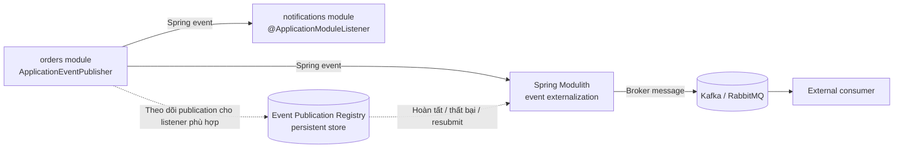
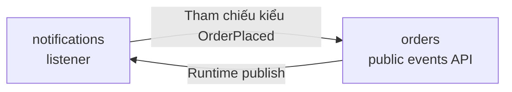
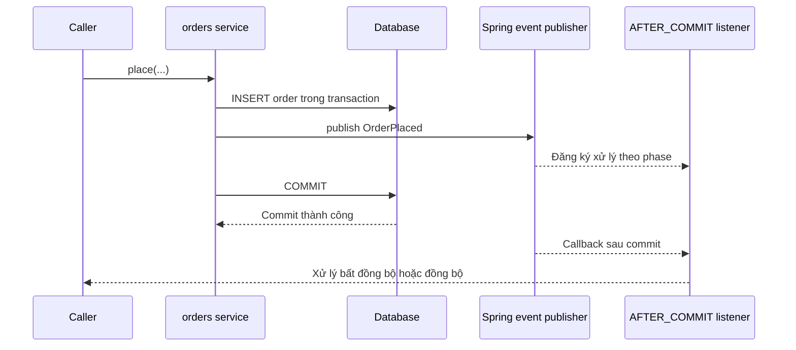
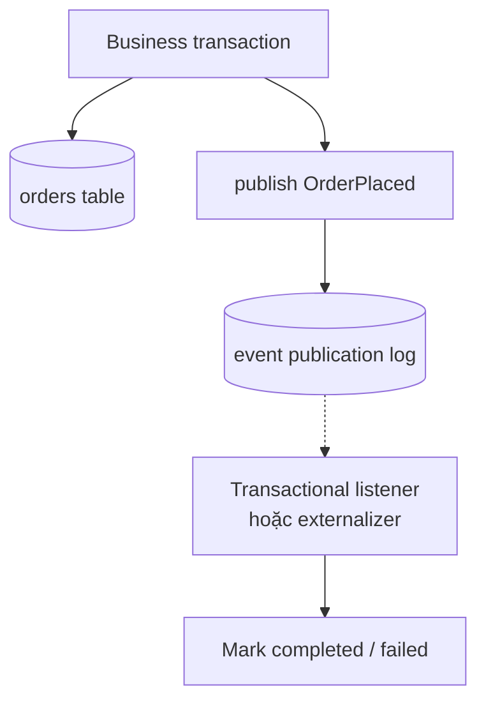
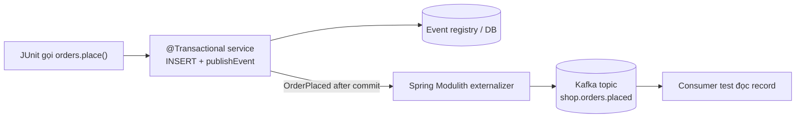
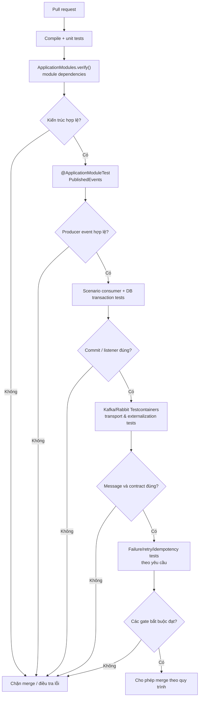

# Cấu hình message broker hoặc event infrastructure

Một ứng dụng Spring Modulith có thể publish sự kiện `OrderPlaced` từ module `orders` để module `notifications` xử lý. Nếu còn phải gửi thông tin ra hệ thống bên ngoài qua Kafka hoặc RabbitMQ, đội phát triển cần cấu hình **message broker, serializer, routing, cơ chế ghi nhận publication và transaction** sao cho bài kiểm thử chạy ổn định, không kết nối nhầm hạ tầng production và thực sự phát hiện lỗi truyền nhận.

Những câu hỏi này **khác nhau**: “service có phát Spring application event không?”, “transaction đã commit chưa?”, “event publication registry có theo dõi listener chưa?”, “message đã đến broker chưa?”, “consumer đã xử lý thành công chưa?”. Một bài test chỉ dùng Mockito hoặc `PublishedEvents` không tự trả lời được tất cả.

Bài thuộc chương **Test configuration** trong **SPRING_MODULITH_VERIFICATION_TESTING**: kiểm chứng ranh giới kiến trúc bằng `ApplicationModules` và quy tắc phụ thuộc, thực hành `@ApplicationModuleTest`, kiểm thử event/database/tích hợp và tổ chức quality gate CI để ngăn phụ thuộc sai và hồi quy. Chúng ta sẽ học cách cấu hình **message broker hoặc event infrastructure** theo đúng nghĩa của từng lớp, từ Spring event bus nội bộ tới Kafka/RabbitMQ và cơ chế publication bền vững.

## 1. Mục tiêu học tập

Sau bài này, bạn có thể:

1. Phân biệt **Spring application event**, **transactional event listener**, **Spring Modulith Event Publication Registry** và **broker message**.
2. Giải thích vì sao `@ApplicationModuleTest` ở chế độ `STANDALONE` có thể kiểm tra producer mà không cần Kafka/RabbitMQ.
3. Viết test `PublishedEvents` để xác minh event type, ID và payload do module phát.
4. Dùng `Scenario` khi kiểm tra consumer bất đồng bộ hoặc trạng thái cuối cùng thay vì dùng `Thread.sleep` tùy tiện.
5. Cấu hình Kafka hoặc RabbitMQ Testcontainers bằng `@ServiceConnection` hay `@DynamicPropertySource`.
6. Kiểm tra việc **gửi và nhận message qua broker thật** trong môi trường test, đồng thời hiểu giới hạn của bài smoke test này.
7. Giải thích cách Spring Modulith chọn event externalization, `@Externalized` và routing target.
8. Hiểu cơ chế ghi nhận publication theo transaction, resubmission, idempotency và những giới hạn của lời hứa “delivery thành công”.
9. Thiết kế kiểm thử transaction/DB, broker integration và consumer contract mà không đánh đồng các nghĩa vụ.
10. Đưa `ApplicationModules.verify()` cùng producer, registry, broker và consumer tests vào CI.

## 2. Bốn lớp của một luồng sự kiện



Sơ đồ là **mô hình khái niệm**, không mô tả trình tự đồng bộ cho mọi trường hợp. Event Publication Registry tích hợp với cơ chế publication của Spring khi dự án cấu hình persistence thích hợp; nó không phải một broker Kafka thu nhỏ. Module `orders` không cần biết URL broker nếu chính hạ tầng integration chịu trách nhiệm externalization.

| Lớp | Công nghệ/ví dụ | Bài test trả lời câu gì? |
| --- | --- | --- |
| **Application event** | `ApplicationEventPublisher`, `OrderPlaced` | Producer có phát event đúng payload không? |
| **Module listener + transaction** | `@TransactionalEventListener`, `@ApplicationModuleListener` | Listener có chạy sau commit và thực hiện side effect không? |
| **Publication registry** | `spring-modulith-starter-jdbc`, JPA/MongoDB… | Publication có được ghi, đánh dấu hoàn tất/thất bại và được xử lý lại an toàn không? |
| **External broker** | Kafka, RabbitMQ/AMQP, JMS | Message có đi tới topic/exchange/queue và consumer có đọc/ack đúng không? |

**Không đồng nghĩa:** `publishEvent(...)` gọi thành công ≠ row publication đã được commit ≠ broker nhận message ≠ consumer xử lý thành công. Mỗi dấu bằng bị bỏ qua có thể trở thành một lỗ hổng trong test suite.

### Hai hướng tích hợp thường gặp

**Nội bộ ứng dụng:** `orders` phát `OrderPlaced`, `notifications` nhận bằng Spring event listener. Hai application module vẫn chạy **trong cùng một process**.

**Ra bên ngoài:** một event được chọn để externalize; hạ tầng Spring Modulith chuyển thành broker message. Một service độc lập đọc Kafka/RabbitMQ. Dòng dữ liệu này có **network, serialization, routing và delivery semantics**, nên không thể chỉ kiểm tra bằng mock.

## 3. Kiến trúc ví dụ

```text
src/main/java/com/acme/shop/
├── ShopApplication.java
├── orders/
│   ├── OrderManagement.java
│   ├── events/
│   │   ├── OrderPlaced.java
│   │   └── package-info.java
│   └── internal/
│       └── DefaultOrderManagement.java
└── notifications/
    └── internal/
        └── OrderPlacedListener.java

src/main/resources/
└── application.yml

src/test/java/com/acme/shop/
├── ArchitectureVerificationTest.java
└── orders/
    ├── OrdersEventModuleTest.java
    ├── KafkaTransportModuleTest.java
    └── RabbitTransportModuleTest.java

src/test/resources/
└── application-broker-test.yml
```

Lớp khởi động ở root package:

```java
// src/main/java/com/acme/shop/ShopApplication.java
package com.acme.shop;

import org.springframework.boot.autoconfigure.SpringBootApplication;

@SpringBootApplication
public class ShopApplication {
}
```

Với cách phát hiện application module mặc định, `orders` và `notifications` là hai module. Vì `notifications` tham chiếu event của `orders`, cạnh phụ thuộc kiểu Java là **`notifications → orders`**, dù sự kiện được phát từ `orders` và được xử lý tại `notifications`.



Đồ thị dependency **tĩnh** và hướng luồng sự kiện **runtime** không phải cùng một thứ. `ApplicationModules.verify()` xác minh dependency tĩnh; `@ApplicationModuleTest` và các phép kiểm thử event xác minh runtime.

## 4. Hợp đồng event và producer của module orders

Public API cho use case:

```java
// src/main/java/com/acme/shop/orders/OrderManagement.java
package com.acme.shop.orders;

import java.util.UUID;

public interface OrderManagement {
    UUID place(String sku, int quantity);
}
```

Định nghĩa immutable event:

```java
// src/main/java/com/acme/shop/orders/events/OrderPlaced.java
package com.acme.shop.orders.events;

import java.util.UUID;

public record OrderPlaced(UUID orderId, String sku, int quantity) {
}
```

Để module khác tham chiếu package `orders.events` theo đúng module boundary:

```java
// src/main/java/com/acme/shop/orders/events/package-info.java
@org.springframework.modulith.NamedInterface("events")
package com.acme.shop.orders.events;
```

Service production:

```java
// src/main/java/com/acme/shop/orders/internal/DefaultOrderManagement.java
package com.acme.shop.orders.internal;

import com.acme.shop.orders.OrderManagement;
import com.acme.shop.orders.events.OrderPlaced;
import java.util.UUID;
import org.springframework.context.ApplicationEventPublisher;
import org.springframework.stereotype.Service;

@Service
class DefaultOrderManagement implements OrderManagement {

    private final ApplicationEventPublisher publisher;

    DefaultOrderManagement(ApplicationEventPublisher publisher) {
        this.publisher = publisher;
    }

    @Override
    public UUID place(String sku, int quantity) {
        if (sku == null || sku.isBlank() || quantity <= 0) {
            throw new IllegalArgumentException("Dữ liệu đơn không hợp lệ");
        }

        UUID id = UUID.randomUUID();
        publisher.publishEvent(new OrderPlaced(id, sku, quantity));
        return id;
    }
}
```

Phiên bản **đơn giản** này chưa lưu database và **chưa mở transaction**. Nó phù hợp để minh họa test **producer phát event**. Khi tiến tới `@TransactionalEventListener(AFTER_COMMIT)`, registry hoặc externalization, chúng ta phải bổ sung **một transaction thực sự commit** (xem mục 14) thay vì giả định `publishEvent(...)` tự tạo transaction.

## 5. Module test nhanh: PublishedEvents không cần broker

Đặt test trong package của module `orders`:

```java
// src/test/java/com/acme/shop/orders/OrdersEventModuleTest.java
package com.acme.shop.orders;

import com.acme.shop.orders.events.OrderPlaced;
import org.junit.jupiter.api.Test;
import org.springframework.beans.factory.annotation.Autowired;
import org.springframework.modulith.test.ApplicationModuleTest;
import org.springframework.modulith.test.PublishedEvents;

import static org.assertj.core.api.Assertions.assertThat;
import static org.junit.jupiter.api.Assertions.assertThrows;

@ApplicationModuleTest
class OrdersEventModuleTest {

    @Autowired
    OrderManagement orders;

    @Test
    void publishesExactlyOneOrderPlaced(PublishedEvents events) {
        var id = orders.place("SKU-42", 2);

        assertThat(events.ofType(OrderPlaced.class)
                .matching(OrderPlaced::orderId, id)).hasSize(1);
        assertThat(events.ofType(OrderPlaced.class)
                .matching(OrderPlaced::sku, "SKU-42")).hasSize(1);
    }

    @Test
    void rejectsInvalidInputWithoutPublishing(PublishedEvents events) {
        assertThrows(IllegalArgumentException.class,
                () -> orders.place("SKU-42", 0));
        assertThat(events.ofType(OrderPlaced.class)).isEmpty();
    }
}
```

Với bootstrap mặc định `STANDALONE`:

1. Spring Modulith nạp **module `orders`**, không tự nạp `notifications`.
2. `DefaultOrderManagement` là bean **thật**.
3. `ApplicationEventPublisher` thật phát `OrderPlaced`.
4. `PublishedEvents` thu thập Spring application events để JUnit assert.
5. Không cần Kafka, RabbitMQ, Docker hay external consumer chỉ để xác minh producer.

**Giới hạn bắt buộc:** test đạt không chứng minh `notifications` đã xử lý, Event Publication Registry đã ghi record, Kafka topic có message hoặc consumer bên ngoài đã nhận event. Nếu project đã bật externalization auto-configuration cho event `@Externalized`, cần tổ chức test/profile/dependency để không vô tình khởi động broker ở phép kiểm tra hẹp; mã mẫu trên chưa đánh dấu event để externalize.

### Cấu hình scope là vấn đề độc lập

`@ApplicationModuleTest` có các mode:

| Mode | Nạp application module nào? | Dùng cho |
| --- | --- | --- |
| `STANDALONE` | Module đang test | Producer hoặc consumer ở phạm vi hẹp; fake cổng ngoài nếu cần |
| `DIRECT_DEPENDENCIES` | Module đang test và dependency trực tiếp | Tích hợp những module có phụ thuộc kiểu Java trực tiếp |
| `ALL_DEPENDENCIES` | Module đang test và toàn cây dependency | Test integration rộng, chi phí khởi động cao hơn |

Một listener `notifications` **phụ thuộc vào** event `orders`, nên test đặt trong `orders` ở `DIRECT_DEPENDENCIES` cũng **không đương nhiên nạp `notifications`**: mode mở rộng theo **dependency của module đang test**, không theo mọi module phụ thuộc ngược vào nó.

## 6. @ApplicationModuleListener và transaction

Spring Modulith cung cấp `@ApplicationModuleListener` để triển khai giao tiếp giữa module qua event. Theo mặc định trên các dòng hiện đại, annotation là shortcut cho **transactional event listener chạy bất đồng bộ, có transaction riêng** (tương ứng ý tưởng `@Async` + `@Transactional(propagation = REQUIRES_NEW)` + `@TransactionalEventListener`).

Ví dụ consumer `notifications`:

```java
// src/main/java/com/acme/shop/notifications/internal/OrderPlacedListener.java
package com.acme.shop.notifications.internal;

import com.acme.shop.orders.events.OrderPlaced;
import org.springframework.modulith.events.ApplicationModuleListener;
import org.springframework.stereotype.Component;

@Component
class OrderPlacedListener {

    private final NotificationGateway gateway;

    OrderPlacedListener(NotificationGateway gateway) {
        this.gateway = gateway;
    }

    @ApplicationModuleListener
    void on(OrderPlaced event) {
        gateway.sendOrderConfirmation(event.orderId());
    }
}
```

`NotificationGateway` trong ví dụ là một **cổng do module `notifications` định nghĩa**, không phải class chuẩn của Spring; project thực tế cần interface/bean tương ứng. Phần này minh họa consumer, không phải đoạn code độc lập có thể biên dịch chỉ bằng copy.

### Vì sao producer không tự thấy listener chạy?

- `notifications` là application module khác, nằm **ngoài context `STANDALONE` của `orders`**.
- `@ApplicationModuleListener` quan tâm tới giao dịch/phase; ví dụ producer ở mục 4 **không có transaction** nên không được dùng để suy ra after-commit behavior.
- Listener là **async**; ngay cả khi được bootstrap, không thể assert side effect ngay lập tức mà không có cơ chế chờ.
- Gateway có thể gọi API bên ngoài; nên dùng fake/mock ở test consumer hẹp và integration test thật cho adapter khi cần.

### Scenario thay vì sleep

Spring Modulith `Scenario` hỗ trợ kích hoạt event và chờ một **event khác hoặc thay đổi trạng thái**:

```java
// Mảnh method trong một @ApplicationModuleTest của notifications.
@Test
void recordsNotificationAfterEvent(Scenario scenario) {
    var id = UUID.randomUUID();
    var event = new OrderPlaced(id, "SKU-42", 2);

    scenario.publish(event)
            .andWaitForStateChange(
                    () -> notificationProjection.exists(id),
                    Boolean.TRUE::equals)
            .andVerify(found -> assertThat(found).isTrue());
}
```

Giả thiết `notificationProjection` là test-visible Spring bean/port truy vấn trạng thái xử lý của consumer và test đã cung cấp dependencies cần thiết. Method là **mảnh minh họa**, chưa có cấu hình đầy đủ cho transaction listener. Cần import `Scenario` (Spring Modulith test), `UUID` và AssertJ. Một test consumer hoàn chỉnh có thể dùng database thật, fake email adapter, timeouts có giới hạn và cơ chế `Scenario` phù hợp version.

**Lưu ý về dữ liệu test:** `Scenario.publish(...)` và `Scenario.stimulate(...)` thực thi stimulus trong **transaction callback riêng** để transactional listeners nhận được event. Thay đổi database từ stimulus đó **không mặc nhiên rollback** cùng test transaction bên ngoài; phải dọn dữ liệu có chủ đích, chẳng hạn qua `Scenario.andCleanup(...)` hoặc fixture cleanup phù hợp.

**Không dùng `Thread.sleep(200)` rồi tin rằng async listener chắc chắn hoàn tất**: timing CI và scheduler thay đổi. Chờ điều kiện nghiệp vụ có timeout rõ ràng sẽ ổn định hơn.

## 7. Chọn event infrastructure ở cấp nào?

| Mục tiêu | Cấu hình/test phù hợp | Không nên nhầm với |
| --- | --- | --- |
| `orders` publish đúng payload | `@ApplicationModuleTest` + `PublishedEvents` | Broker đã nhận message |
| `notifications` xử lý event | `@ApplicationModuleTest` consumer + `Scenario`, fake gateway có chủ đích | External consumer đã ack |
| Ghi publication bền vững theo transaction | Event Publication Registry + persistent store + integration test | Kafka offset/consumer commit |
| Kafka topic/serializer hoạt động | Kafka Testcontainers + producer/consumer thực | Event externalization tự động đúng |
| RabbitMQ exchange/routing/queue hoạt động | RabbitMQ Testcontainers + AMQP client thực | Giao dịch ghi đơn đã commit |
| Chọn `@Externalized` và gửi ra broker | Spring Modulith externalization + transaction + test broker + consumer assertion | Chỉ gọi `KafkaTemplate.send(...)` thủ công |
| Consumer khác service xử lý idempotent | Consumer contract + broker/database/inbox phù hợp | Producer unit test |

**Định nghĩa test trước khi chọn hạ tầng.** Không phải cứ có event là phải dựng Kafka trong mọi module test; nhưng một test end-to-end của externalization phải có broker thực hoặc một phép xác minh có mức bảo đảm tương đương.

## 8. Kafka và RabbitMQ khác nhau ở đâu?

| Thuộc tính | Kafka | RabbitMQ / AMQP |
| --- | --- | --- |
| Đơn vị định tuyến phổ biến | Topic, record key, partition | Exchange, routing key, queue và binding |
| Client Spring | Spring Kafka | Spring AMQP |
| Config Spring Boot | `spring.kafka.bootstrap-servers`, serializers/deserializers, group ID | `spring.rabbitmq.host`, port, username/password, listener container |
| Testcontainers | `KafkaContainer` / `ConfluentKafkaContainer` theo version | `RabbitMQContainer` |
| Consumer progress | Offsets, consumer groups | Delivery acknowledgement, requeue, prefetch |
| Rủi ro khi test | Auto topic creation, offsets, group rebalance, key/partition | Sai exchange/binding, routing key, DLQ/ack/requeue |

JMS, Spring Messaging và các broker khác cũng được Spring Modulith hỗ trợ thông qua artifact phù hợp. **Không quy broker thành một “event bus” chung với semantics đồng nhất**: việc ghi message thành công và xác nhận consumer đã xử lý có ý nghĩa khác giữa các nền tảng.

### Dependencies cần định nghĩa rõ

Đối với Spring Modulith **externalization lên Kafka**, thường cần:

```groovy
// Ví dụ các dependency Gradle, version được quản lý bởi BOM của project.
dependencies {
    implementation 'org.springframework.kafka:spring-kafka'
    implementation 'org.springframework.modulith:spring-modulith-events-kafka'

    testImplementation 'org.springframework.boot:spring-boot-testcontainers'
    testImplementation 'org.testcontainers:kafka'
    testImplementation 'org.testcontainers:junit-jupiter'
}
```

Đối với RabbitMQ/AMQP:

```groovy
// Chọn cấu hình AMQP thay cho Kafka nếu ứng dụng dùng RabbitMQ.
dependencies {
    implementation 'org.springframework.boot:spring-boot-starter-amqp'
    implementation 'org.springframework.modulith:spring-modulith-events-amqp'

    testImplementation 'org.springframework.boot:spring-boot-testcontainers'
    testImplementation 'org.testcontainers:rabbitmq'
    testImplementation 'org.testcontainers:junit-jupiter'
}
```

Các mảnh Gradle trên **không phải một build file hoàn chỉnh**: còn cần Spring Boot, Spring Modulith BOM/version tương thích, Spring Modulith testing và các dependencies của project. Không cần cài cả Kafka và RabbitMQ nếu ứng dụng chỉ dùng một broker.

## 9. Kafka Testcontainers: cấp endpoint động

Trong CI, không nên hard-code `localhost:9092`. Một Kafka container có thể expose bootstrap address với **mapped port** mà test chỉ biết sau khi khởi động.

Spring Boot hỗ trợ `@ServiceConnection` cho các Kafka container tương thích. Ví dụ:

```java
import org.springframework.boot.testcontainers.service.connection.ServiceConnection;
import org.testcontainers.junit.jupiter.Container;
import org.testcontainers.junit.jupiter.Testcontainers;
import org.testcontainers.kafka.ConfluentKafkaContainer;

@Testcontainers
class KafkaConnectionExample {

    @Container
    @ServiceConnection
    static ConfluentKafkaContainer kafka =
            new ConfluentKafkaContainer(
                    "confluentinc/cp-kafka:7.8.1");
}
```

Testcontainers có các loại Kafka container khác nhau tùy version và Docker image. Ví dụ này dùng namespace `org.testcontainers.kafka.ConfluentKafkaContainer` của Testcontainers hiện đại; hãy xác nhận version hiện có trong dự án. Spring Boot cần dependency `spring-boot-testcontainers` phù hợp để nhận diện service connection và tạo `KafkaConnectionDetails`.

**Cơ chế `@ServiceConnection` tạo connection details cho auto-configuration**, không nhất thiết đặt `spring.kafka.bootstrap-servers` như một literal property mà `Environment.getProperty(...)` sẽ trả đúng. Để kiểm tra endpoint thật, xem thông tin kết nối được client sử dụng hoặc gửi/nhận message qua broker.

### Phương án @DynamicPropertySource

Khi không dùng `@ServiceConnection` hoặc cần thêm property custom:

```java
// Thay thế, KHÔNG cần gắn @ServiceConnection cho cùng container.
@Container
static ConfluentKafkaContainer kafka =
        new ConfluentKafkaContainer(
                "confluentinc/cp-kafka:7.8.1");

@DynamicPropertySource
static void kafkaProperties(DynamicPropertyRegistry registry) {
    registry.add("spring.kafka.bootstrap-servers",
            kafka::getBootstrapServers);
}
```

Method `@DynamicPropertySource` phải `static` và nhận `DynamicPropertyRegistry`. `registry.add` nhận **`Supplier`**, vì vậy dùng `kafka::getBootstrapServers` thay vì gọi getter ngay khi khai báo.

`@DynamicPropertySource` **không tự khởi động Kafka**; Testcontainers/JUnit hoặc cơ chế khác vẫn phải quản lý lifecycle. Không cần đồng thời dùng hai phương án cho một endpoint nếu không có lý do cụ thể.

## 10. Profile và serializer cho Kafka transport test

Ví dụ cấu hình test chỉ gửi và nhận chuỗi:

```yaml
# src/test/resources/application-broker-test.yml
spring:
  kafka:
    producer:
      key-serializer: org.apache.kafka.common.serialization.StringSerializer
      value-serializer: org.apache.kafka.common.serialization.StringSerializer
    consumer:
      key-deserializer: org.apache.kafka.common.serialization.StringDeserializer
      value-deserializer: org.apache.kafka.common.serialization.StringDeserializer
      auto-offset-reset: earliest
      group-id: orders-broker-probe
```

Khi test khai báo `@ActiveProfiles("broker-test")`, Spring Boot dùng file này làm phần cấu hình theo profile. Không đặt credentials/endpoint production vào `src/test/resources`.

### Lưu ý về message serialization

Transport test dùng `StringSerializer`/`StringDeserializer` để kiểm tra **kết nối broker và topic**, không phải format JSON cuối cùng của `OrderPlaced`. Khi kiểm thử externalization thật, cần:

- Chọn payload được phép public ra ngoài, có version/schema phù hợp.
- Xác định serializer/converter do adapter Spring Modulith và Spring Messaging/Kafka sử dụng.
- Kiểm tra event ID, loại event, timestamp/schema version và key/routing cần thiết.
- Test backward/forward compatibility nếu nhiều consumer khác phiên bản.

Một test chuỗi thành công **không chứng minh Jackson serialization hay event externalization tự động đã đúng**.

## 11. Kafka transport test: gửi và nhận qua broker thật

Ví dụ này tạo Kafka broker trong Testcontainers và một **test-only Kafka listener** để quan sát record. Nó chứng minh broker round trip với Spring Kafka; **không tự động chứng minh `@Externalized`** (sẽ có phép kiểm tra riêng ở mục 16).

```java
// src/test/java/com/acme/shop/orders/KafkaTransportModuleTest.java
package com.acme.shop.orders;

import java.util.concurrent.BlockingQueue;
import java.util.concurrent.LinkedBlockingQueue;
import java.util.concurrent.TimeUnit;
import org.junit.jupiter.api.Test;
import org.springframework.beans.factory.annotation.Autowired;
import org.springframework.boot.test.context.TestConfiguration;
import org.springframework.boot.testcontainers.service.connection.ServiceConnection;
import org.springframework.context.annotation.Bean;
import org.springframework.kafka.annotation.EnableKafka;
import org.springframework.kafka.annotation.KafkaListener;
import org.springframework.kafka.config.TopicBuilder;
import org.springframework.kafka.core.KafkaTemplate;
import org.apache.kafka.clients.admin.NewTopic;
import org.springframework.modulith.test.ApplicationModuleTest;
import org.springframework.test.context.ActiveProfiles;
import org.testcontainers.junit.jupiter.Container;
import org.testcontainers.junit.jupiter.Testcontainers;
import org.testcontainers.kafka.ConfluentKafkaContainer;

import static org.assertj.core.api.Assertions.assertThat;

@Testcontainers
@ApplicationModuleTest
@ActiveProfiles("broker-test")
class KafkaTransportModuleTest {

    @Container
    @ServiceConnection
    static ConfluentKafkaContainer kafka =
            new ConfluentKafkaContainer(
                    "confluentinc/cp-kafka:7.8.1");

    @Autowired
    KafkaTemplate<String, String> template;

    @Autowired
    KafkaProbe probe;

    @TestConfiguration(proxyBeanMethods = false)
    @EnableKafka
    static class BrokerFixture {

        @Bean
        NewTopic ordersTopic() {
            return TopicBuilder.name("shop.orders.placed")
                    .partitions(1)
                    .replicas(1)
                    .build();
        }

        @Bean
        KafkaProbe kafkaProbe() {
            return new KafkaProbe();
        }
    }

    static class KafkaProbe {

        final BlockingQueue<String> messages =
                new LinkedBlockingQueue<>();

        @KafkaListener(
                topics = "shop.orders.placed",
                groupId = "orders-broker-probe")
        void receive(String payload) {
            messages.offer(payload);
        }
    }

    @Test
    void sendsMessageAndReceivesItThroughKafka() throws Exception {
        String payload = "order-created:00000000-0000-0000-0000-000000000042";

        template.send("shop.orders.placed", "order-42", payload)
                .get(15, TimeUnit.SECONDS);

        assertThat(probe.messages.poll(15, TimeUnit.SECONDS))
                .isEqualTo(payload);
    }
}
```

### Những điều kiện để ví dụ chạy

- Spring Boot Kafka auto-configuration và Spring Kafka/`KafkaTemplate` có trên test classpath.
- `spring-boot-testcontainers` cùng Testcontainers Kafka/JUnit Jupiter phù hợp, Docker có thể chạy.
- Spring Kafka topic administration kích hoạt để `NewTopic` được tạo trên broker test.
- Kafka listener infrastructure được bật bằng `@EnableKafka` trong `BrokerFixture`.
- Producer và consumer đã dùng `StringSerializer`/`StringDeserializer` trong profile `broker-test`.
- Group ID/topic của test không tranh chấp với test khác khi chạy song song.

`BlockingQueue.poll(timeout)` chờ tối đa một khoảng thời gian và trả `null` nếu chưa nhận; nó **không chứng minh network luôn phản hồi trong 15 giây ở mọi CI**. Điều chỉnh timeout có cơ sở, thu thập log broker khi fail và không “sửa” race bằng `Thread.sleep` không điều kiện.

### Test đã bảo vệ những gì?

| Có kiểm tra | Chưa kiểm tra |
| --- | --- |
| Container Kafka khởi động và client Spring kết nối được | `@Externalized` có chọn đúng event type không |
| Topic và producer send hoạt động với String payload | Mã hóa JSON/Avro/Protobuf của domain event |
| Listener test nhận được record từ broker | Registry persistence/resubmission |
| Record payload trả về đúng | Consumer nghiệp vụ ghi database/ack/idempotency |
| Endpoint test do `@ServiceConnection` cung cấp | Kafka cluster production và security ACL/TLS |

Đừng đặt tên bài test này là “externalization hoạt động end-to-end” nếu trong test bạn **tự gọi `KafkaTemplate.send(...)`** thay vì kích hoạt một use case tạo domain event.

## 12. RabbitMQ transport test: queue và acknowledgement không phải Kafka offset

Nếu ứng dụng dùng Spring AMQP, Testcontainers có `RabbitMQContainer`. Spring Boot `@ServiceConnection` có thể tạo `RabbitConnectionDetails` để kết nối tới broker test mà không hard-code host port hoặc dùng credentials production.

```java
// src/test/java/com/acme/shop/orders/RabbitTransportModuleTest.java
package com.acme.shop.orders;

import org.junit.jupiter.api.Test;
import org.springframework.amqp.core.AmqpAdmin;
import org.springframework.amqp.core.Queue;
import org.springframework.amqp.rabbit.core.RabbitTemplate;
import org.springframework.beans.factory.annotation.Autowired;
import org.springframework.boot.testcontainers.service.connection.ServiceConnection;
import org.springframework.modulith.test.ApplicationModuleTest;
import org.testcontainers.containers.RabbitMQContainer;
import org.testcontainers.junit.jupiter.Container;
import org.testcontainers.junit.jupiter.Testcontainers;

import static org.assertj.core.api.Assertions.assertThat;

@Testcontainers
@ApplicationModuleTest
class RabbitTransportModuleTest {

    @Container
    @ServiceConnection
    static RabbitMQContainer rabbit =
            new RabbitMQContainer(
                    "rabbitmq:3.13-management-alpine");

    @Autowired
    RabbitTemplate rabbitTemplate;

    @Autowired
    AmqpAdmin amqpAdmin;

    @Test
    void roundTripsThroughRabbitQueue() {
        String queueName = "shop.orders.test-queue";
        amqpAdmin.declareQueue(new Queue(queueName, false));

        rabbitTemplate.convertAndSend(
                "", queueName, "order-created:42");

        Object received = rabbitTemplate.receiveAndConvert(
                queueName, 10_000L);

        assertThat(received).isEqualTo("order-created:42");
    }
}
```

Ở đây chuỗi rỗng `""` là **default exchange** của RabbitMQ, còn `queueName` là routing key trỏ tới queue được declare. Đây là một **transport smoke test**; trong production, event externalization có thể gửi tới **exchange riêng** với routing key và binding riêng. Đừng suy ra topology production đúng chỉ vì default-exchange test xanh.

Để chạy ví dụ, cần Spring AMQP/Rabbit starter, `spring-boot-testcontainers`, module RabbitMQ Testcontainers, Docker runtime và `AmqpAdmin` auto-configuration. Với project dùng exchange/queue thật, cần thêm phép kiểm tra exchange type, binding, routing key, dead-letter policy, ack/requeue, retry và message conversion.

### Nếu không dùng @ServiceConnection

Có thể đăng ký host và mapped port qua `@DynamicPropertySource`:

```java
@DynamicPropertySource
static void rabbitProperties(DynamicPropertyRegistry registry) {
    registry.add("spring.rabbitmq.host", rabbit::getHost);
    registry.add("spring.rabbitmq.port",
            () -> rabbit.getMappedPort(5672));
}
```

Đoạn này là **mảnh cấu hình thay thế**, giả định `rabbit` là `@Container static` đã khởi động và ứng dụng dùng thông tin đăng nhập của broker test. Với container có credentials khác mặc định, phải cấp thêm username/password bằng nguồn phù hợp. `@DynamicPropertySource` **không tự khởi động RabbitMQ** và không tự declare queue/exchange.

## 13. Spring Modulith event externalization: chọn event để gửi ra broker

Spring Modulith hỗ trợ **event externalization**: lựa chọn những Spring application events được phép chuyển ra broker, chuẩn bị message và xác định routing target. Các artifact tương ứng bao gồm:

| Nền tảng | Spring Modulith artifact | Ghi chú |
| --- | --- | --- |
| Kafka | `spring-modulith-events-kafka` | Topic và record key theo cấu hình routing |
| AMQP/RabbitMQ | `spring-modulith-events-amqp` | Exchange/routing key; cần Spring AMQP |
| JMS | `spring-modulith-events-jms` | Đặc tính routing khác Kafka/AMQP |
| Spring Messaging | `spring-modulith-events-messaging` | Đưa vào `MessageChannel` đã định nghĩa |

**Không phải mọi application event đều mặc định được gửi ra ngoài.** Việc lựa chọn và mapping payload cần có chủ đích, tránh vô tình publish những event chỉ dành cho nội bộ hoặc chứa dữ liệu nhạy cảm.

### Đánh dấu event externalizable

Khi muốn event `OrderPlaced` trở thành integration event gửi tới Kafka topic `shop.orders.placed`, có thể đánh dấu:

```java
// BIẾN THỂ dành cho integration với event externalization.
// Thay định nghĩa OrderPlaced không annotate ở mục 4.
package com.acme.shop.orders.events;

import java.util.UUID;
import org.springframework.modulith.events.Externalized;

@Externalized("shop.orders.placed")
public record OrderPlaced(UUID orderId, String sku, int quantity) {
}
```

Annotation `@Externalized` thuộc Spring Modulith Events API; việc thêm annotation không tự khởi động Kafka hay tạo topic. Còn cần:

1. Artifact externalization của broker tương ứng, Spring Kafka/AMQP configuration.
2. Broker endpoint, serializer/converter và topology hợp lệ.
3. Event type được chọn theo quy tắc externalization.
4. **Transaction/event infrastructure** phù hợp để listener externalization được kích hoạt đúng.
5. Test integration nhận được message thực từ broker.

`@Externalized("shop.orders.placed")` tạo **routing target tĩnh**. Với Kafka, target này thường tương ứng topic; với AMQP, cần hiểu exchange/routing của adapter và những binding trong broker. Khi muốn routing key động, Spring Modulith hỗ trợ quy ước `target::key` và biểu thức SpEL; không cần đưa logic routing phức tạp vào mọi domain event nếu một cấu hình mapping chung rõ ràng hơn.

### Chọn event và DTO dành cho bên ngoài

Một `OrderPlaced` nội bộ có thể chứa nhiều thông tin mà consumer bên ngoài không cần. Nếu đưa trực tiếp JPA entity hoặc một object có quan hệ lazy loading ra broker, dễ gặp lỗi serializer và nguy cơ lộ dữ liệu.

Nên dùng immutable value object hoặc tạo **integration DTO** riêng với:

- `eventId` độc nhất để consumer deduplicate.
- `schemaVersion` hoặc một contract evolution rõ ràng.
- `orderId` và những trường nghiệp vụ cần thiết.
- Không chứa password, token hoặc dữ liệu cá nhân vượt phạm vi đã thỏa thuận.
- Định dạng thời gian/time zone ổn định.

Spring Modulith có `EventExternalizationConfiguration` cho việc chọn, mapping, thêm headers và routing programmatically. Các API cụ thể thay đổi theo dòng version; hãy dùng dependency management phù hợp và đối chiếu tài liệu phiên bản trước khi copy một DSL phức tạp.

## 14. Vì sao cần transaction khi event gắn với thay đổi database?

Ví dụ `DefaultOrderManagement` ở mục 4 publish Spring event nhưng **không có transaction**. Để minh họa nghĩa vụ “chỉ gửi đơn đã commit”, một implementation production thực tế có thể:

```java
// MẢNH MINH HỌA logic ghi DB + event trong một service @Transactional.
@Transactional
public UUID place(String sku, int quantity) {
    UUID id = UUID.randomUUID();
    orderRepository.insert(id, sku, quantity);

    publisher.publishEvent(new OrderPlaced(id, sku, quantity));
    return id;
}
```

Đây là đoạn method cần nằm trong Spring-managed bean, với repository có transaction manager thật. Nó **không phải phiên bản thay trực tiếp vào lớp ở mục 4 mà không thêm dependency**. `@Transactional` chỉ phát huy hiệu lực khi method được gọi qua Spring proxy/transaction interceptor phù hợp, không phải vì Java tự có transaction.

### Luồng logic của transactional event listener



Sơ đồ nhằm giải thích **ranh giới phase**, không hứa callback async sẽ hoàn tất trước khi caller nhận response. Với `@TransactionalEventListener(phase = AFTER_COMMIT)`, event phải được publish trong transaction thực sự; nếu không có transaction và không bật fallback phù hợp, listener không nhất thiết được gọi.

### Bẫy của @Transactional trên test method

```java
@Test
@Transactional
void publishesEventButTestTransactionRollsBack() {
    orders.place("SKU-42", 2);
    // Test method thường rollback sau khi return.
}
```

Khi test transaction bao bên ngoài, service `@Transactional` với propagation `REQUIRED` thường tham gia transaction ấy. Test có thể assert `PublishedEvents` thấy `OrderPlaced`, nhưng cuối method **rollback**, do đó `AFTER_COMMIT` listener không được kích hoạt như một transaction commit thật.

Nếu mục tiêu là event **sau commit**, có thể:

- Không đặt `@Transactional` ở test method; để service tự mở/commit transaction.
- Hoặc dùng `TestTransaction.flagForCommit()` và `TestTransaction.end()` ở đúng thời điểm, rồi assert sau commit.
- Khi listener async, dùng `Scenario`/Awaitility với timeout để quan sát side effect.

**Không nên dùng `@Commit` rồi assert trong cùng test method và mặc định callback sau commit đã chạy trước assertion**: commit của test transaction thông thường diễn ra lúc method hoàn tất.

## 15. Event Publication Registry: không phải message broker

Spring Modulith có **Event Publication Registry** để theo dõi những event publication tới các transactional listeners phù hợp. Khi có persistence integration (JDBC/JPA/MongoDB/Neo4j tùy version) và event serializer, registry có thể lưu thông tin publication trong transaction nghiệp vụ để hỗ trợ recovery/resubmission.



**Cần có eligible listener và persistence module thích hợp.** Ở test `STANDALONE` chỉ nạp `orders` nhưng không có transactional listener nào được bootstrap cho `OrderPlaced`, không thể tùy tiện kết luận mỗi event đều tạo một registry record.

### Persistence starters

| Persistent store | Spring Modulith starter ví dụ |
| --- | --- |
| JDBC | `spring-modulith-starter-jdbc` |
| JPA | `spring-modulith-starter-jpa` |
| MongoDB | `spring-modulith-starter-mongodb` |
| Neo4j | `spring-modulith-starter-neo4j` |

Các starter tương ứng cung cấp cơ chế lưu publication và serializer mặc định khi đủ dependency. Chúng **không tự thay** Kafka/RabbitMQ client. Khi muốn externalize lên broker, cần cả event externalization artifact và broker infrastructure.

Đối với JDBC, starter có cơ chế **khởi tạo bảng event publication** trừ khi đã có schema hoặc dự án tắt schema initialization để dùng Flyway/Liquibase. Ví dụ trong dự án muốn migration tự quản:

```yaml
# Ví dụ configuration khi đội phát triển tự quản schema bằng migration:
spring:
  modulith:
    events:
      jdbc:
        schema-initialization:
          enabled: false
```

**Không sao chép cấu hình trên mà không tạo bảng schema đúng version bằng migration**: tắt auto initialization nhưng thiếu bảng sẽ khiến registry không ghi được.

### Publication lifecycle và trạng thái

Trong Spring Modulith 2.x, publication có thể trải qua các trạng thái như `PUBLISHED`, `PROCESSING`, `COMPLETED`, `FAILED` và `RESUBMITTED`; các khả năng khác nhau theo version và chính sách resubmission. Tránh viết test phụ thuộc cứng vào schema/status enum của một version khác với project.

Một publication “completed” thường có nghĩa **listener tương ứng hoàn tất theo cơ chế registry**, không phải consumer ngoài ứng dụng chắc chắn đã thực hiện side effect thành công. Kafka producer acknowledgment, RabbitMQ confirm và consumer commit/ack còn là những hợp đồng khác.

### Đừng nhầm Event Publication Registry với full outbox

Spring Modulith native externalization dựa trên transactional event listener và cơ chế registry để theo dõi/resubmit; tài liệu chính thức lưu ý cơ chế đó **không tương đương một outbox implementation đầy đủ** với mọi thuộc tính mà hệ phân tán có thể yêu cầu. Các dòng Spring Modulith mới có tích hợp outbox qua những giải pháp như Namastack/JobRunr khi dự án cần.

Với hệ thống có yêu cầu nghiêm ngặt về **atomic business record + message delivery**, cần xem xét design outbox/inbox, atomicity, crash window, ordering và idempotency bằng một bài integration/failure test riêng, không chỉ xem registry có dòng dữ liệu.

## 16. Test externalization thật: từ use case tới Kafka message

Khác với bài `KafkaTransportModuleTest` ở mục 11 (gửi bằng `KafkaTemplate` trực tiếp), phép kiểm tra **event externalization** phải kích hoạt **business use case**:



Một integration test đáng tin cậy cần chuẩn bị:

1. **Đăng ký event:** kiểu `OrderPlaced` có `@Externalized("shop.orders.placed")` hoặc cấu hình programmatic tương đương.
2. **Module broker:** dependency `spring-modulith-events-kafka` và Spring Kafka tương thích.
3. **Business transaction:** service thực sự dùng repository/DataSource và transaction manager, có commit khi use case thành công.
4. **Publication store nếu cần:** Spring Modulith JDBC/JPA starter và schema/migration hợp lệ.
5. **Kafka Testcontainers:** `@ServiceConnection` hoặc `@DynamicPropertySource` cấp bootstrap servers test, topic được tạo trước khi assertion.
6. **Consumer/probe:** đọc message thực từ Kafka, giải mã format và đối chiếu `orderId`/payload/schema.
7. **Điều kiện chờ:** không giả định listener async hoặc broker send hoàn tất tức thì; dùng polling/`Scenario`/Awaitility với timeout.
8. **Đối chứng rollback:** khi business transaction rollback, không được coi event về một đơn chưa commit là publish thành công ra ngoài.

### Đặc tả test minh họa

```text
Given
  - PostgreSQL test đã chạy migration orders + publication log
  - Kafka test đã tạo topic shop.orders.placed
  - Spring Modulith externalization và @Externalized đã được bật
  - Không có consumer khác tranh chấp group của test probe

When
  - Gọi OrderManagement.place("SKU-42", 2) trên service thật
  - Service ghi DB và transaction commit

Then
  - SELECT tìm thấy order đã commit
  - Kafka test consumer nhận record trên shop.orders.placed
  - Payload chứa đúng orderId, sku, quantity
  - Nếu cấu hình registry, publication lifecycle phù hợp

And when
  - Cố tình gây lỗi SQL để transaction rollback

Then
  - Không có order record commit
  - Không gửi một message thành công đại diện cho order rollback
```

Đây là **đặc tả test tích hợp**, không phải một JUnit class tự đủ để copy/paste. Cách lấy record phụ thuộc serializer, consumer factory và thiết kế event; cách kiểm tra registry phụ thuộc persistence/version. Đừng assert “không có message” chỉ bằng `poll(0)`: cần một **khoảng quan sát có giới hạn** và consumer group/offset được kiểm soát.

### Hai trường hợp cần bảo vệ độc lập

- **Broker down trước khi send:** externalization thất bại, registry có thể ghi publication chưa hoàn tất/thất bại theo lifecycle tương ứng để khôi phục.
- **Broker đã nhận nhưng ứng dụng crash trước khi đánh dấu hoàn tất:** hệ thống có thể resend, dẫn tới **message trùng**. Consumer cần cơ chế idempotency; không thể chỉ dựa vào expectation “một event = một message đúng một lần”.

## 17. Resubmission, completion mode và chính sách xử lý lỗi

Spring Modulith có API/quy tắc cho việc quản lý publication chưa hoàn tất hoặc thất bại. Một số cấu hình đáng chú ý:

```yaml
# Ví dụ cấu hình có chủ đích; xem lại theo version dự án.
spring:
  modulith:
    events:
      republish-outstanding-events-on-restart: false
      completion-mode: UPDATE
```

- `republish-outstanding-events-on-restart` mặc định thường **false**; bật một cách tùy tiện trên hệ thống nhiều instance có thể gây chạy lại trong khi instance khác vẫn đang xử lý.
- `completion-mode = UPDATE` mặc định giữ record đã hoàn tất với completion date; một số version hỗ trợ `DELETE` để xóa khi hoàn tất, có trade-off giữa auditability và dung lượng bảng.
- Quản lý retry/resubmission cần backoff, giới hạn số lần, quan sát lỗi và idempotency – **không bật vô hạn chỉ để test xanh**.
- Ở dòng Spring Modulith mới, event publication lifecycle có thêm trạng thái và công cụ quản lý failed/abandoned; cần đối chiếu API với version đang sử dụng.

### Test retry đúng mục tiêu

Một bài test cần mô phỏng **lỗi có kiểm soát**:

1. Cho transactional listener/externalizer fail một lần hoặc tắt broker sau khi tạo publication.
2. Xác nhận publication không bị coi là hoàn tất sai.
3. Khôi phục dependency rồi kích hoạt resubmission bằng cơ chế/API phù hợp.
4. Xác nhận side effect/record được xử lý thành công.
5. Lặp event và xác minh consumer không tạo duplicate business effect.

**Không cần cố ý kill process trong mọi pull request**, nhưng hệ thống có cam kết recovery cần ít nhất một nhóm failure-path integration tests định kỳ hoặc trong pipeline phù hợp.

## 18. Consumer idempotency: broker ACK không bằng xử lý nghiệp vụ

Một broker có thể giao lại message sau crash hoặc timeout. Ngay cả khi producer có registry, consumer vẫn có thể nhận trùng nếu:

- Message đã được xử lý nhưng consumer chưa commit Kafka offset/ack RabbitMQ.
- Producer retry vì không nhận được xác nhận chính xác.
- Registry resubmit một publication sau lỗi hoặc timeout.
- Consumer group rebalance hoặc retry/requeue tạo delivery lặp.

### Quy tắc thiết kế

**Dùng định danh event ổn định**. Một consumer lưu `eventId` hoặc khóa nghiệp vụ phù hợp trong bảng inbox/processed-events (cùng transaction với side effect) để tránh xử lý trùng:

```sql
-- Ví dụ ý tưởng schema inbox; tên bảng/SQL tùy dự án.
CREATE TABLE processed_events (
    event_id UUID PRIMARY KEY,
    processed_at TIMESTAMPTZ NOT NULL
);
```

Luồng consumer khái niệm:

```text
BEGIN TRANSACTION
  - Thử INSERT event_id vào processed_events
  - Nếu đã tồn tại: kết luận event đã xử lý / bỏ qua an toàn
  - Nếu mới: thực hiện business side effect
COMMIT
Sau khi commit phù hợp: ACK / commit offset
```

Thứ tự ack/commit, concurrency, isolation và lỗi giữa DB-broker khác nhau giữa Kafka và RabbitMQ. Không nên biến pseudocode thành cam kết **exactly-once** cho mọi hạ tầng mà chưa kiểm chứng khả năng transaction phối hợp.

### Consumer contract test cần gì?

| Rủi ro | Phép kiểm tra |
| --- | --- |
| JSON/schema thay đổi | Đọc payload thật, deserialize vào contract DTO/version |
| Event trùng | Giao cùng `eventId` hai lần, side effect chỉ một lần |
| Message lỗi liên tục | Retry/backoff/DLQ hoặc failure policy đúng |
| Offset/ACK xảy ra quá sớm | Mô phỏng xử lý DB fail, xác nhận khả năng redelivery |
| Ordering khi nhiều message | Test partition/key và xử lý out-of-order theo yêu cầu |
| Header/correlation ID sai | Assert message metadata và log correlation phù hợp |

Consumer contract nên được chạy trong service thực sự **sở hữu consumer**, không chỉ trong test module producer.

## 19. Kiểm thử event + database: ai được commit trước?

Khi `orders` lưu đơn rồi publish `OrderPlaced`, có ít nhất ba mốc quan sát:

| Mốc | Điều đã được bảo đảm | Điều chưa được bảo đảm |
| --- | --- | --- |
| Sau `publisher.publishEvent(...)` | Producer đã gọi API và các listener phù hợp có thể được kích hoạt/đăng ký | Transaction đã commit, broker nhận, consumer chạy |
| Sau commit business transaction | Bản ghi orders đã commit; transactional event phase có thể chạy | Broker chắc chắn có message và consumer đã hoàn tất |
| Sau broker send acknowledgement | Broker xác nhận thao tác theo cơ chế producer/config | Consumer application đã persist side effect |

Từ đó suy ra ba bài test riêng:

1. **Producer module test**: `PublishedEvents` và payload, không cần broker.
2. **Transaction/registry integration test**: PostgreSQL và listener/registry thật, kiểm tra commit/rollback và trạng thái publication.
3. **Broker/consumer integration test**: Kafka/RabbitMQ thực và consumer test với assertion payload/side effect.

### Khi nào giữ publisher thật?

Nếu đang kiểm tra `PublishedEvents` hoặc event lifecycle, **không mock `ApplicationEventPublisher`**. Mockito mock có thể cho phép `verify(publisher).publishEvent(...)` nhưng làm mất cơ chế dispatch thực mà test muốn xác nhận.

Khi chỉ test một method thuần không dùng Spring, có thể mock publisher như một **unit test**; hãy ghi rõ giới hạn đó và không gọi nó là event infrastructure integration test.

## 20. Kiểm chứng kiến trúc trước khi khởi động broker

Tính đúng của Kafka/RabbitMQ không thể hợp thức hóa một dependency Java sai. Ví dụ module `notifications` có thể import `orders.events.OrderPlaced` khi package được khai báo `@NamedInterface("events")`; nhưng không nên tham chiếu `orders.internal.DefaultOrderManagement` hoặc repository của `orders`.

Một giới hạn ở phía `notifications`:

```java
// src/main/java/com/acme/shop/notifications/package-info.java
@org.springframework.modulith.ApplicationModule(
        allowedDependencies = "orders :: events"
)
package com.acme.shop.notifications;
```

Kiểm chứng cấu trúc bằng JUnit:

```java
// src/test/java/com/acme/shop/ArchitectureVerificationTest.java
package com.acme.shop;

import org.junit.jupiter.api.Test;
import org.springframework.modulith.core.ApplicationModules;

import static org.junit.jupiter.api.Assertions.assertTrue;

class ArchitectureVerificationTest {

    @Test
    void expectedModulesExist() {
        ApplicationModules modules =
                ApplicationModules.of(ShopApplication.class);

        assertTrue(modules.getModuleByName("orders").isPresent());
        assertTrue(modules.getModuleByName("notifications").isPresent());
    }

    @Test
    void dependenciesRespectBoundaries() {
        ApplicationModules.of(ShopApplication.class).verify();
    }
}
```

`verify()` kiểm tra các nhóm quy tắc quan trọng:

- Không có **chu trình phụ thuộc** giữa các application module.
- Không tham chiếu **kiểu nội bộ** của module khác theo mô hình module đóng.
- Tuân thủ giới hạn `allowedDependencies` nếu module nguồn khai báo.

**Không cần Docker, Kafka hoặc RabbitMQ** để chạy bài test kiến trúc này. Nó không xác nhận serialization hay broker routing, nhưng giúp phát hiện import sai trước khi tốn tài nguyên bootstrap container.

### Broker client nên nằm ở đâu?

Nếu module `orders` trực tiếp dùng `KafkaTemplate` trong từng use case, module business sẽ phụ thuộc vào công nghệ hạ tầng. Trong nhiều thiết kế, Spring Modulith event externalization cho phép `orders` chỉ publish **domain event**, còn một **integration adapter/auto-configuration** chịu trách nhiệm đưa event ra broker.

Khi phải dùng broker client trực tiếp, hãy đặt nó sau một interface/cổng có trách nhiệm rõ và chỉ expose API liên module cần thiết. Đừng để `orders` import repository, HTTP client hoặc Kafka consumer nội bộ của `notifications` chỉ để “nhận được event”.

## 21. Chẩn đoán lỗi message broker và event infrastructure

| Triệu chứng | Nguyên nhân có thể | Cách xử lý |
| --- | --- | --- |
| `PublishedEvents` không có `OrderPlaced` | Use case không publish, nhánh validation dừng trước hoặc service bị mock | Giữ producer thật, kiểm tra input và publisher |
| Producer test xanh nhưng listener không chạy | `STANDALONE` của `orders` không nạp `notifications` | Viết test tại consumer module hoặc integration test có listener |
| `@ApplicationModuleListener` không xử lý event | Event không phát trong transaction phù hợp; listener bị loại khỏi context | Kiểm tra transaction, listener registration, dùng `Scenario` để phát stimulus |
| Listener `AFTER_COMMIT` không chạy trong test | Test `@Transactional` rollback | Tạo commit thật hoặc `TestTransaction.flagForCommit()` + `end()` |
| `NoSuchBeanDefinitionException` cho Kafka/Rabbit client | Thiếu starter/dependency hoặc auto-configuration bị giới hạn | Kiểm tra test classpath và Spring Boot auto-config |
| `Connection refused` tới broker | Container chưa chạy, bootstrap servers sai hoặc context cache giữ endpoint cũ | Kiểm tra `@Container`, connection details, lifecycle |
| Kafka send timeout | Topic chưa tạo, broker chưa sẵn sàng, security/serializer sai | Kiểm tra `NewTopic`, bootstrap, serializer và log |
| Kafka listener nhận dữ liệu khác | Consumer group/offset từ test khác, message cũ, schema mismatch | Dùng topic/group ID test riêng, dữ liệu và offset có kiểm soát |
| RabbitMQ nhận `null` | Queue/exchange/routing/binding sai hoặc message chưa được gửi | Declare topology, kiểm tra routing key, timeout |
| Queue có message nhưng consumer không chạy | Listener không đăng ký hoặc ack/requeue/config khác | Kiểm tra container listener, group/queue và error handler |
| Có event nhưng không có registry record | Không có persistence starter hoặc không có eligible transactional listener được nạp | Kiểm tra artifacts, schema, listener type và scope |
| Registry ghi record nhưng không mark completed | Listener lỗi, broker không phản hồi hoặc process chết trước completion | Kiểm tra failed/incomplete publications và policy retry |
| Consumer xử lý hai lần | Redelivery, producer retry hoặc resubmission | Idempotency bằng `eventId`/inbox, kiểm thử duplicate |
| Message được gửi nhưng bên ngoài không hiểu | JSON/schema/header/version không tương thích | Test contract và consumer deserialization thực |
| Test broker chạy xanh nhưng `verify()` fail | Mã production có cycle/internal access/allowlist violation | Sửa thiết kế module, không chỉnh broker để né |

### Trình tự điều tra nên áp dụng

1. **Xác định lớp đang fail**: Spring publisher, transactional listener, registry, Kafka/Rabbit transport hay external consumer.
2. Kiểm tra package và mode của `@ApplicationModuleTest` để biết listener/adapter nào được bootstrap.
3. Kiểm tra use case có thật sự publish event; `PublishedEvents` bắt được type/payload dự kiến không.
4. Nếu event gắn với DB, xác định có transaction commit hay chỉ rollback của test method.
5. Kiểm tra broker container, connection details, serializer và topic/exchange/queue topology.
6. Kiểm tra `@Externalized`, artifact Spring Modulith, event selection và routing.
7. Khi có registry, kiểm tra schema, publication status và resubmission policy theo version.
8. Kiểm tra consumer group/offset hoặc Rabbit ACK, state của consumer và idempotency.
9. Khi lỗi chỉ xuất hiện trong cả suite, kiểm tra lifecycle container, cache `ApplicationContext` và test chạy song song.
10. Chạy `ApplicationModules.verify()` riêng để không đánh đồng lỗi cấu trúc với lỗi messaging runtime.

## 22. Context cache và broker test chạy song song

Spring TestContext có cache `ApplicationContext`. Còn `@Container static` của Testcontainers thường được quản lý theo test class. Nếu một Spring context được reuse nhưng broker container mà nó trỏ tới đã dừng, producer/listener có thể tiếp tục dùng **bootstrap address đã hết hạn**.

```text
Test class A
  Kafka container A -> host:port A
  Spring context A  -> Kafka client dùng port A

Test class A kết thúc -> container A dừng

Test class B
  Reuse context cũ? -> Kafka client vẫn trỏ port A
  Kafka container B -> host:port B
  => test suite flaky / connection refused
```

Đây là **rủi ro phụ thuộc vào cách lifecycle/cache được tổ chức**, không có nghĩa mọi test dùng `@ServiceConnection` đều gặp vấn đề.

### Hướng thiết kế

- Dùng broker/container test **ổn định theo vòng đời phù hợp với context** khi muốn share context.
- Nếu mỗi test class cần broker khác, tách context configuration thật sự hoặc dùng `@DirtiesContext` có chọn lọc.
- Khi dùng static `@DynamicPropertySource` kế thừa từ superclass nhưng container khác nhau giữa subclasses, lưu ý giá trị supplier **không tự tạo cache key mới chỉ vì port đổi**.
- Tách Kafka topic, consumer group và Rabbit queue test khi chạy song song để tránh tranh chấp dữ liệu.
- Xóa test records/queues có chính sách; không test dựa vào dữ liệu từ execution trước.
- Không bật global broker credentials/profiles của môi trường production trong CI.

### @DirtiesContext không phải cách chữa đầu tiên

`@DirtiesContext` khiến Spring bootstrap context mới, có thể rất chậm khi nạp broker clients, transaction infrastructure và schemas. Ưu tiên thiết kế lifecycle dữ liệu/containers đúng; chỉ dùng làm mới context khi không còn cách cô lập phù hợp.

## 23. Quality gate CI: mỗi mức kiểm tra bảo vệ một rủi ro

Một pipeline hợp lý có thể chia tầng:



| Quality gate | Yêu cầu tiêu biểu | Có thể chạy khi không có Docker? |
| --- | --- | --- |
| Architecture | `verify()` + kiểm tra tập module chủ chốt | **Có** |
| Producer module | Payload/event type và error branch bằng `PublishedEvents` | Thường **có** |
| Consumer module | Listener thật, `Scenario` và side effects | Tùy database/external port |
| Transaction/registry | Real DB, commit/rollback, publication lifecycle | Thường cần test DB |
| Transport | Kafka/RabbitMQ broker round-trip | Cần broker/container |
| Externalization | Business use case → `@Externalized` → broker | Cần broker + transaction/context phù hợp |
| Reliability | Broker down, retry, duplicates, consumer idempotency | Cần hạ tầng failure simulation |

Ví dụ lệnh minh họa, khi dự án đã cấu hình build:

```bash
# Maven Wrapper, có gắn integration tests vào lifecycle:
./mvnw verify

# Gradle Wrapper, có gắn integration test suites vào check:
./gradlew check
```

Không mặc định các lệnh trên **tự chạy mọi broker integration test**. Nếu Maven Failsafe hoặc Gradle integration suite chưa được nối vào lifecycle/task, nhóm phải cấu hình và kiểm tra report trong CI. Trong bước soạn bài này **không chạy Maven/Gradle, Docker hay STEP 6 QA chuyên môn**.

### Điều kiện hạ tầng CI

1. Runner có Docker/container runtime hoặc hạ tầng broker test được quản lý phù hợp.
2. Image Kafka/RabbitMQ được pin version có chủ đích; tránh thay đổi bất ngờ của tag `latest`.
3. Spring Boot/Spring Modulith/Spring Kafka/Testcontainers dùng version tương thích.
4. Không hard-code broker host port; lấy từ service connection hoặc dynamic property.
5. Topic/group/queue/schema test được tạo bằng fixture và dọn đúng lifecycle.
6. Không đưa secrets production vào file test hoặc log.
7. Có timeout hữu hạn và log chẩn đoán khi consumer không nhận message.
8. Test producer, externalization và consumer được tách khi cần để biết chính xác tầng nào fail.
9. Các trường hợp retry/redelivery dùng idempotency key và xác minh side effect, không chỉ đếm message.
10. Test kiến trúc vẫn chạy độc lập khi hạ tầng container gặp sự cố.

## 24. Bài thực hành: chọn test đúng cho từng cam kết

Giả sử hệ thống bán vé gồm ba application modules:

```text
com.example.ticket
├── TicketApplication.java
├── booking/
│   ├── BookingManagement.java
│   ├── events/BookingConfirmed.java
│   └── internal/DefaultBookingManagement.java
├── seats/
│   ├── SeatAvailability.java
│   └── internal/JdbcSeatAvailability.java
└── notifications/
    └── internal/BookingConfirmedListener.java
```

Hệ thống dùng PostgreSQL lưu vé, Spring application event `BookingConfirmed` cho `notifications` và Kafka topic `ticket.booking-confirmed` cho hệ thống báo cáo bên ngoài.

Một test đang có:

```java
@ApplicationModuleTest
class BookingEventTest {

    @Autowired
    BookingManagement booking;

    @MockitoBean
    SeatAvailability seats;

    @Test
    void publishesBookingEvent(PublishedEvents events) {
        when(seats.available("SHOW-1", 2)).thenReturn(true);
        var bookingId = booking.confirm("SHOW-1", 2);

        assertThat(events.ofType(BookingConfirmed.class)
                .matching(BookingConfirmed::bookingId, bookingId))
                .hasSize(1);
    }
}
```

Đây là **mảnh test giả định** interface `SeatAvailability`, `BookingManagement`, kiểu `BookingConfirmed` và import tương ứng đã được tạo trong project. Nó chỉ cho thấy hướng kiểm thử producer bằng Spring Modulith.

### Câu hỏi

1. Test trên chứng minh Spring producer đã publish `BookingConfirmed` chưa? Phạm vi nào?
2. Test trên chứng minh Kafka topic có record chưa? Vì sao?
3. Nếu `BookingConfirmedListener` nằm trong `notifications`, test `STANDALONE` của `booking` có nạp listener đó không?
4. Nếu listener dùng `@ApplicationModuleListener`, vì sao cần transaction/`Scenario` hoặc test commit phù hợp?
5. Nếu producer code chỉ gọi `KafkaTemplate.send(...)` trong transport smoke test, điều gì vẫn chưa được kiểm chứng về Spring Modulith externalization?
6. Khi dùng Kafka Testcontainers, property/connection details nào phải cấp từ mapped endpoint của container?
7. RabbitMQ cần kiểm tra thêm những thứ gì ngoài “connection succeeded”?
8. `@Externalized("ticket.booking-confirmed")` tự khởi động Kafka và tạo database publication log chưa?
9. Nếu bật JDBC event publication registry nhưng **không có eligible transactional listener** trong test context, có nên bắt buộc assert một publication row cho mọi event không?
10. Nếu test method có `@Transactional` và tự rollback, test có chứng minh `AFTER_COMMIT` listener chạy không?
11. Khi Kafka broker down đúng lúc externalization, test recovery nên kiểm tra những phần nào?
12. Nếu producer đã gửi message nhưng crash trước khi mark publication completed, nguy cơ gì xảy ra?
13. Consumer nhận cùng `eventId` hai lần cần làm gì để tránh gửi email hoặc trừ tiền hai lần?
14. Nếu `notifications` import `booking.internal.JdbcBookingRepository`, một transport test xanh có làm module dependency đó hợp lệ không?
15. Làm gì nếu Kafka test chạy riêng đạt nhưng chạy cả suite fail `Connection refused` với port cũ?
16. Hãy thiết kế quality gate CI kiểm chứng lần lượt module boundary, producer, transaction, broker externalization và consumer.

### Đáp án gợi ý

1. **Có, trong test context module `booking`**, nếu method chạy thành công và `PublishedEvents` quan sát đúng event. Nó không bảo đảm broker hoặc consumer.
2. **Chưa.** `PublishedEvents` ghi nhận Spring application event, không đọc Kafka topic.
3. **Không đương nhiên.** `STANDALONE` chỉ nạp module `booking`, không phải module khác phụ thuộc ngược vào `booking`.
4. `@ApplicationModuleListener` liên quan tới transactional event/async; phải có event stimulus với transaction commit và chờ side effect được xử lý.
5. Chưa kiểm tra **event selection, `@Externalized`, routing/mapping và lifecycle externalizer** do Spring Modulith tạo.
6. Dùng `@ServiceConnection` để Boot tạo `KafkaConnectionDetails` hoặc `@DynamicPropertySource` đăng ký `spring.kafka.bootstrap-servers` từ `kafka::getBootstrapServers`.
7. Exchange, routing key, queue binding, converter, ack/requeue, dead-letter/retry, consumer processing và idempotency theo thiết kế.
8. **Không.** Cần broker-specific artifact/client, test/production infrastructure, configuration và persistence starter/schema nếu dùng registry.
9. **Không.** Registry theo dõi publication tới các transactional listeners đủ điều kiện; thiếu listener/registry persistence thì không có nghĩa phải có row.
10. **Không.** Rollback mặc định khiến callback after-commit thường không chạy; cần commit thật hoặc `TestTransaction`.
11. Publication status, khả năng phục hồi/resubmit, broker message khi hoạt động lại, side effect và số lần xử lý thực tế.
12. Có thể **resend và tạo duplicate message**; consumer phải idempotent.
13. Dùng `eventId` bền vững và inbox/processed-events hoặc constraint/transaction phù hợp, ACK sau khi xử lý thành công.
14. **Không.** Import internal API vẫn là vấn đề của Spring Modulith; phải sửa dependency và chạy `ApplicationModules.verify()`.
15. Xem vòng đời `@Container` và Spring TestContext cache; context/client có thể giữ bootstrap endpoint của broker đã dừng.
16. `verify()`; module `PublishedEvents`; transaction + registry/`Scenario`; Kafka/Rabbit Testcontainers + externalization; consumer idempotency/retry; tất cả là gate bắt buộc theo rủi ro.

### Bài mở rộng

Thiết kế bốn bài test độc lập:

- **BookingProducerTest:** `@ApplicationModuleTest` `STANDALONE`, fake `SeatAvailability`, xác nhận `PublishedEvents`.
- **BookingTransactionEventTest:** PostgreSQL test + service `@Transactional` + listener `AFTER_COMMIT`; assert DB commit và side effect.
- **BookingKafkaExternalizationTest:** Kafka Testcontainers + event `@Externalized` + business use case thật; consumer đọc message và assert contract.
- **BookingConsumerIdempotencyTest:** cùng `eventId` giao hai lần, chỉ một business side effect và ACK/offset phù hợp.

Giải thích **vì sao test dùng `KafkaTemplate.send(...)` thủ công không thay được `BookingKafkaExternalizationTest`**, dù cả hai đều dùng cùng Kafka container.

## 25. Checklist trước khi merge

- [ ] Test đã xác định rõ đang kiểm tra **Spring event**, listener, registry, broker hay consumer.
- [ ] `@ApplicationModuleTest` nằm trong package module đúng và dùng mode phù hợp.
- [ ] Producer module test giữ `ApplicationEventPublisher` thật khi dùng `PublishedEvents`.
- [ ] Event type/payload/id được assert, không chỉ kiểm tra method không ném exception.
- [ ] Listener async được chờ bằng `Scenario` hoặc công cụ phù hợp, timeout hữu hạn.
- [ ] Test `AFTER_COMMIT` có transaction commit thật, không chỉ rollback của test method.
- [ ] Event Publication Registry có starter, serializer, schema và eligible listener đúng scope.
- [ ] Policy completion/resubmission được cấu hình theo version và hành vi mong muốn.
- [ ] Không bật retry vô hạn hoặc republish trên restart thiếu quản lý nhiều instance.
- [ ] Kafka/RabbitMQ endpoint lấy từ Testcontainers/service connection; không hard-code host port.
- [ ] Serializer/deserializer và event mapping phù hợp schema/contract.
- [ ] Kafka topic/group hoặc Rabbit exchange/queue/binding được chuẩn bị có chủ đích.
- [ ] Transport smoke test và externalization-from-use-case test được phân biệt rõ.
- [ ] Consumer xử lý message trùng an toàn bằng `eventId`/idempotency policy.
- [ ] Có test failure-path cho broker unavailable/retry khi hệ thống cam kết recovery.
- [ ] Không mock mất chính broker client/repository/listener đang là đối tượng cần kiểm chứng.
- [ ] Container lifecycle phù hợp Spring TestContext cache, nhất là khi test song song.
- [ ] Không có secrets hay thông tin nhạy cảm production trong test resources và log.
- [ ] `ApplicationModules.verify()` và assertion tập module chạy độc lập trong CI.
- [ ] Integration tests bắt buộc thực sự được gắn vào Maven/Gradle CI task.

**Ghi nhớ:** Spring application event, transactional listener, Event Publication Registry và Kafka/RabbitMQ là **những ranh giới trách nhiệm khác nhau**. `@ApplicationModuleTest` + `PublishedEvents` kiểm chứng producer hẹp, `Scenario` kiểm chứng listener/event-driven behavior, Testcontainers và `@ServiceConnection`/`@DynamicPropertySource` giúp chạy broker thật, còn externalization integration test phải đi **từ business use case tới message thực**. Registry hỗ trợ quan sát/recovery nhưng không xóa nhu cầu idempotency hoặc biến mọi delivery thành “exactly once”. `ApplicationModules.verify()` bảo vệ kiến trúc, các test event/broker/database bảo vệ runtime; cả hai cùng nằm trong quality gate CI.

## Tài liệu tham khảo

- [Spring Modulith — Integration Testing Application Modules](https://docs.spring.io/spring-modulith/reference/testing.html)
- [Spring Modulith — Working with Application Events, Registry and Externalization](https://docs.spring.io/spring-modulith/reference/events.html)
- [Spring Modulith — Verifying Application Module Structure](https://docs.spring.io/spring-modulith/reference/verification.html)
- [Spring Modulith — Appendix Configuration Properties](https://docs.spring.io/spring-modulith/reference/appendix.html)
- [Spring Boot — Testcontainers and Service Connections](https://docs.spring.io/spring-boot/reference/testing/testcontainers.html)
- [Spring Boot — Apache Kafka Support](https://docs.spring.io/spring-boot/reference/messaging/kafka.html)
- [Spring Boot — AMQP Support](https://docs.spring.io/spring-boot/reference/messaging/amqp.html)
- [Spring Framework — Transaction-Bound Events](https://docs.spring.io/spring-framework/reference/data-access/transaction/event.html)
- [Spring Framework — TestContext Dynamic Property Sources](https://docs.spring.io/spring-framework/reference/testing/testcontext-framework/ctx-management/dynamic-property-sources.html)
- [Testcontainers for Java — Kafka Module](https://java.testcontainers.org/modules/kafka/)
- [Testcontainers for Java — RabbitMQ Module](https://java.testcontainers.org/modules/rabbitmq/)
