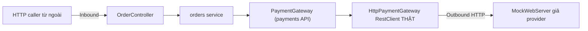
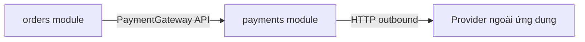
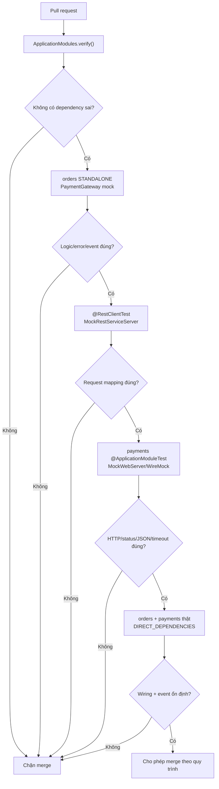

# Cấu hình web client và server giả lập

Một bài `@ApplicationModuleTest` có thể chứng minh module `orders` gọi `PaymentGateway.authorize(...)` với tham số đúng bằng cách dùng Mockito. Nhưng phép kiểm tra đó **không gửi một HTTP request nào**. Nếu adapter thật dùng sai URL, sai JSON field, quên header idempotency hoặc xử lý HTTP 422/503 sai, bài test mock interface vẫn có thể xanh.

Để kiểm chứng đúng **ranh giới HTTP outbound**, cần giữ web client/adapter **thật** và thay **server bên ngoài** bằng một server giả lập có thể nhận request qua socket, trả response tùy kịch bản và ghi nhận request. Bài này tập trung vào **cấu hình web client và server giả lập trong test**, không phải thay toàn bộ nghiệp vụ bằng Mockito hay kiểm thử MVC controller ở phía inbound.

Bài thuộc chương **Test configuration** của **SPRING_MODULITH_VERIFICATION_TESTING**: kiểm chứng ranh giới kiến trúc với `ApplicationModules`, thực hành `@ApplicationModuleTest`, kiểm thử sự kiện/database/tích hợp và quality gate CI. Trọng tâm là **HTTP contract tại outbound port**, cách đưa endpoint động vào Spring context, xử lý lỗi/timeout và xác định chính xác mức bảo đảm của mỗi loại test.

## 1. Bài toán và tiêu chí thành công

Giả sử module `orders` gọi API công khai `payments.PaymentGateway`, còn module `payments` sở hữu adapter `HttpPaymentGateway` dùng `RestClient` để gửi request tới một payment provider.

Một test HTTP adapter có giá trị phải chứng minh **tối thiểu**:

| Hợp đồng cần bảo vệ | Assertion có trọng tâm |
| --- | --- |
| Đúng endpoint/method | `POST /v1/authorizations`, không phải GET hoặc path khác |
| Đúng định dạng request | JSON chứa `orderId` và `amountCents` với kiểu dữ liệu chính xác |
| Idempotency | Header `Idempotency-Key` dùng cùng order ID qua retry |
| Đúng cách đọc response | JSON `approved`/`providerReference` được map thành kết quả API |
| Lỗi 4xx/5xx | Không trả thành công giả khi provider trả 422/503 |
| Network/timeout | Client xử lý connection failure hoặc response chậm theo policy |
| Test isolation | Không gọi endpoint production; mỗi test dùng server/data kiểm soát được |
| Kiến trúc module | `orders` chỉ dùng API `payments`; `verify()` chạy độc lập |

**Đầu ra của bài:** một `@ApplicationModuleTest` dùng HTTP server giả lập thật qua localhost port động, một test slice nhẹ với `MockRestServiceServer`, một ví dụ `WebClient` và một test từ `orders` tới `payments` thật để so sánh isolated adapter với tích hợp liên module.

## 2. Chọn đúng công cụ: mock ở cấp nào?

| Phương án | HTTP request thật? | Cái gì được giữ thật? | Mục tiêu phù hợp |
| --- | --- | --- | --- |
| `@MockitoBean PaymentGateway` | **Không** | Service gọi gateway | Test validation/flow của `orders` |
| `MockRestServiceServer` | **Không qua socket** | `RestClient`/`RestTemplate` + code tạo request + message conversion | Adapter test nhẹ, kỳ vọng request/response |
| OkHttp `MockWebServer` | **Có, qua loopback HTTP** | Adapter, HTTP transport và Jackson/config đang dùng | Client contract, status, header, body, timeout/network |
| WireMock | **Có, qua HTTP** | Tương tự MockWebServer, thêm mapping/scenario/stubbing phong phú | Nhiều endpoint hoặc stateful contract |
| `WebTestClient.bindToController(...)` | **Không chạy server network** | Controller/server-side handler | Test **HTTP inbound**, không thay upstream provider |
| `WebTestClient.bindToServer()` | **Có** | HTTP client gọi một server đang chạy | Test API inbound trên random port |
| Staging provider thật | **Có, mạng ngoài** | Adapter và provider thật | Contract/integration riêng, cần an toàn/quyền truy cập |

Tài liệu Spring Framework khuyến nghị mock web server cho những kiểm thử HTTP client **cần hành vi transport thực**; `MockRestServiceServer` vẫn hữu ích cho test nhanh vì nó chặn request qua mock `ClientHttpRequestFactory`.

### Ranh giới hai chiều dễ bị nhầm



`MockMvc` và `WebTestClient` thường phục vụ **inbound controller**. Trong bài này, server giả lập nằm **phía đối tác mà web client gọi tới**. Dù cùng là “HTTP test”, hai hướng mang các hợp đồng khác nhau.

## 3. Cấu trúc module chỉ giữ những phần cần cho ví dụ

```text
src/main/java/com/acme/shop/
├── ShopApplication.java
├── orders/
│   ├── OrderOperations.java
│   └── internal/DefaultOrderOperations.java
└── payments/
    ├── PaymentGateway.java               # public API cho orders
    └── internal/HttpPaymentGateway.java  # adapter outbound thật

src/main/resources/application.yml

src/test/java/com/acme/shop/
├── ArchitectureVerificationTest.java
├── payments/
│   ├── PaymentHttpModuleTest.java
│   └── internal/HttpPaymentGatewaySliceTest.java
└── orders/
    ├── OrdersWithMockPaymentTest.java
    └── OrdersPaymentIntegrationTest.java
```

Lớp `ShopApplication` ở package root:

```java
// src/main/java/com/acme/shop/ShopApplication.java
package com.acme.shop;

import org.springframework.boot.autoconfigure.SpringBootApplication;

@SpringBootApplication
public class ShopApplication {
}
```

Module `orders` phụ thuộc **interface ở base package `payments`**, không biết kiểu `payments.internal.HttpPaymentGateway`. Trong mô hình closed module thông thường, Java dependency `orders → payments` được kiểm chứng độc lập với HTTP network.



Provider HTTP **không phải application module trong JVM**. `ApplicationModules.verify()` kiểm tra cạnh Java, còn HTTP integration test kiểm tra giao thức với provider.

## 4. Public contract: đừng để orders dùng RestClient trực tiếp

```java
// src/main/java/com/acme/shop/payments/PaymentGateway.java
package com.acme.shop.payments;

import java.util.UUID;

public interface PaymentGateway {

    Authorization authorize(UUID orderId, int amountCents);

    record Authorization(boolean approved, String providerReference) {
    }
}
```

Contract này nói về **ủy quyền thanh toán** bằng đơn vị nhỏ nhất (`amountCents`), không nói URL, DTO JSON hay mã HTTP. Các module khác chỉ import `PaymentGateway`, giúp adapter có thể thay provider mà không làm tràn chi tiết hạ tầng.

**Không nhầm:** interface cho phép mock trong test `orders`, nhưng để kiểm tra JSON/HTTP thì bắt buộc test riêng adapter thật của `payments`.

## 5. Adapter thật: request, response, lỗi HTTP

Ví dụ dùng **Spring Boot 3.4/3.5, Spring Framework 6.2+, Java 17+** và `RestClient`. Dự án dùng dòng mới hơn có thể cần cập nhật import/dependency cho tương thích.

```java
// src/main/java/com/acme/shop/payments/internal/HttpPaymentGateway.java
package com.acme.shop.payments.internal;

import com.acme.shop.payments.PaymentGateway;
import java.util.UUID;
import org.springframework.beans.factory.annotation.Value;
import org.springframework.http.MediaType;
import org.springframework.stereotype.Component;
import org.springframework.web.client.RestClient;

@Component
class HttpPaymentGateway implements PaymentGateway {

    private final RestClient client;

    HttpPaymentGateway(
            RestClient.Builder builder,
            @Value("${partners.payment.base-url}") String baseUrl
    ) {
        this.client = builder.baseUrl(baseUrl).build();
    }

    @Override
    public Authorization authorize(UUID orderId, int amountCents) {
        if (orderId == null || amountCents <= 0) {
            throw new IllegalArgumentException("Payment request không hợp lệ");
        }

        ProviderResponse response = client.post()
                .uri("/v1/authorizations")
                .contentType(MediaType.APPLICATION_JSON)
                .header("Idempotency-Key", orderId.toString())
                .body(new ProviderRequest(orderId, amountCents))
                .retrieve()
                .body(ProviderResponse.class);

        if (response == null) {
            throw new IllegalStateException(
                    "Provider trả response body rỗng");
        }

        return new Authorization(
                response.approved(), response.providerReference());
    }

    // DTO private của adapter, KHÔNG phải API công khai liên module.
    public record ProviderRequest(UUID orderId, int amountCents) {
    }

    public record ProviderResponse(
            boolean approved, String providerReference) {
    }
}
```

**Giải thích có chủ đích:**

1. `RestClient.Builder` đến từ Spring Boot auto-configuration khi có starter/web dependencies phù hợp.
2. `partners.payment.base-url` được đọc **khi bean adapter được tạo**; test phải cấp URL mock server **trước thời điểm ấy**.
3. Method và URI path được test bằng server thật: `POST /v1/authorizations`.
4. Header `Idempotency-Key` dùng `orderId` không đổi giữa những lần retry hợp lệ.
5. `RestClient.retrieve()` mặc định ném exception tương ứng cho HTTP 4xx/5xx; nó **không tự trả `Authorization(false, ...)`** cho HTTP 422.
6. DTO ở adapter không được module `orders` import trực tiếp.

### Một cấu hình production tối thiểu

```yaml
# src/main/resources/application.yml
partners:
  payment:
    base-url: https://payments.example.invalid
```

`example.invalid` là tên miền minh họa không dùng để thanh toán thật. Trong production, cấp URL bằng cấu hình triển khai an toàn. Trong test adapter, nguồn dynamic property sẽ ghi đè `partners.payment.base-url` để trỏ tới HTTP mock server.

### Không coi HTTP 2xx là nghiệp vụ thành công

Provider có thể trả 200 với `{"approved":false,...}` – đó là **từ chối nghiệp vụ nhưng HTTP transport thành công**. Ngược lại HTTP 422 có thể báo request không hợp lệ; HTTP 429/503 thường liên quan retry/throttling. Kiểm thử cả **status** và **payload business**, không gộp chúng thành một boolean duy nhất.

## 6. MockWebServer là server thật, không phải mock bean

OkHttp `MockWebServer` cung cấp một HTTP server chạy trên loopback với port được cấp động:

- `enqueue(MockResponse)` đặt trước response dành cho request tiếp theo.
- `takeRequest(timeout, unit)` lấy request thật mà adapter đã gửi.
- `RecordedRequest` cho phép kiểm tra method, path, headers và body.
- `MockResponse` có thể mô phỏng status, header, body, delay hoặc lỗi connection ở mức transport.
- `start()/shutdown()` là lifecycle phải được quản lý minh bạch.

Dependency test điển hình cho baseline OkHttp 4.x:

```groovy
// Mảnh Gradle; dùng BOM/version management phù hợp dự án.
dependencies {
    implementation 'org.springframework.boot:spring-boot-starter-web'
    testImplementation 'org.springframework.boot:spring-boot-starter-test'
    testImplementation 'org.springframework.modulith:spring-modulith-starter-test'
    testImplementation 'com.squareup.okhttp3:mockwebserver:4.12.0'
}
```

Đây là **mảnh dependencies**, không phải toàn bộ build. Tên artifact/API thay đổi ở một số dòng OkHttp 5.x; bài minh họa dùng `okhttp3.mockwebserver.MockWebServer`/`MockResponse` từ OkHttp 4.12.0.

### Tránh hai bẫy bootstrap

**Bẫy 1 – gọi port quá sớm:** `server.url("/")` không nên được resolve khi server chưa start.

**Bẫy 2 – start trong @BeforeAll rồi context cần URL trước:** khi Spring Test khởi tạo `ApplicationContext`, adapter có thể đọc property trước khi callback JUnit `@BeforeAll` chạy, tùy lifecycle. Một static `@DynamicPropertySource` chỉ đăng ký supplier; nó **không tự start HTTP server**.

Với Spring Framework 6.2+, giải pháp rõ ràng là để **Spring quản lý MockWebServer như một bean** và dùng **`DynamicPropertyRegistrar` bean** đăng ký URL ngay trước giai đoạn khởi tạo singleton thông thường.

## 7. Cấu hình test: MockWebServer bean + DynamicPropertyRegistrar

Một nested `@TestConfiguration` tạo server và đăng ký property:

```java
// Các khai báo nằm bên trong test class ở mục 8.
@TestConfiguration(proxyBeanMethods = false)
static class WebStubFixture {

    @Bean(initMethod = "start", destroyMethod = "shutdown")
    MockWebServer paymentStub() {
        return new MockWebServer();
    }

    @Bean
    DynamicPropertyRegistrar paymentBaseUrl(MockWebServer paymentStub) {
        return registry -> registry.add(
                "partners.payment.base-url",
                () -> paymentStub.url("/").toString());
    }
}
```

Các import cần thiết:

```java
import okhttp3.mockwebserver.MockWebServer;
import org.springframework.boot.test.context.TestConfiguration;
import org.springframework.context.annotation.Bean;
import org.springframework.test.context.DynamicPropertyRegistrar;
```

**Tại sao thứ tự này an toàn hơn?**

1. Spring TestContext phát hiện bean `DynamicPropertyRegistrar` và khởi tạo nó **sớm**.
2. Muốn tạo registrar, Spring phải resolve dependency `MockWebServer`; bean server được tạo và gọi `initMethod="start"`.
3. Registrar đăng ký supplier trả URL dựa trên server **đã start**.
4. Khi Spring tạo `HttpPaymentGateway`, biểu thức `@Value("${partners.payment.base-url}")` lấy URL test có cổng thật.
5. Khi Spring đóng context, `destroyMethod="shutdown"` dừng server.

**Điểm đặc biệt:** vì server là **bean thuộc lifecycle của Spring context**, nó không bị dừng ở cuối JUnit test class trong khi context vẫn đang cache như một server do `@AfterAll` tự shutdown. Điều này giúp tránh một số lỗi endpoint hết hạn khi cache được reuse; vẫn phải quản lý message queue/requests giữa các test.

`DynamicPropertyRegistrar` có từ **Spring Framework 6.2**. Với stack cũ hơn, có thể dùng static server được khởi động sớm và `@DynamicPropertySource`, hoặc JUnit extension/hạ tầng mock server có vòng đời tương thích. Không copy class registrar sang phiên bản chưa có API.

## 8. Bài @ApplicationModuleTest hoàn chỉnh: RestClient thật + HTTP stub

Test ở `com.acme.shop.payments` để Spring Modulith bootstrap **module `payments` ở `STANDALONE`**. Nhờ đó `HttpPaymentGateway` production được tạo thật; chỉ HTTP **server đối tác** được giả lập.

```java
// src/test/java/com/acme/shop/payments/PaymentHttpModuleTest.java
package com.acme.shop.payments;

import com.fasterxml.jackson.databind.JsonNode;
import com.fasterxml.jackson.databind.ObjectMapper;
import java.util.UUID;
import java.util.concurrent.TimeUnit;
import okhttp3.mockwebserver.MockResponse;
import okhttp3.mockwebserver.MockWebServer;
import okhttp3.mockwebserver.RecordedRequest;
import org.junit.jupiter.api.Test;
import org.springframework.beans.factory.annotation.Autowired;
import org.springframework.boot.test.context.TestConfiguration;
import org.springframework.context.annotation.Bean;
import org.springframework.context.annotation.Import;
import org.springframework.modulith.test.ApplicationModuleTest;
import org.springframework.test.context.DynamicPropertyRegistrar;
import org.springframework.web.client.HttpClientErrorException;
import org.springframework.web.client.HttpServerErrorException;

import static org.assertj.core.api.Assertions.assertThat;
import static org.assertj.core.api.Assertions.assertThatThrownBy;

@ApplicationModuleTest
@Import(PaymentHttpModuleTest.WebStubFixture.class)
class PaymentHttpModuleTest {

    @Autowired
    PaymentGateway payments;

    @Autowired
    MockWebServer paymentStub;

    @Autowired
    ObjectMapper objectMapper;

    @TestConfiguration(proxyBeanMethods = false)
    static class WebStubFixture {

        @Bean(initMethod = "start", destroyMethod = "shutdown")
        MockWebServer paymentStub() {
            return new MockWebServer();
        }

        @Bean
        DynamicPropertyRegistrar paymentBaseUrl(MockWebServer paymentStub) {
            return registry -> registry.add(
                    "partners.payment.base-url",
                    () -> paymentStub.url("/").toString());
        }
    }

    @Test
    void sendsCorrectRequestAndParsesSuccessfulResponse()
            throws Exception {

        UUID orderId = UUID.fromString(
                "00000000-0000-0000-0000-000000000042");

        paymentStub.enqueue(new MockResponse()
                .setResponseCode(200)
                .addHeader("Content-Type", "application/json")
                .setBody("""
                        {
                          "approved": true,
                          "providerReference": "PAY-42"
                        }
                        """));

        PaymentGateway.Authorization result =
                payments.authorize(orderId, 12_500);

        assertThat(result.approved()).isTrue();
        assertThat(result.providerReference()).isEqualTo("PAY-42");

        RecordedRequest request =
                paymentStub.takeRequest(2, TimeUnit.SECONDS);

        assertThat(request).isNotNull();
        assertThat(request.getMethod()).isEqualTo("POST");
        assertThat(request.getPath())
                .isEqualTo("/v1/authorizations");
        assertThat(request.getHeader("Idempotency-Key"))
                .isEqualTo(orderId.toString());
        assertThat(request.getHeader("Content-Type"))
                .contains("application/json");

        JsonNode body =
                objectMapper.readTree(request.getBody().readUtf8());
        assertThat(body.path("orderId").asText())
                .isEqualTo(orderId.toString());
        assertThat(body.path("amountCents").asInt())
                .isEqualTo(12_500);
    }

    @Test
    void keepsBusinessRejectionDifferentFromTransportFailure()
            throws Exception {

        UUID orderId = UUID.randomUUID();
        paymentStub.enqueue(new MockResponse()
                .setResponseCode(200)
                .addHeader("Content-Type", "application/json")
                .setBody("""
                        {
                          "approved": false,
                          "providerReference": "DECLINED"
                        }
                        """));

        PaymentGateway.Authorization result =
                payments.authorize(orderId, 1_000);

        assertThat(result.approved()).isFalse();
        assertThat(result.providerReference()).isEqualTo("DECLINED");
        assertThat(paymentStub.takeRequest(2, TimeUnit.SECONDS))
                .isNotNull();
    }

    @Test
    void propagatesHttp422InsteadOfPretendingSuccess()
            throws Exception {

        paymentStub.enqueue(new MockResponse()
                .setResponseCode(422)
                .addHeader("Content-Type", "application/json")
                .setBody("""
                        {"code": "INVALID_AMOUNT"}
                        """));

        assertThatThrownBy(() ->
                payments.authorize(UUID.randomUUID(), 200))
                .isInstanceOf(
                        HttpClientErrorException.UnprocessableEntity.class);

        assertThat(paymentStub.takeRequest(2, TimeUnit.SECONDS))
                .isNotNull();
    }

    @Test
    void propagatesHttp503InsteadOfPretendingSuccess()
            throws Exception {

        paymentStub.enqueue(new MockResponse()
                .setResponseCode(503)
                .addHeader("Content-Type", "application/json")
                .setBody("""
                        {"code": "TEMPORARILY_UNAVAILABLE"}
                        """));

        assertThatThrownBy(() ->
                payments.authorize(UUID.randomUUID(), 200))
                .isInstanceOf(
                        HttpServerErrorException.ServiceUnavailable.class);

        assertThat(paymentStub.takeRequest(2, TimeUnit.SECONDS))
                .isNotNull();
    }
}
```

### Bài test thật sự bảo vệ điều gì?

1. **Adapter thật** được Spring tạo từ `@Component` của `payments`.
2. `MockWebServer` **lắng nghe HTTP qua socket trên port động**, khác với Mockito bean.
3. `DynamicPropertyRegistrar` đăng ký URL **trước** lúc adapter tạo `RestClient`.
4. Jackson thực sự **serialize request body** và **deserialize response body**.
5. `RecordedRequest` khẳng định method/path/header/payload đã đi qua HTTP.
6. HTTP 200 với `approved=false` khác hẳn HTTP 422/503; test không gộp business rejection và lỗi transport.

Các test trong class dùng hàng đợi response/request của **cùng server bean**, nên không được tùy tiện chạy song song trên cùng context. Mỗi method ở ví dụ enqueue **một response, gọi một request, lấy request ra khỏi queue**; trong dự án thật cần thêm reset/isolation nếu test phát nhiều requests, retry hoặc shared context.

### Những điều chưa được chứng minh

Ví dụ không kiểm tra server production, không xác nhận TLS/credentials của provider thật, không tự chứng minh retry/timeout và không kiểm tra transaction của `orders`. Nó cũng **không thay** phép kiểm chứng package/module `ApplicationModules.verify()`.

## 9. Kiểm tra lỗi theo loại: 422, 429, 503 và network

Phần lớn adapter không nên để toàn bộ exception HTTP của thư viện lọt ra public API giữa các module. Nhưng **phải xác định policy trước**, không biến tất cả lỗi thành “payment declined”.

| Tình huống | Ý nghĩa thường gặp | Hướng xử lý adapter đề xuất | Test nên assert |
| --- | --- | --- | --- |
| 200 + `approved=false` | Provider trả lời nghiệp vụ bị từ chối | Trả `Authorization(false, ...)` hoặc domain result | Body mapping đúng; không throw do HTTP |
| 422 | Request không hợp lệ theo contract | Domain validation/integration error, thường không retry mù quáng | Status/error body được map theo policy |
| 401/403 | API key hoặc quyền truy cập sai | Báo lỗi cấu hình/bảo mật, không coi là decline nghiệp vụ | Không retry vô hạn |
| 429 | Rate limit | Lỗi tạm thời, tôn trọng `Retry-After` nếu contract có | Retry/backoff theo giới hạn |
| 503 | Provider unavailable | Lỗi tạm thời, circuit breaker/backoff có kiểm soát | Không trả success giả |
| Connection refused | Không kết nối được | Lỗi hạ tầng, không thể biết provider đã xử lý chưa | Lỗi có thể quan sát và không crash âm thầm |
| Read timeout | Response tới chậm | Hạn chờ, idempotency khi retry | Thời gian timeout theo cấu hình |
| 200 nhưng JSON thiếu/sai kiểu | Contract/schema drift | Protocol/serialization error | Không map sai thành object hợp lệ |

Trong ví dụ `HttpPaymentGateway`, `retrieve()` dùng cơ chế mặc định để throw các exception 4xx/5xx. Nếu muốn module `orders` không biết exception HTTP cụ thể, nên ánh xạ chúng tại adapter:

```java
// Mảnh minh họa bên trong chuỗi client.post().retrieve() của adapter.
.onStatus(status -> status.value() == 422,
        (request, response) -> {
            throw new PaymentRejectedRequestException(
                    "Provider không chấp nhận request");
        })
.onStatus(status -> status.value() == 429
                || status.is5xxServerError(),
        (request, response) -> {
            throw new PaymentTemporarilyUnavailableException(
                    "Provider chưa thể xử lý");
        })
```

Hai exception `PaymentRejectedRequestException` và `PaymentTemporarilyUnavailableException` ở đoạn trên là **domain types do dự án tự định nghĩa**, không phải API Spring. Cần quyết định chúng là kiểu public contract của module `payments` hay được dịch thành result trả về. Đừng copy đoạn này vào ví dụ chính rồi vẫn assert exception gốc 422/503: **test kỳ vọng phải đổi theo policy mới**.

### Cảnh báo về retry POST thanh toán

Một POST có thể đã được xử lý nhưng response bị mất. Nếu retry không có **idempotency key ổn định**, provider có thể ghi nhận hai giao dịch. Ví dụ đã gắn header từ `orderId`; phải kiểm tra lại cùng key qua mọi retry, thiết lập backoff/giới hạn và phối hợp contract thực của provider. Một server stub trả 503 rồi 200 chỉ chứng minh **client thử lại**, chưa chứng minh provider production thực sự deduplicate giao dịch.

## 10. Mô phỏng timeout và lỗi kết nối đúng cách

`MockWebServer` có thể delay response hoặc đóng kết nối. Ví dụ mảnh test:

```java
// Response body bị trì hoãn hai giây:
paymentStub.enqueue(new MockResponse()
        .setResponseCode(200)
        .setBodyDelay(2, TimeUnit.SECONDS)
        .addHeader("Content-Type", "application/json")
        .setBody("""
                {"approved": true, "providerReference": "SLOW-1"}
                """));

// Adapter cần được cấu hình read/response timeout ngắn hơn delay.
// Khi gọi authorize(...), assert exception phù hợp với HTTP client.
```

### Điều kiện quan trọng bị bỏ qua trong nhiều tutorial

Nếu web client **chưa có response/read timeout**, việc delay hai giây có thể chỉ khiến test chậm rồi thành công – không chứng minh timeout handling.

Với `RestClient`, cần quyết định HTTP request factory và timeout ở **cấu hình client production**, rồi cho test sử dụng **cùng cơ chế cấu hình**. Ví dụ với JDK `SimpleClientHttpRequestFactory`:

```java
// Mảnh cấu hình, không phải replacement tự động cho bean ở mục 5.
SimpleClientHttpRequestFactory factory =
        new SimpleClientHttpRequestFactory();
factory.setConnectTimeout(500);
factory.setReadTimeout(800);

RestClient client = RestClient.builder()
        .requestFactory(factory)
        .baseUrl("http://localhost:12345")
        .build();
```

Các import: `org.springframework.http.client.SimpleClientHttpRequestFactory`, `org.springframework.web.client.RestClient`. Ví dụ trên chỉ minh họa **cách cấu hình timeout của một request factory cụ thể**; nếu thay request factory trong test khác với production, phép kiểm tra có thể không phản ánh chính client thật mà dự án dùng.

**Thiết kế tốt hơn:** inject cấu hình timeout (`Duration`) hoặc một `RestClient.Builder` được cấu hình riêng cho adapter, và kiểm tra nó bằng một mock HTTP server có response delay/connection fault tương ứng. Không dùng `Thread.sleep(...)` trong test như cách tự mô phỏng timeout ở phía client.

### Không đưa timeout quá sát ngưỡng của CI

Nếu timeout là 800 ms, delay test nên lớn hơn đủ rõ (chẳng hạn 2 s), nhưng assertion không nên dựa vào số mili-giây đo được phải **bằng chính xác 800**. Scheduler, tải CI và TCP stack có độ dao động. Assert **loại lỗi** và upper bound hợp lý, đồng thời đặt test timeout ngoài để tránh treo vô hạn.

### Fault injection cần xác định cấp độ

| Fault | Cơ chế mock server | Lỗi muốn tìm |
| --- | --- | --- |
| 503 + body | `MockResponse.setResponseCode(503)` | HTTP error mapping |
| Chậm gửi body | `setBodyDelay(...)` | Read/response timeout |
| Đóng socket | `SocketPolicy` hoặc shutdown server có kiểm soát | Transport error path |
| Malformed JSON | Response `Content-Type: application/json` với body lỗi | Deserialization/contract drift |
| Hai response liên tiếp 503 → 200 | Enqueue theo thứ tự | Retry count, idempotency key không đổi |

**Không suy ra “server down” từ một test chỉ trả HTTP 503**: trường hợp đó vẫn có TCP connection và HTTP response hợp lệ. Connection refused/reset, DNS failure và TLS error là những kịch bản khác.

## 11. Test slice nhanh với MockRestServiceServer

Khi chỉ muốn kiểm tra **RestClient tạo request và đọc response** nhưng chưa cần TCP socket thật, Spring Boot `@RestClientTest` và Spring Framework `MockRestServiceServer` là lựa chọn nhẹ.

Ví dụ trong package chứa adapter:

```java
// src/test/java/com/acme/shop/payments/internal/HttpPaymentGatewaySliceTest.java
package com.acme.shop.payments.internal;

import com.acme.shop.payments.PaymentGateway;
import java.util.UUID;
import org.junit.jupiter.api.Test;
import org.springframework.beans.factory.annotation.Autowired;
import org.springframework.boot.test.autoconfigure.web.client.RestClientTest;
import org.springframework.http.HttpMethod;
import org.springframework.http.MediaType;
import org.springframework.test.context.TestPropertySource;
import org.springframework.test.web.client.MockRestServiceServer;

import static org.assertj.core.api.Assertions.assertThat;
import static org.springframework.test.web.client.match.MockRestRequestMatchers.header;
import static org.springframework.test.web.client.match.MockRestRequestMatchers.method;
import static org.springframework.test.web.client.match.MockRestRequestMatchers.requestTo;
import static org.springframework.test.web.client.response.MockRestResponseCreators.withSuccess;

@RestClientTest(HttpPaymentGateway.class)
@TestPropertySource(properties =
        "partners.payment.base-url=https://payments.example.invalid")
class HttpPaymentGatewaySliceTest {

    @Autowired
    PaymentGateway payments;

    @Autowired
    MockRestServiceServer server;

    @Test
    void sendsExpectedRestClientRequestWithoutSocket() {
        UUID id = UUID.fromString(
                "00000000-0000-0000-0000-000000000043");

        server.expect(requestTo(
                "https://payments.example.invalid/v1/authorizations"))
                .andExpect(method(HttpMethod.POST))
                .andExpect(header(
                        "Idempotency-Key", id.toString()))
                .andRespond(withSuccess(
                        """
                        {"approved":true,"providerReference":"PAY-43"}
                        """,
                        MediaType.APPLICATION_JSON));

        PaymentGateway.Authorization result =
                payments.authorize(id, 1_000);

        assertThat(result.providerReference()).isEqualTo("PAY-43");
        server.verify();
    }
}
```

### Điểm khác biệt quyết định

`MockRestServiceServer` **không lắng nghe cổng HTTP**. Nó gắn mock request factory vào `RestClient.Builder` (hoặc `RestTemplate`) để kiểm tra request ở bên trong tiến trình. Nó có thể bắt lỗi path/header/body và map JSON, nhưng **không mô phỏng thực tế TCP connection reset/SSL handshake/timeout ở mức socket**.

Với `@RestClientTest`, Spring Boot tự cấu hình `MockRestServiceServer` và `RestClient.Builder` cho test slice. Điều này khác `@ApplicationModuleTest`: test slice chỉ nạp những bean/client liên quan, **không bảo đảm toàn bộ module `payments` được bootstrap hoặc verify module boundary**.

**Hai bẫy khi dùng MockRestServiceServer:**

1. Phải gắn mock server với **đúng builder/client mà adapter thật sử dụng**. Nếu code tạo `RestClient` khác bằng `RestClient.create()`, không nhất thiết có interception.
2. Khi có **nhiều `RestClient.Builder`/`RestClient`**, một bean `MockRestServiceServer` mặc định có thể không đủ để định danh tất cả. Hãy bind server trực tiếp với builder tương ứng hoặc dùng customizer/test configuration phù hợp.

Spring Framework hỗ trợ `MockRestServiceServer.bindTo(RestClient.Builder)` từ 6.1. Spring Boot `@RestClientTest` thay đổi package import ở các major version (ví dụ Boot 4.x), nên đoạn trên chốt baseline **Boot 3.4/3.5**.

## 12. Cùng mock HTTP server, nhưng với WebClient phản ứng

Nếu adapter dùng Spring WebFlux `WebClient` thay `RestClient`, ta vẫn có thể dùng **MockWebServer**. Khác biệt lớn nhất là network request được kích hoạt khi có **subscription** tới `Mono`/`Flux`, không chỉ khi gọi method tạo publisher.

Một adapter reactive minh họa:

```java
// Mảnh adapter reactive; dùng thay RestClient adapter, không đăng ký
// hai @Component implement PaymentGateway cùng lúc trong một context.
package com.acme.shop.payments.internal;

import com.acme.shop.payments.PaymentGateway;
import java.util.UUID;
import org.springframework.beans.factory.annotation.Value;
import org.springframework.http.MediaType;
import org.springframework.stereotype.Component;
import org.springframework.web.reactive.function.client.WebClient;
import reactor.core.publisher.Mono;

@Component
class ReactivePaymentHttpClient {

    private final WebClient client;

    ReactivePaymentHttpClient(
            WebClient.Builder builder,
            @Value("${partners.payment.base-url}") String baseUrl
    ) {
        this.client = builder.baseUrl(baseUrl).build();
    }

    Mono<PaymentGateway.Authorization> authorize(
            UUID orderId, int amountCents
    ) {
        return client.post()
                .uri("/v1/authorizations")
                .contentType(MediaType.APPLICATION_JSON)
                .header("Idempotency-Key", orderId.toString())
                .bodyValue(new Request(orderId, amountCents))
                .retrieve()
                .bodyToMono(Response.class)
                .switchIfEmpty(Mono.error(
                        new IllegalStateException("Empty body")))
                .map(r -> new PaymentGateway.Authorization(
                        r.approved(), r.providerReference()));
    }

    public record Request(UUID orderId, int amountCents) {
    }

    public record Response(boolean approved, String providerReference) {
    }
}
```

**Lưu ý:** đây là một adapter reactive riêng, chưa triển khai interface `PaymentGateway` đồng bộ ở mục 4, vì return type là `Mono`. Một ứng dụng reactive cần định nghĩa **reactive port** tương ứng (ví dụ `Mono<Authorization> authorize(...)`) và thống nhất cách caller subscribe/chain. Không dùng `block()` trong event-loop request thread chỉ để ép về API đồng bộ.

Mảnh test cùng `MockWebServer`:

```java
// Trong một Spring test có ReactivePaymentHttpClient và MockWebServer bean.
paymentStub.enqueue(new MockResponse()
        .setResponseCode(200)
        .addHeader("Content-Type", "application/json")
        .setBody("""
                {"approved":true,"providerReference":"ASYNC-1"}
                """));

StepVerifier.create(
        reactivePaymentHttpClient.authorize(orderId, 3_000))
        .assertNext(result -> {
            assertThat(result.approved()).isTrue();
            assertThat(result.providerReference()).isEqualTo("ASYNC-1");
        })
        .verifyComplete();

RecordedRequest request =
        paymentStub.takeRequest(2, TimeUnit.SECONDS);
assertThat(request).isNotNull();
assertThat(request.getPath()).isEqualTo("/v1/authorizations");
```

Đoạn này cần Reactor Test `StepVerifier` (`reactor-test`), bean reactive adapter, `orderId` được tạo sẵn và các import MockWebServer/JUnit/AssertJ tương ứng. Đây là **mảnh test** đặt trong test class có fixture phù hợp, không phải một class độc lập.

### Vì sao WebTestClient không thay MockWebServer ở đây?

`WebTestClient` là một **client dùng để test server-side endpoints**, dù bên trong sử dụng công nghệ của WebClient. `WebTestClient.bindToController(...)` hoặc `bindToApplicationContext(...)` dựng server-side test harness; `bindToServer()` gửi tới một server HTTP thật.

Nhưng đối tượng cần kiểm tra ở đây là **WebClient adapter đang gọi provider ngoài**. Muốn kiểm tra outbound HTTP của adapter, phải có upstream server giả lập (MockWebServer/WireMock) hoặc một `ExchangeFunction` giả cho unit test hẹp; chỉ tạo `WebTestClient` không tự intercept outbound request.

## 13. Từ module orders tới payments thật: hai phép kiểm tra khác nhau

**Cùng một cổng `PaymentGateway`, hai cách test phục vụ hai rủi ro khác nhau.**

### 13.1. Code production nhỏ của orders

```java
// src/main/java/com/acme/shop/orders/OrderOperations.java
package com.acme.shop.orders;

import java.util.UUID;

public interface OrderOperations {
    UUID place(int amountCents);
}
```

```java
// src/main/java/com/acme/shop/orders/events/OrderPlaced.java
package com.acme.shop.orders.events;

import java.util.UUID;

public record OrderPlaced(UUID orderId, String paymentReference) {
}
```

```java
// src/main/java/com/acme/shop/orders/internal/DefaultOrderOperations.java
package com.acme.shop.orders.internal;

import com.acme.shop.orders.OrderOperations;
import com.acme.shop.orders.events.OrderPlaced;
import com.acme.shop.payments.PaymentGateway;
import java.util.UUID;
import org.springframework.context.ApplicationEventPublisher;
import org.springframework.stereotype.Service;

@Service
class DefaultOrderOperations implements OrderOperations {

    private final PaymentGateway payments;
    private final ApplicationEventPublisher publisher;

    DefaultOrderOperations(
            PaymentGateway payments,
            ApplicationEventPublisher publisher
    ) {
        this.payments = payments;
        this.publisher = publisher;
    }

    @Override
    public UUID place(int amountCents) {
        if (amountCents <= 0) {
            throw new IllegalArgumentException("Amount phải dương");
        }

        UUID orderId = UUID.randomUUID();
        PaymentGateway.Authorization authorization =
                payments.authorize(orderId, amountCents);

        if (!authorization.approved()) {
            throw new IllegalStateException("Thanh toán từ chối");
        }

        publisher.publishEvent(new OrderPlaced(
                orderId, authorization.providerReference()));
        return orderId;
    }
}
```

Trong ví dụ này, `orders` **không ghi database** và không sử dụng transaction; vì vậy test chỉ bảo vệ flow gọi gateway và publication, chưa phải kiểm thử ACID, event sau commit hoặc outbox.

### 13.2. Test STANDALONE: mock cổng PaymentGateway

```java
// src/test/java/com/acme/shop/orders/OrdersWithMockPaymentTest.java
package com.acme.shop.orders;

import com.acme.shop.orders.events.OrderPlaced;
import com.acme.shop.payments.PaymentGateway;
import org.junit.jupiter.api.Test;
import org.springframework.beans.factory.annotation.Autowired;
import org.springframework.modulith.test.ApplicationModuleTest;
import org.springframework.modulith.test.PublishedEvents;
import org.springframework.test.context.bean.override.mockito.MockitoBean;

import static org.assertj.core.api.Assertions.assertThat;
import static org.mockito.ArgumentMatchers.any;
import static org.mockito.ArgumentMatchers.eq;
import static org.mockito.Mockito.when;

@ApplicationModuleTest
class OrdersWithMockPaymentTest {

    @Autowired
    OrderOperations orders;

    @MockitoBean
    PaymentGateway payments;

    @Test
    void publishesOrderWithoutCallingHttp(PublishedEvents events) {
        when(payments.authorize(any(), eq(1_500)))
                .thenReturn(new PaymentGateway.Authorization(
                        true, "MOCK-REF"));

        var orderId = orders.place(1_500);

        assertThat(events.ofType(OrderPlaced.class)
                .matching(OrderPlaced::orderId, orderId))
                .hasSize(1);
    }
}
```

`STANDALONE` chỉ nạp `orders`; mock `PaymentGateway` **được tạo mới** cho interface thuộc module `payments` chưa bootstrap. Test này **không gọi HTTP** và không bảo vệ việc serialize JSON – đó là giới hạn **có chủ đích** để kiểm tra nhanh logic `orders`.

### 13.3. DIRECT_DEPENDENCIES: đi qua adapter thật và server giả lập

Để xác minh Spring wiring giữa `orders` và `payments`, nạp dependency module trực tiếp:

```java
// src/test/java/com/acme/shop/orders/OrdersPaymentIntegrationTest.java
package com.acme.shop.orders;

import com.acme.shop.orders.events.OrderPlaced;
import java.util.concurrent.TimeUnit;
import okhttp3.mockwebserver.MockResponse;
import okhttp3.mockwebserver.MockWebServer;
import okhttp3.mockwebserver.RecordedRequest;
import org.junit.jupiter.api.Test;
import org.springframework.beans.factory.annotation.Autowired;
import org.springframework.boot.test.context.TestConfiguration;
import org.springframework.context.annotation.Bean;
import org.springframework.context.annotation.Import;
import org.springframework.modulith.test.ApplicationModuleTest;
import org.springframework.modulith.test.ApplicationModuleTest.BootstrapMode;
import org.springframework.modulith.test.PublishedEvents;
import org.springframework.test.context.DynamicPropertyRegistrar;

import static org.assertj.core.api.Assertions.assertThat;

@ApplicationModuleTest(mode = BootstrapMode.DIRECT_DEPENDENCIES)
@Import(OrdersPaymentIntegrationTest.WebStubFixture.class)
class OrdersPaymentIntegrationTest {

    @Autowired
    OrderOperations orders;

    @Autowired
    MockWebServer paymentStub;

    @TestConfiguration(proxyBeanMethods = false)
    static class WebStubFixture {

        @Bean(initMethod = "start", destroyMethod = "shutdown")
        MockWebServer paymentStub() {
            return new MockWebServer();
        }

        @Bean
        DynamicPropertyRegistrar paymentUrl(MockWebServer paymentStub) {
            return registry -> registry.add(
                    "partners.payment.base-url",
                    () -> paymentStub.url("/").toString());
        }
    }

    @Test
    void usesRealPaymentAdapterAndPublishesEvent(
            PublishedEvents events) throws Exception {

        paymentStub.enqueue(new MockResponse()
                .setResponseCode(200)
                .addHeader("Content-Type", "application/json")
                .setBody("""
                        {"approved":true,
                         "providerReference":"LIVE-ADAPTER-1"}
                        """));

        var id = orders.place(2_500);

        RecordedRequest request =
                paymentStub.takeRequest(2, TimeUnit.SECONDS);

        assertThat(request).isNotNull();
        assertThat(request.getPath()).isEqualTo("/v1/authorizations");
        assertThat(request.getHeader("Idempotency-Key"))
                .isEqualTo(id.toString());
        assertThat(events.ofType(OrderPlaced.class)
                .matching(OrderPlaced::orderId, id)).hasSize(1);
    }
}
```

**Tại sao test này quan trọng?**

- `orders` và **dependency trực tiếp `payments`** được bootstrap cùng nhau.
- `PaymentGateway` đến từ `HttpPaymentGateway` production, **không phải Mockito mock**.
- Adapter đọc dynamic URL, gửi HTTP qua loopback, nhận JSON, trả domain result.
- `orders` dùng domain result rồi publish `OrderPlaced` qua publisher thật.
- Test kiểm tra **wiring + HTTP + event producer** trong một luồng.

**Giới hạn:** nó chưa chứng minh transaction, database hoặc event consumer khác module đã xử lý. Nếu `notifications` **phụ thuộc ngược vào** `orders` qua event, `DIRECT_DEPENDENCIES` của test đặt tại `orders` **không tự nạp `notifications`**.

### Đừng chỉ tăng bootstrap mode để chữa mọi lỗi

`DIRECT_DEPENDENCIES` hữu ích khi muốn kiểm tra wiring giữa các module thật, nhưng có thể kéo thêm database, HTTP client, broker hoặc config không thuộc mục tiêu. Nếu test chỉ cần service logic, `STANDALONE` + mock cổng là nhanh hơn; nếu mục tiêu là HTTP adapter, test ở chính module `payments` rõ hơn.

## 14. Khi nào chọn WireMock thay MockWebServer?

`MockWebServer` rất tốt khi mỗi test muốn **enqueue một vài response** rồi kiểm tra `RecordedRequest`. Nhưng các API tích hợp thường có nhiều endpoint, request patterns, stateful scenarios hoặc lỗi tùy điều kiện đầu vào. WireMock có DSL để ánh xạ response theo **method, URL, headers, JSON body và state**.

Một fixture Spring-managed tương tự:

```java
// Mảnh @TestConfiguration cho Spring Framework 6.2+.
@TestConfiguration(proxyBeanMethods = false)
static class WireMockFixture {

    @Bean(initMethod = "start", destroyMethod = "stop")
    WireMockServer paymentServer() {
        return new WireMockServer(
                WireMockConfiguration.wireMockConfig().dynamicPort());
    }

    @Bean
    DynamicPropertyRegistrar paymentUrl(WireMockServer server) {
        return registry -> registry.add(
                "partners.payment.base-url",
                server::baseUrl);
    }
}
```

Mảnh này dùng WireMock 3.x, cần dependency test và import `WireMockServer`, `WireMockConfiguration`, `DynamicPropertyRegistrar`, `@Bean`, `@TestConfiguration` phù hợp. Server phải start trước khi `baseUrl()` được resolve; cách khai báo bean/registrar ở đây đáp ứng được ràng buộc đó.

Một stub có điều kiện:

```java
paymentServer.stubFor(
    WireMock.post(
        WireMock.urlEqualTo("/v1/authorizations"))
        .withHeader("Idempotency-Key",
                WireMock.matching("[0-9a-fA-F-]{36}"))
        .willReturn(
                WireMock.aResponse()
                    .withStatus(200)
                    .withHeader(
                            "Content-Type", "application/json")
                    .withBody("""
                            {"approved":true,
                             "providerReference":"WM-1"}
                            """)
        )
);
```

**Đây là mảnh test**: trong test class cần bean `WireMockServer paymentServer` được inject và import `com.github.tomakehurst.wiremock.client.WireMock`. Một `WireMockServer` là server HTTP thật với port động, không phải Mockito mock của `PaymentGateway`.

### Điểm cần quyết định khi chọn WireMock

| Nhu cầu | MockWebServer | WireMock |
| --- | --- | --- |
| Một POST, một response, kiểm tra raw request | **Rất gọn** | Có thể nhưng DSL dài hơn |
| Nhiều endpoint, matching theo JSON/headers | Cần dispatcher/custom logic | **Phù hợp** |
| Provider thay state sau yêu cầu đầu | Có thể tự viết dispatcher | **Scenario/stateful stub** |
| Fault injection (delay/reset/malformed) | Có `MockResponse`/socket policy | Có fault/delay extensions |
| Dùng mapping file cho contract team | Cần helper riêng | **Có JSON mappings** |
| Kiểm soát request journal và verify | `takeRequest` | DSL verify/find requests |

Không có lựa chọn “tốt nhất” cho tất cả. Mục tiêu là test nhìn thấy **đường HTTP thật**, nhưng không trở thành một bản sao phức tạp của hệ thống đối tác.

## 15. Các quyết định cấu hình làm test xanh giả

### 15.1. Mock nhầm bean adapter

```java
@ApplicationModuleTest
class PaymentTest {
    @MockitoBean
    PaymentGateway gateway;
}
```

Nếu `HttpPaymentGateway` bị thay bởi Mockito mock, gọi `gateway.authorize(...)` không đi qua HTTP. Dù một server giả lập đang chạy cạnh đó, test **không tự chứng minh nó được sử dụng**.

**Cách phát hiện:** assert `RecordedRequest`/request journal thực sự nhận được request, chứ không chỉ assert return value.

### 15.2. Base URL và path bị nối sai

Phân biệt:

```text
Base URL = http://127.0.0.1:49152/
Request URI = /v1/authorizations
Kỳ vọng path = /v1/authorizations
```

Với client dùng base URL có path prefix, cách resolve path bắt đầu bằng `/` có thể thay thế prefix tùy `UriBuilderFactory`. Đừng suy đoán bằng việc “nhìn có vẻ đúng”; **assert request.getPath()** trong test. Đặc biệt khi provider dùng base path `/api/v2`, phải quyết định adapter truyền path tuyệt đối hay tương đối.

### 15.3. Server stub cho phép mọi request

Nếu mock server luôn trả 200 cho mọi method/path, test có thể bỏ qua lỗi GET thay POST. Trong ví dụ chính, ta **đọc request và assert method/path**. Với WireMock, match đúng verb, URL, header và body; một catch-all stub quá rộng làm giảm sức phát hiện hồi quy.

### 15.4. Chỉ kiểm tra HTTP status, không kiểm tra payload

Một response 200 không chứng minh `approved=true` hoặc `providerReference` được map đúng. Assert cả response DTO, JSON request, numeric field và header idempotency.

### 15.5. Không chờ request hoặc async completion

`MockWebServer.takeRequest(timeout)` chờ request với timeout hữu hạn. `WebClient` chỉ phát request khi publisher được subscribe. Một test reactive chỉ tạo `Mono` rồi assert không có exception **không kích hoạt HTTP**. Dùng `StepVerifier` hoặc một subscriber phù hợp để chạy pipeline.

### 15.6. Test đọc nhầm environment nhưng không biết client dùng gì

`@DynamicPropertySource` hoặc `DynamicPropertyRegistrar` tạo property có độ ưu tiên cao hơn `@TestPropertySource` cho cùng key. Nhưng một adapter có thể:

- Đọc **key khác**.
- Build `RestClient` quá sớm và giữ base URL cũ.
- Tự `new RestClient`/`WebClient.create(...)` với URL hard-code.
- Dùng một named client/qualifier khác với bean được test.

Vì vậy **không chỉ assert `Environment.getProperty(...)`**. Assert **server giả lập thật sự nhận request**.

### 15.7. Nhiều test cùng dùng một request queue

`MockWebServer` hoạt động theo queue. Một test enqueue hai response nhưng chỉ gửi một request để lại một response cho test sau; test suite có thể xanh khi chạy từng class nhưng sai khi chạy cả bộ.

Giải pháp:

- Mỗi test enqueue đúng số response theo kịch bản và tiêu thụ đúng số request.
- Không chạy song song nhiều method trên **cùng server bean** nếu dùng queue chung.
- Với nhiều case đồng thời, dùng WireMock matching theo request hoặc dispatcher riêng thay vì phụ thuộc thứ tự queue.
- Nếu cần context/server riêng, tách test class hoặc dùng lifecycle phù hợp.

### 15.8. Spring TestContext cache giữ endpoint cũ

Khi MockWebServer được Spring quản lý như ở mục 7, nó tồn tại theo **Spring context**. Nếu thay bằng static JUnit server được `@AfterAll` shutdown, một context được cache lại có thể giữ `RestClient` đang trỏ cổng của server đã dừng.

`@DirtiesContext` có thể tạo lại context nhưng làm test chậm; ưu tiên thiết kế lifecycle server **cùng vòng đời context**. Nếu dùng `@DynamicPropertySource` kế thừa từ superclass nhưng mỗi subclass tạo server mới, lưu ý cache key không tự đổi chỉ vì supplier trả port khác.

### 15.9. Mock server bị kết nối nhầm vì proxy

Một số môi trường CI có HTTP proxy ở cấp JVM hoặc cấu hình client. Khi kết nối tới `localhost`, cần bảo đảm client không chuyển qua proxy ngoài ý muốn; đừng coi “đã đặt base URL” là chắc chắn socket đi trực tiếp. Trong kiểm thử có security/network policy đặc thù, xác nhận transport và no-proxy settings tương ứng.

## 16. Bảo vệ ranh giới module tách khỏi HTTP transport

Một bài HTTP integration test có thể chạy xanh dù `orders` import thẳng `payments.internal.HttpPaymentGateway`, nếu Java access modifier cho phép. Trong closed module, đây vẫn là import vào **internal implementation** của module khác.

Khai báo giới hạn phù hợp:

```java
// src/main/java/com/acme/shop/orders/package-info.java
@org.springframework.modulith.ApplicationModule(
        allowedDependencies = "payments"
)
package com.acme.shop.orders;
```

Kiểm chứng module độc lập với mock server:

```java
// src/test/java/com/acme/shop/ArchitectureVerificationTest.java
package com.acme.shop;

import org.junit.jupiter.api.Test;
import org.springframework.modulith.core.ApplicationModules;

import static org.junit.jupiter.api.Assertions.assertTrue;

class ArchitectureVerificationTest {

    @Test
    void discoversExpectedModules() {
        var modules = ApplicationModules.of(ShopApplication.class);
        assertTrue(modules.getModuleByName("orders").isPresent());
        assertTrue(modules.getModuleByName("payments").isPresent());
    }

    @Test
    void verifiesArchitecture() {
        ApplicationModules.of(ShopApplication.class).verify();
    }
}
```

`verify()` kiểm tra hướng phụ thuộc, tính hợp lệ của public API, vòng phụ thuộc và `allowedDependencies` khi được khai báo. **Nó không kiểm tra HTTP status, serializer, timeout hoặc contract của provider.** Ngược lại, MockWebServer không thể cấp quyền dùng kiểu `payments.internal`.

### Event và database vẫn cần test của riêng chúng

Trong ví dụ `orders` ở mục 13, `PublishedEvents` chứng minh producer phát `OrderPlaced` sau khi nhận authorization. Nếu ứng dụng thật lưu đơn trong `@Transactional` và consumer dùng `@TransactionalEventListener(AFTER_COMMIT)`, phải có một test database/transaction **commit thật**; test HTTP adapter không tự xác minh listener sau commit.

Một bài test từ `orders` tới HTTP provider cùng event publication vẫn có giới hạn:

| Đã kiểm chứng | Chưa kiểm chứng |
| --- | --- |
| Spring inject đúng `HttpPaymentGateway` khi nạp dependency | Provider production luôn available |
| HTTP JSON/header/path tới server giả lập | TLS/credential/ACL production |
| `OrderPlaced` được producer publish | Event consumer xử lý/ack thành công |
| Có thể assert exception khi 422/503 | Retry/circuit breaker trong mọi tình huống chưa được test |
| `verify()` kiểm tra module dependency khi chạy riêng | Transaction, JPA repository, schema của orders |

## 17. Quality gate CI tập trung vào client contract

Tổ chức các phép kiểm tra theo loại hồi quy, từ nhanh tới tốn tài nguyên:



Không phải mọi pull request đều cần cả `@RestClientTest` và MockWebServer; nếu chỉ chọn một tầng adapter, ưu tiên test nào bắt được **lỗi có giá trị với dự án**. Với payment integration quan trọng, test HTTP thực qua loopback thường đáng chi phí hơn chỉ mock factory.

### Một ví dụ lệnh CI

```bash
# Khi dự án đã cấu hình Maven/Gradle và integration suites:
./mvnw verify

# Hoặc:
./gradlew check
```

Các lệnh này **không tự bảo đảm** test integration đã được gắn vào Maven Failsafe hay Gradle test suite/task. CI phải kiểm tra report và fail build nếu một nhóm bắt buộc bị skip. **Không sử dụng endpoint, API key hoặc dữ liệu payment production** khi chạy test mock server.

### Chọn quality gate theo thay đổi

| Code thay đổi | Test cần tăng ưu tiên |
| --- | --- |
| `orders` đổi điều kiện gọi payment | STANDALONE module test + `PublishedEvents` |
| `HttpPaymentGateway` đổi DTO/header/path | MockWebServer hoặc WireMock + error cases |
| Nâng version Spring HTTP client/transport | HTTP mock server thật qua socket, không chỉ mock request factory |
| Đổi status/error mapping | Case 422/429/503/malformed JSON và domain error contract |
| Đổi retry/timeout | Fault injection, idempotency-key stability, bounded timeout |
| Di chuyển package/đổi public API | `ApplicationModules.verify()` và expected module set |
| Bổ sung DB/event sau commit | Database/transaction/consumer integration tests riêng |

## 18. Bài thực hành: tìm lỗ hổng trong test web client

Giả sử một ứng dụng bán vé có module `booking` và `payments`. `booking` chỉ import `payments.PaymentGateway`. Adapter `payments.internal.HttpPaymentGateway` sử dụng `RestClient` gửi:

```http
POST /v1/authorizations HTTP/1.1
Content-Type: application/json
Idempotency-Key: 00000000-0000-0000-0000-000000000055

{
  "orderId": "00000000-0000-0000-0000-000000000055",
  "amountCents": 2500
}
```

Response thành công theo contract:

```http
HTTP/1.1 200 OK
Content-Type: application/json

{"approved":true,"providerReference":"PAY-55"}
```

### Các tình huống để chẩn đoán

1. Test chỉ mock `PaymentGateway` rồi assert `booking.book(...)` trả ID. Có chứng minh path `/v1/authorizations` đúng không?
2. Adapter thật được tạo, MockWebServer đang chạy, nhưng không có `RecordedRequest`. Có thể xảy ra những nguyên nhân nào?
3. Trong `PaymentHttpModuleTest`, nếu bỏ `paymentStub.enqueue(...)` trước khi gọi `authorize(...)`, test có thể bị gì?
4. Trong `MockRestServiceServer` test, developer xây một `RestClient.Builder` khác với builder đã bind mock. Vì sao kỳ vọng `server.verify()` có thể fail?
5. HTTP 200 trả `approved=false`. Nếu service vẫn publish `OrderPlaced`, lỗi thuộc tầng nào?
6. Server trả HTTP 503 nhưng test chỉ assert một exception chung. Cần bổ sung assertion gì?
7. Để test read timeout bằng `setBodyDelay(2, SECONDS)`, còn phải cấu hình gì?
8. Một test retry POST do timeout: làm sao chứng minh mỗi lần retry giữ cùng `Idempotency-Key`?
9. Test `WebClient` gọi method trả `Mono` nhưng không subscribe. Có request HTTP nào chắc chắn được gửi không?
10. `@ApplicationModuleTest` của `booking` ở `STANDALONE` có tự nạp `HttpPaymentGateway` của `payments` không?
11. Nếu đổi thành `DIRECT_DEPENDENCIES`, những gì cần cấp thêm để kiểm tra adapter thật?
12. Nếu `payments.internal.HttpPaymentGateway` bị import trực tiếp bởi `booking`, MockWebServer test xanh có bảo đảm module boundary hợp lệ không?
13. `DynamicPropertyRegistrar` khác `@DynamicPropertySource` ở chỗ nào khi server là Spring bean?
14. Vì sao một HTTP mock server được shutdown trong `@AfterAll` có thể gây lỗi khi Spring context cache được reuse?
15. Để test HTTP inbound của một controller, nên chọn `WebTestClient`/`MockMvc` hay MockWebServer upstream?
16. Một test HTTP trả JSON đúng có chứng minh transaction lưu booking đã commit và event consumer xử lý chưa?

### Đáp án và lý do

1. **Không.** Mockito mock ở interface không chạy web client. Cần adapter thật + HTTP stub, hoặc `MockRestServiceServer` để kiểm tra path/request.
2. Adapter có thể đã bị `@MockitoBean` override; client dùng URL hard-code hoặc property key khác; service không gọi adapter; request lỗi trước khi gửi; hoặc test chưa kích hoạt publisher reactive. Inspect bean injection, endpoint thực và execution path.
3. `MockWebServer` có thể giữ kết nối và chờ response cho tới timeout hoặc cung cấp response tùy dispatcher; test không kiểm soát response, gây treo/flaky. Hãy enqueue đúng kịch bản.
4. Mock server chỉ intercept client được build từ **đúng builder/request factory đã gắn**. Builder khác có thể gửi network thật hoặc không đi qua expectations.
5. Nếu contract quy định chỉ publish khi payment approved, lỗi thuộc **logic `booking`**; test module `STANDALONE` với `PaymentGateway` mock trả `approved=false` sẽ phát hiện.
6. Kiểm tra loại exception hoặc **domain error policy**, xác minh provider nhận request đúng, và đảm bảo không map 503 thành “authorization approved”. Khi có retry, assert số lần gọi và backoff có giới hạn.
7. Phải cấu hình **response/read timeout thực sự** trên đúng web client/request factory production; chỉ delay server không đủ. Test cần timeout ngoài cho CI.
8. Ghi lại **tất cả `RecordedRequest`** hoặc WireMock request journal, assert `Idempotency-Key` giống nhau và bằng order ID gốc; không chỉ assert số lần gọi.
9. **Không.** Với WebClient/Reactor, `Mono` thường lazy, network request diễn ra khi subscribe. Dùng `StepVerifier` hoặc subscriber phù hợp.
10. **Không.** `STANDALONE` chỉ bootstrap module `booking`. Có thể dùng `@MockitoBean PaymentGateway` nếu chỉ test nghiệp vụ.
11. Nạp module `payments` thật; cấp `partners.payment.base-url` động từ mock HTTP server đã khởi động; đảm bảo adapter/Jackson/HTTP client có trong context; assert request và kết quả nghiệp vụ.
12. **Không.** `payments.internal` vẫn là package nội bộ; cần sửa import đi qua public API và chạy `ApplicationModules.verify()`.
13. `@DynamicPropertySource` là **static test method** đăng ký supplier; `DynamicPropertyRegistrar` là **Spring bean**, có thể phụ thuộc bean `MockWebServer` và đăng ký property sau khi bean server được tạo/start (Spring Framework 6.2+).
14. Context có thể vẫn giữ `RestClient` với base URL và port của server cũ đã dừng. Quản lý server **theo lifecycle Spring context** hoặc tách context phù hợp.
15. `WebTestClient`/`MockMvc` để kiểm tra **server-side HTTP inbound**; MockWebServer/WireMock là **upstream giả** cho outbound client.
16. **Chưa.** HTTP contract test không tự chạy database transaction/consumer thật. Cần test database/after-commit/event integration riêng.

### Thực hành mở rộng theo thứ tự giá trị

**Bài A – lỗi mapping:** sửa adapter cố tình gửi field `amount` thay `amountCents`. Chạy test ở mục 8 và xác định assertion JSON body nào fail.

**Bài B – lỗi URL:** thay `.uri("/v1/authorizations")` bằng `.uri("/v2/authorizations")`. Kiểm tra `RecordedRequest.getPath()` bắt hồi quy ngay cả khi stub vẫn trả 200.

**Bài C – lỗi timeout:** đưa read timeout vào configuration của client thật, cho server delay dài hơn timeout, assert lỗi timeout với thời gian giới hạn; không dùng `Thread.sleep` để đồng bộ.

**Bài D – lỗi architecture:** thay import `payments.PaymentGateway` của `orders` thành import `payments.internal.HttpPaymentGateway`. Giải thích tại sao `verify()` phát hiện lỗi trong khi một HTTP test có thể vẫn xanh.

**Bài E – luồng xuyên module:** nạp `orders` và `payments` bằng `DIRECT_DEPENDENCIES`; server trả 200 với `approved=false`, kiểm tra `orders` không publish `OrderPlaced`, và xác nhận HTTP request đã thực sự tới mock server.

## 19. Checklist review cấu hình web client/server giả lập

- [ ] Xác định chính xác **outbound client** hay **inbound controller** là đối tượng cần test.
- [ ] Giữ `HttpPaymentGateway`/`WebClient` adapter **thật** khi mục tiêu là HTTP contract.
- [ ] Không chỉ mock `PaymentGateway` rồi coi là đã kiểm tra JSON/HTTP.
- [ ] Dùng port động cho MockWebServer/WireMock; không hard-code `localhost:8080`.
- [ ] Cấp base URL **trước khi adapter được tạo**, bằng cơ chế dynamic property tương thích.
- [ ] Lifecycle mock server hợp với Spring context cache và test parallelism.
- [ ] Test kiểm tra method, path, headers, JSON field và kiểu dữ liệu.
- [ ] Có case 200 `approved=true` và 200 `approved=false`.
- [ ] Có case HTTP 422/429/503 theo policy thật của provider.
- [ ] Timeout/fault tests sử dụng **HTTP client timeout thực**, không chỉ delay response.
- [ ] Retry POST có idempotency key ổn định và giới hạn số lần.
- [ ] Không dùng `MockRestServiceServer` để khẳng định TCP/TLS/connection reset đã được kiểm chứng.
- [ ] Không dùng `WebTestClient` inbound như một công cụ tự động chặn WebClient outbound.
- [ ] Mỗi test reset request/response queue hoặc định tuyến stub đủ cô lập.
- [ ] Khi dùng `@ApplicationModuleTest`, chọn `STANDALONE` hay `DIRECT_DEPENDENCIES` theo mục tiêu.
- [ ] Giữ Spring event publisher thật nếu test cần `PublishedEvents`.
- [ ] Có test transaction/database/consumer riêng khi use case đòi commit và event sau commit.
- [ ] `ApplicationModules.verify()` và kiểm tra tập module chạy độc lập với HTTP server.
- [ ] CI thực sự chạy nhóm HTTP contract/integration bắt buộc, không skip âm thầm.
- [ ] Test không dùng API keys, dữ liệu hoặc endpoint production.

**Kết luận:** cấu hình server giả lập tốt không có nghĩa “đổi bean payment thành mock”, mà là **đổi đầu bên kia của kết nối HTTP**, giữ adapter thật và khẳng định request/response được truyền qua đúng giao thức. Trong Spring Modulith, test ở module `payments` bảo vệ HTTP contract; test `orders` với mock cổng bảo vệ logic; test `DIRECT_DEPENDENCIES` xác minh wiring giữa hai module; còn `ApplicationModules.verify()` bảo vệ kiến trúc tĩnh. Mỗi phép kiểm tra trả lời một câu hỏi rõ ràng và cùng đóng góp vào quality gate CI.

## Tài liệu tham khảo

- [Spring Framework — Testing Client Applications: MockRestServiceServer và mock web server](https://docs.spring.io/spring-framework/reference/testing/spring-mvc-test-client.html)
- [Spring Framework — WebClient Testing](https://docs.spring.io/spring-framework/reference/web/webflux-webclient/client-testing.html)
- [Spring Framework — DynamicPropertyRegistrar và dynamic properties](https://docs.spring.io/spring-framework/reference/testing/testcontext-framework/ctx-management/dynamic-property-sources.html)
- [Spring Framework — WebTestClient (server-side tests)](https://docs.spring.io/spring-framework/reference/testing/webtestclient.html)
- [Spring Boot 3.5 — Testing Spring Boot Applications và @RestClientTest](https://docs.spring.io/spring-boot/3.5/reference/testing/spring-boot-applications.html)
- [Spring Boot — Externalized Configuration](https://docs.spring.io/spring-boot/reference/features/external-config.html)
- [Spring Modulith — Testing Application Modules](https://docs.spring.io/spring-modulith/reference/testing.html)
- [Spring Modulith — Verifying Module Structure](https://docs.spring.io/spring-modulith/reference/verification.html)
- [Spring Modulith — Working with Application Events](https://docs.spring.io/spring-modulith/reference/events.html)
- [OkHttp — MockWebServer README](https://github.com/square/okhttp/tree/parent-4.12.0/mockwebserver)
- [WireMock — Stubbing](https://wiremock.org/docs/stubbing/)
