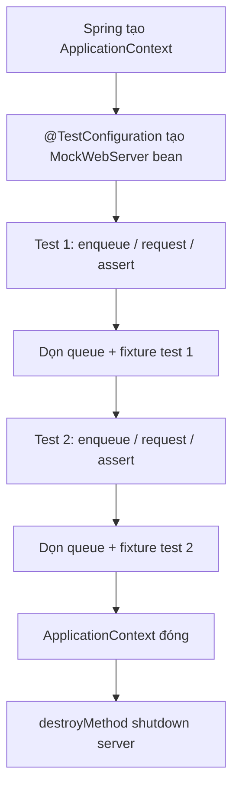
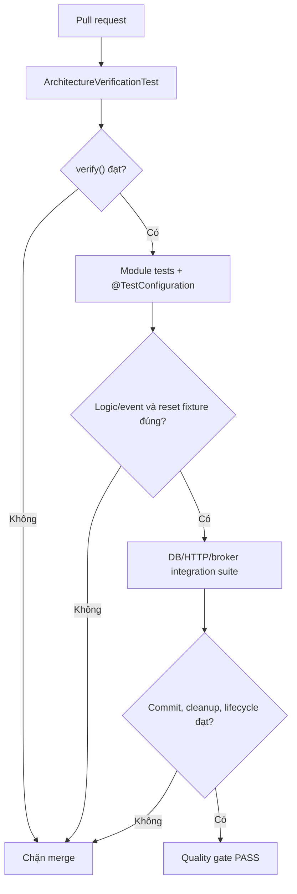

# Dọn tài nguyên từ test configuration

Trong một bài `@ApplicationModuleTest`, các bean test-only có thể tạo **HTTP server ở cổng động, PostgreSQL container, thread pool, file tạm hoặc bộ ghi trạng thái sự kiện**. Test hoàn tất không đồng nghĩa tài nguyên đó đã được đóng. Nếu một server bị dừng quá sớm trong khi Spring TestContext vẫn cache `ApplicationContext`, test tiếp theo có thể dùng client trỏ tới cổng không còn lắng nghe. Ngược lại, nếu giữ tài nguyên mãi mà không dọn dữ liệu, các test lại phụ thuộc lẫn nhau.

Đây là bài **“Dọn tài nguyên từ test configuration”** trong chương **Test configuration** của `SPRING_MODULITH_VERIFICATION_TESTING`. Đích học tập là kiểm chứng được **ai sở hữu tài nguyên, khi nào phải dừng nó, và dữ liệu nào phải xóa riêng cho từng ca kiểm thử**, thay vì chỉ thêm `@AfterEach` hoặc `@DirtiesContext` một cách máy móc. Những kỹ thuật này giữ các bài `@ApplicationModuleTest`, kiểm thử event/database/tích hợp và quality gate CI ổn định; `ApplicationModules.verify()` vẫn là phép kiểm chứng kiến trúc độc lập.

## 1. Xác định chủ sở hữu và thời điểm dọn trước khi viết test

Tài nguyên test có **hai kiểu vòng đời** khác nhau: *infrastructure* tồn tại qua nhiều test method, và *fixture state* chỉ thuộc một kịch bản. Nếu trộn hai kiểu, cleanup thường làm hỏng test chạy sau.

| Tài nguyên | Ai tạo và sở hữu? | Khi nào dọn? | Cách làm |
| --- | --- | --- | --- |
| `MockWebServer` khai báo bằng `@Bean` trong `@TestConfiguration` | Spring `ApplicationContext` | **Khi context được đóng** | `@Bean(destroyMethod = "shutdown")` |
| `ExecutorService` test-only là Spring bean | Spring context | Khi context đóng, đợi/hủy task đúng quy tắc | Bean `close()`/`@PreDestroy` |
| `@Container static` trong JUnit Testcontainers | JUnit Testcontainers extension | **Cuối test class** | Extension tự start/stop |
| `PostgreSQLContainer` do Spring Boot quản lý như bean | Spring Boot test context | Khi context đóng | `@Bean` + `@ServiceConnection` |
| HTTP request/response đang nằm trong queue của server | Từng test method | Trước/sau từng test method | Consume request, reset stub/journal |
| Mockito stub / fake có mutable state | Test method / Spring TestContext | Giữa các test methods | Mockito reset phù hợp, `@BeforeEach` |
| Bản ghi database do test **commit thật** | Test case/integration suite | Sau khi đã assert commit/event | Cleanup SQL hoặc schema/database riêng |
| Dữ liệu tạo bằng `Scenario.stimulate(...)` | Scenario stimulus có transaction riêng | Sau Scenario, kể cả khi assertion lỗi | `andCleanup(...)` |
| File/thư mục tạm | JUnit/test code | Sau test | `@TempDir` hoặc `try/finally` |

Điểm phân biệt quan trọng: **Spring context không đóng sau mỗi `@Test`**. Spring TestContext lưu cache context để nhiều test có cùng cấu hình dùng lại. Khi context bị loại khỏi cache, bị đánh dấu `@DirtiesContext` hoặc JVM tắt, Spring mới chạy những bean destruction callbacks. Ngược lại, `@AfterEach` chạy sau **từng method**. <https://docs.spring.io/spring-framework/reference/testing/testcontext-framework/ctx-management/caching.html>



**Quy tắc thực hành:** cơ chế nào **khởi tạo** tài nguyên thì cơ chế đó **chịu trách nhiệm đóng**. Không để JUnit `@AfterAll` tắt một server do bean Spring sở hữu, cũng không trông chờ `@AfterEach` xóa những bản ghi đã commit từ callback bất đồng bộ mà nó chưa chờ hoàn tất.

## 2. Dọn HTTP server giả lập bằng @TestConfiguration

Giả sử module `orders` có cổng gọi hệ thống giao nhận. Đây là ví dụ nhỏ để kiểm tra **vòng đời server test**, không lặp lại toàn bộ HTTP client contract.

### 2.1. Mã cần kiểm thử

```java
// src/main/java/com/acme/shop/ShopApplication.java
package com.acme.shop;

import org.springframework.boot.autoconfigure.SpringBootApplication;

@SpringBootApplication
public class ShopApplication {
}
```

```java
// src/main/java/com/acme/shop/orders/ShipmentStatus.java
package com.acme.shop.orders;

public interface ShipmentStatus {
    String lookup(String orderId);
}
```

```java
// src/main/java/com/acme/shop/orders/internal/HttpShipmentStatus.java
package com.acme.shop.orders.internal;

import com.acme.shop.orders.ShipmentStatus;
import org.springframework.beans.factory.annotation.Value;
import org.springframework.stereotype.Component;
import org.springframework.web.client.RestClient;

@Component
class HttpShipmentStatus implements ShipmentStatus {

    private final RestClient client;

    HttpShipmentStatus(
            RestClient.Builder builder,
            @Value("${shipping.gateway.base-url}") String baseUrl
    ) {
        this.client = builder.baseUrl(baseUrl).build();
    }

    @Override
    public String lookup(String orderId) {
        ShipmentResponse response = client.get()
                .uri("/shipments/{orderId}", orderId)
                .retrieve()
                .body(ShipmentResponse.class);

        if (response == null) {
            throw new IllegalStateException("Shipping response rỗng");
        }
        return response.state();
    }

    public record ShipmentResponse(String state) {
    }
}
```

`HttpShipmentStatus` là bean **thật của module `orders`**. Server ngoài không nằm trong application module và sẽ được thay bằng một `MockWebServer` chỉ tồn tại trong test.

### 2.2. Bean có start và shutdown đối xứng

```java
// src/test/java/com/acme/shop/orders/ShipmentResourceLifecycleTest.java
package com.acme.shop.orders;

import java.util.concurrent.TimeUnit;
import okhttp3.mockwebserver.MockResponse;
import okhttp3.mockwebserver.MockWebServer;
import okhttp3.mockwebserver.RecordedRequest;
import org.junit.jupiter.api.Test;
import org.springframework.beans.factory.annotation.Autowired;
import org.springframework.boot.test.context.TestConfiguration;
import org.springframework.context.annotation.Bean;
import org.springframework.context.annotation.Import;
import org.springframework.modulith.test.ApplicationModuleTest;
import org.springframework.test.context.DynamicPropertyRegistrar;

import static org.assertj.core.api.Assertions.assertThat;

@ApplicationModuleTest
@Import(ShipmentResourceLifecycleTest.StubInfrastructure.class)
class ShipmentResourceLifecycleTest {

    @Autowired
    ShipmentStatus shipments;

    @Autowired
    MockWebServer shippingServer;

    @TestConfiguration(proxyBeanMethods = false)
    static class StubInfrastructure {

        @Bean(initMethod = "start", destroyMethod = "shutdown")
        MockWebServer shippingServer() {
            return new MockWebServer();
        }

        @Bean
        DynamicPropertyRegistrar shippingUrl(
                MockWebServer shippingServer) {
            return registry -> registry.add(
                    "shipping.gateway.base-url",
                    () -> shippingServer.url("/").toString());
        }
    }

    @Test
    void usesRealClientAgainstTestServer() throws Exception {
        shippingServer.enqueue(new MockResponse()
                .setResponseCode(200)
                .addHeader("Content-Type", "application/json")
                .setBody("""
                        {"state":"DISPATCHED"}
                        """));

        assertThat(shipments.lookup("ORD-12"))
                .isEqualTo("DISPATCHED");

        RecordedRequest request =
                shippingServer.takeRequest(2, TimeUnit.SECONDS);
        assertThat(request).isNotNull();
        assertThat(request.getPath())
                .isEqualTo("/shipments/ORD-12");
    }
}
```

Ví dụ giả định Java 17+, Spring Boot với `RestClient.Builder`/Jackson, Spring Framework **6.2+** (cho `DynamicPropertyRegistrar`), Spring Modulith test starter và OkHttp MockWebServer 4.x trên test classpath.

**Điều cần hiểu ở đây không phải JSON**, mà là thứ tự và chủ sở hữu:

1. Spring tạo `StubInfrastructure` trong test context được bootstrap bởi `@ApplicationModuleTest`.
2. Bean `MockWebServer` được tạo; Spring gọi `start()` theo `initMethod`.
3. Bean `DynamicPropertyRegistrar` nhận server đã khởi động và đăng ký supplier trả `base-url` động.
4. Khi `HttpShipmentStatus` được tạo, `@Value` nhận URL **của server đang chạy**.
5. Sau test method, request đã được đọc khỏi queue, nhưng **server vẫn chạy** để context cached có thể được dùng tiếp.
6. Khi context đóng, Spring gọi `shutdown()` theo `destroyMethod`.

**Không thêm `@AfterEach void stop() { shippingServer.shutdown(); }`** vào bài này: nó đóng server ở cuối method trong khi `RestClient` và Spring context có thể được reuse.

### 2.3. Vì sao khai báo destroyMethod tường minh?

Spring có thể suy ra phương thức `close()` hoặc `shutdown()` của một singleton `@Bean` và đăng ký callback tự động, nhưng việc ghi rõ `destroyMethod="shutdown"` cho external server giúp người đọc thấy **ai sẽ đóng socket**. `@TestConfiguration` chỉ giới hạn bean vào test context; **nó không bảo đảm mọi object test được tự đóng nếu bạn tự `new` bên ngoài container**.

Không cấu hình `destroyMethod=""` để né đóng server khi Spring context còn sở hữu nó; đây là cách dễ tạo socket/thread leak.

## 3. Kiểm chứng destroy callback và hiểu đúng @DirtiesContext

Không thể kiểm tra `shutdown()` *sau mỗi method* nếu server còn thuộc Spring context đang cache. Nếu cần chứng minh Spring thực sự gọi cleanup, hãy viết một **test lifecycle độc lập** có quyền đóng **context do chính nó tạo**:

```java
// Test nhỏ của cơ chế hủy bean; không phải @ApplicationModuleTest.
import java.util.concurrent.atomic.AtomicInteger;
import org.junit.jupiter.api.Test;
import org.springframework.context.annotation.AnnotationConfigApplicationContext;

import static org.assertj.core.api.Assertions.assertThat;

class BeanCleanupContractTest {

    @Test
    void invokesCloseWhenContextCloses() {
        AtomicInteger closes = new AtomicInteger();

        try (AnnotationConfigApplicationContext context =
                     new AnnotationConfigApplicationContext()) {
            context.registerBean(
                    TrackedResource.class,
                    () -> new TrackedResource(closes),
                    definition -> definition.setDestroyMethodName("close")
            );
            context.refresh();
            assertThat(context.getBean(TrackedResource.class))
                    .isNotNull();
            assertThat(closes.get()).isZero();
        }

        assertThat(closes.get()).isEqualTo(1);
    }

    static final class TrackedResource implements AutoCloseable {

        private final AtomicInteger closeCount;

        TrackedResource(AtomicInteger closeCount) {
            this.closeCount = closeCount;
        }

        @Override
        public void close() {
            closeCount.incrementAndGet();
        }
    }
}
```

**Giới hạn của phép kiểm tra:** nó chứng minh `AnnotationConfigApplicationContext.close()` chạy bean destruction callback theo cấu hình, **không** chứng minh JUnit luôn đóng `@ApplicationModuleTest` context sau từng test. Khi chạy test module thật, cơ chế đóng vẫn phụ thuộc context cache.

### Lúc nào @DirtiesContext có ích?

```java
// Chỉ đặt khi thực sự cần ép đóng context ở cuối test class.
@ApplicationModuleTest
@DirtiesContext(classMode = DirtiesContext.ClassMode.AFTER_CLASS)
class IsolatedExternalResourceTest {
    // ...
}
```

`@DirtiesContext` đánh dấu context bị bẩn, khiến Spring TestContext **loại khỏi cache và đóng**, sau đó cần bootstrap context mới nếu lớp khác đòi cấu hình tương tự. Nó không thay `@BeforeEach`/`@AfterEach` để reset dữ liệu, không chủ động xóa database đã commit nếu DB là tài nguyên ngoài context. <https://docs.spring.io/spring-framework/reference/testing/annotations/integration-spring/annotation-dirtiescontext.html>

Nên ưu tiên **resource đúng vòng đời** và **fixture tự reset**; chỉ dùng `@DirtiesContext` khi test thật sự làm thay đổi cấu hình hoặc singleton state không thể phục hồi an toàn. Gắn vào tất cả module tests có thể làm CI rất chậm và che giấu lỗi chia sẻ trạng thái.

## 4. Testcontainers: tránh hai cơ chế cùng sở hữu một container

Ở database/broker integration tests, lỗi cleanup phổ biến không nằm ở lệnh `stop()` mà ở **thời điểm Spring context và container kết thúc khác nhau**.

### 4.1. @Container static: vòng đời theo JUnit test class

```java
@Testcontainers
@ApplicationModuleTest
class OrdersWithJUnitContainerTest {

    @Container
    static PostgreSQLContainer<?> postgres =
            new PostgreSQLContainer<>("postgres:16-alpine");

    @DynamicPropertySource
    static void datasource(DynamicPropertyRegistry registry) {
        registry.add("spring.datasource.url", postgres::getJdbcUrl);
        registry.add("spring.datasource.username", postgres::getUsername);
        registry.add("spring.datasource.password", postgres::getPassword);
    }
}
```

Đây là **mảnh cấu hình**, còn cần import từ Testcontainers/JUnit/Spring Test, JDBC driver, schema và những bean/module dependency của project. Theo Testcontainers Jupiter, `static @Container` được chia sẻ giữa test methods nhưng **bị dừng sau test class**. Nó **không** tự gắn thời gian sống container với cache của `ApplicationContext`. <https://java.testcontainers.org/test_framework_integration/junit_5/>

```text
Test A:
  PostgreSQL container A -> jdbc:postgresql://localhost:49160/test
  Context cached -> DataSource dùng port 49160
  JUnit dừng container A sau class

Test B:
  Spring có thể reuse context A
  DataSource vẫn dùng port 49160 -> Connection refused
  Container B (nếu có) lại dùng port 49187
```

Rủi ro tăng khi nhiều test classes kế thừa cùng `@DynamicPropertySource` hoặc sử dụng cùng cache key nhưng lifecycle container khác. **Supplier trả một URL mới không làm `DataSource` đã tạo tự cấu hình lại**.

Ba lựa chọn hợp lý:

1. Dùng một container ổn định xuyên suốt phạm vi **các Spring contexts chia sẻ nó**, quản lý start/stop minh bạch.
2. Tách context và đánh dấu `@DirtiesContext(classMode = AFTER_CLASS)` có chọn lọc khi container của mỗi test class dừng sau class. Đổi lại là chi phí bootstrap.
3. Nếu Spring Boot hỗ trợ, để **container làm Spring bean** và dùng `@ServiceConnection` để Spring Boot sở hữu lifecycle.

### 4.2. @Bean + @ServiceConnection: vòng đời theo Spring context

Ví dụ cho Spring Boot đã tích hợp Testcontainers service connections:

```java
// Mảnh nested test configuration trong một module test về DB.
@TestConfiguration(proxyBeanMethods = false)
static class DatabaseTestInfrastructure {

    @Bean
    @ServiceConnection
    PostgreSQLContainer<?> postgres() {
        return new PostgreSQLContainer<>("postgres:16-alpine");
    }
}
```

Đặt nó trong một `@ApplicationModuleTest` và import configuration khi cần:

```java
@ApplicationModuleTest
@Import(OrdersDatabaseTest.DatabaseTestInfrastructure.class)
class OrdersDatabaseTest {
    // @Autowired JdbcTemplate, assertions về dữ liệu thật, ...
}
```

Với `spring-boot-testcontainers` và các dependencies tương thích, **Spring Boot tự start/stop `Container` bean**. Khi test context còn được cache, container vẫn tồn tại theo context; khi context đóng, container được dừng. `@ServiceConnection` cung cấp `JdbcConnectionDetails` cho Spring Boot auto-configuration và giảm nhu cầu hard-code `spring.datasource.url`. <https://docs.spring.io/spring-boot/reference/testing/testcontainers.html>

**Không gắn đồng thời `@Container` của JUnit lên cùng bean Spring-managed rồi tự gọi `stop()` trong `@AfterAll`.** Đó là trường hợp hai bộ quản lý vòng đời cùng can thiệp một tài nguyên. Chọn một chủ sở hữu rõ ràng.

### 4.3. Dừng container không xóa mọi dữ liệu test

Một PostgreSQL container có thể dùng volume/persistent store được cấu hình riêng; một broker có thể có message chưa xử lý, topic/group metadata hoặc state ngoài process. Ngay cả khi container dừng, **dữ liệu đã gửi tới hệ ngoài** (HTTP giả lập không hoàn toàn cô lập hoặc database dùng chung) cũng không tự được rollback.

Vì vậy cleanup phải xử lý **cả infrastructure lifetime và fixture state**. Nếu mục tiêu là transaction/event, kết quả commit phải được kiểm chứng trước rồi mới dọn; không được dựa vào “container sau cùng sẽ dừng” để bỏ qua các assertion dữ liệu.

## 5. Dọn database: rollback test khác cleanup sau commit

Một test `@Transactional` do Spring TestContext quản lý thường **rollback cuối test**. Điều đó tiện cho test repository thuần, nhưng không bao phủ mọi trường hợp: service có `REQUIRES_NEW`, một test `@Commit`, một callback async hoặc một `Scenario` có transaction riêng có thể để lại dữ liệu đã commit.

| Kịch bản | Dữ liệu có tự rollback theo test transaction? | Hướng cleanup |
| --- | --- | --- |
| `@Test @Transactional` ghi SQL bằng cùng transaction | **Thường có** | Rollback mặc định, nhưng verify constraint/flush phù hợp |
| Test **không** có `@Transactional`, gọi service `@Transactional` | **Không**; service thường commit khi return | Xóa bằng fixture key, `@Sql` hoặc database/schema riêng |
| Test `@Commit` hoặc `TestTransaction.flagForCommit()` | **Không** với phần đã commit | Cleanup ở transaction độc lập sau assertion |
| Listener `@TransactionalEventListener(AFTER_COMMIT)` ghi DB | Không thể giả định bị rollback cùng test | Chờ xử lý hoàn tất, xóa record của listener |
| `Scenario.stimulate(...)` | Stimulus chạy transaction mới, **không bị rollback bởi transaction bao ngoài** | `Scenario.andCleanup(...)` hoặc teardown tường minh |

### Ví dụ dọn bằng @Sql sau method

Giả sử bảng `orders` có cột `fixture_key` và `order_notifications` có foreign key trỏ `orders.id`. Mỗi test tạo key bắt đầu bằng `TEST012-`, tách khỏi dữ liệu nền. Có thể dùng:

```java
// Đặt trên test class hoặc đúng test method cần cleanup.
@Sql(
    scripts = "classpath:/sql/cleanup-orders-test012.sql",
    executionPhase = Sql.ExecutionPhase.AFTER_TEST_METHOD,
    config = @SqlConfig(
            transactionMode = SqlConfig.TransactionMode.ISOLATED)
)
@Test
void commitsAnOrderAndChecksAfterCommitDelivery() {
    // Gọi service, chờ listener, assert DB đã commit.
}
```

Nội dung script (ví dụ nằm ở `src/test/resources/sql/cleanup-orders-test012.sql`):

```sql
DELETE FROM order_notifications
 WHERE order_id IN (
     SELECT id FROM orders WHERE fixture_key LIKE 'TEST012-%'
 );

DELETE FROM orders
 WHERE fixture_key LIKE 'TEST012-%';
```

Mảnh này giả định các bảng/cột có thật, đã có `DataSource`/`PlatformTransactionManager` phù hợp và `@SqlConfig`/`Sql` được import từ `org.springframework.test.context.jdbc`. `TransactionMode.ISOLATED` chạy script trong **transaction riêng được commit**, thích hợp khi cần dọn bản ghi đã commit; không dùng tùy tiện trên database chia sẻ/production.

**Không xóa cả bảng bằng `DELETE FROM orders` nếu nhiều bài test chạy song song hoặc database chứa fixture của nhóm khác.** Dùng **khóa fixture riêng**, schema riêng, hoặc container/database riêng để phân tách.

### @AfterEach có nằm trong transaction test không?

Với test method có `@Transactional`, Spring TestContext thường chạy JUnit `@BeforeEach` và `@AfterEach` **bên trong test-managed transaction**. Nếu `@AfterEach` tự xóa dữ liệu vừa được commit bởi transaction **khác**, lệnh xóa ấy có thể bị rollback khi test transaction kết thúc – và bản ghi vẫn còn. Với test `@Transactional`, `@AfterTransaction` (nếu phù hợp) chạy **sau** khi test transaction kết thúc và có thể dùng để quan sát/cleanup bằng transaction độc lập. <https://docs.spring.io/spring-framework/reference/testing/testcontext-framework/tx.html>

Đặc biệt với JPA/Hibernate, nếu test chỉ `save(...)` rồi để test-managed transaction tự rollback, một số constraint và listener mapping có thể chưa được thực thi cho tới `flush()`. Dùng `entityManager.flush()` khi muốn phát hiện lỗi SQL/constraint trong chính phép kiểm tra, không suy từ “không ném exception trước rollback” rằng mapping đã đúng.

### Cleanup phải chạy cả khi assertion fail

Một test có thể ném exception sau khi service đã commit. Khi test dùng cleanup thủ công, hãy đặt nó trong `try/finally` hoặc cấu hình `@Sql(AFTER_TEST_METHOD)`, thay vì đặt lệnh xóa **cuối method sau mọi assertion**; nếu assertion fail trước đó, lệnh xóa sẽ không bao giờ chạy.

## 6. Scenario: cleanup dữ liệu do event transaction tạo ra

Spring Modulith `Scenario` được thiết kế cho test sự kiện và thay đổi trạng thái bất đồng bộ. `Scenario.publish(...)`/`stimulate(...)` tạo **transaction callback mới** để event được giao cho transactional listeners, **kể cả khi test bên ngoài có transaction**. Dữ liệu từ stimulus **không được rollback cùng test transaction**, nên tài liệu Spring Modulith cung cấp `andCleanup(...)`. <https://docs.spring.io/spring-modulith/reference/testing.html>

Ví dụ giả định module `orders` có:

- `OrderOperations.place(String fixtureKey)` ghi một `orders` row rồi publish `OrderPlaced(fixtureKey, …)`.
- Một listener cập nhật projection `order_notifications` sau commit.
- Bean `JdbcTemplate` có thể query hai bảng để kiểm tra trạng thái.

```java
// Mảnh method trong một @ApplicationModuleTest có bean orders và jdbc.
@Test
void cleansScenarioDataAfterEventProcessing(Scenario scenario) {
    String fixtureKey = "TEST012-ORDER-42";

    scenario.stimulate(() -> orders.place(fixtureKey))
            .andCleanup(() -> {
                jdbc.update(
                    "DELETE FROM order_notifications WHERE fixture_key = ?",
                    fixtureKey);
                jdbc.update(
                    "DELETE FROM orders WHERE fixture_key = ?",
                    fixtureKey);
            })
            .andWaitForStateChange(
                    () -> jdbc.queryForObject(
                            "SELECT COUNT(*) FROM order_notifications " +
                            "WHERE fixture_key = ?",
                            Long.class,
                            fixtureKey),
                    count -> count != null && count > 0
            )
            .andVerify(count -> assertThat(count).isEqualTo(1L));
}
```

Đoạn này là **mảnh JUnit kiểm thử**, không phải code độc lập: cần `Scenario`, `@Test`, AssertJ, bean `OrderOperations orders`, `JdbcTemplate jdbc`, schema/transaction setup và listener của module đang được bootstrap. Khi dùng `STANDALONE`, listener phải thuộc **chính module đang nạp** hoặc test phải lựa chọn phạm vi phù hợp; chỉ có event class trên classpath không đủ để bootstrap consumer.

**Lý do `andCleanup(...)` đáng dùng:** callback được đăng ký để chạy **sau khi Scenario hoàn tất, dù kết quả thành công hay lỗi**. Nó phù hợp với dữ liệu đã commit do stimulus và listener. Hãy xóa **bản ghi phụ thuộc trước, bản ghi gốc sau**, hoặc dùng cascade khi schema cho phép. Không gọi cleanup quá sớm khi listener vẫn đang viết DB; điểm chờ phải phản ánh **side effect cuối cùng** mà test cần.

### Không gộp “event đã phát” với “consumer đã hoàn tất”

`PublishedEvents` có thể ghi nhận producer gọi `ApplicationEventPublisher.publishEvent(...)`, nhưng nó **không chứng minh** consumer bất đồng bộ đã ghi projection hoặc email đã được gửi. Nếu chỉ dùng `PublishedEvents` rồi xóa ngay database fixture, listener còn chạy có thể gặp `EntityNotFound` hoặc tạo dữ liệu mới **sau khi cleanup**.

Khi cần dọn tài nguyên event:

1. Chờ **đúng trạng thái nghiệp vụ** bằng `Scenario` hoặc cơ chế await có timeout.
2. Kiểm tra kết quả.
3. Cleanup bản ghi publication/projection thuộc test **theo ownership**.
4. Không xóa dữ liệu registry của bài test khác, không giả định broker message tự biến mất khi DB rollback.

## 7. Dọn state giữa các method: fake, mock và queue không tự biến mất

Một `@TestConfiguration` thường khai báo bean singleton. Nếu bean ấy là fake giữ danh sách request, lịch sử email hoặc sequence ID, Spring **có thể reuse nó giữa các test methods** cùng context. Bean `destroyMethod` chỉ chạy lúc context đóng, quá muộn để cô lập dữ liệu **giữa hai method**.

### Fake tự định nghĩa phải có thao tác reset rõ ràng

Ví dụ cổng `NotificationGateway` nằm ngoài module đang test; bean fake lưu lịch sử message:

```java
// Các khai báo đặt trong một test class hoặc test source file phù hợp.
interface NotificationGateway {
    void send(String recipient, String message);
}

static final class RecordingNotificationGateway
        implements NotificationGateway {

    private final List<String> sent = new ArrayList<>();

    @Override
    public synchronized void send(String recipient, String message) {
        sent.add(recipient + ":" + message);
    }

    synchronized List<String> snapshot() {
        return List.copyOf(sent);
    }

    synchronized void reset() {
        sent.clear();
    }
}

@TestConfiguration(proxyBeanMethods = false)
static class NotificationFixture {

    @Bean
    RecordingNotificationGateway notificationGateway() {
        return new RecordingNotificationGateway();
    }
}
```

Trong test:

```java
@Autowired
RecordingNotificationGateway notifications;

@BeforeEach
void resetNotificationHistory() {
    notifications.reset();
}

@Test
void recordsExactlyOneNotification() {
    // Gọi use case thật của module với fake NotificationGateway.
    // Kiểm tra notifications.snapshot() có đúng một message mong muốn.
}
```

Đây là **mảnh minh họa**, cần import `List`, `ArrayList`, `@Bean`, `@TestConfiguration` và JUnit tương ứng; nếu module đã có bean `NotificationGateway` thật, phải **chủ đích override** bằng `@TestBean`/`@MockitoBean` hoặc cấu hình bean candidate phù hợp, không chỉ thêm bean cùng kiểu. Khi dùng `STANDALONE` và interface ở module phụ thuộc không được bootstrap, fake có thể là bean duy nhất.

### Mock reset không thay fake reset

`@MockitoBean` của Spring Framework có cơ chế reset Mockito mock theo TestContext lifecycle (thông thường sau test method). Điều đó **không áp dụng** cho danh sách trong `RecordingNotificationGateway`, mock HTTP server, database hoặc file tạm. Một `@AfterEach` xóa Mockito interactions cũng không xóa database row.

### Đặc biệt với MockWebServer queue

`MockWebServer.enqueue(...)` xếp response theo thứ tự; `takeRequest(...)` lấy request từ queue. Nếu method A enqueue hai response nhưng chỉ tạo một request, response dư có thể được method B tiêu thụ. Một `@AfterEach` chỉ gọi `takeRequest(...)` để “dọn cho sạch” cũng có thể đợi vô ích hoặc ăn mất request mà assertion cần đọc.

Hướng đáng tin cậy:

- Mỗi method **enqueue đúng số response** cho số request dự kiến.
- Assert **đủ số request**, kiểm tra method/path/body và không để response dư.
- Khi có retry hoặc request song song, dùng dispatcher/WireMock stub mapping theo request thay vì phụ thuộc queue thứ tự.
- Không chạy song song test methods dùng chung mutable fake/server queue nếu chưa có isolation.
- Nếu thật sự cần mỗi method một server khác, đổi thiết kế fixture sang **mỗi method tự tạo bằng JUnit extension/try-finally** và bảo đảm client cũng được tạo lại theo server, thay vì giữ Spring singleton client có base URL cũ.

**Dọn trạng thái per-method và đóng server theo context là hai thao tác khác nhau**. Làm cả hai đúng mới tránh test-order dependence.

## 8. Thread pool, file tạm và cấu hình JVM toàn cục

Không phải tài nguyên test nào cũng là database hay server. Một `@TestConfiguration` có thể tạo `ExecutorService` cho event async, hoặc một bean xuất dữ liệu ra thư mục tạm.

### Dừng executor: shutdown không bảo đảm task đã hoàn tất

Nếu chỉ gọi `executor.shutdown()` khi context đóng, các task đã được submit vẫn có thể đang chạy, ghi database **sau khi test cleanup**, hoặc giữ thread làm JVM chậm thoát. Một wrapper test-only có thể chờ có giới hạn:

```java
// Đặt trong test source set, dùng Java 17+.
final class ManagedTestExecutor implements AutoCloseable {

    private final ExecutorService executor =
            Executors.newSingleThreadExecutor();

    Future<?> submit(Runnable action) {
        return executor.submit(action);
    }

    @Override
    public void close() {
        executor.shutdown();
        try {
            if (!executor.awaitTermination(2, TimeUnit.SECONDS)) {
                executor.shutdownNow();
            }
        } catch (InterruptedException ex) {
            executor.shutdownNow();
            Thread.currentThread().interrupt();
        }
    }
}
```

Đăng ký vào Spring context:

```java
@TestConfiguration(proxyBeanMethods = false)
static class AsyncFixture {

    @Bean(destroyMethod = "close")
    ManagedTestExecutor testExecutor() {
        return new ManagedTestExecutor();
    }
}
```

Khi một test cần bảo đảm side effect đã hoàn tất, hãy chờ **trong chính test method**:

```java
Future<?> task = testExecutor.submit(
        () -> resultStore.save("TEST012-ASYNC-01"));

task.get(2, TimeUnit.SECONDS);
assertThat(resultStore.exists("TEST012-ASYNC-01")).isTrue();
```

Đây là mảnh test giả định có bean `resultStore` và `testExecutor`, cần import `ExecutorService`, `Executors`, `Future`, `TimeUnit`, `InterruptedException` và JUnit/AssertJ phù hợp. **`close()` khi context đóng không thể thay chờ completion khi test còn đang assert/cleanup**.

### File/thư mục tạm: ưu tiên @TempDir

```java
@Test
void writesExportOnlyInsideTestTempDir(@TempDir Path tempDir)
        throws Exception {

    Path report = tempDir.resolve("report.json");
    Files.writeString(report, "{\"status\":\"ok\"}");

    assertThat(Files.readString(report))
            .contains("\"ok\"");
}
```

JUnit Jupiter `@TempDir` tạo và dọn temp directory theo cơ chế của JUnit, mặc định không cần viết `Files.walk(...)` để xóa thủ công. Nếu **đưa path ấy vào singleton bean được cache**, cần nhớ path có thể bị JUnit xóa **sau method** trong khi bean vẫn giữ đường dẫn cũ; hãy tạo path/bean lại đúng vòng đời hoặc truyền path theo từng lời gọi thay vì lưu ở singleton.

### Không để lại System properties và ThreadLocal

Một test đổi `System.setProperty("shop.feature.enabled", "true")` làm thay đổi **cả JVM**, gây rò cấu hình sang các test khác. Nếu bắt buộc đổi, phải khôi phục giá trị cũ kể cả khi exception:

```java
String key = "shop.feature.enabled";
String previous = System.getProperty(key);

try {
    System.setProperty(key, "true");
    // Chạy phần code thuần cần giá trị này.
} finally {
    if (previous == null) {
        System.clearProperty(key);
    } else {
        System.setProperty(key, previous);
    }
}
```

Tốt hơn, với Spring context hãy dùng `@TestPropertySource`/profile/`DynamicPropertySource` thay vì sửa global JVM properties. Các ThreadLocal như MDC/security context cần được clear/restore bởi đúng test/framework owner; không nên chỉnh default timezone, locale hoặc static singleton toàn JVM rồi hy vọng `@DirtiesContext` sẽ sửa được.

## 9. Kiểm chứng cleanup trong CI, không chỉ gọi teardown

Một cleanup tốt phải được **quan sát và kiểm tra**, không phải chỉ ghi `@AfterEach` cho có. Với `SPRING_MODULITH_VERIFICATION_TESTING`, hãy tách quality gate thành **module architecture** và **runtime isolation**.

| Phép kiểm tra | Assertion/quan sát | Lỗi phát hiện |
| --- | --- | --- |
| Bean destruction | Test `AnnotationConfigApplicationContext` và `closeCount = 1` | Quên đăng ký `destroyMethod`/`close` |
| HTTP server | Response/request được tiêu thụ đủ; port không bị hard-code | Response dư, test-order dependence |
| Context cache | Chạy **hai class** dùng cấu hình tương đương trong một JVM; kiểm tra endpoint còn sống | Server dừng theo class nhưng context vẫn cache |
| Testcontainers | Full suite không báo `Connection refused` khi chuyển class | Container lifetime không khớp DataSource/client |
| Database | Query sau cleanup không còn `fixture_key` của test | Bản ghi commit tồn dư / `@AfterEach` rollback |
| Event/Scenario | Sau state change, cleanup xóa projection và business row đúng scope | Async listener tạo row sau teardown |
| Thread pool | Task awaited; executor close gọi đúng; không còn test threads mồ côi | Race/hanging JVM |
| Architecture | `ApplicationModules.verify()` | Internal API import, vòng phụ thuộc, sai `allowedDependencies` |

Một bài test kiến trúc **không cần database/broker**:

```java
package com.acme.shop;

import org.junit.jupiter.api.Test;
import org.springframework.modulith.core.ApplicationModules;

class ArchitectureVerificationTest {

    @Test
    void moduleBoundariesAreValid() {
        ApplicationModules.of(ShopApplication.class).verify();
    }
}
```

Một module test có thể chạy xanh dù dọn không sạch; một architecture test có thể xanh dù container leak. Vì vậy chạy **cả hai nhóm** là cần thiết.

### Chẩn đoán theo dấu hiệu

| Dấu hiệu khi chạy suite | Cách tìm nguyên nhân trước |
| --- | --- |
| Test chạy riêng xanh, chạy chung `Connection refused` | So sánh lifecycle `@Container` với Spring context cache; endpoint đã dừng? |
| Càng chạy nhiều test càng tăng thread/port | Có bean đóng bằng `destroyMethod`? Có external resource tự `new` không có teardown? |
| Dữ liệu test trước xuất hiện ở test sau | `@Transactional` có thật sự bao transaction? Có commit/`REQUIRES_NEW`/`Scenario` không? |
| Test consumer fail ngẫu nhiên sau cleanup | Listener async đã hoàn tất trước cleanup chưa? |
| `@DirtiesContext` giúp hết lỗi nhưng suite rất chậm | Có thể reset singleton fake/request journal thay vì tạo lại toàn context? |
| Lỗi chỉ khi test chạy song song | Có dùng chung response queue, fixture key, schema, consumer group hoặc mutable fake? |

### Gợi ý quality gate CI



Trong CI, chạy cả **test method độc lập** và **full suite cùng JVM** để dễ lộ context-cache/lifecycle bugs. Một nhóm test có thể dùng thứ tự khác nhau hoặc chạy song song có kiểm soát để phát hiện chia sẻ state, nhưng đừng bật parallelism mà các fixture chưa được thiết kế cho nó.

Lệnh wrapper chỉ minh họa khi dự án đã gắn integration suites vào build:

```bash
./mvnw verify
# hoặc
./gradlew check
```

**Không mặc định** các lệnh trên đã chạy mọi integration test: Maven Failsafe và Gradle test suites/tasks phải được cấu hình phù hợp. Trong bước biên soạn STEP 4 này **không chạy Gradle, Maven, Python, Docker hoặc vòng STEP 6 QA chuyên môn**.

## 10. Bài thực hành, đáp án và checklist

### Tình huống

Module `orders` dùng Spring JDBC, publish `OrderPlaced`, còn một test đặt:

```java
@Testcontainers
@ApplicationModuleTest
class OrdersCleanupProblemTest {

    @Container
    static PostgreSQLContainer<?> postgres =
            new PostgreSQLContainer<>("postgres:16-alpine");

    @DynamicPropertySource
    static void db(DynamicPropertyRegistry registry) {
        registry.add("spring.datasource.url", postgres::getJdbcUrl);
        registry.add("spring.datasource.username", postgres::getUsername);
        registry.add("spring.datasource.password", postgres::getPassword);
    }

    @Test
    void createsOrder() {
        orders.place("TEST012-A");
        assertThat(jdbc.queryForObject(
                "SELECT COUNT(*) FROM orders WHERE fixture_key = ?",
                Long.class, "TEST012-A")).isEqualTo(1L);
    }
}
```

Đây là **mảnh test giả định** có `OrderOperations orders` và `JdbcTemplate jdbc` được inject, migration cho bảng `orders` và imports tương ứng.

### Câu hỏi kiểm tra

1. Sau khi JUnit chạy xong **test class** trên, container và Spring `ApplicationContext` chắc chắn cùng đóng một lúc không?
2. Nếu test class thứ hai reuse context nhưng tạo container mới ở port khác, nguyên nhân của `Connection refused` là gì?
3. Có thể thay `@Container` bằng `@Bean @ServiceConnection` theo vòng đời context không? Cần dependency nào?
4. Nếu `orders.place(...)` tự commit, có thể dựa vào rollback mặc định của JUnit để dọn row không?
5. Vì sao cleanup bằng `@AfterEach` có thể vô ích khi method có `@Transactional` nhưng row đã commit bởi transaction khác?
6. Trong `Scenario.stimulate(...)`, tại sao cần `andCleanup(...)` ngay cả khi test method `@Transactional`?
7. Khi listener sau commit chạy async, nên chờ tới điều kiện nào trước khi xóa bản ghi?
8. Một bean `MockWebServer` được tạo bằng `@Bean(initMethod="start", destroyMethod="shutdown")` có nên bị `@AfterEach` shutdown không?
9. Nếu `@TestConfiguration` tạo `ExecutorService`, `shutdown()` có chứng minh mọi task đã xong không?
10. Vì sao `ApplicationModules.verify()` phải chạy dù tất cả cleanup tests đều xanh?

### Đáp án giải thích

1. **Không.** `@Container static` do JUnit quản lý theo class; context Spring có thể tiếp tục được cache.
2. `DataSource` có thể giữ JDBC URL/port của container **đã dừng**, dù supplier của test khác trả URL mới; bean không tự refresh.
3. **Có** với Spring Boot/Testcontainers tích hợp và `spring-boot-testcontainers` + driver/connector phù hợp. Spring Boot quản lý start/stop của Container bean; không dùng thêm JUnit `@Container` lên cùng bean.
4. **Không.** Test không có test-level `@Transactional`; transaction của service có thể đã commit và cần cleanup thực.
5. `@AfterEach` chạy trong test-managed transaction; lệnh cleanup có thể bị rollback cùng transaction test, còn dữ liệu đã commit ở transaction riêng vẫn còn.
6. `Scenario` thực thi stimulus trong transaction callback mới để phục vụ transactional listeners; thay đổi DB của stimulus không bị rollback theo transaction ngoài.
7. **Đợi side effect cuối cùng** (projection/status/database row hoặc event quan sát đủ điều kiện) với timeout, không chỉ đợi publisher gọi `publishEvent`.
8. **Không.** Server thuộc Spring context và cần sống cho các test methods dùng chung context; Spring gọi `shutdown()` khi context đóng.
9. **Không.** `shutdown()` ngăn nhận task mới nhưng task đã submit có thể vẫn chạy; cần await completion hoặc timeout rồi xử lý hủy.
10. Vì cleanup nói về runtime isolation; `verify()` nói về **module dependency graph, internal API và giới hạn phụ thuộc**, hai nghĩa vụ độc lập.

### Checklist trước khi merge

- [ ] Đã chỉ rõ ai tạo tài nguyên và ai đóng nó: Spring, JUnit, Testcontainers hay test method.
- [ ] Bean test-only có `destroyMethod`/`close()` phù hợp; không đóng ở `@AfterEach` nếu context còn cache.
- [ ] `@Container` của JUnit và `Container` bean của Spring Boot không cùng quản lý một instance.
- [ ] HTTP stub response/request queue và Mockito/fake state được dọn đúng giữa test methods.
- [ ] Test database đã commit có cleanup theo fixture key hoặc database/schema isolation.
- [ ] Test transaction rollback được phân biệt với service transaction, `REQUIRES_NEW` và `Scenario` transaction.
- [ ] Event consumer async được chờ tới khi side effect hoàn tất rồi mới cleanup.
- [ ] File tạm, thread pool, System properties và ThreadLocal không rò ra test khác.
- [ ] `@DirtiesContext` chỉ dùng khi context thật sự bị thay đổi/không thể reset an toàn.
- [ ] Có kiểm tra sau cleanup; full suite cùng JVM không lệ thuộc thứ tự chạy.
- [ ] `ApplicationModules.of(...).verify()` vẫn là gate riêng trong CI.

**Ghi nhớ:** cleanup đúng trong `@TestConfiguration` là **quản lý ownership theo vòng đời**, không phải thêm một `tearDown()` khổng lồ. **Infrastructure bean sống và chết cùng Spring context; state của từng ca kiểm thử được reset theo method; DB/event đã commit cần cleanup độc lập**. Giữ ba ranh giới đó rõ ràng giúp `@ApplicationModuleTest`, kiểm thử tích hợp và CI đáng tin cậy hơn.

### Tài liệu tham khảo

- [Spring Framework — TestContext Context Caching](https://docs.spring.io/spring-framework/reference/testing/testcontext-framework/ctx-management/caching.html)
- [Spring Framework — @DirtiesContext](https://docs.spring.io/spring-framework/reference/testing/annotations/integration-spring/annotation-dirtiescontext.html)
- [Spring Framework — @Bean lifecycle và destruction callbacks](https://docs.spring.io/spring-framework/reference/core/beans/factory-nature.html)
- [Spring Framework — Transactional Test Execution](https://docs.spring.io/spring-framework/reference/testing/testcontext-framework/tx.html)
- [Spring Framework — @Sql script execution](https://docs.spring.io/spring-framework/reference/testing/testcontext-framework/executing-sql.html)
- [Spring Modulith — Testing Application Modules / Scenario](https://docs.spring.io/spring-modulith/reference/testing.html)
- [Spring Modulith — Verification](https://docs.spring.io/spring-modulith/reference/verification.html)
- [Spring Boot — Testcontainers and @ServiceConnection](https://docs.spring.io/spring-boot/reference/testing/testcontainers.html)
- [Testcontainers for Java — JUnit Jupiter lifecycle](https://java.testcontainers.org/test_framework_integration/junit_5/)
