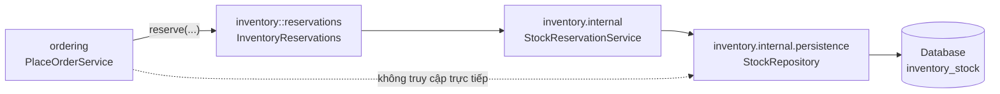

# Module test với database thật hoặc database giả lập

Một module Spring Modulith có thể vượt qua kiểm thử unit khi repository được mock, nhưng lại thất bại ở môi trường thực vì câu SQL không được database hỗ trợ, migration thiếu index, transaction rollback không đúng hoặc hai yêu cầu đồng thời cùng trừ một lượng tồn kho. Ngược lại, không phải mọi kiểm thử nghiệp vụ đều cần khởi động PostgreSQL: một test chỉ kiểm tra quyết định từ chối đơn hàng có thể dùng fake hoặc mock để chạy nhanh và xác định lỗi rõ hơn.

**Module test với database thật hoặc database giả lập** là bài toán chọn mức độ hiện thực của hạ tầng cho đúng **cam kết cần kiểm chứng**. Trong chương **Database testing** của **SPRING_MODULITH_VERIFICATION_TESTING**, mục tiêu không chỉ là “test có kết nối cơ sở dữ liệu” mà còn là rèn cách kiểm chứng ranh giới kiến trúc bằng `ApplicationModules`, quy tắc phụ thuộc giữa module, `@ApplicationModuleTest`, sự kiện, database và tích hợp, rồi kết hợp các bài test thành quality gate CI để ngăn phụ thuộc sai và hồi quy.

> Nguyên tắc xuyên suốt: **Test double kiểm tra quyết định ở ranh giới; database thật kiểm tra hành vi của persistence, transaction và những bất biến mà chỉ database mới thực thi được.** Hai loại kiểm thử bổ sung cho nhau, không thay thế hoàn toàn cho nhau.

## 1. Mục tiêu học tập

Sau bài học, bạn có thể:

1. Phân biệt **mock repository**, **fake repository**, **database nhúng/in-memory** và **database cùng loại với production**.
2. Quyết định loại database cho `@ApplicationModuleTest` dựa trên rủi ro của truy vấn, migration, transaction, khóa và xử lý đồng thời.
3. Chuẩn bị schema và fixture có thể lặp lại, không làm dữ liệu của test này rò sang test khác.
4. Dùng Spring Modulith khởi động một module với database phù hợp, thay vì mặc định chạy toàn bộ ứng dụng.
5. Viết các bài test phát hiện lỗi cập nhật đồng thời, rollback, uniqueness, optimistic locking và khác biệt SQL.
6. Phối hợp kiểm thử module/database với `ApplicationModules.verify()`, event/integration tests và CI.
7. Nhận biết giới hạn của từng loại kiểm thử để không đưa ra kết luận quá mức khi test xanh.

## 2. Trước tiên: “database giả lập” có thể mang ba nghĩa khác nhau

Trong thực hành, cụm từ “database giả lập” thường được dùng cho nhiều kỹ thuật **không tương đương**.

| Lựa chọn | Cái gì thực sự chạy? | Điều có thể kiểm chứng | Điều chưa chứng minh được |
| --- | --- | --- | --- |
| **Mock repository** (Mockito/test double) | Không chạy SQL; method trả kết quả được lập trình trước | Điều phối use case, xử lý lỗi do collaborator trả về | Mapping, query, constraint, lock, rollback database |
| **Fake repository in-memory** | Implementation lưu state bằng collection/map trong RAM | Luật ứng dụng với kho dữ liệu giả đơn giản; trạng thái sau các lệnh | Semantics của transaction, isolation, dialect SQL, index, deadlock thật |
| **Database nhúng/in-memory** (ví dụ H2) | Một **database engine thật**, thường chạy trong tiến trình test | Một phần JPA mapping, JDBC, query cơ bản, transaction/constraint theo semantics của H2 | Sự tương thích tuyệt đối với PostgreSQL/MySQL/Oracle và hành vi khóa cụ thể của chúng |
| **Database cùng engine production** (ví dụ PostgreSQL bằng Testcontainers) | Engine PostgreSQL thật trong container dùng cho test | SQL dialect, migration, constraint, transaction/isolation gần production hơn | Tải production, topology nhiều node, broker thật, cấu hình vận hành và mạng ở quy mô thực |
| **Môi trường staging tích hợp** | Database cùng các dịch vụ, broker, adapter khác | Workflow end-to-end và cấu hình hệ thống gần thực tế | Không mặc nhiên bao phủ mọi race condition hoặc mọi ca lỗi |

**H2 không phải mock:** H2 thực thi SQL và có cơ chế transaction riêng. Nhưng vì H2 **không phải PostgreSQL**, một truy vấn thành công trên H2 chưa chứng minh sẽ thành công trên PostgreSQL. Ngay cả chế độ tương thích PostgreSQL của H2 cũng không biến H2 thành PostgreSQL thật.

Ngược lại, **Testcontainers không phải database giả**: nó khởi động một database thực trong container tạm thời. Nó cung cấp môi trường kiểm thử gần production hơn, nhưng **không tự bảo đảm** schema, dữ liệu, quyền, phiên bản và cấu hình đều tương đương production.

### 2.1. Tên gọi ngắn trong bài

Từ đây:

- **Mock/fake**: các test double thay thế thành phần lưu trữ; không dùng database SQL production.
- **DB nhúng**: H2 hoặc engine tương tự thực thi câu lệnh SQL trong test.
- **DB thật**: engine cùng loại với production, thường PostgreSQL chạy bằng Testcontainers.

Khi quyết định chiến lược test, cần nói chính xác loại nào đang dùng, thay vì chỉ ghi “integration test với database giả lập”.

## 3. Chọn database từ rủi ro cần bắt

Hãy đi từ **đặc điểm nghiệp vụ** thay vì chọn một thư viện test làm mặc định cho tất cả.

| Tình huống | Mock/fake | H2 | DB thật |
| --- | :---: | :---: | :---: |
| Use case trả lỗi khi request thiếu SKU | **Phù hợp** | Có thể, nhưng dư hạ tầng | Có thể, thường không cần |
| Service điều phối lệnh lưu đơn | **Phù hợp** cho luồng quyết định | Có thể kiểm tra persistence đơn giản | Có ích để xác nhận luồng lưu thực |
| JPA mapping/cascade/lazy fetch | Không đủ | Có ích nhưng giới hạn | **Nên có** với những mapping quan trọng |
| Native SQL với cú pháp PostgreSQL | Không | Có thể không tương thích | **Bắt buộc nếu cần chứng minh đúng dialect** |
| Flyway/Liquibase migration production | Không | Có thể phát hiện lỗi cơ bản | **Ưu tiên** chạy bằng đúng engine |
| Unique/check/foreign-key constraint | Không | Có thể phát hiện một phần | **Ưu tiên** với invariant quan trọng |
| Optimistic/pessimistic locking | Không | Khác biệt semantics | **Ưu tiên mạnh** |
| Concurrent reservation tránh oversell | Fake dễ cho kết quả sai | Khác biệt khóa/isolation | **Cần test DB thật** phù hợp |
| Rollback và transaction boundary | Không | Hữu ích | **Ưu tiên** khi phụ thuộc semantics của engine |
| Event listener phụ thuộc commit | Không đủ nếu chỉ mock publisher | Có thể test transaction cơ bản | **Nên có** test cùng DB và event infrastructure thực |

Một chiến lược cân bằng thường là **nhiều test thuần nghiệp vụ nhanh**, **một số module test với DB nhúng cho CRUD đơn giản**, và **những bài kiểm thử DB thật tập trung vào rủi ro**. Không nhất thiết phải chạy mọi test với container, nhưng cũng không nên dùng mock để tuyên bố đã chứng minh tính nhất quán dữ liệu.

### 3.1. Quy tắc hỏi trước khi chọn

1. Test muốn chứng minh **quyết định của service** hay **điều database thực thi**?
2. Nó có phụ thuộc kiểu dữ liệu đặc thù, native query, transaction isolation, lock hoặc index không?
3. Khi thất bại, ta muốn biết lỗi thuộc **module**, **database** hay **tích hợp**?
4. Có thể giữ test đủ nhanh, độc lập và lặp lại trong CI không?
5. Nếu engine production thay đổi, những bài test nào phải tăng mức hiện thực?

**Không tối ưu số lượng test xanh; hãy tối ưu khả năng phát hiện một lỗi quan trọng trước khi deploy.**

## 4. Ví dụ xuyên suốt: module Inventory quản lý giữ hàng

Giả sử ứng dụng bán hàng có:

```text
com/example/shop/
├── ShopApplication.java
├── inventory/
│   ├── package-info.java
│   ├── reservations/
│   │   ├── package-info.java
│   │   ├── InventoryReservations.java
│   │   ├── ReserveStock.java
│   │   └── InsufficientStock.java
│   └── internal/
│       ├── StockReservationService.java
│       └── persistence/
│           ├── StockEntity.java
│           └── StockRepository.java
├── ordering/
│   ├── package-info.java
│   └── internal/PlaceOrderService.java
└── billing/
    ├── package-info.java
    └── internal/OrderPlacedListener.java
```

`inventory` sở hữu invariant: **không xác nhận giữ hàng nhiều hơn số lượng tồn khả dụng**. `ordering` chỉ được yêu cầu giữ hàng qua API công khai, không được tự trừ cột `available`.



Hướng dependency code từ `ordering` tới `inventory::reservations` là hợp lệ khi được công bố và khai báo. Repository, schema và chiến lược khóa thuộc **chính module Inventory**.

### 4.1. Hợp đồng công khai

Trong `inventory/reservations/package-info.java`:

```java
@org.springframework.modulith.NamedInterface("reservations")
package com.example.shop.inventory.reservations;
```

```java
// inventory/reservations/ReserveStock.java
package com.example.shop.inventory.reservations;

public record ReserveStock(String sku, int quantity) {
    public ReserveStock {
        if (sku == null || sku.isBlank() || quantity <= 0) {
            throw new IllegalArgumentException("SKU và số lượng không hợp lệ");
        }
    }
}
```

```java
// inventory/reservations/InsufficientStock.java
package com.example.shop.inventory.reservations;

public class InsufficientStock extends RuntimeException {
    public InsufficientStock(String sku) {
        super("Không đủ tồn khả dụng cho SKU: " + sku);
    }
}
```

```java
// inventory/reservations/InventoryReservations.java
package com.example.shop.inventory.reservations;

public interface InventoryReservations {
    void reserve(ReserveStock command);
}
```

Ví dụ tối giản này chỉ thể hiện hành vi giảm tồn, **chưa mô hình hóa phiếu giữ hàng**. Trong hệ thống thật, thường cần `reservationId`, thời hạn, lệnh nhả, idempotency key và ledger/trạng thái để phục hồi lỗi. Ở đây ta giới hạn hợp đồng nhằm tập trung vào kỹ thuật **kiểm thử database**.

### 4.2. Persistence nội bộ

Ví dụ dùng JPA entity ở package `inventory.internal.persistence`:

```java
package com.example.shop.inventory.internal.persistence;

import jakarta.persistence.Entity;
import jakarta.persistence.Id;
import jakarta.persistence.Table;

@Entity
@Table(name = "inventory_stock")
public class StockEntity {

    @Id
    private String sku;
    private int available;

    protected StockEntity() {}

    public StockEntity(String sku, int available) {
        this.sku = sku;
        this.available = available;
    }

    public String getSku() { return sku; }
    public int getAvailable() { return available; }
}
```

Repository với câu lệnh cập nhật có điều kiện:

```java
package com.example.shop.inventory.internal.persistence;

import org.springframework.data.jpa.repository.JpaRepository;
import org.springframework.data.jpa.repository.Modifying;
import org.springframework.data.jpa.repository.Query;
import org.springframework.data.repository.query.Param;

public interface StockRepository extends JpaRepository<StockEntity, String> {

    @Modifying
    @Query(value = """
        UPDATE inventory_stock
        SET available = available - :qty
        WHERE sku = :sku AND available >= :qty
        """, nativeQuery = true)
    int decrementIfAvailable(
        @Param("sku") String sku,
        @Param("qty") int quantity
    );
}
```

Câu SQL biểu diễn ý định: **một lệnh cập nhật có điều kiện** chỉ giảm tồn khi còn đủ. Trong PostgreSQL, các cập nhật cạnh tranh trên cùng hàng phải phối hợp qua khóa và đánh giá điều kiện theo semantics của transaction/isolation; bài test đồng thời cần xác nhận giả định đó ở môi trường thật.

Service thực hiện ở module sở hữu:

```java
package com.example.shop.inventory.internal;

import com.example.shop.inventory.internal.persistence.StockRepository;
import com.example.shop.inventory.reservations.InsufficientStock;
import com.example.shop.inventory.reservations.InventoryReservations;
import com.example.shop.inventory.reservations.ReserveStock;
import org.springframework.stereotype.Service;
import org.springframework.transaction.annotation.Transactional;

@Service
class StockReservationService implements InventoryReservations {

    private final StockRepository stocks;

    StockReservationService(StockRepository stocks) {
        this.stocks = stocks;
    }

    @Override
    @Transactional
    public void reserve(ReserveStock command) {
        int affected = stocks.decrementIfAvailable(
            command.sku(), command.quantity()
        );
        if (affected != 1) {
            throw new InsufficientStock(command.sku());
        }
    }
}
```

Ví dụ này minh họa một cách kiểm soát tồn đơn giản; **không thể kết luận quy trình giữ hàng đầy đủ đã đúng** chỉ từ lệnh trừ tồn. Nếu cần ledger, thời hạn giữ, hoàn trả hoặc event, phải thêm giao dịch và kiểm thử tương ứng. Kiểu `StockEntity` và `StockRepository` được dùng **chỉ bên trong Inventory**.

### 4.3. Schema làm điểm tham chiếu

Migration SQL có thể có dạng:

```sql
CREATE TABLE inventory_stock (
    sku VARCHAR(100) PRIMARY KEY,
    available INTEGER NOT NULL,
    CONSTRAINT ck_inventory_non_negative CHECK (available >= 0)
);
```

`CHECK (available >= 0)` là **hàng rào dữ liệu cuối cùng**, không thay thế kiểm tra nghiệp vụ hay cập nhật có điều kiện. Nếu production có thêm bảng phiếu giữ hàng, migration phải bảo vệ unique constraint, foreign key hoặc tính nhất quán theo mô hình thực tế. Khi dùng Flyway/Liquibase, nên chạy **migration cùng bộ với production** trong test thay vì âm thầm tạo schema khác cho H2 và PostgreSQL.

## 5. Module test không đồng nghĩa test toàn ứng dụng

`@ApplicationModuleTest` của Spring Modulith khởi tạo một Spring test context theo **application module chứa lớp test**, với phạm vi phụ thuộc phụ thuộc vào cấu hình bootstrap. Điểm mạnh là có thể kiểm tra **use case và persistence của một module** mà không tự động mở toàn bộ các module không liên quan.

### 5.1. Ba phạm vi bootstrap

| `BootstrapMode` | Ý nghĩa thực tế | Khi chọn |
| --- | --- | --- |
| `STANDALONE` | Khởi động module đang kiểm thử | Muốn kiểm tra Inventory độc lập, tự thay collaborator bên ngoài nếu cần |
| `DIRECT_DEPENDENCIES` | Khởi động module cùng các module phụ thuộc trực tiếp | Muốn test Ordering với Inventory thật thông qua interface |
| `ALL_DEPENDENCIES` | Bao gồm phụ thuộc bắc cầu trong phạm vi cần thiết | Test liên kết nhiều tầng, có chủ đích rõ |

`@ApplicationModuleTest` không phải cơ chế **tự đổi một repository thành mock**. Nếu bean đang kiểm thử cần collaborator ở module không được bootstrap, test phải cung cấp bean thay thế/test double hoặc chọn mode phù hợp. Và bootstrap phạm vi Java **không tự tách database vật lý thành một database riêng cho mỗi module**; schema migration/test data cần được quản lý độc lập.

### 5.2. Viết test qua API công khai

Đặt test trong package `com.example.shop.inventory`:

```java
package com.example.shop.inventory;

import static org.assertj.core.api.Assertions.assertThat;

import com.example.shop.inventory.reservations.InventoryReservations;
import com.example.shop.inventory.reservations.ReserveStock;
import org.junit.jupiter.api.Test;
import org.springframework.beans.factory.annotation.Autowired;
import org.springframework.jdbc.core.JdbcTemplate;
import org.springframework.modulith.test.ApplicationModuleTest;

@ApplicationModuleTest
class InventoryModuleTests {

    @Autowired InventoryReservations reservations;
    @Autowired JdbcTemplate jdbc;

    @Test
    void reservesStockWhenAvailable() {
        jdbc.update(
            "INSERT INTO inventory_stock(sku, available) VALUES (?, ?)",
            "SKU-MODULE-TEST", 3
        );

        reservations.reserve(new ReserveStock("SKU-MODULE-TEST", 2));

        Integer remaining = jdbc.queryForObject(
            "SELECT available FROM inventory_stock WHERE sku = ?",
            Integer.class, "SKU-MODULE-TEST"
        );
        assertThat(remaining).isEqualTo(1);
    }
}
```

Đây là một **test module với persistence thật của chính module**: gọi qua `InventoryReservations`, quan sát kết quả lưu bằng `JdbcTemplate`. Test giả định schema đã được migration tạo, SKU test chưa tồn tại, datasource được cấu hình và dữ liệu được dọn giữa các test. Trong suite thực tế, dùng fixture/cleanup nhất quán thay vì dựa vào một SKU ngẫu nhiên hoặc thứ tự chạy.

Sử dụng SQL trực tiếp **trong test để chuẩn bị/quan sát fixture** là một lựa chọn test infrastructure; điều đó **khác** việc module `ordering` chạy SQL production để sửa bảng `inventory` và phá ownership.

### 5.3. `@ApplicationModuleTest` khác `@DataJpaTest`

| Tiêu chí | `@DataJpaTest` | `@ApplicationModuleTest` |
| --- | --- | --- |
| Mục tiêu | Kiểm tra lát cắt JPA/repository | Kiểm tra hành vi module và các bean thuộc phạm vi module |
| Service nghiệp vụ | Thường không được nạp mặc định | Được nạp nếu nằm trong phạm vi module phù hợp |
| Repository/mapping | Trọng tâm | Có thể được dùng như một phần use case |
| Thay database bằng embedded | Tùy cấu hình auto-configuration/test annotations | Tùy cấu hình datasource của Spring test context, **không mặc định đồng nghĩa H2** |
| Phù hợp | Custom query, mapping, repository test hẹp | Lệnh nghiệp vụ + transaction + persistence + event trong module |

`@DataJpaTest` thường đi cùng `@AutoConfigureTestDatabase(replace = NONE)` khi cần buộc giữ datasource cung cấp từ Testcontainers. Nhưng với `@ApplicationModuleTest`, vấn đề chính là **datasource của Spring Boot test context được cấu hình thế nào** và các bean cần thiết có trong module scope không. Không áp annotation một cách máy móc.

## 6. Cách 1: dùng database nhúng H2 cho module test

H2 hữu ích cho các kiểm tra persistence cơ bản khi muốn tốc độ khởi tạo nhanh, ví dụ test mapping đơn giản hoặc logic service không phụ thuộc SQL đặc thù. Một cấu hình test minh họa:

```properties
# application-test.properties (minh họa; đặt vào test resources của dự án thực)
spring.datasource.url=jdbc:h2:mem:inventorytest;DB_CLOSE_DELAY=-1
spring.datasource.driver-class-name=org.h2.Driver
spring.datasource.username=sa
spring.datasource.password=

spring.jpa.hibernate.ddl-auto=validate
spring.flyway.enabled=true
```

File cấu hình trên chỉ có tác dụng nếu dự án có dependency H2, Flyway/JPA như giả định, migration tương thích H2 và profile `test` thật sự được kích hoạt. Khi test dùng profile:

```java
@ActiveProfiles("test")
@ApplicationModuleTest
class InventoryWithH2Tests {
    // Gọi InventoryReservations, dùng JdbcTemplate để assert dữ liệu.
}
```

**Đoạn này là khung annotation**, không phải test hoàn chỉnh. Nếu không dùng Flyway, phải chọn một cơ chế tạo schema rõ và nhất quán. Kết hợp `ddl-auto=create-drop` với migration đã có có thể che giấu sai lệch schema so với production; không nên vô tình kiểm tra một schema do Hibernate tự phát sinh mà production không dùng.

### 6.1. Khi H2 là lựa chọn hợp lý

- Query dùng SQL/JPA thông dụng, không dựa vào tính năng riêng của PostgreSQL.
- Test cần kiểm tra service gọi repository và lưu/đọc các giá trị đơn giản.
- Muốn suite nhanh chạy thường xuyên khi sửa quy tắc không nhạy cảm với isolation/locking.
- Có ít nhất một lớp test khác bằng database production-type cho những truy vấn và invariant quan trọng.

### 6.2. H2 có thể che giấu điều gì?

1. **Native SQL**: toán tử, `RETURNING`, hàm, kiểu `jsonb`, `array` và cú pháp khác biệt.
2. **Kiểu dữ liệu**: timestamp/timezone, UUID, enum, decimal precision hoặc collation.
3. **Transaction/isolation**: mức khóa, đọc song song, deadlock và conflict có thể khác.
4. **Constraint**: một số hành vi unique, foreign key, check, index hoặc deferred constraint không giống production.
5. **Migration**: script được viết riêng cho H2 có thể thành công dù migration PostgreSQL thật thất bại.

H2 `MODE=PostgreSQL` giúp một số câu SQL tương thích hơn, nhưng **không biến H2 thành PostgreSQL**. Với lỗi đang nghi ngờ liên quan database production, nên tái hiện trên đúng engine thay vì nới mã SQL để chỉ test được trên H2.

## 7. Cách 2: dùng PostgreSQL thật với Testcontainers

Khi production dùng PostgreSQL và module chịu rủi ro về concurrent write, khóa và migration, sử dụng **PostgreSQLContainer** thường cho tín hiệu đáng tin hơn.

### 7.1. Các thành phần cần có

Tùy phiên bản Spring Boot, Spring Modulith, JUnit và hệ thống build, dự án thường cần:

- Spring Boot starter test và Spring Modulith test starter.
- Driver JDBC PostgreSQL, Spring Data JPA/JDBC theo cách lưu trữ được dùng.
- Testcontainers JUnit Jupiter và module PostgreSQL tương ứng.
- Tích hợp `spring-boot-testcontainers` nếu dùng `@ServiceConnection`.
- Flyway hoặc Liquibase nếu migration production sử dụng chúng.
- Container runtime phù hợp trên máy chạy test và trên CI.

**Đồng bộ phiên bản theo BOM** của dự án thay vì tự ghép những phiên bản độc lập. Ví dụ dưới sử dụng `@ServiceConnection` — tính năng tích hợp Testcontainers của **Spring Boot 3.1+** — và giả định dependencies được cấu hình đúng. Với phiên bản cũ hơn hoặc cách khởi tạo khác, có thể cấp datasource properties qua `@DynamicPropertySource`.

### 7.2. Một module test chạy với PostgreSQLContainer

```java
package com.example.shop.inventory;

import static org.assertj.core.api.Assertions.assertThat;
import static org.assertj.core.api.Assertions.assertThatThrownBy;

import com.example.shop.inventory.reservations.InsufficientStock;
import com.example.shop.inventory.reservations.InventoryReservations;
import com.example.shop.inventory.reservations.ReserveStock;
import org.junit.jupiter.api.BeforeEach;
import org.junit.jupiter.api.Test;
import org.springframework.beans.factory.annotation.Autowired;
import org.springframework.boot.testcontainers.service.connection.ServiceConnection;
import org.springframework.jdbc.core.JdbcTemplate;
import org.springframework.modulith.test.ApplicationModuleTest;
import org.testcontainers.containers.PostgreSQLContainer;
import org.testcontainers.junit.jupiter.Container;
import org.testcontainers.junit.jupiter.Testcontainers;

@Testcontainers
@ApplicationModuleTest
class InventoryPostgresModuleTests {

    @Container
    @ServiceConnection
    static PostgreSQLContainer<?> postgres =
        new PostgreSQLContainer<>("postgres:16-alpine");

    @Autowired InventoryReservations reservations;
    @Autowired JdbcTemplate jdbc;

    @BeforeEach
    void seed() {
        jdbc.update("DELETE FROM inventory_stock");
        jdbc.update(
            "INSERT INTO inventory_stock(sku, available) VALUES (?, ?)",
            "SKU-1", 3
        );
    }

    @Test
    void reservesAndPersistsAvailableQuantity() {
        reservations.reserve(new ReserveStock("SKU-1", 2));

        assertThat(available("SKU-1")).isEqualTo(1);
    }

    @Test
    void rejectsInsufficientStockWithoutChangingDatabase() {
        assertThatThrownBy(
            () -> reservations.reserve(new ReserveStock("SKU-1", 4))
        ).isInstanceOf(InsufficientStock.class);

        assertThat(available("SKU-1")).isEqualTo(3);
    }

    private int available(String sku) {
        Integer result = jdbc.queryForObject(
            "SELECT available FROM inventory_stock WHERE sku = ?",
            Integer.class, sku
        );
        return result.intValue();
    }
}
```

Ví dụ có phạm vi rõ: một module Spring, bean thực và một engine PostgreSQL trong container. Nó vẫn giả định migration tạo bảng `inventory_stock`, container runtime sẵn sàng và không có test khác ghi cùng bảng trong lúc chạy. Trong suite thật, **không dùng lệnh `DELETE FROM` chung** khi các test cùng chia sẻ database và chạy song song; hãy dùng database/schema riêng, khóa chạy tuần tự, hoặc fixture với isolation thích hợp.

`postgres:16-alpine` là **một ví dụ pin major version**, không phải chỉ dẫn chọn chính xác phiên bản production hiện tại. Test đáng tin phải chọn phiên bản cùng họ và tốt nhất cùng major/minor theo chính sách sản phẩm, cùng extension và migration cần thiết.

### 7.3. Nếu không dùng `@ServiceConnection`

Có thể dùng `@DynamicPropertySource` để cấp các thuộc tính datasource từ container:

```java
@Testcontainers
@ApplicationModuleTest
class InventoryWithDynamicPropertiesTests {

    @Container
    static PostgreSQLContainer<?> postgres =
        new PostgreSQLContainer<>("postgres:16-alpine");

    @DynamicPropertySource
    static void databaseProperties(DynamicPropertyRegistry registry) {
        registry.add("spring.datasource.url", postgres::getJdbcUrl);
        registry.add("spring.datasource.username", postgres::getUsername);
        registry.add("spring.datasource.password", postgres::getPassword);
    }
}
```

Các kiểu cần import từ `org.springframework.test.context.DynamicPropertyRegistry`, `org.springframework.test.context.DynamicPropertySource`, Testcontainers và `ApplicationModuleTest` như ở ví dụ trước. Đây là **khung kết nối**, chưa phải test hành vi vì chưa có `@Test` và assertion; chọn một trong hai chiến lược wiring để tránh cấu hình datasource mâu thuẫn.

### 7.4. Một container không tự tạo đúng test schema

Container khởi động **database engine**. Nó **không tự quyết định** ứng dụng dùng Flyway, Liquibase hay Hibernate để tạo bảng. Test nên thực thi migration từ cùng nguồn với production:

```text
Testcontainers PostgreSQL
  -> Spring Boot DataSource
  -> Flyway/Liquibase migrations
  -> repository / service của module
  -> @ApplicationModuleTest
  -> assert DB state và contract
```

Nếu migration toàn ứng dụng được tự động chạy, việc bootstrap **chỉ module Inventory** không có nghĩa migration chỉ chạy DDL cho Inventory. Cần thiết kế migration và cấu hình khởi động sao cho schema cần thiết luôn có mặt, đồng thời tránh tạo fixture hoặc khởi chạy các adapter của module khác không liên quan.

## 8. Quản lý fixture và isolation của dữ liệu test

Một bài database test chỉ đáng tin nếu mỗi lần chạy có **trạng thái đầu vào xác định**. Chạy test trên database từ hôm qua hoặc phụ thuộc thứ tự các phương thức là nguồn gây flakiness phổ biến.

### 8.1. Các chiến lược chuẩn bị và dọn dữ liệu

| Chiến lược | Lợi ích | Rủi ro/cần lưu ý |
| --- | --- | --- |
| Seed qua `JdbcTemplate` hoặc repository trong `@BeforeEach` | Rõ dữ liệu từng test | Phải cleanup và giữ nhất quán khi test song song |
| `@Sql` trước/sau test | Fixture SQL minh bạch, dễ review | Cần kiểm soát execution phase và transaction mode |
| Transaction rollback cho từng test | Nhanh khi test phù hợp | Có thể che lỗi chỉ phát sinh lúc commit; không chắc rollback thay đổi ở thread/transaction khác |
| Schema/database mới cho mỗi suite | Isolation mạnh | Chậm hơn, tốn tài nguyên |
| Container chung theo suite + dữ liệu riêng | Khởi động nhanh hơn | Phải phân vùng dữ liệu, tránh leak và tranh chấp giữa test |
| Reset qua truncate/delete có kiểm soát | Đơn giản khi chạy tuần tự | Dễ xóa dữ liệu test khác; FK và thứ tự cleanup phức tạp |

**Không mặc định `@Transactional` trên lớp test khi muốn kiểm tra commit thật.** Trong Spring Test, giao dịch bao quanh test có thể rollback sau test và làm kết quả “có vẻ ổn” dù hành vi sau commit hoặc listener transaction không chạy như production. Đặc biệt, các thread chạy nền không tự động tham gia transaction gắn với thread test.

### 8.2. Xác định dữ liệu bằng giá trị cụ thể

Trong một bài test giữ hàng, fixture nên mô tả rõ:

```text
SKU = "SKU-1"
available trước lệnh = 3
reserve quantity = 2
available sau lệnh = 1
```

Test nên kiểm tra **kết quả về mặt nghiệp vụ** và **trạng thái bền vững ở database** khi điều đó là cam kết. Assert `verify(repository).save(...)` chỉ chứng minh một lời gọi mock, không chứng minh hàng được cập nhật, constraint được áp dụng hoặc commit thành công.

### 8.3. Không nhầm isolation của module với isolation của database

`STANDALONE` ở `@ApplicationModuleTest` giới hạn bean/module được bootstrap. Nó **không** tạo riêng schema cho Inventory và cũng không cấm code trong module thực thi SQL truy cập bảng module khác. Đó là trách nhiệm về thiết kế dữ liệu, review SQL, phân quyền và integration tests.

Hãy chọn chiến lược datasource/fixture riêng cho từng suite khi cần. Một module test với PostgreSQL thật vẫn có thể không đáng tin nếu mọi test cùng dùng một database không dọn dữ liệu.

## 9. Kiểm thử transaction: kiểm tra cả commit và rollback

Giao dịch là nguồn sai lệch lớn giữa mock, H2 và database thật. Với module Inventory, cần phân biệt ba câu hỏi:

1. **Lệnh thành công:** trạng thái mới đã được lưu đúng và giao dịch commit?
2. **Lệnh bị từ chối:** state ban đầu có được giữ nguyên?
3. **Lệnh thất bại giữa nhiều bước:** toàn bộ thay đổi được rollback hoặc bù trừ đúng cam kết?

### 9.1. Không chỉ assert trong cùng persistence context

Với JPA, entity đã quản lý trong persistence context có thể phản ánh giá trị mới **trước khi SQL flush hoặc transaction commit**. Nếu test chỉ đọc lại object đang quản lý, có nguy cơ không kiểm tra được dữ liệu đã lưu.

Các kỹ thuật tùy tình huống:

- `EntityManager.flush()` để đẩy SQL xuống DB và phát hiện constraint xảy ra lúc flush.
- `EntityManager.clear()` hoặc truy vấn bằng context/transaction khác để tránh đọc lại entity cache cấp một.
- Kiểm tra dữ liệu sau khi **giao dịch của service thực sự hoàn tất**.
- Với event cần sau commit, không bao bọc cả test trong rollback transaction theo thói quen.

`flush()` **không phải `commit()`**. Một lỗi chỉ phát sinh ở thời điểm commit hoặc listener sau commit cần bài test chuyên biệt, không thể thay bằng `flush()` hoàn toàn.

### 9.2. Ví dụ rollback cho quy trình nhiều bước

Giả sử Inventory có thêm bảng `stock_reservation` để ghi phiếu giữ:

```text
Transaction Inventory.reserve()
  1. Giảm available của SKU
  2. Ghi reservation mới
  3. Commit
```

Nếu bước 2 vi phạm unique constraint hoặc phát sinh lỗi, invariant mong muốn có thể là **không có lượng tồn bị trừ nhưng không có reservation hợp lệ**. Bài test cần tiêm/làm phát sinh lỗi ở bước 2, gọi API thực qua Spring bean, rồi dùng transaction khác đọc lại cả hai bảng.

Không chỉ test method nội bộ gọi trực tiếp trên `new StockReservationService(...)` nếu kỳ vọng `@Transactional` hoạt động: proxy transaction của Spring cần được áp dụng qua bean managed và lời gọi thích hợp. Cũng không dựa vào self-invocation để kỳ vọng một annotation giao dịch trên method được gọi qua `this`.

### 9.3. Cập nhật nhiều module không tự bảo đảm atomicity

Nếu `ordering` gọi `inventory.reserve(...)` và sau đó `ordering.save(...)`, chúng **có thể** cùng transaction khi dùng chung datasource/transaction manager và lời gọi đi trong transaction hợp lệ. Nhưng nếu có hai datasource, message broker hay HTTP, `@Transactional` không tự bao trùm tài nguyên độc lập.

Thiết kế phải xác định: lúc nào đơn được coi là chấp nhận; nếu giữ hàng thành công mà lưu đơn thất bại thì nhả hàng thế nào; khi client retry do timeout thì idempotency ra sao. Test database của từng module cần đi cùng **integration test của quy trình** để xác minh hành vi tổng thể.

## 10. Kiểm thử đồng thời: nơi fake thường che giấu lỗi

Ví dụ phản mẫu:

```java
// Không an toàn nếu hai transaction cùng đọc 1 rồi cùng ghi 0.
Stock stock = repository.findBySku(sku);
if (stock.getAvailable() >= 1) {
    stock.setAvailable(stock.getAvailable() - 1);
    repository.save(stock);
}
```

Hai thread có thể cùng đọc tồn `1`, mỗi thread đều cho rằng có đủ hàng và **cả hai yêu cầu được báo thành công**, dù database cuối cùng chỉ hiển thị `0`. Fake dùng `HashMap` hoặc test chạy tuần tự thường không tái hiện được vấn đề.

### 10.1. Kịch bản bất biến

Đầu vào:

- Tồn khả dụng của `SKU-1` bằng `1`.
- Hai yêu cầu độc lập cùng giữ `1` đơn vị.
- Mỗi yêu cầu gọi service **qua Spring proxy** và dùng transaction riêng.

Kỳ vọng:

- **Chính xác một yêu cầu** thành công nếu không có quy trình chờ/đặt trước khác.
- Yêu cầu còn lại nhận lỗi hết hàng đã công bố hoặc kết quả từ chối tương đương.
- Tồn cuối cùng bằng `0`, không âm.
- Nếu có bảng reservation, đúng một reservation còn hiệu lực được ghi nhận.

### 10.2. Khung test cạnh tranh với PostgreSQL

Ví dụ sau sử dụng cùng setup container/fixture như `InventoryPostgresModuleTests` ở mục 7. Hai tác vụ cùng chờ một tín hiệu bắt đầu:

```java
@Test
void twoConcurrentReservationsCannotOversell() throws Exception {
    jdbc.update("UPDATE inventory_stock SET available = 1 WHERE sku = ?", "SKU-1");

    ExecutorService pool = Executors.newFixedThreadPool(2);
    CountDownLatch ready = new CountDownLatch(2);
    CountDownLatch start = new CountDownLatch(1);

    try {
        Callable<Boolean> attempt = () -> {
            ready.countDown();
            if (!start.await(5, TimeUnit.SECONDS)) {
                throw new IllegalStateException("Không nhận được tín hiệu start");
            }
            try {
                reservations.reserve(new ReserveStock("SKU-1", 1));
                return true;
            } catch (InsufficientStock expected) {
                return false;
            }
        };

        Future<Boolean> first = pool.submit(attempt);
        Future<Boolean> second = pool.submit(attempt);

        assertThat(ready.await(5, TimeUnit.SECONDS)).isTrue();
        start.countDown();

        long successes = Stream.of(first.get(10, TimeUnit.SECONDS),
                                  second.get(10, TimeUnit.SECONDS))
            .filter(Boolean::booleanValue).count();

        assertThat(successes).isEqualTo(1);
        assertThat(available("SKU-1")).isZero();
    } finally {
        start.countDown();
        pool.shutdownNow();
    }
}
```

Các import rút gọn trong khung test: `java.util.concurrent.*`, `java.util.stream.Stream` và các kiểu/fixture ở mục 7. Ví dụ giả định test **không chạy dưới transaction bao quanh của thread test**, service có transaction riêng và connection pool có đủ connection cho hai lời gọi. Nếu test suite chạy song song, cần tách dữ liệu theo test hoặc chạy tuần tự để tránh can thiệp lẫn nhau.

**Tín hiệu bắt đầu đồng thời không bảo đảm mọi interleaving đều được khám phá.** Một test cạnh tranh pass nhiều lần có giá trị hơn test tuần tự, nhưng vẫn không phải chứng minh hình thức rằng mọi lịch thực thi đều đúng. Để nâng độ tin cậy, kết hợp SQL atomic update/constraint, kiểm thử lặp có kiểm soát và xem xét mức isolation production. Tránh thêm `Thread.sleep(...)` để “tạo race”; sleep không đồng bộ hóa được tiến trình như mong đợi.

### 10.3. Khi dùng optimistic locking

Nếu entity có `@Version` và update theo optimistic locking, một trong hai transaction cạnh tranh có thể bị exception xung đột phiên bản. Contract phải quyết định lỗi đó được chuyển thành từ chối nghiệp vụ, retry hay kết quả khác. Test không nên cứng nhắc kỳ vọng **luôn** là `InsufficientStock` nếu implementation đã chọn semantics retry/version khác.

Điểm cần bảo vệ là **invariant và hợp đồng được công bố**, đồng thời hiểu chính xác exception/transaction xảy ra trong cách triển khai đã chọn.

## 11. Event, commit và database module test

Một module có thể phát domain event sau khi thay đổi database, ví dụ `StockReserved` hoặc `OrderPlaced`. Sự kiện tạo thêm câu hỏi ngoài việc `UPDATE` thành công:

1. Event được phát ở giai đoạn nào của transaction?
2. Listener có xử lý trước hay sau commit?
3. Khi transaction rollback, consumer có được nhận một “thành công” không hợp lệ?
4. Nếu consumer lỗi, publication có thể được retry/phát lại không?
5. Khi nhận thông điệp lặp, consumer có gây tác dụng phụ trùng không?

Spring Modulith cung cấp cơ chế hỗ trợ kiểm thử sự kiện/module listener, nhưng semantics cụ thể phụ thuộc annotation, cấu hình publication registry và phiên bản dùng trong dự án. Không suy rằng chỉ dùng `@ApplicationModuleListener` là **exactly once** từ góc nhìn nghiệp vụ.

### 11.1. Bài kiểm thử sự kiện cần có

| Kịch bản | Kết quả mong muốn | Mức test phù hợp |
| --- | --- | --- |
| Ghi tồn/phiếu giữ thành công | Event có mã giữ hàng và dữ kiện đúng | Module test với event assertions |
| Transaction rollback | Không được coi event thành công đã được commit/giao cho consumer không phù hợp | DB + transaction + event test |
| Listener thất bại một lần | Có cách ghi nhận/retry theo chính sách | Integration test có event infrastructure cần thiết |
| Nhận cùng event hai lần | Không tạo hai yêu cầu thanh toán/đặt hàng | Consumer module test với DB |
| Đổi payload/schema | Consumer vẫn giải mã và hiểu đúng hoặc có migration | Contract/integration test |

Khi test **sự kiện sau commit**, cần cho transaction kết thúc thật rồi mới assert, thay vì kiểm tra danh sách sự kiện được publish trong một test transaction cuối cùng rollback. Nếu listener bất đồng bộ, phải dùng cách chờ có điều kiện và giới hạn thời gian phù hợp, không sleep cố định.

### 11.2. Không cần khởi động Billing cho mọi test Inventory

Một test `InventoryReservations.reserve(...)` có thể kiểm tra event do Inventory phát trong module scope. Bài test thực sự cần xác minh Payment/Billing nhận và xử lý sẽ khởi động hoặc thay thế consumer thích hợp ở **mức integration**. Trộn mọi listener vào từng module test làm test chậm và khiến lỗi khó quy về một trách nhiệm.

## 12. Kiểm chứng kiến trúc song song với database test

Database thật không tự ngăn `ordering` import repository nội bộ của `inventory`. Đó là lỗi **kiến trúc**, cần một bài test khác:

```java
// src/test/java/com/example/shop/ModularityTests.java
package com.example.shop;

import org.junit.jupiter.api.Test;
import org.springframework.modulith.core.ApplicationModules;

class ModularityTests {

    @Test
    void modulesRespectPublishedBoundaries() {
        ApplicationModules.of(ShopApplication.class).verify();
    }
}
```

Và trong `ordering/package-info.java`:

```java
@org.springframework.modulith.ApplicationModule(
    allowedDependencies = "inventory::reservations"
)
package com.example.shop.ordering;
```

`verify()` kiểm tra các quy tắc cấu trúc điển hình như không có dependency cycle, không tham chiếu package nội bộ của closed module và không vượt `allowedDependencies`. Nhưng nó **không kiểm tra tính đúng đắn của SQL, migration, constraint, isolation, transaction hay số phiếu giữ hàng được ghi khi đồng thời**.

Ngược lại, database test có thể chứng minh `inventory` không oversell nhưng không phát hiện việc module `ordering` gọi trực tiếp `inventory.internal.StockRepository` nếu test không có luật kiến trúc. Hai lớp bảo vệ là **bổ sung**.

### 12.1. Ma trận trách nhiệm kiểm chứng

| Câu hỏi | `verify()` | `@ApplicationModuleTest` + DB | Event/integration |
| --- | :---: | :---: | :---: |
| Caller có import package nội bộ? | **Có** | Không phải mục tiêu chính | Không phải mục tiêu chính |
| Có cycle giữa application modules? | **Có** | Không bảo đảm | Không bảo đảm |
| Câu SQL chạy trên PostgreSQL? | Không | **Có**, nếu test dùng PostgreSQL | Có thể |
| Transaction rollback thật? | Không | **Có**, khi test commit/rollback đúng | Có thể |
| Không giữ hàng vượt tồn khi đồng thời? | Không | **Có**, nếu test có concurrency và DB thật | Có thể |
| Event được xử lý an toàn khi lặp? | Không | Có thể test trong consumer module | **Nên có** |
| Quy trình Booking–Inventory–Billing thành công? | Không | Chỉ một phần | **Có**, qua test tích hợp phù hợp |
| SQL string ghi bảng module khác có bị cấm? | Không bảo đảm | Không tự động | Cần review/quyền DB/test bổ sung |

## 13. Chọn chế độ module test khi có dependency tới database module khác

Giả sử `ordering` gọi `InventoryReservations` để giữ hàng. Có ba mục tiêu test khác nhau:

### Mục tiêu A — Test logic đặt hàng, không test database Inventory

Chọn `@ApplicationModuleTest` trong `ordering` với phạm vi `STANDALONE` và cung cấp một test double cho `InventoryReservations`. Khi test **lỗi hết hàng**, giả lập collaborator trả `InsufficientStock`; khi test đặt hàng thành công, giả lập kết quả như hợp đồng mô tả.

Test này trả lời: **Ordering phản ứng đúng với kết quả hợp đồng Inventory không?** Nó **không trả lời** Inventory có trừ tồn thật hay không.

### Mục tiêu B — Test phối hợp Ordering–Inventory với DB thật

Chọn:

```java
@ApplicationModuleTest(mode = BootstrapMode.DIRECT_DEPENDENCIES)
class OrderingWithInventoryTests {
    // Wiring thật của InventoryReservations và datasource Testcontainers.
}
```

Khi có dependency được công bố và cấu hình đúng, test này dùng Inventory thật để kiểm tra workflow đặt hàng cùng database phù hợp. Cần fixture cho cả Ordering lẫn Inventory, transaction và cleanup giữa các ca. Nếu `ordering` còn phụ thuộc catalog, phạm vi direct dependencies có thể nạp cả module catalog; cần chuẩn bị hạ tầng cần thiết cho chúng hoặc tách test theo mục đích.

### Mục tiêu C — Test toàn quy trình có listener

Chỉ tăng phạm vi bootstrap khi cần, hoặc viết integration test khởi động các module liên quan và event infrastructure. Nếu mục tiêu bao gồm thanh toán/sự kiện, cần assert tác dụng phụ và khả năng xử lý lại — không chỉ nhìn API `reserve` trả thành công.

**Không chọn `ALL_DEPENDENCIES` cho mọi test** chỉ để tránh thiếu bean. Nó làm phạm vi lớn hơn, tăng độ khó xác định lỗi và có thể che giấu thiết kế phụ thuộc không mong muốn.

## 14. Đưa database module tests vào CI

Một quality gate thực tế nên phân lớp theo chi phí và độ tin cậy:

```text
Pull request
  |
  +-- Compile + unit tests
  |     -> Logic thuần, mock/fake test nhanh
  |
  +-- ModularityTests
  |     -> ApplicationModules.verify()
  |     -> Chặn import internal/cycle/allowedDependencies sai
  |
  +-- @ApplicationModuleTest với DB nhúng (nếu áp dụng)
  |     -> Truy vấn và hành vi persistence đơn giản
  |
  +-- @ApplicationModuleTest với PostgreSQL Testcontainers
  |     -> Migration, SQL, transaction, constraint, concurrency
  |
  +-- Event / contract / integration tests
  |     -> Commit, retry, listener, tác dụng phụ xuyên module
  |
  +-- Các gate bắt buộc đạt -> đủ điều kiện merge
```

### 14.1. Điều kiện chạy container trong CI

- CI runner phải có container runtime/daemon hoặc một giải pháp Testcontainers được hỗ trợ trong môi trường đó.
- Image database phải được lấy theo chính sách mạng, registry và version của tổ chức.
- Có giới hạn thời gian khởi động, số container/connection và lượng tài nguyên.
- Test không dựa vào database đang chạy trên máy phát triển hoặc secret production.
- Có cách cô lập dữ liệu giữa job/test song song.
- Khi container không khởi động được, job phải báo lỗi hạ tầng rõ ràng; không âm thầm chuyển sang H2 rồi coi cùng chất lượng kiểm chứng.

### 14.2. Chính sách chạy test

Với Maven, dự án có thể dùng `./mvnw -B test` cho bài JUnit thường và một stage integration test nếu có cấu hình Surefire/Failsafe phù hợp; Gradle dùng các task test được định nghĩa trong build. Cần kiểm tra **test thật sự được discover**, không bị skip theo tag/profile, và khi test thất bại CI phải trả kết quả không thành công.

Không mặc định mọi `@ApplicationModuleTest` là “integration test chậm”; chi phí chủ yếu do context, container, migration và fixture cần chạy. Dùng chiến lược reuse/context caching có kiểm soát, không để tối ưu tốc độ làm mất isolation.

### 14.3. Bảng quality gate đề xuất

| Gate | Điều kiện tối thiểu | Rủi ro khi bỏ |
| --- | --- | --- |
| **Architecture** | `ApplicationModules.verify()` pass | Phụ thuộc sai và chu trình xuất hiện |
| **Business unit** | Lệnh từ chối/chấp nhận theo luật được test | Refactor đổi quyết định nghiệp vụ |
| **Persistence mapping/SQL** | Module test dùng DB phù hợp, migration chạy | SQL hoặc mapping fail ở production |
| **Transaction** | Có test commit, rollback và lỗi giữa các bước | Dữ liệu nửa vời sau lỗi |
| **Concurrency** | Invariant trọng yếu có test với engine production-type | Oversell/double booking |
| **Events** | Payload, timing, retry/idempotency được kiểm tra | Event lặp hoặc phát sai trạng thái |
| **Integration** | Các module kết hợp đúng qua API/sự kiện | Consumer hiểu sai contract |

## 15. Những lỗi thường gặp và cách chẩn đoán

| Biểu hiện | Nguyên nhân khả dĩ | Cách điều tra |
| --- | --- | --- |
| Test mock xanh, production mất dữ liệu | Mock không chạy transaction/SQL | Chuyển kiểm tra invariant sang module test với DB thật |
| H2 xanh, PostgreSQL báo lỗi SQL | Khác dialect/hàm/kiểu dữ liệu | Chạy migration và query trên PostgreSQLContainer |
| Test xanh khi rollback, event không tới listener | Test transaction chưa commit | Tạo test cho commit thực, quan sát publication/consumer |
| Test chạy đơn lẻ xanh, chạy suite đỏ | Fixture bẩn, shared DB, parallel writes | Cô lập dữ liệu và cleanup xác định |
| Test concurrency đôi khi đỏ | Race thật hoặc test synchronization kém | Phân tích logs, transaction, latch, pool, isolation |
| `@ApplicationModuleTest` thiếu bean Inventory | Scope module chưa gồm dependency hoặc thiếu test double | Chọn `DIRECT_DEPENDENCIES` hoặc thay collaborator có chủ đích |
| `@ApplicationModuleTest` mất nhiều thời gian | Container/migration/context nhiều lần | Reuse context có kiểm soát, giảm scope, tối ưu fixture |
| Lỗi migration khi module test đứng riêng | Migration toàn ứng dụng giả định bean/module khác | Tách trách nhiệm schema hoặc cấu hình migration đúng |
| `verify()` xanh nhưng module sửa bảng của nhau | Dependency nằm trong SQL string | Review SQL/quyền DB, thêm integration/architecture rule khác |
| Test `assertThat(repository.save(...))` xanh nhưng DB sai | Chỉ test mock hoặc chưa commit/flush | Đọc lại DB sau transaction, assert row/constraint |

### 15.1. Trình tự debug một bài test database đỏ

1. Kiểm tra **engine thực tế** được kết nối: H2, PostgreSQL container hay DB khác?
2. Kiểm tra **schema/migration version**: table/column/index/constraint đã tồn tại như production chưa?
3. Kiểm tra **fixture và cleanup**: còn hàng từ test trước không?
4. Kiểm tra **transaction boundary**: service call qua bean managed hay `new` trực tiếp? Test có bao ngoài transaction rollback không?
5. Kiểm tra **truy vấn và isolation**: SQL có tương thích và lock như mong muốn không?
6. Kiểm tra **scope module**: bean và module phụ thuộc đã bootstrap đúng không?
7. Kiểm tra **test đồng thời**: có hai connection/transaction riêng và điểm xuất phát hợp lý không?
8. Chỉ sau khi xác định nguyên nhân mới sửa code, migration hoặc cấu hình test.

## 16. Bài thực hành: test giữ ghế bằng H2 và PostgreSQL

Một hệ thống đặt vé có module `seatallocation` với API `SeatHolds.hold(showId, seatId, requestId)` và bảng phiếu giữ ghế. Luật nghiệp vụ: **một ghế của một suất diễn không được có hai phiếu giữ còn hiệu lực đồng thời**. Các nhóm khác chỉ được gọi API, không truy cập `SeatHoldRepository`.

### 16.1. Nhiệm vụ

1. Lập danh sách test **có thể dùng mock**, test **có thể dùng H2** và test **phải ưu tiên PostgreSQL thật**.
2. Viết một `@ApplicationModuleTest` với test database phù hợp để chứng minh giữ ghế thành công và từ chối ghế đã giữ.
3. Tạo fixture cho một suất diễn và một ghế, chỉ rõ cách dọn dữ liệu.
4. Viết test đồng thời hai request giữ cùng ghế; xác định số thành công và số phiếu giữ còn hiệu lực.
5. Viết test rollback khi ghi phiếu giữ lỗi giữa transaction.
6. Nếu module phát `SeatHeld`, thêm test sự kiện đúng payload và chỉ có tác dụng sau trạng thái giao dịch phù hợp.
7. Tạo bài `ApplicationModules.verify()` để chặn `booking` import `seatallocation.internal.SeatHoldRepository`.
8. Đề xuất các stage CI phù hợp và nêu hậu quả nếu runner không có container runtime.

### 16.2. Phương án đối chiếu

**Mock/fake** phù hợp để test `booking` phản ứng thế nào khi `SeatHolds` báo ghế bận; nó không chứng minh ghế thật được khóa. **H2** có thể kiểm tra mapping, lưu/đọc và constraint cơ bản nếu schema tương thích. **PostgreSQL Testcontainers** nên dùng cho test không giữ trùng khi đồng thời, transaction, unique/index strategy và migration production.

Một bộ ca tối thiểu:

| Ca | Dữ liệu đầu | Kết quả |
| --- | --- | --- |
| `holdAvailableSeat` | Một ghế chưa giữ | Receipt hợp lệ, một phiếu giữ được ghi |
| `rejectAlreadyHeldSeat` | Một phiếu giữ còn hiệu lực | Lệnh tiếp theo bị từ chối theo contract |
| `sameRequestIdIsIdempotent` | Gửi lại cùng request ID | Trả kết quả cũ hoặc hành vi đúng cam kết, không tạo phiếu mới |
| `concurrentHoldCannotDoubleBook` | Hai request khác ID cùng bắt đầu | Tối đa một phiếu giữ có hiệu lực |
| `rollbackOnPersistFailure` | Lỗi tại bước ghi phiếu giữ | Không để ghế ở trạng thái bị giữ nhưng không có record hợp lệ |
| `holdExpiryAllowsNewRequest` | Phiếu cũ hết hạn theo đồng hồ kiểm soát được | Có thể giữ lại theo chính sách mà không vi phạm constraint |
| `eventFollowsCommittedHold` | Tạo/rollback một phiếu giữ | Consumer chỉ thấy trạng thái theo semantics cam kết |

**Chú ý:** Nếu thiết kế dùng unique constraint trên `(show_id, seat_id)` cho tất cả record, một phiếu hết hạn vẫn có thể ngăn ghi phiếu mới. Test phải phản ánh **chiến lược lưu trữ thật**, ví dụ state transition, xóa/thu hồi record hoặc khóa duy nhất cho phiếu đang hoạt động. Một bộ test đúng cũng giúp phát hiện việc schema không phù hợp với luật hết hạn.

### 16.3. Review kiến trúc song song

Module Booking:

```java
@org.springframework.modulith.ApplicationModule(
    allowedDependencies = "seatallocation::holds"
)
package com.example.tickets.booking;
```

Module SeatAllocation công bố package `holds` qua `@NamedInterface("holds")`. Test kiến trúc:

```java
@Test
void moduleBoundariesAreRespected() {
    ApplicationModules.of(TicketsApplication.class).verify();
}
```

Bài test đó chặn phụ thuộc vào class nội bộ, **không** chứng minh một ghế không bị giữ hai lần. Ngược lại, test PostgreSQL giữ ghế đúng **không** chứng minh Booking đã sử dụng đúng API module. Cần cả hai.

## 17. Checklist chọn database cho module test

- [ ] Xác định bài test bảo vệ **logic nghiệp vụ**, **persistence**, **giao dịch** hay **tích hợp**.
- [ ] Phân biệt mock/fake repository với H2 engine và với database production-type.
- [ ] Không dùng test mock để tuyên bố đã kiểm tra SQL, constraint, isolation hoặc khóa.
- [ ] Những query/native SQL và migration quan trọng có bài test trên đúng engine production.
- [ ] `@ApplicationModuleTest` đặt ở đúng package module, chọn bootstrap mode theo mục tiêu.
- [ ] API module được gọi qua interface công khai; repository và entity của module khác không bị truy cập.
- [ ] Schema được tạo bằng migration hoặc cơ chế đồng nhất được chọn; không âm thầm dùng schema thử khác production.
- [ ] Fixture xác định, cleanup/isolation hợp lý khi suite chạy song song.
- [ ] Test commit/rollback không bị transaction của chính test che mất hành vi sau commit.
- [ ] JPA test phân biệt entity trong persistence context với dữ liệu đã lưu bền vững.
- [ ] Invariant có rủi ro cạnh tranh được kiểm tra với các transaction riêng và engine phù hợp.
- [ ] Event/integration tests bảo vệ sự kiện, retry, idempotency và tác dụng phụ liên module.
- [ ] `ApplicationModules.verify()` có trong CI để phát hiện chu trình và phụ thuộc vượt ranh giới.
- [ ] CI có container runtime cần thiết và không lặng lẽ hạ chất lượng kiểm chứng từ PostgreSQL xuống H2.
- [ ] Những lỗi flakey được phân tích theo schema, dữ liệu, transaction và concurrency thay vì bỏ qua test.

**Ghi nhớ:** `@ApplicationModuleTest` giúp kiểm thử **một năng lực/module**; mock, H2 và Testcontainers quyết định **mức độ hiện thực của lưu trữ** trong bài kiểm thử đó. Dùng test double cho quyết định và phối hợp đơn giản; dùng database thật cho những lời hứa phụ thuộc SQL, transaction, constraint và đồng thời. Khi kết hợp kiểm thử database với `ApplicationModules.verify()`, sự kiện và integration tests trong CI, ta bảo vệ được cả **ranh giới kiến trúc** lẫn **tính đúng đắn của dữ liệu** khi hệ thống thay đổi.
