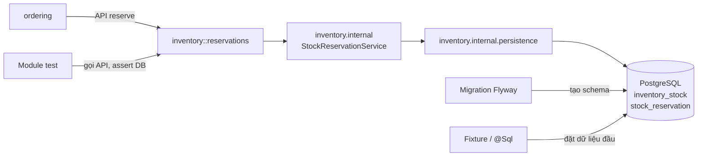

# Tạo schema và dữ liệu đầu vào

Một bài `@ApplicationModuleTest` có thể biên dịch, khởi động Spring và gọi repository thành công, nhưng kết quả vẫn không đáng tin nếu **schema kiểm thử khác schema production**, dữ liệu test phụ thuộc vào lần chạy trước, hoặc bài test được “giúp” bởi các bản ghi không liên quan. Khi kiểm chứng ứng dụng Spring Modulith, câu hỏi không chỉ là *database có kết nối được không?* mà còn là: **database đã được tạo bằng nguồn nào, dữ liệu đầu vào có biểu diễn đúng trạng thái nghiệp vụ, và mỗi test có được chạy lại từ cùng một điều kiện ban đầu hay không?**

Trong chương **Database testing** của **SPRING_MODULITH_VERIFICATION_TESTING**, bài **“Tạo schema và dữ liệu đầu vào”** hướng dẫn thiết lập nền tảng dữ liệu cho kiểm thử module. Ta sẽ phối hợp schema migration, fixture/seed, chiến lược làm sạch và môi trường database thực tế; sau đó liên hệ `ApplicationModules.verify()`, `@ApplicationModuleTest`, kiểm thử transaction, sự kiện và tích hợp cùng quality gate trong CI để chặn phụ thuộc sai và hồi quy.

> **Nguyên tắc:** Schema kiểm thử phải phản ánh **hợp đồng lưu trữ thực tế**; dữ liệu kiểm thử phải phản ánh **trạng thái nghiệp vụ có chủ đích**; kết quả phải **độc lập với thứ tự và lịch sử chạy test**.

## 1. Mục tiêu học tập

Sau bài học, bạn có thể:

1. Phân biệt **schema**, **migration**, **reference data**, **fixture**, **test seed** và **kết quả do test tạo ra**.
2. Chọn cách tạo schema bằng Flyway/Liquibase, Hibernate DDL hoặc SQL thủ công và hiểu những rủi ro khi trộn nhiều cách.
3. Thiết kế fixture tối thiểu có tính quyết định (*deterministic*), có khóa định danh, ngày giờ và giá trị biên rõ ràng.
4. Nạp dữ liệu bằng `@Sql`, `JdbcTemplate`, repository hoặc fixture builder khi kiểm thử module Spring Modulith.
5. Dùng PostgreSQL/Testcontainers để kiểm tra migration và ràng buộc thực, không nhầm H2 hoặc mock với database production.
6. Dọn và cô lập dữ liệu giữa các bài test, đặc biệt khi transaction, listener hoặc test song song tham gia.
7. Viết test xác minh constraint, rollback, trạng thái sau commit và sự kiện qua module boundary.
8. Đưa các bài kiểm chứng schema và dữ liệu vào quality gate CI có thể chạy lại.

## 2. Từ điển dữ liệu kiểm thử

Các khái niệm thường bị gọi chung là “seed” nhưng có trách nhiệm khác nhau:

| Khái niệm | Vai trò | Ví dụ |
| --- | --- | --- |
| **Schema** | Cấu trúc và ràng buộc database | Bảng `inventory_stock`, primary key, foreign key, check, index |
| **Migration** | Thay đổi schema có phiên bản, áp dụng theo thứ tự | `V1__create_inventory_tables.sql`, `V2__add_expiry_index.sql` |
| **Reference data** | Dữ liệu nền có ngữ nghĩa tương đối ổn định của ứng dụng | Mã trạng thái, loại thuế, danh mục quốc gia nếu thật sự được quản lý dưới DB |
| **Fixture** | Bộ dữ liệu đã biết để một bài hoặc nhóm test bắt đầu | SKU có tồn `3`, SKU hết hàng có tồn `0` |
| **Seed** | Hành động nạp các bản ghi cần thiết | `INSERT` trong `@Sql` hoặc `JdbcTemplate` |
| **Act data** | Dữ liệu phát sinh khi thực thi hành vi được test | Phiếu giữ hàng được API `reserve()` tạo |
| **Cleanup/reset** | Loại bỏ ảnh hưởng của lần test trước | Xóa reservation trước stock, rollback phù hợp, hoặc tạo schema mới |

Một nguyên tắc quan trọng: **fixture không phải kết quả test**. Nếu muốn chứng minh `InventoryReservations.reserve(...)` tạo phiếu giữ, không được nạp sẵn chính phiếu đó rồi chỉ `assert` nó có tồn tại. Fixture nên thiết lập **tiền điều kiện**, còn bài test phải tạo **hành vi được kiểm chứng**.

### 2.1. Ba loại sự thật khác nhau

Một test tốt phân biệt:

1. **Điều kiện ban đầu:** `SKU-AVAILABLE` có `available = 3`.
2. **Hành động:** gọi `reserve(SKU-AVAILABLE, 2)`.
3. **Hậu điều kiện:** `available = 1` và, nếu hợp đồng yêu cầu, một phiếu giữ hợp lệ được ghi.

Khi chia rõ ba phần, lỗi database có thể được quy về tạo schema, fixture, transaction hoặc hành vi nghiệp vụ, thay vì một bài test với nhiều nguồn dữ liệu không giải thích được.

## 3. Ví dụ xuyên suốt: Inventory và Ordering

Ứng dụng có hai application module chính:

- `inventory`: sở hữu tồn khả dụng và phiếu giữ hàng; bảo vệ invariant **không chấp nhận giữ quá số lượng khả dụng**.
- `ordering`: yêu cầu giữ hàng khi đặt đơn; chỉ sử dụng API đã công bố của Inventory.

Cấu trúc minh họa:

```text
src/
├── main/
│   ├── java/com/example/shop/
│   │   ├── ShopApplication.java
│   │   ├── inventory/
│   │   │   ├── reservations/
│   │   │   │   ├── package-info.java
│   │   │   │   ├── InventoryReservations.java
│   │   │   │   ├── ReserveStock.java
│   │   │   │   └── ReservationReceipt.java
│   │   │   └── internal/
│   │   │       ├── StockReservationService.java
│   │   │       └── persistence/
│   │   │           ├── StockEntity.java
│   │   │           └── StockRepository.java
│   │   └── ordering/
│   │       ├── package-info.java
│   │       └── internal/PlaceOrderService.java
│   └── resources/db/migration/
│       ├── V1__create_inventory_tables.sql
│       └── V2__add_inventory_indexes.sql
└── test/
    ├── java/com/example/shop/
    │   ├── ModularityTests.java
    │   └── inventory/InventoryDatabaseModuleTests.java
    └── resources/fixtures/inventory/
        ├── clean-and-seed.sql
        ├── empty-stock.sql
        └── active-reservation.sql
```

Các đường dẫn SQL trong cây trên là **ví dụ để học và đưa vào một dự án thực tế**, không phải những file được tạo sẵn trong bài. Khi áp dụng, phải tạo chúng trong dự án và điều chỉnh theo engine, migration và lớp domain thực tế.



Ở production, `ordering` không được truy cập `StockRepository` hoặc chạy SQL cập nhật bảng tồn thay Inventory. Trong **test infrastructure** của Inventory, `JdbcTemplate` hoặc SQL fixture có thể dùng để chuẩn bị và quan sát state nhằm kiểm chứng module. Phân biệt **mã test dựng dữ liệu** với **module production xâm nhập quyền sở hữu dữ liệu khác**.

## 4. Tạo schema từ nguồn chân lý

Trong ứng dụng có migration được quản lý, **migration production** nên là nguồn chân lý của schema test. Nếu production dùng Flyway, đừng viết một `schema-test.sql` độc lập rồi lặng lẽ để nó khác DDL production sau vài tháng.

### 4.1. Flyway: migration có phiên bản

Ví dụ nội dung `src/main/resources/db/migration/V1__create_inventory_tables.sql` dành cho **PostgreSQL**:

```sql
CREATE TABLE inventory_stock (
    sku VARCHAR(80) PRIMARY KEY,
    available INTEGER NOT NULL,
    CONSTRAINT ck_inventory_available_nonnegative
        CHECK (available >= 0)
);

CREATE TABLE stock_reservation (
    reservation_id UUID PRIMARY KEY,
    request_id UUID NOT NULL UNIQUE,
    sku VARCHAR(80) NOT NULL,
    quantity INTEGER NOT NULL,
    status VARCHAR(20) NOT NULL,
    expires_at TIMESTAMPTZ NOT NULL,
    created_at TIMESTAMPTZ NOT NULL DEFAULT CURRENT_TIMESTAMP,
    CONSTRAINT fk_reservation_stock
        FOREIGN KEY (sku) REFERENCES inventory_stock(sku),
    CONSTRAINT ck_reservation_quantity_positive
        CHECK (quantity > 0),
    CONSTRAINT ck_reservation_status
        CHECK (status IN ('ACTIVE', 'RELEASED', 'EXPIRED'))
);
```

Giải thích các ràng buộc:

- `PRIMARY KEY (sku)` bảo đảm không có hai bản ghi tồn với cùng SKU.
- `CHECK (available >= 0)` ngăn lưu giá trị âm ở cấp database; không thay thế thuật toán giữ hàng đúng khi nhiều transaction cạnh tranh.
- `request_id UNIQUE` hỗ trợ một phần idempotency; service còn phải so sánh payload và quyết định trả lại kết quả gì khi request bị gửi lại.
- `FOREIGN KEY (sku)` ngăn phiếu giữ tham chiếu SKU không tồn tại.
- `CHECK (quantity > 0)` loại bản ghi giữ số lượng vô nghĩa.
- `status` có tập giá trị hợp lệ, nhưng **không** tự bảo đảm mọi chuyển trạng thái đều đúng quy trình.
- `TIMESTAMPTZ` thể hiện timestamp có semantics thời điểm thực; code vẫn phải thống nhất timezone, chuyển đổi và thời điểm hết hiệu lực.

Migration bổ sung `V2__add_inventory_indexes.sql` có thể là:

```sql
CREATE INDEX idx_reservation_active_expiry
    ON stock_reservation(expires_at)
    WHERE status = 'ACTIVE';

CREATE INDEX idx_reservation_sku
    ON stock_reservation(sku);
```

Partial index dùng cú pháp PostgreSQL. **Nếu H2 không hỗ trợ cùng cú pháp**, không nên đổi migration production chỉ để chạy H2; test kiểm tra chính migration này nên dùng PostgreSQL thật. Index có thể giúp tốc độ truy vấn hoặc xử lý hết hạn, nhưng bài test thông thường không chứng minh kế hoạch thực thi và hiệu năng production.

### 4.2. Không biến `ddl-auto=create-drop` thành nguồn sự thật vô tình

Với Spring Data JPA/Hibernate, cấu hình:

```properties
spring.jpa.hibernate.ddl-auto=create-drop
```

có thể tạo schema dựa trên entity khi context khởi động và xóa khi kết thúc. Nó tiện trong bài thử đơn giản, nhưng **không chứng minh migration production đúng**. Những index, partial index, trigger, check constraint hoặc quyền database có thể không được tạo giống hệt môi trường thật.

Khi dùng Flyway và muốn so khớp entity với migration, cấu hình test thường nên là:

```properties
spring.flyway.enabled=true
spring.jpa.hibernate.ddl-auto=validate
```

`validate` giúp phát hiện một số bất đồng giữa mapping và schema; nó không phải công cụ so sánh đầy đủ mọi index, constraint, trigger hoặc mọi hành vi dialect. Migration cần được chạy thật trên engine mục tiêu và các luật dữ liệu quan trọng cần test riêng.

### 4.3. So sánh chiến lược tạo schema

| Cách làm | Lợi ích | Giới hạn/khuyến nghị |
| --- | --- | --- |
| Flyway/Liquibase từ cùng nguồn production | Phát hiện lỗi migration, bảo vệ lịch sử DDL | Cần DB phù hợp, quản lý version và thời gian khởi động |
| Hibernate `validate` sau migration | Phát hiện một số mismatch entity/schema | Không kiểm tra đủ mọi constraint và performance |
| Hibernate `create-drop` | Nhanh cho thử nghiệm nhỏ | Có thể tạo schema khác production; không test migration |
| `schema.sql` dành riêng cho test | Đơn giản, chủ động dữ liệu | Dễ drift; chỉ dùng nếu là một lựa chọn có chủ đích và kiểm tra |
| Schema khởi tạo thủ công tồn tại lâu | Có vẻ tiết kiệm khởi động | Không lặp lại, rò rỉ dữ liệu, khó tái hiện CI |

**Tránh hai nguồn cùng tạo bảng** mà không hiểu thứ tự chạy: ví dụ Flyway tạo bảng rồi script init khác tạo lại, hoặc Hibernate `create` xóa schema vừa migrate. Chọn **một cơ chế sở hữu DDL** trong mỗi loại test và công khai lựa chọn đó.

## 5. Khi dùng Liquibase hoặc nhiều module chia sẻ datasource

Flyway không phải công cụ duy nhất. Với Liquibase, ý tưởng tương đương: dùng **changelog đã được quản lý** và cho test áp dụng những changeSet cần thiết trên database trống, thay vì chép schema thủ công sang bộ test.

Trong Spring Modulith, có hai trục ranh giới độc lập:

1. **Ranh giới Java:** `@ApplicationModuleTest` quyết định module/bean nào được bootstrap theo mode.
2. **Ranh giới schema:** datasource và công cụ migration quyết định bảng nào tồn tại trong database.

Một database vật lý dùng chung có thể chứa bảng của `inventory`, `ordering` và `billing`. Việc chạy `@ApplicationModuleTest` ở `inventory` **không bảo đảm chỉ migration của Inventory được thực thi**. Nếu Flyway quét toàn bộ `db/migration`, các migration của mọi module có thể áp dụng cho datasource đó; điều này có thể hợp lý nếu ứng dụng triển khai chung và cần kiểm thử schema chung.

### 5.1. Tổ chức migration theo module khi cần

Với một ứng dụng lớn, có thể đặt migration theo vùng có chủ sở hữu:

```text
db/migration/
├── inventory/
│   ├── V1__create_stock.sql
│   └── V2__create_reservation.sql
├── ordering/
│   └── V1__create_orders.sql
└── billing/
    └── V1__create_payments.sql
```

**Lưu ý:** Đây là phương án tổ chức tệp, **không tự được Flyway chấp nhận khi quét chung**, vì version `V1` có thể trùng trong cùng schema history. Nếu dùng một Flyway instance/schema history chung, các version phải là duy nhất trên những location được quét; hoặc cần các instance/history/schema tách biệt được cấu hình rõ. Hãy giữ cơ chế versioning nhất quán với chiến lược triển khai thực tế.

Không tạo một migration chỉ dành riêng cho test để sửa lỗ hổng của migration production. Nếu cần seed thử nghiệm, đặt nó vào **test resources**, tránh thay đổi logic schema chỉ để một fixture dễ được nạp hơn.

### 5.2. Database ownership và migration ownership

`inventory` sở hữu schema logic của tồn kho; `ordering` không tự cập nhật bảng `inventory_stock` trong mã production. Tuy nhiên một team có thể chọn quản lý migration vật lý tập trung để deploy an toàn. **Sở hữu nghiệp vụ** không bắt buộc trùng với cấu trúc thư mục migration, nhưng phải có quy trình review người chịu trách nhiệm cho mỗi thay đổi DDL.

## 6. Tạo fixture nhỏ, rõ và tái lập được

Một fixture tốt cho test giữ hàng phải diễn tả **đúng trạng thái trước khi chạy**. Ví dụ trong `src/test/resources/fixtures/inventory/clean-and-seed.sql`:

```sql
-- Xóa bảng con trước bảng cha để thỏa foreign key.
DELETE FROM stock_reservation;
DELETE FROM inventory_stock;

INSERT INTO inventory_stock(sku, available)
VALUES
    ('SKU-AVAILABLE', 3),
    ('SKU-EMPTY', 0),
    ('SKU-LARGE', 100);
```

Ý nghĩa của từng hàng:

| Fixture | Giá trị đầu | Bài test sử dụng |
| --- | --- | --- |
| `SKU-AVAILABLE` | `available = 3` | Giữ `2` thành công, sau còn `1` |
| `SKU-EMPTY` | `available = 0` | Giữ `1` phải bị từ chối |
| `SKU-LARGE` | `available = 100` | Test các giá trị biên/số lượng lớn khi cần |
| SKU không tồn tại | Không có bản ghi | Test phân biệt “không tồn tại” và “hết hàng” nếu contract có phân biệt |

Đừng tạo 500 sản phẩm ngẫu nhiên cho một test chỉ cần một SKU. Fixture lớn dễ che các quan hệ dữ liệu và làm người đọc khó biết test phụ thuộc vào hàng nào.

### 6.1. Dùng khóa ổn định khi test cần đối chiếu

Khi test cần tham chiếu cùng request qua nhiều bảng, có thể dùng UUID cố định, ví dụ:

```sql
-- Ví dụ chỉ dùng cho test kiểm tra reservation đã tồn tại.
INSERT INTO stock_reservation (
    reservation_id, request_id, sku,
    quantity, status, expires_at
) VALUES (
    '00000000-0000-0000-0000-000000000111',
    '00000000-0000-0000-0000-000000000222',
    'SKU-EMPTY',
    1, 'ACTIVE', '2030-01-01T00:00:00Z'
);
```

Với ví dụ này, `available = 0` được hiểu là **số lượng chưa được giữ**; reservation `1` đã được ghi nhận riêng. Ngày `2030-01-01` chỉ là thời điểm minh họa, không phải fixture phù hợp vĩnh viễn: khi cần test “đang hiệu lực”, hãy dùng `Clock` có thể điều khiển hoặc một thời điểm được tính từ đồng hồ test, tránh giả định một ngày cố định luôn ở tương lai.

**Đừng nạp reservation có sẵn trong bài test muốn chứng minh lệnh `reserve` tạo reservation mới.** Tách fixture “không có reservation” và fixture “đã giữ” cho hai mục đích khác nhau.

### 6.2. Phân biệt dữ liệu hợp lệ và dữ liệu biên

Một tập fixture đáng tin nên có một số ca cố ý:

- `available = 0`: không đủ tồn.
- `available = 1`: ranh giới giữa hai request cạnh tranh.
- `available = 3`, reserve `3`: vừa đủ.
- Reserve `4` khi có `3`: vượt tồn.
- SKU không tồn tại: contract trả lỗi gì?
- Request ID lặp: cùng payload hay payload thay đổi?
- Record hết hạn: tại đúng thời điểm hết hạn, so sánh `>` hay `>=`?

Giá trị biên nên được **đặt trong đúng test** hoặc fixture dành riêng, không cố gắng nhét mọi trạng thái vào một script nền chung rồi khiến mọi test nhìn thấy quá nhiều dữ liệu.

## 7. Nạp fixture bằng `@Sql`

Spring Test hỗ trợ `@Sql` để chạy script trước hoặc sau test, tiện khi muốn người đọc thấy dữ liệu đầu vào mà không cần khởi động toàn bộ workflow tạo dữ liệu.

```java
package com.example.shop.inventory;

import static org.assertj.core.api.Assertions.assertThat;

import com.example.shop.inventory.reservations.InventoryReservations;
import com.example.shop.inventory.reservations.ReserveStock;
import java.util.UUID;
import org.junit.jupiter.api.Test;
import org.springframework.beans.factory.annotation.Autowired;
import org.springframework.jdbc.core.JdbcTemplate;
import org.springframework.modulith.test.ApplicationModuleTest;
import org.springframework.test.context.jdbc.Sql;

@ApplicationModuleTest
@Sql(
    scripts = "/fixtures/inventory/clean-and-seed.sql",
    executionPhase = Sql.ExecutionPhase.BEFORE_TEST_METHOD
)
class InventoryDatabaseModuleTests {

    @Autowired InventoryReservations reservations;
    @Autowired JdbcTemplate jdbc;

    @Test
    void reservesFromKnownStartingBalance() {
        var request = new ReserveStock(
            "SKU-AVAILABLE", 2,
            UUID.fromString("00000000-0000-0000-0000-000000000333")
        );

        var receipt = reservations.reserve(request);

        Integer available = jdbc.queryForObject(
            "SELECT available FROM inventory_stock WHERE sku = ?",
            Integer.class, "SKU-AVAILABLE"
        );
        assertThat(receipt.reservationId()).isNotNull();
        assertThat(available).isEqualTo(1);
    }
}
```

Test trên giả định hợp đồng công khai mẫu:

```java
// inventory/reservations/ReserveStock.java
package com.example.shop.inventory.reservations;

import java.util.UUID;

public record ReserveStock(String sku, int quantity, UUID requestId) {}
```

```java
// inventory/reservations/ReservationReceipt.java
package com.example.shop.inventory.reservations;

import java.util.UUID;

public record ReservationReceipt(UUID reservationId) {}
```

```java
// inventory/reservations/InventoryReservations.java
package com.example.shop.inventory.reservations;

public interface InventoryReservations {
    ReservationReceipt reserve(ReserveStock command);
}
```

Các record/interface là ví dụ API, cần validation, implementation, transaction và lỗi nghiệp vụ tương ứng trong dự án thật. `@Sql` sẽ tìm script ở **test classpath**; nếu chưa tạo file ở vị trí ví dụ, bài test sẽ thất bại. Không cần tự viết logic seed trong phương thức nếu script đã đảm bảo tiền điều kiện.

### 7.1. `@Sql` trước và sau test

Có thể dùng:

```java
@Sql(
    scripts = "/fixtures/inventory/clean-and-seed.sql",
    executionPhase = Sql.ExecutionPhase.BEFORE_TEST_METHOD
)
@Sql(
    statements = {
        "DELETE FROM stock_reservation",
        "DELETE FROM inventory_stock"
    },
    executionPhase = Sql.ExecutionPhase.AFTER_TEST_METHOD
)
class InventoryDatabaseModuleTests {
    // ...
}
```

Chiến lược này có ý nghĩa khi test **không** chạy song song trên cùng tập bảng/schema. Nếu một test khác đang thao tác cùng bảng, câu `DELETE` chung có thể phá dữ liệu của nó. Với test song song, hãy dùng schema/database riêng hoặc fixture có key phân vùng và chiến lược cleanup có kiểm soát.

Khi kết hợp `@Sql` với `@Transactional` trên lớp test, các câu SQL có thể tham gia **test-managed transaction** theo cấu hình transaction manager. Nếu cần đảm bảo fixture đã commit trước khi một thread khác đọc, hãy thiết kế transaction mode cho `@Sql` rõ ràng và kiểm tra hậu quả cleanup. Không mặc định mọi script được commit độc lập.

### 7.2. Vì sao SQL fixture không nên thay thế migration?

`@Sql` thích hợp để **nạp/đặt lại dữ liệu**. Flyway/Liquibase thích hợp để **tạo và nâng cấp schema**. Trộn `CREATE TABLE` vào một script fixture của từng test dễ gây lỗi “table already exists”, tạo DDL khác production và làm chậm suite.

Một thứ tự phổ biến:

```text
Database container mới
  ↓
Spring Boot + Flyway/Liquibase áp dụng migration
  ↓
Spring context khởi động module cần test
  ↓
@Sql hoặc fixture builder nạp trạng thái ban đầu
  ↓
Gọi API của module
  ↓
Assert hành vi + trạng thái database
  ↓
Cleanup/reset theo chiến lược đã chọn
```

## 8. Nạp fixture bằng `JdbcTemplate` hoặc repository

`@Sql` rất rõ cho những bảng và constraint cần nhìn thấy. Tuy nhiên, khi fixture phụ thuộc tham số hoặc nhiều tình huống, dùng helper có tên nghiệp vụ có thể dễ bảo trì hơn.

### 8.1. `JdbcTemplate` trong setup test

```java
@BeforeEach
void seedKnownStock() {
    jdbc.update("DELETE FROM stock_reservation");
    jdbc.update("DELETE FROM inventory_stock");
    jdbc.update(
        "INSERT INTO inventory_stock(sku, available) VALUES (?, ?)",
        "SKU-AVAILABLE", 3
    );
}
```

Đoạn setup này cần đặt trong lớp test đã inject `JdbcTemplate`, có import `org.junit.jupiter.api.BeforeEach`, và **không nên dùng đồng thời** với `@Sql` thực hiện đúng các thao tác seed đó. Chọn một cơ chế chính cho mỗi nhóm test để tránh không biết dữ liệu đến từ đâu.

Ưu điểm của SQL/JdbcTemplate là có thể xác minh **schema và constraint thật** thay vì đi vòng qua method tạo fixture của production. Nhược điểm là fixture có thể phụ thuộc tên bảng/cột và phải sửa khi migration có thay đổi có chủ đích.

### 8.2. Dùng repository để dựng aggregate hợp lệ

Nếu mục tiêu test là use case trên dữ liệu domain hợp lệ và không cần kiểm tra SQL/constraint chi tiết, có thể dùng repository nội bộ qua helper setup **trong test của module sở hữu**. Lúc đó test bớt lệ thuộc vào DDL nhưng phải cẩn thận: nếu cùng repository mapping có bug, fixture có thể thất bại hoặc che bug trước khi method được test chạy.

Một nguyên tắc lựa chọn:

| Mục tiêu test | Setup ưu tiên | Vì sao |
| --- | --- | --- |
| Kiểm tra native query/constraint của repository | SQL/JdbcTemplate hoặc `@Sql` | Không dựa vào chính method đang cần kiểm chứng |
| Kiểm tra use case với aggregate hợp lệ | Factory/builder + repository | Rõ ý nghĩa nghiệp vụ và ít chi tiết bảng |
| Kiểm tra mapping JPA | Entity factory + repository, `flush`/`clear` | Kiểm tra mapping/thời điểm ghi DB |
| Kiểm tra migration từ DB rỗng | Không có fixture schema tự tạo | Migration phải tự dựng được schema |
| Kiểm tra dữ liệu biên không cho phép ở domain | SQL có chủ đích nếu database cho phép | Test có thể cần chứng minh constraint cuối cùng từ chối dữ liệu |

### 8.3. Fixture builder là công cụ của test, không phải domain API mới

Thay vì viết `insertCustomer(...)`, `insertOrder(...)`, `insertReservation(...)` trong mọi test, có thể tạo helper test:

```java
// Mã minh họa fixture helper, không phải application module API.
final class StockFixture {
    private final JdbcTemplate jdbc;

    StockFixture(JdbcTemplate jdbc) {
        this.jdbc = jdbc;
    }

    void available(String sku, int amount) {
        jdbc.update(
            "INSERT INTO inventory_stock(sku, available) VALUES (?, ?)",
            sku, amount
        );
    }
}
```

Đừng tạo một “module `test-common`” khổng lồ chứa tất cả factory nghiệp vụ và buộc mọi test hiểu schema của mọi module. Helper nên nằm trong test scope thích hợp và có trách nhiệm rõ.

## 9. Database thật cho schema đáng tin: Testcontainers

Nếu production dùng PostgreSQL và migration có `TIMESTAMPTZ`, `UUID`, partial index hoặc constraint đặc thù, nên kiểm tra bằng **PostgreSQL thật** trong môi trường tạm thời. Testcontainers giúp khởi động một engine như vậy, nhưng không tự sinh migration hay fixture.

### 9.1. Kết hợp `@ApplicationModuleTest` với PostgreSQLContainer

Ví dụ minh họa, giả định Spring Boot hỗ trợ `@ServiceConnection` (Spring Boot 3.1+) và dự án đã có dependencies Testcontainers, PostgreSQL driver, Spring Modulith test starter và Flyway tương thích:

```java
package com.example.shop.inventory;

import static org.assertj.core.api.Assertions.assertThat;

import com.example.shop.inventory.reservations.InventoryReservations;
import com.example.shop.inventory.reservations.ReserveStock;
import java.util.UUID;
import org.junit.jupiter.api.Test;
import org.springframework.beans.factory.annotation.Autowired;
import org.springframework.boot.testcontainers.service.connection.ServiceConnection;
import org.springframework.jdbc.core.JdbcTemplate;
import org.springframework.modulith.test.ApplicationModuleTest;
import org.springframework.test.context.jdbc.Sql;
import org.testcontainers.containers.PostgreSQLContainer;
import org.testcontainers.junit.jupiter.Container;
import org.testcontainers.junit.jupiter.Testcontainers;

@Testcontainers
@ApplicationModuleTest
@Sql(
    scripts = "/fixtures/inventory/clean-and-seed.sql",
    executionPhase = Sql.ExecutionPhase.BEFORE_TEST_METHOD
)
class InventoryPostgresModuleTests {

    @Container
    @ServiceConnection
    static PostgreSQLContainer<?> postgres =
        new PostgreSQLContainer<>("postgres:16-alpine");

    @Autowired InventoryReservations reservations;
    @Autowired JdbcTemplate jdbc;

    @Test
    void schemaAndFixtureSupportReservation() {
        var result = reservations.reserve(
            new ReserveStock(
                "SKU-AVAILABLE", 2,
                UUID.fromString("00000000-0000-0000-0000-000000000333")
            )
        );

        Integer available = jdbc.queryForObject(
            "SELECT available FROM inventory_stock WHERE sku = ?",
            Integer.class, "SKU-AVAILABLE"
        );
        Integer reservationsCount = jdbc.queryForObject(
            "SELECT count(*) FROM stock_reservation WHERE reservation_id = ?",
            Integer.class, result.reservationId()
        );

        assertThat(available).isEqualTo(1);
        assertThat(reservationsCount).isEqualTo(1);
    }
}
```

Đây là **mẫu ghép nối test**, không phải chương trình độc lập: cần triển khai `InventoryReservations`, các entity/repository, migration và datasource. `postgres:16-alpine` là một major version minh họa; hãy chọn version phù hợp với production. Cấu hình dự án có thể dùng `spring.jpa.hibernate.ddl-auto=validate` và `spring.flyway.enabled=true` để đảm bảo migration tạo bảng trước khi JPA làm việc.

Test xác nhận cả dữ liệu tồn và phiếu giữ mới được tạo. Nếu chỉ kiểm tra một lời gọi mock hoặc mỗi `available` trong RAM, ta không biết migration có tạo đúng bảng và constraint hay không.

### 9.2. Testcontainers không tự quản lý phiên bản schema

Container chỉ cung cấp **database engine**. Một test có thể chạy PostgreSQL thành công nhưng schema vẫn sai nếu:

- Flyway bị tắt bởi một profile.
- Dự án chỉ chạy `ddl-auto=create` thay vì migration.
- Có script test tự tạo bảng khác production.
- Test dùng migration thiếu một module hoặc sai thứ tự.
- Cơ sở dữ liệu container được tái sử dụng với dữ liệu/schema cũ không được kiểm soát.

Vì vậy cần xác minh migration chạy thực sự và kiểm soát trạng thái ban đầu. Cách đơn giản và chắc chắn cho **bài test kiểm tra migration từ đầu** là tạo một DB/schema mới.

### 9.3. Cách kết nối khác: `@DynamicPropertySource`

Khi không dùng `@ServiceConnection`, có thể cung cấp datasource properties từ container:

```java
@DynamicPropertySource
static void databaseProperties(DynamicPropertyRegistry registry) {
    registry.add("spring.datasource.url", postgres::getJdbcUrl);
    registry.add("spring.datasource.username", postgres::getUsername);
    registry.add("spring.datasource.password", postgres::getPassword);
}
```

Các annotation/type thuộc `org.springframework.test.context.DynamicPropertySource` và `DynamicPropertyRegistry`. Đoạn mã phải nằm trong một test class đang sở hữu `postgres` được khởi động theo lifecycle Testcontainers. Thường chọn **một** cách wiring datasource để tránh cấu hình chồng lấn không cần thiết.

## 10. H2 có dùng được cho schema và fixture không?

H2 là **database engine thực**, không phải mock repository. Nó có thể giúp test CRUD và mapping đơn giản, nhưng không chứng minh migration đặc thù của PostgreSQL hoạt động.

Ví dụ cấu hình test mang tính minh họa:

```properties
spring.datasource.url=jdbc:h2:mem:inventorytest;DB_CLOSE_DELAY=-1
spring.datasource.driver-class-name=org.h2.Driver
spring.datasource.username=sa
spring.datasource.password=
spring.jpa.hibernate.ddl-auto=validate
spring.flyway.enabled=true
```

Để chạy được, dự án phải có dependency H2, profile đúng và **migration tương thích H2**. Migration PostgreSQL dùng partial index ở mục 4 có thể không được H2 hỗ trợ theo cùng cú pháp. Nếu một dự án cần hai loại engine, phải có chính sách quản lý migration/test matrix rõ; không lặng lẽ xóa các constraint khó từ test schema để test xanh.

| Nhu cầu | H2 | PostgreSQL trong Testcontainers |
| --- | --- | --- |
| Kiểm thử CRUD đơn giản | Thường phù hợp | Phù hợp nhưng nặng hơn |
| Kiểm tra `@Entity` và repository cơ bản | Có ích | Gần production hơn |
| Kiểm tra partial index, `TIMESTAMPTZ`, native SQL PostgreSQL | Không bảo đảm | **Nên dùng** |
| Kiểm tra migration PostgreSQL | Không đủ thay thế | **Nên dùng** |
| Kiểm tra lock/isolation khi đồng thời | Có semantics riêng | **Nên dùng** engine production-type |
| Tốc độ startup | Thường nhanh | Có chi phí container/runtime |

H2 ở chế độ tương thích PostgreSQL chỉ giúp một số cú pháp, **không trở thành PostgreSQL**. Nếu dùng H2 cho test nhanh, hãy giữ một lớp test PostgreSQL cho invariant và migration quan trọng.

## 11. Thiết kế isolation để test không ảnh hưởng lẫn nhau

Một module test cần câu trả lời rõ: **Ai dọn dữ liệu? Dọn khi nào? Test nào có thể chạy song song?**

### 11.1. Các lựa chọn reset dữ liệu

| Chiến lược | Thích hợp khi | Điểm cần kiểm soát |
| --- | --- | --- |
| `@Sql` cleanup + seed trước mỗi test | Test tuần tự, schema nhỏ | Thứ tự xóa bảng theo foreign key, transaction |
| `@Sql` cleanup sau mỗi test | Muốn giữ DB sạch sau ca | Cleanup phải chạy cả khi test fail; song song dễ xung đột |
| Transaction rollback quanh test | Chỉ kiểm tra trong một transaction | Có thể che lỗi chỉ xảy ra sau commit; worker thread có transaction riêng |
| Schema/database mới mỗi class/suite | Kiểm tra migration hoặc isolation mạnh | Chi phí startup, tài nguyên, version |
| ID/SKU phân vùng theo test | Test chia sẻ database | Không xóa chung; cần tránh collision và cleanup đúng namespace |
| Container tái dùng có quản lý | Suite lớn cần tối ưu startup | Reset schema/data rõ ràng; không mặc định môi trường luôn sạch |

Ví dụ PostgreSQL:

```sql
DELETE FROM stock_reservation;
DELETE FROM inventory_stock;
```

Thứ tự đúng vì `stock_reservation.sku` có foreign key tới `inventory_stock.sku`. Nếu dùng `TRUNCATE ... CASCADE`, lệnh đó có thể xóa **nhiều bảng không dự kiến**; chỉ dùng khi schema/test database hoàn toàn do suite kiểm soát. Không chạy những lệnh dọn rộng này trên database dùng chung với dữ liệu thật.

### 11.2. Vì sao transaction của test đôi khi làm sai bài học?

Spring Test có thể mở transaction quanh một phương thức `@Transactional` và rollback khi test xong. Điều đó hữu ích cho isolation, nhưng nếu mục tiêu là test **commit thực**, sự kiện `AFTER_COMMIT`, lock được release hoặc nhiều thread tương tác với nhau, transaction bao ngoài có thể:

- Làm service tham gia transaction của test thay vì tự commit.
- Khiến listener sau commit không được kích hoạt như production.
- Làm fixture không nhìn thấy được từ thread/connection khác trước commit.
- Che vấn đề chỉ phát sinh sau commit.

Khi test commit/rollback của module, **không mặc nhiên gắn `@Transactional` lên test class**. Nếu cần, tách riêng test rollback trong transaction với test tích hợp có transaction thật, và đảm bảo dữ liệu đầu vào đã được commit trước khi chạy các thread đồng thời.

### 11.3. Isolation theo module là hai vấn đề khác nhau

`@ApplicationModuleTest` có chế độ bootstrap `STANDALONE`, `DIRECT_DEPENDENCIES`, `ALL_DEPENDENCIES`; điều này giới hạn **Spring bean/module**. Nó **không tự tạo schema riêng cho Inventory**, không ngăn SQL string truy cập bảng Ordering và không dọn database sau test.

Ranh giới database phải được giữ bằng quyền sở hữu bảng, migration, test data policy và — khi cần — quyền database hoặc schema tách biệt.

## 12. Fixture phải phản ánh thời gian, tiền tệ và dữ liệu biên

Những lỗi khó thường không nằm ở một bản ghi đơn giản mà ở **ý nghĩa của giá trị đầu vào**.

### 12.1. Thời gian

Tránh test:

```java
// Dễ flakey: phụ thuộc thời điểm test chạy.
Instant expiresAt = Instant.now().plusSeconds(1);
```

Nếu CI bị chậm, thời hạn có thể hết trước khi assertion chạy. Với service có thể inject `Clock`, dùng đồng hồ cố định trong test:

```java
Clock fixedClock = Clock.fixed(
    Instant.parse("2026-04-10T09:00:00Z"), ZoneOffset.UTC
);
```

Sau đó dựng fixture `expiresAt` trước/sau thời điểm cố định để kiểm tra đúng ranh giới `expiresAt <= now`. Một test xử lý hết hạn cần chọn chính xác điều kiện nghiệp vụ, **không dùng sleep để chờ thời gian thật** khi có thể điều khiển đồng hồ.

Khi dùng SQL fixture có timestamp cố định, cần kiểm tra service thực sự dùng clock được inject thay vì `Instant.now()` bên trong. Việc cố định đồng hồ ở bài test không giúp gì nếu production code bỏ qua clock đó.

### 12.2. Tiền và số thập phân

Nếu module `ordering` có bảng tổng tiền, fixture nên dùng `DECIMAL/NUMERIC` thích hợp và `BigDecimal`, không dùng `double` để so sánh tiền. Test cần kiểm tra rounding, scale, tiền tệ và giá trị biên đúng hợp đồng.

Với database khác nhau, precision/scale và kiểu mapping có thể khác. Một test dùng H2 pass không tự xác nhận PostgreSQL giữ đúng số thập phân nếu schema không tương đương.

### 12.3. Ràng buộc null, unique và foreign key

Fixture cần có cả trường hợp không hợp lệ **khi muốn test constraint**:

```sql
-- Trong một test riêng, database phải từ chối số lượng âm.
UPDATE inventory_stock
SET available = -1
WHERE sku = 'SKU-AVAILABLE';
```

Đừng đặt SQL này vào script seed dùng chung: nó sẽ làm tất cả bài test fail ngay ở bước chuẩn bị. Test constraint nên **chủ động thử ghi dữ liệu sai**, assert lỗi phù hợp và kiểm tra state không bị phá.

Ví dụ một test khác tạo hai reservation với cùng `request_id` để kiểm tra `UNIQUE`; cần đảm bảo mỗi lần test có database state riêng và lỗi được phát sinh tại thời điểm flush/commit dự kiến.

## 13. Kiểm thử schema bằng assertion, không chỉ chờ khởi động thành công

Migration khởi động được là điều kiện cần, nhưng chưa chứng minh mọi constraint đang bảo vệ dữ liệu.

### 13.1. Test check constraint

```java
@Test
void databaseRejectsNegativeAvailability() {
    assertThatThrownBy(() -> jdbc.update(
        "UPDATE inventory_stock SET available = ? WHERE sku = ?",
        -1, "SKU-AVAILABLE"
    )).isInstanceOf(DataAccessException.class);

    Integer available = jdbc.queryForObject(
        "SELECT available FROM inventory_stock WHERE sku = ?",
        Integer.class, "SKU-AVAILABLE"
    );
    assertThat(available).isEqualTo(3);
}
```

Ví dụ cần import `org.springframework.dao.DataAccessException` và static `assertThatThrownBy`. Nó giả định seed `SKU-AVAILABLE = 3` đã chạy, test không bị bọc trong một transaction lỗi đã chuyển sang trạng thái không thể tiếp tục, và statement lỗi được thực thi trong transaction riêng phù hợp. Với PostgreSQL, **một câu SQL lỗi bên trong transaction hiện hành sẽ làm transaction đó bị đánh dấu aborted** cho tới khi rollback; khi đó đọc lại trong cùng transaction có thể tiếp tục lỗi. Vì vậy bài test constraint nên kiểm soát transaction rõ (ví dụ thao tác `JdbcTemplate` auto-commit riêng khi không có test transaction) hoặc tách bước đọc sau khi transaction lỗi đã rollback.

### 13.2. Test foreign key và unique

Những trường hợp có giá trị:

- Ghi reservation trỏ tới SKU không tồn tại → database từ chối.
- Ghi hai reservation cùng `reservation_id` → database từ chối.
- Ghi hai reservation cùng `request_id` → database từ chối theo unique constraint.
- Ghi `quantity = 0` → check constraint từ chối.
- Ghi `status = 'UNKNOWN'` → check constraint từ chối.

Các test nên kiểm tra **hậu điều kiện không có bản ghi sai được commit**, không chỉ `assertThrows` rồi bỏ qua. Mục tiêu là xác nhận ràng buộc được database thực thi và không để lại state không nhất quán.

### 13.3. Test migration khi nâng cấp

Có hai câu hỏi khác nhau:

1. **Tạo mới:** toàn bộ migration áp dụng được trên database trống không?
2. **Nâng cấp:** khi database đã ở version trước với dữ liệu thật có hình dạng hợp lệ, migration mới có chạy mà không mất ý nghĩa dữ liệu không?

Test khởi tạo DB mới từ `V1` đến `Vn` trả lời câu đầu. Để trả lời câu thứ hai, cần mô phỏng **snapshot/schema ở version trước**, seed dữ liệu phù hợp, chạy migration mới và assert tính toàn vẹn. Đừng coi “DB trống migrate thành công” là đủ cho mọi đợt nâng cấp production.

Migration cần được thiết kế với backward compatibility và thời điểm deploy nếu ứng dụng cũ/mới cùng chạy tạm thời. Đó là vấn đề vận hành schema, không chỉ vấn đề viết fixture.

## 14. Sự kiện và dữ liệu đầu vào phải cùng một ngữ nghĩa

Ví dụ Inventory phát `StockReserved` sau khi reservation được chấp nhận. Fixture có ba SKU và không có reservation mới trước khi test. Bài test thực thi lệnh giữ hàng, rồi kỳ vọng:

1. Dòng tồn đã thay đổi đúng.
2. Phiếu giữ được ghi bền vững.
3. Sự kiện mô tả **đúng reservation vừa tạo**, không phải dữ liệu nạp sẵn.
4. Nếu transaction rollback, consumer không được coi reservation đã commit thành công.

Nếu listener bất đồng bộ, cần kiểm tra việc nhận lại sự kiện, retry và idempotency theo cấu hình. `@ApplicationModuleTest` giúp kiểm tra event trong phạm vi module; test liên quan tới consumer ở module khác cần bootstrap hoặc test integration thích hợp.

### 14.1. Fixture có thể che lỗi event

Phản mẫu:

```text
Fixture tạo reservation R-1
↓
Service xử lý request khác
↓
Test chỉ query thấy R-1 và kết luận service đã phát sự kiện/ghi dữ liệu
```

Đây là **false positive** vì dữ liệu kết quả có sẵn trước hành động. Muốn test event và side effect, hãy dùng ID mới có thể đối chiếu, so sánh số bản ghi trước–sau và xác minh payload thuộc đúng hành động đang test.

### 14.2. Khi test sau commit

Một test có `@Transactional` rollback ở cuối có thể khiến listener `AFTER_COMMIT` không chạy. Khi kiểm thử sự kiện sau commit, chọn điều kiện fixture và transaction để service thật sự commit, rồi mới chờ/khẳng định kết quả listener. Không chỉ dùng `Thread.sleep(...)` một khoảng cố định; kiểm tra điều kiện hoàn thành với timeout rõ ràng.

## 15. Bảo vệ ranh giới module trong khi tạo dữ liệu test

Một fixture được dùng trong test Inventory có thể truy cập bảng Inventory để chuẩn bị tình huống. Nhưng mã production trong module Ordering không được tự `UPDATE inventory_stock` chỉ vì hai module chia sẻ datasource.

Trong `inventory/reservations/package-info.java`:

```java
@org.springframework.modulith.NamedInterface("reservations")
package com.example.shop.inventory.reservations;
```

Và trong `ordering/package-info.java`:

```java
@org.springframework.modulith.ApplicationModule(
    allowedDependencies = "inventory::reservations"
)
package com.example.shop.ordering;
```

Kiểm chứng cấu trúc:

```java
// src/test/java/com/example/shop/ModularityTests.java
package com.example.shop;

import org.junit.jupiter.api.Test;
import org.springframework.modulith.core.ApplicationModules;

class ModularityTests {

    @Test
    void boundariesRemainEnforced() {
        ApplicationModules.of(ShopApplication.class).verify();
    }
}
```

`verify()` giúp phát hiện các trường hợp điển hình: chu trình giữa application module, tham chiếu vào phần nội bộ của closed module, và phụ thuộc vượt `allowedDependencies`. Nó **không kiểm chứng SQL cụ thể** hay việc một module dùng câu SQL string ghi bảng module khác, và cũng không kiểm tra chính xác migration/fixture.

Đó là lý do cần hai nhóm kiểm thử song song:

- **Architecture test:** `ordering` có được phép biết kiểu `inventory.internal.StockRepository` không? (Không.)
- **Database/module test:** với schema và dữ liệu ban đầu chính xác, `InventoryReservations.reserve(...)` có bảo vệ invariant và ghi state đúng không?

### 15.1. Chọn bootstrap mode cho module test

| Mode | Phạm vi module | Dữ liệu cần chuẩn bị |
| --- | --- | --- |
| `STANDALONE` | Module đang test | Fixture cho module đó; test double cho collaborator ngoài nếu cần |
| `DIRECT_DEPENDENCIES` | Module cùng phụ thuộc trực tiếp | Có thể cần fixture cho các module đích; database vật lý vẫn có thể chung |
| `ALL_DEPENDENCIES` | Bao gồm phụ thuộc bắc cầu | Có thể cần migration, seed và test infrastructure rộng hơn |

Ví dụ test `ordering` thật sự gọi Inventory:

```java
@ApplicationModuleTest(mode = BootstrapMode.DIRECT_DEPENDENCIES)
class OrderingWithInventoryModuleTests {
    // Setup fixture Inventory + Ordering có kiểm soát.
    // Gọi API Ordering và assert state ở các module liên quan.
}
```

`BootstrapMode` cần import từ `org.springframework.modulith.test.ApplicationModuleTest.BootstrapMode`; ví dụ là **khung định hướng**, chưa có assertion. Phạm vi bootstrap **không có nghĩa** tự tạo database mới hay tự seed các module trực tiếp: người viết test vẫn chịu trách nhiệm setup.

## 16. Lỗi thường gặp khi tạo schema và dữ liệu đầu vào

| Triệu chứng | Nguyên nhân có thể | Cách khắc phục |
| --- | --- | --- |
| H2 xanh, PostgreSQL đỏ lúc migrate | SQL dialect/index/type khác nhau | Test migration production trên PostgreSQL |
| Bảng không tồn tại khi `@ApplicationModuleTest` khởi động | Flyway/Liquibase không chạy hoặc location sai | Kiểm tra datasource, migration và profile |
| `relation already exists` | DDL chạy hai lần từ Flyway, Hibernate hoặc script init | Chỉ định một cơ chế sở hữu DDL |
| Test đơn lẻ xanh, chạy suite đỏ | Fixture trùng ID, dữ liệu tồn từ test trước | Reset/cleanup xác định; isolation khi chạy song song |
| Test đôi khi hết hạn trước assert | Dùng thời gian thực quá ngắn | Inject `Clock`, sử dụng thời điểm test có kiểm soát |
| `INSERT` fixture báo lỗi FK | Thứ tự tạo bản ghi cha/con sai | Seed bảng cha trước bảng con; cleanup ngược |
| Test event không có kết quả listener | Transaction chưa commit, listener ngoài scope | Test commit thật, bootstrap consumer đúng |
| Test constraint không đọc lại được DB | Transaction PostgreSQL đã aborted sau SQL lỗi | Rollback rồi đọc bằng transaction khác |
| Dữ liệu test không giống production | Tạo schema bằng `ddl-auto` khác migration | Dùng migration thật, DB production-type |
| Dữ liệu bị mất khi test song song | `DELETE`/`TRUNCATE` bảng dùng chung | Database/schema/test namespace riêng |
| Test cập nhật tồn xanh dù không hề chạy service | Fixture đã nạp sẵn hậu điều kiện | Tách dữ liệu đầu vào và kết quả do hành động tạo |
| Migrate DB trống xanh nhưng upgrade production lỗi | Chỉ test fresh migration, không test dữ liệu cũ | Bổ sung upgrade migration test có dữ liệu trước đó |

### 16.1. Quy trình debug theo thứ tự

1. **Xác định engine:** H2, PostgreSQL container hay datasource khác thực sự được test dùng?
2. **Xác định nguồn DDL:** Flyway, Liquibase, Hibernate hay script init? Có chạy trùng không?
3. **Xác định migration version:** bảng và constraint đã đến đúng phiên bản chưa?
4. **Xác định fixture:** script/builder nào đã seed, vào database/schema nào, trước test hay trong transaction nào?
5. **Xác định isolation:** dữ liệu từ bài khác hoặc thread khác có thể can thiệp không?
6. **Xác định action:** test đã gọi đúng API Spring bean, hay chỉ dùng mock/đọc fixture?
7. **Xác định commit:** state được assert có bền vững ở database hay còn nằm trong persistence context?
8. **Xác định contract:** trạng thái nghiệp vụ mà test mong đợi có đúng chủ sở hữu và ý nghĩa không?

Tránh sửa `assert` cho xanh khi chưa biết **state ban đầu thật sự** của database.

## 17. Quality gate CI cho schema và fixture

Một pipeline gọn nhưng có ý nghĩa:

```text
Pull request
   |
   +-- Compile + unit tests
   |      -> Logic dùng mock/fake được kiểm tra nhanh
   |
   +-- ModularityTests / ApplicationModules.verify()
   |      -> Không vòng, không import nội bộ, đúng allowedDependencies
   |
   +-- Testcontainers: PostgreSQL database mới
   |      -> Áp dụng migration production
   |      -> Nạp fixture có phiên bản/trạng thái xác định
   |      -> @ApplicationModuleTest với real persistence
   |      -> Kiểm tra constraint, transaction và invariant
   |
   +-- Event / contract / integration tests
   |      -> Payload, commit, retry, idempotency, consumer
   |
   +-- Tất cả gate bắt buộc đạt -> được xem xét merge
```

### 17.1. Các điều kiện vận hành

- CI phải có container runtime hoặc môi trường Testcontainers được hỗ trợ, nếu các bài test cần PostgreSQL container.
- Image database được pin phiên bản tương thích và lấy từ registry theo chính sách của tổ chức.
- Không dùng database production hay credentials production làm nơi chạy fixture/reset.
- Mỗi job phải có database state xác định; test song song không xóa dữ liệu của nhau.
- Migration phải chạy trên database phù hợp, và lỗi migration phải làm CI thất bại.
- Bài `ModularityTests` và các module database test phải được test runner phát hiện thật.
- Test dùng native SQL/constraint không được âm thầm chuyển qua H2 khi container không khởi động.
- Có báo cáo nguyên nhân lỗi: migration, startup datasource, fixture, assertion hoặc timeout.

Ví dụ dự án Maven dùng `./mvnw -B test` và stage integration test riêng nếu build cấu hình Surefire/Failsafe theo cách đó; Gradle dùng các tác vụ test đã định nghĩa. **Không giả định một lệnh sẽ tự chạy mọi test**: cần kiểm tra tên, tag, profile và cấu hình test discovery.

### 17.2. Khi schema thay đổi, những test nào phải chạy?

| Loại thay đổi | Gate quan trọng |
| --- | --- |
| Thêm cột `NOT NULL` | Migration trên DB mới và DB upgrade, fixture thiếu giá trị phải được xem lại |
| Đổi kiểu `VARCHAR` sang enum/check | Schema test, seed dữ liệu biên, consumer mapping |
| Thêm unique index | Test dữ liệu cũ có trùng, test race hoặc idempotency liên quan |
| Đổi cách lưu `expires_at` | Test timezone, boundary time, query và index |
| Đổi foreign key giữa bảng | Test seed/cleanup thứ tự, quan hệ sở hữu dữ liệu |
| Đổi repository/API giữa module | `ApplicationModules.verify()`, module test và consumer contract |
| Đổi cơ chế phát sự kiện sau commit | Transaction/event/integration tests |

## 18. Bài thực hành: dựng schema và seed cho module Seating

Hệ thống đặt vé có module `seating` với API `SeatHolds.hold(showId, seatId, requestId)` và bảng lưu phiếu giữ ghế. Invariant: **trong cùng một suất diễn, một ghế không thể có hai phiếu giữ còn hiệu lực đồng thời**.

### 18.1. Yêu cầu

1. Thiết kế bảng `seat`, `seat_hold` với primary key, foreign key, trạng thái, thời hạn và khóa phục vụ idempotency.
2. Chọn migration Flyway/Liquibase cho PostgreSQL, nêu cách chạy nó trên DB mới trong Testcontainers.
3. Viết fixture một suất diễn với ghế `A-01` khả dụng, ghế `A-02` đã giữ và một yêu cầu không tồn tại.
4. Gắn fixture vào `@ApplicationModuleTest` bằng `@Sql` hoặc builder có chủ đích.
5. Viết test giữ ghế thành công, test ghế đã giữ, test request ID lặp, test hai request khác ID cạnh tranh.
6. Test quy tắc hết hạn tại thời điểm được điều khiển bằng `Clock` thay vì sleep.
7. Giải thích cách dọn dữ liệu để chạy suite nhiều lần và khi test song song.
8. Viết `ApplicationModules.verify()` để chặn Booking import repository nội bộ của Seating.
9. Chọn CI gate bắt buộc cho schema, transaction, event và integration.

### 18.2. Một phương án schema minh họa

```sql
CREATE TABLE seat (
    show_id UUID NOT NULL,
    seat_id VARCHAR(40) NOT NULL,
    PRIMARY KEY (show_id, seat_id)
);

CREATE TABLE seat_hold (
    hold_id UUID PRIMARY KEY,
    request_id UUID NOT NULL UNIQUE,
    show_id UUID NOT NULL,
    seat_id VARCHAR(40) NOT NULL,
    status VARCHAR(20) NOT NULL,
    expires_at TIMESTAMPTZ NOT NULL,
    FOREIGN KEY (show_id, seat_id) REFERENCES seat(show_id, seat_id),
    CONSTRAINT ck_seat_hold_status
        CHECK (status IN ('ACTIVE', 'RELEASED', 'EXPIRED'))
);
```

**Đây chưa phải schema đủ để chống giữ ghế trùng theo thời gian.** Nếu thêm `UNIQUE(show_id, seat_id)` cho toàn bộ `seat_hold`, một phiếu `EXPIRED` cũ vẫn cản ghi phiếu mới. Nếu dùng partial unique index:

```sql
CREATE UNIQUE INDEX uq_active_seat_hold
    ON seat_hold(show_id, seat_id)
    WHERE status = 'ACTIVE';
```

thì cần thiết kế **cách chuyển hàng hết hạn từ `ACTIVE` sang `EXPIRED` trước khi cấp phiếu mới**, dưới transaction/locking phù hợp. Thời gian `expires_at` tự trôi qua **không tự làm predicate của partial index đổi giá trị**; không thể đơn giản dùng `now()` trong predicate index để tạo điều kiện “chỉ các phiếu chưa hết hạn” biến thiên theo thời gian. Mục tiêu bài học là chỉ ra rằng **DDL, thuật toán cấp ghế và fixture/test hết hạn phải cùng một semantics**.

### 18.3. Dữ liệu ban đầu hợp lý

Fixture được tạo từ một đồng hồ test cố định, có:

- Ghế `A-01` tồn tại, chưa có phiếu giữ `ACTIVE`.
- Ghế `A-02` có phiếu giữ `ACTIVE`, `expiresAt` lớn hơn thời điểm test.
- `requestId` là UUID cố định để có thể kiểm tra idempotency.
- Một `showId` không tồn tại để test lỗi foreign key hoặc lỗi nghiệp vụ tương ứng.

Khi test `hold(A-01)`, **không seed trước phiếu giữ của A-01**. Khi test `hold(A-02)`, fixture phải seed trạng thái bận có chủ đích. Khi test hết hạn, điều khiển clock và chạy đúng quy trình giải phóng/đổi trạng thái theo hợp đồng trước khi kết luận có thể giữ lại.

### 18.4. Quy tắc phụ thuộc giữa module

Trong `seating/holds/package-info.java`:

```java
@org.springframework.modulith.NamedInterface("holds")
package com.example.tickets.seating.holds;
```

Trong `booking/package-info.java`:

```java
@org.springframework.modulith.ApplicationModule(
    allowedDependencies = "seating::holds"
)
package com.example.tickets.booking;
```

Và kiểm chứng:

```java
@Test
void boundariesHold() {
    ApplicationModules.of(TicketsApplication.class).verify();
}
```

Bài test kiến trúc chặn tham chiếu `booking → seating.internal.SeatHoldRepository`, **không tự chứng minh** constraint chống giữ ghế trùng. Bài test PostgreSQL với fixture và hai transaction cạnh tranh bảo vệ invariant về dữ liệu. Cần cả hai, cùng test sự kiện nếu Seating công bố `SeatHeld`.

## 19. Checklist cuối cùng

- [ ] Xác định rõ schema, migration, reference data, fixture và dữ liệu do hành động test tạo.
- [ ] Chọn **một nguồn chân lý DDL** cho mỗi loại test; không vô tình trộn Flyway, Hibernate create và script init.
- [ ] Migration production được chạy trên database phù hợp; test không chỉ dùng một schema H2 đơn giản hóa.
- [ ] Các constraint quan trọng (PK, FK, unique, check) được mô tả và có test bảo vệ.
- [ ] Fixture chỉ chứa dữ liệu đầu vào cần thiết, không nạp sẵn kết quả mà test định chứng minh.
- [ ] Mọi ID, lượng tồn, trạng thái, thời gian và giá trị biên được chọn có chủ đích.
- [ ] Test dùng `@Sql`, `JdbcTemplate` hoặc builder theo một chiến lược rõ ràng, không seed lặp ở nhiều nơi.
- [ ] Thứ tự insert và cleanup đáp ứng foreign key; không xóa dữ liệu của test khác.
- [ ] Test chạy lại độc lập với thứ tự test, thời điểm hiện tại và database còn sót từ lần trước.
- [ ] Test commit/rollback không bị test-managed transaction che giấu hành vi.
- [ ] Test đồng thời có dữ liệu đã commit, transaction riêng và kiểm chứng invariant trên engine thật.
- [ ] `@ApplicationModuleTest` chọn đúng bootstrap mode; scope module không bị nhầm với schema isolation.
- [ ] API công khai và repository nội bộ được phân tách; có `ApplicationModules.verify()` trong CI.
- [ ] Sự kiện và consumer test kiểm tra payload, thời điểm commit, retry và idempotency.
- [ ] CI chạy migration, fixture và module test thực sự; lỗi schema/data phải chặn merge.
- [ ] Với migration nâng cấp, có test dữ liệu cũ và đường upgrade, không chỉ test tạo database trống.

**Ghi nhớ:** **Schema là hợp đồng lưu trữ; fixture là tiền điều kiện của phép thử.** Nếu schema và dữ liệu đầu vào sai, một bài test xanh có thể tạo cảm giác an toàn giả. Dùng migration làm nguồn chân lý, chọn database phù hợp với rủi ro, seed dữ liệu nhỏ và quyết định được, cô lập mỗi lần chạy, rồi kết hợp `@ApplicationModuleTest` với `ApplicationModules.verify()`, kiểm thử transaction, sự kiện và tích hợp. Cách đó giúp chất lượng dữ liệu và ranh giới Spring Modulith được bảo vệ cùng nhau qua từng lần thay đổi.
