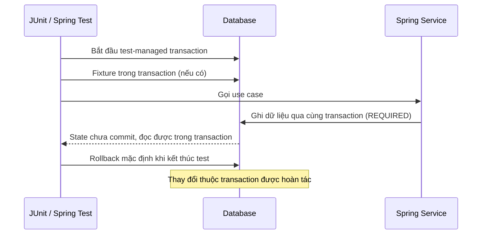

# Transaction rollback giữa các test

Một bài kiểm thử Inventory chạy thành công, trừ tồn kho từ `5` xuống `3`, rồi test tiếp theo lại thấy tồn bằng `3` dù fixture mong đợi `5`. Một nhóm khác giải quyết bằng cách thêm `@Transactional` lên mọi lớp test và thấy bộ kiểm thử xanh. Nhưng khi triển khai thật, sự kiện cần xử lý **sau commit** không xuất hiện như mong đợi, hoặc một giao dịch `REQUIRES_NEW` vẫn để lại dữ liệu sau khi bài test rollback. Cả hai tình huống đều xuất phát từ việc chưa phân biệt **transaction của bài test** với **transaction do ứng dụng quản lý**.

**Transaction rollback giữa các test** là kỹ thuật giữ trạng thái dữ liệu ổn định khi kiểm thử, nhưng không phải cơ chế cô lập vạn năng. Trong chương **Database testing** của **SPRING_MODULITH_VERIFICATION_TESTING**, chúng ta sẽ chọn lúc dùng transaction để dọn dữ liệu, lúc cần commit thật, và cách kiểm chứng rằng các module Spring Modulith vẫn bảo vệ đúng dữ liệu, giao tiếp và sự kiện. Phần thực hành kết hợp `@ApplicationModuleTest`, `ApplicationModules.verify()`, kiểm thử database/integration và quality gate CI để phát hiện phụ thuộc sai và hồi quy.

> **Điểm mấu chốt:** `@Rollback` điều khiển **test-managed transaction** của Spring Test. Nó không “quay ngược thời gian” cho mọi transaction, thread, database, message broker hay tác dụng phụ mà ứng dụng đã tạo.

## 1. Mục tiêu học tập

Sau bài học, bạn có thể:

1. Giải thích vòng đời **test-managed transaction** trong Spring Test và hành vi rollback mặc định của bài test `@Transactional`.
2. Phân biệt `@Rollback`, `@Commit`, `TestTransaction`, `@BeforeTransaction` và `@AfterTransaction`.
3. Thiết kế fixture để mỗi bài `@ApplicationModuleTest` có đầu vào xác định và không rò dữ liệu sang bài kế tiếp.
4. Nhận biết vì sao `REQUIRES_NEW`, tác vụ bất đồng bộ, luồng khác và listener `AFTER_COMMIT` có thể nằm ngoài rollback của test.
5. Chọn bài test **rollback để dọn dữ liệu** hay bài test **commit thật để kiểm chứng hành vi transaction**.
6. Kết hợp transaction rollback với schema migration, PostgreSQL/Testcontainers, kiểm thử concurrency và sự kiện.
7. Dùng `ApplicationModules.verify()` song song với test dữ liệu để chặn truy cập nội bộ và các dependency sai.

## 2. Hai mục tiêu khác nhau của rollback

Từ “rollback” xuất hiện trong hai câu hỏi khác nhau:

| Câu hỏi | Mục tiêu | Cách test thích hợp |
| --- | --- | --- |
| **Sau khi test chạy, dữ liệu có sạch không?** | Isolation: test sau không bị ảnh hưởng bởi test trước | Test-managed transaction mặc định rollback; hoặc cleanup/schema riêng |
| **Khi use case thật thất bại, dữ liệu có rollback đúng không?** | Correctness: ứng dụng không để trạng thái nửa vời | Gọi bean/service thực với ranh giới transaction production, chủ động gây lỗi rồi đọc DB sau khi transaction kết thúc |

Một test có `@Transactional` ở cấp test có thể **làm mất ý nghĩa kiểm thử transaction production** nếu nó vô tình bao trọn cả các lời gọi service trong một giao dịch lớn và rollback mọi thứ ở cuối. Để chứng minh một listener sau commit có chạy hay không, chẳng hạn, ta phải cho transaction cần kiểm tra **commit thực**.

### 2.1. Vì sao rollback hỗ trợ isolation?

Giả sử test tạo một đơn hàng, cập nhật tồn kho và thêm phiếu giữ hàng. Nếu toàn bộ thay đổi được thực hiện trong **cùng một database transaction chưa commit**, rollback ở cuối có thể đưa dữ liệu transactional về trạng thái trước test, miễn là các resource có tham gia vào transaction đó.

Nhờ vậy:

- Test không cần xóa thủ công những hàng đã chèn trong transaction.
- Có thể thử lại cùng fixture mà không gặp khóa chính trùng do bài test trước.
- Người viết test bớt phụ thuộc vào thứ tự chạy.

Tuy nhiên, rollback không hoàn tác **mọi thứ**: PostgreSQL sequence có thể tăng dù transaction bị rollback; một email đã gửi, message đã publish, cache ngoài DB đã cập nhật hoặc một `REQUIRES_NEW` đã commit sẽ không được tự động đảo ngược.

### 2.2. Ranh giới của test và module không giống nhau

`@ApplicationModuleTest` chọn phạm vi application module trong Spring context. `@Transactional` trên bài test chọn giao dịch do Spring Test quản lý quanh phương thức test. Hai chức năng **độc lập**.

```text
@ApplicationModuleTest  → Module/bean nào khởi động?
@Transactional (test)   → Test method có test-managed transaction không?
@Rollback / @Commit     → Transaction của test kết thúc theo cách nào?
@Transactional (service)→ Method ứng dụng tham gia/tạo transaction nào?
```

Không có quy tắc “đã dùng `@ApplicationModuleTest` thì mọi test mặc định rollback”. Nếu test cần rollback tự động, phải xét cấu hình transaction thực tế và đặt `@Transactional` ở mức test phù hợp.

## 3. Vòng đời test-managed transaction trong Spring Test

Khi lớp hoặc phương thức test được khai báo `@Transactional` và Spring Test có `PlatformTransactionManager` phù hợp, `TransactionalTestExecutionListener` có thể mở **test-managed transaction** trước lúc chạy test. Với kiểm thử transactional thông thường, sau khi test hoàn tất Spring Test **rollback theo mặc định**, trừ khi cấu hình commit.



Đây là **trường hợp thông thường khi service dùng `Propagation.REQUIRED` và cùng transaction manager**. Nếu service tạo `REQUIRES_NEW`, chạy ở thread khác hoặc dùng một tài nguyên không tham gia giao dịch, sơ đồ không còn mô tả hết tác dụng phụ.

### 3.1. Ví dụ tối thiểu

```java
package com.example.shop.inventory;

import org.junit.jupiter.api.Test;
import org.springframework.modulith.test.ApplicationModuleTest;
import org.springframework.transaction.annotation.Transactional;

@ApplicationModuleTest
@Transactional
class InventoryRollbackTests {

    @Test
    void changesAreRolledBackAfterTheTest() {
        // Gọi service và assert dữ liệu bên trong transaction.
        // Spring Test rollback transaction này mặc định khi test kết thúc.
    }
}
```

**Cần nhớ:** Method chỉ có comment không phải kiểm thử hành vi. Đây là khung thể hiện annotation; phải có fixture, hành động và assertion thật. Annotation `@Transactional` của test **không chứng minh** service tạo transaction đúng ở production.

### 3.2. `@BeforeEach` và `@AfterEach` có ở trong transaction?

Với JUnit Jupiter và test được Spring Test quản lý transaction đúng cách, những callback per-test như `@BeforeEach` và `@AfterEach` thường chạy **trong test-managed transaction**. Vì vậy SQL seed trong `@BeforeEach` có thể bị rollback cùng thao tác của bài test.

Ngược lại, `@BeforeAll` và `@AfterAll` **không** tự chạy trong test-managed transaction của từng test. Đừng đặt seed vào `@BeforeAll` rồi kỳ vọng rollback mặc định sau mỗi phương thức sẽ dọn dữ liệu đó.

Nếu cần thao tác **bên ngoài** test transaction, Spring Test hỗ trợ `@BeforeTransaction` và `@AfterTransaction`, sẽ được minh họa ở các mục sau.

## 4. `@Rollback`, `@Commit` và mặc định

Các annotation này điều khiển **cách kết thúc test-managed transaction**:

```java
@ApplicationModuleTest
@Transactional
class InventoryTests {

    @Test
    void defaultRollback() {
        // Mặc định rollback.
    }

    @Test
    @Rollback
    void explicitRollback() {
        // Tương đương @Rollback(true).
    }

    @Test
    @Commit
    void commitAfterTest() {
        // Giao dịch test được yêu cầu commit sau test.
    }

    @Test
    @Rollback(false)
    void alsoCommitAfterTest() {
        // Cũng cấu hình không rollback ở cuối test.
    }
}
```

Các import rút gọn: `org.springframework.test.annotation.Rollback`, `org.springframework.test.annotation.Commit`, `org.springframework.transaction.annotation.Transactional`, `org.junit.jupiter.api.Test`, `org.springframework.modulith.test.ApplicationModuleTest`.

**Cảnh báo:** `@Commit` hoặc `@Rollback(false)` để lại thay đổi database đã commit. Test phải tự có cách cleanup/isolation nếu muốn chạy lặp lại. Không nên thêm `@Commit` chỉ để “chữa” một test sau commit, rồi để lại dữ liệu khiến test khác thất bại.

### 4.1. Không có test transaction thì sao?

Nếu test **không** được chạy trong test-managed transaction, `@Rollback` đơn độc không tạo transaction kỳ diệu; nó không thể rollback những giao dịch đã được service commit riêng.

Ví dụ:

```java
@ApplicationModuleTest
class InventoryCommitBehaviorTests {

    @Test
    void serviceCanCommitNormally() {
        // Test không có @Transactional ở cấp test.
        // Service @Transactional(REQUIRED) thường tự mở transaction
        // khi lời gọi đi qua Spring proxy.
    }
}
```

Đoạn này chưa kiểm tra gì nếu không gọi service và đọc DB; mục đích là làm rõ cấu hình. Khi muốn test trạng thái **sau commit**, đây thường là điểm xuất phát tốt hơn test có transaction bao ngoài.

## 5. Bài toán Inventory: ai sở hữu dữ liệu cần rollback?

Giả sử một modular monolith có:

```text
com/example/shop/
├── ShopApplication.java
├── inventory/
│   ├── reservations/
│   │   ├── package-info.java
│   │   ├── InventoryReservations.java
│   │   ├── ReserveStock.java
│   │   └── ReservationReceipt.java
│   └── internal/
│       ├── StockReservationService.java
│       └── persistence/
│           ├── StockEntity.java
│           └── StockRepository.java
└── ordering/
    ├── package-info.java
    └── internal/PlaceOrderService.java
```

`inventory` sở hữu invariant **không giữ hàng vượt tồn khả dụng**; `ordering` chỉ được gọi `InventoryReservations` đã công bố, không được tự cập nhật bảng Inventory. Bài test transaction của Inventory nên kiểm tra những thay đổi **thuộc module đó**, còn bài test tích hợp sẽ kiểm tra khi Ordering phối hợp với Inventory.

### 5.1. Schema mẫu dùng trong test

PostgreSQL migration minh họa:

```sql
CREATE TABLE inventory_stock (
    sku VARCHAR(80) PRIMARY KEY,
    available INTEGER NOT NULL,
    CONSTRAINT ck_inventory_nonnegative CHECK (available >= 0)
);

CREATE TABLE inventory_reservation (
    reservation_id UUID PRIMARY KEY,
    request_id UUID NOT NULL UNIQUE,
    sku VARCHAR(80) NOT NULL
        REFERENCES inventory_stock(sku),
    quantity INTEGER NOT NULL CHECK (quantity > 0)
);
```

Để giữ ví dụ tập trung, đây chỉ là **schema tối giản**; ứng dụng thực có thể cần thời hạn, trạng thái nhả/hoàn hàng và ledger, cùng chiến lược idempotency, constraint và race condition phù hợp. DDL phải được cung cấp qua migration/schema thực của dự án — **không** trông chờ `@ApplicationModuleTest` tự sinh bảng.

### 5.2. API công khai

```java
// inventory/reservations/package-info.java
@org.springframework.modulith.NamedInterface("reservations")
package com.example.shop.inventory.reservations;
```

```java
// inventory/reservations/ReserveStock.java
package com.example.shop.inventory.reservations;

import java.util.UUID;

public record ReserveStock(
    String sku,
    int quantity,
    UUID requestId
) {
    public ReserveStock {
        if (sku == null || sku.isBlank() ||
            quantity <= 0 || requestId == null) {
            throw new IllegalArgumentException("Yêu cầu giữ hàng không hợp lệ");
        }
    }
}
```

```java
// inventory/reservations/ReservationReceipt.java
package com.example.shop.inventory.reservations;

import java.util.UUID;

public record ReservationReceipt(UUID reservationId) {}
```

```java
// inventory/reservations/InventoryReservations.java
package com.example.shop.inventory.reservations;

public interface InventoryReservations {
    ReservationReceipt reserve(ReserveStock command);
}
```

Đoạn code xác định **hợp đồng được test**, chưa có implementation. Giả định khi giữ hàng thành công, Inventory ghi một reservation và giảm tồn trong **cùng một transaction**. Nếu gặp lỗi giữa hai bước, không được để lại dữ liệu nửa vời.

### 5.3. Vì sao cần test đúng transaction boundary?

Implementation mong muốn:

```text
InventoryReservations.reserve(command)
    │
    ├── kiểm tra requestId/idempotency
    ├── giảm tồn bằng thao tác an toàn
    ├── ghi inventory_reservation
    └── commit transaction
```

Nếu database không ghi được reservation sau khi đã giảm tồn, transaction phải rollback toàn bộ hai bước. Một test có `@Transactional` ở cấp test có thể che mất ranh giới commit/rollback của service; do đó hãy có **bài test riêng ngoài test-managed transaction** để xác nhận thao tác thực sự tự rollback khi lỗi.

## 6. Thực hành rollback mặc định qua `@ApplicationModuleTest`

Mục tiêu test sau: chuẩn bị một bản ghi **đã commit** có tồn `5`, chạy lệnh trừ `2` trong test transaction, rồi xác minh **sau khi rollback** tồn vẫn là `5` và reservation mới không tồn tại.

### 6.1. `@BeforeTransaction` và `@AfterTransaction`

```java
package com.example.shop.inventory;

import static org.assertj.core.api.Assertions.assertThat;

import com.example.shop.inventory.reservations.InventoryReservations;
import com.example.shop.inventory.reservations.ReserveStock;
import java.util.UUID;
import org.junit.jupiter.api.Test;
import org.springframework.beans.factory.annotation.Autowired;
import org.springframework.jdbc.core.JdbcTemplate;
import org.springframework.modulith.test.ApplicationModuleTest;
import org.springframework.test.context.transaction.AfterTransaction;
import org.springframework.test.context.transaction.BeforeTransaction;
import org.springframework.transaction.annotation.Transactional;

@ApplicationModuleTest
@Transactional
class InventoryRollbackModuleTests {

    private static final String SKU = "SKU-ROLLBACK-CASE";
    private static final UUID REQUEST_ID = UUID.fromString(
        "00000000-0000-0000-0000-000000000321"
    );

    @Autowired InventoryReservations reservations;
    @Autowired JdbcTemplate jdbc;

    @BeforeTransaction
    void seedCommittedBaseline() {
        jdbc.update("DELETE FROM inventory_reservation WHERE sku = ?", SKU);
        jdbc.update("DELETE FROM inventory_stock WHERE sku = ?", SKU);
        jdbc.update(
            "INSERT INTO inventory_stock(sku, available) VALUES (?, ?)",
            SKU, 5
        );
    }

    @Test
    void reservationChangesAreVisibleInsideTransaction() {
        reservations.reserve(new ReserveStock(SKU, 2, REQUEST_ID));

        assertThat(available()).isEqualTo(3);
        assertThat(countReservations()).isEqualTo(1);
    }

    @AfterTransaction
    void verifyRollbackAndCleanup() {
        try {
            assertThat(available()).isEqualTo(5);
            assertThat(countReservations()).isZero();
        } finally {
            jdbc.update(
                "DELETE FROM inventory_reservation WHERE sku = ?", SKU
            );
            jdbc.update("DELETE FROM inventory_stock WHERE sku = ?", SKU);
        }
    }

    private int available() {
        return jdbc.queryForObject(
            "SELECT available FROM inventory_stock WHERE sku = ?",
            Integer.class, SKU
        );
    }

    private int countReservations() {
        return jdbc.queryForObject(
            "SELECT count(*) FROM inventory_reservation WHERE sku = ?",
            Integer.class, SKU
        );
    }
}
```

**Điều kiện để ví dụ có ý nghĩa:**

- `StockReservationService` được Spring quản lý, dùng transaction manager cho cùng datasource và `Propagation.REQUIRED` hoặc tương đương; các thay đổi tham gia test transaction.
- Migration tạo đúng hai bảng và các constraint trước test.
- Không có test khác cùng thao tác `SKU-ROLLBACK-CASE` trên database/schema đó cùng lúc.
- `seedCommittedBaseline()` chạy **ngoài** test transaction, thường các câu JDBC auto-commit khi không có transaction bên ngoài.
- `verifyRollbackAndCleanup()` chạy **sau khi** Spring Test đã rollback; nó đọc dữ liệu bằng connection/transaction mới theo cấu hình datasource.

Trong `@Test`, tồn thấy `3` chỉ cho biết **thay đổi đang hiện diện trong transaction**. `@AfterTransaction` nhìn thấy tồn trở lại `5` mới kiểm chứng isolation qua rollback. Nếu service mở `REQUIRES_NEW` hoặc ghi qua thread khác, giả định này có thể không còn đúng.

### 6.2. Vì sao không seed ở `@BeforeEach` cho ví dụ này?

Nếu `@BeforeEach` seed tồn `5` **bên trong test transaction**, rollback sẽ xóa cả bản ghi seed. `@AfterTransaction` khi đó không thể kỳ vọng tìm lại tồn `5`. Dùng `@BeforeTransaction` giúp tạo **baseline đã commit** để quan sát hiệu quả rollback.

Tùy mục tiêu, seed trong `@BeforeEach` hoàn toàn hợp lý cho bài test không cần quan sát sau rollback: test tạo fixture, chạy use case và cả fixture lẫn kết quả cùng rollback ở cuối. Nhưng không nên trộn hai mục tiêu khi viết assertion.

### 6.3. `@AfterTransaction` có thể dùng để assert, không chỉ cleanup

Hầu hết các test chỉ assert trong `@Test`; với hành vi transaction, kiểm tra sau transaction đôi khi là bằng chứng quan trọng nhất. Callback `@AfterTransaction` hỗ trợ đọc trạng thái **sau rollback hoặc commit của test**. Nếu lớp có nhiều phương thức test mang kịch bản khác nhau, tránh viết một `@AfterTransaction` với assertion cố định áp cho tất cả mà không có điều kiện.

## 7. Tạo fixture bằng `@Sql` và hiểu transaction mode

`@Sql` là lựa chọn thuận tiện để mô tả state ban đầu, nhưng **thời điểm nạp dữ liệu** và **transaction chứa script** quyết định liệu fixture có rollback hay không.

### 7.1. Seed cùng test-managed transaction

```java
@ApplicationModuleTest
@Transactional
@Sql(
    scripts = "/fixtures/inventory/stock-five.sql",
    executionPhase = Sql.ExecutionPhase.BEFORE_TEST_METHOD
)
class InventoryWithSqlFixtureTests {
    // Dữ liệu được seed trước test; khi script tham gia
    // test transaction, cả seed và thay đổi service sẽ rollback.
}
```

Ví dụ file test resource:

```sql
-- src/test/resources/fixtures/inventory/stock-five.sql
INSERT INTO inventory_stock(sku, available)
VALUES ('SKU-SQL-TEST', 5);
```

Các import cần thiết: `org.springframework.test.context.jdbc.Sql`, `org.springframework.transaction.annotation.Transactional` và `org.springframework.modulith.test.ApplicationModuleTest`. Test cần schema đúng và không có bản ghi SKU trùng trước lúc seed.

Khi Spring Test có transaction manager phù hợp, script SQL có thể tham gia transaction đang hoạt động. Hãy kiểm chứng cấu hình cụ thể của dự án; không suy rằng `@Sql` luôn commit độc lập.

### 7.2. `@SqlConfig(transactionMode = ISOLATED)` để seed độc lập

Một cấu hình khác:

```java
@Sql(
    scripts = "/fixtures/inventory/stock-five.sql",
    config = @SqlConfig(transactionMode = SqlConfig.TransactionMode.ISOLATED),
    executionPhase = Sql.ExecutionPhase.BEFORE_TEST_METHOD
)
```

Với transaction manager phù hợp, `ISOLATED` yêu cầu script chạy trong transaction **riêng và commit ngay**, thay vì gộp vào test transaction. Điều này có ích khi các thread khác phải nhìn thấy fixture đã commit, nhưng **rollback mặc định cuối test không xóa seed đã commit**. Phải có cách cleanup sau test hoặc dùng database/schema riêng.

### 7.3. Cleanup `AFTER_TEST_METHOD` có chắc dọn được mọi thứ?

Không chắc. Nếu cleanup script tham gia test-managed transaction đang hoạt động, thao tác xóa có thể cũng bị rollback cuối test, trong khi một `REQUIRES_NEW` đã commit từ trước vẫn để lại dữ liệu. Khi thật sự cần dọn **dữ liệu đã commit độc lập**, hãy dùng transaction mode thích hợp (`ISOLATED`) hoặc callback `@AfterTransaction`, kiểm soát thứ tự và quyền ghi.

**Cảnh báo khi chạy song song:** `DELETE FROM inventory_stock` hoặc `TRUNCATE` toàn bảng có thể xóa fixture của test khác. Cần namespace bằng SKU/request ID riêng, schema/database riêng hoặc buộc các test dùng cùng bảng chạy tuần tự.

## 8. `TestTransaction`: chủ động kết thúc và bắt đầu transaction

Một số ca cần khởi đầu trong transaction được Spring Test quản lý, sau đó **commit giữa bài test** để quan sát tác dụng sau commit. Spring Test cung cấp `TestTransaction`:

```java
package com.example.shop.inventory;

import static org.assertj.core.api.Assertions.assertThat;

import com.example.shop.inventory.reservations.InventoryReservations;
import com.example.shop.inventory.reservations.ReserveStock;
import java.util.UUID;
import org.junit.jupiter.api.Test;
import org.springframework.beans.factory.annotation.Autowired;
import org.springframework.jdbc.core.JdbcTemplate;
import org.springframework.modulith.test.ApplicationModuleTest;
import org.springframework.test.context.transaction.TestTransaction;
import org.springframework.transaction.annotation.Transactional;

@ApplicationModuleTest
@Transactional
class InventoryManualCommitTests {

    @Autowired InventoryReservations inventory;
    @Autowired JdbcTemplate jdbc;

    @Test
    void committedResultIsVisibleAfterTransactionEnds() {
        // Giả định SKU được tạo bởi fixture có isolation riêng,
        // hoặc đã tồn tại trong database test sạch.
        inventory.reserve(new ReserveStock(
            "SKU-COMMIT-CASE", 2,
            UUID.fromString("00000000-0000-0000-0000-000000000456")
        ));

        TestTransaction.flagForCommit();
        TestTransaction.end();  // Kết thúc và commit test transaction.

        Integer remaining = jdbc.queryForObject(
            "SELECT available FROM inventory_stock WHERE sku = ?",
            Integer.class, "SKU-COMMIT-CASE"
        );
        assertThat(remaining).isNotNull();

        // Từ đây phải cleanup bằng một cơ chế có commit riêng.
        // Không thể trông chờ rollback cuối test hoàn tác commit trên.
    }
}
```

Đây là **mã minh họa API**, chưa phải test hoàn chỉnh vì cần fixture có tồn ban đầu và assertion giá trị kỳ vọng rõ. Trong suite thật, thay `isNotNull()` bằng giá trị cụ thể, ví dụ `isEqualTo(3)` nếu bắt đầu từ `5`, và cleanup dữ liệu đã commit bằng `@AfterTransaction`/database riêng. Đoạn code minh họa rằng **`TestTransaction.end()` kết thúc transaction hiện tại**; sau đó không còn transaction đó để rollback tại cuối test.

### 8.1. `TestTransaction.start()` và `isActive()`

Khi có test-managed transaction theo cấu hình:

- `TestTransaction.isActive()` cho biết test transaction có đang hoạt động không.
- `TestTransaction.flagForCommit()` đánh dấu transaction hiện hành cần commit khi kết thúc.
- `TestTransaction.flagForRollback()` đánh dấu rollback.
- `TestTransaction.end()` kết thúc transaction hiện hành theo cờ.
- `TestTransaction.start()` bắt đầu **một test-managed transaction mới** sau khi transaction trước đã kết thúc.

Ví dụ kiểm tra hai pha:

```java
assertThat(TestTransaction.isActive()).isTrue();
TestTransaction.flagForCommit();
TestTransaction.end();
assertThat(TestTransaction.isActive()).isFalse();

// Truy vấn DB ngoài transaction để quan sát dữ liệu đã commit.

TestTransaction.start();
// Transaction mới sẽ rollback mặc định nếu không đổi cờ.
```

Không nên dùng `TestTransaction` chỉ vì muốn làm mọi bài test “phức tạp hơn”. Khi mục tiêu là kiểm tra **service tự commit/rollback như production**, một test **không** đặt `@Transactional` ở cấp test thường dễ lý giải hơn.

### 8.2. `@Commit` khác với `TestTransaction.flagForCommit()`

`@Commit` thường yêu cầu **commit khi phương thức test kết thúc**. `TestTransaction.flagForCommit()` kết hợp `TestTransaction.end()` cho phép kết thúc transaction **ngay trong thân test**, rồi kiểm tra trạng thái bên ngoài transaction. Cả hai đều cần cleanup dữ liệu đã commit.

## 9. Những tình huống test rollback không bao phủ

### 9.1. `Propagation.REQUIRES_NEW`

```java
@Service
class AuditWriter {

    @Transactional(propagation = Propagation.REQUIRES_NEW)
    public void writeAudit(AuditRecord record) {
        // Ghi audit trong một transaction độc lập.
    }
}
```

Nếu một service khác gọi `AuditWriter` **qua Spring proxy** trong khi test-managed transaction đang hoạt động, `REQUIRES_NEW` thường tạm dừng transaction ngoài và tạo transaction vật lý mới. Khi giao dịch mới commit, những hàng đã ghi **có thể tồn tại sau khi test transaction ngoài rollback**.

Điều này không nhất thiết là bug: audit có thể được thiết kế để tồn tại ngay cả khi use case thất bại. Nhưng nếu muốn isolation, test cần dọn các hàng audit ấy hoặc dùng datasource/schema riêng. Không trông cậy vào `@Rollback` của test để dọn một transaction đã commit độc lập.

### 9.2. `Propagation.NOT_SUPPORTED`

Một method được gọi qua proxy với `Propagation.NOT_SUPPORTED` có thể chạy **ngoài transaction đang hoạt động**. Tác động ghi database lúc đó tùy cơ chế kết nối/auto-commit và code thực hiện. Nó có thể tạo thay đổi mà test rollback không kiểm soát. Tránh dùng `NOT_SUPPORTED` trong logic ghi chỉ để vượt qua các giới hạn transaction mà chưa thiết kế rõ semantics.

### 9.3. `Propagation.NESTED` không giống `REQUIRES_NEW`

`NESTED` thường sử dụng savepoint trong **cùng physical transaction** khi transaction manager/resource hỗ trợ. Rollback nested chỉ quay về savepoint, còn transaction ngoài tiếp tục; rollback transaction ngoài vẫn có thể hoàn tác mọi thay đổi trong physical transaction đó. Hỗ trợ cụ thể phụ thuộc JDBC/JPA/transaction manager, không được mặc định mọi dự án đều có nested transaction đúng nghĩa.

### 9.4. Thread khác và `@Async`

Test-managed transaction thường được gắn với **thread hiện tại** thông qua Spring transaction context. Nếu test submit công việc cho `ExecutorService`, dùng `@Async`, scheduler hoặc listener bất đồng bộ, thread đó **không tự động thừa hưởng** transaction của thread test.

```java
@Test
void asynchronousSideEffectMayEscapeTestRollback() {
    // Một @Async method hoặc ExecutorService task có thể tự
    // mở và commit transaction riêng trên thread khác.
    // Test @Transactional ngoài không rollback được commit đó.
}
```

Test code dùng `assertTimeoutPreemptively(...)` cũng cần chú ý: cơ chế timeout chạy phần mã test trong **thread khác** có thể khiến thao tác bên trong không tham gia test-managed transaction do Spring Test chuẩn bị ở thread ban đầu. Khi mục tiêu là rollback/transaction, tránh giả định kiểm thử preemptive timeout an toàn như gọi trực tiếp.

### 9.5. Message broker, email, HTTP, cache và file

Rollback transaction của database không tự động “thu hồi” email đã gửi, message đã được broker xác nhận, request HTTP đã được dịch vụ ngoài thực hiện, file đã ghi hoặc giá trị ở cache ngoài transaction. Cần test double ở ranh giới khi không muốn phát tác dụng thật, hoặc môi trường integration cô lập cùng cơ chế cleanup/compensation rõ ràng.

### 9.6. Sequence và giá trị không transactional

Với PostgreSQL, `nextval()` của sequence **không bị rollback** theo cách rollback hàng dữ liệu. Một bài test insert rồi rollback có thể làm giá trị ID tiếp theo tăng. Vì thế không nên assert rằng “sau rollback, ID kế tiếp phải bằng ID trước đó”. Hãy test trên định danh nghiệp vụ hoặc kết quả quan sát được thay vì dựa vào ID liên tiếp.

## 10. Kiểm tra rollback do lỗi nghiệp vụ thật

Đây là phần cần **khác** với test isolation ở mục 6. Mục tiêu: module có một lệnh giảm tồn rồi ghi reservation; nếu bước ghi reservation thất bại, toàn bộ thay đổi phải rollback.

### 10.1. Thiết kế tình huống lỗi có chủ đích

Giả định:

```text
inventory_stock: SKU-ROLLBACK-ERROR, available = 5
inventory_reservation: chưa có requestId = R

Service.reserve(...)
    ├── cập nhật tồn thành 3
    └── INSERT reservation gây lỗi UNIQUE/constraint hoặc lỗi được tiêm có chủ đích

Kỳ vọng sau khi service transaction kết thúc:
    inventory_stock.available = 5
    không có reservation mới không hợp lệ
```

Một cách tạo lỗi lặp được là chuẩn bị một bản ghi khác có cùng `request_id` rồi gửi request khiến insert vi phạm unique constraint; tuy nhiên nếu service **đúng chuẩn idempotency**, nó có thể phát hiện request lặp và trả kết quả cũ thay vì cố insert. Khi test rollback do lỗi giữa hai bước, cần chọn điểm lỗi **phù hợp với implementation và hợp đồng thực tế**, ví dụ một port ghi reservation được điều khiển để ném exception sau khi update, hoặc constraint khác phát sinh trong bước insert.

### 10.2. Khung kiểm thử không bọc test transaction

```java
@ApplicationModuleTest
class InventoryTransactionBoundaryTests {

    @Autowired InventoryReservations inventory;
    @Autowired JdbcTemplate jdbc;

    @Test
    void failureAfterDecrementRollsBackWholeUseCase() {
        // Arrange: seed một SKU có tồn 5 đã commit,
        // cấu hình tình huống gây lỗi giữa update và insert.

        // Act: gọi inventory.reserve(...) qua Spring bean thực
        // và assert exception theo contract của module.

        // Assert: đọc bằng connection/transaction mới sau khi
        // service transaction thất bại; tồn vẫn là 5,
        // reservation không hợp lệ không tồn tại.
    }
}
```

Đây là **khung mô tả**, chưa phải test thực thi hoàn chỉnh. Để có giá trị, cần viết fixture, điểm gây lỗi, assertion exception và truy vấn DB thật. Không đặt `@Transactional` trên class test này theo thói quen: nếu service dùng transaction `REQUIRED` thông thường, nó nên **tự tạo và kết thúc transaction** qua Spring proxy.

### 10.3. Vì sao test transaction bao ngoài có thể làm sai kết luận?

Nếu test mở transaction rồi gọi service `@Transactional(REQUIRED)`, service tham gia transaction của test. Nó có thể trả về sau khi đã update nhưng **chưa commit**. Khi test rollback, dữ liệu trở về như cũ dù service trong production có thể gặp lỗi tại commit hoặc có side effect khác. Test lúc đó chứng minh **rollback ở cuối test**, không nhất thiết chứng minh **service tự rollback đúng khi lỗi**.

Cần kiểm tra cả lỗi phát sinh tại flush và lỗi chỉ xuất hiện lúc commit, khi có liên quan đến schema hay driver. `EntityManager.flush()` có thể phát hiện sớm một số constraint nhưng **không tương đương `commit()`**.

## 11. Transaction rollback và sự kiện sau commit

Một vấn đề thường thấy: bài test có `@Transactional`, service phát `OrderPlaced`, bài test assert event đã được phát, nhưng listener dùng `@TransactionalEventListener(phase = AFTER_COMMIT)` không chạy. Điều đó có thể hoàn toàn đúng: **test transaction bị rollback nên không có commit** để kích hoạt listener sau commit.

### 11.1. Phân biệt publish với xử lý

```java
@Component
class PaymentRequestListener {

    @TransactionalEventListener(phase = TransactionPhase.AFTER_COMMIT)
    void on(OrderPlaced event) {
        // Phản ứng khi giao dịch phát event đã commit.
    }
}
```

Đoạn trên cần import `org.springframework.transaction.event.TransactionalEventListener`, `org.springframework.transaction.event.TransactionPhase`, `org.springframework.stereotype.Component` và kiểu sự kiện công khai phù hợp. Việc `ApplicationEventPublisher.publishEvent(...)` đã được gọi **không đồng nghĩa** listener `AFTER_COMMIT` đã chạy. Một test ghi nhận event publish chỉ chứng minh một tầng của hợp đồng.

### 11.2. Bài test đúng cho `AFTER_COMMIT`

Một lựa chọn:

1. **Không gắn `@Transactional` lên test**.
2. Gọi service production qua Spring proxy để service tự commit.
3. Kiểm tra listener sau commit bằng tác dụng phụ có thể quan sát (ví dụ bản ghi trong module Payment).
4. Nếu listener bất đồng bộ, chờ **điều kiện** với timeout rõ; không chỉ `Thread.sleep()`.
5. Cleanup dữ liệu đã commit bằng test database/schema cô lập hoặc thao tác dọn có kiểm soát.

Lựa chọn khác là dùng `TestTransaction.flagForCommit()` và `TestTransaction.end()` để cho test-managed transaction commit trước khi assert listener. Cách này hữu ích khi phải chủ động điều khiển transaction ngay trong test.

**Lưu ý sâu hơn:** Trong một callback `AFTER_COMMIT`, resource transaction cũ có thể vẫn tạm thời được gắn với thread trong quá trình hoàn tất. Nếu listener cần **ghi database** sau commit, phải thiết kế transaction mới phù hợp (thường `REQUIRES_NEW`) hoặc cơ chế event publication có khả năng bền vững; không giả định ghi trong callback sẽ được commit chỉ vì method được gọi.

### 11.3. `@ApplicationModuleListener` và giao dịch riêng

Spring Modulith cung cấp `@ApplicationModuleListener` nhằm hỗ trợ listener module với semantics transaction/bất đồng bộ theo phiên bản framework. Khi dùng, cần xác minh configuration thực của dự án (event publication registry, executor, transaction manager, retry). **Test rollback của module phát event không tự chứng minh consumer đã xử lý đúng**. Nên có test integration riêng cho payload, xử lý lặp và tác dụng phụ được commit.

### 11.4. Event test cần thêm tình huống rollback

| Tình huống | Điều cần chứng minh |
| --- | --- |
| Use case commit thành công | Event diễn đạt đúng trạng thái đã được chấp nhận |
| Use case rollback | Không có tác dụng phụ sau commit không hợp lệ |
| Consumer thất bại sau commit | Có cơ chế ghi nhận/retry/phục hồi đúng chính sách |
| Event được xử lý hai lần | Không tạo hai khoản thu hay hai thông báo ngoài ý muốn |
| Listener dùng `REQUIRES_NEW` | Cleanup test bao phủ cả dữ liệu được commit độc lập |

Không nên dùng một bài test rollback thuần túy để kết luận về toàn bộ semantics của event-driven workflow.

## 12. Database engine, schema và ràng buộc transaction

H2 có thể giúp thử transaction cơ bản, nhưng không nên dùng nó để khẳng định hành vi PostgreSQL/MySQL về isolation, khóa, deadlock, DDL hoặc lỗi constraint.

### 12.1. PostgreSQL bằng Testcontainers

Một lớp test thực tế có thể cấu hình:

```java
package com.example.shop.inventory;

import org.springframework.boot.testcontainers.service.connection.ServiceConnection;
import org.springframework.modulith.test.ApplicationModuleTest;
import org.testcontainers.containers.PostgreSQLContainer;
import org.testcontainers.junit.jupiter.Container;
import org.testcontainers.junit.jupiter.Testcontainers;

@Testcontainers
@ApplicationModuleTest
class InventoryPostgresTransactionTests {

    @Container
    @ServiceConnection
    static PostgreSQLContainer<?> postgres =
        new PostgreSQLContainer<>("postgres:16-alpine");

    // Bổ sung @Test với fixture và assertions.
}
```

Đoạn code là **khung kết nối**, không phải test hoàn chỉnh. `@ServiceConnection` được Spring Boot hỗ trợ từ dòng 3.1+ khi có tích hợp `spring-boot-testcontainers` phù hợp. Test cần Testcontainers PostgreSQL/JUnit Jupiter, driver JDBC, container runtime và migration thật; chọn image version phù hợp engine production, không mặc định `postgres:16` là đúng cho mọi dự án.

Khi không dùng `@ServiceConnection`, có thể cấu hình các datasource property từ `PostgreSQLContainer` qua `@DynamicPropertySource` và `DynamicPropertyRegistry`.

### 12.2. Migration và rollback của DDL

Schema nên được khởi tạo bằng Flyway/Liquibase đúng như môi trường triển khai khi kiểm thử migration/constraint:

```properties
spring.flyway.enabled=true
spring.jpa.hibernate.ddl-auto=validate
```

Đây là ví dụ cấu hình, có hiệu lực khi dự án sử dụng Flyway/JPA và dependencies tương ứng. `ddl-auto=validate` không tự xác minh đầy đủ unique/index/trigger; migration và test constraint vẫn cần thiết.

Không coi rollback của `@Transactional` test là cách “reset schema”: DDL không có semantics rollback giống nhau ở mọi engine. Với nhiều database, DDL có thể implicit commit hoặc bị hạn chế trong transaction. Tạo schema trong migration/test database mới rồi cleanup state dữ liệu bằng chiến lược phù hợp đáng tin hơn.

### 12.3. Read sau rollback và JPA persistence context

Nếu dùng JPA, entity đang được quản lý trong persistence context có thể còn giá trị đã sửa dù SQL chưa commit. Để xác minh state bền vững:

- Cho transaction cần kiểm tra **kết thúc** (rollback hoặc commit) trước.
- Dùng `JdbcTemplate` hoặc một persistence context/transaction mới để đọc.
- Nếu muốn kiểm tra constraint xảy ra khi flush, gọi `EntityManager.flush()` có chủ đích.
- Không suy rằng `flush()` đồng nghĩa transaction đã commit.

Đọc lại cùng một entity managed ngay trong test transaction không phải bằng chứng có commit.

## 13. Test song song và nhiều transaction

### 13.1. Rollback không giải quyết mọi đụng độ fixture

Hai bài test cùng seed `SKU-1` có thể đụng primary key hoặc làm một bài test quan sát dữ liệu của bài kia, đặc biệt khi seed được commit ngoài test transaction. Dù mỗi test rollback thao tác riêng, dữ liệu nền đã commit hoặc cleanup toàn bảng vẫn có thể gây xung đột.

Chiến lược tốt hơn:

- Tạo `sku`, `orderId`, `requestId` **riêng cho từng test** khi có khả năng chạy song song.
- Dùng schema/database riêng cho nhóm test concurrency nặng hoặc test commit.
- Nếu phải dùng cleanup toàn bảng, chỉ chạy tuần tự trong một database test chuyên dụng.
- Tránh chạy những test dùng `TRUNCATE ... CASCADE` trên schema chia sẻ không kiểm soát.

### 13.2. Concurrency test cần transaction thật, không phải rollback bao ngoài

Để chứng minh hai yêu cầu giữ hàng `1` trên tồn `1` không cùng thành công:

1. Seed tồn `1` và **commit fixture** trước khi hai worker thread bắt đầu.
2. Mỗi worker gọi service Spring qua proxy và dùng transaction riêng.
3. Dùng latch/barrier để tăng khả năng hai yêu cầu thực sự cạnh tranh.
4. Assert **tối đa một yêu cầu được chấp nhận**, tồn cuối bằng `0` và không có reservation trùng.
5. Cleanup sau khi cả hai transaction hoàn tất.

Một test `@Transactional` ở thread JUnit có thể làm fixture chưa commit **không nhìn thấy được** từ các worker thread và dẫn tới lỗi sai nguyên nhân. Khi kiểm thử concurrency, thường không bọc test trong test-managed transaction.

### 13.3. Rollback và isolation level

Mức `READ_COMMITTED`, `REPEATABLE_READ`, `SERIALIZABLE` có semantics cụ thể theo database. Một test không chứng minh mọi lịch xen kẽ đều an toàn chỉ vì hai thread chạy qua một lần. Kết hợp ràng buộc database, câu SQL update atomic/locking, test dưới engine production-type và nhiều lần chạy có kiểm soát.

## 14. `@Sql`, cleanup và Testcontainers: chọn một chính sách rõ

| Phương án | Khi dùng | Điều cần tránh |
| --- | --- | --- |
| Test-managed `@Transactional` rollback | Kiểm tra logic lưu đơn giản trong cùng transaction | Tưởng đã test commit thật hoặc `AFTER_COMMIT` |
| Fixture trong cùng test transaction | Muốn seed và thay đổi cùng rollback | Dùng fixture đó cho thread khác chưa nhìn thấy |
| `@SqlConfig(ISOLATED)` seed | Cần dữ liệu nền commit trước test | Quên cleanup dữ liệu nền |
| `@BeforeTransaction` / `@AfterTransaction` | Muốn assert trước và sau rollback | Dùng một SKU cố định khi test song song |
| Test không `@Transactional`, service tự commit | Kiểm tra transaction/consumer theo production | Quên dọn dữ liệu đã commit |
| Database/schema mới trong Testcontainers | Test migration, commit, isolation mạnh | Tốn tài nguyên; cần quản lý runtime/image |
| `@DirtiesContext` | Cần làm mới Spring ApplicationContext | **Không** giả định xóa database hay rollback dữ liệu |

### 14.1. `@DirtiesContext` không phải database cleanup

`@DirtiesContext` yêu cầu Spring Test bỏ hoặc làm mới context cache theo phạm vi áp dụng. Nó có thể khiến datasource/pool/context khởi tạo lại, nhưng không nhất thiết xóa hàng trong một database còn tồn tại. Nếu database container được reuse, dữ liệu đã commit có thể còn nguyên.

### 14.2. Thứ tự cleanup khi có foreign key

Giả sử `inventory_reservation.sku` tham chiếu `inventory_stock.sku`, cleanup trước tiên phải xóa reservation, sau đó mới xóa stock:

```sql
DELETE FROM inventory_reservation WHERE sku = 'SKU-ROLLBACK-CASE';
DELETE FROM inventory_stock WHERE sku = 'SKU-ROLLBACK-CASE';
```

Trong test database chuyên dụng, có thể dùng schema mới hoặc cleanup toàn bảng, nhưng đừng viết `DELETE` quá rộng khi test có khả năng chạy song song. Một fixture có khóa định danh và ranh giới riêng giúp test bớt flakey.

## 15. `@ApplicationModuleTest` và phụ thuộc giữa các module

| Bootstrap mode | Phạm vi kiểm thử | Tác động với database/rollback |
| --- | --- | --- |
| `STANDALONE` | Module hiện tại | Hợp lý cho test Inventory tự quản lý persistence; test transaction vẫn theo Spring Test |
| `DIRECT_DEPENDENCIES` | Module và phụ thuộc trực tiếp | Có thể kéo thêm bean từ Ordering/Catalog/Inventory tùy module nguồn, nhưng **không tự tách datasource** |
| `ALL_DEPENDENCIES` | Bao gồm phụ thuộc bắc cầu | Scope lớn hơn; test transaction không tự rollback mọi tài nguyên nằm ngoài cùng transaction manager |

Một bài test Ordering với Inventory thật có thể dùng:

```java
@ApplicationModuleTest(mode = BootstrapMode.DIRECT_DEPENDENCIES)
class OrderingInventoryIntegrationTests {
    // Cần fixture của các module được bootstrap và transaction policy rõ.
}
```

`BootstrapMode` cần import từ `org.springframework.modulith.test.ApplicationModuleTest.BootstrapMode`. Đây là **khung**; chỉ khi có `@Test`, fixture và assertion mới thành kiểm thử.

Hãy chọn mode vì **mục tiêu test**, không phải để nạp tất cả bean cho khỏi lỗi. Một module có nhiều dependency không cần thiết vẫn có thể khiến test chậm và khó cô lập lỗi dù test được bọc transaction.

### 15.1. Kiểm thử không được vượt quyền sở hữu dữ liệu

Nếu `ordering` gọi API `inventory::reservations`, bài test integration có thể seed dữ liệu Inventory để chuẩn bị use case. Nhưng code **production** trong `ordering` không được sửa bảng Inventory trực tiếp để tránh gọi API. Khi test dùng `JdbcTemplate` setup dữ liệu, hãy ghi rõ đó là test fixture, không biến nó thành logic production.

## 16. Kiểm chứng ranh giới kiến trúc song song với rollback

Test rollback đúng chưa chứng minh quan hệ giữa module hợp lệ. Tạo bài kiểm tra cấu trúc:

```java
// src/test/java/com/example/shop/ModularityTests.java
package com.example.shop;

import org.junit.jupiter.api.Test;
import org.springframework.modulith.core.ApplicationModules;

class ModularityTests {

    @Test
    void moduleBoundariesAreRespected() {
        ApplicationModules.of(ShopApplication.class).verify();
    }
}
```

Trong `ordering/package-info.java`, khai báo:

```java
@org.springframework.modulith.ApplicationModule(
    allowedDependencies = "inventory::reservations"
)
package com.example.shop.ordering;
```

Với Inventory là module `CLOSED` theo thiết kế ví dụ, `verify()` giúp chặn các vi phạm điển hình:

- Import `inventory.internal.StockRepository` từ Ordering.
- Phụ thuộc vào một package con chưa được công bố qua named interface.
- Phụ thuộc vượt danh sách `allowedDependencies`.
- Chu trình giữa application module.

**Giới hạn:** `ApplicationModules.verify()` không kiểm chứng `@Transactional` có commit/rollback đúng, không phân tích toàn bộ SQL string truy cập bảng module khác, không chứng minh listener không thu tiền hai lần và không chạy thử concurrency của database. Cần kết hợp các lớp test.

### 16.1. Ma trận kiểm chứng

| Rủi ro | Architecture test | Module + DB test | Event/integration test |
| --- | :---: | :---: | :---: |
| `ordering` import `inventory.internal.*` | **Có** | Không tự động | Không tự động |
| Hai module phụ thuộc vòng | **Có** | Không tự động | Không tự động |
| Transaction service không rollback khi insert fail | Không | **Có**, sau khi service transaction kết thúc | Có thể |
| Test để lại fixture sau `REQUIRES_NEW` | Không | **Có**, cleanup/after-test read | Có thể |
| Listener `AFTER_COMMIT` không chạy | Không | Có thể | **Nên có** |
| Hai yêu cầu cùng giữ tồn cuối | Không | **Có**, cần DB thật và concurrency | Có thể |
| Event xử lý lặp gây double payment | Không | Consumer DB test | **Nên có** |
| SQL string ghi bảng module khác | Không bảo đảm | Không tự động | Review SQL/quyền DB và integration |

## 17. Quality gate CI cho transaction rollback

Một quality gate nên phân biệt test **nhanh để cô lập logic**, test **DB thật để bắt commit/rollback** và test **tích hợp để bắt side effect**:

```text
Pull request
  |
  +-- Unit tests
  |      -> Quy tắc nghiệp vụ thuần, fake/mock collaborator
  |
  +-- Architecture gate
  |      -> ApplicationModules.verify()
  |
  +-- @ApplicationModuleTest (test-managed rollback)
  |      -> Kiểm tra hành vi lưu trữ và cách fixture được cô lập
  |
  +-- PostgreSQL/Testcontainers, không bọc test transaction khi cần
  |      -> Service commit/rollback thật, constraint, REQUIRES_NEW
  |
  +-- Event/integration tests
  |      -> AFTER_COMMIT, retry, idempotency, kết quả consumer
  |
  +-- Các gate bắt buộc đạt -> đủ điều kiện merge
```

### 17.1. Điều kiện tối thiểu

1. Dự án có schema được tạo từ migration production hoặc nguồn DDL được quản lý rõ; không âm thầm dùng một test schema khác hoàn toàn.
2. PostgreSQL/Testcontainers hoặc database production-type có cấu hình hợp lệ nếu cần test isolation/locking/commit.
3. Test có dữ liệu đầu vào xác định và cleanup không phá dữ liệu test song song.
4. Các bài test “commit thật” **không** bị `@Transactional` ở cấp test che khuất.
5. Bài `ModularityTests` thực sự được test runner phát hiện, lỗi `verify()` làm CI thất bại.
6. Test sau commit và listener có cách chờ kết quả theo điều kiện/timeout thích hợp.
7. Khi container hoặc migration lỗi, CI **báo thất bại**, không tự coi H2 là kết quả thay thế tương đương.

Ví dụ dự án Maven có thể dùng `./mvnw -B test` cho JUnit thường và một stage integration test riêng theo cấu hình Surefire/Failsafe; Gradle dùng các task tương ứng. Cần kiểm tra tag/profile và test discovery để bảo đảm mọi gate bắt buộc đều chạy thật.

## 18. Những sai lầm thường gặp

| Hiện tượng | Nguyên nhân khả dĩ | Cách sửa |
| --- | --- | --- |
| Test 1 xanh, test 2 dính dữ liệu test 1 | Không có rollback/cleanup hoặc có commit độc lập | Kiểm tra transaction manager, `REQUIRES_NEW`, cleanup |
| Test xanh với `@Transactional`, production fail sau commit | Test chưa cho service commit đúng ranh giới | Viết test không có test-managed transaction |
| `AFTER_COMMIT` listener không chạy trong test | Test mặc định rollback | Dùng commit thật hoặc `TestTransaction.end()` |
| `@Sql` tạo dữ liệu nhưng thread khác không thấy | Seed đang nằm trong transaction chưa commit | Seed với transaction `ISOLATED` hoặc `@BeforeTransaction` |
| `@Sql` cleanup không xóa hàng `REQUIRES_NEW` | Cleanup cũng bị rollback theo test transaction | Dùng cleanup đã commit ở ngoài transaction |
| Entity đọc lại vẫn hiện giá trị mới sau rollback | Đọc cache/persistence context hoặc chưa kết thúc transaction | Đọc từ context/connection mới sau transaction |
| `@DirtiesContext` nhưng DB vẫn còn dữ liệu | Context khác database storage | Reset schema/rows, không lạm dụng context reset |
| ID tăng sau rollback | Sequence không transactional | Không assert ID liên tiếp |
| `@Rollback` không hoạt động | Test không có test-managed transaction đúng cấu hình | Kiểm tra `@Transactional`, transaction manager và test listener |
| Test concurrent không ổn định | Fixture chưa commit, thread/connection không độc lập | Seed commit trước, đồng bộ worker, tránh test-level transaction |
| H2 cho kết quả khác PostgreSQL | Semantics transaction/lock khác | Dùng engine production-type cho test rủi ro cao |
| Một module chạy SQL cập nhật bảng module khác | Phụ thuộc ẩn, sai ownership | Chuyển hành vi vào module sở hữu, review SQL/quyền DB |

### 18.1. Quy trình debug nhanh

Khi test rollback không như mong đợi:

1. Xác minh test **có** `@Transactional` ở mức test không?
2. Xác minh Spring Test nhận diện transaction manager nào?
3. Xác minh service dùng `REQUIRED`, `REQUIRES_NEW`, `NOT_SUPPORTED` hay transaction manager khác?
4. Xác minh thao tác xảy ra ở thread nào, qua Spring proxy hay self-invocation?
5. Xác minh `@Sql`/fixture được commit hay đang thuộc test transaction?
6. Xác minh kết quả đọc trong cùng persistence context hay sau transaction kết thúc?
7. Xác minh listener cần `AFTER_COMMIT`, bất đồng bộ hay đang dùng broker ngoài DB?
8. Xác minh dữ liệu thực sự thuộc database/schema nào, có test khác can thiệp không?
9. Chỉ sau khi tìm ra **ranh giới transaction thật**, hãy sửa annotation, fixture hoặc implementation.

Không nên chỉ thêm `@Rollback` vào bài test đỏ rồi kết luận mọi trạng thái đã được cô lập.

## 19. Bài thực hành: rollback cho module giữ ghế

Ứng dụng bán vé có module `seatallocation`:

- API `SeatHolds.hold(showId, seatId, requestId)`.
- Bảng `seat` và `seat_hold`.
- Invariant: **không có hai phiếu giữ còn hiệu lực cho cùng ghế trong cùng suất diễn**.
- `booking` chỉ được gọi API công khai của `seatallocation`, không truy cập `SeatHoldRepository`.

### 19.1. Yêu cầu

1. Viết `@ApplicationModuleTest @Transactional` seed một ghế chưa giữ và dùng `@AfterTransaction` xác minh phiếu giữ tạo trong test đã rollback.
2. Viết một bài test **không có `@Transactional` ở mức test**, gọi service thực, gây lỗi ở bước ghi `seat_hold` và xác nhận toàn bộ giao dịch được rollback.
3. Bổ sung một test dùng `@SqlConfig(transactionMode = ISOLATED)` để seed dữ liệu mà worker thread khác nhìn thấy; nêu cách cleanup.
4. Mô phỏng service audit dùng `REQUIRES_NEW`; dự đoán dữ liệu audit còn hay mất khi transaction ngoài rollback và viết bài test quan sát.
5. Test một `@TransactionalEventListener(AFTER_COMMIT)` chỉ tạo tác dụng phụ sau khi transaction service commit.
6. Test hai thread cùng giữ một ghế với database PostgreSQL/Testcontainers và fixture đã commit trước khi bắt đầu.
7. Viết `ApplicationModules.verify()` chặn `booking` import `seatallocation.internal.SeatHoldRepository`.
8. Thiết kế quality gate CI để kiểm tra rollback, event, concurrency và dependency.

### 19.2. Gợi ý đối chiếu

| Ca | Transaction của test | Kết quả cần kiểm chứng |
| --- | --- | --- |
| Rollback để isolation | Có, mặc định rollback | Phiếu giữ trong transaction không còn sau test; baseline đã commit không đổi |
| Service rollback khi insert lỗi | **Không** | Service tự rollback, không ghi phiếu giữ nửa vời |
| Seed cho thread khác | Seed bằng transaction đã commit | Worker thread nhìn thấy ghế đã chuẩn bị |
| Audit `REQUIRES_NEW` | Có test transaction nhưng audit commit riêng | Audit có thể còn sau outer rollback; phải cleanup |
| Listener `AFTER_COMMIT` | Cho service commit thật | Consumer phản ứng sau commit, không tạo side effect cho rollback |
| Giữ ghế đồng thời | Không bọc transaction toàn test | Chỉ một giữ thành công, DB không chứa hai phiếu xung đột |
| Kiểm chứng module | Không phụ thuộc database | `verify()` phát hiện truy cập nội bộ/cycle/allowedDependencies sai |

### 19.3. Câu hỏi phản biện

- **Nếu `@Rollback` được đặt trên test nhưng test không `@Transactional`, liệu nó dọn các hàng đã commit không?** Không; cần một test-managed transaction phù hợp hoặc cleanup riêng.
- **Nếu test dùng `@Transactional` và sau đó nhận được event qua `ApplicationEventPublisher`, có thể khẳng định listener sau commit chạy không?** Không; việc publish và hoàn thành transaction là hai điều khác nhau.
- **Nếu tất cả test dùng H2 và đều xanh, có đủ chứng minh transaction PostgreSQL đúng không?** Không; cần test trên engine production-type cho những semantics phụ thuộc isolation/locking/constraint.
- **Nếu `@AfterTransaction` thấy dữ liệu audit `REQUIRES_NEW` còn tồn tại, rollback có lỗi không?** Không nhất thiết; đó có thể là hệ quả dự kiến của giao dịch độc lập. Cần xem policy nghiệp vụ và cleanup.
- **Nếu `ApplicationModules.verify()` pass, có thể chắc rằng dữ liệu sau rollback sạch không?** Không; công cụ kiểm tra kiến trúc, không phải transaction semantics.

## 20. Checklist trước khi dùng rollback làm cơ chế dọn test

- [ ] Test thực sự có **test-managed transaction** và transaction manager phù hợp.
- [ ] Hiểu rollback mặc định của test `@Transactional`, tác dụng của `@Rollback` và `@Commit`.
- [ ] Phân biệt **isolation sau test** với **kiểm thử correctness của transaction service**.
- [ ] Biết dữ liệu fixture được seed trong hay ngoài test transaction.
- [ ] Dùng `@BeforeTransaction`/`@AfterTransaction` nếu cần quan sát baseline trước/sau rollback.
- [ ] Chỉ dùng `@SqlConfig(ISOLATED)` khi cần seed/cleanup được commit độc lập và có chính sách dọn rõ.
- [ ] Có test không bọc transaction khi cần xác minh commit/rollback thật của use case.
- [ ] Nhận diện `REQUIRES_NEW`, `NOT_SUPPORTED`, transaction manager khác và thread bất đồng bộ.
- [ ] Không giả định Spring rollback email, broker, file, cache hoặc PostgreSQL sequence.
- [ ] Không dùng test transaction rollback để kết luận listener `AFTER_COMMIT` đã hoạt động.
- [ ] Với concurrency test, seed đã commit và mỗi worker dùng transaction/connection thích hợp.
- [ ] Đọc state sau khi transaction kết thúc, không chỉ từ JPA persistence context đang quản lý.
- [ ] Cleanup dữ liệu đã commit bằng chiến lược phù hợp, không xóa dữ liệu của test song song.
- [ ] Có database engine production-type cho migration, transaction và invariant rủi ro cao.
- [ ] `@ApplicationModuleTest` dùng bootstrap mode phù hợp, không nhầm module scope với transaction scope.
- [ ] Có `ApplicationModules.verify()` trong CI để phát hiện dependency sai và chu trình.
- [ ] Có event/integration tests cho after-commit, retry và idempotency.
- [ ] Mọi test quan trọng được CI chạy thực sự và lỗi phải chặn merge.

**Ghi nhớ:** Rollback giữa các test là một **công cụ cô lập dữ liệu có điều kiện**, không phải bằng chứng rằng giao dịch production đúng và cũng không phải phương án dọn mọi side effect. Muốn kiểm chứng chắc chắn, hãy xác định transaction thuộc **Spring Test** hay **service ứng dụng**, thời điểm nào có **commit thực**, và tác dụng nào nằm ngoài transaction đó. Kết hợp `@ApplicationModuleTest`, PostgreSQL/Testcontainers, kiểm thử sự kiện và `ApplicationModules.verify()` trong CI để bảo vệ cả **tính đúng đắn dữ liệu** lẫn **ranh giới giữa các module**.
