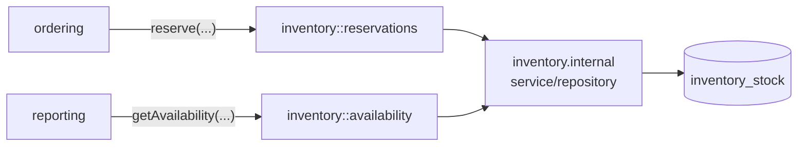
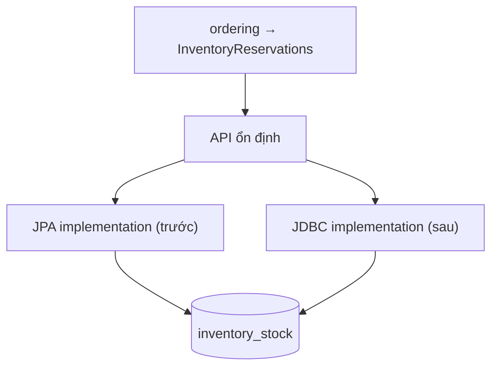

# Ràng buộc module khi truy cập repository

Giả sử module `ordering` tạo đơn hàng và cần giữ một số sản phẩm. Cách viết nhanh là inject `StockRepository` từ module `inventory`, gọi `findBySku(...)`, giảm `available`, rồi lưu lại. Code có thể biên dịch, test CRUD có thể xanh, nhưng ranh giới kiến trúc đã bị phá: **Ordering đang tự quyết định cách cập nhật dữ liệu mà Inventory sở hữu**. Khi Inventory đổi schema, cách khóa bản ghi hoặc quy tắc giữ hàng, Ordering phải thay đổi theo; tệ hơn, hai module có thể cùng sửa tồn kho mà không bảo vệ một invariant thống nhất.

Trong **Spring Modulith**, một application module nên công bố **hành vi nghiệp vụ hoặc truy vấn có chủ đích**, còn repository, entity mapping và transaction của phần dữ liệu nó sở hữu được giữ bên trong. Tuy nhiên, chỉ tách package không đủ: cần xác minh dependency Java, kiểm tra các đường SQL/JDBC không tạo phụ thuộc kiểu, và chạy test database thật để chứng minh invariant vẫn đúng khi nhiều module phối hợp.

Bài học **“Ràng buộc module khi truy cập repository”** thuộc chương **Database testing** của **SPRING_MODULITH_VERIFICATION_TESTING**. Chúng ta sẽ thiết kế quyền truy cập repository, kiểm chứng với `ApplicationModules.verify()` và `@ApplicationModuleTest`, bổ sung database/event/integration tests và đưa các quy tắc quan trọng vào quality gate CI để phát hiện phụ thuộc sai cùng hồi quy.

## 1. Kết quả cần đạt

Sau bài này, bạn có thể:

1. Phân biệt **quyền truy cập Java** với **quyền truy cập API ở cấp application module**.
2. Chỉ ra module nào **sở hữu dữ liệu, invariant và repository**, module nào chỉ là consumer.
3. Chuyển một phụ thuộc `OtherModuleRepository` thành **lệnh/query qua hợp đồng công khai**.
4. Cấu hình `@NamedInterface`, `@ApplicationModule(allowedDependencies = ...)` và dùng `ApplicationModules.verify()` chặn import sai.
5. Nhận biết những phụ thuộc ẩn mà phép kiểm tra cấu trúc có thể bỏ sót: native SQL, JDBC, bảng chia sẻ, ORM association, reflection và integration hạ tầng.
6. Dùng `@ApplicationModuleTest` với fixture và PostgreSQL/Testcontainers để xác nhận hành vi qua boundary.
7. Viết kiểm thử transaction, concurrency, event và contract khi module đích đổi repository hoặc schema.
8. Thiết kế quality gate CI và checklist review một yêu cầu truy cập dữ liệu xuyên module.

## 2. Một repository thuộc về ai?

Trong Spring Data, `JpaRepository`, `CrudRepository` hoặc custom repository giúp đọc/ghi dữ liệu. Nhưng trong một modular monolith, câu hỏi đầu tiên không phải “repository nằm ở package nào?” mà là:

> **Module nào được quyền thực hiện quyết định nghiệp vụ mà thao tác đọc/ghi này phục vụ?**

Ví dụ:

| Dữ liệu/quy tắc | Module sở hữu | Những module khác có thể cần | Điều không nên cho phép |
| --- | --- | --- | --- |
| Tồn khả dụng, phiếu giữ hàng | `inventory` | `ordering` yêu cầu giữ/nhả hàng | `ordering` sửa trực tiếp `StockRepository` |
| Vòng đời đơn hàng | `ordering` | `billing` nhận trạng thái đặt/hủy | `billing` cập nhật `OrderEntity.status` |
| Giao dịch thu/hoàn tiền | `billing` | `ordering` cần biết kết quả nghiệp vụ | `ordering` tự gọi `PaymentJpaRepository.save(...)` |
| Giá đang được bán | `pricing` | `ordering` cần báo giá trước khi chốt | `ordering` đọc `PromotionRuleEntity` để tự tính ưu đãi |
| Mẫu và lịch sử thông báo | `notification` | Các module phát sự kiện nghiệp vụ | Module phát event sửa trực tiếp bảng `notification_outbox` |

**Repository là chi tiết triển khai của chủ sở hữu**, không phải hợp đồng giao tiếp mặc định giữa các module. Module khác có thể dùng dữ liệu thông qua API query, bản chụp (snapshot), read model hoặc sự kiện; việc **dùng một thông tin** không đồng nghĩa với quyền **sửa nguồn dữ liệu** ấy.

### 2.1. Tách quyền đọc và quyền ghi

Ranh giới dữ liệu không chỉ có hai lựa chọn “cấm hoàn toàn” và “đọc/ghi tự do”.

- **Command API:** consumer yêu cầu module sở hữu thực hiện một thay đổi nghiệp vụ, ví dụ `reserve(sku, quantity)`.
- **Query API:** consumer yêu cầu một góc nhìn đã công bố, ví dụ `getAvailability(sku)`.
- **Event/read model:** consumer nhận dữ kiện từ module sở hữu rồi lưu bản sao phù hợp với nhu cầu của mình.
- **Database access trực tiếp:** một số hệ thống có báo cáo hoặc analytics được cấp phép đọc bảng; nếu tồn tại, phải xem đó là **ngoại lệ có chủ đích và có hợp đồng dữ liệu**, không mặc định mọi module được đọc/ghi tùy ý.

Việc công bố `StockRepository` toàn bộ để consumer chỉ gọi một phương thức `countAvailable(...)` trao cho caller **nhiều khả năng hơn cần thiết** và làm caller lệ thuộc vào model persistence.

### 2.2. Quy tắc sở hữu không đòi hỏi database vật lý riêng

Spring Modulith thường dùng một ứng dụng Spring Boot và có thể dùng **chung datasource**. Chẳng hạn:

```text
PostgreSQL / commerce_db
  ├── inventory_stock        -- logic thuộc Inventory
  ├── stock_reservation      -- logic thuộc Inventory
  ├── sales_order            -- logic thuộc Ordering
  └── payment_transaction    -- logic thuộc Billing
```

Cùng một database **không** có nghĩa tất cả bảng là tài nguyên chung. Quyền sở hữu vẫn có thể được bảo vệ bằng package/API, review SQL, ranh giới transaction, schema/role database và test tích hợp. Ngược lại, tách thành nhiều database vật lý cũng **không tự giải quyết** sai sót nếu module này vẫn gọi thẳng HTTP/SDK triển khai của module khác mà không có hợp đồng nghiệp vụ rõ.

## 3. Ba lớp ràng buộc cần phối hợp

Khi nói “Ordering không được truy cập repository của Inventory”, cần xem ba lớp khác nhau:

| Lớp kiểm soát | Đối tượng | Cơ chế | Giới hạn |
| --- | --- | --- | --- |
| **Java/package** | Khả năng tham chiếu kiểu/method | `private`, package-private, `public`; package structure | Java `public` không đồng nghĩa API module được phép |
| **Spring Modulith architecture** | Dependency giữa application modules | Closed module, `@NamedInterface`, `allowedDependencies`, `verify()` | Không tự phân tích mọi SQL string hoặc database privilege |
| **Database/integration** | Hàng dữ liệu, schema, transaction và side effect | Constraint, query, quyền DB, integration tests, event tests | Không tự chứng minh dependency Java đã hợp lệ |

Nếu một `StockRepository` là Java `public` vì có nhiều lớp **nội bộ Inventory** dùng nó, code Ordering có thể import được trong Java, nhưng Spring Modulith vẫn có thể kết luận đó là **vi phạm ranh giới module đóng**. Ngược lại, code Ordering có thể không import repository mà chạy SQL string trực tiếp; khi đó đồ thị dependency Java không đủ để phát hiện sai phạm.

### 3.1. Tình huống dễ nhầm

```java
// ordering/internal/PlaceOrderService.java
import com.example.shop.inventory.internal.StockRepository;
```

Nếu kiểu đích đủ `public`, Java có thể chấp nhận import. Nhưng nếu `inventory` là `CLOSED` và package `internal` không được công bố, thì theo chính sách kiến trúc **Ordering không có quyền phụ thuộc vào kiểu đó**.

Ngược lại:

```java
// Về mặt kiểu Java chỉ phụ thuộc JdbcTemplate.
jdbc.update("UPDATE inventory_stock SET available = available - ? WHERE sku = ?",
            quantity, sku);
```

Đoạn code không import class Inventory, nên **`ApplicationModules.verify()` không nhất thiết phát hiện** quan hệ SQL tới bảng của Inventory. Cần review query, phân quyền database phù hợp hoặc quy tắc kiến trúc bổ sung, cùng test kiểm tra ownership.

## 4. Phản mẫu: module khác inject repository trực tiếp

Giả sử ban đầu có:

```text
com/example/shop/
├── ShopApplication.java
├── inventory/
│   ├── StockRepository.java
│   └── StockEntity.java
└── ordering/
    ├── OrderRepository.java
    └── PlaceOrderService.java
```

Và:

```java
// Ví dụ sai về quyền sở hữu, không dùng trong production.
package com.example.shop.ordering;

import com.example.shop.inventory.StockEntity;
import com.example.shop.inventory.StockRepository;
import org.springframework.stereotype.Service;

@Service
class PlaceOrderService {

    private final StockRepository stocks;

    PlaceOrderService(StockRepository stocks) {
        this.stocks = stocks;
    }

    void place(String sku, int qty) {
        StockEntity stock = stocks.findById(sku).orElseThrow();
        if (stock.getAvailable() < qty) {
            throw new IllegalStateException("Không đủ hàng");
        }
        stock.setAvailable(stock.getAvailable() - qty);
        stocks.save(stock);
        // ... lưu order ...
    }
}
```

Lỗi thiết kế:

1. `ordering` biết entity, mapping và repository của `inventory`.
2. Quy tắc “không giữ vượt tồn” bị chuyển sang caller, trong khi nhiều caller khác có thể xử lý không nhất quán.
3. Hai transaction cùng đọc tồn `1` có thể đều chấp nhận giữ `1`, tùy cách cập nhật/khóa.
4. Thay `StockEntity` bằng một cơ chế lưu khác sẽ buộc Ordering sửa.
5. Caller có thể gọi `deleteAll()`, `save(...)`, `findAll()` vượt xa use case đặt đơn.

Trong ví dụ này, cả entity và repository đang nằm **ở package gốc** `inventory`. Theo quy ước module đóng, package gốc là API mặc định, nên Spring Modulith **không nhất thiết coi những kiểu đó là phần nội bộ**. Đó chính là lý do phải **thiết kế package và API đúng**: không thể chỉ trông chờ `verify()` sửa một API đã được công bố quá rộng.

### 4.1. Tại sao đổi repo thành một interface cùng tên không đủ?

Giả sử chuyển `StockRepository` vào package `inventory.api` rồi khai báo named interface. Nếu interface vẫn extends `JpaRepository<StockEntity, String>`, nó tiếp tục xuất bản entity và các method ghi không cần thiết. Tên package thay đổi nhưng **năng lực được trao** và **phụ thuộc vào persistence** vẫn quá lớn.

Hợp đồng tốt là **ý định nghiệp vụ**: `InventoryReservations.reserve(...)`, không phải “cho Ordering dùng API SQL/JPA của Inventory”.

## 5. Thiết kế đúng: API nghiệp vụ trước, repository phía sau

Đề xuất cây package:

```text
com/example/shop/
├── ShopApplication.java
├── inventory/                              # application module
│   ├── package-info.java
│   ├── reservations/
│   │   ├── package-info.java               # @NamedInterface("reservations")
│   │   ├── ReserveStock.java
│   │   ├── InventoryReservations.java
│   │   └── InsufficientStock.java
│   ├── availability/
│   │   ├── package-info.java               # @NamedInterface("availability")
│   │   ├── StockAvailability.java
│   │   └── AvailabilityView.java
│   └── internal/
│       ├── StockReservationService.java
│       ├── StockAvailabilityService.java
│       └── persistence/
│           ├── StockRow.java
│           └── StockJpaRepository.java
├── ordering/
│   ├── package-info.java
│   └── internal/
│       ├── PlaceOrderService.java
│       ├── Order.java
│       └── OrderRepository.java
└── reporting/
    ├── package-info.java
    └── internal/StockSummaryService.java
```

Trong cấu trúc này, các package gốc `inventory`, `ordering`, `reporting` là các application module theo cách phát hiện thông dụng của Spring Modulith. `inventory.internal` và `inventory.internal.persistence` là **implementation detail**. `inventory.reservations` và `inventory.availability` chỉ trở thành giao diện công khai khi được **chủ động công bố**.

### 5.1. Hai loại consumer có hai hợp đồng

`ordering` cần **lệnh** giữ hàng, còn `reporting` chỉ cần **truy vấn** số lượng; chúng không nên được cấp cùng một repository đầy đủ.



Một named interface không phải là REST endpoint hay một microservice. Nó là **bề mặt kiểu/package** được Spring Modulith dùng để mô hình hóa dependency hợp lệ trong cùng ứng dụng.

## 6. Viết hợp đồng lệnh và truy vấn nhỏ

Trong `inventory/reservations/package-info.java`:

```java
@org.springframework.modulith.NamedInterface("reservations")
package com.example.shop.inventory.reservations;
```

Lệnh:

```java
// inventory/reservations/ReserveStock.java
package com.example.shop.inventory.reservations;

public record ReserveStock(String sku, int quantity) {
    public ReserveStock {
        if (sku == null || sku.isBlank() || quantity <= 0) {
            throw new IllegalArgumentException("SKU/số lượng không hợp lệ");
        }
    }
}
```

```java
// inventory/reservations/InsufficientStock.java
package com.example.shop.inventory.reservations;

public class InsufficientStock extends RuntimeException {
    public InsufficientStock(String sku) {
        super("Không đủ tồn khả dụng cho " + sku);
    }
}
```

```java
// inventory/reservations/InventoryReservations.java
package com.example.shop.inventory.reservations;

public interface InventoryReservations {
    void reserve(ReserveStock command);
}
```

Để tránh che khuất chủ đề repository boundary, ví dụ tối giản này dùng `reserve` với nghĩa **giảm tồn khả dụng theo một lệnh được chấp nhận**. Một hệ thống giữ hàng đầy đủ thường cần thêm phiếu giữ, `reservationId`, hết hạn, nhả hàng và idempotency; không được xem interface tối giản là mô hình production hoàn chỉnh.

Trong `inventory/availability/package-info.java`:

```java
@org.springframework.modulith.NamedInterface("availability")
package com.example.shop.inventory.availability;
```

```java
// inventory/availability/AvailabilityView.java
package com.example.shop.inventory.availability;

public record AvailabilityView(String sku, int available) {}
```

```java
// inventory/availability/StockAvailability.java
package com.example.shop.inventory.availability;

import java.util.Optional;

public interface StockAvailability {
    Optional<AvailabilityView> findBySku(String sku);
}
```

Hai giao diện trên trả **DTO hoặc kết quả nghiệp vụ**, không trả `JpaRepository`, `EntityManager`, `StockRow` hay Hibernate proxy. `reporting` có thể dùng `AvailabilityView` nhưng không được `save(...)` tồn kho.

### 6.1. API công khai phải có semantics rõ

Ngay cả một interface nhỏ vẫn cần trả lời:

- `findBySku(...)` trả `Optional.empty()` khi SKU không tồn tại hay khi dữ liệu chưa được đồng bộ?
- `reserve(...)` có ném `InsufficientStock` nếu SKU không tồn tại, hay một lỗi khác?
- Khi hai yêu cầu cạnh tranh, cách nào đảm bảo không quá tồn?
- Khi DB timeout nhưng thay đổi đã commit, caller có thể retry an toàn không?
- Số lượng biểu diễn từng SKU, từng kho hay từng lô? Có ràng buộc tenant/vị trí không?

Nếu khác biệt đó có ý nghĩa, hợp đồng cần bổ sung kiểu dữ liệu hoặc điều kiện rõ. Không xuất bản repository chỉ để consumer tự suy ra semantics từ bảng.

## 7. Repository giữ ở internal; service sở hữu transaction

Một lớp entity có thể được giữ trong `inventory.internal.persistence`:

```java
// inventory/internal/persistence/StockRow.java
package com.example.shop.inventory.internal.persistence;

import jakarta.persistence.Entity;
import jakarta.persistence.Id;
import jakarta.persistence.Table;

@Entity
@Table(name = "inventory_stock")
public class StockRow {
    @Id
    private String sku;
    private int available;

    protected StockRow() {}

    public StockRow(String sku, int available) {
        this.sku = sku;
        this.available = available;
    }

    public String getSku() { return sku; }
    public int getAvailable() { return available; }
}
```

Ví dụ dùng JPA repository:

```java
// inventory/internal/persistence/StockJpaRepository.java
package com.example.shop.inventory.internal.persistence;

import org.springframework.data.jpa.repository.JpaRepository;
import org.springframework.data.jpa.repository.Modifying;
import org.springframework.data.jpa.repository.Query;
import org.springframework.data.repository.query.Param;

public interface StockJpaRepository extends JpaRepository<StockRow, String> {

    @Modifying
    @Query(value = """
        UPDATE inventory_stock
           SET available = available - :qty
         WHERE sku = :sku AND available >= :qty
        """, nativeQuery = true)
    int decrementWhenEnough(
        @Param("sku") String sku,
        @Param("qty") int quantity
    );
}
```

`StockRow` và `StockJpaRepository` ở đây được khai báo Java `public` để minh họa rằng **Java public vẫn không đủ để cho một module khác truy cập nội bộ**. Trong dự án thật, có thể giảm visibility nếu các class cùng package cho phép; điều đó tăng mức bảo vệ của compiler.

Service dùng repository bên trong module:

```java
// inventory/internal/StockReservationService.java
package com.example.shop.inventory.internal;

import com.example.shop.inventory.internal.persistence.StockJpaRepository;
import com.example.shop.inventory.reservations.InsufficientStock;
import com.example.shop.inventory.reservations.InventoryReservations;
import com.example.shop.inventory.reservations.ReserveStock;
import org.springframework.stereotype.Service;
import org.springframework.transaction.annotation.Transactional;

@Service
class StockReservationService implements InventoryReservations {

    private final StockJpaRepository stocks;

    StockReservationService(StockJpaRepository stocks) {
        this.stocks = stocks;
    }

    @Override
    @Transactional
    public void reserve(ReserveStock command) {
        int updated = stocks.decrementWhenEnough(
            command.sku(), command.quantity()
        );
        if (updated != 1) {
            throw new InsufficientStock(command.sku());
        }
    }
}
```

Trong ví dụ PostgreSQL đơn giản, `UPDATE ... WHERE available >= :qty` là **một cập nhật có điều kiện**, tránh mẫu đọc-tính-lưu dễ phát sinh lost update. Nhưng cần test với database/isolation production để xác nhận hành vi đồng thời; với quy trình phiếu giữ nhiều bước, update tồn và insert reservation phải nằm trong giao dịch phù hợp.

### 7.1. Những gì caller được nhìn thấy

```java
// ordering/internal/PlaceOrderService.java
package com.example.shop.ordering.internal;

import com.example.shop.inventory.reservations.InventoryReservations;
import com.example.shop.inventory.reservations.ReserveStock;
import org.springframework.stereotype.Service;

@Service
class PlaceOrderService {

    private final InventoryReservations inventory;

    PlaceOrderService(InventoryReservations inventory) {
        this.inventory = inventory;
    }

    void place(String sku, int quantity) {
        inventory.reserve(new ReserveStock(sku, quantity));
        // Ordering xử lý/lưu đơn theo transaction và hợp đồng đã thiết kế.
    }
}
```

Caller không có `StockJpaRepository`, `StockRow`, `JpaTransactionManager` hay câu SQL tồn kho trong signature. Nó chỉ biết **một yêu cầu nghiệp vụ và kết quả/lỗi công khai**.

**Lưu ý tích hợp:** Nếu giữ hàng xong nhưng lưu đơn thất bại, hệ thống phải xác định transaction chung hay bù trừ nhả hàng; hai lời gọi nằm trong cùng JVM không tự bảo đảm atomicity cho mọi loại datasource/resource.

## 8. Giới hạn dependency trong Spring Modulith

### 8.1. Cấu hình source module

Đặt trong `ordering/package-info.java`:

```java
@org.springframework.modulith.ApplicationModule(
    allowedDependencies = "inventory::reservations"
)
package com.example.shop.ordering;
```

Và trong `reporting/package-info.java`:

```java
@org.springframework.modulith.ApplicationModule(
    allowedDependencies = "inventory::availability"
)
package com.example.shop.reporting;
```

Phần `inventory::reservations` được tạo bởi **định danh module `inventory` + named interface `reservations`**. Đây không phải đường dẫn Java đầy đủ. `allowedDependencies` chỉ nói **source module được phép tham chiếu API nào của target**, nó không tự tạo bean, endpoint mạng hay cấp quyền SQL.

### 8.2. Hai điều kiện đồng thời

Để một tham chiếu hợp lệ trong thiết kế có giới hạn:

1. Module đích **công bố** kiểu cần dùng (package gốc hoặc named interface có chủ đích).
2. Module nguồn **được cho phép** phụ thuộc vào giao diện đó theo chính sách `allowedDependencies`, nếu đã giới hạn.

Vì vậy:

| Cạnh phụ thuộc | Kết quả kiến trúc mong muốn | Lý do |
| --- | --- | --- |
| `ordering → inventory.reservations.InventoryReservations` | Hợp lệ | Được công bố và được cho phép |
| `reporting → inventory.availability.StockAvailability` | Hợp lệ | Named interface chỉ đọc |
| `ordering → inventory.internal.persistence.StockJpaRepository` | Vi phạm | Tham chiếu nội bộ, không thuộc `inventory::reservations` |
| `ordering → inventory.availability.StockAvailability` | Vi phạm theo danh sách này | Caller chỉ có quyền `inventory::reservations` |
| `reporting → inventory.internal.persistence.StockRow` | Vi phạm | Consumer phụ thuộc persistence nội bộ |
| `reporting → ordering.internal.OrderRepository` | Vi phạm nếu không công bố | Xâm nhập nội bộ module khác |

Giới hạn quyền phụ thuộc qua named interface giúp một module **không tự nhiên có quyền dùng tất cả API của module khác** chỉ vì cần một lời gọi.

### 8.3. Không làm module OPEN chỉ để import repository

Một module kiểu `OPEN` có thể nới kiểm tra truy cập package bên trong. Điều này đôi khi hữu ích trong quá trình di trú, nhưng không nên dùng để hợp thức hóa việc gọi repository chéo module. Nếu có ngoại lệ tạm thời, cần ghi lý do, chủ sở hữu, consumer bị ảnh hưởng và điều kiện đưa module về cấu trúc đóng.

## 9. `ApplicationModules.verify()` kiểm tra được điều gì?

Viết một bài test kiến trúc độc lập với database:

```java
// src/test/java/com/example/shop/ModularityTests.java
package com.example.shop;

import org.junit.jupiter.api.Test;
import org.springframework.modulith.core.ApplicationModules;

class ModularityTests {

    @Test
    void onlyPublishedModuleDependenciesAreUsed() {
        ApplicationModules.of(ShopApplication.class).verify();
    }
}
```

Trong ứng dụng có các module được phát hiện đúng và quy tắc đóng gói như ví dụ, `verify()` giúp phát hiện các vi phạm kiến trúc điển hình:

1. Phụ thuộc vòng giữa application module.
2. Tham chiếu tới kiểu ở package không được công bố của closed module khác.
3. Phụ thuộc vượt `allowedDependencies` đã được khai báo ở source module.

### 9.1. Tạo một vi phạm có thể tái hiện

```java
// ordering/internal/WrongDependency.java -- ví dụ cố ý sai.
package com.example.shop.ordering.internal;

import com.example.shop.inventory.internal.persistence.StockJpaRepository;

class WrongDependency {
    private final StockJpaRepository stocks;

    WrongDependency(StockJpaRepository stocks) {
        this.stocks = stocks;
    }
}
```

Vì `StockJpaRepository` là Java `public`, ví dụ có thể biên dịch nếu dependency build bình thường. Nhưng Ordering đã tham chiếu `inventory.internal.persistence`, không thuộc API được công bố; **bài kiểm thử kiến trúc cần báo lỗi**. Một field/constructor thật giúp tạo dependency kiểu rõ ràng; chỉ thêm một import không được sử dụng có thể không tạo quan hệ trong bytecode.

Sửa bằng cách inject `InventoryReservations`, chuyển thao tác cập nhật về Inventory. **Không** thêm `inventory.internal` vào named interface hoặc mở toàn bộ Inventory chỉ để test xanh.

### 9.2. Một trường hợp `verify()` có thể xanh nhưng kiến trúc vẫn tệ

```java
// Inventory đặt repository ở package gốc và công bố như API mặc định.
package com.example.shop.inventory;

public interface StockRepository
        extends org.springframework.data.jpa.repository.JpaRepository<
            StockEntity, String> {}
```

Nếu module nguồn được phép phụ thuộc vào **API gốc** của Inventory, quan hệ kiểu có thể hợp lệ theo quy tắc cấu trúc, nhưng thiết kế vẫn công khai persistence và quyền ghi quá rộng. Điều này cần **review bề mặt API**: `verify()` kiểm tra chính sách nhóm đã mô tả, không tự đánh giá một repository có nên là API nghiệp vụ hay không.

### 9.3. Giới hạn quan trọng của `verify()`

`verify()` không tự chứng minh:

- SQL string/JdbcTemplate trong Ordering không đụng bảng Inventory.
- Hai module không chia sẻ database view, stored procedure hoặc schema migration gây coupling.
- Hibernate không tạo query làm lộ trạng thái module khác theo một con đường động.
- Code dùng reflection, bean name/string hoặc external SDK không vượt ranh giới ngữ nghĩa.
- `StockJpaRepository.decrementWhenEnough()` thật sự chống oversell.
- Một listener không phát sinh tác dụng phụ hai lần sau retry.

Vì vậy cần **architecture test + database/transaction test + contract/event/integration test**. Không dùng một lớp bảo vệ để thay thế toàn bộ lớp khác.

## 10. Phụ thuộc ẩn qua SQL và database chung

### 10.1. Cross-module SQL không cần import

Phản mẫu:

```java
// ordering/internal/PlaceOrderService.java -- PHẢN MẪU.
class PlaceOrderService {
    private final JdbcTemplate jdbc;

    void place(String sku, int quantity) {
        jdbc.update("""
            UPDATE inventory_stock
            SET available = available - ?
            WHERE sku = ?
            """, quantity, sku);
    }
}
```

Java chỉ thấy `JdbcTemplate`; dependency nghiệp vụ lại nằm ở tên bảng `inventory_stock`. Điều này có thể bỏ qua kiểm tra kiểu giữa application module, và còn bỏ qua cả điều kiện `available >= quantity`. Cần chuyển logic về `InventoryReservations.reserve(...)`.

**Lưu ý:** `JdbcTemplate` bản thân nó không xấu. Dùng `JdbcTemplate` **bên trong Inventory** để thực thi persistence hoặc **trong test** để seed/assert dữ liệu là hợp lệ nếu tuân thủ quyền sở hữu. Vấn đề nằm ở **ai quyết định cập nhật dữ liệu nào**.

### 10.2. Biện pháp bổ sung

- **Review SQL/query:** những bảng nào module đang đọc/ghi? Có tên bảng thuộc module khác không?
- **Phân quyền database:** khi hạ tầng cho phép, dùng schema/role với quyền ghi giới hạn theo ownership; trong một ứng dụng dùng một connection pool/role, cách này có thể khó áp dụng triệt để.
- **Schema contract:** nếu báo cáo phải đọc dữ liệu nhiều module, thiết kế view/read model hoặc query API được quản trị.
- **Integration test:** chạy một use case qua API chính thức rồi xác minh bảng của module đích thay đổi đúng, không có cập nhật bất ngờ.
- **Công cụ kiến trúc bổ sung:** quy ước/code review/ArchUnit rule riêng cho tổ chức nếu đủ dữ kiện để phát hiện mẫu truy cập đáng ngờ; không xem regex tên bảng là bằng chứng tuyệt đối.

Một database role chung có toàn quyền truy cập sẽ **không** cưỡng chế được ownership ở cấp SQL. Khi đó quy tắc kiến trúc và review phải chặt, hoặc cân nhắc thiết kế quyền/schema tách biệt phù hợp.

## 11. Liên kết entity JPA xuyên module: coupling khó nhận ra

Một phản mẫu khác là entity của Ordering giữ tham chiếu trực tiếp tới entity của Inventory:

```java
// ordering/internal/OrderLine.java -- phản mẫu.
@Entity
class OrderLine {
    @ManyToOne(fetch = FetchType.LAZY)
    private StockRow stock;
}
```

Giả sử `StockRow` ở `inventory.internal.persistence`. Lúc này module Ordering đã phụ thuộc kiểu JPA nội bộ của Inventory, dù không inject repository trực tiếp. Hệ quả có thể gồm:

- Coupling vào mapping, tên bảng và vòng đời entity của Inventory.
- Lazy loading gây SQL ngầm, `LazyInitializationException` hoặc N+1 query.
- Thay schema, thay khóa hoặc tách datastore khiến Ordering phải sửa.
- Dữ liệu đơn hàng và dữ liệu tồn kho bị ép chung một aggregate graph không phù hợp.

### 11.1. Ưu tiên tham chiếu bằng giá trị/hợp đồng

```java
// ordering/internal/OrderLine.java -- minh họa model riêng.
@Entity
class OrderLine {
    @Id
    private UUID id;
    private String sku;
    private int quantity;
    // Có thể lưu giá đã chốt hay reservationId theo ngữ nghĩa Ordering.
}
```

`OrderLine` giữ **SKU hoặc reservation ID** làm tham chiếu nghiệp vụ, không trực tiếp quản lý `StockRow`. Khi cần trạng thái tồn mới nhất, Ordering gọi query API phù hợp; khi cần giữ hàng, gọi command API.

Tách entity graph không có nghĩa mọi dữ liệu trùng lặp đều sai. **Ảnh chụp giá/tên sản phẩm trong đơn** có thể là dữ liệu do Ordering sở hữu theo vòng đời đơn; nó không tự thay đổi khi Catalog điều chỉnh thông tin hiện tại.

### 11.2. Foreign key giữa bảng của hai module có bị cấm?

Không có quy tắc tuyệt đối. Một foreign key xuyên bảng/module có thể hỗ trợ toàn vẹn tham chiếu khi chúng dùng chung database, nhưng cũng tạo **phụ thuộc lifecycle/migration/transaction** giữa các vùng trách nhiệm. Hãy đánh giá:

1. Có cần database bảo đảm quan hệ này ngay tại commit không?
2. Bảng đích có thể được xóa/migrate độc lập hay không?
3. Cách cập nhật schema ở hai module được điều phối như thế nào?
4. Nếu tách database về sau, hợp đồng/invariant sẽ được bảo vệ bằng gì?

Đừng chỉ tạo FK xuyên module vì ORM làm điều đó thuận tay. Nhưng cũng đừng bỏ ràng buộc toàn vẹn quan trọng mà chưa thiết kế cơ chế khác thay thế.

## 12. `@ApplicationModuleTest`: test qua API, không bypass repository

Đặt test ở package `com.example.shop.inventory` để kiểm tra hành vi module Inventory:

```java
package com.example.shop.inventory;

import static org.assertj.core.api.Assertions.assertThat;
import static org.assertj.core.api.Assertions.assertThatThrownBy;

import com.example.shop.inventory.reservations.InsufficientStock;
import com.example.shop.inventory.reservations.InventoryReservations;
import com.example.shop.inventory.reservations.ReserveStock;
import org.junit.jupiter.api.Test;
import org.springframework.beans.factory.annotation.Autowired;
import org.springframework.jdbc.core.JdbcTemplate;
import org.springframework.modulith.test.ApplicationModuleTest;
import org.springframework.test.context.jdbc.Sql;

@ApplicationModuleTest
@Sql(
    scripts = "/fixtures/inventory/stock-three.sql",
    executionPhase = Sql.ExecutionPhase.BEFORE_TEST_METHOD
)
class InventoryModuleDatabaseTests {

    @Autowired InventoryReservations inventory;
    @Autowired JdbcTemplate jdbc;

    @Test
    void reserveChangesOwnedStock() {
        inventory.reserve(new ReserveStock("SKU-A", 2));
        assertThat(available("SKU-A")).isEqualTo(1);
    }

    @Test
    void insufficientStockDoesNotChangeOwnedStock() {
        assertThatThrownBy(
            () -> inventory.reserve(new ReserveStock("SKU-A", 4))
        ).isInstanceOf(InsufficientStock.class);

        assertThat(available("SKU-A")).isEqualTo(3);
    }

    private int available(String sku) {
        return jdbc.queryForObject(
            "SELECT available FROM inventory_stock WHERE sku = ?",
            Integer.class, sku
        );
    }
}
```

Ví dụ file fixture `src/test/resources/fixtures/inventory/stock-three.sql`:

```sql
-- Chỉ dùng trong database/schema kiểm thử được kiểm soát.
DELETE FROM inventory_stock;
INSERT INTO inventory_stock(sku, available) VALUES ('SKU-A', 3);
```

Đoạn này là **bài test minh họa** và cần lớp production/DB schema đầy đủ. `@Sql` phải trỏ đúng test resource, datasource được cấu hình, migration đã tạo bảng, và các test dùng cùng bảng phải được cô lập. Nếu có bảng con foreign key tới `inventory_stock`, script cleanup phải xóa đúng thứ tự; không dùng `DELETE` toàn bảng khi chạy song song trên cùng schema.

### 12.1. Tại sao assert bằng JDBC trong test mà production phải qua API?

Trong test của **module sở hữu**, `JdbcTemplate` có thể dùng để seed dữ liệu và đọc trạng thái nhằm xác minh hành vi. Đây là **test infrastructure**, không phải lời mời Ordering truy cập trực tiếp bảng Inventory trong production.

Hãy phân biệt:

- Test chuẩn bị tiền điều kiện `available = 3`.
- Test gọi **API công khai** `InventoryReservations.reserve(...)`.
- Test đọc DB xác nhận hậu điều kiện `available = 1`.

Không thay lời gọi API bằng `StockJpaRepository.decrementWhenEnough(...)` trong bài kiểm thử muốn chứng minh **contract của module**. Nếu muốn kiểm thử câu query riêng, tạo repository slice test trong Inventory với mục đích rõ.

### 12.2. `STANDALONE`, `DIRECT_DEPENDENCIES`, `ALL_DEPENDENCIES`

| Bootstrap mode | Phạm vi | Khi phù hợp |
| --- | --- | --- |
| `STANDALONE` (mặc định phổ biến) | Module đang test | Inventory tự thực thi repository của mình |
| `DIRECT_DEPENDENCIES` | Module và những module nó phụ thuộc trực tiếp | Ordering + Inventory thực qua `InventoryReservations` |
| `ALL_DEPENDENCIES` | Cả các module phụ thuộc bắc cầu | Test nhiều tầng có chủ đích |

`@ApplicationModuleTest` **không** tự tạo một database vật lý riêng cho mỗi module và **không** tự loại bỏ các transaction không đúng. Nó kiểm soát phạm vi module/bean của Spring test context, còn schema/fixture/transaction do cấu hình test đảm nhận.

## 13. Dùng PostgreSQL/Testcontainers để kiểm tra boundary với database thật

Một test mock có thể chứng minh Ordering gọi `InventoryReservations`, nhưng không chứng minh Inventory ghi dữ liệu đúng khi PostgreSQL thực thi câu `UPDATE`.

Kết nối một PostgreSQL container trong test (ví dụ Spring Boot 3.1+ với tích hợp `spring-boot-testcontainers` và Testcontainers phù hợp):

```java
package com.example.shop.inventory;

import org.springframework.boot.testcontainers.service.connection.ServiceConnection;
import org.springframework.modulith.test.ApplicationModuleTest;
import org.testcontainers.containers.PostgreSQLContainer;
import org.testcontainers.junit.jupiter.Container;
import org.testcontainers.junit.jupiter.Testcontainers;

@Testcontainers
@ApplicationModuleTest
class InventoryPostgresTests {

    @Container
    @ServiceConnection
    static PostgreSQLContainer<?> postgres =
        new PostgreSQLContainer<>("postgres:16-alpine");

    // Bổ sung @Test, fixture, InventoryReservations và assertions như mục 12.
}
```

Đây là **khung cấu hình**, không phải một test có assertion; cần thêm PostgreSQL JDBC driver, module Testcontainers, JUnit Jupiter, database runtime, schema migration và các bean production. Chọn image DB đúng version/mở rộng so với production, không mặc định `postgres:16` phù hợp mọi hệ thống.

Với hệ thống không dùng `@ServiceConnection`, có thể cấp datasource URL, username/password qua `@DynamicPropertySource`. **Testcontainers chỉ chạy engine database**; nó không tự tạo đúng bảng hoặc seed fixture. Nên chạy Flyway/Liquibase migration đã được quản lý trong ứng dụng.

### 13.1. Một schema tối thiểu cho ví dụ

```sql
CREATE TABLE inventory_stock (
    sku VARCHAR(80) PRIMARY KEY,
    available INTEGER NOT NULL,
    CONSTRAINT ck_inventory_nonnegative CHECK (available >= 0)
);
```

`CHECK (available >= 0)` là tuyến phòng thủ dữ liệu. Tuy nhiên test phải xác nhận **service** thực hiện update có điều kiện: nếu code dùng read-modify-write không an toàn, CHECK constraint đơn độc có thể không phát hiện hai yêu cầu đều báo thành công trong một race.

### 13.2. Kiểm thử đồng thời

Với tồn `1`, hai request độc lập cùng `reserve("SKU-A", 1)`:

1. Seed tồn `1` và **commit fixture trước khi các thread bắt đầu**.
2. Mỗi worker thread gọi `InventoryReservations` qua Spring bean/proxy, sử dụng transaction/connection phù hợp.
3. Dùng latch/barrier khởi chạy gần đồng thời.
4. Assert **chính xác một yêu cầu thành công** trong thiết kế có semantics từ chối ngay, yêu cầu còn lại nhận `InsufficientStock`.
5. Đọc DB sau khi hai transaction hoàn tất; tồn cuối `0`, không âm.

Một test concurrency có `@Transactional` ở thread JUnit nhưng fixture chưa commit có thể khiến worker thread **không thấy dữ liệu đầu vào**. Khi cần kiểm chứng transaction thật, không nên bọc test bằng test-managed transaction theo thói quen.

**Một lượt test hai thread không là chứng minh hình thức về mọi interleaving.** Hãy kết hợp constraint, SQL atomic update/locking, kiểm thử lặp có kiểm soát và engine production-type.

## 14. Kiểm thử khi thay repository implementation

Lợi ích lớn của ranh giới module là **thay implementation nhưng giữ contract**. Ví dụ Inventory chuyển từ Spring Data JPA sang `JdbcTemplate`, jOOQ hoặc một cơ chế lưu khác; Ordering vẫn gọi:

```java
inventory.reserve(new ReserveStock("SKU-A", 2));
```

Nếu lớp API và semantics không đổi, Ordering không phải biết Inventory dùng `JpaRepository` hay SQL:



Đồ thị biểu diễn **hai khả năng triển khai thay thế**, không phải yêu cầu chạy đồng thời cả hai implementation làm bean cùng loại. Khi chuyển đổi:

- Bảo đảm chỉ có bean implementation phù hợp được inject.
- Giữ lỗi nghiệp vụ công khai (`InsufficientStock`) và semantics kết quả.
- Chạy lại module test trên database production-type.
- Chạy lại consumer contract test từ Ordering và test tích hợp nếu behavior transaction đổi.
- Chạy `ApplicationModules.verify()` để chặn import implementation cũ từ module khác.

### 14.1. Hợp đồng có thể bị phá dù chữ ký không đổi

Nếu implementation mới trả thành công trước khi dữ liệu thật sự được commit, hoặc bỏ tính idempotent, caller vẫn biên dịch nhưng cam kết nghiệp vụ đã thay đổi. Vì vậy test **chỉ kiểm tra chữ ký hoặc verify() xanh** là không đủ.

### 14.2. Migration schema cần được test

Khi chuyển repository, có thể đổi tên cột, khóa, chỉ mục hoặc serialization. Chạy migration trên database trống và — với thay đổi rủi ro — thử **upgrade từ dữ liệu ở schema cũ**. Một test chỉ dùng Hibernate `ddl-auto=create-drop` không chứng minh Flyway/Liquibase migration production có thể nâng cấp dữ liệu thật.

## 15. Transaction và consistency xuyên module

Một module sở hữu repository cũng nên sở hữu **ranh giới nhất quán của thao tác đó**. Với lệnh giữ hàng:

```text
Inventory.reserve()
  ├── kiểm tra requestId nếu có
  ├── cập nhật tồn khả dụng
  ├── ghi reservation (trong hệ thống đầy đủ)
  └── commit hoặc rollback toàn bộ thay đổi cần nguyên tử
```

Khi Ordering gọi API, có hai kiểu phối hợp cần phân biệt:

| Kiểu | Khả năng nhất quán | Vấn đề phải thiết kế/test |
| --- | --- | --- |
| Cùng một transaction manager/datasource, lời gọi đồng bộ cùng transaction | Có thể tham gia một physical transaction | Propagation, rollback, deadlock, thứ tự thao tác |
| Hai datasource hoặc broker/HTTP | Không tự có atomicity từ `@Transactional` | State trung gian, bù trừ, outbox, retry và idempotency |

### 15.1. `@Transactional` không tự sửa ownership

Một transaction mở từ Ordering và trực tiếp cập nhật bảng Inventory vẫn là **thiết kế sai chủ sở hữu**, dù database rollback đúng khi lỗi. Quy tắc “ai được ghi dữ liệu” và quy tắc “thay đổi nào là nguyên tử” có liên quan nhưng không giống nhau.

### 15.2. Test rollback và sau commit

Để kiểm tra transaction service thật:

- Gọi bean managed qua proxy, tạo lỗi giữa hai bước lưu, rồi đọc state **sau khi service transaction kết thúc**.
- Không bọc test trong `@Transactional` nếu muốn xác minh service tự commit/rollback và listener `AFTER_COMMIT`.
- Với JPA, phân biệt `flush()` và `commit()`; không chỉ đọc entity còn trong persistence context cấp một.
- Nếu test dùng transaction rollback để dọn fixture, nhớ rằng thay đổi từ `REQUIRES_NEW`, thread khác, broker hoặc tài nguyên ngoài database có thể **không** bị rollback cùng test.

### 15.3. Event sau commit

Khi Inventory phát `StockReserved`, consumer có thể cập nhật read model hoặc khởi động công việc khác. Một event công khai là **hợp đồng dữ liệu**, không phải `StockRow` được serialize.

```java
// inventory/events/StockReserved.java -- cần @NamedInterface("events") nếu công bố.
package com.example.shop.inventory.events;

import java.util.UUID;

public record StockReserved(UUID reservationId, String sku, int quantity) {}
```

Các bài event/integration test phải xác minh:

1. Chỉ có sự kiện đúng nghĩa sau khi thao tác được chấp nhận.
2. Nếu transaction rollback, consumer sau commit không coi giữ hàng thành công.
3. Listener xử lý sự kiện lặp an toàn.
4. Đổi schema/implementation repository không làm payload vô tình chứa JPA entity nội bộ.

Named interface chỉ công bố kiểu, **không** tự bảo đảm event được giao exactly-once hoặc transaction xuyên broker. Cấu hình publication registry/retry cần được test theo môi trường của ứng dụng.

## 16. Ngoại lệ: báo cáo và truy vấn xuyên nhiều module

Trong thực tế, một báo cáo có thể phải tổng hợp `sales_order`, `inventory_stock` và `payment_transaction`. Có ba cách cân nhắc:

1. **Query API:** báo cáo gọi từng module lấy DTO đã công bố rồi tổng hợp. Tốt khi khối lượng vừa phải, cần quyền sở hữu rõ.
2. **Read model/projection:** các module phát sự kiện hoặc cấp dữ liệu theo hợp đồng, reporting sở hữu bảng/materialized view phục vụ truy vấn. Tốt khi query phức tạp và có thể chấp nhận độ trễ cập nhật có kiểm soát.
3. **SQL cross-module read có chủ đích:** trong một modular monolith, có thể tồn tại báo cáo đọc các bảng chung bằng một query tối ưu. Nếu chọn, cần công nhận đó là **phụ thuộc vào schema của nhiều module**, xác định owner, quyền read-only, migration compatibility và kiểm thử contract.

Không nên xóa ranh giới module chỉ vì dashboard cần join nhiều bảng. Nhưng cũng không nên buộc tất cả báo cáo qua hàng chục API đồng bộ khi yêu cầu về hiệu năng và tính nhất quán không phù hợp; hãy thiết kế một đường truy vấn có quyền sở hữu và chi phí được hiểu rõ.

### 16.1. Khi nào nên gộp module?

Nếu `ordering` và `inventory` **luôn** phải truy cập cùng entity và bảo vệ một invariant không thể phân chia, có thể cần xem lại ranh giới: liệu đây có thật sự là hai năng lực độc lập hay chỉ là hai package kỹ thuật của một aggregate? Việc gộp dựa trên **trách nhiệm và tính nhất quán**, không phải chỉ để tránh một lỗi `allowedDependencies`.

Nếu hai module có trách nhiệm rõ ràng, ưu tiên hợp đồng nghiệp vụ hơn là cho phép import repository chéo.

## 17. Test tích hợp consumer–provider đúng chiều

Test Ordering với Inventory thật có thể dùng bootstrap mode:

```java
// src/test/java/com/example/shop/ordering/OrderingInventoryTests.java
package com.example.shop.ordering;

import org.junit.jupiter.api.Test;
import org.springframework.modulith.test.ApplicationModuleTest;
import org.springframework.modulith.test.ApplicationModuleTest.BootstrapMode;

@ApplicationModuleTest(mode = BootstrapMode.DIRECT_DEPENDENCIES)
class OrderingInventoryTests {

    @Test
    void placingOrderUsesPublishedInventoryContract() {
        // Arrange: seed tồn và các dữ liệu Ordering cần.
        // Act: gọi API Ordering để đặt đơn.
        // Assert: đơn và tồn đúng trạng thái,
        //         lỗi hết hàng không tạo đơn sai.
    }
}
```

Đây là **khung cấu hình**, không được coi là test hoàn chỉnh nếu chưa có fixture, API gọi và assertion thật. Nếu Ordering còn phụ thuộc Pricing/Catalog, `DIRECT_DEPENDENCIES` cũng có thể khởi động các module đó theo đồ thị đã khai báo; cần chuẩn bị test infrastructure phù hợp. Không mở rộng mọi test sang `ALL_DEPENDENCIES` chỉ để khỏi thiết kế test double.

### 17.1. Ma trận test cần có

| Loại test | Hành vi/ranh giới cần kiểm tra | Dữ liệu/hạ tầng |
| --- | --- | --- |
| Architecture | Ordering không import `StockJpaRepository`, không cycle, đúng allowedDependencies | Không cần database |
| Inventory module | `reserve(...)` trừ tồn đúng và từ chối khi thiếu | DB fixture, migration |
| Repository slice | Native SQL/JPQL/query và mapping của Inventory | Engine phù hợp |
| Concurrency | Hai yêu cầu tranh cùng tồn cuối không cùng thành công | PostgreSQL/Testcontainers, transaction riêng |
| Ordering consumer | Xử lý kết quả và lỗi `InventoryReservations` đúng | Fake/mock cho unit, hoặc Inventory thật khi integration |
| Transaction | Lỗi giữa update/insert không để state nửa vời | DB thật và commit/rollback |
| Event | Payload công khai, AFTER_COMMIT, retry/idempotency | Event infrastructure phù hợp |
| Cross-module reporting | Read model hoặc query contract không phụ thuộc sai schema | Integration/contract test |

**Mục tiêu kiểm thử** quyết định dùng mock, H2 hay PostgreSQL. Mock làm test nghiệp vụ nhanh nhưng không chứng minh SQL; H2 chạy SQL thật nhưng không tương đương hoàn toàn với PostgreSQL; Testcontainers sử dụng engine thật mà vẫn cần migration, fixture và isolation phù hợp.

## 18. Quality gate CI cho quyền truy cập repository

Một pipeline có thể được cấu trúc:

```text
Pull request
   |
   +-- Compile + unit tests
   |     -> Quyết định nghiệp vụ, các lỗi caller xử lý
   |
   +-- ModularityTests
   |     -> ApplicationModules.verify()
   |     -> Không import internal, không cycle, không vượt allowedDependencies
   |
   +-- API review / ownership check
   |     -> Không xuất bản JpaRepository, entity hay transaction helper ngoài ý muốn
   |     -> Kiểm tra SQL/JDBC vượt quyền sở hữu bảng
   |
   +-- @ApplicationModuleTest + PostgreSQL/Testcontainers
   |     -> Migration, query, constraint, transaction, concurrency
   |
   +-- Contract / event / integration tests
   |     -> Consumer hiểu đúng kết quả/lỗi, listener và read model đúng
   |
   +-- Các gate bắt buộc đạt → đủ điều kiện xem xét merge
```

### 18.1. Một số tiêu chí chặn merge

- `ApplicationModules.verify()` báo một tham chiếu từ Ordering vào `inventory.internal`.
- Module mới công bố `JpaRepository` của mình thành API mà không có lý do và review.
- SQL production của một module ghi bảng do module khác sở hữu.
- Migration PostgreSQL không chạy trên database sạch hoặc không nâng cấp được dữ liệu cũ ở các tình huống đã xác định.
- Test concurrent reservation cho phép hai yêu cầu đều thành công khi chỉ còn một đơn vị.
- API đổi semantics làm consumer không xử lý đúng lỗi hoặc trạng thái.
- Event listener xử lý lặp tạo tác dụng phụ trùng, hoặc dùng entity nội bộ làm payload.

Nếu dùng Maven, `./mvnw -B test` có thể chạy JUnit gồm bài kiểm tra kiến trúc khi được cấu hình đúng; test dùng container có thể được phân vào stage riêng. Gradle dùng task tương ứng. Phải xác nhận test runner **thực sự phát hiện và chạy test**, kết quả đỏ làm job thất bại và CI có container runtime cho các test cần PostgreSQL.

### 18.2. Đừng tạo “gate chỉ xanh trên giấy”

Một bài `ModularityTests` bị skip bởi profile/tag hoặc một job integration test được đánh dấu không bắt buộc không thực sự bảo vệ kiến trúc. Tương tự, test dùng mock repository nhưng được đặt tên `RealDatabaseIntegrationTest` không làm nó thành kiểm thử dữ liệu thật.

Gate hiệu quả cần **phạm vi rõ, đầu vào xác định, lỗi có thể tái hiện và kết quả gắn với quyết định merge**.

## 19. Bài thực hành: ai được phép dùng repository của ai?

Ứng dụng đặt vé sự kiện có:

```text
booking/
    internal/BookingService.java
    internal/BookingJpaRepository.java
seating/
    api/SeatHolds.java
    internal/SeatHoldJpaRepository.java
payment/
    internal/PaymentJpaRepository.java
reporting/
    internal/RevenueReportService.java
```

Chính sách nghiệp vụ:

- `seating` sở hữu ghế, trạng thái khả dụng và invariant **không có hai phiếu giữ hợp lệ cho cùng ghế/suất diễn**.
- `booking` sở hữu trạng thái đặt/hủy vé, nhưng phải yêu cầu giữ ghế qua Seating.
- `payment` sở hữu giao dịch thu/hoàn tiền và idempotency.
- `reporting` cần tổng hợp số vé và doanh thu, không trực tiếp thay đổi các bảng giao dịch.

### 19.1. Các đề xuất cần đánh giá

1. Booking inject `SeatHoldJpaRepository`, kiểm tra ghế rảnh rồi tự insert.
2. Booking gọi `SeatHolds.hold(...)`, nhận `SeatHoldReceipt`.
3. Payment import `booking.internal.BookingJpaRepository` để đổi trạng thái vé sau thanh toán.
4. Reporting gọi `BookingQueries` và `PaymentSummaries` đã được công bố.
5. Reporting chạy SQL `SELECT` join bảng Booking và Payment vì dashboard có truy vấn nặng.
6. Booking giữ entity `SeatHoldRow` của Seating bằng `@ManyToOne`.
7. Payment nghe `BookingPlaced` công khai và lưu yêu cầu thanh toán do Payment sở hữu.

### 19.2. Phương án đối chiếu

| Đề xuất | Đánh giá | Hướng xử lý |
| --- | --- | --- |
| (1) Inject Seating repository | **Bác bỏ** | Chuyển về command API; Seating bảo vệ race và transaction |
| (2) Dùng `SeatHolds` | **Phù hợp** | Named interface có contract lỗi/idempotency và test |
| (3) Payment cập nhật Booking repository | **Bác bỏ** | Thiết kế API/sự kiện công khai để phản hồi trạng thái đúng quyền sở hữu |
| (4) Reporting dùng query APIs | **Phù hợp** | Chỉ cấp dữ liệu tối thiểu cần cho báo cáo |
| (5) SQL join read-only | **Cần quyết định có chủ đích** | Đánh giá read model, hiệu năng, quyền DB và schema contract; không được ghi chéo |
| (6) JPA association tới SeatHoldRow | **Bác bỏ theo thiết kế này** | Giữ `holdId` hoặc snapshot, không phụ thuộc entity nội bộ |
| (7) Payment lắng nghe event | **Phù hợp nếu semantics đúng** | Named interface công khai, test transaction/retry/idempotency |

### 19.3. Bài tập code và test

1. Tạo `seating.api` với `@NamedInterface("api")` và hợp đồng `SeatHolds`.
2. Khai báo Booking chỉ được phụ thuộc `"seating::api"`.
3. Viết `ApplicationModules.of(TicketsApplication.class).verify()`.
4. Cố ý tạo field kiểu `seating.internal.SeatHoldJpaRepository` trong Booking và quan sát kiểm thử kiến trúc; sửa bằng `SeatHolds`.
5. Viết `@ApplicationModuleTest` cho Seating với PostgreSQL và fixture ghế còn trống/đã giữ.
6. Test hai transaction cạnh tranh trên cùng một ghế, bảo đảm không có hai phiếu giữ hợp lệ.
7. Test Booking xử lý lỗi ghế bận mà không tạo booking được coi là đã xác nhận.
8. Test Payment nhận event hai lần không tạo hai khoản thu.
9. Đề xuất gate review SQL/reporting nếu dự án vẫn phải cho phép một read-only query trực tiếp.

**Tự phản biện:** Nếu một repository `public` có thể import nhưng `verify()` báo sai, hãy sửa **dependency và cách công bố API**, không tắt rule. Nếu `verify()` xanh vì repository nằm ở package gốc module đích, hãy hỏi liệu **bề mặt API đang quá rộng**. Nếu SQL cross-module không bị `verify()` phát hiện, hãy bổ sung kiểm soát dữ liệu thay vì giả định công cụ đã kiểm thử toàn bộ.

## 20. Checklist trước khi cho một module truy cập dữ liệu module khác

- [ ] Xác định **module sở hữu** bảng, entity, repository và invariant.
- [ ] Mô tả use case khiến caller cần dữ liệu hoặc hành vi đó.
- [ ] Caller cần **lệnh**, **truy vấn**, **sự kiện** hay **read model**?
- [ ] Không cho caller inject repository chỉ để “tiện” kiểm tra và cập nhật state.
- [ ] API công khai trả DTO/value object/kết quả nghiệp vụ, không làm lộ JPA entity/`JpaRepository`.
- [ ] Repository và persistence mapping được giữ trong package nội bộ của module sở hữu.
- [ ] Có `@NamedInterface` cho package công bố và `allowedDependencies` phản ánh đúng caller/target.
- [ ] Tránh phụ thuộc vòng; phân biệt hướng import kiểu sự kiện và hướng sự kiện lúc chạy.
- [ ] Không dùng JPA association xuyên module tới entity nội bộ khi có thể tham chiếu bằng ID/snapshot.
- [ ] Mọi SQL/JDBC production được review theo bảng và quyền sở hữu, kể cả không có import Java chéo.
- [ ] Foreign key hoặc report join xuyên module được quyết định có chủ đích và có kế hoạch migration.
- [ ] `ApplicationModules.verify()` có trong CI và thất bại khi import nội bộ/chu trình sai.
- [ ] `@ApplicationModuleTest` gọi qua API module, không bypass repository để chứng minh contract.
- [ ] Những query/migration/transaction quan trọng có test trên database production-type.
- [ ] Concurrency tests bảo vệ invariant; test không dùng transaction bao ngoài làm sai kết luận.
- [ ] Consumer contract tests bảo vệ lỗi và kết quả khi module đích thay persistence implementation.
- [ ] Event/integration tests kiểm tra payload, commit, retry và idempotency.
- [ ] Quality gate bắt buộc được test runner thực thi và tác động đến quyết định merge.

**Ghi nhớ:** **Quyền sở hữu repository là ranh giới của quyết định nghiệp vụ, không chỉ là vị trí của một interface Java.** Module tiêu thụ chỉ nên yêu cầu hành vi hoặc thông tin thông qua hợp đồng công khai; module sở hữu giữ quyền cập nhật dữ liệu và bảo vệ invariant. Dùng Spring Modulith để phát hiện phụ thuộc kiểu sai, kết hợp kiểm thử database thật và review các đường SQL/JPA ẩn, rồi đưa chúng vào CI để thay đổi schema hoặc implementation không âm thầm phá ranh giới giữa các module.
