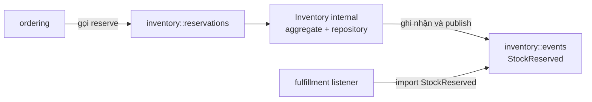
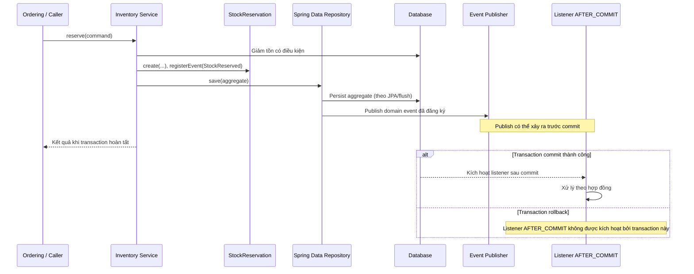
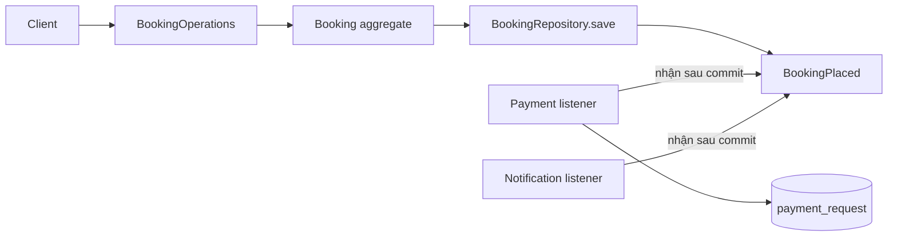

# Kiểm tra event sau khi lưu aggregate

Một đơn hàng được lưu thành công, nhưng module thanh toán không nhận được sự kiện `OrderPlaced`. Ở một tình huống khác, test ghi nhận sự kiện `StockReserved` đã được publish, nhưng transaction lưu phiếu giữ hàng sau đó rollback. Nếu chỉ assert “có event” ngay sau `repository.save(...)`, nhóm phát triển có thể kết luận sai rằng **dữ liệu đã commit và tất cả consumer đã xử lý xong**.

Trong ứng dụng Spring Modulith, có ít nhất ba thời điểm cần phân biệt:

1. **Aggregate ghi nhận một domain event** khi hành vi nghiệp vụ xảy ra.
2. **Spring Data công bố event** khi repository thực hiện một thao tác hỗ trợ phát domain events, điển hình là `save(...)`.
3. **Transactional listener xử lý event** theo pha transaction, ví dụ sau khi transaction của producer commit thành công.

Ba thời điểm này liên quan nhưng **không đồng nhất**. Phát sự kiện trong transaction không tự làm sự kiện “được commit”; lưu aggregate không tự bảo đảm event đã được xử lý; listener thất bại sau commit không thể khiến mọi thay đổi ở producer tự rollback.

Bài **“Kiểm tra event sau khi lưu aggregate”** thuộc chương **Database testing** của **SPRING_MODULITH_VERIFICATION_TESTING**. Ta sẽ thiết kế một module Inventory lưu aggregate và phát `StockReserved`, kiểm thử publication bằng `@ApplicationModuleTest` và `PublishedEvents`, kiểm tra rollback/commit với PostgreSQL, rồi mở rộng sang event listener, event publication registry, idempotency, kiểm chứng dependency qua `ApplicationModules.verify()` và quality gate trong CI.

> **Nguyên tắc:** Phải hỏi rõ bài test đang chứng minh **aggregate đã thay đổi**, **event đã được publish**, **transaction đã commit**, hay **consumer đã hoàn thành tác dụng phụ**. Mỗi kết luận cần bằng chứng riêng.

## 1. Mục tiêu học tập

Sau bài học, bạn có thể:

1. Giải thích domain event là gì và vì sao aggregate ghi nhận event thay vì gọi trực tiếp module consumer.
2. Dùng `AbstractAggregateRoot`, hoặc `@DomainEvents`/`@AfterDomainEventPublication`, để công bố sự kiện khi Spring Data repository lưu aggregate.
3. Phân biệt `repository.save()`, `EntityManager.flush()`, **commit** và listener `AFTER_COMMIT`.
4. Viết `@ApplicationModuleTest` kiểm tra kiểu, số lượng và payload sự kiện bằng `PublishedEvents`.
5. Thiết kế bài test rollback chứng minh **không có side effect sau commit** khi transaction thất bại.
6. Kiểm tra trạng thái database sau lưu aggregate, cả khi thành công lẫn khi lỗi hoặc request trùng.
7. Giới hạn tham chiếu sự kiện xuyên module bằng `@NamedInterface`, `allowedDependencies` và `ApplicationModules.verify()`.
8. Kiểm tra consumer bất đồng bộ, phát lại, xử lý lặp và quality gate CI.

## 2. Domain event thuộc về quyết định nghiệp vụ

Một **domain event** diễn tả một sự thật nghiệp vụ đã xảy ra trong mô hình: `StockReserved`, `OrderPlaced`, `PaymentCaptured`, `SeatHoldExpired`. Nó không nên là bản ghi toàn bộ entity JPA, cũng không nên là mệnh lệnh kỹ thuật kiểu `CallPaymentServiceNow`.

Ví dụ Inventory có hai hành vi:

- `reserve(sku, quantity)`: cố giữ một lượng hàng theo chính sách tồn kho.
- `release(reservationId)`: nhả một phiếu giữ khi được phép.

Nếu `reserve` thành công, aggregate `StockReservation` có thể ghi nhận `StockReserved`. Event này giúp module `fulfillment` lên kế hoạch chuẩn bị hàng **mà Inventory không cần import listener hoặc repository của Fulfillment**.

| Thành phần | Trách nhiệm |
| --- | --- |
| `StockReservation` aggregate | Ghi nhận trạng thái nghiệp vụ và domain event của quyết định vừa xảy ra |
| `InventoryReservations` API | Cấp cho caller quyền yêu cầu giữ hàng qua hợp đồng công khai |
| `StockReservationRepository` | Lưu aggregate thuộc Inventory |
| Spring Data event publication | Lấy event đã đăng ký từ aggregate và publish khi gọi repository method phù hợp |
| Transaction manager | Commit hoặc rollback những thay đổi database thuộc transaction |
| `StockReserved` consumer | Phản ứng theo hợp đồng sau thời điểm/pha transaction đã chọn |

### 2.1. Event khác command và query

| Loại thông điệp | Ví dụ | Ý nghĩa |
| --- | --- | --- |
| **Command** | `ReserveStock("SKU-1", 2)` | Yêu cầu Inventory ra quyết định giữ hàng, có thể từ chối |
| **Query** | `GetStockAvailability("SKU-1")` | Yêu cầu thông tin mà Inventory công bố |
| **Domain event** | `StockReserved(reservationId, ...)` | Thông báo sự thật giữ hàng đã được chấp nhận theo ngữ nghĩa công bố |

Một event tốt dùng **thì quá khứ** và có chủ sở hữu rõ. Không nên phát `StockReserved` nếu mới chỉ kiểm tra tồn khả dụng nhưng chưa quyết định giữ hàng. Ngược lại, cần xác định rõ “đã giữ” có nghĩa **aggregate đang ở trạng thái được chấp nhận trong transaction** hay **giao dịch đã commit bền vững**. Các consumer cần một hợp đồng nhất quán.

### 2.2. Không coi event là một entity được chia sẻ

Tránh:

```java
// Phản mẫu: làm lộ domain/persistence model nội bộ.
public record StockReserved(StockReservationJpaEntity entity) {}
```

Thay bằng payload nhỏ có ý nghĩa:

```java
package com.example.shop.inventory.events;

import java.util.UUID;

public record StockReserved(
    UUID reservationId,
    UUID requestId,
    String sku,
    int quantity
) {}
```

Như vậy consumer không cần hiểu ORM, lazy loading, transaction state hoặc internal entity của Inventory. Khi phát triển thêm schema event, cần xác định trường nào là một phần hợp đồng công khai và cách giữ tương thích với consumer cũ.

## 3. Đồ thị ứng dụng và luồng sự kiện

Ví dụ ứng dụng:

```text
com.example.shop/
├── ShopApplication.java
├── ordering/
│   ├── package-info.java
│   └── internal/PlaceOrderService.java
├── inventory/
│   ├── reservations/
│   │   ├── package-info.java
│   │   ├── InventoryReservations.java
│   │   ├── ReserveStock.java
│   │   └── ReservationReceipt.java
│   ├── events/
│   │   ├── package-info.java
│   │   └── StockReserved.java
│   └── internal/
│       ├── StockReservationService.java
│       └── persistence/
│           ├── StockRow.java
│           ├── StockJpaRepository.java
│           ├── StockReservation.java
│           └── StockReservationRepository.java
└── fulfillment/
    ├── package-info.java
    └── internal/
        ├── StockReservedListener.java
        └── PickingTaskRepository.java
```

Ở mô hình này, `ordering` gọi lệnh của Inventory, còn `fulfillment` nghe event được Inventory công bố.



**Chú ý hướng mũi tên:** Lúc chạy, event được phát từ Inventory và đến Fulfillment. Nhưng về **dependency mã nguồn**, Fulfillment import kiểu `StockReserved` nên nó phụ thuộc `inventory::events`, không phải Inventory phụ thuộc `fulfillment.internal.StockReservedListener`.

Đặt `StockReserved` tại package được công bố là hợp đồng, còn `StockReservation`, entity, repository và quy tắc locking ở bên trong Inventory. Một modular monolith có thể dùng chung một datasource vật lý nhưng vẫn cần giữ **quyền sở hữu logic của bảng và invariant**.

## 4. Vòng đời sự kiện khi lưu aggregate

Xét một aggregate vừa đăng ký `StockReserved` và được lưu:



Sơ đồ là **mô hình khái niệm**. Thời điểm JPA thực hiện SQL `INSERT` phụ thuộc flush strategy; trình tự callback của Spring Data và Spring transaction phụ thuộc cơ chế repository/listener thực tế. Điểm cần nhớ là **publish domain event tại `save` không phải bằng chứng database đã commit**, và `AFTER_COMMIT` được dùng để gắn phản ứng với kết quả commit thành công.

### 4.1. Bốn mốc kiểm tra

| Mốc | Có thể quan sát bằng | Chưa được phép kết luận |
| --- | --- | --- |
| Aggregate đã đăng ký event | Unit test aggregate hoặc kiểm tra event registration | Repository đã lưu hoặc event đã publish |
| Repository đã publish event | `PublishedEvents` hoặc publisher spy | Transaction đã commit hoặc consumer đã xong |
| Transaction đã commit | Truy vấn từ transaction/connection mới sau use case | Consumer bất đồng bộ chắc chắn thành công |
| Consumer hoàn tất side effect | Bản ghi/trạng thái consumer, event integration test | Mọi consumer khác cũng đã hoàn tất |

Thiết kế bộ test phải nhắm đúng mốc. Một assertion `PublishedEvents` có event ngay sau `save` chỉ là bằng chứng **publication**, không tự xác minh **transactional durability** hoặc **delivery tới hệ thống ngoài**.

## 5. Hai cách Spring Data hỗ trợ domain events

Spring Data có cơ chế lấy các domain event từ aggregate qua `@DomainEvents` và đánh dấu sau khi publication bằng `@AfterDomainEventPublication`. Cách thường dùng trong Spring Data Commons là kế thừa `AbstractAggregateRoot<T>`, đã hỗ trợ đăng ký và cung cấp event.

### 5.1. Cách A — `AbstractAggregateRoot`

```java
// inventory/internal/persistence/StockReservation.java
package com.example.shop.inventory.internal.persistence;

import com.example.shop.inventory.events.StockReserved;
import jakarta.persistence.Column;
import jakarta.persistence.Entity;
import jakarta.persistence.Id;
import jakarta.persistence.Table;
import java.util.UUID;
import org.springframework.data.domain.AbstractAggregateRoot;

@Entity
@Table(name = "inventory_reservation")
public class StockReservation
        extends AbstractAggregateRoot<StockReservation> {

    @Id
    @Column(name = "reservation_id")
    private UUID id;

    @Column(name = "request_id", nullable = false, unique = true)
    private UUID requestId;

    @Column(name = "sku", nullable = false)
    private String sku;

    @Column(name = "quantity", nullable = false)
    private int quantity;

    protected StockReservation() {}

    private StockReservation(
        UUID id, UUID requestId, String sku, int quantity
    ) {
        this.id = id;
        this.requestId = requestId;
        this.sku = sku;
        this.quantity = quantity;
    }

    public static StockReservation create(
        UUID id, UUID requestId, String sku, int quantity
    ) {
        var reservation = new StockReservation(
            id, requestId, sku, quantity
        );
        reservation.registerEvent(new StockReserved(
            id, requestId, sku, quantity
        ));
        return reservation;
    }

    public UUID getId() {
        return id;
    }
}
```

`registerEvent(...)` **ghi nhận** sự kiện trên aggregate, chưa publish ngay. Khi repository Spring Data thực hiện một phương thức được hỗ trợ như `save(aggregate)`, cơ chế domain events của Spring Data có thể lấy các event đã đăng ký và publish qua application event infrastructure. `AbstractAggregateRoot` cũng hỗ trợ xóa danh sách event sau publication.

**Đừng trộn** `registerEvent(...)` với `ApplicationEventPublisher.publishEvent(...)` cho cùng một sự thật nếu không có chủ đích: rất dễ publish trùng hai lần.

### 5.2. Cách B — Tự định nghĩa `@DomainEvents`

Khi không muốn kế thừa `AbstractAggregateRoot`, một aggregate có thể tự giữ danh sách event:

```java
// Trích đoạn minh họa trong một aggregate class.
private final transient List<Object> pendingEvents = new ArrayList<>();

void record(Object event) {
    pendingEvents.add(event);
}

@DomainEvents
Collection<Object> eventsToPublish() {
    return List.copyOf(pendingEvents);
}

@AfterDomainEventPublication
void clearPublishedEvents() {
    pendingEvents.clear();
}
```

Các import tương ứng: `java.util.ArrayList`, `java.util.Collection`, `java.util.List`, `org.springframework.data.domain.DomainEvents` và `org.springframework.data.domain.AfterDomainEventPublication`. Đây là **trích đoạn**, cần đặt trong aggregate class phù hợp và nối với repository Spring Data. Không dùng cả hai cách cùng lúc chỉ vì “an toàn hơn”.

### 5.3. Cơ chế phát event gắn với lời gọi repository

Với Spring Data repository hỗ trợ domain events, những method tiêu biểu như `save(…)`, `saveAll(…)`, `delete(…)`, `deleteAll(…)` có thể kích hoạt cơ chế lấy event từ aggregate. **Không nên giả định** mọi cách thay đổi database đều kích hoạt domain event:

- Sửa managed JPA entity rồi để dirty checking flush mà **không gọi repository method**: không tự tương đương một lời gọi `save(...)` về cơ chế Spring Data domain-event publication.
- Native SQL `UPDATE` hoặc `@Modifying @Query` ghi thẳng bảng: không đi qua aggregate event registration và repository save cho aggregate đó.
- `JdbcTemplate.update(...)`: không tự đọc danh sách `@DomainEvents`.
- Thay đổi do database trigger: cũng không tự publish Java domain event.

Nếu một use case cần công bố domain event, hãy thiết kế **đường cập nhật và publication rõ ràng**. Đừng nghĩ “JPA đã lưu row” thì Spring Data chắc chắn sẽ publish event của aggregate.

### 5.4. `@AfterDomainEventPublication` không phải `AFTER_COMMIT`

`@AfterDomainEventPublication` cho phép xóa/đánh dấu danh sách event đã được lấy và publish qua repository event infrastructure. Nó **không** tự chứng minh database transaction đã commit thành công, cũng không đảm bảo consumer đã xử lý.

Đây là khác biệt cốt lõi:

```text
@AfterDomainEventPublication → sau publication từ aggregate qua Spring Data
@TransactionalEventListener(AFTER_COMMIT) → listener được gọi sau commit
```

Nếu transaction rollback sau khi event đã được lấy khỏi aggregate, một lần retry bằng **chính object aggregate cũ** có thể không còn pending event. Cần thiết kế retry/use case có chủ đích thay vì dựa vào object đã đi qua transaction thất bại; với quy trình cần phát chắc chắn có thể cân nhắc cơ chế publication bền vững phù hợp.

## 6. Thiết kế schema và repository cho ví dụ

Inventory có một bảng tồn và một bảng reservation. Migration PostgreSQL tối giản:

```sql
CREATE TABLE inventory_stock (
    sku VARCHAR(80) PRIMARY KEY,
    available INTEGER NOT NULL,
    CONSTRAINT ck_stock_nonnegative CHECK (available >= 0)
);

CREATE TABLE inventory_reservation (
    reservation_id UUID PRIMARY KEY,
    request_id UUID NOT NULL UNIQUE,
    sku VARCHAR(80) NOT NULL,
    quantity INTEGER NOT NULL,
    CONSTRAINT fk_reservation_stock
        FOREIGN KEY (sku) REFERENCES inventory_stock(sku),
    CONSTRAINT ck_reservation_positive CHECK (quantity > 0)
);
```

Schema này phục vụ **bài toán minh họa một lần giảm tồn và ghi reservation**. Ứng dụng giữ hàng thực có thể cần trạng thái, thời hạn, nhả hàng, ledger, kho/tenant, quy tắc idempotency và những ràng buộc tương ứng. Chỉ khai báo `request_id UNIQUE` không tự định nghĩa chuyện phải trả gì nếu client gửi lại cùng request.

### 6.1. Repository nội bộ

```java
// inventory/internal/persistence/StockReservationRepository.java
package com.example.shop.inventory.internal.persistence;

import java.util.UUID;
import org.springframework.data.jpa.repository.JpaRepository;

public interface StockReservationRepository
        extends JpaRepository<StockReservation, UUID> {}
```

```java
// inventory/internal/persistence/StockJpaRepository.java
package com.example.shop.inventory.internal.persistence;

import org.springframework.data.jpa.repository.JpaRepository;
import org.springframework.data.jpa.repository.Modifying;
import org.springframework.data.jpa.repository.Query;
import org.springframework.data.repository.query.Param;

public interface StockJpaRepository extends JpaRepository<StockRow, String> {

    @Modifying
    @Query(value = """
        UPDATE inventory_stock
           SET available = available - :qty
         WHERE sku = :sku AND available >= :qty
        """, nativeQuery = true)
    int decrementIfEnough(
        @Param("sku") String sku,
        @Param("qty") int quantity
    );
}
```

`StockRow` là JPA entity nội bộ ứng với bảng `inventory_stock` với khóa `sku` và thuộc tính `available` được map đúng; lớp này cần được triển khai khi áp dụng ví dụ. `@Modifying` và câu SQL `UPDATE ... WHERE available >= :qty` minh họa một thao tác thay đổi tồn có điều kiện. Để đánh giá concurrency thật, vẫn phải chạy bài test với engine/isolation production.

### 6.2. API của module Inventory

```java
// inventory/reservations/package-info.java
@org.springframework.modulith.NamedInterface("reservations")
package com.example.shop.inventory.reservations;
```

```java
// inventory/events/package-info.java
@org.springframework.modulith.NamedInterface("events")
package com.example.shop.inventory.events;
```

```java
// inventory/reservations/ReserveStock.java
package com.example.shop.inventory.reservations;

import java.util.UUID;

public record ReserveStock(
    String sku, int quantity, UUID requestId
) {
    public ReserveStock {
        if (sku == null || sku.isBlank() ||
            quantity <= 0 || requestId == null) {
            throw new IllegalArgumentException("Yêu cầu giữ hàng không hợp lệ");
        }
    }
}
```

```java
// inventory/reservations/ReservationReceipt.java
package com.example.shop.inventory.reservations;

import java.util.UUID;

public record ReservationReceipt(UUID reservationId) {}
```

```java
// inventory/reservations/InventoryReservations.java
package com.example.shop.inventory.reservations;

public interface InventoryReservations {
    ReservationReceipt reserve(ReserveStock command);
}
```

Các kiểu API không công bố `StockRow`, `StockReservation` JPA entity hay repository. Với consumer, điều quan trọng là **kết quả giữ hàng có ý nghĩa và lỗi được mô tả**, không phải cách lưu bảng.

## 7. Service lưu aggregate, phát event qua repository

Triển khai một use case đơn giản:

```java
// inventory/internal/StockReservationService.java
package com.example.shop.inventory.internal;

import com.example.shop.inventory.internal.persistence.StockJpaRepository;
import com.example.shop.inventory.internal.persistence.StockReservation;
import com.example.shop.inventory.internal.persistence.StockReservationRepository;
import com.example.shop.inventory.reservations.InventoryReservations;
import com.example.shop.inventory.reservations.ReservationReceipt;
import com.example.shop.inventory.reservations.ReserveStock;
import java.util.UUID;
import org.springframework.stereotype.Service;
import org.springframework.transaction.annotation.Transactional;

@Service
class StockReservationService implements InventoryReservations {

    private final StockJpaRepository stock;
    private final StockReservationRepository reservations;

    StockReservationService(
        StockJpaRepository stock,
        StockReservationRepository reservations
    ) {
        this.stock = stock;
        this.reservations = reservations;
    }

    @Override
    @Transactional
    public ReservationReceipt reserve(ReserveStock command) {
        int affected = stock.decrementIfEnough(
            command.sku(), command.quantity()
        );
        if (affected != 1) {
            throw new IllegalStateException("Không đủ hàng hoặc SKU không tồn tại");
        }

        UUID reservationId = UUID.randomUUID();
        var aggregate = StockReservation.create(
            reservationId, command.requestId(),
            command.sku(), command.quantity()
        );

        reservations.save(aggregate);
        return new ReservationReceipt(reservationId);
    }
}
```

Các bước có ý nghĩa:

1. Kiểm tra/cập nhật tồn trong transaction bằng thao tác có điều kiện.
2. Tạo aggregate `StockReservation` và **đăng ký** event `StockReserved` trong factory.
3. Gọi `reservations.save(aggregate)` để Spring Data thực hiện lưu và cơ chế publication.
4. Transaction của service **commit khi lời gọi được hoàn tất thành công**, hoặc rollback khi gặp lỗi theo chính sách transaction.

Đây là mô hình học tập, **chưa phải implementation production hoàn chỉnh**. Chẳng hạn, chưa xử lý request ID lặp bằng cách trả kết quả cũ, chưa có release/expiry và chưa xác định mã lỗi nghiệp vụ đầy đủ. Nếu `request_id` trùng, `UNIQUE` có thể làm transaction rollback; production cần quyết định cách trả lỗi hoặc cách thực hiện idempotency.

### 7.1. Vì sao đặt `@Transactional` ở service?

Nếu chỉ `decrementIfEnough(...)` thành công rồi `reservations.save(...)` lỗi, **không được để tồn bị giảm nhưng không có reservation**. Transaction chung giúp database rollback cả hai thao tác khi chúng dùng cùng transaction manager/resource và exception kích hoạt rollback.

Nếu database đã commit rồi consumer bất đồng bộ lỗi, rollback của producer **không còn áp dụng** cho kết quả consumer. Đó là bài toán xử lý sự kiện sau commit, cần các cách retry/đối soát tương ứng.

### 7.2. Một thay đổi SQL trực tiếp có thể bỏ qua event

Phản mẫu:

```java
@Modifying
@Query(value = """
    UPDATE inventory_reservation SET quantity = :newQuantity
    WHERE reservation_id = :id
    """, nativeQuery = true)
int updateQuantity(UUID id, int newQuantity);
```

Đoạn update này thao tác thẳng vào bảng và **không phải** gọi Spring Data `save(aggregate)` để lấy pending domain events. Nếu use case điều chỉnh reservation có nghĩa vụ phát `StockReservationChanged`, phải thiết kế riêng đường domain event thay vì cho rằng SQL update tự làm điều đó.

### 7.3. Repository save không nhất thiết là database commit

Với Spring Data JPA, `save(...)` có thể gọi `persist` hoặc `merge`; SQL thực tế có thể được gửi lúc flush hoặc sớm hơn tùy chiến lược ID và flush mode. Tuy nhiên, **giao dịch vẫn có thể rollback sau khi event đã publish**.

Phân biệt:

```text
registerEvent      → ghi pending event trong aggregate
repository.save    → thao tác repository và domain-event publication
EntityManager.flush→ đẩy các thay đổi SQL chưa nhất thiết commit
transaction commit → xác nhận tính bền vững của transaction
listener AFTER_COMMIT → phản ứng sau commit thành công
```

Không dùng `saveAndFlush()` như một cách thay thế `commit`; `flush` không đồng nghĩa commit.

## 8. Kiểm thử aggregate thuần túy: sự kiện được đăng ký

Trước khi khởi động Spring hoặc database, có thể unit test hành vi factory/aggregate. Do danh sách event trong `AbstractAggregateRoot` được thiết kế như chi tiết domain-event infrastructure, **không cần truy cập nội bộ của Spring Data chỉ để test**. Một lựa chọn là kiểm tra trạng thái aggregate và dùng bài module test ở mục sau để xác minh event thực sự được publish khi save.

Nếu aggregate có các điều kiện domain như số lượng phải dương hoặc trạng thái không được chuyển ngược, test thuần Java nên kiểm tra:

- Factory chỉ tạo aggregate hợp lệ.
- Các lệnh domain có điều kiện tiền/hậu rõ ràng.
- Không tạo event “thành công” khi quyết định nghiệp vụ bị từ chối.
- Event mang ID, SKU, số lượng đã được chấp nhận, không mang JPA proxy.

Ví dụ skeleton:

```java
@Test
void reservationFactoryKeepsBusinessValues() {
    var id = UUID.randomUUID();
    var requestId = UUID.randomUUID();
    var reservation = StockReservation.create(id, requestId, "SKU-1", 2);

    assertThat(reservation.getId()).isEqualTo(id);
    // Kiểm thử event-publication thực tế bằng repository + PublishedEvents.
}
```

Bài unit này **không chứng minh event đã publish**; nó chỉ kiểm tra giá trị mô hình. Đừng gọi nó là “event integration test” khi không có event publisher hoặc repository tham gia.

## 9. `@ApplicationModuleTest` và `PublishedEvents`

Spring Modulith cung cấp hỗ trợ test event trong phạm vi application module. Với test được đặt dưới package `com.example.shop.inventory`, `@ApplicationModuleTest` khởi động module Inventory theo bootstrap mode, còn `PublishedEvents` cho phép quan sát các application events đã được publish trong lúc test.

### 9.1. Một test publication có assertion rõ

```java
package com.example.shop.inventory;

import static org.assertj.core.api.Assertions.assertThat;

import com.example.shop.inventory.events.StockReserved;
import com.example.shop.inventory.reservations.InventoryReservations;
import com.example.shop.inventory.reservations.ReserveStock;
import java.util.UUID;
import org.junit.jupiter.api.Test;
import org.springframework.beans.factory.annotation.Autowired;
import org.springframework.jdbc.core.JdbcTemplate;
import org.springframework.modulith.test.ApplicationModuleTest;
import org.springframework.modulith.test.PublishedEvents;
import org.springframework.test.context.jdbc.Sql;

@ApplicationModuleTest
@Sql(
    scripts = "/fixtures/inventory/stock-five.sql",
    executionPhase = Sql.ExecutionPhase.BEFORE_TEST_METHOD
)
class InventoryEventModuleTests {

    @Autowired InventoryReservations inventory;
    @Autowired PublishedEvents events;
    @Autowired JdbcTemplate jdbc;

    @Test
    void publishesEventForSavedReservation() {
        UUID requestId = UUID.randomUUID();

        var receipt = inventory.reserve(
            new ReserveStock("SKU-EVENT", 2, requestId)
        );

        var published = events.ofType(StockReserved.class)
            .matching(event ->
                event.reservationId().equals(receipt.reservationId())
                    && event.requestId().equals(requestId)
                    && event.sku().equals("SKU-EVENT")
                    && event.quantity() == 2
            );

        assertThat(published).hasSize(1);
        assertThat(available("SKU-EVENT")).isEqualTo(3);
    }

    private int available(String sku) {
        return jdbc.queryForObject(
            "SELECT available FROM inventory_stock WHERE sku = ?",
            Integer.class, sku
        );
    }
}
```

Giả sử `src/test/resources/fixtures/inventory/stock-five.sql` chứa:

```sql
-- Fixture dành cho DB/schema test riêng.
DELETE FROM inventory_reservation;
DELETE FROM inventory_stock;
INSERT INTO inventory_stock(sku, available)
VALUES ('SKU-EVENT', 5);
```

Điều kiện áp dụng:

- Spring Modulith test dependency và kiểu `PublishedEvents` có mặt trong phiên bản framework đang dùng.
- Migration tạo schema; Inventory có implementation thực và datasource được cấu hình.
- Lớp test **không dùng `@Transactional` ở cấp test**; service có transaction riêng và hoàn tất khi trả kết quả.
- Fixture và cleanup được cô lập, không xóa bản ghi của test đang chạy song song.
- `PublishedEvents` quan sát application event được publish, **không** đồng nghĩa listener downstream đã hoàn thành.

Trong những phiên bản API khác nhau, tên hoặc kiểu method lọc event có thể thay đổi; hãy thống nhất dependency theo BOM và kiểm tra chữ ký API khi đưa mã ví dụ vào dự án. Ý nghĩa test không đổi: **một event thuộc đúng reservation, đúng request, đúng SKU và số lượng**.

### 9.2. Kiểm tra “không có event” khi lệnh bị từ chối sớm

```java
@Test
void rejectedReservationDoesNotPublishSuccessEvent() {
    assertThatThrownBy(() -> inventory.reserve(
        new ReserveStock("SKU-EVENT", 6, UUID.randomUUID())
    )).isInstanceOf(IllegalStateException.class);

    assertThat(events.ofType(StockReserved.class)).isEmpty();
    assertThat(available("SKU-EVENT")).isEqualTo(5);
}
```

Ví dụ cần import `assertThatThrownBy` từ AssertJ và cùng fixture `available = 5`. Ở implementation hiện tại, lệnh từ chối **trước khi tạo aggregate và trước `save(...)`**, do đó không có event thành công nào được đăng ký/publish. Đây là trường hợp có thể dùng `PublishedEvents.isEmpty()` một cách có nghĩa.

### 9.3. Một event đã publish vẫn có thể thuộc transaction rollback

Đừng áp assertion trên một cách máy móc cho tình huống **lưu aggregate xong rồi mới lỗi**. Nếu `repository.save(...)` đã publish domain event trong transaction, `PublishedEvents` có thể ghi nhận nó dù transaction sau đó rollback. Điều đúng cần kiểm tra là:

- Dữ liệu producer không còn kết quả sai sau rollback.
- Listener **chỉ chạy AFTER_COMMIT** không tạo side effect cho transaction bị rollback.
- Cơ chế publication/retry được cấu hình phù hợp với trạng thái transaction.

Vì thế **test publication** và **test kết quả commit/rollback** nên là hai ca riêng để tránh kết luận sai.

## 10. Kiểm chứng trạng thái DB sau lưu aggregate

Một event test chỉ nhìn payload có thể xanh dù repository lưu dữ liệu sai. Với module Inventory, kiểm chứng thêm:

| Điều kiện | Hành động | Hậu điều kiện DB |
| --- | --- | --- |
| Có `5` đơn vị | Giữ `2` | Tồn `3`, có reservation mới `quantity = 2` |
| Có `5` đơn vị | Giữ `6` | Tồn `5`, không có reservation mới |
| `request_id` trùng | Gửi lại yêu cầu | Theo chính sách idempotency, không giữ trùng |
| Lỗi khi insert reservation sau giảm tồn | Gọi reserve và gây lỗi có chủ đích | Giảm tồn được rollback, không có record nửa vời |
| Hai request tranh tồn cuối | Hai transaction độc lập | Không thể cùng xác nhận khi tổng yêu cầu vượt tồn |

### 10.1. Đọc dữ liệu sau khi transaction kết thúc

Nếu dùng JPA, một entity đang nằm trong persistence context có thể biểu diễn giá trị đã thay đổi **trước commit**. Để kiểm tra trạng thái bền vững, nên:

1. Gọi API Spring bean từ test **không bọc test-managed transaction** khi muốn service tự commit.
2. Để lời gọi transactional hoàn tất hoặc ném lỗi.
3. Dùng `JdbcTemplate` hoặc một transaction/persistence context mới để đọc kết quả.
4. Assert số bản ghi, giá trị cột và invariant, không chỉ `verify(mockRepository).save(...)`.

`flush()` giúp buộc SQL được gửi và phát hiện một số constraint ở thời điểm flush nhưng **không thay thế commit**. Lỗi xuất hiện lúc commit cần bài test cho transaction kết thúc thật.

### 10.2. Kiểm tra reservation không bị tạo trùng

Ví dụ sau phù hợp khi fixture là một DB test đã seed và chưa có reservation của request:

```java
Integer count = jdbc.queryForObject(
    """
    SELECT count(*) FROM inventory_reservation
    WHERE request_id = ?
    """,
    Integer.class,
    requestId
);
assertThat(count).isEqualTo(1);
```

Không chỉ assert `eventCount = 1` nếu mục tiêu còn gồm idempotency của lệnh giữ hàng. Event có thể được publish lặp bởi retry hoặc thiết kế lại consumer; bảo đảm **không giữ hai lần** là invariant ở module Inventory và DB.

## 11. Rollback sau publication: kiểm tra đúng mốc

Tình huống cần bắt:

```text
Transaction T bắt đầu
    Inventory.reserve(...)
       ├── UPDATE tồn kho
       ├── INSERT aggregate reservation qua repository.save(...)
       └── publish StockReserved trong transaction
    Tiếp theo: một bước nghiệp vụ phát sinh lỗi
Transaction T rollback
    → Không còn tồn đã giảm, reservation đã lưu
    → Không có listener AFTER_COMMIT hợp lệ xử lý sự kiện của T
```

Ở bài này, test không nên khẳng định `PublishedEvents` luôn rỗng, vì event **có thể đã được publish trước rollback**. Để kiểm tra có/không có **tác dụng sau commit**, hãy dùng một listener quan sát pha `AFTER_COMMIT`.

### 11.1. Dùng `TransactionTemplate` để buộc rollback

Một khung test kết hợp được với `InventoryEventModuleTests`:

```java
@Autowired PlatformTransactionManager transactionManager;

@Test
void outerRollbackRestoresInventoryState() {
    var transaction = new TransactionTemplate(transactionManager);
    UUID requestId = UUID.randomUUID();

    assertThatThrownBy(() -> transaction.executeWithoutResult(status -> {
        inventory.reserve(new ReserveStock("SKU-EVENT", 2, requestId));
        throw new IllegalStateException("Giả lập lỗi sau khi lưu aggregate");
    })).isInstanceOf(IllegalStateException.class);

    assertThat(available("SKU-EVENT")).isEqualTo(5);

    Integer count = jdbc.queryForObject(
        "SELECT count(*) FROM inventory_reservation WHERE request_id = ?",
        Integer.class, requestId
    );
    assertThat(count).isZero();
}
```

Các kiểu cần import: `org.springframework.transaction.PlatformTransactionManager`, `org.springframework.transaction.support.TransactionTemplate` và `assertThatThrownBy`. Khi service dùng `@Transactional` với propagation mặc định `REQUIRED`, lời gọi service **tham gia transaction do `TransactionTemplate` mở** nếu cùng transaction manager. Lỗi ở cuối callback khiến cả transaction rollback.

Ví dụ này **chứng minh state database rollback**, không tự chứng minh rằng listener `AFTER_COMMIT` không chạy; test đó sẽ được bổ sung ở mục tiếp theo.

### 11.2. Tạo một listener kiểm tra `AFTER_COMMIT`

Có thể khai báo một probe bean chỉ phục vụ test. Ví dụ:

```java
@TestConfiguration
static class EventProbeConfig {

    @Bean
    AfterCommitProbe afterCommitProbe() {
        return new AfterCommitProbe();
    }
}

static class AfterCommitProbe {

    private final List<UUID> committed = new CopyOnWriteArrayList<>();

    @TransactionalEventListener(phase = TransactionPhase.AFTER_COMMIT)
    void on(StockReserved event) {
        committed.add(event.reservationId());
    }

    boolean saw(UUID reservationId) {
        return committed.contains(reservationId);
    }

    void reset() {
        committed.clear();
    }
}
```

Các import cần bổ sung: `org.springframework.boot.test.context.TestConfiguration`, `org.springframework.context.annotation.Bean`, `java.util.List`, `java.util.UUID`, `java.util.concurrent.CopyOnWriteArrayList`, `org.springframework.transaction.event.TransactionalEventListener`, `org.springframework.transaction.event.TransactionPhase`. Đăng ký cấu hình bằng `@Import(EventProbeConfig.class)` trên lớp test và inject `AfterCommitProbe`.

Một bài test có thể:

1. Reset probe trong `@BeforeEach`.
2. Tạo transaction bằng `TransactionTemplate`.
3. Lưu aggregate, đăng ký `StockReserved`, rồi cố ý ném lỗi trước commit.
4. Assert DB không đổi và `probe.saw(reservationId)` bằng `false`.
5. Ở một test khác, cho transaction commit thành công; assert probe **có** reservation ID đó.

Probe dùng listener đồng bộ để giảm nhiễu thời gian; ở integration test với listener bất đồng bộ thực, phải đợi kết quả theo điều kiện và timeout. Khi test có nhiều phương thức, cần tránh state của probe/test context gây rò kết quả qua test khác.

### 11.3. Vì sao test transaction mặc định rollback thường gây nhầm?

Nếu đánh dấu cả lớp `@ApplicationModuleTest` bằng `@Transactional`, Spring Test thường rollback transaction sau test. Một listener `AFTER_COMMIT` có thể **không chạy**, dù `PublishedEvents` đã ghi nhận event. Đây có thể là hành vi **đúng**.

Muốn kiểm tra listener sau commit, hãy dùng test không bọc transaction ngoài, hoặc sử dụng `TestTransaction.flagForCommit()` và `TestTransaction.end()` có chủ đích. Khi commit thật, dữ liệu đã commit phải được cleanup bằng một chiến lược riêng.

## 12. Consumer xuyên module và `@ApplicationModuleListener`

Module Fulfillment có thể phản ứng sau khi Inventory giữ hàng:

```java
// fulfillment/internal/StockReservedListener.java
package com.example.shop.fulfillment.internal;

import com.example.shop.inventory.events.StockReserved;
import org.springframework.modulith.events.ApplicationModuleListener;
import org.springframework.stereotype.Component;

@Component
class StockReservedListener {

    private final PickingTaskRepository tasks;

    StockReservedListener(PickingTaskRepository tasks) {
        this.tasks = tasks;
    }

    @ApplicationModuleListener
    void on(StockReserved event) {
        tasks.createIfAbsent(
            event.reservationId(), event.sku(), event.quantity()
        );
    }
}
```

`PickingTaskRepository` cùng method `createIfAbsent(...)` là port/implementation nội bộ **giả định** của Fulfillment. Đoạn code cần thêm schema và bean cụ thể để chạy. Điểm quan trọng là listener **không chỉnh `inventory_reservation`**; nó tạo dữ liệu do Fulfillment sở hữu dựa trên một sự kiện công khai.

`@ApplicationModuleListener` là tiện ích Spring Modulith cho xử lý event liên module theo cơ chế transactional/asynchronous tương ứng phiên bản và cấu hình. Khi sử dụng cần xác minh dependency, transaction manager, executor, event publication registry và chính sách retry. Đừng đồng nhất nó với callback đồng bộ `@TransactionalEventListener` của probe ở mục trước.

### 12.1. Điều gì xảy ra nếu consumer lỗi sau commit?

Khi producer transaction đã commit:

- Reservation của Inventory đã tồn tại bền vững.
- Listener Fulfillment có thể bị lỗi database, mất kết nối hoặc crash sau khi bắt đầu.
- Việc listener ném exception **không tự rollback** transaction Inventory đã commit.
- Hệ thống cần quy trình ghi nhận, retry và idempotency để consumer có thể khôi phục.

Không nên thay event listener bằng `@Transactional` trên toàn luồng rồi giả định mọi tài nguyên tự trở thành một distributed transaction.

### 12.2. Kiểm thử consumer theo hai cấp

**Module test Fulfillment:** inject/công bố một `StockReserved` theo điều kiện transaction thích hợp và kiểm tra `PickingTaskRepository`/bảng `picking_task`. Với listener transactional sau commit, việc phát event bên ngoài transaction có thể không kích hoạt nó theo mặc định; cần một transaction **thực sự commit**.

**Integration test Inventory → Fulfillment:** gọi `InventoryReservations.reserve(...)` qua API, cho service commit, chờ listener hoàn tất nếu bất đồng bộ và kiểm tra đúng một picking task tương ứng. Test này cần khởi động các module/hạ tầng liên quan, không chỉ `STANDALONE` Inventory.

## 13. Event publication registry, retry và bảo đảm giao nhận

Trong ứng dụng cần độ tin cậy cao, một listener có thể thất bại **sau khi producer đã commit**. Spring Modulith có cơ chế **Event Publication Registry** theo cấu hình và persistence module tương ứng, dùng để ghi nhận publications dành cho transactional listeners, theo dõi việc hoàn tất và hỗ trợ xử lý lại các publication chưa hoàn thành.

Không nên tự suy rằng chỉ cần thêm `@ApplicationModuleTest` hoặc `@ApplicationModuleListener` là **mọi event đã được lưu bền vững** và sẽ đến consumer đúng một lần. Phải kiểm tra:

- Dependency của event publication persistence (JDBC/JPA/khác) đã được thêm và cấu hình chưa.
- Schema phục vụ publication registry có được migrate/tạo đúng không.
- Registry lưu bản ghi ở thời điểm/giao dịch nào và đồng nhất với transaction producer ra sao.
- Listener nào được theo dõi; kết quả hoàn tất được ghi khi nào.
- Cơ chế retry/resubmission nào được bật, điều kiện khởi động lại ra sao.
- Consumer có xử lý **idempotent** khi event được giao lại không.

### 13.1. Ba khái niệm bảo đảm khác nhau

| Tuyên bố | Ý nghĩa | Điều phải test |
| --- | --- | --- |
| **Event được publish** | Event đã đi qua event publisher trong JVM | `PublishedEvents`, listener spy |
| **Publication được ghi bền vững** | Có cơ chế lưu theo transaction/config phù hợp | Test registry/persistence và rollback/commit |
| **Consumer xử lý thành công** | Tác dụng phụ đã được commit đúng, có thể chống lặp | Integration test database consumer, retry/idempotency |

Đây là các bằng chứng **tăng dần**, không thay thế được nhau.

### 13.2. Exactly-once là lời hứa dễ hiểu sai

Khi sự kiện có thể bị retry, một consumer có thể nhận lại cùng `reservationId`. Hãy thiết kế **idempotent business effect**:

```sql
CREATE TABLE picking_task (
    task_id UUID PRIMARY KEY,
    reservation_id UUID NOT NULL UNIQUE,
    sku VARCHAR(80) NOT NULL,
    quantity INTEGER NOT NULL
);
```

Một unique constraint trên `reservation_id` có thể hỗ trợ không tạo hai picking task cho cùng reservation. Consumer vẫn phải xử lý xung đột unique theo semantics, và cần bảo đảm rằng các side effect khác (email, HTTP, message) cũng không vô tình lặp.

**At-least-once delivery + idempotent consumer** thường là mục tiêu thực dụng hơn việc khẳng định mọi consumer chạy exactly once. Không thể chứng minh exactly-once cho cả nhiều resource chỉ bằng một assertion `PublishedEvents` có một phần tử.

### 13.3. Những kịch bản test độ bền

1. Producer rollback trước commit → không có reservation được commit và không có publication bền vững sai.
2. Producer commit → publication cần được ghi/quan sát theo cấu hình.
3. Consumer lỗi giữa xử lý → ghi nhận chưa hoàn tất theo registry (nếu dùng), có đường retry.
4. Consumer thành công → publication được đánh dấu hoàn tất theo semantics cấu hình.
5. Cùng event được deliver lại → side effect business chỉ được áp dụng một lần.
6. Ứng dụng restart sau failure → khả năng khôi phục phụ thuộc thiết kế registry, không chỉ in-memory queue.

## 14. Event sau `save()` khi aggregate bị cập nhật nhiều lần

Một aggregate có thể đi qua nhiều thay đổi trước một lần lưu. Nếu mỗi method domain đăng ký event:

```text
aggregate.adjustQuantity(2)   → đăng ký QuantityAdjusted
aggregate.confirm()           → đăng ký ReservationConfirmed
repository.save(aggregate)    → Spring Data publish các event đã đăng ký
```

Khi đó test cần xác định **hai event có thật sự là hai sự thật nghiệp vụ được công bố hay không**. Không mặc định chỉ có một event vì chỉ gọi repository `save` một lần.

### 14.1. Ngược lại, nhiều lần save có thể publish gì?

Sau một lần repository publication, `AbstractAggregateRoot` có cơ chế clear pending events. Nếu không đăng ký event mới, gọi `save` lần nữa trên cùng aggregate không mặc nhiên publish lại event cũ. Tuy vậy:

- Một listener/flow khác có thể tạo event mới hoặc gọi save theo đường khác.
- Một transaction rollback sau publication không “đưa pending events quay lại”.
- Ứng dụng retry toàn bộ use case có thể tạo aggregate/event mới.

Vì thế kiểm thử nên dựa trên **ID request, ID aggregate và payload**, đồng thời thiết kế idempotency, thay vì chỉ đếm tổng event trên một Spring context dùng chung qua nhiều bài test.

### 14.2. Gọi `deleteById(...)` không đồng nghĩa gọi `delete(entity)`

Spring Data domain-event publication dựa trên những aggregate instance được repository nhận trong các thao tác hỗ trợ lấy event. Một số thao tác như `deleteById(...)` không có aggregate instance sẵn để lấy pending events, nên **không được suy rằng mọi cách xóa đều publish domain event**.

Khi nghiệp vụ cần event `ReservationCancelled`, hãy đặt quyết định hủy trong aggregate/service, đăng ký sự kiện và dùng đường repository hỗ trợ publication, hoặc phát event tường minh theo thiết kế.

### 14.3. Direct SQL update và dirty checking

Với JPA dirty checking, transaction có thể cập nhật entity dù không có lệnh gọi `repository.save(...)` rõ ràng. Nếu ứng dụng kỳ vọng cơ chế `@DomainEvents` của Spring Data, **chỉ dirty checking không đủ làm lời gọi publication xuất hiện**. Hãy kiểm tra đường đi cụ thể của use case.

Một lựa chọn là dùng `ApplicationEventPublisher` trực tiếp trong application service để phát event sau quyết định nghiệp vụ; khi đó cần thống nhất thời điểm phát và tránh publish trùng với event registration của aggregate. Lựa chọn khác là dùng outbox/publication registry có transaction coupling phù hợp. Không có một kiểu đúng cho mọi ứng dụng; phải rõ **ai phát**, **lúc nào**, **trong transaction nào**.

## 15. Cấu hình database thật cho module event test

Để kiểm tra cả event và trạng thái aggregate khi persistence phức tạp, dùng engine cùng loại production sẽ đáng tin hơn H2, nhất là với native SQL, unique/check constraint và isolation.

### 15.1. PostgreSQL qua Testcontainers

Ví dụ skeleton khi dự án dùng Spring Boot hỗ trợ `@ServiceConnection` (3.1+):

```java
package com.example.shop.inventory;

import org.springframework.boot.testcontainers.service.connection.ServiceConnection;
import org.springframework.modulith.test.ApplicationModuleTest;
import org.testcontainers.containers.PostgreSQLContainer;
import org.testcontainers.junit.jupiter.Container;
import org.testcontainers.junit.jupiter.Testcontainers;

@Testcontainers
@ApplicationModuleTest
class InventoryPostgresEventTests {

    @Container
    @ServiceConnection
    static PostgreSQLContainer<?> postgres =
        new PostgreSQLContainer<>("postgres:16-alpine");

    // @Autowired InventoryReservations inventory;
    // @Autowired PublishedEvents events;
    // @Autowired JdbcTemplate jdbc;
    // Thêm fixture và @Test kiểm tra commit/rollback + event.
}
```

`postgres:16-alpine` chỉ là **ví dụ**, cần chọn version/extension và migration phù hợp với production. Cần có dependency Spring Modulith test, Spring Boot test, driver PostgreSQL, Testcontainers, module JUnit Jupiter/PostgreSQL và container runtime. **Testcontainers khởi động database engine; nó không tự tạo đúng schema**: Flyway/Liquibase hoặc cơ chế migration đã quản lý phải chạy trước test.

Nếu không dùng `@ServiceConnection`, có thể cấp datasource qua `@DynamicPropertySource`; chọn một cách cấu hình nhất quán.

### 15.2. Fixture và cleanup

Một fixture đủ cho event test:

```sql
-- File ví dụ trong test resources, dành cho DB test riêng.
DELETE FROM inventory_reservation;
DELETE FROM inventory_stock;
INSERT INTO inventory_stock(sku, available)
VALUES ('SKU-EVENT', 5);
```

Để test đáng tin:

- Mỗi test bắt đầu với tồn/record xác định.
- Nếu dùng chung database và test song song, tránh `DELETE` toàn bảng; phân vùng theo SKU/request hoặc tạo schema/database riêng.
- Test listener `AFTER_COMMIT` cần service **commit thật**; đừng bọc mọi test trong test-managed transaction mặc định rollback.
- Seed cho worker thread/concurrency phải được commit trước lúc các worker đọc.
- Cleanup các side effect **đã commit** từ listener transaction riêng, không trông chờ rollback của thread test.

### 15.3. Khi dùng H2

H2 có thể chạy test JPA/transaction cơ bản nhưng không chứng minh cùng semantics với PostgreSQL, nhất là native SQL, JSONB, partial index, isolation hoặc lock. Không nên đổi migration production chỉ để test H2 xanh. Kết hợp test nhanh H2/mock với một nhóm PostgreSQL Testcontainers cho các sự kiện phụ thuộc transaction và persistence thật.

## 16. Kiểm chứng kiến trúc: event không được làm lộ internal

Giả sử module `ordering` được phép gọi reservation API và `fulfillment` được phép nghe event:

```java
// ordering/package-info.java
@org.springframework.modulith.ApplicationModule(
    allowedDependencies = "inventory::reservations"
)
package com.example.shop.ordering;
```

```java
// fulfillment/package-info.java
@org.springframework.modulith.ApplicationModule(
    allowedDependencies = "inventory::events"
)
package com.example.shop.fulfillment;
```

Event type nằm trong `inventory.events` được công bố bằng `@NamedInterface("events")`; aggregate/repository nằm trong `inventory.internal.persistence`. Vì vậy:

| Phụ thuộc mã nguồn | Đánh giá | Lý do |
| --- | --- | --- |
| `ordering → inventory.reservations.InventoryReservations` | Hợp lệ | API và `allowedDependencies` tương ứng |
| `fulfillment → inventory.events.StockReserved` | Hợp lệ | Event được công bố |
| `fulfillment → inventory.internal.persistence.StockReservation` | Sai | Consumer import aggregate JPA nội bộ |
| `ordering → inventory.internal.persistence.StockReservationRepository` | Sai | Caller vượt quyền sở hữu dữ liệu |
| `ordering → inventory.events.StockReserved` | Không được phép theo cấu hình mẫu | Ordering chỉ được `inventory::reservations` |
| `inventory → fulfillment.internal.PickingTaskRepository` | Sai | Producer phụ thuộc consumer implementation, dễ tạo vòng |

### 16.1. Dùng `ApplicationModules.verify()`

```java
// src/test/java/com/example/shop/ModularityTests.java
package com.example.shop;

import org.junit.jupiter.api.Test;
import org.springframework.modulith.core.ApplicationModules;

class ModularityTests {

    @Test
    void publishedEventsRespectModuleBoundaries() {
        ApplicationModules.of(ShopApplication.class).verify();
    }
}
```

Trong cấu hình Spring Modulith phù hợp, `verify()` kiểm tra các quy tắc điển hình: không có dependency cycle, không truy cập phần nội bộ của closed module và không vượt `allowedDependencies`.

Nó **không chứng minh** `StockReserved` được publish sau `repository.save`, không kiểm tra dữ liệu đã commit, không bảo đảm listener xử lý thành công, và không tự phát hiện mọi truy cập SQL string qua bảng module khác. Vì vậy phải giữ song song **architecture test** và **module/database/event tests**.

### 16.2. Vì sao dùng `StockReservation` làm event payload dễ sai?

Nếu `StockReserved` mang `StockReservation` JPA entity:

- Fulfillment sẽ biết tên/mapping entity thuộc nội bộ Inventory.
- Listener có thể chạm lazy relationship khi persistence context đã đóng.
- Thay schema/ORM ở Inventory sẽ ảnh hưởng Fulfillment.
- Event không còn là một Published Language ổn định.

Chính các event DTO nhỏ như `StockReserved(UUID, UUID, String, int)` giúp hai module giao tiếp mà không dùng chung aggregate. Kiểm thử payload và kiểm chứng dependency phải bổ sung cho nhau.

## 17. Thiết kế test cho consumer bất đồng bộ

Khi Fulfillment listener chạy bất đồng bộ, một assertion ngay sau lệnh `reserve()` có thể xảy ra **trước khi** consumer hoàn thành. Bài test không nên kết luận “không nhận được event” chỉ vì truy vấn bảng `picking_task` tức thì chưa thấy hàng.

### 17.1. Một integration test theo điều kiện

Kịch bản:

1. Khởi tạo PostgreSQL và migration cho Inventory/Fulfillment cùng event infrastructure thích hợp.
2. Seed `inventory_stock` có `available = 5`; `picking_task` không có reservation mới.
3. Gọi `InventoryReservations.reserve(...)` và nhận `reservationId`.
4. Sau service commit, **chờ đến khi** `picking_task` có đúng một bản ghi tương ứng.
5. Assert SKU và quantity của picking task khớp event.
6. Phát lại cùng event theo đường test được hỗ trợ; assert không có picking task thứ hai.

Nếu dùng Awaitility trong dự án, skeleton:

```java
await().atMost(Duration.ofSeconds(5)).untilAsserted(() -> {
    Integer count = jdbc.queryForObject(
        "SELECT count(*) FROM picking_task WHERE reservation_id = ?",
        Integer.class, reservationId
    );
    assertThat(count).isEqualTo(1);
});
```

Đoạn này cần dependency/import `org.awaitility.Awaitility.await`, `java.time.Duration` và các biến fixture/jdbc trong test; **không tự động có sẵn** chỉ vì dùng Spring Modulith. Trong trường hợp không có Awaitility, có thể dùng cơ chế chờ assertion có timeout tương đương được dự án chấp nhận. Tránh `Thread.sleep(2000)` cố định vì vừa chậm vừa flakey.

### 17.2. Chọn bootstrap mode theo mục tiêu

| Mục tiêu | Cách test | Ghi chú |
| --- | --- | --- |
| Inventory tạo event sau save | `@ApplicationModuleTest` đặt trong Inventory | `PublishedEvents`, DB state; không cần toàn bộ Fulfillment |
| Fulfillment xử lý event | `@ApplicationModuleTest` đặt trong Fulfillment | Cần listener, event fixture và transaction đúng pha |
| Inventory → Fulfillment hoàn chỉnh | Integration test khởi động các module liên quan | Test commit, async, DB consumer, retry |
| Kiến trúc của hai module | `ApplicationModules.verify()` | Không cần database |

`BootstrapMode.STANDALONE`, `DIRECT_DEPENDENCIES` và `ALL_DEPENDENCIES` điều chỉnh phạm vi module được khởi tạo, **không tự thay thế database**, **không tự làm listener synchronous**, và không tự mở transaction bên ngoài cần thiết cho event test.

## 18. Những bẫy thường gặp

| Triệu chứng | Nguyên nhân khả dĩ | Cách kiểm tra/sửa |
| --- | --- | --- |
| `PublishedEvents` không thấy event | Aggregate chỉ thay đổi nhờ dirty checking, không gọi repository method publish | Kiểm tra đường `registerEvent` và `repository.save` hoặc explicit publisher |
| Test thấy event nhưng DB không có reservation | Transaction rollback sau publication | Phân biệt publish với commit, đọc DB sau transaction |
| Test `@Transactional` không kích hoạt listener `AFTER_COMMIT` | Test-managed transaction rollback mặc định | Test commit thật hoặc dùng `TestTransaction` có chủ đích |
| Listener chạy nhưng không ghi DB | Callback sau commit không mở transaction ghi phù hợp | Kiểm tra transaction mới/cơ chế `@ApplicationModuleListener` |
| Hai event cho một reservation | Vừa `registerEvent` vừa `publishEvent` hoặc retry lặp | Thống nhất một đường publication, thêm idempotency |
| Không có event sau native SQL update | SQL bỏ qua Spring Data aggregate event mechanism | Thiết kế publication rõ tại nơi sở hữu use case |
| Consumer bị lỗi lazy loading | Event mang JPA entity nội bộ | Đổi sang DTO bất biến đã công bố |
| `saveAndFlush` dùng để “đảm bảo event sau commit” | Nhầm flush với commit | Test ranh giới transaction và listener phase |
| Event test chạy đơn lẻ xanh, suite đỏ | Fixture/race/consumer async chạy chồng lên nhau | Reset dữ liệu, dùng ID riêng, chờ có điều kiện |
| Test mock xanh, production mất event | Chỉ mock repository nên không chạy Spring Data event publication | Có test module với repository thật |
| Listener lỗi rồi reservation không rollback | Consumer xử lý sau producer commit | Thiết kế retry, recovery và idempotent side effect |
| `verify()` xanh nhưng SQL chéo bảng | Dependency nằm trong JDBC string | Review SQL/quyền DB và integration tests |
| Publication registry không ghi được | Thiếu persistence dependency/schema hoặc cấu hình | Test registry trên database đã migrate |
| H2 xanh, PostgreSQL đỏ | Dialect, constraint, isolation hoặc migration khác | Test engine production-type bằng Testcontainers |

### 18.1. Quy trình debug theo thứ tự

Khi event “biến mất” sau khi lưu aggregate:

1. Aggregate có **đăng ký** event tại đúng hành vi domain không?
2. Use case có gọi một repository method được Spring Data hỗ trợ **phát domain event** không?
3. Repository là Spring Data proxy thật hay mock/fake bỏ qua interceptor publication?
4. Transaction có bắt đầu bằng Spring proxy, dùng transaction manager nào?
5. Event đã **publish** nhưng transaction có rollback không?
6. Listener dùng `@EventListener`, `@TransactionalEventListener` hay `@ApplicationModuleListener`?
7. Listener yêu cầu `AFTER_COMMIT` và test có cho transaction commit thật không?
8. Listener chạy đồng bộ hay bất đồng bộ? Test có chờ đúng điều kiện không?
9. Nếu listener lỗi, có publication registry/retry hay bị mất trong JVM?
10. Consumer có idempotent và DB constraint để tránh side effect trùng không?

Đừng sửa bằng cách gọi thêm `publishEvent(...)` tại nhiều lớp khi chưa xác định điểm thiếu; như vậy dễ chữa lỗi “không có event” thành lỗi “event trùng”.

## 19. Bài thực hành: event sau khi lưu đơn hàng

Giả sử hệ thống bán vé có `booking`, `payment` và `notification`:

- Booking tạo aggregate `Booking`, lưu bằng `BookingRepository` và công bố `BookingPlaced`.
- Payment lắng nghe để tạo yêu cầu thu tiền do Payment sở hữu.
- Notification lắng nghe để gửi xác nhận yêu cầu đặt vé.
- Nếu Booking không được commit, **không** được xử lý một sự kiện “đã đặt vé” như sự thật đã commit.

### 19.1. Yêu cầu

1. Tạo `Booking` aggregate kế thừa `AbstractAggregateRoot<Booking>` hoặc tự dùng `@DomainEvents`, nhưng **chỉ chọn một cơ chế**.
2. Khi `Booking.place(...)` hợp lệ, ghi nhận `BookingPlaced(bookingId, customerId, occurredAt)`; event không mang JPA entity.
3. Đặt `BookingPlaced` trong package `booking.events`, công bố `@NamedInterface("events")`.
4. Module Payment dùng `allowedDependencies = "booking::events"`, không import `booking.internal.BookingRepository`.
5. Viết `@ApplicationModuleTest` của Booking với `PublishedEvents`: một event đúng `bookingId` khi lưu thành công.
6. Tạo fixture làm use case từ chối trước save; assert không có `BookingPlaced` và không có booking mới.
7. Tạo test rollback sau save nhưng trước commit: assert DB không lưu booking và listener `AFTER_COMMIT` không tạo side effect.
8. Cho commit thật: test consumer tạo một payment request, chờ hoàn thành nếu listener bất đồng bộ.
9. Gửi lại cùng `BookingPlaced`: payment request phải không tăng thành hai cho cùng `bookingId`.
10. Tạo `ApplicationModules.verify()` và một CI gate gồm kiến trúc, database và event integration.

### 19.2. Gợi ý thiết kế



Đây là sơ đồ phối hợp, cần phân biệt **mũi tên event runtime** từ publisher tới consumer với **dependency Java** của listener vào kiểu event công khai.

Ma trận kỳ vọng:

| Ca test | Publication | Commit | Side effect Payment |
| --- | --- | --- | --- |
| Booking hợp lệ, save và commit | Có `BookingPlaced` | Có | Một payment request đúng hợp đồng |
| Input không hợp lệ, dừng trước save | Không có success event | Không có booking mới | Không có |
| Booking save rồi transaction rollback | Có thể đã publish trong transaction | Không | Không có tác dụng `AFTER_COMMIT` |
| Consumer lần đầu lỗi sau producer commit | Đã publish | Booking vẫn đã commit | Có thể chưa có; cần retry/phục hồi |
| Event được xử lý lại | Có thể nhận hơn một lần | Booking đã commit | Vẫn chỉ một tác dụng nghiệp vụ |

**Câu hỏi phản biện:** Nếu test xanh với `PublishedEvents` nhưng không có bản ghi payment request, cần điều tra **listener đã được bootstrap, transaction đã commit, consumer async đã xong và cơ chế retry có hoạt động không** — không chỉ kiểm tra repository của Booking.

### 19.3. Một bài tự kiểm tra dependency

Thử tạo:

```java
// payment/internal/WrongListener.java -- phản mẫu.
import com.example.shop.booking.internal.BookingRepository;
```

Với `booking` là closed module và package `internal` không công bố, test kiến trúc cần bắt tham chiếu sai. Sửa bằng cách listener chỉ dựa trên `BookingPlaced` và các hợp đồng truy vấn công khai thực sự cần thiết, không truy cập entity/repository của Booking.

## 20. Quality gate CI bảo vệ luồng aggregate → event → consumer

Một pipeline nên phản ánh từng loại lời hứa khác nhau:

```text
Pull request
   |
   +-- Compile + unit tests
   |      -> Aggregate quyết định đúng, payload đúng ngữ nghĩa
   |
   +-- ModularityTests
   |      -> ApplicationModules.verify()
   |      -> Không cycle, không import internal, đúng allowedDependencies
   |
   +-- @ApplicationModuleTest + real repository
   |      -> save aggregate thực sự publish event đúng
   |      -> fixture, DB state, trường hợp không publish
   |
   +-- PostgreSQL / Testcontainers + transaction tests
   |      -> migration, commit, rollback, constraint, concurrency
   |
   +-- Event integration / publication registry tests
   |      -> AFTER_COMMIT, consumer side effect, retry, idempotency
   |
   +-- Các gate bắt buộc đều đạt → đủ điều kiện xem xét merge
```

### 20.1. Những thay đổi phải kích hoạt kiểm thử gì?

| Thay đổi | Test cần ưu tiên |
| --- | --- |
| Đổi method tạo/sửa aggregate | Aggregate unit test và module event test |
| Chuyển từ `repository.save` sang native SQL | Kiểm tra lại cơ chế event publication, module/integration tests |
| Đổi tên/schema `StockReserved` | Consumer contract và serialization test |
| Đổi `@Transactional` hoặc propagation | Rollback/commit và AFTER_COMMIT tests |
| Đổi listener sync → async | Integration test có chờ, cleanup và retry |
| Đổi DB schema reservation | Migration và DB module tests trên engine thật |
| Thêm consumer event | Dependency `allowedDependencies` và consumer idempotency test |
| Bật/chuyển publication registry | Test persistence của publication và kịch bản retry/restart |

### 20.2. Điều kiện vận hành

- CI có container runtime được hỗ trợ nếu test PostgreSQL/Testcontainers là bắt buộc.
- Migration và test fixture được áp dụng trên database sạch hoặc trạng thái ban đầu có kiểm soát.
- Không dùng database production hay credentials production để chạy test/cleanup.
- Test asynchronous listener có timeout, báo lỗi rõ khi không hoàn thành và không lệ thuộc `Thread.sleep`.
- Test runner thực sự phát hiện các bài `@Test`, không skip vì cấu hình.
- Lỗi architecture, persistence hoặc event integration **làm job thất bại**, không chỉ ghi log.
- Không tự hạ bài test từ PostgreSQL xuống H2 khi container thất bại rồi coi chất lượng xác minh tương đương.

Với dự án Maven, có thể cấu hình `./mvnw -B test` cho JUnit/module tests và stage integration riêng theo Surefire/Failsafe; Gradle sử dụng task tương ứng. Lệnh chính xác tùy cấu hình build, không nên mặc định mọi bài test container/event đều được chạy nếu chưa kiểm tra test discovery và pipeline.

## 21. Checklist trước khi xác nhận “event đã được lưu đúng”

- [ ] Domain event phản ánh một quyết định nghiệp vụ và có producer sở hữu rõ ràng.
- [ ] Aggregate ghi nhận event tại hành vi hợp lệ, không publish success event khi bị từ chối.
- [ ] Hiểu sự khác nhau giữa `registerEvent(...)`, `repository.save(...)`, `flush` và commit.
- [ ] Nếu dùng `AbstractAggregateRoot`, không publish trùng bằng `ApplicationEventPublisher` cho cùng sự thật.
- [ ] Nếu dùng `@DomainEvents` thủ công, có cơ chế clear sau publication phù hợp.
- [ ] Đường cập nhật dữ liệu có thực sự kích hoạt Spring Data domain-event mechanism không?
- [ ] Event payload là hợp đồng nhỏ, không rò rỉ entity/repository nội bộ.
- [ ] Có `@NamedInterface("events")` và giới hạn `allowedDependencies` cho consumer.
- [ ] `ApplicationModules.verify()` có trong CI để phát hiện import/cycle sai.
- [ ] `@ApplicationModuleTest`/`PublishedEvents` assert **kiểu, số lượng và nội dung** event đúng request/aggregate.
- [ ] Test trạng thái DB sau khi service transaction hoàn tất, không chỉ sau `save`/`flush`.
- [ ] Test từ chối trước save không tạo event thành công hoặc reservation ngoài ý muốn.
- [ ] Test rollback sau publication kiểm tra DB và listener AFTER_COMMIT, không ép `PublishedEvents` phải rỗng vô điều kiện.
- [ ] Có bài commit thật cho transactional listener, không chỉ test transaction mặc định rollback.
- [ ] Consumer có khả năng xử lý event lặp và kiểm thử tác dụng phụ idempotent.
- [ ] Nếu dùng publication registry, schema/persistence/retry và kịch bản consumer failure được kiểm thử.
- [ ] Listener bất đồng bộ được chờ theo điều kiện với timeout rõ, không ngủ cố định.
- [ ] PostgreSQL/Testcontainers hoặc engine production-type bảo vệ các khác biệt migration/transaction quan trọng.
- [ ] Fixture, ID và cleanup độc lập với thứ tự test và test song song.
- [ ] Quality gate CI bắt buộc chạy kiến trúc, module/database và event integration tests.

**Ghi nhớ:** **“Đã đăng ký event”, “đã publish event”, “aggregate đã commit” và “consumer đã xử lý” là bốn phát biểu khác nhau.** Khi Spring Data lưu aggregate có pending domain events, event có thể được publish trong transaction trước lúc commit. Vì thế, hãy kiểm tra `PublishedEvents` cho publication, kiểm tra database sau transaction cho tính bền vững, và kiểm tra listener `AFTER_COMMIT` cùng retry/idempotency cho hành vi xuyên module. Kết hợp các bằng chứng đó với `ApplicationModules.verify()` trong CI để ranh giới Spring Modulith và dữ liệu luôn được bảo vệ khi ứng dụng thay đổi.
