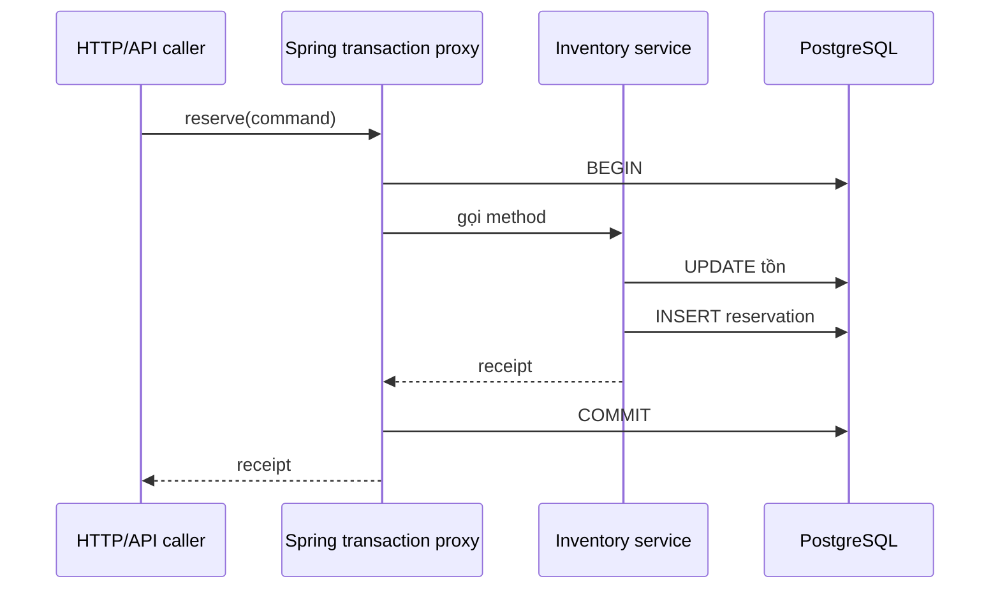
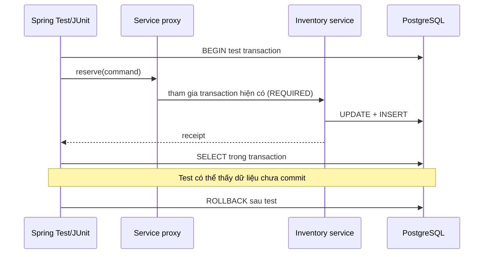
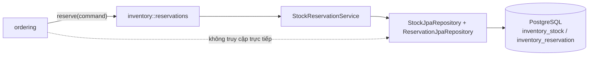

# Phân biệt transaction test với transaction production

Một bài `@ApplicationModuleTest` có `@Transactional` thường khiến dữ liệu được rollback khi test kết thúc. Điều đó tiện để giữ database sạch, nhưng có thể làm nhóm phát triển hiểu sai rằng đã kiểm chứng được **transaction của ứng dụng khi chạy production**. Chẳng hạn, phương thức đặt hàng ở production tự mở transaction rồi commit trước khi trả kết quả; trong test có `@Transactional`, chính phương thức đó có thể chỉ **tham gia transaction do Spring Test mở**, còn commit thực chưa bao giờ xảy ra. Một listener `AFTER_COMMIT` sẽ không chạy trong bài test rollback mặc định, dù sự kiện đã được publish trong transaction.

Ngược lại, một bài test không được bọc transaction có thể để lại dữ liệu đã commit; nếu không reset fixture, các bài test sau dễ thất bại ngẫu nhiên. Hiểu rõ hai loại transaction giúp chọn đúng **điểm quan sát**: khi nào cần dữ liệu được tự dọn, khi nào cần kiểm tra commit, khi nào cần kiểm tra rollback do lỗi và khi nào cần một bài integration test xuyên module.

Bài **“Phân biệt transaction test với transaction production”** thuộc chương **Database testing** của **SPRING_MODULITH_VERIFICATION_TESTING**. Chúng ta sẽ kết hợp `@ApplicationModuleTest`, `ApplicationModules.verify()`, kiểm thử sự kiện và database thật, rồi thiết kế quality gate CI để bắt hồi quy về giao dịch và phụ thuộc sai giữa các module.

> **Thông điệp cốt lõi:** Transaction do **Spring Test** quản lý phục vụ vòng đời kiểm thử; transaction do **ứng dụng** quản lý bảo vệ một đơn vị công việc nghiệp vụ. Chúng có thể tham gia cùng một physical transaction trong test, nhưng điều đó **không có nghĩa** ranh giới commit/rollback giống production.

## 1. Mục tiêu học tập

Sau bài này, bạn có thể:

1. Phân biệt **test-managed transaction**, **Spring-managed transaction của application service** và transaction do ứng dụng tự quản lý ở cấp JDBC/JPA.
2. Giải thích tác động của `@Transactional` ở **lớp test** lên một service `@Transactional(propagation = REQUIRED)`.
3. Nhận biết một test xanh nhưng **chưa từng kiểm tra commit thật**, flush thật hoặc callback `AFTER_COMMIT`.
4. Viết hai kiểu test bổ sung: **rollback để dọn dữ liệu** và **service tự commit/rollback theo ranh giới production**.
5. Đánh giá `REQUIRES_NEW`, `NOT_SUPPORTED`, `NESTED`, self-invocation, exception checked/unchecked và lời gọi khác thread.
6. Chọn fixture, transaction manager và database production-type phù hợp cho test Spring Modulith.
7. Kiểm chứng thao tác lưu aggregate và event consumer sau commit mà không đánh đồng publication với delivery.
8. Đưa architecture test, module test, database/concurrency và integration tests vào CI.

## 2. Ba tầng quản lý transaction

Cùng annotation `@Transactional` có thể xuất hiện ở nhiều vị trí, nhưng mục đích khác nhau:

| Tầng | Ai bắt đầu/kết thúc? | Phạm vi điển hình | Mục đích |
| --- | --- | --- | --- |
| **Test-managed** | Spring Test `TransactionalTestExecutionListener` | Phương thức test và các callback per-test phù hợp | Cô lập fixture, rollback sau test hoặc chủ động commit |
| **Spring-managed production** | Transaction interceptor/proxy khi gọi bean Spring | Một use case/service/repository được khai báo `@Transactional` | Bảo đảm tính nguyên tử của nghiệp vụ |
| **Programmatic/application-managed** | Code dùng `TransactionTemplate`, `PlatformTransactionManager`, `EntityTransaction` hoặc JDBC APIs | Đơn vị công việc do lập trình viên xác định | Chủ động kiểm soát transaction và thời điểm kết thúc |

**Chú ý từ ngữ:** “Spring-managed” không đối lập hoàn toàn với “test-managed” về hạ tầng: Spring Test cũng dùng `PlatformTransactionManager` để thao tác transaction. Điểm phân biệt là **ai quyết định ranh giới và thời điểm kết thúc**.

### 2.1. Test-managed transaction

Ví dụ:

```java
@ApplicationModuleTest
@Transactional
class InventoryTests {

    @Test
    void reserveStock() {
        // Code test và những lời gọi tham gia transaction hiện tại.
        // Spring Test rollback transaction mặc định sau test.
    }
}
```

Nếu Spring Test tìm được transaction manager phù hợp, nó bắt đầu transaction trước khi thực thi phần test thuộc phạm vi và rollback khi kết thúc, trừ khi được cấu hình khác. Đây là **chính sách của môi trường kiểm thử**, không phải bằng chứng rằng use case production đã tự commit.

### 2.2. Spring-managed production transaction

Ví dụ service:

```java
@Service
class StockReservationService {

    @Transactional
    public ReservationReceipt reserve(ReserveStock command) {
        // Cập nhật tồn và ghi phiếu giữ trong một đơn vị công việc.
        return doReserve(command);
    }
}
```

Khi một lời gọi đi qua Spring transactional proxy phù hợp, interceptor sẽ tham gia hoặc bắt đầu transaction tùy `Propagation`, rồi commit/rollback khi method kết thúc theo chính sách. Nếu caller **không** có transaction, `REQUIRED` mặc định thường mở một transaction mới; nếu caller **đã** có transaction tương thích, method thường tham gia transaction đó.

### 2.3. Programmatic transaction

Một service có thể dùng:

```java
TransactionTemplate template = new TransactionTemplate(transactionManager);

var result = template.execute(status -> {
    // Những thao tác tham gia transaction do template kiểm soát.
    return performBusinessWork();
});
```

`TransactionTemplate` có thể được dùng trong **production code** hoặc **test infrastructure**, nhưng test phải hiểu transaction manager nào được cấp và các thao tác có thực sự tham gia tài nguyên đó không. `TransactionTemplate.execute(...)` kết thúc transaction của chính scope đó; nếu thực tế nó chỉ **tham gia transaction ngoài** theo propagation, boundary commit vật lý vẫn có thể nằm ở caller.

## 3. Cùng một service, hai timeline khác nhau

Giả sử service `InventoryReservations.reserve(...)` có `@Transactional` mặc định.

### 3.1. Gọi ở production, không có transaction bên ngoài



Với lời gọi đồng bộ và transaction manager hợp lệ, điểm trả kết quả ở caller có thể xảy ra **sau khi proxy kết thúc commit**. Nếu lỗi phát sinh tại commit, caller có thể nhận exception thay vì receipt.

### 3.2. Gọi cùng service từ test có transaction bao ngoài



Điểm khác biệt quyết định: **service method đã trả về nhưng transaction vật lý chưa commit**. Nếu một assertion chỉ đọc dữ liệu trong cùng transaction rồi cho test kết thúc rollback, nó chứng minh **logic và trạng thái chưa commit**, không chứng minh production commit hoặc event sau commit đã chạy.

### 3.3. Một bảng so sánh hữu ích

| Đặc điểm | `@Transactional` trên test | Không `@Transactional` trên test, service tự quản lý |
| --- | --- | --- |
| Ai mở transaction ngoài cùng? | Spring Test | Service proxy (khi không có caller transaction) |
| Service `REQUIRED` làm gì? | Thường tham gia test transaction | Thường bắt đầu transaction tại service |
| Khi service trả về đã commit chưa? | **Chưa chắc; thường chưa** | **Thông thường đã kết thúc** transaction của service |
| Test kết thúc mặc định | Rollback | Không có rollback test-level để dọn |
| Assertion nhìn thấy dữ liệu chưa commit? | Có thể | Không nếu đã kết thúc transaction và đọc qua connection khác |
| `AFTER_COMMIT` của service có chạy? | Không nếu test transaction rollback | Có khi service transaction commit thành công |
| Phải dọn fixture đã commit? | Chủ yếu dữ liệu ngoài test transaction | **Có**, bằng cleanup/isolation có chủ đích |

## 4. Vì sao `@ApplicationModuleTest` không thay thế transaction test?

`@ApplicationModuleTest` kiểm soát **phạm vi Spring bean/application module** trong test, chứ không tự quyết định mọi transaction bắt đầu và kết thúc khi nào.

| Chú thích/cơ chế | Câu hỏi nó giải quyết |
| --- | --- |
| `@ApplicationModuleTest` | Bean của những module nào được khởi động để test? |
| `BootstrapMode.STANDALONE` | Chỉ test module hiện tại hay cần collaborator ngoài? |
| `BootstrapMode.DIRECT_DEPENDENCIES` | Có cần nạp các module phụ thuộc trực tiếp? |
| `@Transactional` trên test | Test có được Spring Test bọc transaction không? |
| `@Transactional` trên service | Use case có transaction policy gì khi được gọi qua Spring không? |
| `@Rollback`/`@Commit` | Transaction của test nên kết thúc bằng rollback hay commit? |
| `ApplicationModules.verify()` | Đồ thị dependency giữa các module có hợp lệ không? |

Trong Spring Modulith, Inventory có thể được kiểm thử riêng (`STANDALONE`) với PostgreSQL thật, còn Ordering có thể được kiểm thử cùng Inventory (`DIRECT_DEPENDENCIES`). **Cả hai** vẫn phải lựa chọn test-managed transaction hoặc production-style transaction tùy điều cần chứng minh.

### 4.1. Một ngộ nhận phổ biến

> “Test dùng `@ApplicationModuleTest` và `@Transactional`, do đó vừa xác nhận module đúng ranh giới, vừa xác nhận transaction production.”

Phát biểu này **quá mức**. `@ApplicationModuleTest` không tự kiểm chứng dependency của toàn ứng dụng thay `ApplicationModules.verify()`, còn transaction test-level có thể che điểm commit thực của service. Cần test **khác nhau** cho kiến trúc, hành vi module và transaction production.

## 5. Ví dụ xuyên suốt: giữ hàng trong Inventory

Ứng dụng bán hàng gồm:

```text
com/example/shop/
├── ShopApplication.java
├── inventory/
│   ├── reservations/
│   │   ├── package-info.java
│   │   ├── ReserveStock.java
│   │   ├── ReservationReceipt.java
│   │   └── InventoryReservations.java
│   └── internal/
│       ├── StockReservationService.java
│       └── persistence/
│           ├── StockRow.java
│           ├── StockJpaRepository.java
│           ├── ReservationRow.java
│           └── ReservationJpaRepository.java
├── ordering/
│   ├── package-info.java
│   └── internal/PlaceOrderService.java
└── billing/
    ├── package-info.java
    └── internal/OrderPlacedListener.java
```

`inventory` sở hữu invariant: **không trừ tồn khả dụng quá số lượng còn lại**, và nếu phiếu giữ không được ghi thì việc trừ tồn phải được rollback. `ordering` chỉ được gọi API công khai của Inventory.



### 5.1. Lược đồ PostgreSQL

Ví dụ migration trong `src/main/resources/db/migration`:

```sql
CREATE TABLE inventory_stock (
    sku VARCHAR(80) PRIMARY KEY,
    available INTEGER NOT NULL,
    CONSTRAINT ck_stock_nonnegative CHECK (available >= 0)
);

CREATE TABLE inventory_reservation (
    reservation_id UUID PRIMARY KEY,
    request_id UUID NOT NULL UNIQUE,
    sku VARCHAR(80) NOT NULL REFERENCES inventory_stock(sku),
    quantity INTEGER NOT NULL CHECK (quantity > 0)
);
```

Đây là lược đồ rút gọn để dạy transaction. Production có thể cần `status`, `expires_at`, lệnh nhả hàng, ledger, khóa/idempotency và cách xử lý concurrency phù hợp. `request_id UNIQUE` giúp tránh ghi hai reservation với cùng ID, **không tự định nghĩa** cách ứng dụng trả kết quả khi một request được retry.

### 5.2. API công khai

Trong `inventory/reservations/package-info.java`:

```java
@org.springframework.modulith.NamedInterface("reservations")
package com.example.shop.inventory.reservations;
```

```java
// inventory/reservations/ReserveStock.java
package com.example.shop.inventory.reservations;

import java.util.UUID;

public record ReserveStock(String sku, int quantity, UUID requestId) {
    public ReserveStock {
        if (sku == null || sku.isBlank() ||
            quantity <= 0 || requestId == null) {
            throw new IllegalArgumentException("Yêu cầu giữ hàng không hợp lệ");
        }
    }
}
```

```java
// inventory/reservations/ReservationReceipt.java
package com.example.shop.inventory.reservations;

import java.util.UUID;

public record ReservationReceipt(UUID reservationId) {}
```

```java
// inventory/reservations/InventoryReservations.java
package com.example.shop.inventory.reservations;

public interface InventoryReservations {
    ReservationReceipt reserve(ReserveStock command);
}
```

Consumer chỉ cần những kiểu trên, không biết entity/repository/migration của Inventory.

## 6. Một service production có ranh giới transaction rõ

Repository dùng cập nhật có điều kiện:

```java
// inventory/internal/persistence/StockJpaRepository.java
package com.example.shop.inventory.internal.persistence;

import org.springframework.data.jpa.repository.JpaRepository;
import org.springframework.data.jpa.repository.Modifying;
import org.springframework.data.jpa.repository.Query;
import org.springframework.data.repository.query.Param;

public interface StockJpaRepository extends JpaRepository<StockRow, String> {

    @Modifying
    @Query(value = """
        UPDATE inventory_stock
        SET available = available - :qty
        WHERE sku = :sku AND available >= :qty
        """, nativeQuery = true)
    int decrementIfAvailable(
        @Param("sku") String sku,
        @Param("qty") int quantity
    );
}
```

`StockRow` là entity JPA nội bộ với khóa `sku`, trường `available` map đúng bảng `inventory_stock`; cần triển khai khi đưa code vào dự án.

Một entity reservation tối giản:

```java
// inventory/internal/persistence/ReservationRow.java
package com.example.shop.inventory.internal.persistence;

import jakarta.persistence.Column;
import jakarta.persistence.Entity;
import jakarta.persistence.Id;
import jakarta.persistence.Table;
import java.util.UUID;

@Entity
@Table(name = "inventory_reservation")
public class ReservationRow {

    @Id
    @Column(name = "reservation_id")
    private UUID id;

    @Column(name = "request_id", nullable = false, unique = true)
    private UUID requestId;

    @Column(name = "sku", nullable = false)
    private String sku;

    @Column(name = "quantity", nullable = false)
    private int quantity;

    protected ReservationRow() {}

    public ReservationRow(
        UUID id, UUID requestId, String sku, int quantity
    ) {
        this.id = id;
        this.requestId = requestId;
        this.sku = sku;
        this.quantity = quantity;
    }

    public UUID getId() { return id; }
}
```

```java
// inventory/internal/persistence/ReservationJpaRepository.java
package com.example.shop.inventory.internal.persistence;

import java.util.UUID;
import org.springframework.data.jpa.repository.JpaRepository;

public interface ReservationJpaRepository
        extends JpaRepository<ReservationRow, UUID> {}
```

Service:

```java
// inventory/internal/StockReservationService.java
package com.example.shop.inventory.internal;

import com.example.shop.inventory.internal.persistence.ReservationJpaRepository;
import com.example.shop.inventory.internal.persistence.ReservationRow;
import com.example.shop.inventory.internal.persistence.StockJpaRepository;
import com.example.shop.inventory.reservations.InventoryReservations;
import com.example.shop.inventory.reservations.ReservationReceipt;
import com.example.shop.inventory.reservations.ReserveStock;
import java.util.UUID;
import org.springframework.stereotype.Service;
import org.springframework.transaction.annotation.Transactional;

@Service
class StockReservationService implements InventoryReservations {

    private final StockJpaRepository stocks;
    private final ReservationJpaRepository reservations;

    StockReservationService(
        StockJpaRepository stocks,
        ReservationJpaRepository reservations
    ) {
        this.stocks = stocks;
        this.reservations = reservations;
    }

    @Override
    @Transactional
    public ReservationReceipt reserve(ReserveStock command) {
        int affected = stocks.decrementIfAvailable(
            command.sku(), command.quantity()
        );

        if (affected != 1) {
            throw new IllegalStateException("Không đủ tồn hoặc SKU không tồn tại");
        }

        UUID id = UUID.randomUUID();
        reservations.saveAndFlush(
            new ReservationRow(
                id, command.requestId(),
                command.sku(), command.quantity()
            )
        );

        return new ReservationReceipt(id);
    }
}
```

Trong ví dụ:

- `@Transactional` được đặt trên **method service của module sở hữu dữ liệu**.
- Câu `UPDATE` có điều kiện tránh mẫu read-then-write không an toàn đơn giản.
- `saveAndFlush` gửi INSERT sớm hơn để lộ một số lỗi constraint ngay trong method, nhưng **không phải commit**.
- Nếu INSERT thất bại với exception phù hợp rollback, cả việc trừ tồn cũng phải rollback khi cùng một transaction.
- Khi service được gọi qua Spring proxy từ một caller **không có transaction**, commit thường xảy ra trước khi proxy trả kết quả cho caller.

Đoạn code minh họa và chưa triển khai idempotent retry, phiếu giữ có thời hạn, event publication hoặc phân biệt toàn bộ lỗi nghiệp vụ. Dù vậy nó đủ để thấy **test-managed transaction có thể thay đổi boundary quan sát**.

## 7. Cách A: test dùng transaction để cô lập fixture

Bài test dưới đây **cố tình** đặt `@Transactional` trên lớp test:

```java
package com.example.shop.inventory;

import static org.assertj.core.api.Assertions.assertThat;

import com.example.shop.inventory.reservations.InventoryReservations;
import com.example.shop.inventory.reservations.ReserveStock;
import java.util.UUID;
import org.junit.jupiter.api.Test;
import org.springframework.beans.factory.annotation.Autowired;
import org.springframework.jdbc.core.JdbcTemplate;
import org.springframework.modulith.test.ApplicationModuleTest;
import org.springframework.test.context.jdbc.Sql;
import org.springframework.transaction.annotation.Transactional;

@ApplicationModuleTest
@Transactional
@Sql(
    scripts = "/fixtures/inventory/stock-five.sql",
    executionPhase = Sql.ExecutionPhase.BEFORE_TEST_METHOD
)
class InventoryTransactionalFixtureTests {

    @Autowired InventoryReservations inventory;
    @Autowired JdbcTemplate jdbc;

    @Test
    void reservesStockInsideTestTransaction() {
        inventory.reserve(
            new ReserveStock("SKU-TEST", 2, UUID.randomUUID())
        );

        Integer available = jdbc.queryForObject(
            "SELECT available FROM inventory_stock WHERE sku = ?",
            Integer.class, "SKU-TEST"
        );
        assertThat(available).isEqualTo(3);
    }
}
```

Fixture SQL giả định:

```sql
-- src/test/resources/fixtures/inventory/stock-five.sql
INSERT INTO inventory_stock(sku, available)
VALUES ('SKU-TEST', 5);
```

**Điều kiện:** Database test cần có migration và không có bản ghi `SKU-TEST` cũ; script `@Sql` tham gia transaction của test theo cấu hình mặc định phù hợp. Nếu test thành công, Spring Test **thường rollback cả fixture lẫn thay đổi của service** ở cuối.

### 7.1. Bài test này chứng minh được gì?

Nó cung cấp tín hiệu rằng:

1. Bean `InventoryReservations` có thể được wire trong phạm vi module test.
2. Trong một transaction có dữ liệu đầu vào hợp lệ, lệnh `reserve` cập nhật tồn như mong đợi.
3. Dữ liệu trong transaction được nhìn thấy qua query sau lời gọi.
4. Transaction do test quản lý có thể dùng để dọn thay đổi ở cuối.

### 7.2. Bài test này **chưa** chứng minh được gì?

Nó không chứng minh:

- Service tự mở transaction đúng khi **không có transaction ngoài**.
- Commit thực sự thành công trên PostgreSQL.
- Một listener `@TransactionalEventListener(AFTER_COMMIT)` đã chạy.
- Lỗi xảy ra tại thời điểm commit được xử lý đúng.
- Transaction khác/thread khác nhìn thấy đúng dữ liệu đã commit.
- Một `REQUIRES_NEW` bên trong hoặc side effect bên ngoài database đã được rollback.

**Không đổi tên bài này thành `productionTransactionCommitsCorrectly`** chỉ vì đã dùng database thật.

### 7.3. `@Rollback` mặc định không làm nên transaction mới

Spring Test thường rollback **test-managed transaction** theo mặc định. `@Rollback` hoặc `@Rollback(true)` làm rõ chính sách; `@Commit` hoặc `@Rollback(false)` yêu cầu commit ở cuối test. Tuy nhiên, những annotation đó **không tự tạo** một test-managed transaction khi test chưa có `@Transactional`/cấu hình phù hợp.

## 8. Cách B: test transaction production thực sự commit

Để kiểm tra service tự commit theo đường production, hãy **không** bọc method test trong `@Transactional`.

```java
package com.example.shop.inventory;

import static org.assertj.core.api.Assertions.assertThat;

import com.example.shop.inventory.reservations.InventoryReservations;
import com.example.shop.inventory.reservations.ReserveStock;
import java.util.UUID;
import org.junit.jupiter.api.Test;
import org.springframework.beans.factory.annotation.Autowired;
import org.springframework.jdbc.core.JdbcTemplate;
import org.springframework.modulith.test.ApplicationModuleTest;
import org.springframework.test.context.jdbc.Sql;

@ApplicationModuleTest
@Sql(
    scripts = "/fixtures/inventory/reset-and-seed.sql",
    executionPhase = Sql.ExecutionPhase.BEFORE_TEST_METHOD
)
class InventoryProductionTransactionTests {

    @Autowired InventoryReservations inventory;
    @Autowired JdbcTemplate jdbc;

    @Test
    void successfulReserveCommitsBeforeTheCallerObservesState() {
        UUID requestId = UUID.randomUUID();

        var receipt = inventory.reserve(
            new ReserveStock("SKU-TEST", 2, requestId)
        );

        assertThat(available("SKU-TEST")).isEqualTo(3);
        assertThat(reservationCount(requestId)).isEqualTo(1);
        assertThat(receipt.reservationId()).isNotNull();
    }

    private int available(String sku) {
        return jdbc.queryForObject(
            "SELECT available FROM inventory_stock WHERE sku = ?",
            Integer.class, sku
        );
    }

    private int reservationCount(UUID requestId) {
        return jdbc.queryForObject(
            "SELECT count(*) FROM inventory_reservation WHERE request_id = ?",
            Integer.class, requestId
        );
    }
}
```

Ví dụ fixture:

```sql
-- src/test/resources/fixtures/inventory/reset-and-seed.sql
-- Chỉ dùng trên database/schema test riêng và khi test không chạy song song.
DELETE FROM inventory_reservation;
DELETE FROM inventory_stock;
INSERT INTO inventory_stock(sku, available)
VALUES ('SKU-TEST', 5);
```

Ở ví dụ này, nếu test không có transaction bao ngoài và service là Spring bean proxied đúng, lời gọi `inventory.reserve(...)` tự có transaction production-style. Sau khi nó trả về, `JdbcTemplate` truy vấn dữ liệu từ một scope mới. Như vậy ta có bằng chứng **mạnh hơn** rằng state đã commit, thay vì chỉ nhìn thấy state chưa commit trong transaction của test.

### 8.1. Đừng vô tình tạo false positive

Kiểm tra các giả định:

- `InventoryReservations` được inject từ Spring context, không phải `new StockReservationService(...)`.
- Bean thật có transactional advice, không phải mock hoặc proxy bị thay thế bởi test double.
- `@Transactional` của service có hiệu lực qua đường gọi hiện tại.
- Không có `@Transactional` trên lớp test hoặc một scope bao ngoài khác làm service chỉ tham gia transaction có sẵn.
- `JdbcTemplate` đang truy vấn **cùng database** nhưng ngoài transaction vừa kết thúc.
- Fixture được tạo trước hành động, không được nạp sẵn reservation mà test muốn chứng minh.

### 8.2. Cleanup trở thành trách nhiệm của test

Trong test không có rollback tự động, hàng tồn và reservation **đã commit**. Phải dùng chiến lược reset:

| Chiến lược | Khi phù hợp | Điều cần kiểm soát |
| --- | --- | --- |
| `@Sql` reset trước mỗi test | Suite tuần tự, test database cô lập | Không xóa dữ liệu của test chạy song song |
| Cleanup `@Sql` sau mỗi test | Muốn database sạch sau test | Thứ tự FK và transaction mode |
| Mỗi suite có schema/database mới | Kiểm tra commit và migration | Chi phí khởi động/tài nguyên |
| Namespace SKU/request ID riêng | Suite chia sẻ database | Tránh collision, cleanup theo key cụ thể |
| Container riêng cho nhóm test | Integration/concurrency lớn | Container lifecycle, migration, quota CI |

`@DirtiesContext` **không phải lệnh dọn bảng**: nó tác động đến Spring context cache, không mặc nhiên xóa dữ liệu đã commit trong database còn tồn tại.

## 9. Kiểm tra rollback **của service**, không phải rollback **của test**

Một test `@Transactional` cuối cùng rollback dữ liệu có thể xanh dù service production không tự rollback đúng khi lỗi. Để kiểm tra trách nhiệm transaction của service, tạo ca lỗi **sau bước trừ tồn, trước khi hoàn tất ghi reservation**, sau đó đọc state ngoài transaction.

### 9.1. Tiền điều kiện và kết quả

```text
Trước use case:
    inventory_stock('SKU-TEST').available = 5
    không có reservation cho request R

Trong Inventory.reserve(R, qty=2):
    UPDATE tồn: 5 → 3
    INSERT reservation: cố ý lỗi
    → Transaction phải rollback

Sau use case thất bại:
    inventory_stock.available = 5
    không có reservation mới không hợp lệ
```

Với schema có `request_id UNIQUE`, một test có thể tạo xung đột unique có chủ đích. Nhưng nếu implementation production đã **idempotent đúng** khi gặp request lặp, lỗi unique có thể không phát sinh; lúc đó cần một điểm gây lỗi phù hợp, không thay đổi hợp đồng nghiệp vụ chỉ để test dễ hơn.

### 9.2. Khung test có lỗi sau update

```java
@ApplicationModuleTest
class InventoryFailureTransactionTests {

    @Autowired InventoryReservations inventory;
    @Autowired JdbcTemplate jdbc;

    @Test
    void failureDuringReservationInsertRollsBackStockDecrement() {
        // Arrange: fixture đã commit, tồn 5, chọn tình huống
        // khiến bước INSERT reservation lỗi sau UPDATE.

        // Act: gọi service thật qua interface Spring bean.
        // assertThatThrownBy(() -> inventory.reserve(command))
        //     .isInstanceOf(...);

        // Assert: sau khi transaction của service kết thúc,
        // SELECT từ database thấy available=5 và không có row mới.
    }
}
```

Đây là **khung định hướng**, chưa phải một test có assertion thực thi: dự án phải cung cấp setup lỗi nhất quán, exception dự kiến và các query assert. Phân biệt rõ tình huống lỗi **trước** khi trừ tồn (dễ dàng giữ state nguyên) với lỗi **sau** khi trừ tồn (mới kiểm chứng rollback nhiều bước).

### 9.3. Có thể dùng constraint để làm lỗi lặp được

Trong một kịch bản đơn giản chưa hỗ trợ idempotent replay, có thể:

1. Seed một reservation cũ có `request_id=R` và `sku='SKU-OTHER'`.
2. Seed `SKU-TEST` còn tồn `5`.
3. Gọi `reserve("SKU-TEST", 2, R)`.
4. Code thực hiện `UPDATE` thành `3`, sau đó INSERT reservation với `request_id=R` bị database từ chối.
5. Assert transaction rollback, `SKU-TEST` trở lại `5`, reservation cũ không đổi.

Kịch bản này kiểm chứng transaction theo **implementation minh họa**, không nên áp dụng mù quáng khi service có policy trả lại kết quả cho request lặp. Với những constraint bị hoãn đến commit, exception có thể chỉ xuất hiện khi proxy kết thúc transaction — đó là lý do test cần để service commit/rollback thật.

## 10. `save`, `flush` và `commit` khác nhau thế nào?

Với Spring Data JPA, ba thao tác thường bị đánh đồng:

| Thao tác | Ý nghĩa | Có bảo đảm commit? |
| --- | --- | --- |
| `repository.save(entity)` | Yêu cầu persistence context quản lý/lưu entity | **Không** |
| `entityManager.flush()` hoặc `saveAndFlush(...)` | Đẩy các thay đổi đang pending tới database trong transaction | **Không** |
| Transaction commit | Kết thúc thành công transaction, xác nhận thay đổi bền vững theo database | **Có**, nếu commit thực sự thành công |

### 10.1. Test chỉ nhìn managed entity chưa đủ

```java
reservation.setQuantity(2);
repository.save(reservation);

assertThat(reservation.getQuantity()).isEqualTo(2);
```

Đoạn assert này rất yếu: nó có thể đúng chỉ vì object Java vừa được sửa. Ngay cả truy vấn qua repository trong cùng persistence context cũng có thể lấy lại entity managed thay vì đọc trạng thái mới từ database.

Để kiểm chứng durable state:

1. Gọi use case từ test không có transaction bao ngoài.
2. Chờ lời gọi transactional hoàn tất và proxy trả kết quả.
3. Đọc bằng `JdbcTemplate`, connection hoặc persistence context mới.
4. Assert các hàng/constraint thật.

### 10.2. Lỗi khi flush khác lỗi khi commit

Một constraint PostgreSQL thông thường có thể lỗi ngay khi INSERT/UPDATE hoặc flush. Một ràng buộc **deferrable** được hoãn kiểm tra có thể lỗi tại commit. Một số flush xảy ra tự động trước query hoặc khi transaction kết thúc.

Vì vậy, test có `saveAndFlush()` và assertion trong cùng test transaction **vẫn chưa chứng minh được commit production**, đặc biệt với constraint/trigger cần kiểm chứng ở thời điểm kết thúc.

### 10.3. Exception PostgreSQL khiến transaction bị aborted

Khi một câu SQL lỗi trong transaction PostgreSQL, transaction hiện hành thường rơi vào trạng thái không thể tiếp tục bình thường cho tới khi rollback. Bài test không nên:

```java
// Phản mẫu: sau khi SQL lỗi trong cùng transaction,
// tiếp tục SELECT trong transaction aborted.
assertThatThrownBy(() -> jdbc.update("... SQL lỗi ..."));
assertThat(jdbc.queryForObject("SELECT ...", Integer.class)).isEqualTo(5);
```

Hãy để transaction lỗi **kết thúc/rollback**, rồi truy vấn bằng transaction mới. Điều này cũng giúp phân biệt “lỗi đã được ném” với “dữ liệu được giữ nguyên sau rollback”.

## 11. Spring AOP: method có `@Transactional` chưa chắc được intercept

Trong chế độ proxy-based transaction management thông thường, `@Transactional` được áp dụng khi lời gọi **đi qua Spring proxy thích hợp**. Một số lỗi rất dễ bị che bởi test-managed transaction:

### 11.1. Self-invocation

```java
@Service
class ReservationWorkflow {

    public void reserve() {
        this.saveReservation(); // Gọi trực tiếp trong cùng object.
    }

    @Transactional
    public void saveReservation() {
        // Có thể KHÔNG được proxy intercept khi gọi qua this.
    }
}
```

Nếu test có `@Transactional`, code trong `saveReservation()` vẫn có thể chạy **bên trong test transaction** và test xanh. Nhưng khi production gọi `reserve()` từ ngoài, lời gọi `this.saveReservation()` không qua proxy, transaction mong đợi tại method con có thể không được mở.

**Cách sửa theo thiết kế:** đặt transaction tại boundary method public thực sự được gọi qua proxy, hoặc tách phần transactional sang một bean khác được inject. Không dùng test transaction để che một ranh giới proxy bị bỏ qua.

### 11.2. Private/final method và kiểu proxy

Không suy rằng mọi method có annotation đều được proxy xử lý. Khả năng intercept phụ thuộc chế độ proxy, mức truy cập, class final, loại proxy JDK/CGLIB và cấu hình. Trong một dự án thực, nên ưu tiên **API service public, được gọi qua Spring bean**, và kiểm tra cấu hình cụ thể khi có ngoại lệ.

### 11.3. Tự `new` service

```java
// Không đi qua Spring bean/proxy.
var service = new StockReservationService(stocks, reservations);
service.reserve(command);
```

Code này có thể kiểm thử logic thuần khi dependencies được thay bằng test double, nhưng **không** là bằng chứng transaction annotation hoạt động. Khi muốn test transaction, inject bean từ Spring context.

### 11.4. Dấu hiệu nghi ngờ

- `@Transactional` đặt trên method được gọi bằng `this.method()`.
- Dùng `new` để tạo service trong integration test.
- Annotate một helper private rồi kỳ vọng transaction riêng.
- Lớp test `@Transactional` che việc service không có proxy.
- Chỉ assert state ở trong cùng transaction, không có test production-style.

## 12. `Propagation`: một annotation, nhiều hành vi

Spring `@Transactional` mặc định có `Propagation.REQUIRED`, nhưng policy có thể khác:

| Propagation | Khi có transaction ngoài | Ý nghĩa với test-managed transaction |
| --- | --- | --- |
| `REQUIRED` | Tham gia transaction hiện tại | Service thường tham gia test transaction và chưa tự commit |
| `REQUIRES_NEW` | Tạm dừng transaction ngoài và mở transaction mới | Có thể commit độc lập, dữ liệu còn sau rollback test |
| `SUPPORTS` | Tham gia nếu có; nếu không có thì không tự mở | Test có transaction có thể che production chạy ngoài transaction |
| `MANDATORY` | Bắt buộc có transaction đang hoạt động | Test có transaction làm lời gọi thành công dù production caller không có sẽ lỗi |
| `NOT_SUPPORTED` | Tạm dừng transaction ngoài, chạy ngoài transaction | Thao tác có thể escape rollback của test |
| `NEVER` | Báo lỗi nếu có transaction | Test `@Transactional` có thể thất bại dù production gọi không transaction thì hợp lệ |
| `NESTED` | Dùng nested scope/savepoint nếu manager/resource hỗ trợ | Không giống physical transaction độc lập của `REQUIRES_NEW` |

### 12.1. Một test `@Transactional` có thể che lỗi `MANDATORY`

```java
@Transactional(propagation = Propagation.MANDATORY)
public void finalizeReservation() {
    // Đòi hỏi caller đã tạo transaction.
}
```

Nếu test có transaction ngoài, method chạy thành công. Nhưng một production caller không có transaction sẽ nhận lỗi. Vì vậy phải test cả **hợp đồng caller**: hệ thống có thật sự bảo đảm `finalizeReservation()` luôn được gọi bên trong transaction không?

### 12.2. `SUPPORTS` cũng dễ tạo cảm giác sai

Một method `SUPPORTS` có thể chạy trong transaction do test mở, nhưng khi production gọi độc lập thì nó không tự mở transaction. Nếu use case cần thay đổi nhiều hàng nguyên tử, cần đánh giá lại propagation và viết test production-style.

### 12.3. Đừng dùng propagation của test để mô phỏng production

Spring Test chỉ hỗ trợ một tập semantics `@Transactional` ở cấp test; ví dụ `NOT_SUPPORTED` và `NEVER` có thể làm test **không** được chạy trong test-managed transaction. Nhiều thuộc tính như timeout, isolation hay propagation nâng cao **không nên được kỳ vọng áp dụng như khi đặt trên service** chỉ bằng cách chuyển annotation sang test.

Để kiểm chứng `REQUIRES_NEW` hoặc `NESTED`, hãy đặt policy trên **Spring bean production** và gọi nó theo đúng luồng cần kiểm tra.

## 13. `REQUIRES_NEW`: rollback test có thể để sót dữ liệu

Giả sử hệ thống lưu audit trong transaction riêng:

```java
@Service
class AuditService {

    @Transactional(propagation = Propagation.REQUIRES_NEW)
    public void recordAttempt(UUID requestId, String outcome) {
        // Ghi vào audit_entry, dùng repository thuộc module sở hữu.
    }
}
```

Nếu test có `@Transactional` và gọi một workflow dẫn đến `AuditService.recordAttempt(...)` qua proxy, audit transaction có thể **commit trước khi transaction của test rollback**.

```text
Test transaction T0 bắt đầu
    Inventory workflow gọi audit
        T0 bị tạm dừng
        Audit mở T1 (REQUIRES_NEW)
        INSERT audit_entry
        COMMIT T1
        tiếp tục T0
    Test kết thúc và ROLLBACK T0

Kết quả:
    thay đổi thuộc T0 được rollback
    audit thuộc T1 có thể vẫn còn
```

### 13.1. Khi nào đây là hành vi đúng?

Một audit “đã thử thao tác dù cuối cùng thất bại” có thể **cố ý** được lưu độc lập. Ngược lại, phiếu giữ hàng phải rollback cùng việc trừ tồn; nếu một phần quy trình giữ hàng dùng `REQUIRES_NEW` vô tình, có thể để lại reservation mồ côi.

**Hãy hỏi theo nghiệp vụ:** dữ liệu nào phải tồn tại sau khi use case thất bại? Trả lời đó mới quyết định `REQUIRES_NEW` đúng hay sai, không phải mục tiêu dọn test cho dễ.

### 13.2. Lưu ý khi test với PostgreSQL

- `REQUIRES_NEW` có thể cần **connection khác** trong lúc transaction ngoài vẫn giữ connection.
- Connection pool phải đủ dung lượng; nếu nhiều thread cùng giữ T0 và mở T1, pool cạn có thể gây timeout.
- Nếu transaction ngoài giữ lock trên hàng mà transaction mới cần, hai transaction có thể tự chặn nhau.
- Fixture được insert nhưng chưa commit ở T0 có thể **không nhìn thấy** từ T1.
- Rollback T0 không dọn những hàng T1 đã commit.

Một bài test tốt phải seed dữ liệu nền **đã commit** trước kịch bản `REQUIRES_NEW`, kiểm tra dữ liệu còn lại sau rollback ngoài, và cleanup bằng một transaction riêng.

### 13.3. `NESTED` khác `REQUIRES_NEW`

Khi transaction manager/resource hỗ trợ savepoint, `NESTED` cho phép rollback một phần về savepoint nhưng thường vẫn thuộc **cùng physical transaction** với transaction ngoài. Nếu transaction ngoài rollback, thay đổi nested cũng không được commit bền vững. Không được giả định JPA transaction manager và mọi driver đều hỗ trợ nested semantics giống JDBC savepoint; cần kiểm tra cấu hình đang dùng.

## 14. Exception và quy tắc rollback của production

Theo mặc định Spring transaction management thường rollback khi có **unchecked exception (`RuntimeException`) hoặc `Error`**, còn checked exception không tự kích hoạt rollback nếu không cấu hình.

### 14.1. Ví dụ checked exception có thể vẫn commit

```java
class ReservationReviewRequired extends Exception {
    ReservationReviewRequired(String message) {
        super(message);
    }
}

@Transactional
public void reserveWithReview() throws ReservationReviewRequired {
    repository.updateSomething();
    throw new ReservationReviewRequired("Cần người kiểm duyệt");
}
```

Nếu không có rollback rule khác, transaction có thể **commit thay đổi** mặc dù method ném checked exception. Nếu nghiệp vụ yêu cầu toàn bộ thao tác rollback, khai báo:

```java
@Transactional(rollbackFor = ReservationReviewRequired.class)
public void reserveWithReview() throws ReservationReviewRequired {
    repository.updateSomething();
    throw new ReservationReviewRequired("Cần người kiểm duyệt");
}
```

Đây là **trích đoạn phương thức**, không phải lớp hoàn chỉnh; `repository` đại diện collaborator được inject. Với phiên bản/cấu hình transaction có default rollback policy khác, phải kiểm tra rule thực tế của dự án.

### 14.2. Catch exception có thể đổi kết quả transaction

```java
@Transactional
public ReservationReceipt reserve(ReserveStock command) {
    try {
        repository.doWork();
    } catch (BusinessException ex) {
        return fallbackReceipt();
    }
    return normalReceipt();
}
```

Nếu exception bị bắt và method trả về bình thường, transaction interceptor có thể cố commit, trừ khi transaction đã bị đánh dấu rollback-only bởi tầng khác hoặc code chủ động đánh dấu rollback. Với JPA/database exception, transaction có thể đã bị đánh dấu rollback-only, dẫn đến `UnexpectedRollbackException` khi interceptor cố commit.

Không viết test chỉ assert `fallbackReceipt()` rồi kết luận database chắc chắn rollback. Hãy đọc DB **sau ranh giới transaction** và xác nhận kết quả được thiết kế.

### 14.3. Bài test nên phân biệt

| Kịch bản | Chính sách kỳ vọng | Test |
| --- | --- | --- |
| `RuntimeException` thoát khỏi service | Thường rollback | Assert DB không đổi sau call lỗi |
| Checked exception không có rollback rule | Có thể commit theo mặc định | Assert state theo policy, không suy đoán |
| `rollbackFor` được khai báo | Rollback theo rule | Trigger checked exception, đọc DB sau kết thúc |
| Exception bị bắt trong service | Có thể vẫn commit hoặc rollback-only | Assert kết quả service và state DB |
| Constraint violation tại commit | Proxy ném exception trước khi trả caller | Gọi service production-style, không chỉ flush trong test transaction |

## 15. `@BeforeTransaction`, `@AfterTransaction` và `@Sql`

Khi dùng test-managed transaction, **thời điểm tạo fixture** quyết định dữ liệu nào được rollback.

### 15.1. Callback per-test và callback ngoài transaction

Với JUnit Jupiter + Spring Test:

- `@BeforeEach` và `@AfterEach` của một transactional test thường chạy **trong** test-managed transaction.
- `@BeforeAll`/`@AfterAll` không mặc nhiên thuộc transaction của từng phương thức.
- `@BeforeTransaction` chạy **trước khi** test-managed transaction bắt đầu.
- `@AfterTransaction` chạy **sau khi** test-managed transaction kết thúc.

Ví dụ khung:

```java
@ApplicationModuleTest
@Transactional
class InventoryTransactionLifecycleTests {

    @BeforeTransaction
    void seedCommittedBaseline() {
        // Seed đã commit để có thể quan sát sau rollback.
    }

    @Test
    void workInsideTestTransaction() {
        // Có thể thấy thay đổi chưa commit.
    }

    @AfterTransaction
    void checkRollbackThenCleanup() {
        // Đọc state sau rollback rồi cleanup fixture đã commit.
    }
}
```

Nếu seed trong `@BeforeEach` rồi rollback, cả fixture cũng có thể bị xóa. Khi đó `@AfterTransaction` không nên kỳ vọng bản ghi seed còn tồn tại. Đây là khác biệt giữa **fixture đã commit ngoài transaction** và **fixture tạm nằm trong transaction của test**.

### 15.2. `@Sql` và transaction mode

```java
@Sql(
    scripts = "/fixtures/inventory/stock-five.sql",
    executionPhase = Sql.ExecutionPhase.BEFORE_TEST_METHOD
)
```

Khi Spring Test có transaction manager phù hợp và test đang transactional, script có thể tham gia transaction hiện tại. Với `ISOLATED`:

```java
@Sql(
    scripts = "/fixtures/inventory/stock-five.sql",
    config = @SqlConfig(
        transactionMode = SqlConfig.TransactionMode.ISOLATED
    ),
    executionPhase = Sql.ExecutionPhase.BEFORE_TEST_METHOD
)
```

Script được yêu cầu thực thi trong **transaction độc lập và commit**, hữu ích khi thread khác cần thấy fixture. Nhưng rollback test sau đó **không** xóa fixture đã commit. Phải có cleanup sau test hoặc database/schema riêng.

### 15.3. Không dọn sạch database bằng `TRUNCATE` vô điều kiện

Nếu CI chạy test song song, `DELETE FROM inventory_stock` hoặc `TRUNCATE ... CASCADE` có thể phá dữ liệu của test khác. Chọn:

- Database/schema riêng cho suite cần commit thật.
- SKU/request ID duy nhất cho mỗi test và cleanup theo key.
- `@Sql` reset toàn bảng **chỉ** khi suite dùng database chuyên dụng, chạy tuần tự và hiểu quan hệ FK.
- Fixture bất biến, deterministic, không dựa vào dữ liệu từ lần chạy trước.

## 16. `TestTransaction`: điều khiển transaction của test khi cần

Spring Test cung cấp `TestTransaction` để chủ động kết thúc và bắt đầu **test-managed transaction** trong một test đã được cấu hình transactional.

### 16.1. Commit ở giữa test

```java
@ApplicationModuleTest
@Transactional
class ExplicitCommitTests {

    @Test
    void canObserveAfterCommit() {
        // Arrange/Act trong test-managed transaction.
        inventory.reserve(command);

        TestTransaction.flagForCommit();
        TestTransaction.end();  // Commit test transaction hiện tại.

        // Quan sát DB ngoài transaction vừa kết thúc.
        assertThat(readCommittedState()).isEqualTo(expectedState);

        // Đã commit; phải cleanup bằng chiến lược riêng.
    }
}
```

Các biến `inventory`, `command`, `expectedState` và helper là **placeholder** cho test hoàn chỉnh; cần import `org.springframework.test.context.transaction.TestTransaction` và cấu hình Spring Test transactional. `TestTransaction.end()` kết thúc transaction theo cờ đã đặt. Không thể mong rollback cuối test hoàn tác phần đã commit.

### 16.2. Tạo transaction test mới

```java
assertThat(TestTransaction.isActive()).isTrue();

TestTransaction.flagForCommit();
TestTransaction.end();
assertThat(TestTransaction.isActive()).isFalse();

// Đọc kết quả sau commit.

TestTransaction.start();
// Transaction test mới có thể rollback mặc định khi kết thúc.
```

`flagForRollback()` có thể dùng khi muốn chủ động rollback transaction hiện tại. Tuy nhiên, **không cần dùng TestTransaction cho mọi test**: bài kiểm chứng production boundary thường đơn giản và dễ đọc hơn khi **không có `@Transactional` trên test**.

### 16.3. `@Commit` cũng không giống production boundary

`@Commit` trên test yêu cầu Spring Test commit test-managed transaction ở cuối test. Điều đó giúp kiểm tra dữ liệu đã được ghi, nhưng **caller production** vẫn có thể có transaction boundary khác. Nếu mục tiêu là service tự quản lý transaction như khi được gọi bình thường, hãy viết test không bọc transaction và quan sát qua bean interface.

## 17. Event `AFTER_COMMIT`: nơi khác biệt lộ rõ nhất

Một module Inventory có thể publish `StockReserved` sau khi lưu aggregate. Consumer Fulfillment dùng sự kiện để tạo picking task.

```java
package com.example.shop.inventory.events;

import java.util.UUID;

public record StockReserved(
    UUID reservationId, String sku, int quantity
) {}
```

```java
// fulfillment/internal/StockReservedListener.java
@Component
class StockReservedListener {

    @TransactionalEventListener(phase = TransactionPhase.AFTER_COMMIT)
    void on(StockReserved event) {
        // Phản ứng sau khi transaction producer commit.
    }
}
```

Đây là **trích đoạn listener**; cần import Spring annotations và event type tương ứng. `@TransactionalEventListener(phase = AFTER_COMMIT)` phản ứng với **commit thành công** của transaction phát event phù hợp. Nếu test-managed transaction mặc định rollback, callback này sẽ **không được kích hoạt bởi một commit chưa xảy ra**.

### 17.1. Đừng đánh đồng `PublishedEvents` với `AFTER_COMMIT`

Spring Modulith cung cấp `PublishedEvents` để kiểm tra application events đã được publish trong module test. Khi event được publish **bên trong transaction**, `PublishedEvents` có thể thấy nó trước khi commit, ngay cả khi transaction sau đó rollback.

| Điều muốn chứng minh | Bằng chứng đúng |
| --- | --- |
| Aggregate đăng ký event đúng | Unit/domain test hoặc đường publication của Spring Data |
| Event đã publish | `PublishedEvents`/publisher spy |
| State producer đã commit | DB read sau transaction hoàn tất |
| Listener `AFTER_COMMIT` đã chạy | Side effect/probe sau commit thật |
| Consumer async hoàn tất và idempotent | Integration test, DB consumer, retry/replay |

Một bài `@ApplicationModuleTest @Transactional` có thể assert event trong `PublishedEvents` nhưng vẫn rollback toàn bộ. Không nên gọi đó là “event committed and consumed”.

### 17.2. Test cho commit thật

Một kịch bản hợp lý:

1. Test **không** có `@Transactional` ở lớp test.
2. Seed database theo cách độc lập và đã commit.
3. Gọi Inventory service qua Spring proxy; service commit khi thành công.
4. Lắng nghe event `AFTER_COMMIT` bằng probe hoặc consumer thật.
5. Assert state DB producer và tác dụng phụ consumer.
6. Nếu consumer async, chờ điều kiện với timeout, không `Thread.sleep` cố định.
7. Cleanup các hàng đã commit và state của probe.

### 17.3. Test cho rollback

1. Tạo một transaction qua `TransactionTemplate` hoặc một service production transaction đúng.
2. Thực hiện thao tác nghiệp vụ, publish event trong transaction.
3. Cố ý ném lỗi **sau khi publish nhưng trước commit**.
4. Transaction rollback; đọc lại DB bằng transaction mới.
5. Assert **không có tác dụng phụ của listener sau commit** liên quan đến event đã rollback.

Ở kịch bản này không được khẳng định `PublishedEvents` bắt buộc rỗng: publication có thể đã diễn ra **trước rollback**.

### 17.4. Ghi database từ callback sau commit

Khi `@TransactionalEventListener(AFTER_COMMIT)` cần ghi bảng consumer, hãy kiểm tra transaction semantics của việc ghi đó. Resource transaction producer có thể còn gắn với thread trong pha callback; nếu cần transaction ghi độc lập, consumer thường cần một transaction mới phù hợp (ví dụ service `REQUIRES_NEW` được gọi qua proxy) hoặc cơ chế `@ApplicationModuleListener` của Spring Modulith theo cấu hình.

Không giả định một lời gọi `repository.save(...)` trong callback `AFTER_COMMIT` luôn được commit bền vững chỉ vì callback đã chạy.

## 18. `@ApplicationModuleListener` và event publication registry

Spring Modulith hỗ trợ `@ApplicationModuleListener` để xử lý application event liên module bằng cơ chế transactional/asynchronous tương ứng phiên bản và cấu hình. Trong một hệ thống có **Event Publication Registry**, việc ghi publication và đánh dấu consumer hoàn tất có thể giúp xử lý lại những publication chưa hoàn thành.

Điều quan trọng khi test:

- Producer transaction **đã commit** hay chưa?
- Listener **được bootstrap** trong test context hay nằm ngoài module scope?
- Listener xử lý đồng bộ hay bất đồng bộ?
- Có persistence cho event publication registry không, schema đã được migrate chưa?
- Khi consumer lỗi sau commit, publication có còn được đánh dấu chưa hoàn thành không?
- Có cơ chế retry/republication phù hợp để khôi phục không?
- Consumer có idempotent nếu cùng event được nhận lại không?

**Không suy rằng annotation listener bảo đảm exactly-once.** Trong các quy trình có retry, mục tiêu hợp lý thường là **delivery có thể lặp + tác dụng nghiệp vụ idempotent**.

### 18.1. Event là quan hệ module có hướng riêng

Ví dụ:

```java
// inventory/events/package-info.java
@org.springframework.modulith.NamedInterface("events")
package com.example.shop.inventory.events;
```

```java
// fulfillment/package-info.java
@org.springframework.modulith.ApplicationModule(
    allowedDependencies = "inventory::events"
)
package com.example.shop.fulfillment;
```

Fulfillment import **kiểu event** từ Inventory, nên dependency mã nguồn là `fulfillment → inventory::events`. Lúc chạy, event được phát từ Inventory tới Fulfillment. Đây là **hai chiều mô tả khác nhau**. Không cho Inventory import `fulfillment.internal.PickingTaskRepository` chỉ để “gọi nhanh” vì dễ tạo vòng và làm sai ownership.

### 18.2. Khi một module test không thấy listener

Một test `STANDALONE` của Inventory thường không chủ đích khởi động toàn bộ Fulfillment. `PublishedEvents` có thể thấy event, nhưng consumer không chạy vì nó **không nằm trong phạm vi test**. Khi cần kiểm tra đường Inventory → Fulfillment, viết một integration test có **đủ module và event infrastructure**; không nên tăng mọi module test sang `ALL_DEPENDENCIES` mà không có lý do.

## 19. Web transaction và thread trong integration test

Một tình huống quan trọng khi chuyển từ module test sang HTTP integration test:

```java
@SpringBootTest(webEnvironment = SpringBootTest.WebEnvironment.RANDOM_PORT)
@Transactional
class OrderHttpTests {
    // Gửi request thật tới cổng HTTP của ứng dụng.
}
```

Spring Boot khởi động server ở một **thread/process execution context** khác với thread JUnit gửi request. Test-managed transaction gắn với thread test **không tự bao bọc transaction của request HTTP** được xử lý bên phía server. Vì vậy:

- Service xử lý HTTP có thể tự commit transaction.
- Rollback của thread test **không dọn** những hàng mà request server đã commit.
- Dữ liệu fixture chưa commit ở thread test có thể **không nhìn thấy** từ request HTTP.
- `@Transactional` trên lớp test HTTP **không** là giải pháp cleanup tin cậy.

### 19.1. Ví dụ kịch bản đúng

1. Seed database đã commit trước khi gửi HTTP request.
2. Gửi POST thực tới API đặt hàng.
3. Nhận status/body; đừng coi HTTP 200 là bằng chứng duy nhất của DB state.
4. Đọc lại database sau request để xác minh commit/side effect.
5. Kiểm tra event consumer nếu use case có event.
6. Cleanup bằng schema/database test riêng, fixture key riêng hoặc dọn state đã commit.

### 19.2. Vì sao `MockMvc` có thể khác?

Với nhiều cấu hình `MockMvc`, request được xử lý trong thread test và có thể tham gia test-managed transaction tùy cách test setup. Nhưng **không nên suy** hành vi transaction của `MockMvc` sẽ giống request HTTP thật qua `RANDOM_PORT`.

Khi một bug phụ thuộc vào thread, filter/interceptor, commit hoặc cơ chế bất đồng bộ, cần test ở **đúng mức tích hợp** thay vì chỉ dựa vào mock web layer.

### 19.3. `@Async` và timeout preemptive

Transaction context thông thường gắn với thread. Lời gọi `@Async`, `ExecutorService` hoặc scheduler chạy trên thread khác không tự động chia sẻ transaction của test. Tương tự, cơ chế preemptive timeout chạy code test trong thread khác có thể khiến các thao tác không còn ở trong test-managed transaction đã chuẩn bị ở thread gốc.

Khi test dựa vào rollback, hãy kiểm tra **thread nào** thực hiện câu SQL và **transaction manager nào** đang quản lý nó. Đừng dùng `Thread.sleep(...)` làm cách cố gắng đồng bộ hóa transaction.

## 20. Concurrency: muốn giống production phải có transaction độc lập

Giả sử kho chỉ còn một đơn vị SKU `SKU-ONE`. Hai request đồng thời cùng giữ `1` đơn vị.

### 20.1. Kỳ vọng nghiệp vụ

- Tối đa một yêu cầu được chấp nhận.
- Nếu theo hợp đồng từ chối ngay, chính xác một thành công và một lỗi hết tồn.
- Tồn cuối cùng bằng `0`, không âm.
- Nếu mỗi giữ hàng tạo reservation, chỉ có một reservation hợp lệ.

### 20.2. Setup test đúng

```text
Main test thread:
    seed SKU-ONE.available = 1
    COMMIT fixture
    chuẩn bị latch đồng bộ

Worker A:
    gọi InventoryReservations.reserve(...)
    transaction A riêng

Worker B:
    gọi InventoryReservations.reserve(...)
    transaction B riêng

Main test thread:
    chờ cả hai hoàn tất với timeout
    đọc DB sau transaction A/B
    assert invariant + cleanup
```

Nếu fixture được tạo trong test-managed transaction chưa commit, worker threads có thể không thấy SKU-ONE. Một test như vậy thất bại vì **setup transaction sai**, không nhất thiết vì race condition trong service.

### 20.3. Khung kiểm thử hai request đồng thời

Ví dụ dùng `ExecutorService`, `CountDownLatch` và `Future`:

```java
@Test
void twoRequestsCannotReserveTheLastUnit() throws Exception {
    // Fixture SKU-ONE.available = 1 đã được commit.
    var pool = Executors.newFixedThreadPool(2);
    var ready = new CountDownLatch(2);
    var start = new CountDownLatch(1);

    try {
        Callable<Boolean> attempt = () -> {
            ready.countDown();
            if (!start.await(5, TimeUnit.SECONDS)) {
                throw new IllegalStateException("Worker chưa được bắt đầu");
            }
            try {
                inventory.reserve(new ReserveStock(
                    "SKU-ONE", 1, UUID.randomUUID()
                ));
                return true;
            } catch (IllegalStateException expectedInsufficientStock) {
                return false;
            }
        };

        Future<Boolean> first = pool.submit(attempt);
        Future<Boolean> second = pool.submit(attempt);
        assertThat(ready.await(5, TimeUnit.SECONDS)).isTrue();
        start.countDown();

        long accepted = Stream.of(
            first.get(10, TimeUnit.SECONDS),
            second.get(10, TimeUnit.SECONDS)
        ).filter(Boolean::booleanValue).count();

        assertThat(accepted).isEqualTo(1);
        assertThat(available("SKU-ONE")).isZero();
    } finally {
        start.countDown();
        pool.shutdownNow();
    }
}
```

Import cần có: `java.util.UUID`, `java.util.concurrent.*`, `java.util.stream.Stream` và các API AssertJ; `inventory` và `available(...)` là dependency/helper của lớp test đầy đủ. Test **không** dùng `@Transactional` ở cấp test, fixture phải commit trước đó, và connection pool có đủ kết nối.

Một test dùng hai thread chạy một lần **không chứng minh mọi lịch xen kẽ đều an toàn**. Kết hợp thao tác SQL atomic/locking, constraint, database engine production-type và nhiều kịch bản transaction isolation; tránh “chữa” race bằng sleep.

## 21. H2, PostgreSQL và Testcontainers: engine cũng ảnh hưởng kết luận

Transaction test chạy H2 có giá trị, nhưng không chứng minh mọi semantics về khóa, isolation, SQL dialect và constraint của PostgreSQL/MySQL/Oracle.

| Nhu cầu kiểm thử | Mock/fake | H2 | PostgreSQL production-type |
| --- | --- | --- | --- |
| Quyết định điều phối đơn giản | Phù hợp | Có thể | Có thể, thường nặng |
| Entity mapping và CRUD cơ bản | Không đủ | Có ích | Có ích và sát production hơn |
| Commit/rollback với constraint PostgreSQL | Không | Không tương đương | **Ưu tiên** |
| Native SQL, `RETURNING`, partial index | Không | Hạn chế | **Ưu tiên** |
| Lock, isolation, deadlock/race | Không | Semantics riêng | **Ưu tiên mạnh** |
| Event sau commit gắn với DB thật | Không đủ | Một phần | **Nên có** |
| Migration production | Không | Có thể không tương thích | **Nên chạy đúng engine** |

### 21.1. Kết nối `@ApplicationModuleTest` với PostgreSQL

Khi dự án dùng Spring Boot 3.1+ cùng tích hợp Testcontainers phù hợp:

```java
package com.example.shop.inventory;

import org.springframework.boot.testcontainers.service.connection.ServiceConnection;
import org.springframework.modulith.test.ApplicationModuleTest;
import org.testcontainers.containers.PostgreSQLContainer;
import org.testcontainers.junit.jupiter.Container;
import org.testcontainers.junit.jupiter.Testcontainers;

@Testcontainers
@ApplicationModuleTest
class InventoryPostgresBoundaryTests {

    @Container
    @ServiceConnection
    static PostgreSQLContainer<?> postgres =
        new PostgreSQLContainer<>("postgres:16-alpine");

    // Bổ sung @Test cho service commit/rollback, fixture và assertions.
}
```

Đây là **khung cấu hình**, không phải test hoàn chỉnh. Cần dependency Spring Boot Testcontainers, Testcontainers PostgreSQL/JUnit Jupiter, JDBC driver, Spring Modulith test starter, migration và container runtime. `postgres:16-alpine` chỉ là major version minh họa; chọn engine/version/extension tương thích production.

### 21.2. Migration là một phần của test

Có thể cấu hình:

```properties
spring.flyway.enabled=true
spring.jpa.hibernate.ddl-auto=validate
```

Khi dự án dùng Flyway và JPA, migration phải thực sự tạo schema; `validate` giúp phát hiện một số lệch mapping nhưng không kiểm tra đầy đủ index, trigger, check constraint và transaction policy.

Testcontainers **không tự sinh** schema/fixture. Nếu CI thiếu container runtime, bài test phải báo lỗi rõ; không âm thầm chuyển sang H2 rồi coi kết quả tương đương.

## 22. Nhiều datasource, broker và side effect ngoài DB

Một ranh giới transaction production không tự mở rộng ra tất cả hệ thống:

| Tài nguyên | Có tự tham gia `@Transactional` của cùng JPA manager? | Cần gì thêm? |
| --- | --- | --- |
| Cùng datasource, cùng transaction manager | Có thể, nếu code tham gia đúng | Kiểm tra propagation và rollback |
| Datasource thứ hai | **Không tự động** | Transaction manager khác, workflow nhất quán hoặc kỹ thuật distributed transaction có chủ đích |
| Kafka/RabbitMQ | **Không mặc nhiên** | Chính sách publish/consume, outbox, registry/retry |
| HTTP tới payment provider | **Không** | Idempotency key, trạng thái trung gian, compensation |
| Email/SMS | **Không** | Queue/retry, gửi sau commit, chống thông báo trùng |
| Cache/Redis ngoài DB | **Không tự động** | Invalidations, TTL, retry, nhất quán cuối cùng |
| File/object storage | **Không** | Quy trình cleanup/compensation và transaction boundary rõ |

### 22.1. Hai module dùng chung datasource

Trong modular monolith, `ordering` có thể gọi `inventory.reserve(...)` trong cùng một request. Nếu cả hai dùng cùng datasource và transaction manager, một transaction ngoài có thể bao trùm cả hai **khi có chính sách propagation phù hợp**. Tuy nhiên, ownership vẫn đúng: Ordering phải yêu cầu Inventory giữ hàng qua API; nó không được tự sửa bảng Inventory chỉ vì hai thao tác nằm trong cùng transaction.

### 22.2. Hai datasource độc lập

Khi Inventory lưu ở DB A và Ordering lưu ở DB B, một `@Transactional` mặc định gắn với transaction manager A **không tự bảo đảm** DB B rollback khi A lỗi. Muốn giao dịch phân tán nguyên tử cần cơ chế rõ ràng và có chi phí; trong nhiều ứng dụng, chọn workflow trạng thái trung gian, bù trừ và eventual consistency thay vì giả định một `@Transactional` đã đủ.

### 22.3. Event publication không phải commit của consumer

Producer có thể commit rồi publish/ghi nhận event. Consumer thất bại sau đó **không quay ngược** commit producer. Kiểm thử cần xét delivery/retry/idempotency và dữ liệu ở consumer, không chỉ assert entity producer.

## 23. Kiến trúc Spring Modulith: test transaction không tự chặn import sai

Giới hạn module Inventory:

```java
// inventory/reservations/package-info.java
@org.springframework.modulith.NamedInterface("reservations")
package com.example.shop.inventory.reservations;
```

```java
// ordering/package-info.java
@org.springframework.modulith.ApplicationModule(
    allowedDependencies = "inventory::reservations"
)
package com.example.shop.ordering;
```

Và kiểm chứng:

```java
// src/test/java/com/example/shop/ModularityTests.java
package com.example.shop;

import org.junit.jupiter.api.Test;
import org.springframework.modulith.core.ApplicationModules;

class ModularityTests {

    @Test
    void dependenciesRespectModuleBoundaries() {
        ApplicationModules.of(ShopApplication.class).verify();
    }
}
```

`ApplicationModules.verify()` giúp phát hiện vòng phụ thuộc, truy cập phần nội bộ của closed module và phụ thuộc vượt quy tắc được khai báo. Nó **không tự kiểm tra** transaction propagation, rollback, commit, SQL string ghi bảng module khác hay tính idempotent của consumer.

### 23.1. Hai lỗi độc lập cần hai loại test

| Lỗi | Bài test nào nên bắt? |
| --- | --- |
| `ordering` import `inventory.internal.StockJpaRepository` | `ApplicationModules.verify()` |
| Service không rollback sau khi update tồn mà INSERT lỗi | Module test với DB thật, không bọc test transaction |
| `ordering` dùng `JdbcTemplate` sửa bảng Inventory | Review SQL/quyền DB và integration checks bổ sung |
| Event được publish nhưng listener không chạy do rollback test | Commit/event integration test |
| Hai request giữ tồn cuối đều thành công | Concurrency test với transaction riêng |

Không dùng một bài test kiến trúc xanh để khẳng định transaction đúng, và không dùng một bài transaction xanh để hợp thức hóa import repository chéo module.

### 23.2. `BootstrapMode` phải phù hợp điều muốn chứng minh

| Mode | Ví dụ sử dụng |
| --- | --- |
| `STANDALONE` | Test Inventory và transaction/persistence do nó sở hữu |
| `DIRECT_DEPENDENCIES` | Test Ordering cùng Inventory thật khi dependency đã được công bố |
| `ALL_DEPENDENCIES` | Test use case cần cả phụ thuộc bắc cầu có chủ đích |

Khi chọn `DIRECT_DEPENDENCIES` hoặc `ALL_DEPENDENCIES`, test có thể cần schema/fixture cho các module được nạp, nhưng **không tự tạo một transaction bao trùm mọi datasource**. Chọn mode theo mục tiêu, không dùng mode lớn nhất để chữa lỗi thiếu bean.

## 24. Ma trận kiểm thử transaction: tránh kết luận quá mức

Một hệ thống muốn bảo vệ transaction production cần nhiều tầng test:

| ID | Tình huống | Transaction của test? | Bằng chứng quan trọng |
| --- | --- | --- | --- |
| T1 | Use case lưu đúng trong một scope | Có thể có, rollback | State nội transaction và contract |
| T2 | Service tự commit thành công | **Không** | DB read sau service proxy return |
| T3 | Service gặp lỗi sau một phần ghi | **Không** | DB trở về baseline sau rollback service |
| T4 | Checked exception và rollback rule | **Không** | Commit/rollback đúng rule công bố |
| T5 | `REQUIRES_NEW` từ workflow | Theo kịch bản | Dữ liệu transaction mới tồn tại riêng |
| T6 | Listener `AFTER_COMMIT` | **Không**, hoặc commit `TestTransaction` có chủ đích | Side effect chỉ sau commit |
| T7 | Rollback trước commit sau event publish | Transaction điều khiển riêng | Không có side effect AFTER_COMMIT |
| T8 | Hai request cạnh tranh tồn cuối | **Không** ở thread test | Hai transaction độc lập, invariant DB |
| T9 | HTTP `RANDOM_PORT` | Không dựa vào rollback test | Server tự commit, cleanup riêng |
| T10 | Kiến trúc module | Không cần DB | `ApplicationModules.verify()` |
| T11 | Consumer xử lý event lặp | **Không** nếu cần side effect commit | Idempotent DB consumer |
| T12 | Migration nâng cấp schema | DB mới/cũ theo mục tiêu | DDL/constraint chạy trên engine thật |

**Đừng đặt `@Transactional` đồng loạt lên mọi test** chỉ để giải quyết dữ liệu rò rỉ. Mỗi bài test phải nói rõ: nó muốn **rollback fixture**, **kiểm chứng production transaction** hay **kiểm chứng event sau commit**?

## 25. Chẩn đoán những kết quả test dễ gây hiểu nhầm

| Triệu chứng | Khả năng sai ở đâu? | Cách xác minh |
| --- | --- | --- |
| Test có `@Transactional` xanh nhưng production không rollback | Service không có proxy/rollback rule đúng | Test không bọc transaction, gây lỗi sau update |
| `PublishedEvents` thấy event nhưng không có consumer side effect | Test transaction rollback hoặc consumer ngoài scope | Commit thật, khởi động consumer và kiểm tra sau commit |
| Service method trả kết quả, DB chưa có hàng | Test chỉ nhìn dữ liệu chưa commit hoặc DB khác | Đọc từ connection mới sau transaction |
| `@Rollback` không xóa audit | Audit `REQUIRES_NEW` commit riêng | Test/cleanup transaction độc lập |
| `@Sql` fixture không thấy từ worker thread | Seed chưa commit | Seed bằng transaction độc lập |
| Test HTTP để lại database state | Server thread tự commit | Cleanup riêng cho test `RANDOM_PORT` |
| `@Transactional` annotation không có tác dụng | Self-invocation, bean không qua proxy | Gọi qua Spring bean đúng đường |
| Sau exception service vẫn commit | Checked exception/catch exception/rollback rule | Kiểm tra policy và DB state sau call |
| SELECT sau SQL lỗi cũng lỗi PostgreSQL | Cùng transaction đã aborted | Rollback trước, đọc bằng transaction mới |
| `@DirtiesContext` không xóa rows | Spring context khác database storage | Reset DB/schema/fixture |
| Test concurrency xanh nhưng chưa đủ | Không có hai transaction thật hoặc interleaving quá ít | Seed commit, worker threads, engine thật |
| H2 xanh, PostgreSQL fail | Khác dialect/isolation/constraint | Testcontainers production-type |
| `verify()` xanh nhưng SQL chéo bảng | Dependency ẩn trong SQL string | Review DB ownership, permissions và integration test |

### 25.1. Trình tự debug một lỗi giao dịch

1. **Ai là caller?** JUnit test, service khác, HTTP request hay event listener?
2. **Thread nào chạy?** Cùng thread JUnit hay thread server/async?
3. **Có transaction ngoài chưa?** Test-managed, caller-managed hoặc không có?
4. **Propagation của method là gì?** `REQUIRED`, `REQUIRES_NEW`, `SUPPORTS`, `MANDATORY`, v.v.
5. **Lời gọi có qua Spring proxy không?** Hay `this.method()`/`new`?
6. **Transaction manager và datasource nào được dùng?** Có cùng resource không?
7. **Lỗi xảy ra khi nào?** Trước query, khi flush, khi commit hay sau commit?
8. **Exception thuộc loại nào?** Có `rollbackFor`/`noRollbackFor`, bị catch hay đánh dấu rollback-only?
9. **Kết quả được đọc ở đâu?** Trong persistence context hiện tại hay transaction mới?
10. **Có side effect không transactional không?** Broker, email, HTTP, audit `REQUIRES_NEW`.
11. **Fixture đã commit chưa?** Có dữ liệu của test khác can thiệp không?
12. **Test đang chứng minh điều gì?** Isolation, transaction correctness hay event delivery?

Đi theo thứ tự này giúp tránh “sửa” lỗi bằng việc thêm annotation vào test và vô tình che vấn đề production.

## 26. Bài thực hành: Booking–SeatAllocation–Payment

Hệ thống bán vé có:

- `booking`: tạo yêu cầu đặt vé, trạng thái `PENDING_PAYMENT` và sự kiện `BookingPlaced`.
- `seatallocation`: giữ ghế, bảo đảm không có hai phiếu giữ hiệu lực cùng ghế/suất diễn.
- `payment`: nhận `BookingPlaced`, tạo yêu cầu thu tiền theo `bookingId`, chống xử lý lặp.

Ứng dụng modular monolith cùng một JVM. `booking` và `seatallocation` dùng chung PostgreSQL; `payment` có thể dùng database riêng hoặc cùng database tùy cấu hình. Nhóm phát triển có lớp test `@ApplicationModuleTest @Transactional`, chỉ assert `BookingPlaced` có trong `PublishedEvents` và phiếu giữ ghế tồn tại trong transaction.

### 26.1. Nhiệm vụ

1. Xác định **ai mở transaction** khi Booking gọi SeatAllocation trong production và trong test đã cho.
2. Chỉ ra những kết luận test hiện tại **chưa** chứng minh được.
3. Thiết kế test `SeatHolds.hold(...)` không bọc test transaction để chứng minh **commit thật**.
4. Thiết kế test gây lỗi **sau khi ghi giữ ghế nhưng trước khi lưu booking**, rồi kiểm tra rollback/bù trừ theo kiến trúc đã chọn.
5. Test event `BookingPlaced` và listener `AFTER_COMMIT` không tạo payment request khi Booking transaction rollback.
6. Test event consumer chạy sau commit và xử lý lặp không tạo hai payment request.
7. Nếu Payment dùng `REQUIRES_NEW`, xác định dữ liệu nào có thể còn sau rollback transaction ngoài.
8. Viết test concurrency hai request cùng giữ một ghế, nêu cách seed đã commit.
9. Viết `ApplicationModules.verify()` để chặn Booking import `seatallocation.internal.SeatHoldRepository`.
10. Đề xuất quality gate CI chạy các bài kiến trúc, transaction, concurrency và event integration.

### 26.2. Gợi ý phân tích

Một bảng phân biệt:

| Kịch bản | Transaction boundary cần test | Điều kiện thành công |
| --- | --- | --- |
| SeatAllocation giữ ghế | Service transaction hoặc transaction do workflow hợp lệ mở | Phiếu giữ và trạng thái ghế commit nguyên tử |
| Booking gọi SeatAllocation, cùng datasource | Cần làm rõ transaction ngoài ở Booking và propagation SeatAllocation | Không tạo booking được xác nhận nếu giữ ghế không hợp lệ |
| Booking rollback sau khi giữ ghế | Nếu cùng physical transaction: rollback cả hai; nếu khác resource: cần bù trừ | Không để phiếu giữ mồ côi |
| Event `BookingPlaced` | Publication có thể trước commit; consumer theo pha | Không xử lý “đã đặt” khi transaction rollback |
| Payment xử lý event | Transaction consumer độc lập sau producer commit | Một payment request cho một booking ID |
| HTTP booking endpoint | Transaction do server thực thi | Test không dựa vào rollback của thread JUnit |
| Test concurrency | Hai transaction khác nhau | Không giữ trùng cùng ghế |

### 26.3. Ví dụ chính sách dependency

Trong `seatallocation/holds/package-info.java`:

```java
@org.springframework.modulith.NamedInterface("holds")
package com.example.tickets.seatallocation.holds;
```

Trong `booking/package-info.java`:

```java
@org.springframework.modulith.ApplicationModule(
    allowedDependencies = "seatallocation::holds"
)
package com.example.tickets.booking;
```

Trong `booking/events/package-info.java`:

```java
@org.springframework.modulith.NamedInterface("events")
package com.example.tickets.booking.events;
```

Trong `payment/package-info.java`:

```java
@org.springframework.modulith.ApplicationModule(
    allowedDependencies = "booking::events"
)
package com.example.tickets.payment;
```

Kiểm chứng:

```java
package com.example.tickets;

import org.junit.jupiter.api.Test;
import org.springframework.modulith.core.ApplicationModules;

class ModularityTests {

    @Test
    void boundariesStayValid() {
        ApplicationModules.of(TicketsApplication.class).verify();
    }
}
```

Sơ đồ dependency mã nguồn là `booking → seatallocation::holds` và `payment → booking::events`, không tạo vòng theo ví dụ. Dù `verify()` xanh, test vẫn phải chứng minh **transaction và event behavior**. Nếu về sau Booking cần nhận kết quả thanh toán, hãy thiết kế contract/workflow không tạo chu trình module.

### 26.4. Phương án test gợi ý

**Module test SeatAllocation:**

- Dùng PostgreSQL Testcontainers và Flyway.
- Seed ghế khả dụng đã commit.
- Gọi `SeatHolds.hold(...)` qua bean thật, **không** có `@Transactional` trên test.
- Đọc database sau khi method trả về, assert một phiếu giữ hợp lệ.
- Gây lỗi giữa update và insert; assert transaction rollback về baseline.

**Module test Booking:**

- Test logic điều phối với test double cho SeatAllocation khi chỉ muốn test phản ứng lỗi.
- Khi muốn kiểm chứng commit chung, dùng `DIRECT_DEPENDENCIES` hoặc integration test khởi động modules liên quan và transaction manager thật.
- Assert đơn không được coi là đã đặt thành công khi giữ ghế thất bại.

**Event integration test:**

- Producer commit thật và consumer khởi động trong phạm vi test.
- Assert Payment tạo một yêu cầu thu tiền, sau khi listener hoàn tất.
- Producer rollback thì không có side effect `AFTER_COMMIT`.
- Publish/replay event lặp và assert tác dụng nghiệp vụ idempotent.

**Architecture gate:** Chạy `ApplicationModules.verify()` trong CI và review những SQL string ghi bảng do module khác sở hữu, vì kiểm tra kiểu không tự phát hiện tất cả đường SQL.

### 26.5. Câu hỏi phản biện

- **Tại sao test rollback mặc định có thể thấy phiếu giữ tồn tại?** Vì test đọc trong chính transaction chưa commit của nó.
- **Nếu `@Commit` được thêm vào test, đã giống production hoàn toàn chưa?** Chưa; vẫn phải xem caller/proxy/propagation và điểm commit.
- **Nếu Payment listener dùng `REQUIRES_NEW`, rollback transaction Booking có xóa payment request đã commit riêng không?** Không; nhưng listener sau commit chỉ chạy khi có commit producer phù hợp. Cần test đúng từng quan hệ.
- **Nếu hai module dùng chung datasource thì có được phép truy cập repository của nhau không?** Không mặc định; ownership và contract là một vấn đề độc lập.
- **Nếu HTTP test có `@Transactional`, request server có nằm trong test transaction không?** Không nên giả định; request ở server thread thường có transaction riêng.

## 27. Quality gate CI: phân lớp thay vì “một test để làm tất cả”

Một pipeline có thể dùng:

```text
Pull request
   |
   +-- Unit tests
   |      → Luật domain, service orchestration, test double
   |
   +-- Architecture gate
   |      → ApplicationModules.verify()
   |      → Không cycle, không import internal, đúng allowedDependencies
   |
   +-- @ApplicationModuleTest với test-managed rollback
   |      → Kiểm tra behavior nhanh và fixture isolation
   |
   +-- @ApplicationModuleTest trên PostgreSQL/Testcontainers
   |      → Service commit/rollback thật, JPA/constraint/isolation
   |
   +-- Event/integration tests
   |      → AFTER_COMMIT, retry/idempotency, HTTP/async khi cần
   |
   +-- Các gate bắt buộc đạt → đủ điều kiện xem xét merge
```

### 27.1. Tiêu chí thiết kế gate

- Bài test commit thật phải chạy **không có test-managed transaction ngoài**, trừ khi chủ động dùng `TestTransaction` để commit và quan sát.
- Test DB phải dùng migration chính thức và engine production-type cho các semantics rủi ro.
- Test có fixture/cleanup độc lập với thứ tự chạy và không xóa dữ liệu test song song.
- Test event sau commit phải bảo đảm producer đã commit và consumer được bootstrap đúng.
- Test async phải chờ theo điều kiện với timeout, không ngủ một khoảng cố định.
- Test `REQUIRES_NEW`/audit phải cleanup cả những hàng đã commit độc lập.
- Architecture gate phải chạy `ApplicationModules.verify()` thực sự, không chỉ có file test nhưng bị skip.
- Lỗi migration/container runtime/test assertion phải làm CI thất bại, không tự hạ mức test sang H2 rồi coi tương đương.

### 27.2. Một số ca làm đổi lựa chọn test

| Thay đổi mã nguồn | Bài test cần chạy hoặc bổ sung |
| --- | --- |
| Thêm `@Transactional` vào service | Test production-style commit + rollback |
| Chuyển method sang `REQUIRES_NEW` | Test transaction độc lập và cleanup |
| Đưa method transactional vào helper cùng class | Test proxy/self-invocation |
| Bắt một exception thay vì ném ra ngoài | Test rollback rules và state sau commit |
| Chuyển listener sync → async | Event integration test có điều kiện chờ |
| Thêm datasource mới | Cross-resource consistency/compensation test |
| Đổi `@Sql` từ transaction mặc định sang `ISOLATED` | Test fixture visibility và cleanup |
| Chuyển `MockMvc` sang HTTP `RANDOM_PORT` | Kiểm tra boundary thread/server, reset DB |
| Đổi query/locking tồn kho | PostgreSQL concurrency test |
| Thêm dependency giữa module | `ApplicationModules.verify()` và contract test |

Với Maven, `./mvnw -B test` có thể chạy JUnit test nếu Surefire được cấu hình phù hợp; một số dự án dùng Failsafe/stage integration riêng. Gradle dùng task test/integration tương ứng. Cần kiểm tra test discovery, tags và cấu hình CI thay vì giả định mọi test container hoặc integration tự được chạy.

## 28. Checklist phân biệt transaction test và production

- [ ] Xác định **mục tiêu test**: cô lập fixture, kiểm tra commit, rollback, event hay concurrency.
- [ ] Biết transaction nào do Spring Test mở và transaction nào do service/workflow mở.
- [ ] Không mặc định `@ApplicationModuleTest` đồng nghĩa test luôn có rollback transaction.
- [ ] Không gắn `@Transactional` lên mọi test nếu cần kiểm tra service commit thật.
- [ ] Nếu test có `@Transactional`, hiểu rằng service `REQUIRED` thường tham gia transaction của test.
- [ ] Test commit thật đọc database **sau khi proxy method kết thúc** bằng transaction/connection phù hợp.
- [ ] Phân biệt `save`, `flush` và `commit`; không chỉ đọc managed entity.
- [ ] Lỗi giữa nhiều bước ghi được test **sau khi transaction service rollback**.
- [ ] Có test checked exception, exception bị catch và rollback rules nếu nghiệp vụ cần.
- [ ] Các method transactional được gọi qua Spring proxy phù hợp; tránh self-invocation bị bỏ qua.
- [ ] Đã xem xét `REQUIRES_NEW`, `SUPPORTS`, `MANDATORY`, `NOT_SUPPORTED`, `NESTED` theo rủi ro.
- [ ] Fixture ngoài test transaction có cleanup riêng; fixture trong transaction có thể bị rollback.
- [ ] `@BeforeTransaction`, `@AfterTransaction`, `@Sql` và `ISOLATED` được dùng đúng thời điểm.
- [ ] Nếu dùng `TestTransaction`, hiểu phần nào đã commit và không thể rollback ở cuối test.
- [ ] Không giả định `@DirtiesContext` xóa database hoặc rollback side effect ngoài DB.
- [ ] Test HTTP/server/async không dựa vào transaction gắn với thread JUnit.
- [ ] Test đồng thời seed fixture đã commit, dùng nhiều transaction và engine database phù hợp.
- [ ] Event publication được phân biệt với commit và xử lý consumer `AFTER_COMMIT`.
- [ ] Database production-type/Testcontainers kiểm chứng migration, constraint, locking khi cần.
- [ ] `ApplicationModules.verify()` chạy trong CI để chặn phụ thuộc module sai.
- [ ] Có event/integration tests để kiểm tra retry, idempotency và external side effects.
- [ ] CI thực thi các gate bắt buộc; test thất bại chặn merge.

**Ghi nhớ:** **Test-managed transaction trả lời “dữ liệu có thể được cô lập trong bài test không?”; transaction production trả lời “một hành vi nghiệp vụ có commit hoặc rollback đúng ranh giới không?”** Chúng sử dụng hạ tầng Spring tương tự nhưng không có cùng caller, thread, propagation, thời điểm commit hoặc cleanup. Để tránh test xanh giả, hãy dùng cả bài test rollback phục vụ fixture **và** bài test production-style không bọc transaction, đọc dữ liệu sau commit/rollback; bổ sung kiểm thử sự kiện, đồng thời và `ApplicationModules.verify()` trong CI để bảo vệ dữ liệu lẫn ranh giới giữa các module.
