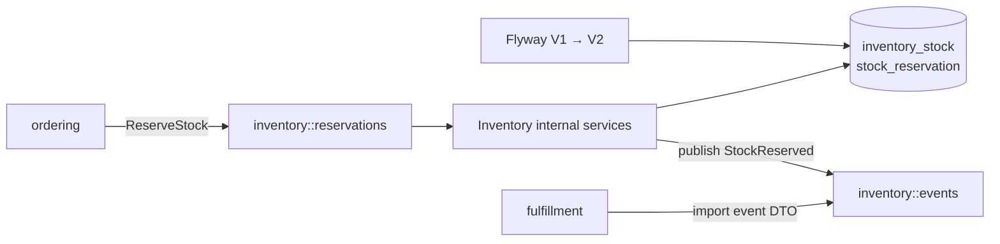
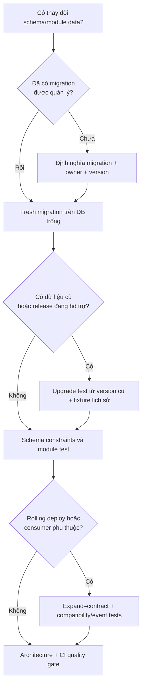

# Test migration và version schema

Một ứng dụng Spring Modulith có thể chạy rất tốt trên database mới dựng từ đầu, nhưng lỗi ngay khi triển khai trên database đã tồn tại hai năm. Nguyên nhân có thể là migration thêm cột `NOT NULL` không backfill dữ liệu cũ, index mới không tạo được vì bản ghi trùng, hoặc phiên bản ứng dụng cũ vẫn đang truy vấn cột vừa bị xóa. Các bài test CRUD thông thường không nhất thiết phát hiện những sai sót này.

Ngược lại, việc chỉ thấy Flyway/Liquibase báo “migration thành công” cũng **chưa đủ** để kết luận schema tương thích với module, dữ liệu nghiệp vụ được bảo toàn, hay ứng dụng đang triển khai nhiều phiên bản có thể cùng sử dụng database an toàn. Ta cần kiểm tra cả **lịch sử schema**, **đường nâng cấp từ dữ liệu thật có hình dạng cũ**, **ràng buộc database**, **contract của consumer** và **thứ tự triển khai**.

Bài **“Test migration và version schema”** thuộc chương **Database testing** của **SPRING_MODULITH_VERIFICATION_TESTING**. Mục tiêu của học phần là rèn kỹ năng kiểm chứng ranh giới kiến trúc bằng `ApplicationModules`, quy tắc phụ thuộc giữa các module, `@ApplicationModuleTest`, kiểm thử database/sự kiện/tích hợp và quality gate CI. Ở đây ta tập trung vào migration và version schema, đồng thời làm rõ khi nào một thay đổi DDL của module có thể vô tình phá module khác.

> **Luận điểm chính:** Test tạo schema mới và test nâng cấp schema cũ là **hai phép thử khác nhau**. Cả hai cần chạy trên database engine phù hợp, nhưng vẫn chưa thay thế được kiểm thử tương thích ứng dụng hoặc kiểm thử bảo toàn dữ liệu.

## 1. Mục tiêu học tập

Sau bài học, bạn có thể:

1. Giải thích sự khác nhau giữa **schema version**, **application version**, **migration script version**, **database engine version** và **event contract version**.
2. Xây dựng lịch sử migration có thể kiểm chứng bằng Flyway hoặc Liquibase, hiểu trạng thái và checksum trong bảng lịch sử.
3. Viết bài test **fresh migration** từ database trống và bài test **upgrade migration** từ một version cũ có dữ liệu đã commit.
4. Kiểm tra backfill, `NOT NULL`, `UNIQUE`, `CHECK`, foreign key, index, dữ liệu thời gian và các quy tắc bảo toàn dữ liệu sau migration.
5. Phân biệt **migration chạy được**, **application mapping dùng được** và **nghiệp vụ hoạt động đúng**.
6. Thiết kế migration theo kiểu **expand → migrate data → contract** khi có khả năng triển khai ứng dụng nhiều phiên bản.
7. Tránh xung đột migration giữa application modules dùng cùng datasource và cùng schema history.
8. Kết hợp `@ApplicationModuleTest`, PostgreSQL/Testcontainers, `ApplicationModules.verify()`, event/integration tests và CI.

## 2. “Version schema” thực sự là version của điều gì?

Trong một ứng dụng có nhiều module, một chữ “version” có thể chỉ những đối tượng rất khác nhau:

| Loại version | Ví dụ | Điều nó mô tả |
| --- | --- | --- |
| **Application release** | `shop-service 2.8.0` | Bộ mã, dependency và cấu hình đang deploy |
| **Database engine** | PostgreSQL 16 | Tính năng SQL, transaction/isolation, extension được hỗ trợ |
| **Migration version** | Flyway `V2` | Một bước thay đổi schema/dữ liệu đã được quản lý |
| **Schema state** | Có cột `expires_at`, index `idx_active_reservation_expiry` | Trạng thái cấu trúc database thực sự |
| **Migration history state** | `V1` thành công, `V2` thành công; checksum khớp | Lịch sử những thay đổi công cụ đã ghi nhận |
| **Domain/event contract version** | `StockReservedV2` | Dữ kiện/semantics mà consumer hiểu |

**Không có một quy luật bắt buộc** rằng application version `2.8.0` phải dùng migration `V2.8.0`. Một release có thể có nhiều migration; một migration có thể được triển khai trước phiên bản code phụ thuộc vào nó.

Schema history có ích nhưng **không phải bằng chứng tuyệt đối rằng schema thực giống mong đợi**. Nếu ai đó sửa bảng thủ công ngoài migration, history có thể vẫn ghi version đúng. Vì vậy cần kết hợp **history validation** và **assertion trên schema thực**.

### 2.1. Dấu hiệu schema drift

**Schema drift** xảy ra khi database thực khác cấu trúc mà migration được quản lý giả định. Ví dụ:

- Production được thêm một index thủ công nhưng test database không có.
- DBA đổi kiểu cột ngoài lịch sử Flyway.
- Một môi trường đã áp dụng `V3`, môi trường khác đang ở `V2`.
- Script `V1` đã chạy được sửa nội dung sau đó, khiến checksum lệch.
- Chạy `hibernate.hbm2ddl.auto=create` trên test nhưng production dùng DDL từ migration.

Không thể chữa mọi drift bằng cách “thêm một đoạn SQL vào fixture”. Cần phát hiện nguyên nhân và đưa thay đổi về một lịch sử có thể review, tái hiện.

## 3. Ví dụ xuyên suốt: Inventory bổ sung hạn giữ hàng

Ứng dụng bán hàng có các application module:

```text
com/example/shop/
├── ShopApplication.java
├── inventory/
│   ├── reservations/
│   │   ├── package-info.java
│   │   ├── InventoryReservations.java
│   │   └── ReserveStock.java
│   ├── events/
│   │   ├── package-info.java
│   │   └── StockReserved.java
│   └── internal/
│       ├── StockReservationService.java
│       └── persistence/
│           ├── StockReservationEntity.java
│           └── StockReservationRepository.java
├── ordering/
│   ├── package-info.java
│   └── internal/PlaceOrderService.java
└── fulfillment/
    ├── package-info.java
    └── internal/StockReservedListener.java
```

`inventory` sở hữu tồn khả dụng và phiếu giữ. `ordering` gọi API `InventoryReservations`; `fulfillment` xử lý sự kiện công khai. Không module nào được tự sửa bảng `stock_reservation` chỉ vì bảng cùng nằm trong một PostgreSQL vật lý.

**Yêu cầu thay đổi:** ở schema `V1`, một reservation chỉ có thời điểm tạo `created_at` và trạng thái. Từ `V2`, reservation đang `ACTIVE` phải có `expires_at` để job nhả hàng hết hạn tìm nhanh hơn.

Quyết định migration có thể là:

- Với bản ghi `ACTIVE` đã tồn tại, backfill `expires_at = created_at + 15 phút`.
- Với bản ghi `RELEASED`, để `expires_at = NULL` vì nó không còn thời hạn giữ hiệu lực.
- Thêm constraint: **reservation `ACTIVE` không được thiếu `expires_at`**.
- Thêm partial index để tìm những reservation `ACTIVE` đến hạn.

Quy tắc backfill `15 phút` là **quyết định nghiệp vụ ví dụ**, không được sao chép sang production nếu chính sách sản phẩm không cho phép. Có hệ thống phải dùng thời hạn cấu hình tại thời điểm tạo, cần kiểm tra dữ liệu lịch sử hoặc quy trình chuyển đổi riêng.

### 3.1. Dòng dependency được phép



Ở đồ thị Java, Fulfillment **phụ thuộc kiểu event công khai** của Inventory. Ở luồng runtime, Inventory **phát event** sang Fulfillment. Migration thuộc trách nhiệm dữ liệu của Inventory, không làm quyền truy cập repository tự động mở cho Ordering hoặc Fulfillment.

## 4. Định nghĩa `V1`: schema cũ cần nâng cấp

Giả sử production dùng PostgreSQL và Flyway, với bộ migration minh họa:

```text
src/main/resources/
└── db/migration/
    ├── V1__create_inventory.sql
    └── V2__add_reservation_expiry.sql
```

Đây là **hai tên file mẫu cho ứng dụng nhỏ**. Trong ứng dụng thật đã có nhiều migration, phải dùng version chưa được sử dụng trong **cùng Flyway schema history**, không tạo `V1` mới trùng version đang có.

Nội dung `V1__create_inventory.sql`:

```sql
CREATE TABLE inventory_stock (
    sku VARCHAR(80) PRIMARY KEY,
    available INTEGER NOT NULL,
    CONSTRAINT ck_inventory_available_nonnegative
        CHECK (available >= 0)
);

CREATE TABLE stock_reservation (
    reservation_id UUID PRIMARY KEY,
    request_id UUID NOT NULL UNIQUE,
    sku VARCHAR(80) NOT NULL,
    quantity INTEGER NOT NULL,
    status VARCHAR(20) NOT NULL,
    created_at TIMESTAMPTZ NOT NULL,
    CONSTRAINT fk_stock_reservation_sku
        FOREIGN KEY (sku) REFERENCES inventory_stock(sku),
    CONSTRAINT ck_stock_reservation_quantity
        CHECK (quantity > 0),
    CONSTRAINT ck_stock_reservation_status
        CHECK (status IN ('ACTIVE', 'RELEASED'))
);
```

Lưu ý:

1. `inventory_stock` chỉ thể hiện tồn khả dụng đơn giản; việc giảm tồn an toàn khi đồng thời là trách nhiệm service/SQL/transaction và test khác.
2. `stock_reservation` có `request_id UNIQUE` để hỗ trợ phát hiện yêu cầu lặp.
3. Trạng thái `ACTIVE`/`RELEASED` thể hiện hợp đồng của **ví dụ**, chưa có lịch sử trạng thái đầy đủ.
4. `TIMESTAMPTZ` phù hợp với PostgreSQL; kiểm thử migration này trên H2 không chứng minh nó chạy đúng trên PostgreSQL.
5. `created_at` cần được định nghĩa rõ là thời điểm thực (UTC/offset semantics); không lưu một chuỗi thời gian tùy theo timezone máy CI.

## 5. Định nghĩa `V2`: expand, backfill và ràng buộc mới

Nội dung `V2__add_reservation_expiry.sql`:

```sql
-- 1) EXPAND: thêm cột nullable để bản ghi cũ vẫn hợp lệ.
ALTER TABLE stock_reservation
    ADD COLUMN expires_at TIMESTAMPTZ;

-- 2) BACKFILL: chỉ những reservation đang ACTIVE cần hạn giữ.
UPDATE stock_reservation
   SET expires_at = created_at + INTERVAL '15 minutes'
 WHERE status = 'ACTIVE'
   AND expires_at IS NULL;

-- 3) ENFORCE: mỗi ACTIVE reservation phải có expires_at.
ALTER TABLE stock_reservation
    ADD CONSTRAINT ck_active_reservation_expiry
    CHECK (status <> 'ACTIVE' OR expires_at IS NOT NULL);

-- 4) SUPPORT QUERY: hỗ trợ tìm ACTIVE reservations theo hạn.
CREATE INDEX idx_active_reservation_expiry
    ON stock_reservation(expires_at)
    WHERE status = 'ACTIVE';
```

Migration có thể chạy trên database sạch đã qua `V1` **và** database `V1` có bản ghi lịch sử. Tuy nhiên, **khả năng chạy SQL** mới là điều kiện đầu tiên; bài test còn phải kiểm tra:

- `ACTIVE` cũ được backfill đúng theo policy.
- `RELEASED` cũ còn `expires_at = NULL`.
- `reservation_id`, `request_id`, `sku`, `quantity`, `status`, `created_at` không bị thay đổi.
- Constraint mới từ chối ghi `ACTIVE` mà thiếu hạn.
- Partial index thực sự tồn tại và có tên/định nghĩa mong đợi.
- Đường lưu mới của Inventory cấp `expires_at` cho reservation `ACTIVE`, không chỉ dựa vào backfill cũ.

### 5.1. Vì sao không thêm `NOT NULL` trực tiếp?

Nếu `V1` đã có các hàng cũ, lệnh:

```sql
-- Phản mẫu nếu chưa có backfill hoặc default nghiệp vụ đúng.
ALTER TABLE stock_reservation
    ADD COLUMN expires_at TIMESTAMPTZ NOT NULL;
```

có thể bị database từ chối ngay hoặc gây yêu cầu giá trị mặc định không phù hợp. Với nghiệp vụ trên, `RELEASED` hợp lệ khi `expires_at` rỗng, nên `NOT NULL` cho toàn cột còn **sai nghĩa nghiệp vụ**. Constraint có điều kiện phù hợp hơn.

### 5.2. Vì sao index không đủ bảo vệ quy tắc?

`idx_active_reservation_expiry` giúp truy vấn, nhưng **không** bảo đảm một reservation Active có expiry. Đó là nhiệm vụ của constraint. Hơn nữa, sự tồn tại của index không chứng minh query planner sẽ sử dụng index hoặc performance ở production sẽ đạt SLA; cần test/benchmark với dữ liệu và thống kê có hình dạng thực tế.

### 5.3. Các yêu cầu trước khi deploy `V2`

1. Chốt chính sách đối với reservation lịch sử.
2. Kiểm tra dữ liệu bẩn ở `V1`: trạng thái ngoài tập cho phép, thời điểm null/tràn, duplicate.
3. Xác định ứng dụng cũ có thực hiện INSERT `ACTIVE` mà không cấp `expires_at` khi chạy song song với phiên bản mới hay không.
4. Nếu có triển khai rolling/blue-green, **không được áp constraint mới quá sớm** khi code cũ vẫn có quyền ghi theo schema cũ.
5. Kiểm tra chi phí UPDATE hàng loạt, thời gian giữ lock và tác động đến truy cập production.

Ví dụ `V2` lý tưởng cho **migration nguyên tử khi ứng dụng dừng/không còn writer cũ**. Đối với deployment không downtime, ta sẽ cần chia giai đoạn ở mục về expand–contract.

## 6. Flyway ghi nhớ version schema như thế nào?

Flyway dùng bảng lịch sử schema, thường là `flyway_schema_history` khi không đổi cấu hình. Những cột điển hình gồm version, description, script, checksum, thời điểm thực thi và kết quả thành công/thất bại theo khả năng của engine.

Mô hình khái niệm:

```text
Database trống
   |
   +-- V1__create_inventory.sql
   |      -> tables + constraints
   |      -> ghi lịch sử V1
   |
   +-- V2__add_reservation_expiry.sql
          -> column + backfill + check + index
          -> ghi lịch sử V2
```

Khi khởi động lại trên database đã migrate:

- Flyway đối chiếu những migration đã áp dụng với các migration khả dụng.
- Những version đã áp dụng thành công thông thường không bị thực thi lại.
- Checksum giúp phát hiện việc **nội dung migration có phiên bản đã áp dụng** bị sửa sau đó.
- Migration mới chưa áp dụng được chọn chạy theo chính sách version/ordering.

### 6.1. Migration version khác deployment version

Ví dụ `V1`, `V2` là **version Flyway**, không phải version của module Java hoặc tài liệu lesson. Một service release có thể triển khai `V2` trước khi bật code dùng `expires_at`, và một release tiếp theo mới dừng hỗ trợ code cũ.

### 6.2. Kiểm tra checksum là bắt buộc nhưng chưa đủ

Nếu developer sửa một `V1` đã được áp dụng trên production:

```text
V1 ban đầu → checksum A
V1 trong repository hôm nay → checksum B
```

Validation có thể báo mismatch. Cách xử lý thông thường là **không sửa lịch sử đã được triển khai**, mà tạo migration mới có chủ đích. Không tự gọi `repair()` trong CI để “làm biến mất” sự khác biệt: repair thay đổi metadata history theo chính sách, **không biến schema thực thành cấu trúc mong muốn**.

### 6.3. `validate`, `migrate`, `info`, `clean` phục vụ mục đích khác nhau

| Lệnh/API Flyway | Công dụng | Lưu ý |
| --- | --- | --- |
| `migrate()` | Áp dụng các migration pending theo cấu hình | Không phải bằng chứng các invariant nghiệp vụ còn đúng |
| `validate()` | Kiểm tra tính nhất quán lịch sử và migration resolved | Không phải diff đầy đủ mọi table/index |
| `info()` | Xem trạng thái/version migration được nhận diện | Chỉ phản ánh những location/history đã cấu hình |
| `repair()` | Sửa một số trạng thái/metadata migration theo quy tắc Flyway | **Không** chạy tự động để che checksum mismatch |
| `clean()` | Xóa các object thuộc schemas được cấu hình | **Nguy hiểm**, chỉ sử dụng có chủ đích trên DB test dùng riêng |

Trên shared/staging/production database, **không** dùng `clean()` như cách reset fixture. Với Testcontainers, một database mới cho mỗi scenario thường dễ hiểu và an toàn hơn.

## 7. Thiết lập môi trường kiểm thử PostgreSQL thật

Khi production dùng PostgreSQL, migration có `TIMESTAMPTZ`, partial index và PostgreSQL SQL syntax nên được kiểm tra trên PostgreSQL thật, ví dụ qua Testcontainers.

Những dependency thường cần (chọn version tương thích qua BOM của dự án):

- Spring Boot starter test, Spring Modulith test starter.
- PostgreSQL JDBC driver và Spring JDBC/JPA nếu test service/repository.
- Flyway Core và module hỗ trợ database phù hợp với phiên bản Flyway dùng.
- Testcontainers JUnit Jupiter + PostgreSQL.
- Spring Boot Testcontainers integration nếu dùng `@ServiceConnection` (Spring Boot 3.1+).
- Docker-compatible container runtime trong máy phát triển và CI.

Không nên trộn version Maven/Gradle bằng cách sao chép các con số từ nhiều tài liệu thuộc nhiều thế hệ Spring Boot. API import, Flyway database support và cơ chế test connection cần khớp với dependency thực tế.

### 7.1. Cấu hình Boot minh họa

```properties
# Test profile; chỉ minh họa, cần áp vào test resources của dự án.
spring.flyway.enabled=true
spring.flyway.locations=classpath:db/migration
spring.jpa.hibernate.ddl-auto=validate
```

Giải thích:

- Flyway là **nguồn tạo/nâng cấp schema**.
- Hibernate `validate` có thể phát hiện một số lệch entity–schema; không tự tạo bảng để test xanh giả.
- `validate` của Hibernate **khác** `Flyway.validate()`: cái đầu so khớp một số mapping; cái sau đối chiếu metadata lịch sử migration.
- Không đồng thời bật `ddl-auto=create-drop` khi mục tiêu là kiểm tra schema do Flyway tạo.

### 7.2. Một lớp test khởi động PostgreSQL

```java
package com.example.shop.inventory;

import org.springframework.boot.testcontainers.service.connection.ServiceConnection;
import org.springframework.modulith.test.ApplicationModuleTest;
import org.testcontainers.containers.PostgreSQLContainer;
import org.testcontainers.junit.jupiter.Container;
import org.testcontainers.junit.jupiter.Testcontainers;

@Testcontainers
@ApplicationModuleTest
class InventoryFreshSchemaTests {

    @Container
    @ServiceConnection
    static PostgreSQLContainer<?> postgres =
        new PostgreSQLContainer<>("postgres:16-alpine");

    // Các bài @Test ở mục tiếp theo dùng Flyway + JdbcTemplate.
}
```

Đoạn trên là **khung cấu hình**, chưa có assertion. `@ServiceConnection` kết nối container với datasource của Spring Boot trong những phiên bản được hỗ trợ; không tự viết migration, tự tạo fixture hay tự xác nhận version. `postgres:16-alpine` chỉ là hình mẫu pin major version: hãy chọn version, extension và collation gần production.

Nếu dự án không dùng `@ServiceConnection`, có thể cấu hình datasource qua `@DynamicPropertySource`. Đừng đồng thời wiring cả hai theo cách mâu thuẫn.

## 8. Test 1 — dựng database mới từ toàn bộ migration

**Fresh migration test** trả lời câu hỏi:

> Khi có một PostgreSQL database sạch và bộ migration hiện tại, ứng dụng có khởi tạo được schema hoàn chỉnh để module hoạt động không?

Với hai file `V1` và `V2` mẫu, Spring Boot/Flyway sẽ khởi chạy cả hai khi context được tạo. Có thể thêm assertion vào lớp ở mục 7:

```java
import static org.assertj.core.api.Assertions.assertThat;

import org.flywaydb.core.Flyway;
import org.junit.jupiter.api.Test;
import org.springframework.beans.factory.annotation.Autowired;
import org.springframework.jdbc.core.JdbcTemplate;

// Đặt các trường/method sau BÊN TRONG InventoryFreshSchemaTests.
@Autowired Flyway flyway;
@Autowired JdbcTemplate jdbc;

@Test
void freshDatabaseReachesExpectedMigration() {
    // Giả định test fixture chỉ chứa V1 và V2 của ví dụ.
    flyway.validate();
    assertThat(flyway.info().current().getVersion().getVersion())
        .isEqualTo("2");

    Integer columnCount = jdbc.queryForObject("""
        SELECT count(*) FROM information_schema.columns
        WHERE table_schema = 'public'
          AND table_name = 'stock_reservation'
          AND column_name = 'expires_at'
        """, Integer.class);

    Integer indexCount = jdbc.queryForObject("""
        SELECT count(*) FROM pg_indexes
        WHERE schemaname = 'public'
          AND indexname = 'idx_active_reservation_expiry'
        """, Integer.class);

    assertThat(columnCount).isEqualTo(1);
    assertThat(indexCount).isEqualTo(1);
}
```

**Giới hạn của ví dụ:** Assertion version `"2"` đúng nếu database test chỉ resolve hai migration này; trong ứng dụng thật có nhiều module/migration, latest version toàn hệ thống có thể khác. Khi đó hãy assert version **được kỳ vọng cho toàn schema history** hoặc kiểm tra một migration cụ thể đã được áp dụng, thay vì cứng nhắc xem `V2` là version cuối.

`Flyway.validate()` có thể throw exception nếu metadata không hợp lệ. Các query `information_schema` và `pg_indexes` chỉ kiểm tra **có column/index**, chưa chứng minh mọi thuộc tính của chúng chính xác.

### 8.1. Kiểm tra thuộc tính thay vì chỉ kiểm tra tên

Một column tên `expires_at` tồn tại không bảo đảm:

- Nó là kiểu `TIMESTAMPTZ` như yêu cầu.
- Constraint `ck_active_reservation_expiry` được tạo.
- Partial index có predicate đúng.
- Các giá trị được backfill chính xác.

Cần thêm assertion trên `information_schema`, PostgreSQL catalogs và **hành vi ghi dữ liệu sai bị từ chối**. Những bài kiểm tra này có thể quan trọng hơn một assertion tên index đơn thuần.

### 8.2. Thử idempotency của công cụ migration

Khi tất cả version đã được áp dụng, chạy `migrate()` lần nữa với cùng cấu hình thường không cần áp dụng thêm migration. Có thể kiểm tra kết quả hoặc trạng thái history sau lần gọi tiếp theo.

**Không nhầm idempotency của runner** với khả năng chạy lại trực tiếp từng SQL file: `CREATE TABLE` không có `IF NOT EXISTS` có thể lỗi nếu chạy thủ công hai lần, nhưng Flyway **không cần** chạy lại version đã đánh dấu thành công. Không thêm `IF NOT EXISTS` khắp nơi chỉ để che lịch sử bị trôi.

## 9. Test 2 — nâng cấp từ `V1` đã có dữ liệu

Fresh migration chỉ chạy `V1` rồi `V2` trên database **chưa có reservation**. Nó không kiểm tra đường backfill dữ liệu lịch sử. Đây là lý do cần **upgrade migration test**.

### 9.1. Kịch bản đầu vào chính xác

Trước khi chạy `V2`:

```text
inventory_stock:
  SKU-01, available = 8

stock_reservation (schema V1):
  R-A, status ACTIVE,   created_at = 2026-01-01T10:00:00Z
  R-B, status RELEASED, created_at = 2026-01-01T08:00:00Z
```

Sau khi chạy `V2`:

```text
R-A.expires_at = 2026-01-01T10:15:00Z
R-B.expires_at = NULL
2 reservations vẫn tồn tại với ID/request/SKU/quantity cũ
Schema history: V1 + V2 đã áp dụng thành công
```

Test cần bảo đảm **chỉ `V1` được áp dụng trước khi seed**, rồi mới nâng cấp lên `V2`. Nếu Spring Boot tự migrate tới bản mới trước lúc seed, test không còn tái hiện đường upgrade như production.

### 9.2. Tách test upgrade khỏi Boot auto migration

Một cách dễ kiểm soát là dùng một **JUnit/Testcontainers test độc lập**, tự cấu hình Flyway theo hai chặng. Ví dụ dưới dùng **cùng resource migration production** và một PostgreSQL container:

```java
package com.example.shop.inventory;

import static org.assertj.core.api.Assertions.assertThat;

import org.flywaydb.core.Flyway;
import org.junit.jupiter.api.Test;
import org.springframework.jdbc.core.JdbcTemplate;
import org.springframework.jdbc.datasource.DriverManagerDataSource;
import org.testcontainers.containers.PostgreSQLContainer;
import org.testcontainers.junit.jupiter.Container;
import org.testcontainers.junit.jupiter.Testcontainers;

@Testcontainers
class InventoryUpgradeMigrationTests {

    @Container
    static PostgreSQLContainer<?> postgres =
        new PostgreSQLContainer<>("postgres:16-alpine");

    @Test
    void upgradesExistingReservationsFromV1ToV2() {
        var datasource = new DriverManagerDataSource(
            postgres.getJdbcUrl(),
            postgres.getUsername(),
            postgres.getPassword()
        );
        var jdbc = new JdbcTemplate(datasource);

        // CHẶNG 1: database mới nhưng CHỈ chạy tới schema V1.
        Flyway v1 = Flyway.configure()
            .dataSource(datasource)
            .locations("classpath:db/migration")
            .target("1")
            .load();
        v1.migrate();

        // Tiền điều kiện: dữ liệu theo CHÍNH schema V1.
        jdbc.update("""
            INSERT INTO inventory_stock(sku, available)
            VALUES ('SKU-01', 8)
            """);
        jdbc.update("""
            INSERT INTO stock_reservation
              (reservation_id, request_id, sku,
               quantity, status, created_at)
            VALUES
              ('00000000-0000-0000-0000-000000000101',
               '00000000-0000-0000-0000-000000000201',
               'SKU-01', 2, 'ACTIVE', '2026-01-01T10:00:00Z'),
              ('00000000-0000-0000-0000-000000000102',
               '00000000-0000-0000-0000-000000000202',
               'SKU-01', 1, 'RELEASED', '2026-01-01T08:00:00Z')
            """);

        // CHẶNG 2: chạy toàn bộ những migration còn pending.
        Flyway latest = Flyway.configure()
            .dataSource(datasource)
            .locations("classpath:db/migration")
            .load();
        latest.migrate();
        latest.validate();

        Integer activeDeltaSeconds = jdbc.queryForObject("""
            SELECT EXTRACT(
                EPOCH FROM (expires_at - created_at)
            )::int
            FROM stock_reservation WHERE status = 'ACTIVE'
            """, Integer.class);
        Boolean releasedExpiryIsNull = jdbc.queryForObject("""
            SELECT expires_at IS NULL
              FROM stock_reservation WHERE status = 'RELEASED'
            """, Boolean.class);
        Integer rows = jdbc.queryForObject(
            "SELECT count(*) FROM stock_reservation",
            Integer.class
        );

        assertThat(activeDeltaSeconds).isEqualTo(15 * 60);
        assertThat(releasedExpiryIsNull).isTrue();
        assertThat(rows).isEqualTo(2);
        assertThat(latest.info().current().getVersion().getVersion())
            .isEqualTo("2");
    }
}
```

**Giả định của bài test:**

- `db/migration` trong test chỉ chứa **V1 và V2 mẫu**; trong ứng dụng có thêm version, cần điều chỉnh stage/expected version.
- Không có Spring Boot auto migration chạy song song vì đây là JUnit/Testcontainers class độc lập.
- Container dùng một database mới, không có state từ test khác.
- Flyway và JDBC driver hỗ trợ PostgreSQL đúng phiên bản.
- Các câu `jdbc.update(...)` được thực hiện ngoài Spring-managed transaction, nên thông thường đã commit trước bước `latest.migrate()`.
- `V2` thật sự là source migration production được test, không phải script “đơn giản hóa” chỉ cho test.

Với migration version phức tạp (`V2026.11.26.1`, v.v.), thay `"1"` và `"2"` bằng version thực đã xác định. Không dùng `target("1")` trên một database production hiện có; ví dụ chỉ chạy trên database test tạm.

### 9.3. Còn thiếu assertion nào?

Bài test trên chứng minh backfill hai trạng thái cơ bản. Để đầy đủ hơn:

1. Assert `reservation_id`, `request_id`, `sku`, `quantity` và `created_at` không thay đổi.
2. Assert `available` của `inventory_stock` vẫn bằng `8`.
3. Assert constraint mới từ chối `ACTIVE` thiếu `expires_at`.
4. Assert `RELEASED` với `expires_at = NULL` vẫn hợp lệ.
5. Assert query tìm ACTIVE hết hạn cho kết quả đúng.
6. Kiểm tra index predicate nếu hiệu năng và đường query là yêu cầu.
7. Nếu có nhiều tenant/kho/trạng thái, đưa vào fixture đại diện cho dữ liệu lịch sử thực.

**Điểm học thuật:** “Upgrade SQL chạy không lỗi” chỉ là điều kiện cần; **sự bảo toàn ý nghĩa dữ liệu** mới là điều kiện đủ ở tầng nghiệp vụ.

## 10. Test constraint sau migration

Một cách xác minh quy tắc của `V2` là thử ghi dữ liệu sai trên database đã migrate hoàn chỉnh.

### 10.1. Chèn ACTIVE không có expiry phải thất bại

```java
@Test
void activeReservationWithoutExpiryIsRejected() {
    assertThatThrownBy(() -> jdbc.update("""
        INSERT INTO stock_reservation
          (reservation_id, request_id, sku,
           quantity, status, created_at, expires_at)
        VALUES
          ('00000000-0000-0000-0000-000000000103',
           '00000000-0000-0000-0000-000000000203',
           'SKU-01', 1, 'ACTIVE',
           '2026-01-01T11:00:00Z', NULL)
        """)).isInstanceOf(DataAccessException.class);
}
```

Các import cần có: `org.springframework.dao.DataAccessException` và `org.assertj.core.api.Assertions.assertThatThrownBy`. Đoạn này là **method rút gọn**; phải đặt trong lớp test có `JdbcTemplate jdbc`, đã seed `SKU-01`, đã áp dụng `V2`, và không dùng test-managed transaction nếu muốn đọc tiếp sau lỗi mà không gặp transaction aborted của PostgreSQL.

Nếu PostgreSQL từ chối SQL bên trong một transaction đang mở, transaction đó thường bị đánh dấu lỗi cho tới rollback. Hãy rollback trước khi đọc lại hậu điều kiện, hoặc để `JdbcTemplate` thao tác auto-commit từng statement trong bài test phù hợp.

### 10.2. Chèn RELEASED không có expiry được phép

```sql
INSERT INTO stock_reservation
  (reservation_id, request_id, sku,
   quantity, status, created_at, expires_at)
VALUES
  ('00000000-0000-0000-0000-000000000104',
   '00000000-0000-0000-0000-000000000204',
   'SKU-01', 1, 'RELEASED',
   '2026-01-01T11:00:00Z', NULL);
```

Viết assertion sau INSERT để chứng minh database chấp nhận trạng thái hợp lệ. Không đặt một câu INSERT kỳ vọng thất bại vào script seed chung; nó sẽ làm mọi bài test không liên quan đỏ ngay từ bước chuẩn bị.

### 10.3. Ràng buộc mới còn phải đúng với code mới

Một database đã qua `V2` sẽ từ chối INSERT `ACTIVE` thiếu `expires_at`. Test schema có thể xanh, nhưng **service JPA cũ** chưa map cột mới sẽ thất bại khi tạo reservation. Do đó phải có `@ApplicationModuleTest` gọi API `InventoryReservations.reserve(...)` với implementation mới và DB đã migrate; chỉ test trực tiếp SQL không kiểm tra hợp đồng Java/JPA của module.

## 11. Kiểm tra data preservation và backfill quy mô lớn

Migration có thể đúng với hai hàng nhưng sai với dữ liệu production có hàng triệu reservation, timestamp bất thường hoặc trạng thái lịch sử.

### 11.1. Bất biến dữ liệu trước và sau nâng cấp

| Bất biến | Trước upgrade | Sau upgrade |
| --- | --- | --- |
| Số reservation | `N` | Vẫn `N`, trừ khi migration có policy rõ làm thay đổi |
| Khóa `reservation_id` | Tập `R` | Không mất/nhân đôi ID |
| `request_id` unique | Đã bảo vệ | Tiếp tục bảo vệ |
| Tổng số lượng đã ghi | `SUM(quantity)` | Không bị thay đổi vô ý |
| ACTIVE reservation | Có `created_at` | Có `expires_at` theo policy |
| RELEASED reservation | Không có expiry | Vẫn hợp lệ, không ép thời hạn vô nghĩa |
| `inventory_stock.available` | Giá trị trước | Không đổi nếu migration chỉ thêm expiry |

Một bài test có thể chụp **tập ID và giá trị business columns** vào bộ dữ liệu nhỏ trước migration, rồi so sánh sau migration. Không chỉ kiểm tra `COUNT(*)`: một migration lỗi có thể xóa một hàng và nhân đôi một hàng khác nhưng tổng count vẫn như cũ.

### 11.2. Chọn fixture theo rủi ro

- ACTIVE có thời điểm tạo bình thường.
- RELEASED có thời điểm tạo cũ.
- ACTIVE có `created_at` gần thời điểm hiện tại theo clock test kiểm soát.
- Bản ghi lâu đời mà policy hết hạn cần xem xét đặc biệt.
- Trường hợp timezone/offset khác nhau nhưng cùng instant.
- Bản ghi đã được xử lý lặp với cùng request (nếu schema cũ cho phép).
- Dữ liệu cũ vi phạm giả định mới mà migration không thể tự chữa.

Không sinh dữ liệu ngẫu nhiên không kiểm soát rồi gọi đó là realistic. Fixture cần được **giải thích**, có kỳ vọng được xác định và chạy lặp lại được.

### 11.3. Data migration không phải chỉ `UPDATE` hàng loạt

Một bước backfill thực có thể phải:

- Chuẩn hóa giá trị enum cũ trước khi thêm `CHECK`.
- Hợp nhất các bản ghi duplicate trước khi tạo unique index.
- Chuyển timestamp local thành UTC dựa trên timezone theo tenant.
- Thay khóa định danh string bằng UUID và giữ mapping cũ.
- Tách bảng lớn, tạo foreign key, điền khóa ở bảng con.
- Dịch dữ liệu nhạy cảm sang cấu trúc lưu mới.

Những thao tác này cần **test đầy đủ trường hợp biên và kiểm tra conservation invariants**, không chỉ assert migration “không ném exception”.

## 12. Schema version và mô hình ORM phải khớp

Giả sử entity ở `inventory.internal.persistence` được cập nhật:

```java
@Entity
@Table(name = "stock_reservation")
class StockReservationEntity {

    @Id
    @Column(name = "reservation_id")
    private UUID id;

    @Column(name = "status")
    private String status;

    @Column(name = "created_at")
    private OffsetDateTime createdAt;

    @Column(name = "expires_at")
    private OffsetDateTime expiresAt;
}
```

Đây là **trích đoạn**, không đầy đủ các trường/constructor/mapping cần thiết để chạy. Nó chỉ minh họa cột mới ở tầng JPA.

### 12.1. Hibernate `validate` chứng minh điều gì?

`spring.jpa.hibernate.ddl-auto=validate` có thể kiểm tra một số sai lệch giữa mapping của entity với table/column/type. Nhưng nó **không phải schema diff đầy đủ**:

- Không bảo đảm mọi index có đúng predicate.
- Không tự chứng minh check constraint bảo vệ invariant.
- Không kiểm tra dữ liệu lịch sử được backfill đúng.
- Không chứng minh transaction/concurrency semantics.
- Không tự phát hiện mọi thay đổi SQL được viết trong `JdbcTemplate` hoặc native query.

Sự phối hợp phù hợp là **Flyway migrate/validate + assertion schema/constraint + module test qua repository/service**.

### 12.2. Đừng thay migration bằng `ddl-auto=create-drop` trong test

Nếu Hibernate tự tạo `expires_at` dựa trên entity mới, test có thể xanh dù script `V2` thiếu `ALTER TABLE`. Khi production dùng Flyway, deploy sẽ lỗi. Muốn test migration, hãy chạy **migration chính thức** trên database mới/cũ và chỉ dùng Hibernate `validate` để bổ sung tín hiệu.

### 12.3. Data model API không phải JPA entity

Consumer của Inventory nên dùng DTO/record được công bố, không phải `StockReservationEntity`. Khi schema đổi từ `created_at` sang `expires_at` hoặc thay kiểu ID, module Ordering/Fulfillment không nên phải sửa JPA query của Inventory. **Ranh giới module** giúp thay đổi schema có phạm vi hợp lý.

## 13. `@ApplicationModuleTest` sau migration: phép thử hợp đồng thực

Một database tạo được cột không chứng minh service mới ghi giá trị hợp lệ. Viết module test theo luồng công khai:

```java
package com.example.shop.inventory;

import static org.assertj.core.api.Assertions.assertThat;

import com.example.shop.inventory.reservations.InventoryReservations;
import com.example.shop.inventory.reservations.ReserveStock;
import java.util.UUID;
import org.junit.jupiter.api.Test;
import org.springframework.beans.factory.annotation.Autowired;
import org.springframework.jdbc.core.JdbcTemplate;
import org.springframework.modulith.test.ApplicationModuleTest;
import org.springframework.test.context.jdbc.Sql;

@ApplicationModuleTest
@Sql(
    scripts = "/fixtures/inventory/stock-three.sql",
    executionPhase = Sql.ExecutionPhase.BEFORE_TEST_METHOD
)
class InventoryV2ModuleTests {

    @Autowired InventoryReservations inventory;
    @Autowired JdbcTemplate jdbc;

    @Test
    void createsActiveReservationWithExpiry() {
        UUID requestId = UUID.randomUUID();

        var receipt = inventory.reserve(
            new ReserveStock("SKU-01", 2, requestId)
        );

        Integer available = jdbc.queryForObject("""
            SELECT available FROM inventory_stock WHERE sku = ?
            """, Integer.class, "SKU-01");

        Boolean validExpiry = jdbc.queryForObject("""
            SELECT status = 'ACTIVE'
               AND expires_at IS NOT NULL
               AND expires_at > created_at
              FROM stock_reservation WHERE reservation_id = ?
            """, Boolean.class, receipt.reservationId());

        assertThat(available).isEqualTo(1);
        assertThat(validExpiry).isTrue();
    }
}
```

Lớp test này **giả định API và implementation Inventory V2** đã tồn tại:

```java
// Các record/interface minh họa trong inventory.reservations:
public record ReserveStock(String sku, int quantity, UUID requestId) {}
public record ReservationReceipt(UUID reservationId) {}
public interface InventoryReservations {
    ReservationReceipt reserve(ReserveStock command);
}
```

Ví dụ fixture `src/test/resources/fixtures/inventory/stock-three.sql`:

```sql
-- Dành cho DB/schema test riêng, chạy tuần tự.
DELETE FROM stock_reservation;
DELETE FROM inventory_stock;
INSERT INTO inventory_stock(sku, available) VALUES ('SKU-01', 3);
```

Ví dụ còn cần import type/bean, Flyway migration tạo schema, datasource, policy expiry và test infrastructure thích hợp. Nếu triển khai có database chung và test song song, **không dùng cleanup toàn bảng** như trên; hãy cô lập schema hoặc chọn khóa test riêng.

### 13.1. Vì sao test này cần chạy sau migration?

Nếu service mới insert `ACTIVE` mà bỏ `expires_at`, constraint ở `V2` sẽ từ chối. Test lộ lỗi khi gọi **API thực qua Spring bean**, thay vì chỉ nhìn thấy column có mặt. Hậu điều kiện xác minh cả business state (available) và dữ liệu reservation.

### 13.2. Không vô tình bọc test trong transaction rollback

Khi muốn xác minh service **commit** và listener sau commit, không đặt `@Transactional` lên lớp test. Với `@Transactional` ở cấp test, service `REQUIRED` có thể tham gia test transaction và chưa commit khi assertion chạy. Một module test transaction mặc định rollback vẫn hữu ích cho kiểm tra logic/fixture isolation, nhưng không là bằng chứng commit production.

### 13.3. `@ApplicationModuleTest` kiểm soát bean, không kiểm soát schema

Đặt test trong package module Inventory giúp bootstrap Inventory theo cấu hình. Tuy nhiên datasource/Flyway vẫn có thể migrate **toàn schema ứng dụng**, không tự migrate riêng Inventory. Khi kiểm thử Ordering với dependency trực tiếp Inventory, cần đảm bảo các migration và fixture của module liên quan tương thích với phạm vi test.

## 14. Kiểm thử lịch sử migration và checksum có kiểm soát

Một test nên kiểm tra **cơ chế versioning** chứ không chỉ DDL:

```java
// Khi đã có @Autowired Flyway flyway và DB test đã migrate.
@Test
void schemaHistoryIsValid() {
    flyway.validate();
    assertThat(flyway.info().current()).isNotNull();
}
```

Đây là một **assertion cơ bản**, cần mở rộng theo lịch sử thực của dự án. Ví dụ nếu một migration từng bị thay nội dung sau khi chạy, validate có thể báo checksum mismatch.

### 14.1. Không sửa migration đã triển khai

Một workflow khuyến nghị:

1. `V1` đã được áp dụng ở môi trường dùng chung hoặc production.
2. Phát hiện muốn đổi constraint/index của `V1`.
3. **Không sửa file `V1`**, vì checksum/lịch sử bị khác.
4. Thêm `V2`, `V3`, ... để mô tả thay đổi tiếp theo.
5. Viết fresh test và upgrade test từ version cũ.
6. Khi có drift bất thường, điều tra lịch sử, không tự repair để làm CI xanh.

### 14.2. Một thay đổi không thể replay từ đầu

Ví dụ `V3` giả định cột `expires_at` đã có nhưng quên phụ thuộc logic `V2`, hoặc một script chạy dựa vào bảng tạo thủ công. Nếu chỉ test trên database developer đã có sẵn, nó có thể thành công. **Fresh migration trên DB trống** phát hiện chuỗi thiếu bước; **upgrade migration từ một version được hỗ trợ** phát hiện dữ liệu cũ và thứ tự phụ thuộc.

### 14.3. Nguy cơ với version `outOfOrder`

Flyway có chính sách liên quan migration được phát hiện trễ với version thấp hơn những version đã áp dụng. Không nên bật khả năng chạy `outOfOrder` vô điều kiện để hợp thức hóa việc hai nhóm triển khai các version xung đột. Cần thống nhất versioning toàn bộ schema history hoặc tách lịch sử theo thiết kế, rồi test đường nâng cấp thực.

## 15. Expand–contract: schema phải tương thích với ứng dụng nào?

Migration có thể chạy thành công mà vẫn làm ứng dụng cũ ngừng hoạt động. Điều này đặc biệt quan trọng khi deploy rolling update, blue/green hoặc nhiều instance của một modular monolith cùng dùng database.

Ví dụ thay đổi `expires_at`:

```text
Phiên bản ứng dụng A (cũ):
  INSERT stock_reservation(... status='ACTIVE', created_at)
  không biết cột expires_at.

Phiên bản ứng dụng B (mới):
  INSERT (... status='ACTIVE', created_at, expires_at)
  dùng expires_at để xử lý hết hạn.
```

Nếu áp luôn constraint ở `V2` như mục 5 **trước khi tất cả instance A ngừng ghi**, những request do A xử lý có thể thất bại dù migration SQL chạy tốt. Đây là lỗi **tương thích runtime**, không phải lỗi cú pháp DDL.

### 15.1. Tách migration thành ba pha

Với deployment không downtime, có thể chia thay đổi thành nhiều bước có version riêng:

```text
PHA EXPAND:
  V2a: ADD COLUMN expires_at NULLABLE
       chưa thêm constraint bắt buộc cho ACTIVE
       giữ cột/hành vi cũ còn dùng được.

PHA CHUYỂN TIẾP:
  Deploy code B đọc expires_at nếu có; có fallback hợp lệ cho record cũ.
  Writer B bắt đầu ghi expires_at.
  Writer A có thể vẫn ghi NULL trong giai đoạn cùng chạy.
  Backfill có kiểm soát, chạy lại/tiếp tục cho đến khi hết dữ liệu cần chuyển.

PHA CONTRACT:
  Xác nhận không còn writer A.
  Xác nhận tất cả ACTIVE đã có expires_at.
  Migration mới thêm CHECK/NOT NULL phù hợp và tối ưu index.
  Release sau có thể xóa fallback nếu không còn cần.
```

Đây là **một kế hoạch phát hành**, không phải gợi ý đặt ba lệnh SQL vào cùng một migration rồi gọi là zero downtime. Giữa các pha phải có bước xác nhận dữ liệu và điều kiện sẵn sàng của từng phiên bản application.

### 15.2. Ma trận tương thích code/schema

| Application code | Schema V1 | Schema expand | Schema contract cuối |
| --- | --- | --- | --- |
| **A – cũ** | Phù hợp | Thường phù hợp nếu chỉ thêm cột nullable | Có thể lỗi khi INSERT ACTIVE |
| **B – mới** | Có thể lỗi nếu query cột mới | Phù hợp nếu được viết để hỗ trợ chuyển tiếp | Phù hợp |
| **C – chỉ hỗ trợ V2 đầy đủ** | Không phù hợp | Có thể lỗi nếu dữ liệu chưa backfill | Phù hợp |

Các ô trên là **kỳ vọng thiết kế cần chứng minh**, không phải bảo đảm áp dụng cho mọi SQL/JPA mapping. Nếu app A dùng `SELECT *`, native result mapping, `INSERT` không chỉ định danh sách cột hoặc trigger phức tạp, ngay cả việc thêm cột nullable cũng có thể cần kiểm thử tương thích.

### 15.3. Test tương thích thật chứ không chỉ đọc bảng

Một ma trận integration test có thể:

1. Dựng schema ở trạng thái expand.
2. Chạy đường INSERT/UPDATE của code A (hoặc adapter/contract cũ được giữ trong test).
3. Chạy đường ghi mới của code B.
4. Đọc lại cả dữ liệu A và B bằng code B.
5. Chạy backfill, assert không còn ACTIVE thiếu expiry.
6. Thêm constraint contract và xác nhận code B tiếp tục chạy.
7. Đảm bảo code A đã được ngừng trước khi áp bước không còn tương thích.

Để chạy **hai binary application khác version** thật sự, thường cần một integration environment/pipeline riêng; một module test chỉ dùng code hiện tại không thể tự chứng minh binary cũ vẫn chạy được.

## 16. Backfill online: dữ liệu lớn và lock cũng là điều cần test

Trên database nhỏ, lệnh `UPDATE stock_reservation ...` có thể xong tức thì. Trên production với nhiều triệu bản ghi, cùng lệnh có thể:

- Tạo transaction rất lớn, sinh WAL/bloat và tiêu thụ nhiều tài nguyên.
- Giữ lock kéo dài khiến request tạo/nhả reservation bị ảnh hưởng.
- Làm tăng replication lag hoặc thời gian phục hồi.
- Đụng vào record đang được worker xử lý.
- Phải chạy lại sau khi job dừng giữa chừng.

Vì vậy cần phân biệt **schema migration** ngắn với **data backfill** có thể cần job vận hành riêng và được chia lô.

### 16.1. Nguyên tắc cho một backfill nhiều batch

- Chọn một khóa ổn định, ví dụ `reservation_id`, để phân trang/batch.
- Chỉ cập nhật những hàng còn thiếu giá trị: `WHERE expires_at IS NULL AND status='ACTIVE'`.
- Thiết kế thao tác **có thể chạy lại** mà không ghi đè expiry đã được code mới tạo.
- Giới hạn số hàng mỗi batch, kích thước transaction và mức độ tranh chấp.
- Có metrics: còn bao nhiêu ACTIVE thiếu hạn, số bản ghi xử lý/phút, lỗi từng batch.
- Phải xác định có **writer cũ** tiếp tục tạo hàng NULL trong thời gian backfill hay không.
- Khi kết thúc, kiểm tra số hàng cần sửa bằng query và xác minh readiness trước constraint.

Query đo tiến độ:

```sql
SELECT count(*) AS missing_active_expiry
FROM stock_reservation
WHERE status = 'ACTIVE' AND expires_at IS NULL;
```

Đối với migration nhỏ và downtime được chấp nhận, một câu UPDATE trong migration có thể đủ. Với batch online, nên có kế hoạch test **resume sau lỗi**, **chạy lại không làm hỏng dữ liệu**, và **cạnh tranh với writer**; không mặc định Flyway chỉ cần chạy một script dài là an toàn.

### 16.2. Kiểm tra idempotency của backfill

Giả sử đã backfill `expires_at` lần đầu:

```sql
UPDATE stock_reservation
SET expires_at = created_at + INTERVAL '15 minutes'
WHERE status = 'ACTIVE' AND expires_at IS NULL;
```

Một lần chạy lại không được thay đổi những reservation mới đã có hạn khác theo chính sách. Test cần:

1. Seed một ACTIVE cũ `expires_at=NULL`.
2. Seed một ACTIVE mới có `expires_at` không phải `created_at + 15 phút`.
3. Chạy batch.
4. Assert hàng cũ được bổ sung, hàng mới **giữ nguyên expiry**.
5. Chạy batch thêm lần nữa và assert trạng thái không đổi.

Đó là **idempotency nghiệp vụ của data conversion**, khác với việc Flyway chỉ chạy một migration version một lần.

### 16.3. Tại sao constraint nên đến sau readiness check?

Nếu code cũ vẫn ghi ACTIVE thiếu expiry, thêm CHECK có điều kiện sẽ từ chối những INSERT mới của code cũ. Một số tính năng PostgreSQL như `ADD CONSTRAINT ... NOT VALID` cho phép hoãn validate **dữ liệu đã tồn tại**, nhưng constraint đó vẫn có thể **được áp trên thao tác ghi mới**; `NOT VALID` không phải cách giữ writer cũ hoạt động mãi mãi.

Khi triển khai không downtime, cần xử lý **cả dữ liệu cũ lẫn các writer đang sống**, rồi mới áp constraint phù hợp. Query `COUNT(*) = 0` tại một thời điểm không đủ nếu một instance cũ vẫn có thể tạo thêm hàng NULL ngay sau đó.

## 17. Transaction DDL và lỗi migration không giống nhau ở mọi engine

Một nguy cơ của migration là **thất bại giữa chừng**. Mức độ có thể rollback DDL phụ thuộc database và loại câu lệnh.

### 17.1. PostgreSQL transactional DDL thường có lợi

Nhiều DDL của PostgreSQL có thể thực thi trong transaction. Nếu một migration gồm nhiều câu lệnh hợp lệ để chạy transactional và một câu cuối lỗi, những thay đổi trước đó có thể được rollback cùng transaction. Tuy nhiên:

- Không phải **mọi** lệnh PostgreSQL đều cho phép trong transaction.
- Lệnh như `CREATE INDEX CONCURRENTLY` có ràng buộc riêng về transaction.
- Flyway có cấu hình/chính sách thực thi migration trong transaction phụ thuộc loại migration và engine.
- Khi chạy migration non-transactional, lỗi có thể để lại object/state cần phục hồi có chủ đích.

**Không suy rằng** mọi SQL migration lỗi đều tự rollback sạch trên PostgreSQL, càng không suy như vậy với MySQL/Oracle/DB khác.

### 17.2. Test phục hồi migration thất bại

Một suite chuyên dụng có thể:

1. Dựng database test tại schema V1.
2. Thực thi một migration **cố ý lỗi** trên database tạm để quan sát trạng thái.
3. Assert không bị mất dữ liệu cần bảo vệ và hiểu những object còn lại.
4. Kiểm tra Flyway/Liquibase history sau lỗi.
5. Thử quy trình phục hồi được tổ chức phê duyệt (fix script/version mới hoặc vận hành thủ công có kiểm soát).

**Không tạo hay sửa một migration lỗi trong thư mục production để làm bài test**. Dùng test-only location/database cho thí nghiệm failure hoặc một bộ fixture migration chuyên biệt; STEP_4 bài học này chỉ mô tả cách làm, không tạo file ngoài bài Markdown.

### 17.3. Rollback migration không đồng nghĩa rollback business transaction

Khi Flyway chạy DDL, đó là một bước vòng đời **triển khai schema**. Khi `InventoryReservations.reserve(...)` giữ hàng, đó là một bước vòng đời **nghiệp vụ**. Một bài `@Transactional` test thông thường chỉ rollback dữ liệu thuộc test-managed transaction; nó **không** là cách reset schema version về V1 để chạy lại upgrade test.

Muốn test nâng cấp từ V1, hãy tạo database/schema test tại V1 bằng công cụ migration như mục 9, thay vì kỳ vọng `@Rollback` tự làm cột `expires_at` biến mất.

## 18. Nhiều module, một datasource: ai sở hữu migration history?

Trong Spring Modulith, application modules là **ranh giới code/nghiệp vụ**, không mặc định có một database schema riêng. Một ứng dụng có thể sử dụng một datasource và một Flyway schema history chung.

### 18.1. Cạm bẫy khi mỗi module đều có `V1`

Ví dụ tổ chức tài nguyên:

```text
db/migration/
├── inventory/V1__create_stock.sql
├── ordering/V1__create_orders.sql
└── billing/V1__create_payments.sql
```

Nếu **cùng một Flyway instance/history** quét cả ba location, ba script cùng version `V1` là một **xung đột version**, không phải ba luồng migration hoàn toàn độc lập.

Có hai chiến lược chính:

| Chiến lược | Cách hoạt động | Điều cần test |
| --- | --- | --- |
| **Một lịch sử migration toàn ứng dụng** | Dùng một chuỗi version duy nhất cho các thay đổi dù đến từ module khác nhau | Không trùng version, thứ tự phụ thuộc DDL, fresh/upgrade toàn schema |
| **Lịch sử tách riêng** | Flyway instances/history tables và có thể schema/datasource riêng theo cấu hình rõ ràng | Mỗi lịch sử được migrate đúng, quyền/lock/config, tương thích khi module cần dữ liệu module khác |

Không có quy tắc “cứ một Spring Modulith module thì tự có một Flyway history”. Nếu tách instances trên cùng DB, vẫn cần đánh giá collision về object name, schema history table, thứ tự migrate và khả năng phụ thuộc dữ liệu.

### 18.2. Ví dụ một chuỗi toàn ứng dụng

```text
V001__inventory_stock.sql
V002__ordering_tables.sql
V003__billing_tables.sql
V004__inventory_reservation_expiry.sql
V005__ordering_add_confirmation.sql
```

Chủ sở hữu nghiệp vụ mỗi bảng vẫn rõ, nhưng việc **cấp version và sắp xếp triển khai** được điều phối toàn ứng dụng. Đây là lựa chọn dễ kiểm soát khi chỉ có một datasource, một process boot và một schema history.

### 18.3. Khi một module phụ thuộc schema module khác

Ví dụ migration Ordering tạo foreign key tới Inventory, hoặc một materialized view Reporting join Billing/Ordering. Dù có thể triển khai, chúng tạo coupling cấp database:

- DDL phải có thứ tự để bảng đích tồn tại trước.
- Migration đổi cột ở Inventory có thể làm view/report của module khác lỗi.
- Nếu định tách database về sau, phải thay đổi cơ chế toàn vẹn/truy vấn.
- `ApplicationModules.verify()` có thể **không nhìn thấy** quan hệ SQL thuần trong migration.

Vì vậy cần **review quyền sở hữu schema**, integration/contract tests cho consumer của dữ liệu, và test fresh/upgrade toàn schema. Một index hoặc foreign key “thuộc folder nào” không thay thế được phân tích chủ sở hữu thay đổi.

## 19. Kiểm chứng ranh giới Java bằng Spring Modulith

Migration test xanh không bảo đảm Ordering đang truy cập Inventory qua API đúng. Bài test kiến trúc:

```java
// src/test/java/com/example/shop/ModularityTests.java
package com.example.shop;

import org.junit.jupiter.api.Test;
import org.springframework.modulith.core.ApplicationModules;

class ModularityTests {

    @Test
    void dependenciesRemainLegal() {
        ApplicationModules.of(ShopApplication.class).verify();
    }
}
```

Khai báo interface công khai của Inventory:

```java
// inventory/reservations/package-info.java
@org.springframework.modulith.NamedInterface("reservations")
package com.example.shop.inventory.reservations;
```

Và quyền của Ordering:

```java
// ordering/package-info.java
@org.springframework.modulith.ApplicationModule(
    allowedDependencies = "inventory::reservations"
)
package com.example.shop.ordering;
```

Nếu Fulfillment nghe event:

```java
// inventory/events/package-info.java
@org.springframework.modulith.NamedInterface("events")
package com.example.shop.inventory.events;
```

```java
// fulfillment/package-info.java
@org.springframework.modulith.ApplicationModule(
    allowedDependencies = "inventory::events"
)
package com.example.shop.fulfillment;
```

`verify()` giúp chặn vòng phụ thuộc, tham chiếu package nội bộ của closed module và phụ thuộc không được `allowedDependencies` cho phép. Nhưng nó **không**:

- Chạy Flyway/Liquibase.
- So checksum migration.
- Đọc `flyway_schema_history`.
- Xác minh `expires_at` đã backfill.
- Phát hiện mọi câu SQL string ghi chéo bảng module khác.
- Đảm bảo event `StockReserved` được listener xử lý đúng sau commit.

Hai lớp test độc lập cần được CI kiểm tra **cùng nhau**.

### 19.1. Migration không cấp quyền repository

Việc `ordering` và `inventory` cùng dùng PostgreSQL không cho Ordering quyền inject `inventory.internal.StockReservationRepository`. Quyền nghiệp vụ chỉ được công bố qua `InventoryReservations`, `InventoryAvailability` hoặc event/read model có chủ đích.

Nếu sau migration Ordering cần `expires_at`, hãy xem nó thực sự cần:

- **Query API** do Inventory trả hạn giữ.
- Một DTO `ReservationReceipt` có hạn giữ được công bố.
- Event mới/cập nhật `StockReserved` có thời hạn phù hợp.
- Hay read model do Ordering sở hữu theo hợp đồng.

Không đưa `StockReservationEntity` JPA ra public API chỉ để caller đọc cột mới.

## 20. Schema change và event publication registry

Spring Modulith có thể dùng cơ chế **Event Publication Registry** với persistence thích hợp để ghi nhận event publication dành cho transactional listeners và theo dõi việc hoàn tất. Điều này bổ sung **schema hạ tầng** bên cạnh các bảng nghiệp vụ.

Nếu nâng cấp version Spring Modulith, thay module lưu publication (JDBC/JPA, v.v.) hoặc đổi cấu trúc lưu event, cần kiểm tra:

1. Database có bảng/index/schema phục vụ publication registry đúng với dependency/configuration hiện tại không?
2. Migration hạ tầng đã chạy **trước** khi listener/registry cần sử dụng chưa?
3. Những publication chưa hoàn thành từ phiên bản cũ có được đọc/tiếp tục xử lý không?
4. Payload event cũ có còn được consumer mới giải mã và hiểu đúng không?
5. Việc retry/republication có tạo side effect trùng không?
6. Nếu producer rollback, publication nào được coi là hợp lệ theo transaction semantics cấu hình?

### 20.1. Test event không thay thế test schema

`PublishedEvents` trong `@ApplicationModuleTest` cho biết application events đã được publish trong phạm vi test, **không tự chứng minh**:

- Publication đã được ghi bền vững vào registry.
- DDL của registry đã migrate đúng.
- Consumer async đã hoàn thành.
- Khi restart, publication chưa hoàn thành có thể được khôi phục.

Các case cần được kiểm chứng trong integration test với đúng persistence/retry infrastructure. Không tự giả định chỉ dùng `@ApplicationModuleListener` là có **exactly-once processing**.

### 20.2. `AFTER_COMMIT` và version schema

Giả sử Inventory phát `StockReserved` sau khi lưu phiếu giữ; Fulfillment cập nhật read model. Khi thêm `expires_at`, cần kiểm tra:

- API producer commit dữ liệu có expiry đúng.
- Event payload có/không có expiry được xác định bằng một hợp đồng có version hoặc compatibility rule.
- Listener nhận sự kiện cũ sau khi consumer mới deploy có thể xử lý.
- Listener nếu viết database sau commit có transaction riêng phù hợp và schema consumer đã được migrate.
- Nếu listener fail, retry không tạo bản ghi mới trùng cho cùng `reservationId`.

**Database schema version** và **event schema version** là hai hợp đồng khác nhau, dù có thể thay đổi trong cùng release.

## 21. Tương thích contract khi consumer không ở cùng schema

Một thay đổi schema **nội bộ** không nên bắt các module khác sửa theo, nếu contract công khai không đổi. Ví dụ:

```java
// inventory/reservations/ReservationReceipt.java
package com.example.shop.inventory.reservations;

import java.time.Instant;
import java.util.UUID;

public record ReservationReceipt(
    UUID reservationId,
    Instant expiresAt
) {}
```

Nếu trước đây `ReservationReceipt` chỉ có một trường, việc thêm `expiresAt` có thể là **thay đổi breaking ở cấp constructor/source/binary/API**, dù database migration đã chạy tốt. Consumer phải được kiểm tra biên dịch và hành vi theo contract; trong một số tình huống cần API mới, constructor tương thích hoặc rollout có kiểm soát.

### 21.1. Migration nội bộ không đồng nghĩa API luôn backward compatible

Một số thay đổi có thể làm API đổi semantics mà không đổi signature:

- Trước đây reservation được giữ vô hạn, sau này hết hạn sau 15 phút.
- Trước đây `reserve` trả thành công ngay, nay có trạng thái pending.
- Trước đây event `StockReserved` luôn gắn một SKU, nay gắn warehouse-specific allocation.

Đó là thay đổi **hành vi nghiệp vụ**; cần consumer contract test và event/integration tests. `ApplicationModules.verify()` kiểm tra cấu trúc dependency, không kiểm chứng semantics của kết quả.

### 21.2. Test Ordering qua module API

Với Ordering phụ thuộc trực tiếp Inventory:

```java
@ApplicationModuleTest(
    mode = BootstrapMode.DIRECT_DEPENDENCIES
)
class OrderingInventoryCompatibilityTests {
    // Seed dữ liệu hợp lệ theo schema mới.
    // Gọi PlaceOrder/Ordering API.
    // Assert kết quả giữ hàng, trạng thái đơn và lỗi được xử lý.
}
```

Import: `org.springframework.modulith.test.ApplicationModuleTest` và `org.springframework.modulith.test.ApplicationModuleTest.BootstrapMode`. Đây là **khung thiết kế**, chưa phải test có assertion. Nếu Ordering còn phụ thuộc Pricing/Catalog, bootstrap mode có thể kéo thêm dependency; chuẩn bị fixture/schema và chọn scope có chủ đích.

## 22. Liquibase: một cách quản lý lịch sử khác

Một số hệ thống dùng **Liquibase** thay vì Flyway. Mục tiêu test không đổi: dựng mới, nâng cấp dữ liệu lịch sử, kiểm tra constraint, tương thích code và phân quyền sở hữu schema.

Khái niệm cần phân biệt:

| Flyway | Liquibase | Ý nghĩa |
| --- | --- | --- |
| Versioned migration `V1`, `V2` | `changeSet` trong changelog | Bước thay đổi được quản lý |
| `flyway_schema_history` | `DATABASECHANGELOG` | Lịch sử những bước đã được áp dụng |
| Checksum migration | Checksum changeSet | Phát hiện thay đổi ngoài ý muốn đối với history |
| Migration lock/history policy | `DATABASECHANGELOGLOCK` và chính sách changelog | Giúp điều phối quá trình áp dụng |
| `migrate`, `validate` | `update`, `validate` và cơ chế tương ứng | Áp dụng/kiểm tra metadata theo công cụ |

Với Liquibase, danh tính changeSet thông thường gắn với `id`, `author` và đường dẫn/logical file path; thay tên file/changelog có thể ảnh hưởng cách công cụ nhận diện lịch sử. Context/labels/preconditions cũng có thể khiến một changeSet chạy ở môi trường này nhưng không chạy ở môi trường khác. **Test phải dùng cùng changelog và điều kiện cấu hình** với môi trường cần kiểm chứng.

### 22.1. Test nâng cấp Liquibase

Chiến lược:

1. Dựng database test sạch với changelog đến release trước.
2. Seed dữ liệu cũ ở cấu trúc cũ.
3. Chạy `update` với changelog hiện tại.
4. Kiểm tra `DATABASECHANGELOG`, table/column/constraint và data preservation.
5. Khởi động module code hiện tại và chạy use case thực.

Không cần vừa bật Flyway vừa bật Liquibase cùng quản lý **một bộ DDL** nếu dự án không có chiến lược tách trách nhiệm rõ. Hai runner cùng tạo bảng có thể gây lỗi hoặc drift.

### 22.2. Rollback script của Liquibase không phải lời hứa mất mát dữ liệu bằng không

Liquibase có hỗ trợ định nghĩa/kiểm tra rollback theo những loại changeSet, nhưng một migration xóa cột hoặc đổi giá trị nghiệp vụ **có thể không đảo ngược được dữ liệu đã mất** chỉ bằng lệnh rollback. Cần phân loại thay đổi reversible/non-reversible và có kế hoạch backup, restore hoặc forward fix.

Trong nhiều hệ thống, **forward-only migration** cùng các bước expand–contract được review cẩn thận thường thực tế hơn việc yêu cầu mọi thay đổi có rollback hoàn hảo.

## 23. Quản lý version khi có nhiều nhánh phát triển

Hai nhánh phát triển song song có thể cùng tạo:

```text
branch A: V004__inventory_expiry.sql
branch B: V004__payment_audit.sql
```

Khi merge, một schema history chung có hai migration `V004`. Đây là **xung đột version**, không phải vấn đề sẽ tự được sửa khi chạy lần đầu.

### 23.1. Quy tắc CI hữu ích

- Chỉ có một cơ chế/cách cấp version migration cho Flyway history chung.
- Kiểm tra uniqueness của version ở những location được quét.
- Mỗi PR chạy fresh migration trên DB sạch.
- Với thay đổi schema rủi ro, chạy upgrade test từ một hoặc nhiều version release đang được hỗ trợ.
- Không bật `outOfOrder` để chữa conflict khi chưa phân tích trình tự áp dụng thực.
- Không sửa file migration đã được deploy để thay logic; thêm version mới.
- Khi phát hiện checksum mismatch, dừng pipeline và điều tra.

### 23.2. Version timestamp có luôn giải quyết được conflict?

Tên version dạng timestamp giúp giảm nguy cơ hai nhánh chọn cùng số, nhưng không giải quyết:

- Clock/format khác nhau.
- Migration A phụ thuộc bảng do B tạo nhưng version A lại chạy trước.
- Một migration dùng chính sách tương thích sai khi triển khai rolling.
- Hai nhóm cùng sở hữu một bảng và sửa constraint mâu thuẫn.

**Version không thay thế review dependency dữ liệu.** Migration liên module cần có owner, hợp đồng rõ và test thứ tự.

## 24. CI quality gate: từng lớp bảo vệ điều gì?

Một quality gate tốt chạy các phép thử khác nhau theo độ rủi ro, không chỉ chạy `mvn test` rồi hy vọng mọi migration đã được kiểm tra.

```text
Pull request
  |
  +-- Compile / domain unit tests
  |       → Logic nghiệp vụ, validation, mapping
  |
  +-- ModularityTests
  |       → ApplicationModules.verify()
  |       → Chặn dependency sai và vòng module
  |
  +-- Fresh schema test (PostgreSQL/Testcontainers)
  |       → Từ DB trống áp dụng toàn bộ migrations
  |       → Flyway/Liquibase history và schema constraints
  |
  +-- Upgrade schema tests
  |       → DB ở version release cũ + dữ liệu lịch sử
  |       → Chạy migration mới, assert bảo toàn dữ liệu
  |
  +-- @ApplicationModuleTest với DB đã migrate
  |       → API module + repository/entity/transaction
  |
  +-- Compatibility / event / integration tests
  |       → Rolling deploy, event registry, consumer, retry
  |
  +-- Những gate bắt buộc đạt → xét merge/release
```

### 24.1. Đừng để container lỗi rồi âm thầm chuyển sang H2

Nếu production chạy PostgreSQL và migration dùng partial index/`TIMESTAMPTZ`/DDL riêng của PostgreSQL, một bài test H2 xanh không thay thế được PostgreSQL Testcontainers. CI runner phải có container runtime được hỗ trợ, image và dependency được pin, và đủ tài nguyên.

Khi hạ tầng container không sẵn sàng, job nên **fail rõ ràng** hoặc ghi trạng thái không thể kiểm chứng; không coi một engine khác là kết quả tương đương để cho qua quality gate.

### 24.2. Đừng để test không được discover

Kiểm tra test runner (JUnit Jupiter, Maven Surefire/Failsafe hoặc Gradle task) có thực thi:

- `ModularityTests`.
- `InventoryFreshSchemaTests`.
- `InventoryUpgradeMigrationTests`.
- Module test dùng repository thật.
- Các integration test cho consumer và transaction.

Một test class nằm trong repository nhưng bị skip bởi tag/profile hoặc stage không bắt buộc không tạo quality gate thực sự.

### 24.3. Matrix lựa chọn theo thay đổi

| Thay đổi | Fresh migration | Upgrade | Module DB | Contract/event |
| --- | :---: | :---: | :---: | :---: |
| Thêm nullable column không ai dùng ngay | Có | Nên có | Có | Nếu contract ảnh hưởng |
| Thêm `NOT NULL`/`CHECK` trên dữ liệu cũ | **Có** | **Bắt buộc cho release cũ hỗ trợ** | **Có** | Nếu semantics đổi |
| Tạo unique index trên bảng đã có hàng | Có | **Bắt buộc** với dữ liệu duplicate đại diện | Có | Idempotency nếu liên quan |
| Rename/drop column | Có | **Bắt buộc** | Có | **Bắt buộc** nếu consumer cũ cần |
| Data backfill phức tạp | Có | **Bắt buộc** với nhiều edge cases | Có | Nếu dữ liệu được công bố |
| Thay migration engine/locations | **Có** | **Có** | Có | Khi infrastructure ảnh hưởng |
| Thay publication registry schema | Có | Có với publication cũ | Có | **Có**, retry/restart |
| Đổi payload `StockReserved` | Không nhất thiết | Không nhất thiết | Có | **Bắt buộc** |
| Chuyển bảng giữa module | Có | **Có** | **Có** | **Có**, cộng architecture review |

“Bắt buộc” ở bảng là khuyến nghị chất lượng cho trường hợp có dữ liệu/release tương ứng, không phải một quy tắc pháp lý hoặc tính năng tự động được Spring Modulith bật sẵn.

## 25. Khi nào test performance hoặc lock migration?

Các bài test chức năng trên DB vài hàng không đo được thời gian tạo index trên bảng lớn. Nếu deployment có SLA chặt hoặc dữ liệu production lớn:

1. Tạo dữ liệu test có **hình dạng/khối lượng đại diện** trong môi trường staging cô lập.
2. Đo thời gian migrate và mức độ lock/blocking.
3. Kiểm tra timeout, connection pool, replication lag, tài nguyên DB.
4. Kiểm tra query plan/truy vấn sau khi thêm index.
5. Xác định chiến lược rollout, batch size và rollback/forward fix.
6. Không chạy tải test khổng lồ trên database production khi chưa có quy trình an toàn.

### 25.1. Functional gate và performance gate khác nhau

| Functional schema test | Performance/operational migration rehearsal |
| --- | --- |
| Database nhỏ, nhanh, chạy mỗi PR | Database dữ liệu lớn, có thể chạy trước release |
| Bắt syntax/history/constraint/backfill lỗi | Bắt lock, tốc độ và giới hạn vận hành |
| Thường dùng Testcontainers trong CI | Có thể cần staging với cấu hình phần cứng gần thật |
| Không chứng minh SLA dưới tải production | Không thay thế test logic chính xác |

Không cần mọi PR chạy migration trên hàng triệu dòng, nhưng những thay đổi bảng lớn hoặc lock-sensitive không nên chỉ dựa vào bài test 2 rows để phê duyệt triển khai.

## 26. Các lỗi thường gặp và cách tìm nguyên nhân

| Hiện tượng | Nguyên nhân khả dĩ | Hướng điều tra |
| --- | --- | --- |
| Fresh DB migrate xanh, prod deploy đỏ | Không test upgrade với dữ liệu cũ | Dựng Vn-1 + seed dữ liệu lịch sử rồi chạy Vn |
| `V2` fail khi thêm constraint | Backfill thiếu hàng hoặc policy không phù hợp | Query dữ liệu vi phạm, tách giai đoạn migration |
| Checksum mismatch | Script đã áp dụng bị chỉnh sửa | So lịch sử Git/DB, tạo migration mới nếu cần; không tự repair |
| Duplicate version | Nhiều module/branch cùng dùng `V4` | Điều phối một version sequence hoặc histories tách biệt |
| Flyway history xanh nhưng index thiếu | Schema bị sửa ngoài migration hoặc config/location khác | Kiểm tra catalog/schema và history thật |
| H2 xanh, PostgreSQL lỗi migration | Khác dialect/kiểu/index | Test engine production-type |
| JPA test xanh nhưng deploy thiếu cột | Hibernate tự tạo schema test | Chỉ dùng migration để dựng schema, `ddl-auto=validate` |
| App cũ fail sau migration | Constraint/drop column contract quá sớm | Expand–contract, test code/schema matrix |
| Backfill xong lại xuất hiện NULL | Writer cũ vẫn tạo dữ liệu chưa chuyển | Ngừng/chuyển writer, chạy lại backfill, readiness check |
| Migration chạy lâu, request timeout | Lock/transaction lớn/index build | Test vận hành, batch, đánh giá concurrent index |
| Module test báo thiếu bean | Bootstrap mode không nạp dependency | Kiểm tra `STANDALONE`/`DIRECT_DEPENDENCIES`, không nới tùy tiện |
| `verify()` xanh nhưng SQL chéo bảng | Dependency ẩn trong SQL string | Review ownership/DB privilege/contract tests |
| Event registry lỗi sau deploy | Chưa migrate schema infrastructure hoặc version không tương thích | Kiểm tra persistence module, registry history và old publications |
| Upgrade test đột nhiên không còn kiểm tra V1 | Boot đã auto-migrate tới latest trước seed | Dùng test programmatic Flyway stage riêng |
| Thử rollback SQL lỗi nhưng SELECT cũng lỗi | PostgreSQL transaction bị aborted | Rollback rồi đọc bằng transaction mới |
| Rerun test đỏ do trùng request ID | Fixture/cleanup không cô lập | Unique ID, schema/container riêng, cleanup theo FK |

### 26.1. Quy trình debug theo thứ tự

1. **Đang nối tới database nào?** URL, engine, version, schema, user và profile?
2. **Ai tạo schema?** Flyway, Liquibase, Hibernate DDL hay script init?
3. **Migration locations nào được scan?** Có đúng resource mới không?
4. **History ghi những version nào?** `current`, pending, failed, checksum mismatch?
5. **Dữ liệu cũ có hình dạng nào?** Có NULL, duplicate, out-of-range hoặc trạng thái legacy?
6. **Migration lỗi ở lệnh nào?** DDL, data conversion, index, constraint hay lock?
7. **Code phiên bản nào đang chạy?** Có instance cũ còn ghi theo contract trước?
8. **Schema thực khác gì?** Table, column, type, constraint, index, trigger và permission?
9. **Transaction có rollback được không?** DDL transactional hay non-transactional?
10. **Có module khác phụ thuộc SQL không?** Review ownership và compatibility.
11. **Test setup có đúng Vn-1 trước seed không?** Hay auto migration đã chạy toàn bộ?
12. **Kết quả test chứng minh điều gì?** Fresh, upgrade, mapping, business hay compatibility?

Tránh sửa test để xanh khi chưa chứng minh database thực sự ở version mà test tuyên bố.

## 27. Bài thực hành: nâng cấp module Seating từ V1 sang V3

Một hệ thống đặt vé có:

- `seating`: sở hữu ghế, phiếu giữ và invariant **không có hai phiếu giữ còn hiệu lực cho cùng một ghế/suất diễn**.
- `booking`: gọi `SeatHolds.hold(...)` qua named interface.
- `payment`: lắng nghe event `BookingPlaced` được Booking công bố để tạo yêu cầu thanh toán idempotent.

**Schema V1:** `seat_hold(hold_id, request_id, show_id, seat_id, status, created_at)`; trạng thái `ACTIVE` và `RELEASED`, chưa có hạn giữ.

**Yêu cầu V2:** thêm `expires_at`, backfill cho ACTIVE theo chính sách, tạo query/index hỗ trợ expiration.

**Yêu cầu V3:** áp constraint phù hợp và chuẩn bị bỏ đường đọc cũ sau khi phiên bản ứng dụng cũ ngừng hoạt động.

### 27.1. Nhiệm vụ

1. Thiết kế `V1` có PK/FK và unique `request_id`; xác định dữ liệu nào thuộc Seating.
2. Thiết kế migration expand `V2` thêm `expires_at` nullable.
3. Thiết kế backfill từ dữ liệu cũ; nêu chính sách cho ACTIVE và RELEASED.
4. Viết một test **fresh migration** chạy V1→V2→V3 trên PostgreSQLContainer.
5. Viết một test **upgrade**: chỉ chạy V1, seed hai phiếu giữ, chạy V2→V3 rồi assert dữ liệu được giữ nguyên.
6. Viết test constraint để ACTIVE thiếu `expires_at` bị từ chối sau V3.
7. Nếu rolling deployment, lập ma trận app cũ/mới với schema expand/contract và chỉ ra thời điểm an toàn để áp constraint.
8. Viết `@ApplicationModuleTest` gọi `SeatHolds.hold(...)` trên DB đã migrate và assert expiry được lưu đúng.
9. Thiết kế integration test khi một `SeatHeld` event bị retry sau khi event publication registry nâng cấp.
10. Viết `ApplicationModules.verify()` để chặn Booking import `seating.internal.SeatHoldRepository`.
11. Thiết kế các quality gates của PR/release, gồm migration checksum và dữ liệu lịch sử.

### 27.2. Một định hướng triển khai an toàn

```text
Release R1:
  DB V1; app cũ đọc/ghi không có expires_at

Release R2 (expand):
  V2: thêm cột NULLABLE
  App mới bắt đầu ghi expires_at
  App cũ vẫn có thể ghi trong thời gian overlap

Backfill / readiness:
  Chuyển các hàng ACTIVE thiếu expires_at theo policy
  Xác minh không còn writer cũ
  Kiểm tra count NULL = 0

Release R3 (contract):
  V3: thêm constraint thích hợp
  App mới sử dụng đường đọc mới
  Sau khi tương thích được bảo đảm mới bỏ fallback cũ
```

Đây là **thứ tự có điều kiện**, không phải cứ qua một ngày là đủ an toàn để nâng version. Các yếu tố cần kiểm tra gồm replica cũ, queue delayed jobs, scheduled tasks và các clients vẫn ghi schema cũ.

### 27.3. Bảng nghiệm thu tối thiểu

| Ca test | Kỳ vọng |
| --- | --- |
| Fresh V1→V3 | Schema có cột, check/index; history hợp lệ |
| Upgrade V1 có dữ liệu | Giữ ID và trạng thái; backfill ACTIVE đúng; RELEASED còn hợp lệ |
| V3 constraint | ACTIVE thiếu hạn bị từ chối, RELEASED không có hạn được phép nếu contract cho phép |
| Service sau V3 | `SeatHolds.hold()` tạo phiếu giữ có thời hạn qua API công khai |
| Concurrent hold | Không có hai phiếu giữ hợp lệ cho cùng ghế/suất |
| Event retry | Consumer không tạo hai tác dụng phụ cho cùng event/booking ID |
| Architecture | Booking không dùng repository/entity nội bộ Seating |
| Rolling compatibility | App đang được phép sống trong pha expand vẫn đọc/ghi an toàn |

**Câu hỏi phản biện:** Nếu migration V3 có `CHECK` nhưng một instance cũ vẫn tạo ACTIVE thiếu hạn, hệ thống có an toàn không? **Không**: constraint sẽ bảo vệ chất lượng dữ liệu bằng cách từ chối ghi, nhưng ứng dụng cũ có thể phát sinh lỗi người dùng. Thiết kế deployment phải bảo vệ cả schema invariant và khả năng hoạt động của ứng dụng trong giai đoạn chuyển đổi.

## 28. Checklist trước khi phê duyệt một migration

- [ ] Biết schema version được quản lý bằng Flyway/Liquibase nào và location/history nào.
- [ ] Phân biệt version migration, release ứng dụng, engine và contract event.
- [ ] Script đã deploy **không bị sửa lại**; thay đổi tiếp theo có migration version mới.
- [ ] Không có version trùng giữa module/branch trong một schema history.
- [ ] Dựng schema mới từ đầu bằng migration chính thức thành công trên engine production-type.
- [ ] Có test nâng cấp từ **mỗi đường release cũ còn hỗ trợ** hoặc tập đại diện có căn cứ.
- [ ] Fixture upgrade có dữ liệu cũ **đã commit** trước khi migration mới chạy.
- [ ] Test chứng minh bảo toàn ID, liên kết, row count và những dữ kiện nghiệp vụ quan trọng.
- [ ] Backfill có policy rõ, xử lý trạng thái cũ, NULL, duplicate, timezone và giá trị biên.
- [ ] Dữ liệu chuyển đổi có thể chạy lại/resume khi quy mô yêu cầu và không ghi đè dữ liệu mới.
- [ ] Các constraint/index/foreign key được kiểm tra trên database thật, không chỉ xem history.
- [ ] `Flyway.validate()` hoặc Liquibase validation nằm trong quy trình thích hợp.
- [ ] Hibernate/JPA mapping được kiểm tra trên schema do migration tạo, không dựa vào `ddl-auto=create-drop`.
- [ ] `@ApplicationModuleTest` gọi **API module thực** sau migration để kiểm tra đường ghi/đọc.
- [ ] `ApplicationModules.verify()` chạy trong CI để ngăn import nội bộ/cycle/allowedDependencies sai.
- [ ] SQL/migration đọc/ghi bảng module khác đã được review theo ownership và compatibility contract.
- [ ] Với rolling deploy, có kế hoạch expand–contract và ma trận code/schema version.
- [ ] Constraint contract không áp khi writer cũ còn có thể ghi dữ liệu không hợp lệ.
- [ ] Migration lớn có đánh giá lock, timeout, batch/backfill và chi phí operational.
- [ ] Không tự `repair()`, `clean()` hay bật `outOfOrder` để che lỗi lịch sử trong CI/production.
- [ ] Event publication registry và consumer contracts được test nếu nâng version ảnh hưởng đến chúng.
- [ ] Test after-commit, retry/idempotency không bị test transaction rollback mặc định che sai.
- [ ] CI có runtime Testcontainers, migration/version tests thực sự được discover và là gate bắt buộc.
- [ ] Có kế hoạch xử lý khi migration lỗi giữa chừng hoặc không thể rollback mất mát dữ liệu.

## 29. Tóm tắt và sơ đồ quyết định



**Ghi nhớ:** Một migration đáng tin phải vượt qua ít nhất **ba lớp chứng minh**: (1) **schema được tạo và version history hợp lệ**; (2) **database cũ có thể nâng cấp mà không làm sai dữ liệu**; (3) **module và consumer dùng schema mới đúng hợp đồng trong thời gian triển khai thực tế**. `@ApplicationModuleTest` kiểm chứng hành vi module trên schema đã migrate; `ApplicationModules.verify()` kiểm chứng quan hệ Java/named interface; còn Testcontainers, event/integration tests và CI nối những bằng chứng đó với database và workflow thật. Chỉ khi các lớp bảo vệ cùng đạt, việc tăng version schema mới có thể được xem là một thay đổi có kiểm soát thay vì một phép thử may rủi trên production.
