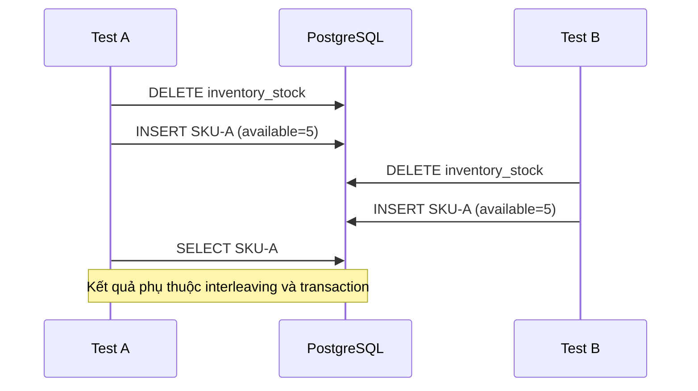
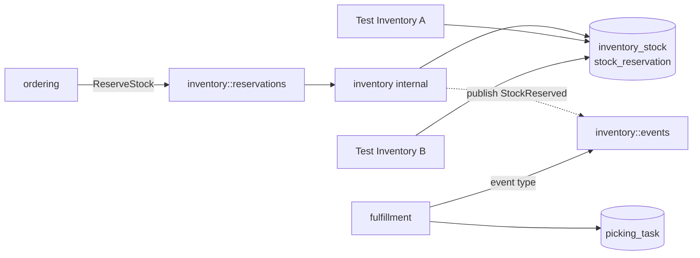
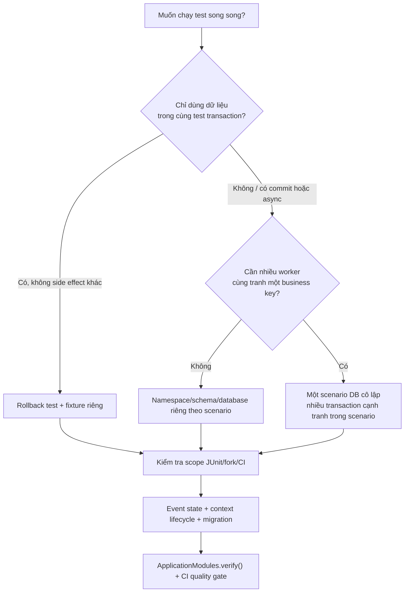

# Database isolation khi chạy song song

Một bài `@ApplicationModuleTest` của Inventory chạy riêng luôn xanh: fixture tạo SKU có tồn `5`, test giữ `2`, sau đó xác minh tồn còn `3`. Nhưng khi CI bật chạy nhiều test class cùng lúc, bài này đôi khi không tìm thấy SKU, đôi khi nhận lỗi `duplicate key`, hoặc quan sát thấy tồn `1`. Một bài khác dùng `@Sql("DELETE FROM inventory_stock")` để “dọn cho sạch”, vô tình xóa fixture của test đang chạy trên thread khác.

Nguyên nhân không nhất thiết nằm ở logic Inventory. **Nhiều test đang cạnh tranh cùng một database state**, trong khi mỗi test tưởng mình sở hữu dữ liệu. Rollback của test A không dọn dữ liệu đã được transaction B commit; một `@ResourceLock` trong JUnit không ngăn job CI khác kết nối cùng database; và `@ApplicationModuleTest` chỉ kiểm soát phạm vi module/bean chứ **không tự tạo database riêng**.

Bài **“Database isolation khi chạy song song”** thuộc chương **Database testing** của **SPRING_MODULITH_VERIFICATION_TESTING**. Trong bối cảnh rèn kỹ năng kiểm chứng ranh giới Spring Modulith bằng `ApplicationModules`, `@ApplicationModuleTest`, kiểm thử sự kiện, database và tích hợp, chúng ta sẽ thiết kế chính sách cô lập database khi chạy nhiều test, minh họa với PostgreSQL/Testcontainers, bảo vệ invariant qua transaction độc lập, rồi thiết lập quality gate CI không bị lỗi ngẫu nhiên.

> **Quy tắc gốc:** Mỗi phép thử phải biết chính xác **dữ liệu nào nó sở hữu, ai khác có thể chạm vào dữ liệu đó, khi nào thao tác đã commit và cơ chế nào dọn những thay đổi**. “Có rollback” hoặc “có container” không tự trả lời đủ bốn câu hỏi.

## 1. Mục tiêu học tập

Sau bài này, bạn có thể:

1. Phân biệt **song song giữa test method, test class, process/JVM, fork, module test và CI job**.
2. Nhận dạng ba nhóm lỗi: **data collision**, **transaction visibility** và **shared infrastructure side effect**.
3. So sánh năm chiến lược: rollback test, reset DB tuần tự, ID/namespace riêng, schema/database riêng và container riêng.
4. Thiết kế fixture/cleanup có tính lặp lại, không xóa dữ liệu đang được test khác sử dụng.
5. Dùng `@Execution`, `@ResourceLock`, cấu hình JUnit, Testcontainers và Spring context caching với đúng phạm vi bảo vệ của chúng.
6. Chạy concurrency test thực sự với **hai transaction độc lập**, fixture đã commit và PostgreSQL tương đương engine production.
7. Cô lập dữ liệu do event listener, `REQUIRES_NEW`, async worker và Event Publication Registry tạo ra.
8. Kết hợp `ApplicationModules.verify()`, module/database tests và quality gate CI để chặn phụ thuộc sai và hồi quy.

## 2. “Chạy song song” có ít nhất năm tầng

Khi nói hai test “chạy cùng lúc”, cần xác định phạm vi. Cơ chế khóa/cô lập có hiệu lực ở tầng thấp **không tự mở rộng** lên tầng cao.

| Tầng | Ví dụ | Tài nguyên có thể chia sẻ |
| --- | --- | --- |
| **Test method** | Hai `@Test` trong cùng một class chạy concurrent | Spring context, datasource, schema, fixture, static fields |
| **Test class** | `InventoryTests` và `OrderingTests` cùng JVM | Spring context cache, connection pool, container singleton, database |
| **Test worker/JVM/fork** | Maven Surefire forks hoặc Gradle `maxParallelForks` | Database bên ngoài process, Docker daemon, broker |
| **CI job/shard** | Hai job chạy cùng branch hoặc hai PR | Database test dùng chung, schema, queue, Redis, external sandbox |
| **Thread bất đồng bộ của ứng dụng** | `@Async`, event listener, scheduler | Cùng schema nhưng transaction/connection độc lập |

Hai trường hợp thường bị lẫn:

- **Parallel test execution:** nhiều bài test độc lập phải chạy mà **không ảnh hưởng nhau**.
- **Concurrency test:** một bài test chủ động tạo nhiều transaction cạnh tranh trên **cùng một đối tượng nghiệp vụ** để kiểm chứng locking, atomic update và invariant.

Với parallel execution, ta muốn **cô lập** trạng thái. Với concurrency test, ta cố ý **chia sẻ một SKU/ghế** giữa các worker, nhưng **chỉ trong phạm vi một scenario có kiểm soát**. Nếu không phân biệt hai mục tiêu này, test hoặc quá tuần tự nên không bắt được race, hoặc quá chia sẻ nên cho lỗi ngẫu nhiên.

### 2.1. Từ khóa để hỏi trước khi cấu hình

1. Có bao nhiêu **process/JVM** cùng chạy test?
2. Các test có sử dụng **cùng JDBC URL, database name và schema** không?
3. Các test có **khóa định danh fixture giống nhau** không?
4. Có bài nào chạy `DELETE`/`TRUNCATE` toàn bảng?
5. Có dữ liệu nào được commit ngoài test-managed transaction không?
6. Event consumer hoặc scheduler có thể còn chạy sau khi phương thức test kết thúc không?

Không nên bật `parallel=true` rồi trông chờ sửa từng test đỏ bằng `Thread.sleep(...)`. Trước tiên cần chính sách **sở hữu dữ liệu và hạ tầng**.

## 3. Ba kiểu lỗi làm test song song không đáng tin

### 3.1. Data collision

Hai test đều seed:

```sql
INSERT INTO inventory_stock(sku, available)
VALUES ('SKU-A', 5);
```

Nếu một test đã commit hàng đó, test kia có thể gặp primary-key violation. Nếu hai test chạy `DELETE` trước seed, chúng có thể luân phiên xóa dữ liệu của nhau.



Sơ đồ minh họa một lịch xen kẽ có thể xảy ra khi các câu SQL **đã commit** hoặc chạy ở những transaction đủ nhìn thấy ảnh hưởng lẫn nhau. Lock của database có thể làm một trong các thao tác bị chờ hoặc lỗi; điều đó không bảo đảm test đúng. Kết quả vẫn phụ thuộc lịch chạy, chứ không chỉ vào input của từng test.

### 3.2. Transaction visibility

Test A mở `@Transactional`, seed SKU nhưng **chưa commit**. Một thread khác gọi service và không nhìn thấy SKU vì đang sử dụng transaction/connection khác theo isolation level. Bài test sau đó kết luận nhầm “service không tìm thấy hàng”.

Ngược lại, test A dùng `@SqlConfig(transactionMode = ISOLATED)` để seed đã commit. Test B có thể nhìn thấy fixture đó và vô tình dùng nhầm.

**Hai loại lỗi trái ngược:**

- Dữ liệu **chưa commit nên test khác không thấy**.
- Dữ liệu **đã commit nên test khác thấy hoặc sửa được**.

Một chiến lược isolation phải kiểm soát cả hai.

### 3.3. Shared infrastructure side effects

Test Inventory phát `StockReserved`; listener Fulfillment bất đồng bộ tạo một `picking_task`. Dù transaction test Inventory rollback, listener có thể đã commit trong transaction riêng, tùy pha xử lý/cấu hình. Test sau thấy picking task cũ hoặc unique constraint lỗi.

Những tài nguyên còn dễ rò hơn:

- Event publication registry.
- Queue/message broker và những subscription cùng tên.
- Redis/cache với key cố định.
- Local filesystem hoặc object storage.
- Đồng hồ giả/static singleton/probe giữ state.
- Scheduled jobs chạy nền trong Spring context.

**Database isolation chỉ là một lớp.** Với integration test có event, phải xét side effect xuyên tài nguyên theo cùng tiêu chí “được sở hữu bởi scenario nào?”.

## 4. Transaction test rollback: hữu ích nhưng có điều kiện

Spring Test có thể mở test-managed transaction cho phương thức `@Transactional` và rollback mặc định sau test:

```java
@ApplicationModuleTest
@Transactional
class InventoryRepositoryModuleTests {

    @Test
    void reservesStockInsideTestTransaction() {
        // Nếu cùng transaction manager và propagation REQUIRED,
        // những thay đổi phù hợp sẽ rollback sau test.
    }
}
```

Rollback giúp dọn dữ liệu do chính test tạo **trong cùng physical transaction**. Nhưng không tự thu hồi:

- Transaction `REQUIRES_NEW` đã commit.
- Transaction mở ở thread `@Async`, scheduler hoặc event consumer khác.
- HTTP request chạy trên server thread trong test `RANDOM_PORT`.
- Message/email đã gửi, cache ngoài database đã cập nhật.
- Dữ liệu fixture đã được commit bằng `@SqlConfig(ISOLATED)`.
- PostgreSQL sequence values tăng từ `nextval()` (sequence không rollback như row).

### 4.1. Rollback không phải khóa phân tán

Nếu hai test cùng ghi một bảng trong hai transaction khác nhau, PostgreSQL có cơ chế isolation/locking của **DB engine**. Test rollback cuối cùng không biến hai ca thành độc lập về dữ liệu và lock:

- Hai transaction có thể chờ nhau.
- Có thể có deadlock/timeouts.
- Có thể tranh cùng unique key.
- Có thể quan sát phantom/serialization failure tùy isolation.

Đừng coi việc `@Transactional` làm test xanh khi chạy đơn lẻ là bằng chứng chạy song song an toàn.

### 4.2. Test transaction còn có thể che commit thật

Một service `@Transactional(REQUIRED)` thường tham gia test transaction nếu đã có. Khi method trả về, DB chưa nhất thiết commit; listener `AFTER_COMMIT` có thể chưa chạy. Vì thế:

| Mục tiêu | Có thể dùng transaction bao ngoài của test? |
| --- | --- |
| Test repository CRUD đơn giản và tự rollback fixture | **Có**, nếu mọi thao tác tham gia đúng transaction |
| Test service tự commit, kiểm tra lỗi tại commit | **Không nên** |
| Test event `AFTER_COMMIT` hoặc listener bất đồng bộ | **Không nên**, trừ khi chủ động commit test transaction |
| Test hai worker threads tranh một hàng | **Không nên**, fixture cần được commit trước |
| Test reset schema/migration version | **Không**, phải quản lý schema/database riêng |

### 4.3. `@DirtiesContext` không phải reset database

`@DirtiesContext` làm Spring Test bỏ context cache theo phạm vi xác định. Nó có thể tạo một ApplicationContext mới, nhưng không mặc nhiên xóa những hàng đã commit trong một PostgreSQL container hoặc database external còn tồn tại. Dùng nó để “fix flakiness” sẽ làm test chậm mà chưa chắc xử lý nguyên nhân.

## 5. Chiến lược isolation: chọn theo phạm vi rủi ro

| Chiến lược | Phạm vi bảo vệ điển hình | Ưu điểm | Giới hạn |
| --- | --- | --- | --- |
| **Test-managed rollback** | Những thao tác trong cùng test transaction | Nhanh, ít cleanup SQL | Không bao phủ transaction/side effect khác |
| **Reset + chạy tuần tự** | Một nhóm test cùng schema | Đơn giản, dễ debug | Giảm parallelism; không khóa job/process khác |
| **Dữ liệu phân vùng theo test key** | Những hàng/khóa thuộc scenario | Có thể chia sẻ một DB, tiết kiệm container | Code/query/cleanup phải giữ namespace nghiêm ngặt |
| **Schema riêng theo class/job** | Các bảng cùng tên trong schema riêng | Chia sẻ một PostgreSQL server nhưng tách phần lớn SQL state | Cần cấu hình search path, Flyway, ORM và schema registry đúng |
| **Database riêng theo class/job** | Database state và history độc lập | Isolation mạnh cho migration/commit test | Chi phí tạo DB/connection và quyền quản trị |
| **Container riêng theo suite/class** | Engine + database process độc lập | Rất mạnh, gần production, dễ reset | Startup/RAM/CPU, context-cache/lifecycle cần quản lý |

Không có một lựa chọn tối ưu cho toàn bộ test suite. **Tách test theo rủi ro**, ví dụ unit test chạy song song tự do; module test thuần transaction rollback có thể chia sẻ DB được kiểm soát; test commit/event/migration/concurrency dùng schema/database/container riêng.

### 5.1. Chọn theo loại test

| Loại test | Đề xuất mặc định | Khi cần nâng mức isolation |
| --- | --- | --- |
| Pure unit test không DB | Chạy song song | Nếu dùng static mutable state |
| Repository slice test | Transaction rollback + fixture nhỏ | Khi có commit riêng hoặc SQL lock |
| `@ApplicationModuleTest` với JPA | Fixture phân vùng; có test commit riêng | Khi listener/scheduler chạm cùng bảng |
| Test migration version | Database/schema mới, không dựa rollback | Khi test nhiều đường upgrade song song |
| Concurrency test | Một scenario DB cô lập, nhiều transaction trong scenario | Nếu còn suite khác dùng cùng business key |
| Event publication/consumer | DB và event state cô lập | Nếu broker/cache/registry được chia sẻ |
| HTTP integration `RANDOM_PORT` | DB/schema riêng, cleanup committed data | Vì test-level rollback không ôm server thread |

### 5.2. Quy tắc nâng cấp isolation

Nếu một bài test dùng **reset toàn bảng**, không thể vừa cho các bài khác ghi cùng bảng song song vừa kỳ vọng dữ liệu độc lập. Hoặc chuyển sang **reset theo namespace** và tôn trọng mọi truy vấn; hoặc cấp **schema/database riêng**; hoặc đánh dấu nhóm test không chạy chồng.

Thay đổi cách chạy test phải có **lý do kỹ thuật**, không chỉ “chậm nhưng ít fail”.

## 6. Ví dụ nghiệp vụ: Inventory, Ordering và Fulfillment

Ta xét modular monolith với các module:

```text
com/example/shop/
├── ShopApplication.java
├── inventory/
│   ├── reservations/
│   │   ├── package-info.java
│   │   ├── InventoryReservations.java
│   │   ├── ReserveStock.java
│   │   └── ReservationReceipt.java
│   ├── events/
│   │   ├── package-info.java
│   │   └── StockReserved.java
│   └── internal/
│       ├── StockReservationService.java
│       ├── persistence/
│       │   ├── StockRow.java
│       │   ├── StockRepository.java
│       │   ├── ReservationRow.java
│       │   └── ReservationRepository.java
│       └── ReservationExpiryJob.java
├── ordering/
│   ├── package-info.java
│   └── internal/PlaceOrderService.java
└── fulfillment/
    ├── package-info.java
    └── internal/StockReservedListener.java
```

Invariant của Inventory:

- `available >= 0`.
- Khi giữ `q` đơn vị, chỉ một giao dịch được chấp nhận nếu tồn không đủ cho tất cả.
- Mỗi `requestId` được xử lý theo hợp đồng idempotency; không tạo hai reservation nghiệp vụ cho một request.
- Nếu ghi reservation thất bại, giảm tồn phải rollback cùng giao dịch.

Ordering **không được** inject repository nội bộ Inventory. Fulfillment nhận event công khai và sở hữu bảng `picking_task` của nó.



Hai đường test A/B đến cùng DB là điểm cần kiểm soát. Cả hai test có thể bootstrap Inventory độc lập nhưng **nếu trỏ cùng datasource/schema thì vẫn chia sẻ dữ liệu**.

### 6.1. Schema PostgreSQL tối giản

```sql
CREATE TABLE inventory_stock (
    sku VARCHAR(80) PRIMARY KEY,
    available INTEGER NOT NULL,
    CONSTRAINT ck_inventory_nonnegative CHECK (available >= 0)
);

CREATE TABLE stock_reservation (
    reservation_id UUID PRIMARY KEY,
    request_id UUID NOT NULL UNIQUE,
    sku VARCHAR(80) NOT NULL
        REFERENCES inventory_stock(sku),
    quantity INTEGER NOT NULL CHECK (quantity > 0),
    status VARCHAR(20) NOT NULL
        CHECK (status IN ('ACTIVE', 'RELEASED'))
);

CREATE TABLE picking_task (
    task_id UUID PRIMARY KEY,
    reservation_id UUID NOT NULL UNIQUE,
    sku VARCHAR(80) NOT NULL,
    quantity INTEGER NOT NULL
);
```

Đây là **DDL để học**. Trong dự án thật, schema nên được tạo từ Flyway/Liquibase migration production, không copy thủ công một file DDL riêng cho test rồi để drift. `picking_task` logic thuộc Fulfillment dù có thể nằm chung PostgreSQL.

### 6.2. API công khai

```java
// inventory/reservations/package-info.java
@org.springframework.modulith.NamedInterface("reservations")
package com.example.shop.inventory.reservations;
```

```java
// inventory/reservations/ReserveStock.java
package com.example.shop.inventory.reservations;

import java.util.UUID;

public record ReserveStock(String sku, int quantity, UUID requestId) {
    public ReserveStock {
        if (sku == null || sku.isBlank() ||
            quantity <= 0 || requestId == null) {
            throw new IllegalArgumentException("Lệnh giữ hàng không hợp lệ");
        }
    }
}
```

```java
// inventory/reservations/ReservationReceipt.java
package com.example.shop.inventory.reservations;

import java.util.UUID;

public record ReservationReceipt(UUID reservationId) {}
```

```java
// inventory/reservations/InventoryReservations.java
package com.example.shop.inventory.reservations;

public interface InventoryReservations {
    ReservationReceipt reserve(ReserveStock command);
}
```

Thực thi Inventory cần update tồn an toàn, ghi reservation trong transaction cùng datasource và công bố event theo hợp đồng. Những record/interface trên là **mẫu API**, không phải implementation đầy đủ về release/expiry/idempotent replay.

## 7. Fixture test: sở hữu data theo một scenario

Điều kiện để các bài test chạy song song là **mỗi bài không được sử dụng ngẫu nhiên dữ liệu của bài khác**.

### 7.1. Phản mẫu: ID cố định + xóa toàn bảng

```sql
DELETE FROM stock_reservation;
DELETE FROM inventory_stock;

INSERT INTO inventory_stock(sku, available)
VALUES ('SKU-TEST', 5);
```

Script này hợp lý **chỉ khi** database/schema được sở hữu riêng cho test suite tuần tự hoặc reset trước khi chạy một scenario có khóa. Nếu nhiều test class cùng DB thực thi script, chúng có thể xóa dữ liệu của nhau.

### 7.2. Tạo test namespace có ý nghĩa

Ví dụ test A dùng:

```text
SKU = TEST_A_71FD_SKU
requestId = 11111111-1111-4111-8111-111111111111
```

Test B dùng:

```text
SKU = TEST_B_34A2_SKU
requestId = 22222222-2222-4222-8222-222222222222
```

Các giá trị cố định **khác nhau** giúp test đọc được và chạy lặp lại khi DB sạch. Khi nhiều CI job có thể chia sẻ database, khóa cố định theo class **vẫn có thể trùng giữa hai job**; cần thêm `runId/shardId` hoặc cấp database/schema riêng.

Một helper test có thể tạo ID:

```java
String runKey = UUID.randomUUID().toString().replace("-", "")
    .substring(0, 10);
String sku = "test_" + runKey + "_sku";
UUID requestId = UUID.randomUUID();
```

Random ở đây dùng để **phân vùng định danh**, không dùng để quyết định lượng tồn hoặc giá trị kỳ vọng. Assert vẫn phải có kết quả **deterministic** theo input `available = 5`, `reserve = 2`.

### 7.3. Fixture builder có scope rõ

```java
final class InventoryFixture {

    private final JdbcTemplate jdbc;
    private final String namespace;

    InventoryFixture(JdbcTemplate jdbc, String namespace) {
        this.jdbc = jdbc;
        this.namespace = namespace;
    }

    String seedStock(int available) {
        String sku = "test_" + namespace + "_sku";
        jdbc.update(
            "INSERT INTO inventory_stock(sku, available) VALUES (?, ?)",
            sku, available
        );
        return sku;
    }
}
```

Khi dùng helper này, `namespace` phải là chuỗi hợp lệ và đủ duy nhất trong database được chia sẻ. Helper chỉ seed **bảng do Inventory sở hữu trong test infrastructure**, không nên bị Ordering production import thành API truy cập nội bộ.

### 7.4. Cleanup đúng phạm vi

```java
void cleanupSku(JdbcTemplate jdbc, String sku) {
    jdbc.update("DELETE FROM stock_reservation WHERE sku = ?", sku);
    jdbc.update("DELETE FROM inventory_stock WHERE sku = ?", sku);
}
```

Xóa bảng con trước bảng cha để đáp ứng foreign key. Điều này không đủ nếu listener đã tạo `picking_task` liên quan: cần cleanup dữ liệu consumer theo `reservationId` tương ứng **hoặc** cô lập database/schema đủ mạnh để toàn bộ trạng thái về một điểm xuất phát. Không dùng `DELETE FROM picking_task` toàn bảng khi test khác đang dùng cùng bảng.

**Định danh unique giúp giảm collision, nhưng chỉ an toàn nếu mọi đường query/cleanup/event đều giữ được namespace.** Một câu SQL `SELECT count(*) FROM stock_reservation` không lọc theo scenario vẫn có thể đếm hàng của test khác và cho kết quả sai.

## 8. `@Sql` và transaction mode khi chạy song song

Với Spring Test, `@Sql` có thể seed trước test:

```java
@Sql(
    scripts = "/fixtures/inventory/seed-stock.sql",
    executionPhase = Sql.ExecutionPhase.BEFORE_TEST_METHOD
)
```

Khi test có test-managed transaction, script thường tham gia transaction đó nếu có transaction manager phù hợp. Với một concurrency test cần worker thread **nhìn thấy fixture đã commit**, một script nằm trong transaction của thread JUnit có thể không đủ.

### 8.1. Seed commit riêng

```java
@Sql(
    scripts = "/fixtures/inventory/seed-stock.sql",
    config = @SqlConfig(
        transactionMode = SqlConfig.TransactionMode.ISOLATED
    ),
    executionPhase = Sql.ExecutionPhase.BEFORE_TEST_METHOD
)
```

`ISOLATED` yêu cầu chạy SQL trong transaction riêng và commit khi có cấu hình transaction manager tương ứng. Nhưng **rollback test không xóa fixture đã commit**. Cần cleanup tách biệt hoặc database/schema riêng.

### 8.2. Cleanup theo namespace không chỉ theo thứ tự

Giả sử `seed-stock.sql` dùng SKU cố định. Dù cleanup đã chạy ở `AFTER_TEST_METHOD`, một test khác có thể bị ảnh hưởng **trước khi** cleanup xảy ra. Vì vậy “có cleanup sau test” không đồng nghĩa “an toàn khi hai test chạy chồng”.

Nếu cần test song song, script chỉ được đụng dữ liệu nó sở hữu:

```sql
DELETE FROM stock_reservation WHERE sku = 'TEST_A_71FD_SKU';
DELETE FROM inventory_stock WHERE sku = 'TEST_A_71FD_SKU';
```

Ở cấp CI job, SKU còn phải phân vùng theo job hoặc có database riêng. Việc copy một script với SKU cứng sang nhiều job cùng DB không đủ.

### 8.3. Không trộn seed từ nhiều nguồn không kiểm soát

Một test sử dụng cả `@Sql`, `@BeforeEach` JDBC và repository builder để seed cùng SKU rất khó xác định tiền điều kiện. Hãy chọn một cơ chế chính cho mỗi loại scenario; nếu cần kết hợp, ghi rõ từng loại dữ liệu do thành phần nào tạo.

## 9. JUnit 5 parallel execution và phạm vi của khóa

JUnit Jupiter hỗ trợ parallel execution theo cấu hình; khi bật, có thể cho test methods và classes chạy đồng thời. Ví dụ file `src/test/resources/junit-platform.properties`:

```properties
junit.jupiter.execution.parallel.enabled=true
junit.jupiter.execution.parallel.mode.default=concurrent
junit.jupiter.execution.parallel.mode.classes.default=concurrent
```

Đây là **cấu hình minh họa** để thấy mức độ cạnh tranh, không phải khuyến nghị bật cả hai dòng cho mọi suite ngay. Nên chia test theo nhóm và kiểm soát tài nguyên trước khi bật toàn cục.

### 9.1. `@Execution(SAME_THREAD)` cho một nhóm test

```java
import org.junit.jupiter.api.parallel.Execution;
import org.junit.jupiter.api.parallel.ExecutionMode;

@Execution(ExecutionMode.SAME_THREAD)
class InventorySequentialTests {
    // Những test methods trong class không chạy đồng thời với nhau
    // theo mode của JUnit Jupiter.
}
```

Điều này **không tự đảm bảo** một class khác dùng cùng database không chạy song song với class này. Nó cũng không khóa một Maven fork/CI job khác.

### 9.2. `@ResourceLock` khi nhiều test class chung tài nguyên

```java
import org.junit.jupiter.api.parallel.ResourceAccessMode;
import org.junit.jupiter.api.parallel.ResourceLock;

@ResourceLock(
    value = "inventory-shared-db",
    mode = ResourceAccessMode.READ_WRITE
)
class InventoryDatabaseTests {
    // Các test/class dùng cùng lock name phối hợp trong
    // phạm vi một JUnit Jupiter execution engine.
}
```

Mọi test cạnh tranh cùng tài nguyên **phải áp cùng lock name** thì cơ chế này mới hữu ích. `@ResourceLock` chỉ phối hợp việc thực thi trong phạm vi JUnit engine tương ứng, **không phải distributed lock** giữa nhiều JVM, Maven/Gradle forks hoặc CI shards.

### 9.3. Khác biệt giữa giới hạn parallelism và isolation

| Cách làm | Điều thực sự đảm bảo | Không đảm bảo |
| --- | --- | --- |
| `@Execution(SAME_THREAD)` | Test methods trong phạm vi áp dụng tuân theo execution mode tuần tự | Class khác/JVM khác không đụng DB |
| `@ResourceLock("db")` | Các test dùng cùng lock trong một engine được điều phối | Job CI/fork/process khác |
| `forkCount=1` hoặc `maxParallelForks=1` | Giảm số JVM/fork của build test | Không tự tắt method parallel hoặc job CI khác |
| Database/schema riêng | Tách bảng/transaction state theo phạm vi cấp phát | Không tự tách broker, static state hoặc tài nguyên ngoài |
| Container riêng | Tách engine và DB state của container đó | Không tách external API/broker dùng chung hoặc lỗi code concurrency |

Một cách an toàn để bắt đầu là **giữ integration tests có cleanup toàn bảng chạy tuần tự trong DB dành riêng**, còn unit tests chạy song song. Sau đó dần chuyển integration tests sang isolation mạnh để tăng parallelism.

## 10. Spring Test context cache không đồng nghĩa database cache

Spring Test có thể **tái sử dụng `ApplicationContext`** giữa các test có cấu hình tương thích để tiết kiệm thời gian bootstrap. Context này có thể giữ datasource pool, transaction manager, scheduler, listener và beans. Nhưng dữ liệu trong PostgreSQL là một nguồn state **khác**.

Các tình huống cần cảnh giác:

- Test class A và B tái sử dụng context, trong khi A đã commit fixture mà B tưởng DB sạch.
- Test class A có static `PostgreSQLContainer` rồi container đó bị dừng theo lifecycle JUnit; một Spring context được cache vẫn tham chiếu datasource URL của container cũ.
- Hai test class tạo container khác nhau nhưng Spring context cache không được tách theo cấu hình cần thiết.
- Một test dùng `@DirtiesContext` khiến context khởi động lại nhưng database vẫn giữ hàng cũ.
- Listener/scheduler trong context sống giữa các test và tiếp tục xử lý message chưa xong.

### 10.1. Quy tắc tổ chức lifecycle

1. Chọn **scope container** rõ: per class, per test suite hoặc singleton suốt quá trình test.
2. Đảm bảo Spring context sử dụng datasource **còn sống** trong toàn bộ thời gian context được cache/sử dụng.
3. Nếu chia sẻ container, mọi test phải biết có đang chia sẻ **cùng database/schema** hay không.
4. Nếu chuyển schema/database, các datasource/Flyway/JPA configuration phải được tạo lại với cấu hình phù hợp; một context cũ không tự đổi datasource vì biến static đã đổi.
5. Không dùng `@DirtiesContext` làm chiến lược duy nhất để dọn dữ liệu.

### 10.2. Một container dùng chung có thể tốt nhưng phải được thiết kế

Một PostgreSQL container singleton cho cả test suite có thể giảm chi phí startup. Nhưng nó đòi hỏi một trong các cách:

- Schema/database riêng theo nhóm test để chạy song song an toàn.
- Namespace dữ liệu nghiêm ngặt.
- Chạy tuần tự với reset rõ ràng cho các nhóm dùng chung schema.

**Chia sẻ engine** có thể là tối ưu hiệu năng; **chia sẻ dữ liệu không kiểm soát** là nguyên nhân flakiness.

## 11. Testcontainers: phân biệt container scope với database scope

Testcontainers cho phép chạy PostgreSQL thật trong môi trường tạm thời, nhưng **không tự tạo isolation đến từng test method** nếu tất cả test methods dùng một container và một schema.

### 11.1. Một module test với container được quản lý theo class

```java
package com.example.shop.inventory;

import org.springframework.boot.testcontainers.service.connection.ServiceConnection;
import org.springframework.modulith.test.ApplicationModuleTest;
import org.testcontainers.containers.PostgreSQLContainer;
import org.testcontainers.junit.jupiter.Container;
import org.testcontainers.junit.jupiter.Testcontainers;

@Testcontainers
@ApplicationModuleTest
class InventoryPostgresModuleTests {

    @Container
    @ServiceConnection
    static PostgreSQLContainer<?> postgres =
        new PostgreSQLContainer<>("postgres:16-alpine");

    // @Test, fixture, repository/service và assertions được bổ sung bên dưới.
}
```

`@ServiceConnection` là tính năng của Spring Boot với tích hợp Testcontainers phù hợp (ví dụ Spring Boot 3.1+). Cần driver PostgreSQL, Testcontainers PostgreSQL/JUnit Jupiter, Spring Modulith test starter, container runtime và migration/schema.

Giải thích scope:

- `static @Container` theo JUnit extension thường được start trước test class và stop sau test class.
- Mọi test method trong class trỏ đến **cùng database** của container đó.
- Nếu JUnit chạy các method concurrent, chúng vẫn có thể đụng nhau nếu fixture/cleanup chia sẻ khóa.
- Nếu các class khác dùng **container khác**, state vật lý có thể tách; nhưng cần phối hợp với lifecycle của Spring context cache.
- Nếu nhiều class dùng **cùng singleton container**, database **không tách** trừ khi cấp database/schema/namespace riêng.

`postgres:16-alpine` chỉ là phiên bản minh họa. Chọn PostgreSQL major version, extension và collation tương thích production; không coi một container chạy thành công là bằng chứng migration/constraint đúng nếu application đã tắt Flyway hoặc dùng Hibernate `create-drop`.

### 11.2. Vấn đề context cache và container lifecycle

Một lỗi khó: class A mở static container, Spring context A tạo datasource dùng URL đó; class A kết thúc và container stop. Class B tái sử dụng context được cache với datasource cũ, dẫn đến kết nối bị từ chối hoặc trạng thái khó đoán.

Chiến lược triển khai có thể là:

1. **Per-class container + context scope phù hợp:** test class và context không sống lâu hơn container; cách tách cache phải được xác định và kiểm tra.
2. **Singleton container toàn test suite/JVM:** container sống suốt khi context còn dùng, nhưng test phải tách data state rõ.
3. **Một database/schema riêng cho mỗi nhóm trên container dùng chung:** giảm startup mà vẫn kiểm soát ownership.

Không chỉ sao chép `@Testcontainers` và `@ServiceConnection` vào hàng chục class rồi mặc định lifecycle/cache sẽ luôn an toàn trong mọi cấu hình. Kiểm tra thực tế bằng suite chạy nhiều class ngược thứ tự và với parallelism bật.

### 11.3. Testcontainers reuse không đồng nghĩa data reset

Nếu cấu hình container reuse giữa các lần chạy, database có thể tồn tại lâu hơn mong đợi. Lúc đó test không nên giả định “container có nghĩa là database trống”. Với test migration từ đầu, ưu tiên container/database **thực sự mới** hoặc quy trình tạo schema mới có thể xác minh; không dùng `Flyway.clean()` tùy tiện trên tài nguyên chia sẻ.

## 12. Schema-per-suite trên một PostgreSQL instance

Khi chi phí khởi động container lớn, một lựa chọn là cấp **schema riêng** cho mỗi test suite/shard trên cùng server:

```text
PostgreSQL instance
├── schema it_inventory_7fd2
│   ├── flyway_schema_history
│   ├── inventory_stock
│   └── stock_reservation
├── schema it_inventory_a98c
│   ├── flyway_schema_history
│   ├── inventory_stock
│   └── stock_reservation
└── schema it_ordering_b142
    ├── flyway_schema_history
    ├── sales_order
    └── ...
```

Điều này **chỉ an toàn khi** migration và SQL/JPA thực sự sử dụng schema được cấp. Nếu migration có `public.inventory_stock` hard-coded, nó vẫn ghi vào `public` bất chấp test đang trỏ `it_inventory_7fd2`.

### 12.1. Trình tự provisioning

1. Tạo một định danh schema duy nhất cho **một scope có đời sống rõ** (ví dụ CI job hoặc test suite).
2. Dùng connection có quyền cần thiết để tạo schema.
3. Cấu hình datasource/application search path hoặc default schema.
4. Cấu hình Flyway/Liquibase chạy trong schema tương ứng, bao gồm history table.
5. Khởi động module test context với những property **đã cố định**.
6. Seed fixture, chạy test, xác minh không đụng schema khác.
7. Chờ worker/listener hoàn tất, dọn schema của chính job khi không còn được dùng.

**Thứ tự quan trọng:** Không khởi động `ApplicationContext`/Flyway trước rồi mới tạo schema và đổi biến môi trường trong cùng context, vì datasource/connection pool đã được tạo. Cấp schema và cấu hình kết nối **trước** khi migration và bean JPA khởi động.

### 12.2. Ví dụ thiết lập Flyway theo schema

Với PostgreSQL và datasource do một **test harness độc lập** tạo:

```java
String schema = "it_inventory_a98c";

if (!schema.matches("[a-z][a-z0-9_]*")) {
    throw new IllegalArgumentException("Schema identifier không hợp lệ");
}

JdbcTemplate admin = new JdbcTemplate(adminDatasource);
admin.execute("CREATE SCHEMA \"" + schema + "\"");

Flyway flyway = Flyway.configure()
    .dataSource(applicationDatasource)
    .schemas(schema)
    .defaultSchema(schema)
    .locations("classpath:db/migration")
    .load();
flyway.migrate();
flyway.validate();
```

Đây là **trích đoạn provisioning**, không phải nguyên lớp test. `adminDatasource` phải có quyền tạo schema, `applicationDatasource` phải trỏ đúng database; cả hai cần được tạo từ cấu hình của suite. Chỉ tạo tên schema do code kiểm soát và validate chặt trước khi đưa vào câu SQL định danh; JDBC parameter `?` không dùng thay cho identifier schema trong DDL thông thường.

`Flyway.schemas(...)`/`defaultSchema(...)` định vị schema migration và history theo cách cấu hình; nhưng các repository và native SQL của ứng dụng **cũng phải trỏ đúng schema**.

### 12.3. Đồng bộ datasource, Flyway và Hibernate

Ví dụ một kết nối PostgreSQL được cấu hình search path theo schema thử nghiệm:

```properties
# Các giá trị là ví dụ; test harness phải thay cùng một schema theo job.
spring.datasource.url=jdbc:postgresql://localhost:5432/shop_test?currentSchema=it_inventory_a98c
spring.flyway.schemas=it_inventory_a98c
spring.flyway.default-schema=it_inventory_a98c
spring.jpa.hibernate.ddl-auto=validate
```

Khi dự án dùng Hibernate với schema được khai báo tường minh, có thể cần cấu hình `hibernate.default_schema` hoặc mapping phù hợp. Nếu entity dùng `@Table(schema = "public")` cố định, `currentSchema` có thể không đủ để chuyển mọi SQL.

**Không có một property thần kỳ** làm tất cả Flyway, Hibernate, JDBC native SQL, event registry và stored procedure tự đổi schema nếu code/config đã hard-code `public`. Mỗi đường lưu trữ phải được xác minh.

### 12.4. Schema riêng vẫn có tài nguyên chung

Các schema trong cùng một PostgreSQL instance vẫn chia sẻ:

- CPU, memory, I/O, connection capacity và một số lock/resource global.
- Roles và extensions có phạm vi database.
- Có thể chia sẻ advisory lock nếu code không namespace lock key.
- Scheduled jobs hoặc consumer cố ý truy vấn nhiều schema.
- Function/trigger/view đã được schema-qualify ngoài phạm vi test.

Schema-per-suite **cô lập phần lớn table state**, không tương đương container-per-suite cho mọi kịch bản load, migration lock hoặc cơ chế extension.

## 13. Database-per-shard và container-per-class: khi nào đáng chi phí?

Nếu một test cần đảm bảo database sạch để chạy migration `V1 → Vn`, hoặc test dùng `TRUNCATE`/DDL/transaction nhiều resource, **database riêng** thường dễ lý giải hơn namespace.

### 13.1. Database-per-shard

```text
CI_RUN_ID = run-8521
CI_SHARD = 03
DATABASE = shop_test_run8521_shard03
```

Mỗi shard nhận JDBC URL riêng. Phải bảo đảm database name được tạo bởi script provisioning an toàn, schema/migration được khởi tạo một lần đúng lifecycle, và cleanup chỉ xóa database thuộc đúng shard sau khi tất cả test/thread đã ngừng.

Không sử dụng tên `shop_test` toàn cục cho mọi PR khi nhiều CI jobs có thể chạy cùng lúc. Ngược lại, nếu mỗi CI job đã khởi tạo PostgreSQL container riêng trên runner độc lập, có thể không cần tạo thêm một database cho từng test class.

### 13.2. Container-per-class

Lợi ích:

- Mỗi class có engine/process với database state độc lập.
- Fresh migration dễ tái hiện.
- Thích hợp cho test DDL, isolation level, lock và event integration nhiều bảng.

Chi phí:

- Tăng thời gian khởi động và tải CPU/RAM khi class chạy song song.
- CI phải có container runtime và tài nguyên đủ.
- Context lifecycle/cache phải tương thích với container lifecycle.

**Đừng “càng nhiều container càng tốt”.** Thay vì 100 class đều khởi động PostgreSQL mới, có thể nhóm theo suite/mức rủi ro, dùng một container cho các test được cô lập bằng schema hoặc namespace.

### 13.3. Quy tắc chọn theo scope

| Nếu bạn cần... | Cân nhắc trước |
| --- | --- |
| Chỉ test một query, không commit ngoài transaction | Rollback + schema chung được kiểm soát |
| Hai class cùng DB nhưng phải chạy song song | Namespace dữ liệu hoặc schema riêng |
| Hai JVM/fork cùng một PostgreSQL | Database/schema riêng theo fork |
| Hai CI jobs chạy trên shared PostgreSQL service | Database/schema riêng theo job/run |
| Test migration từ DB trống, nhiều version | Database hoặc schema mới, history độc lập |
| Test lock/resource toàn instance | Container instance riêng nếu muốn loại trừ nhiễu |
| Event registry/consumer và nhiều modules | DB/schema/queue namespaces theo toàn workflow |

## 14. Một module test PostgreSQL chạy tuần tự có chủ đích

Không phải tất cả test DB phải chạy song song. Nếu một lớp được thiết kế để **sử dụng database/schema riêng và reset toàn bảng**, có thể thực hiện như sau:

```java
package com.example.shop.inventory;

import static org.assertj.core.api.Assertions.assertThat;

import com.example.shop.inventory.reservations.InventoryReservations;
import com.example.shop.inventory.reservations.ReserveStock;
import java.util.UUID;
import org.junit.jupiter.api.Test;
import org.junit.jupiter.api.parallel.Execution;
import org.junit.jupiter.api.parallel.ExecutionMode;
import org.springframework.beans.factory.annotation.Autowired;
import org.springframework.boot.testcontainers.service.connection.ServiceConnection;
import org.springframework.jdbc.core.JdbcTemplate;
import org.springframework.modulith.test.ApplicationModuleTest;
import org.springframework.test.context.jdbc.Sql;
import org.testcontainers.containers.PostgreSQLContainer;
import org.testcontainers.junit.jupiter.Container;
import org.testcontainers.junit.jupiter.Testcontainers;

@Testcontainers
@ApplicationModuleTest
@Execution(ExecutionMode.SAME_THREAD)
@Sql(
    scripts = "/fixtures/inventory/reset-and-seed.sql",
    executionPhase = Sql.ExecutionPhase.BEFORE_TEST_METHOD
)
class InventorySequentialPostgresTests {

    @Container
    @ServiceConnection
    static PostgreSQLContainer<?> postgres =
        new PostgreSQLContainer<>("postgres:16-alpine");

    @Autowired InventoryReservations inventory;
    @Autowired JdbcTemplate jdbc;

    @Test
    void reservesKnownStock() {
        inventory.reserve(new ReserveStock(
            "SKU-ISOLATED", 2, UUID.randomUUID()
        ));

        Integer remaining = jdbc.queryForObject(
            "SELECT available FROM inventory_stock WHERE sku = ?",
            Integer.class, "SKU-ISOLATED"
        );
        assertThat(remaining).isEqualTo(3);
    }
}
```

Test resource `src/test/resources/fixtures/inventory/reset-and-seed.sql`:

```sql
DELETE FROM stock_reservation;
DELETE FROM inventory_stock;

INSERT INTO inventory_stock(sku, available)
VALUES ('SKU-ISOLATED', 5);
```

Ví dụ giả định:

- Migration đã tạo hai bảng từ source được quản lý.
- `InventoryReservations` có implementation thực và dùng transaction phù hợp.
- Container/database không được một test class khác sử dụng đồng thời.
- Nếu test không bọc trong `@Transactional`, service có thể commit, nên reset trước mỗi test là cách khôi phục baseline; cần cleanup sau class nếu tài nguyên được dùng lại.
- `@Execution(SAME_THREAD)` giữ test methods của lớp tuần tự **nhưng không khóa các class/process khác**.

Nếu test class khác dùng **cùng singleton database**, hãy thêm chiến lược isolation hoặc khóa phù hợp; không nên nghĩ annotation `@Execution` tự giải quyết.

## 15. Concurrency test đúng nghĩa: hai transaction tranh tồn cuối

Để bắt lỗi oversell, ta cần **cố ý cho hai worker cạnh tranh trên cùng SKU**, trong khi không có test khác chạm vào database state của scenario.

### 15.1. Implementation an toàn tối thiểu

Đường nghiệp vụ trong Inventory nên thực hiện một câu lệnh update có điều kiện:

```java
// inventory/internal/persistence/StockRepository.java
package com.example.shop.inventory.internal.persistence;

import org.springframework.data.jpa.repository.JpaRepository;
import org.springframework.data.jpa.repository.Modifying;
import org.springframework.data.jpa.repository.Query;
import org.springframework.data.repository.query.Param;

public interface StockRepository extends JpaRepository<StockRow, String> {

    @Modifying
    @Query(value = """
        UPDATE inventory_stock
           SET available = available - :qty
         WHERE sku = :sku AND available >= :qty
        """, nativeQuery = true)
    int decrementIfEnough(
        @Param("sku") String sku,
        @Param("qty") int quantity
    );
}
```

Service thực hiện update và ghi reservation trong cùng transaction:

```java
// inventory/internal/StockReservationService.java
@Service
class StockReservationService implements InventoryReservations {

    private final StockRepository stock;
    private final ReservationRepository reservations;

    StockReservationService(
        StockRepository stock, ReservationRepository reservations
    ) {
        this.stock = stock;
        this.reservations = reservations;
    }

    @Override
    @Transactional
    public ReservationReceipt reserve(ReserveStock command) {
        if (stock.decrementIfEnough(
                command.sku(), command.quantity()) != 1) {
            throw new InsufficientStock(command.sku());
        }

        UUID reservationId = UUID.randomUUID();
        reservations.save(new ReservationRow(
            reservationId,
            command.requestId(),
            command.sku(),
            command.quantity()
        ));
        return new ReservationReceipt(reservationId);
    }
}
```

Đây là **mã minh họa**, cần định nghĩa `StockRow`, `ReservationRow`, `ReservationRepository`, `InsufficientStock` công khai theo hợp đồng và import Spring types. Ví dụ cho thấy ý định: transaction thống nhất hai bước và thao tác update tồn tránh read-then-write đơn giản. Production còn phải xác định idempotency, thời hạn giữ, retry sau lỗi commit và isolation level thích hợp.

### 15.2. Cấu hình test: fixture đã commit, không bọc transaction ngoài

```java
package com.example.shop.inventory;

import static org.assertj.core.api.Assertions.assertThat;

import com.example.shop.inventory.reservations.InsufficientStock;
import com.example.shop.inventory.reservations.InventoryReservations;
import com.example.shop.inventory.reservations.ReserveStock;
import java.util.UUID;
import java.util.concurrent.Callable;
import java.util.concurrent.CountDownLatch;
import java.util.concurrent.Executors;
import java.util.concurrent.Future;
import java.util.concurrent.TimeUnit;
import java.util.stream.Stream;
import org.junit.jupiter.api.Test;
import org.junit.jupiter.api.parallel.ResourceAccessMode;
import org.junit.jupiter.api.parallel.ResourceLock;
import org.springframework.beans.factory.annotation.Autowired;
import org.springframework.jdbc.core.JdbcTemplate;
import org.springframework.modulith.test.ApplicationModuleTest;
import org.springframework.test.context.jdbc.Sql;
import org.springframework.test.context.jdbc.SqlConfig;

@ApplicationModuleTest
@ResourceLock(
    value = "inventory-shared-db",
    mode = ResourceAccessMode.READ_WRITE
)
@Sql(
    scripts = "/fixtures/inventory/last-unit.sql",
    config = @SqlConfig(
        transactionMode = SqlConfig.TransactionMode.ISOLATED
    ),
    executionPhase = Sql.ExecutionPhase.BEFORE_TEST_METHOD
)
class InventoryLastUnitConcurrencyTests {

    @Autowired InventoryReservations inventory;
    @Autowired JdbcTemplate jdbc;

    @Test
    void onlyOneRequestCanReserveLastUnit() throws Exception {
        var pool = Executors.newFixedThreadPool(2);
        var ready = new CountDownLatch(2);
        var start = new CountDownLatch(1);

        Callable<Boolean> attempt = () -> {
            ready.countDown();
            if (!start.await(5, TimeUnit.SECONDS)) {
                throw new IllegalStateException("Worker không bắt đầu");
            }
            try {
                inventory.reserve(new ReserveStock(
                    "SKU-LAST-UNIT", 1, UUID.randomUUID()
                ));
                return true;
            } catch (InsufficientStock expected) {
                return false;
            }
        };

        try {
            Future<Boolean> a = pool.submit(attempt);
            Future<Boolean> b = pool.submit(attempt);
            assertThat(ready.await(5, TimeUnit.SECONDS)).isTrue();
            start.countDown();

            long accepted = Stream.of(
                a.get(10, TimeUnit.SECONDS),
                b.get(10, TimeUnit.SECONDS)
            ).filter(Boolean::booleanValue).count();

            Integer remaining = jdbc.queryForObject(
                "SELECT available FROM inventory_stock WHERE sku = ?",
                Integer.class, "SKU-LAST-UNIT"
            );
            Integer reservations = jdbc.queryForObject(
                "SELECT count(*) FROM stock_reservation WHERE sku = ?",
                Integer.class, "SKU-LAST-UNIT"
            );

            assertThat(accepted).isEqualTo(1);
            assertThat(remaining).isZero();
            assertThat(reservations).isEqualTo(1);
        } finally {
            start.countDown();
            pool.shutdownNow();
            pool.awaitTermination(5, TimeUnit.SECONDS);
        }
    }
}
```

Script `src/test/resources/fixtures/inventory/last-unit.sql` dùng cho **database/schema riêng hoặc một suite được khóa đúng**:

```sql
DELETE FROM stock_reservation;
DELETE FROM inventory_stock;
INSERT INTO inventory_stock(sku, available)
VALUES ('SKU-LAST-UNIT', 1);
```

Điểm quan trọng:

1. Không đặt `@Transactional` trên test class: worker threads phải gọi service qua Spring proxy và tự có transaction.
2. `ISOLATED` giúp fixture được commit **trước** khi worker bắt đầu; test-level rollback không phụ trách cleanup.
3. Hai request ID khác nhau, nhưng **cùng SKU** để thực sự cạnh tranh.
4. `CountDownLatch` điều phối lúc bắt đầu; timeout làm lỗi có giới hạn, không treo CI vô hạn.
5. `Future.get(...)` bảo đảm test chờ kết quả worker trước khi đọc trạng thái DB.
6. `@ResourceLock` điều phối các bài **cùng khóa** trong một JUnit engine, không cấm một fork/job khác xóa bảng.
7. Trước test tiếp theo cần reset/cleanup; khi test chạy cùng schema dùng khóa toàn suite hoặc cấp DB riêng.

**Giới hạn:** Một lượt chạy hai thread **không chứng minh mọi interleaving**; nếu có deadlock, timeout hoặc serialization failure thì phải xét hợp đồng retry/lỗi thay vì giả định chỉ có `InsufficientStock`. Nên kết hợp invariant database, update atomic, test đa lần có kiểm soát và PostgreSQL version gần production.

### 15.3. Không nhầm concurrency test với parallel test

Trong `onlyOneRequestCanReserveLastUnit()`, chia sẻ `SKU-LAST-UNIT` **là chủ đích**. Nhưng hai lượt chạy khác nhau của **chính test đó** không nên song song trên cùng bảng với cùng SKU và script reset. Isolation giữa các **scenarios** phải được bảo vệ, dù bên trong mỗi scenario có nhiều worker thread.

## 16. Sự kiện, transaction riêng và state vượt vòng đời test

Giả sử Inventory công bố `StockReserved` sau khi giữ thành công. Fulfillment có listener xử lý:

```java
// inventory/events/StockReserved.java
package com.example.shop.inventory.events;

import java.util.UUID;

public record StockReserved(
    UUID reservationId,
    String sku,
    int quantity
) {}
```

```java
// fulfillment/internal/StockReservedListener.java
@Component
class StockReservedListener {

    @ApplicationModuleListener
    void on(StockReserved event) {
        // Tạo picking task theo reservationId, idempotent.
    }
}
```

Listener cần implementation thật, import và cấu hình event phù hợp với Spring Modulith phiên bản đang dùng. `@ApplicationModuleListener` hỗ trợ mô hình xử lý transactional/asynchronous theo cấu hình, nhưng **không tự bảo đảm exactly-once delivery**.

### 16.1. Một listener có thể chạy sau phương thức test

Nếu test gọi `inventory.reserve(...)` rồi kết thúc ngay, listener bất đồng bộ có thể tiếp tục ghi `picking_task` sau khi assertion của test producer hoàn tất. Nếu test kế tiếp reset `picking_task` ngay lúc đó, ta có race giữa cleanup và consumer.

Một integration test nên:

1. Seed dữ liệu theo namespace.
2. Gọi producer và cho transaction commit thật.
3. Chờ consumer hoàn thành bằng **điều kiện quan sát** và timeout.
4. Assert side effect thuộc đúng `reservationId`.
5. Nếu cần test retry, phát lại cùng event và assert idempotency.
6. Sau khi chắc chắn không còn worker liên quan, cleanup dữ liệu thuộc scenario.

Đừng giải quyết bằng `Thread.sleep(3000)` cố định; máy CI nhanh/chậm khác nhau khiến test lúc nào đó vẫn fail.

### 16.2. Event Publication Registry cũng cần isolation

Nếu dự án bật cơ chế lưu publication của Spring Modulith, bảng registry có thể chứa những publication chưa hoàn thành. Một test consumer thất bại có chủ đích có thể để lại publication để retry. Trong shared DB:

- Test khác hoặc một cơ chế resubmission khi context khởi động có thể xử lý publication cũ.
- Count `SELECT count(*) FROM event_publication` toàn bảng có thể gồm sự kiện từ scenario khác.
- Các bản ghi cần được phân vùng/đối chiếu theo event ID/aggregate ID hoặc cô lập schema/database.
- Schema migration của registry phải chạy đúng nơi; không chỉ migrate bảng nghiệp vụ Inventory.

Tên bảng, schema và policy resubmission phụ thuộc **module persistence và phiên bản Spring Modulith**, nên không hard-code tên bảng registry khi chưa kiểm tra cấu hình của dự án.

### 16.3. Test `AFTER_COMMIT` khác test publication

`PublishedEvents` trong `@ApplicationModuleTest` có thể ghi nhận event được publish **trước khi transaction commit**. Listener `@TransactionalEventListener(phase = AFTER_COMMIT)` chỉ phản ứng khi transaction producer commit thành công phù hợp. Do đó:

| Test | Cần chứng minh | Isolation cần thiết |
| --- | --- | --- |
| Publication test | Một event đúng kiểu và payload đã publish | Scope event recorder/test đúng scenario |
| Producer commit test | Database producer bền vững sau service transaction | Transaction thật và DB read sau commit |
| Consumer test | Listener tạo state đúng và idempotent | Module consumer + DB/registry/queue được phân vùng |
| Rollback test | Không có consumer side effect sau commit sai | Chủ động rollback và đọc state ngoài transaction |
| Retry/restart test | Publication chưa hoàn thành được xử lý lại đúng | Hạ tầng persistence thật, test lifecycle cô lập |

Một test rollback mặc định **không** thay thế test listener sau commit; và test listener sau commit cũng **không** tự chứng minh dữ liệu của mọi module được dọn sạch giữa các test.

## 17. Module boundary vẫn phải được kiểm chứng độc lập

Database isolation kiểm soát **state**, không tự bảo vệ cấu trúc phụ thuộc Java giữa application modules. Dù mỗi module test có container riêng, `ordering` vẫn có thể đang import `inventory.internal.StockRepository` — đó là vi phạm kiến trúc.

Khai báo Inventory API:

```java
// inventory/reservations/package-info.java
@org.springframework.modulith.NamedInterface("reservations")
package com.example.shop.inventory.reservations;
```

Cho phép Ordering dùng đúng interface:

```java
// ordering/package-info.java
@org.springframework.modulith.ApplicationModule(
    allowedDependencies = "inventory::reservations"
)
package com.example.shop.ordering;
```

Event công khai:

```java
// inventory/events/package-info.java
@org.springframework.modulith.NamedInterface("events")
package com.example.shop.inventory.events;
```

Và Fulfillment chỉ phụ thuộc event API:

```java
// fulfillment/package-info.java
@org.springframework.modulith.ApplicationModule(
    allowedDependencies = "inventory::events"
)
package com.example.shop.fulfillment;
```

Bài test cấu trúc:

```java
// src/test/java/com/example/shop/ModularityTests.java
package com.example.shop;

import org.junit.jupiter.api.Test;
import org.springframework.modulith.core.ApplicationModules;

class ModularityTests {

    @Test
    void applicationModulesHaveValidDependencies() {
        ApplicationModules.of(ShopApplication.class).verify();
    }
}
```

`ApplicationModules.verify()` giúp phát hiện chu trình, tham chiếu package nội bộ của closed module và phụ thuộc vượt `allowedDependencies` đã khai báo. Nhưng công cụ **không tự kiểm tra SQL string**, `JdbcTemplate` cross-module, transaction isolation hoặc quyền truy cập table.

### 17.1. Hạn chế của việc chỉ tách schema cho test

Nếu Ordering production chạy SQL:

```java
jdbc.update(
    "UPDATE inventory_stock SET available = available - ? WHERE sku = ?",
    quantity, sku
);
```

Code vẫn là sai ownership dù test Ordering và Inventory có hai schema riêng trong CI. Khi chạy production chung DB, Ordering vẫn bypass business invariant của Inventory. Hãy chuyển thao tác về `InventoryReservations` và bổ sung review SQL, quyền database hoặc architecture rules khác nếu cần.

**Ranh giới code/nghiệp vụ và ranh giới dữ liệu kiểm thử là hai trục độc lập.** Chúng cần được xác minh cùng nhau.

## 18. CI: parallelism có thể xuất hiện ngoài JUnit

Ngay cả khi `junit.jupiter.execution.parallel.enabled=false`, CI vẫn có thể chạy song song qua:

- Maven test forks.
- Gradle test worker processes.
- Nhiều build modules/tasks chạy cùng lúc.
- Ma trận JDK/OS/database version.
- CI shards phân chia test classes.
- Hai PR/job khởi động đồng thời nhưng trỏ cùng external DB.
- Retry của một job cũ vẫn còn side effect khi job mới bắt đầu.

### 18.1. Maven Surefire và Gradle

Trong Maven, cấu hình Surefire/Failsafe như `forkCount` có thể tạo nhiều process; cơ chế parallel execution của JUnit bên trong từng fork là một lớp khác. Với Gradle, `maxParallelForks` điều khiển số JVM worker cho task test; không tự thay đổi việc JUnit trong mỗi worker chạy concurrent methods.

Do đó:

```text
total concurrency ≈ CI jobs × forks/workers × test threads
```

Đây là **mô hình xấp xỉ để lập kế hoạch tài nguyên**, không phải công thức chính xác cho lịch thực thi; một số tầng không chạy đồng thời hết và còn giới hạn CPU, connection pool, test scheduling.

### 18.2. Định danh môi trường theo run/shard

Một chiến lược:

```text
run_id   = 8521
shard_id = 03
db_name  = shop_it_8521_03
schema   = it_8521_03
```

CI provisioning cấp DB/schema trước khi test context khởi động, truyền URL/credentials theo **job-local configuration**, sau đó teardown đúng tài nguyên thuộc job. Không lấy tên database bằng một biến môi trường mặc định chung cho mọi PR.

### 18.3. Không dùng production credentials

Fixture thường chứa lệnh xóa/chèn rộng. Không trỏ chúng vào database production hay shared staging có dữ liệu thật. Dùng role/test account quyền tối thiểu và namespace được cấp riêng; teardown phải xác minh chính xác tài nguyên nó chuẩn bị xóa.

### 18.4. CI gate theo rủi ro

```text
Pull request
  |
  +-- Unit tests: chạy song song rộng, không chạm DB
  |
  +-- Architecture tests: ApplicationModules.verify()
  |
  +-- Repository/module tests: isolation bằng rollback hoặc namespace
  |
  +-- PostgreSQL Testcontainers: migration + commit/rollback
  |
  +-- Concurrency tests: nhiều worker trong scenario DB riêng
  |
  +-- Event/integration tests: DB + publication registry + listener
  |
  +-- Parallelism verification: chạy suite với config CI thực tế
  |
  +-- Tất cả gate bắt buộc đạt → đủ điều kiện xem xét merge
```

Một test đơn lẻ xanh **không** chứng minh cả suite song song an toàn. Nên có một job kiểm chứng tập các test có khả năng va chạm dưới cấu hình parallelism thực tế, đồng thời giữ khả năng chạy tuần tự để debug khi cần.

## 19. Cách chẩn đoán test flakey do database sharing

Một test đôi khi đỏ nhưng chạy lại xanh không nên được chữa bằng **retry vô hạn**. Trước khi điều chỉnh code, cần thu thập bằng chứng về **đúng database, đúng schema, transaction và lịch thực thi**.

### 19.1. Thông tin đáng log trong môi trường test

Với PostgreSQL, một test có thể đọc:

```sql
SELECT
    current_database() AS db_name,
    current_schema() AS schema_name,
    pg_backend_pid() AS connection_pid;

SHOW search_path;
```

Lưu vào log test khi debug:

- Tên test method/class và CI run/shard.
- JDBC URL **đã loại bỏ credentials/secrets**, database/schema thực.
- Thread name và các ID nghiệp vụ được test sử dụng.
- Thời điểm bắt đầu/kết thúc transaction theo log ở test scope.
- Số liệu hàng theo **namespace của scenario**, không log toàn bộ dữ liệu nhạy cảm.
- Listener/task nào còn đang xử lý khi test chuẩn bị cleanup.

`pg_backend_pid()` chỉ cho biết connection backend tại thời điểm truy vấn; hai câu SQL của cùng test có thể dùng connection khác khi pool cấp phát lại. Không dùng PID đơn lẻ làm cơ chế định danh test.

### 19.2. Kiểm tra có ghi sai schema không

Ví dụ một test được cấp schema `it_8521_03` nhưng vẫn thấy `current_schema() = public`. Điều đó cho thấy cần kiểm tra:

1. `spring.datasource.url` và `currentSchema`.
2. Flyway `schemas/defaultSchema` và location.
3. Hibernate `default_schema`, `@Table(schema=...)` cố định.
4. Những native SQL có tiền tố `public.`.
5. Connection pool có dùng `SET search_path` tùy thời điểm không được reset hay không.

**Cảnh giác:** Nếu một test thay đổi `search_path` trên connection được pool tái sử dụng mà không khôi phục đúng trạng thái, test khác có thể sử dụng nhầm schema. Ưu tiên cấu hình schema **ổn định cho cả datasource/context** hơn là thay đổi schema tùy ý theo từng test method trên cùng pool.

### 19.3. Kiểm tra transaction visibility

Nếu thread B “không nhìn thấy” fixture do test A tạo:

- Fixture của A đã commit chưa?
- Test A có `@Transactional` mặc định rollback không?
- Seed `@Sql` có đang tham gia test-managed transaction không?
- Thread B có dùng connection và transaction độc lập không?
- Nếu dùng `REQUIRES_NEW`, transaction mới có đang chờ lock hoặc thiếu visibility?
- Query có vô tình lọc sai namespace/tenant không?

Một bản ghi **không nhìn thấy** không nhất thiết là không tồn tại; nó có thể chưa commit, thuộc schema khác hoặc bị filter.

### 19.4. Kiểm tra collision và cleanup race

| Triệu chứng | Tình huống nghi ngờ | Bằng chứng nên thu thập |
| --- | --- | --- |
| `duplicate key (sku)` | Hai fixture dùng cùng SKU | Key, runId, test class, SQL seed |
| `row not found` sau khi vừa seed | Test khác `DELETE/TRUNCATE` | Thời điểm cleanup, schema, table |
| `could not serialize access` | Transaction concurrent với isolation phù hợp | Transaction boundaries và chính sách retry |
| `deadlock detected` | Lock order xung đột giữa nhiều worker | SQL/lock order, số connection |
| `relation does not exist` | Flyway chưa migrate hoặc schema sai | `search_path`, history, container lifecycle |
| Listener xử lý “event lạ” | Publication còn từ test trước | Event ID, registry state, startup resubmission |
| Context dùng URL container đã stop | Cache/lifecycle không khớp | Context key, container lifetime, datasource |
| Test xanh tuần tự, đỏ khi 2 forks | JUnit lock không vượt process | Config Surefire/Gradle, URL của mỗi fork |

**Nguyên tắc debug:** Giữ nguyên dữ liệu lỗi và log cần thiết trong một test environment có thể tái hiện trước khi tự động dọn toàn bộ, nhưng không bao giờ đụng đến dữ liệu ngoài phạm vi test được cấp.

## 20. Test dữ liệu khác test tính đúng đắn đồng thời

Không nên sửa một concurrency test đỏ bằng cách cho **mỗi worker một schema**: như vậy hai worker không còn tranh cùng một đơn vị tồn kho và test sẽ đánh mất mục tiêu.

### 20.1. Hai trục độc lập

```text
Trục A — giữa các scenarios:
  Scenario 1       Scenario 2
  DB/schema riêng  DB/schema riêng
       |                 |
       v                 v

Trục B — bên trong Scenario 1:
  Worker A ----+
               +----> cùng SKU, cùng Inventory DB
  Worker B ----+
```

Cần **cô lập giữa scenarios** và **chia sẻ có chủ đích bên trong một scenario kiểm thử cạnh tranh**.

### 20.2. Kỳ vọng và loại kết quả

Giả sử hai worker cùng giữ `1` đơn vị còn lại:

| Kết quả | Ý nghĩa |
| --- | --- |
| Một thành công, một `InsufficientStock`, tồn `0` | Đúng với contract từ chối ngay |
| Hai thành công, tồn `-1` hoặc hai reservation trái invariant | Lỗi concurrency/invariant |
| Hai thành công, tồn `0`, hai reservation | Vẫn có thể là lỗi; số reservation vượt lượng tồn |
| Cả hai lỗi “không có SKU” | Có thể do fixture chưa commit/sai schema, chưa chứng minh locking |
| Một lỗi DB timeout thay vì domain error | Cần xem policy retry/deadlock/timeout |
| Test pass trong 1 lượt | Tín hiệu tốt nhưng chưa chứng minh mọi interleaving |

Đừng chỉ assert `available >= 0`: một implementation sai có thể trả thành công cho cả hai request nhưng lưu tồn `0` do lost update. Phải assert **số request được chấp nhận, số reservation và state cuối** cùng nhau.

### 20.3. Độ tin cậy của concurrency test

- Dùng database production-type cho locking/isolation.
- Đảm bảo fixture đã commit và có cùng business key.
- Đảm bảo mọi worker thực sự chạy qua Spring bean/proxy production.
- Dùng barrier/latch, timeout hữu hạn, không dựa vào sleep.
- Ghi nhận cả kết quả accepted/rejected và exception không mong đợi.
- Chờ mọi worker xong trước khi cleanup.
- Có thể lặp nhiều lần trong môi trường cô lập để tăng xác suất bắt race.
- Kết hợp invariant ở database và atomic SQL update/optimistic/pessimistic lock phù hợp.

## 21. Bài thực hành: Booking–SeatAllocation–Payment

Ứng dụng đặt vé có ba application modules:

- `seatallocation`: sở hữu bảng `seat`, `seat_hold`, bảo vệ **không có hai phiếu giữ hiệu lực trên cùng ghế/suất diễn**.
- `booking`: đặt vé qua API `SeatHolds.hold(...)`, không inject `SeatHoldRepository`.
- `payment`: nghe `BookingPlaced`, ghi `payment_request` và phải idempotent theo `bookingId`.

Nhóm CI chạy **4 shards**, mỗi shard có **2 JVM forks**, mỗi JVM có JUnit concurrent test classes. Hiện mọi shard trỏ cùng PostgreSQL database `tickets_test`, các fixture dùng chung `show_id` và `seat_id='A-01'`, mỗi `@AfterEach` chạy `DELETE FROM seat_hold`.

### 21.1. Phân tích nguyên nhân

Hãy trả lời:

1. Vì sao `@ResourceLock("seat-db")` không ngăn shard khác xóa `seat_hold`?
2. Vì sao `@Transactional` trên test có thể không dọn payment request mà listener đã commit?
3. Vì sao `DELETE FROM seat_hold` trong `@AfterEach` có thể gây lỗi ngay cả khi mọi test có teardown?
4. Vì sao `@ApplicationModuleTest(STANDALONE)` không đảm bảo database chỉ chứa bảng Seating?
5. Trong một concurrency test trên ghế A-01, nên phân vùng **giữa worker** hay **giữa scenario**?

### 21.2. Thiết kế lại isolation

Một phương án:

```text
CI job / run 8521
  |
  +-- shard 01: database tickets_it_8521_01
  |              ├── suite Seating
  |              └── suite Booking
  |
  +-- shard 02: database tickets_it_8521_02
  |              ├── suite Payment
  |              └── event integration
  |
  +-- shard 03: database tickets_it_8521_03
  |              └── concurrency scenarios
  |
  +-- shard 04: database tickets_it_8521_04
                 └── migration/version tests
```

Nếu trong cùng shard có hai forks dùng cùng database, vẫn phải tiếp tục tách schema/namespace **theo fork**, hoặc bảo đảm các nhóm nguy cơ chạy tuần tự trong một process được phân quyền. Bảng trên minh họa tầng job/shard, **chưa tự giải quyết fork-level isolation**.

### 21.3. Viết test cho hai loại song song

**Parallel independence:**

- Tạo hai fixture ghế với `showId`/namespace khác nhau.
- Chạy test giữ ghế của hai scenario cùng lúc.
- Chứng minh kết quả của từng scenario chỉ phụ thuộc input của chính nó.
- Cleanup theo scenario key, không `DELETE` toàn bảng.

**Concurrency correctness:**

- Tạo một suất diễn và một ghế A-01 với trạng thái khả dụng.
- Commit fixture trước khi hai worker bắt đầu.
- Hai worker gọi API `SeatHolds.hold(...)` cùng ghế.
- Assert một phiếu giữ hợp lệ và số lời gọi thành công đúng contract.
- Chờ hoàn tất transaction, consumer và cleanup theo scenario.

Hai bài có mục tiêu **khác nhau** và nên cùng xuất hiện trong test suite.

### 21.4. Sự kiện và consumer

Khi Booking phát `BookingPlaced`:

1. Schema của Payment đã được migrate trước listener xử lý.
2. Payment listener chỉ tham chiếu event type công khai, không dùng `BookingRepository` nội bộ.
3. `payment_request.booking_id` được bảo vệ unique/idempotent.
4. Test chờ listener hoàn thành với timeout.
5. Publication registry hoặc broker test được cô lập theo job/scenario.
6. Test cleanup sau khi producer/consumer hoàn tất, tránh event từ test cũ chạy sang test mới.

### 21.5. Kiểm chứng architecture

Với:

```java
// seatallocation/holds/package-info.java
@org.springframework.modulith.NamedInterface("holds")
package com.example.tickets.seatallocation.holds;
```

```java
// booking/package-info.java
@org.springframework.modulith.ApplicationModule(
    allowedDependencies = "seatallocation::holds"
)
package com.example.tickets.booking;
```

Thêm một bài `ApplicationModules.of(TicketsApplication.class).verify()`. Sau đó cố tạo một field tham chiếu `seatallocation.internal.SeatHoldRepository` trong Booking để thấy vi phạm, rồi sửa bằng API `SeatHolds`.

**Bài nâng cao:** Chọn schema-per-shard trên một PostgreSQL instance; giải thích cách đảm bảo Flyway history, Hibernate mapping, JDBC `search_path` và Event Publication Registry đều ở đúng schema. Nêu ít nhất ba tình huống mà schema riêng chưa đủ isolation và phải dùng container/resource riêng.

## 22. Ma trận kiểm tra trước khi bật parallelism

| Kiểm tra | Câu hỏi nghiệm thu | Nếu chưa đạt |
| --- | --- | --- |
| Database identity | Mỗi job/fork đang dùng database/schema nào? | Cấp namespace/DB rõ ràng |
| Fixture ownership | Có test nào tạo cùng PK/unique key không? | Sinh key theo scenario |
| Reset strategy | `DELETE/TRUNCATE` có thể xóa dữ liệu test khác không? | Cô lập hoặc chạy tuần tự |
| Transaction visibility | Worker cần thấy fixture đã commit chưa? | Seed commit độc lập |
| Commit behavior | Test đang assert production commit hay state chưa commit? | Tách test không bọc transaction |
| Async completion | Listener có thể còn chạy khi cleanup không? | Chờ điều kiện, timeout |
| Event registry | Có publication cũ bị replay qua test khác không? | Registry/schema/ID riêng |
| Schema migration | Flyway history có độc lập theo scope không? | Database/schema mới |
| Spring context cache | Context có thể giữ datasource/container đã stop không? | Đồng bộ lifecycle |
| JUnit lock | Mọi test chia sẻ state có dùng cùng lock không? | Khóa đúng hoặc tách DB |
| Fork/CI sharding | Có process/job ngoài JUnit dùng cùng DB không? | Isolation theo run/shard |
| Module boundary | Có import internal/cycle/allowedDependencies sai không? | Chạy `ApplicationModules.verify()` |
| SQL ownership | Có module viết bảng của module khác qua JDBC string không? | Review SQL, DB permission |
| Idempotency | Event/retry có thể tạo hai side effect không? | Constraint + consumer test |
| Engine fidelity | H2 có thay thế PostgreSQL cho test lock không? | Testcontainers production-type |
| Cleanup safety | Teardown có đụng database ngoài test scope không? | Chặn và kiểm tra đích |

## 23. Checklist triển khai thực tế

- [ ] Phân biệt parallel **test execution** và concurrency **bên trong một business scenario**.
- [ ] Biết số tầng thực thi: JUnit methods/classes, JVM forks, CI jobs và async workers.
- [ ] Mỗi test có dữ liệu đầu vào và khóa định danh riêng hoặc sở hữu database/schema riêng.
- [ ] Không dùng `DELETE`/`TRUNCATE` toàn bảng trên schema mà test khác có thể dùng đồng thời.
- [ ] Cleanup xóa bảng con trước bảng cha và chỉ xóa các hàng thuộc scenario khi chia sẻ DB.
- [ ] Hiểu rollback chỉ áp cho dữ liệu cùng transaction; không bao phủ `REQUIRES_NEW`, async hoặc broker.
- [ ] Test commit/rollback thật không bị `@Transactional` ở cấp test che khuất.
- [ ] Concurrency fixture đã commit và được cả worker nhìn thấy trước khi bắt đầu.
- [ ] Mỗi worker concurrency đi qua Spring bean/proxy, transaction và connection phù hợp.
- [ ] Kết quả concurrency assert cả số thành công, lỗi từ chối và state database.
- [ ] `@ResourceLock` được dùng nhất quán trong cùng JUnit engine; không trông chờ nó khóa fork/job khác.
- [ ] `@Execution(SAME_THREAD)` không bị hiểu nhầm là cô lập mọi class/process.
- [ ] Testcontainers lifecycle tương thích với Spring context cache; không tham chiếu container đã stop.
- [ ] Nếu chia sẻ PostgreSQL instance, datasource/Flyway/JPA/native SQL đều trỏ đúng schema.
- [ ] Migration/version test dùng schema/database mới và history độc lập.
- [ ] Event listener, scheduler, registry và external resources không để side effect sang scenario khác.
- [ ] Async test chờ hoàn tất theo điều kiện với timeout thay vì sleep cố định.
- [ ] ID nghiệp vụ và event ID được đối chiếu theo scenario, không chỉ `count(*)` toàn bảng.
- [ ] CI shards/forks/jobs không vô tình sử dụng chung database test.
- [ ] CI test không được dùng production credentials/database và teardown chỉ xóa tài nguyên được cấp.
- [ ] Database engine production-type được dùng cho test locking/isolation rủi ro cao.
- [ ] `@ApplicationModuleTest` được cấu hình bootstrap mode đúng mục tiêu, không nhầm với DB isolation.
- [ ] `ApplicationModules.verify()` chạy trong CI để chặn import internal, vòng phụ thuộc và allowedDependencies sai.
- [ ] Review SQL/JPA association xuyên module vì kiểm tra Java dependency không phát hiện mọi đường dữ liệu.
- [ ] Suite được thử nghiệm cả khi chạy tuần tự để debug và khi chạy song song theo cấu hình CI thật.
- [ ] Chỉ bật mức parallelism có thể quan sát và kiểm soát; lỗi race phải làm quality gate thất bại.

## 24. Tóm tắt



**Ghi nhớ:** **Cô lập giữa các phép thử, nhưng chia sẻ có chủ đích bên trong phép thử đồng thời.** Test-managed rollback, `@ResourceLock`, namespace, schema riêng và Testcontainers đều hữu ích khi đúng phạm vi, nhưng không cách nào tự giải quyết mọi tầng từ JUnit thread đến CI job và event consumer. Thiết kế isolation bắt đầu từ **ai sở hữu dữ liệu**, **transaction nào đã commit**, **test nào có thể cùng truy cập** và **khi nào cleanup an toàn**. Khi kết hợp những câu hỏi đó với `@ApplicationModuleTest`, database production-type, kiểm thử sự kiện và `ApplicationModules.verify()`, ta có một quality gate Spring Modulith vừa chạy song song đáng tin vừa thực sự ngăn hồi quy nghiệp vụ và phụ thuộc sai giữa các module.
