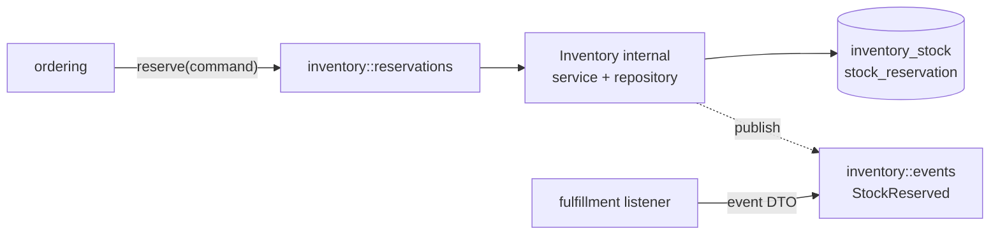
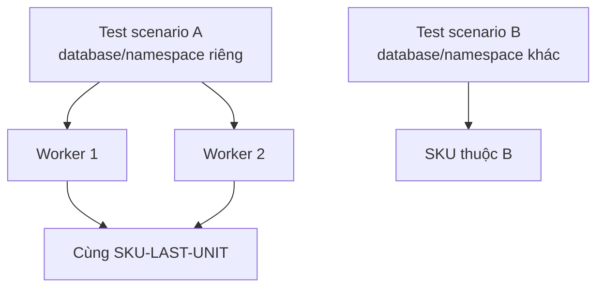
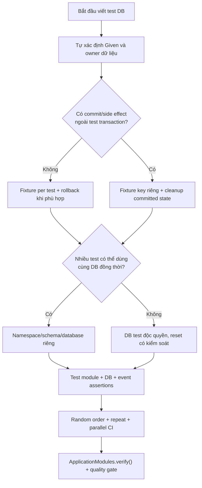

# Tạo dữ liệu test không phụ thuộc thứ tự

Một bài kiểm thử `reserveStock()` chạy độc lập thì xanh, nhưng chạy sau `releaseStock()` lại đỏ vì lượng tồn kho đã thay đổi. Một bài khác chỉ xanh sau khi `createOrder()` đã chạy, bởi nó ngầm sử dụng đơn hàng do bài trước tạo. Có nhóm dùng `@TestMethodOrder` để “ổn định” bộ test, hoặc chạy `DELETE FROM ...` đầu mỗi test nhưng vẫn gặp lỗi ngẫu nhiên khi CI chia test sang nhiều worker.

Những triệu chứng này cho thấy bài test **không tự sở hữu tiền điều kiện** của mình. Kết quả phụ thuộc trạng thái còn sót, thứ tự chạy, thời gian hiện tại hoặc công việc nền chưa kết thúc. Khi bổ sung `@ApplicationModuleTest` và PostgreSQL thật, vấn đề không tự biến mất: Spring Modulith lựa chọn phạm vi application module, còn dữ liệu và transaction phải được thiết kế rõ.

Bài **“Tạo dữ liệu test không phụ thuộc thứ tự”** thuộc chương **Database testing** của **SPRING_MODULITH_VERIFICATION_TESTING**. Ta sẽ thiết kế fixture xác định, độc lập giữa các phương thức test; kiểm tra quyền sở hữu bảng theo module; thử cả rollback và commit thật; cô lập event listener, dữ liệu sau migration và tác dụng phụ khi chạy song song. Kết quả được kết nối với `ApplicationModules.verify()`, kiểm thử module/integration và quality gate CI nhằm ngăn phụ thuộc sai cùng hồi quy.

> **Nguyên tắc:** Mỗi test phải tự tạo hoặc được cấp **đúng trạng thái ban đầu nó cần**, chỉ thay đổi dữ liệu thuộc phạm vi của mình, và không đòi hỏi test khác chạy trước hay sau.

## 1. Kết quả học tập

Sau bài này, bạn có thể:

1. Nhận diện phụ thuộc thứ tự trong fixture, `@BeforeAll`, shared static state, auto-generated ID, dữ liệu thời gian và listener chạy nền.
2. Thiết kế **Given–When–Then** với tiền điều kiện được tạo lại độc lập cho mỗi test, bao gồm cả các trường hợp không hợp lệ.
3. Phân biệt fixture dữ liệu nghiệp vụ, migration/schema, reference data và dữ liệu hạ tầng.
4. Tạo fixture bằng `@Sql`, `JdbcTemplate`, repository hoặc test-data builder mà không tạo phụ thuộc vào test khác.
5. Chọn chính sách rollback/cleanup khi có test-managed transaction, transaction production, `REQUIRES_NEW` và `AFTER_COMMIT`.
6. Dùng ID và `Clock` có chủ đích để test lặp lại được, không phụ thuộc sequence hay đồng hồ hệ thống.
7. Kiểm thử module Spring Modulith qua **API công khai**, kết hợp `@ApplicationModuleTest`, PostgreSQL/Testcontainers và xác minh kiến trúc.
8. Thiết lập CI chạy test với thứ tự khác nhau, lặp lại và song song mà không che lỗi bằng `@TestMethodOrder`.

## 2. Thế nào là “không phụ thuộc thứ tự”?

Xét hai bài test `A` và `B`. Một thiết kế tốt phải khiến **cả hai** hoàn thành đúng khi chạy:

```text
A
B

B
A

A, B trên các test worker khác nhau

A chạy lặp lại sau chính nó
```

Mục tiêu không phải mọi hệ thống đều có thể chạy song song vô hạn; một số integration test cần tài nguyên độc quyền. Mục tiêu là: **kết quả kiểm thử không bị quyết định bởi dữ liệu mà một test khác vô tình để lại**. Nếu một test phải chạy tuần tự vì sử dụng database chung, đó phải là **ràng buộc hạ tầng được công bố**, không phải phụ thuộc nghiệp vụ vào test trước.

### 2.1. Công thức tư duy

Một test có thể được xem như:

```text
Given:  S0 = trạng thái ban đầu đã kiểm soát
When:   f(input) = hành vi thực sự được kiểm tra
Then:   assert(output, S1)
Finish: dọn S1 hoặc hủy cả môi trường cô lập
```

Nếu `S0` ngầm bao gồm “bản ghi do test X tạo hôm qua”, test chưa độc lập. Nếu assertion đọc tổng số bản ghi của **cả database** trong khi test khác có thể thêm dữ liệu, kết quả cũng chưa độc lập.

### 2.2. Ba tiêu chí cần tách

| Tiêu chí | Câu hỏi kiểm chứng | Không đồng nghĩa với |
| --- | --- | --- |
| **Deterministic** | Cùng input và trạng thái có cùng kết quả hợp đồng? | Không nhất thiết mỗi ID sinh ra giống nhau |
| **Order-independent** | Chạy trước/sau test khác có giữ kết quả? | Không tự bảo đảm có thể chạy parallel |
| **Parallel-safe** | Khi chạy đồng thời, fixture/cleanup có đụng nhau? | Không đồng nghĩa đã test race condition nghiệp vụ |

Ví dụ dùng `UUID.randomUUID()` cho một request ID test là ổn **nếu assertion so với ID vừa tạo**, chứ không phụ thuộc vào giá trị UUID cụ thể. Ngược lại, dùng `LocalDateTime.now()` rồi assert một ngày/giờ tuyệt đối thường không deterministic.

## 3. Bốn loại trạng thái khiến test rò sang nhau

Trong một ứng dụng Spring Modulith, state không nằm riêng ở database:

| Nguồn state | Ví dụ | Vì sao có thể ảnh hưởng test kế tiếp |
| --- | --- | --- |
| **Database nghiệp vụ** | `inventory_stock`, `stock_reservation`, `sales_order` | Dữ liệu đã commit hoặc cleanup thiếu |
| **Spring context / JVM** | static list, bean cache, fake clock thay đổi, in-memory event probe | `ApplicationContext` được cache và tái sử dụng |
| **Công việc bất đồng bộ** | `@ApplicationModuleListener`, `@Async`, scheduler | Worker có thể chạy sau khi method test kết thúc |
| **Tài nguyên ngoài** | Broker, Redis, HTTP sandbox, file | DB rollback không hoàn tác side effect đó |

Trong chương này ta ưu tiên database, nhưng **thiết kế fixture đúng phải xác định cả những state liên quan**. Ví dụ một test tạo reservation rồi phát `StockReserved`; Fulfillment có thể lưu `picking_task` trong transaction riêng. Việc cleanup hai bảng Inventory không đủ nếu `picking_task` còn tồn tại và consumer dùng lại ID cũ.

### 3.1. State có thể ẩn trong assertion

```java
// Phản mẫu: không giới hạn phạm vi dữ liệu đang đếm.
assertThat(
    jdbc.queryForObject(
        "SELECT count(*) FROM stock_reservation",
        Integer.class
    )
).isEqualTo(1);
```

Khi một test khác có reservation riêng trong cùng schema, số đếm toàn bảng có thể lớn hơn `1` dù use case đang test vẫn đúng.

Nên assert **đối tượng do scenario sở hữu**:

```java
Integer rows = jdbc.queryForObject(
    "SELECT count(*) FROM stock_reservation WHERE request_id = ?",
    Integer.class, requestId
);
assertThat(rows).isEqualTo(1);
```

Việc query theo `requestId` là một phần của isolation, không chỉ là chi tiết cú pháp SQL.

## 4. Những phản mẫu phụ thuộc thứ tự điển hình

### 4.1. Test B sử dụng dữ liệu do test A tạo

```java
// PHẢN MẪU: hai phương thức test ngầm phụ thuộc thứ tự.
@Test
void createStock() {
    jdbc.update(
        "INSERT INTO inventory_stock(sku, available) VALUES (?, ?)",
        "SKU-1", 5
    );
}

@Test
void reserveStock() {
    inventory.reserve(new ReserveStock(
        "SKU-1", 2, UUID.randomUUID()
    ));
    // Bài này không tự tạo SKU-1.
}
```

JUnit không bắt buộc chạy `createStock()` trước `reserveStock()`. Ngay cả khi đặt thứ tự, hai test đã mất độc lập.

**Cách sửa:** `reserveStock()` tự tạo tồn `5` bằng fixture trong `Given`, rồi mới gọi API. `createStock()` có thể tồn tại như một test độc lập cho API tạo SKU, nhưng không trở thành bước setup ẩn của test khác.

### 4.2. `@TestMethodOrder` dùng để che state leak

```java
@TestMethodOrder(MethodOrderer.OrderAnnotation.class)
class OrderWorkflowTests {

    @Test
    @Order(1)
    void create() {}

    @Test
    @Order(2)
    void pay() {}

    @Test
    @Order(3)
    void cancel() {}
}
```

Nếu đây là **một workflow duy nhất**, hãy cân nhắc viết **một test** thực hiện create → pay → cancel và assert từng mốc. Nếu đó là ba yêu cầu nghiệp vụ độc lập, mỗi test cần `Given` riêng.

`@TestMethodOrder` có các use case có chủ đích, nhưng không nên là biện pháp mặc định để giữ một bộ test CRUD xanh.

### 4.3. Dữ liệu được tạo trong `@BeforeAll`

```java
@BeforeAll
static void seedOnce() {
    // Tạo một record dùng chung cho mọi test method.
}
```

Nếu test thứ nhất cập nhật hoặc xóa record, test thứ hai nhận state khác. Đặc biệt `@BeforeAll` không tự nằm trong test-managed transaction của từng phương thức.

Nếu thật sự có reference data bất biến dùng chung, cần quy định **không test nào chỉnh sửa** nó và có schema/database phù hợp. Những bản ghi có thể thay đổi theo use case nên thuộc `@BeforeEach`, test fixture hoặc database riêng.

### 4.4. Assert ID từ auto-increment/sequence

```java
// Phản mẫu.
assertThat(order.getId()).isEqualTo(1L);
```

Với PostgreSQL, `nextval()` thường không rollback theo cách rollback hàng dữ liệu. Một test insert rồi rollback vẫn có thể làm sequence tăng. Assertion phụ thuộc `id=1` dễ thất bại khi chạy sau test khác.

Nên assert ID **tồn tại, đúng định dạng, liên kết đúng dữ liệu**, hoặc truyền ID chủ đích nếu domain contract cho phép:

```java
assertThat(order.getId()).isNotNull();
assertThat(order.getRequestId()).isEqualTo(requestId);
```

### 4.5. Dùng đồng hồ hệ thống mà không kiểm soát

```java
// Phản mẫu khi thời điểm có ý nghĩa quyết định.
assertThat(reservation.getExpiresAt())
    .isEqualTo(Instant.now().plusSeconds(900));
```

Hai lần gọi `Instant.now()` không cùng thời điểm; timezone, tải CI và sai số scheduler có thể tạo test không ổn định. Hãy inject `Clock` và cố định thời gian khi kiểm tra expiry, deadline hoặc lịch chạy.

### 4.6. `DELETE FROM table` trên database dùng chung

```sql
DELETE FROM stock_reservation;
DELETE FROM inventory_stock;
```

Script này chỉ an toàn với **database/schema thuộc riêng test hoặc suite tuần tự có độc quyền**. Nếu test khác đang sử dụng cùng bảng, script có thể xóa nhầm fixture của nó. Có cleanup không đồng nghĩa có isolation.

## 5. Thiết kế fixture như một hợp đồng Given–When–Then

Một fixture tốt trả lời được:

1. **Dữ liệu nào bắt buộc có?** Ví dụ `SKU-A` còn `5`.
2. **Ai sở hữu dữ liệu?** `inventory` sở hữu tồn, `ordering` sở hữu đơn.
3. **Dữ liệu nào cố ý không tồn tại?** Chưa có reservation với `requestId` đang test.
4. **Test thay đổi gì?** Giữ `2`, hoặc cố giữ `6` khi chỉ còn `5`.
5. **Đo kết quả ở đâu?** Trạng thái DB sau commit, event publication hay API response.
6. **Ai dọn dữ liệu?** Rollback test, cleanup theo ID, schema/database riêng hoặc teardown environment.

Ví dụ một **bảng kịch bản**:

| Test case | Given | When | Then |
| --- | --- | --- | --- |
| Giữ hàng thành công | SKU-X có `available=5`, chưa có request R | `reserve(X,2,R)` | Tồn `3`, đúng 1 reservation R |
| Không đủ tồn | SKU-Y có `available=1` | `reserve(Y,2,R)` | Lỗi nghiệp vụ; tồn vẫn `1`, không có reservation R |
| Request lặp | R đã được xử lý trước đó trong **chính fixture của test** | Gửi lại R | Theo idempotency contract, không trừ tồn hai lần |
| DB lỗi sau giảm tồn | Có tồn `5`, điểm lỗi insert được kiểm soát | Reserve thất bại | Rollback tồn về `5` |
| Tranh tồn cuối | Một SKU có `available=1` đã commit | Hai thread cùng reserve `1` | Tối đa một thành công, không oversell |

Test “request lặp” **phải tự chuẩn bị trạng thái R đã xử lý** trong `Given`, không trông chờ một test đặt hàng thành công chạy trước.

### 5.1. Test data builder không phải một database chứa sẵn

Một `InventoryFixture` hoặc `OrderBuilder` nên giúp biểu đạt dữ liệu:

```java
fixture.stockAvailable(5);
fixture.activeReservation("SKU-A", requestId);
fixture.orderPendingPayment(customerId);
```

Nhưng tên method phải phản ánh **dữ liệu thật đã tạo** và các invariant cần giữ. Không viết helper “ma thuật” âm thầm tạo 15 bảng hoặc publish event khiến người đọc test không thể xác định `Given`.

### 5.2. Reference data khác dữ liệu tình huống

Có hai lớp dữ liệu:

- **Reference data gần như bất biến:** danh mục quốc gia, currency codes, bảng trạng thái chuẩn, cấu hình hệ thống. Có thể được seed bằng migration/test setup chung khi có chính sách rõ.
- **Scenario data:** order, reservation, stock, payment request, customer test. Nên tạo riêng mỗi test vì thường bị sửa hoặc xóa bởi use case.

Không cố biến một order hoặc một phiếu giữ có trạng thái thay đổi thành “reference data dùng chung”.

## 6. Ví dụ xuyên suốt: Inventory giữ hàng cho Ordering

Ứng dụng Spring Modulith có cấu trúc:

```text
com/example/shop/
├── ShopApplication.java
├── inventory/
│   ├── reservations/
│   │   ├── package-info.java
│   │   ├── InventoryReservations.java
│   │   ├── ReserveStock.java
│   │   └── ReservationReceipt.java
│   ├── events/
│   │   ├── package-info.java
│   │   └── StockReserved.java
│   └── internal/
│       ├── StockReservationService.java
│       └── persistence/
│           ├── StockRow.java
│           ├── StockJpaRepository.java
│           ├── ReservationRow.java
│           └── ReservationRepository.java
├── ordering/
│   ├── package-info.java
│   └── internal/PlaceOrderService.java
└── fulfillment/
    ├── package-info.java
    └── internal/StockReservedListener.java
```

`inventory` là **owner** của tồn và reservation. `ordering` chỉ được gọi API công khai của Inventory, không cập nhật `inventory_stock` trực tiếp. `fulfillment` nghe event được công bố và sở hữu dữ liệu chuẩn bị hàng của mình.



### 6.1. Schema từ migration

Ví dụ PostgreSQL:

```sql
CREATE TABLE inventory_stock (
    sku VARCHAR(80) PRIMARY KEY,
    available INTEGER NOT NULL,
    CONSTRAINT ck_stock_nonnegative CHECK (available >= 0)
);

CREATE TABLE stock_reservation (
    reservation_id UUID PRIMARY KEY,
    request_id UUID NOT NULL UNIQUE,
    sku VARCHAR(80) NOT NULL
        REFERENCES inventory_stock(sku),
    quantity INTEGER NOT NULL CHECK (quantity > 0)
);
```

Đây là **schema tối giản để dạy fixture**; production có thể cần trạng thái, thời hạn, kho/tenant, ledger và release logic. Khi test, tạo schema từ **migration production** (Flyway/Liquibase), không tự để Hibernate `create-drop` dựng một schema khác khiến migration lỗi vẫn test xanh.

### 6.2. Contract API module

```java
// inventory/reservations/package-info.java
@org.springframework.modulith.NamedInterface("reservations")
package com.example.shop.inventory.reservations;
```

```java
// inventory/reservations/ReserveStock.java
package com.example.shop.inventory.reservations;

import java.util.UUID;

public record ReserveStock(
    String sku,
    int quantity,
    UUID requestId
) {
    public ReserveStock {
        if (sku == null || sku.isBlank() ||
            quantity <= 0 || requestId == null) {
            throw new IllegalArgumentException("Lệnh giữ hàng không hợp lệ");
        }
    }
}
```

```java
// inventory/reservations/ReservationReceipt.java
package com.example.shop.inventory.reservations;

import java.util.UUID;

public record ReservationReceipt(UUID reservationId) {}
```

```java
// inventory/reservations/InventoryReservations.java
package com.example.shop.inventory.reservations;

public interface InventoryReservations {
    ReservationReceipt reserve(ReserveStock command);
}
```

Chúng ta sẽ viết test gọi `InventoryReservations`, không gọi thẳng `ReservationRepository` làm đường use case. `JdbcTemplate` ở **test code của module owner** được dùng để seed/đọc hậu điều kiện, không có nghĩa Ordering production được phép ghi bảng Inventory.

### 6.3. Giả định của implementation

Giả sử service:

1. Thực thi một câu `UPDATE inventory_stock ... WHERE available >= :quantity`.
2. Nếu không cập nhật được đúng một hàng, ném lỗi `InsufficientStock`.
3. Tạo reservation gắn `requestId`.
4. Lưu reservation trong **cùng một transaction** với giảm tồn.
5. Khi thành công có thể phát `StockReserved` theo hợp đồng.

Chi tiết tồn kho theo lô hoặc phát event bền vững nằm ngoài ví dụ fixture; những tính năng đó cần test riêng. Quan trọng ở đây là mỗi test **tự xây tiền điều kiện** trước khi gọi API.

## 7. Một fixture SQL có thể hiểu và tái tạo được

Với **database/schema chỉ dành cho một lớp test tuần tự**, có thể dùng:

```sql
-- src/test/resources/fixtures/inventory/stock-five.sql
-- Chỉ dùng trong schema test cô lập; không dùng trên DB shared đang chạy parallel.
DELETE FROM stock_reservation;
DELETE FROM inventory_stock;

INSERT INTO inventory_stock(sku, available)
VALUES ('SKU-FIVE', 5);
```

Điểm tốt:

- Explicit column list, không phụ thuộc thứ tự cột hiện tại.
- Giá trị nghiệp vụ có ý nghĩa (`available=5`).
- Xóa bảng con trước bảng cha theo foreign key.
- Test có tiền điều kiện rõ ở **mỗi lần chạy**.

Nhưng có **điều kiện mạnh**: không có test khác đang dùng các bảng này trong schema đó. Đoạn `DELETE` toàn bảng **không** an toàn nếu hai lớp `@ApplicationModuleTest` cùng datasource/schema chạy song song.

### 7.1. Dùng `@Sql` cho mỗi phương thức test

```java
@ApplicationModuleTest
@Sql(
    scripts = "/fixtures/inventory/stock-five.sql",
    executionPhase = Sql.ExecutionPhase.BEFORE_TEST_METHOD
)
class InventoryWithSqlTests {

    @Test
    void reservesTwoUnits() {
        // Fixture được chạy cho test này trước khi method thực hiện.
    }

    @Test
    void rejectsTooLargeRequest() {
        // Fixture được chạy lại cho test này.
    }
}
```

Import: `org.springframework.modulith.test.ApplicationModuleTest`, `org.springframework.test.context.jdbc.Sql`, `org.junit.jupiter.api.Test`.

`BEFORE_TEST_METHOD` làm seed xảy ra trước mỗi test method, không phải một lần cho cả class. Tuy nhiên, muốn có **isolation thật**, phải xét transaction mode và những side effect/commit từ test trước. Nếu `@Sql` tham gia transaction hiện tại, nó có thể cùng rollback; nếu test không có transaction bao ngoài, script có thể commit theo cấu hình.

### 7.2. Có nên dùng `@Sql AFTER_TEST_METHOD`?

Có thể khai báo cleanup script sau test:

```java
@Sql(
    scripts = "/fixtures/inventory/cleanup.sql",
    executionPhase = Sql.ExecutionPhase.AFTER_TEST_METHOD
)
```

Nhưng hai lưu ý:

1. Trong test-managed transaction, cleanup tham gia transaction nào phụ thuộc cấu hình; nó có thể bị rollback cùng transaction của test.
2. Với event listener bất đồng bộ, cleanup chạy sau test method **không đồng nghĩa consumer đã xử lý xong**.

Nếu muốn dọn **dữ liệu đã commit** (kể cả từ `REQUIRES_NEW`), cần cơ chế cleanup có transaction riêng phù hợp và chờ các tác vụ liên quan hoàn tất. Không tự mặc định `AFTER_TEST_METHOD` sẽ chữa mọi rò state.

### 7.3. Đừng che lỗi fixture bằng `ON CONFLICT DO NOTHING`

```sql
-- Có thể che lỗi collision nếu dùng bừa.
INSERT INTO inventory_stock(sku, available)
VALUES ('SKU-FIVE', 5)
ON CONFLICT (sku) DO NOTHING;
```

Nếu bản ghi tồn tại từ test trước nhưng `available=2`, `DO NOTHING` giữ nguyên giá trị `2`; test tưởng vừa seed `5` mà thực tế không phải. Chỉ dùng upsert khi **ngữ nghĩa mong muốn đã rõ**, và phải assert trạng thái sau seed.

## 8. Fixture builder riêng cho mỗi test, không xóa toàn bảng

Một giải pháp linh hoạt cho test có thể chạy song song là **cấp định danh riêng theo scenario**. Thay vì xóa mọi hàng, mỗi test tạo SKU mới và cleanup đúng SKU đó.

### 8.1. Helper đơn giản với `JdbcTemplate`

```java
// src/test/java/com/example/shop/inventory/InventoryFixture.java
package com.example.shop.inventory;

import java.util.ArrayList;
import java.util.List;
import java.util.UUID;
import org.springframework.jdbc.core.JdbcTemplate;

final class InventoryFixture {

    private final JdbcTemplate jdbc;
    private final List<String> ownedSkus = new ArrayList<>();

    InventoryFixture(JdbcTemplate jdbc) {
        this.jdbc = jdbc;
    }

    String stockWithAvailable(int available) {
        if (available < 0) {
            throw new IllegalArgumentException("available < 0");
        }
        String sku = "IT-" + UUID.randomUUID();
        jdbc.update(
            "INSERT INTO inventory_stock(sku, available) VALUES (?, ?)",
            sku, available
        );
        ownedSkus.add(sku);
        return sku;
    }

    int available(String sku) {
        Integer value = jdbc.queryForObject(
            "SELECT available FROM inventory_stock WHERE sku = ?",
            Integer.class, sku
        );
        return value;
    }

    int reservationCount(UUID requestId) {
        Integer value = jdbc.queryForObject(
            "SELECT count(*) FROM stock_reservation WHERE request_id = ?",
            Integer.class, requestId
        );
        return value;
    }

    void cleanup() {
        for (String sku : ownedSkus) {
            jdbc.update(
                "DELETE FROM stock_reservation WHERE sku = ?", sku
            );
            jdbc.update(
                "DELETE FROM inventory_stock WHERE sku = ?", sku
            );
        }
        ownedSkus.clear();
    }
}
```

Mỗi instance helper chỉ giữ những SKU mà **test đó** tạo. Không dùng `static List<String> ownedSkus` cho nhiều test concurrent, vì test này có thể dọn ID của test khác.

**Điều kiện của helper:** Chưa tính đến event consumer ghi bảng phụ thuộc reservation, transaction riêng hoặc test process bị kill. Với các integration test đó, phải bổ sung cleanup theo `reservationId` hoặc cấp database/schema riêng cho workflow.

### 8.2. Test thực tế không phụ thuộc thứ tự

```java
// src/test/java/com/example/shop/inventory/InventoryOrderIndependentTests.java
package com.example.shop.inventory;

import static org.assertj.core.api.Assertions.assertThat;
import static org.assertj.core.api.Assertions.assertThatThrownBy;

import com.example.shop.inventory.reservations.InventoryReservations;
import com.example.shop.inventory.reservations.ReserveStock;
import java.util.UUID;
import org.junit.jupiter.api.AfterEach;
import org.junit.jupiter.api.BeforeEach;
import org.junit.jupiter.api.Test;
import org.springframework.beans.factory.annotation.Autowired;
import org.springframework.jdbc.core.JdbcTemplate;
import org.springframework.modulith.test.ApplicationModuleTest;

@ApplicationModuleTest
class InventoryOrderIndependentTests {

    @Autowired InventoryReservations inventory;
    @Autowired JdbcTemplate jdbc;

    private InventoryFixture fixture;

    @BeforeEach
    void createFixtureOwner() {
        fixture = new InventoryFixture(jdbc);
    }

    @AfterEach
    void cleanupFixtureOwner() {
        fixture.cleanup();
    }

    @Test
    void reservesTwoUnits() {
        String sku = fixture.stockWithAvailable(5);
        UUID requestId = UUID.randomUUID();

        var receipt = inventory.reserve(
            new ReserveStock(sku, 2, requestId)
        );

        assertThat(receipt.reservationId()).isNotNull();
        assertThat(fixture.available(sku)).isEqualTo(3);
        assertThat(fixture.reservationCount(requestId)).isEqualTo(1);
    }

    @Test
    void rejectsInsufficientStockWithoutChangingDatabase() {
        String sku = fixture.stockWithAvailable(1);
        UUID requestId = UUID.randomUUID();

        assertThatThrownBy(() -> inventory.reserve(
            new ReserveStock(sku, 2, requestId)
        )).isInstanceOf(IllegalStateException.class);

        assertThat(fixture.available(sku)).isEqualTo(1);
        assertThat(fixture.reservationCount(requestId)).isZero();
    }
}
```

Điều kiện để hai test có ý nghĩa:

- Có schema từ migration và implementation `InventoryReservations` thực, giao dịch đúng.
- Lỗi hết hàng của implementation là `IllegalStateException` hoặc subtype; production nên định nghĩa lỗi nghiệp vụ công khai và test loại lỗi chính xác.
- Không đặt `@Transactional` ở lớp test vì các phương thức trên muốn quan sát trạng thái đã commit hoặc rollback **do service** khi lời gọi kết thúc.
- `@BeforeEach` tạo helper mới cho từng test; mặc định vòng đời instance test của JUnit Jupiter cũng là per-method khi không cấu hình khác.
- `@AfterEach` cleanup theo đúng SKU đã tạo, xóa bảng con trước bảng cha.
- Không có consumer/scheduler riêng vẫn đang ghi theo SKU sau cleanup; nếu có, đổi chiến lược isolation hoặc chờ hoàn thành.

Hai bài này có thể chạy theo thứ tự bất kỳ, và có khả năng chạy đồng thời về **data key**, nhưng kết luận parallel-safe còn phụ thuộc toàn bộ hạ tầng/lifecycle chứ không chỉ helper.

### 8.3. Vì sao đọc DB bằng JDBC là chấp nhận được trong test?

Trong production, Ordering không được sửa bảng Inventory; nó chỉ gọi API công khai. Nhưng ở **test của module owner Inventory**, `JdbcTemplate` là test infrastructure để seed/đọc hậu điều kiện, không phải business dependency xuyên module.

Nếu test chỉ gọi thẳng `ReservationRepository.save(...)`, nó không kiểm tra logic `InventoryReservations.reserve(...)`. Ngược lại, test này gọi API công khai và dùng SQL để xác nhận hậu điều kiện — đúng mục tiêu module boundary.

## 9. Tạo ID test: ổn định kỳ vọng, không cố định mọi giá trị

Có hai yêu cầu đôi khi tưởng mâu thuẫn:

- Khi test đọc log/failure, muốn ID có thể liên hệ rõ với scenario.
- Khi test chạy lặp và song song trên database chung, không muốn hai test dùng cùng primary key.

Giải pháp là **tách định danh do test tạo và điều kiện kỳ vọng**.

### 9.1. UUID cho scenario data

```java
UUID requestId = UUID.randomUUID();
String sku = "IT-" + UUID.randomUUID();
```

Giá trị ID có thể thay đổi mỗi lần chạy nhưng assertion vẫn deterministic:

```java
assertThat(fixture.reservationCount(requestId)).isEqualTo(1);
```

Không cần biết UUID sẽ là gì trước khi test bắt đầu.

### 9.2. Fixed UUID khi bài test cần xác minh giá trị cụ thể

Một test serialization hoặc migration có thể cần:

```java
UUID requestId = UUID.fromString(
    "00000000-0000-0000-0000-000000000123"
);
```

ID cố định hữu ích cho test **ở database/schema riêng**, nhưng nếu hai job cùng dùng DB shared, hai fixture cố định vẫn có thể trùng. Đừng lựa chọn ID cố định vì “deterministic” rồi quên phạm vi độc quyền của dữ liệu.

### 9.3. Sequence và `IDENTITY`

Không assert ID auto-increment bắt đầu ở `1` hoặc tăng liên tục. Với PostgreSQL, `nextval()` không được rollback giống hàng dữ liệu. Sau một test rollback hoặc insert thất bại, sequence vẫn có thể tăng. Hãy assert ID không null, unique khi cần, và liên hệ tới request/business key.

### 9.4. Random có seed cho dữ liệu số lượng lớn

Với property-based test hoặc generator cần tạo 1000 record, dùng một `seed` được ghi trong failure message giúp tái hiện dữ liệu:

```java
long seed = 20261126L;
Random random = new Random(seed);
```

**Không** dùng random để quyết định kết quả assertion rồi để test “tùy may mắn”. Nếu nhiều test chạy song song, mỗi test cần generator instance riêng, không dùng shared mutable `Random` dẫn tới chuỗi phụ thuộc lịch gọi giữa các test.

## 10. Thời gian là một phần của fixture

Đối với reservation expiry, payment deadline hay lịch giao hàng, dữ liệu đầu vào bao gồm **thời gian hiện tại**. Sử dụng `Clock` inject được sẽ giúp test không phụ thuộc thứ tự hoặc tốc độ CI.

### 10.1. Production service nhận `Clock`

```java
@Service
class ReservationExpiryPolicy {

    private final Clock clock;

    ReservationExpiryPolicy(Clock clock) {
        this.clock = clock;
    }

    Instant expiresAt() {
        return clock.instant().plus(Duration.ofMinutes(15));
    }
}
```

Các import: `java.time.Clock`, `java.time.Instant`, `java.time.Duration`, `org.springframework.stereotype.Service`. Production cần định nghĩa bean `Clock` rõ ràng, ví dụ `Clock.systemUTC()`, ở cấu hình hạ tầng thuộc đúng module/configuration.

### 10.2. Test dùng thời gian cố định

```java
@TestConfiguration
static class FixedClockTestConfig {

    @Bean
    @Primary
    Clock fixedClock() {
        return Clock.fixed(
            Instant.parse("2026-01-15T10:00:00Z"),
            ZoneOffset.UTC
        );
    }
}
```

Khai báo `@Import(FixedClockTestConfig.class)` tại lớp test cần cấu hình này. Import tương ứng: `org.springframework.boot.test.context.TestConfiguration`, `org.springframework.context.annotation.Bean`, `org.springframework.context.annotation.Primary`, `org.springframework.context.annotation.Import`, `java.time.Clock`, `java.time.Instant`, `java.time.ZoneOffset`.

Một assertion:

```java
assertThat(policy.expiresAt()).isEqualTo(
    Instant.parse("2026-01-15T10:15:00Z")
);
```

Đây là **trích đoạn**; đưa code vào dự án cần bean production, class test và `@Autowired` đúng.

### 10.3. Tránh bean clock có mutable state chia sẻ

Nếu `MutableClock` được đặt trong Spring singleton rồi test A đặt giờ `10:00`, test B đặt `11:00`, hai test có thể va chạm dù không ghi cùng bảng. Có thể dùng:

- `Clock.fixed` immutable theo một test context ổn định.
- Instance policy/service thuần Java với Clock riêng cho unit test.
- Context hoặc resource isolation nếu mỗi test cần sửa clock khác nhau.
- Khôi phục đúng state với serialization khi cần, nhưng không lạm dụng context mutable global.

Không dùng cùng một global fake clock rồi trông chờ `@Rollback` database dọn cả trạng thái JVM.

## 11. Test lifecycle: `@BeforeEach`, `@AfterEach` và callback Spring

Với JUnit Jupiter, mỗi bài test có thể được thiết kế thành:

```java
@BeforeEach
void setUp() {
    // Tạo fixture owner mới, seed tiền điều kiện phù hợp.
}

@Test
void scenario() {
    // Khi test bắt đầu, Given đã được xác định.
}

@AfterEach
void tearDown() {
    // Dọn tài nguyên do scenario sở hữu.
}
```

Nếu Spring Test có test-managed transaction:

- `@BeforeEach` và `@AfterEach` thường chạy **trong transaction của test**.
- `@BeforeTransaction` chạy **trước** transaction của test.
- `@AfterTransaction` chạy **sau khi** transaction của test kết thúc.
- `@BeforeAll` không tự thuộc transaction của từng test.

### 11.1. Khi nào rollback là cleanup đủ?

```java
@ApplicationModuleTest
@Transactional
class InventoryTransactionalTests {

    @Test
    void storesReservationThenRollsBack() {
        // Seed và reserve cùng tham gia test transaction.
    }
}
```

Nếu **toàn bộ** fixture và thay đổi đều tham gia test-managed transaction, rollback mặc định có thể dọn chúng. Nhưng nếu service gọi `REQUIRES_NEW`, worker khác hoặc gửi message ngoài DB, những tác dụng đó có thể tồn tại.

**Không kết luận** test này đã chứng minh service production tự commit/rollback đúng. Service `REQUIRED` có thể chỉ tham gia transaction do test mở và chưa commit khi method trả kết quả.

### 11.2. Dùng `@BeforeTransaction`/`@AfterTransaction` có chủ đích

Ví dụ để xác minh rollback đưa DB về một **baseline đã commit**:

```java
@ApplicationModuleTest
@Transactional
class InventoryRollbackStateTests {

    @BeforeTransaction
    void seedCommittedBaseline() {
        // Seed dữ liệu bên ngoài test transaction.
    }

    @Test
    void performsWorkInsideTransaction() {
        // Thay đổi nhưng không commit.
    }

    @AfterTransaction
    void verifiesAndCleansBaseline() {
        // Kiểm tra sau rollback rồi dọn dữ liệu đã commit.
    }
}
```

Đây là khung mô tả lifecycle; cần thêm fixture, API gọi và assertion cụ thể. Không seed trong `@BeforeEach` rồi ở `@AfterTransaction` lại mong fixture vẫn còn: seed đó thường cũng bị rollback nếu thuộc test transaction.

### 11.3. `@TestInstance(PER_CLASS)` và mutable test fields

JUnit Jupiter mặc định thường dùng test instance mới cho mỗi method. Khi chuyển sang `@TestInstance(PER_CLASS)`, các field mutable có thể được chia sẻ giữa methods; nếu chạy parallel sẽ dễ sinh race hoặc phụ thuộc thứ tự. Dùng `PER_CLASS` khi có lý do rõ và bảo đảm state được reset/cô lập đúng.

## 12. `@Sql` mode, rollback và dữ liệu đã commit

Spring Test `@Sql` có nhiều cách chạy script; đừng coi toàn bộ là “seed tạm luôn rollback”.

| Cách seed | Khả năng visibility | Dọn bằng rollback test? |
| --- | --- | --- |
| `@Sql` tham gia test transaction | Thread trong cùng transaction thấy dữ liệu; thread khác có thể chưa thấy | Có, nếu không có commit khác |
| `@SqlConfig(transactionMode=ISOLATED)` | Fixture được commit riêng theo cấu hình phù hợp | **Không**, cần cleanup ngoài |
| `JdbcTemplate` trong test không transactional | Thường auto-commit từng statement | **Không**, cần cleanup |
| `@BeforeTransaction` seed bằng JDBC | Thường đã commit trước test transaction | **Không**, cần cleanup |
| Service `@Transactional(REQUIRES_NEW)` | Giao dịch riêng có thể commit | **Không** theo rollback transaction ngoài |
| HTTP request `RANDOM_PORT` | Service server thread tự quản transaction | **Không** theo rollback của JUnit thread |

### 12.1. Fixture cho concurrency phải commit trước

Một concurrency test tạo hai thread cùng giữ hàng cần một SKU có `available=1` mà **cả hai đều nhìn thấy**. Nếu seed trong test-managed transaction chưa commit, worker thread có thể báo không tìm thấy SKU. Khi đó test thất bại vì fixture visibility, không chứng minh được concurrency bug.

### 12.2. Fixture setup không nên làm phát event nghiệp vụ ngoài ý muốn

Nếu cần dựng một reservation đã tồn tại, gọi `InventoryReservations.reserve(...)` để seed có thể:

- Trừ tồn thực.
- Publish `StockReserved`.
- Khởi động Fulfillment listener.
- Ghi event registry.

Điều này có thể là **đúng** nếu test đang kiểm tra workflow đầy đủ. Nhưng với test “request đã tồn tại và cần retry”, đôi khi nên seed state qua test infrastructure (SQL hoặc builder) để không kích hoạt side effect không thuộc `Given`.

Hãy ghi rõ mục tiêu: **fixture bằng API** để giữ invariant xuyên module, hay **fixture bằng SQL** để dựng một trạng thái xác định mà không chạy tác dụng nghiệp vụ? Cả hai có thể hợp lệ khi phạm vi phù hợp.

## 13. PostgreSQL/Testcontainers: tách môi trường để fixture đáng tin

Một fixture được thiết kế đẹp vẫn có thể không độc lập nếu tất cả test chạy trên một database lâu đời, có dữ liệu từ lần chạy trước. Vì vậy, các bài database/module test rủi ro cao nên chạy trên một **database test được cấp và kiểm soát vòng đời**.

### 13.1. Khung `@ApplicationModuleTest` với PostgreSQL

```java
package com.example.shop.inventory;

import org.springframework.boot.testcontainers.service.connection.ServiceConnection;
import org.springframework.modulith.test.ApplicationModuleTest;
import org.testcontainers.containers.PostgreSQLContainer;
import org.testcontainers.junit.jupiter.Container;
import org.testcontainers.junit.jupiter.Testcontainers;

@Testcontainers
@ApplicationModuleTest
class InventoryPostgresFixtureTests {

    @Container
    @ServiceConnection
    static PostgreSQLContainer<?> postgres =
        new PostgreSQLContainer<>("postgres:16-alpine");

    // Bổ sung @Test và @Autowired service, JdbcTemplate, fixture.
}
```

Đây là **khung kết nối**, chưa có test assertion. `@ServiceConnection` cần Spring Boot có tích hợp Testcontainers tương ứng (ví dụ dòng 3.1+) và các dependency thích hợp. Test cần PostgreSQL JDBC driver, Testcontainers PostgreSQL/JUnit Jupiter, runtime hỗ trợ container, Spring Modulith test và migration được cấu hình.

`postgres:16-alpine` chỉ là major version minh họa. Nếu production dùng PostgreSQL version/extension khác, hãy chọn engine tương ứng cho những test phụ thuộc transaction, locking, index và SQL dialect.

### 13.2. Testcontainers không tự tạo schema nghiệp vụ

Database mới không tự có `inventory_stock` hoặc `stock_reservation`. Với Flyway/JPA, cấu hình test minh họa:

```properties
spring.flyway.enabled=true
spring.flyway.locations=classpath:db/migration
spring.jpa.hibernate.ddl-auto=validate
```

Khi dự án dùng Flyway, các migration production phải tạo schema trước khi fixture/test truy vấn. Hibernate `validate` giúp bắt một số lệch mapping nhưng **không tự xác minh mọi unique/check/index**. Không dùng `ddl-auto=create-drop` để biến schema thử nghiệm thành cấu trúc khác production chỉ nhằm cho test CRUD xanh.

### 13.3. Một container không tương đương một database cho mỗi test

`static @Container` thường được dùng chung bởi các method trong một test class. Nếu các method chạy đồng thời, chúng vẫn có thể đụng cùng bảng và fixture.

Các chiến lược:

| Mức isolation | Cách làm | Lưu ý |
| --- | --- | --- |
| Container riêng theo class | Mỗi class có DB vật lý riêng | Cần bảo đảm Spring context cache không giữ datasource tới container đã stop |
| Container dùng chung, schema riêng theo class/suite | Giảm startup | Cấu hình Flyway, JPA và native SQL trỏ cùng schema |
| Database dùng chung, SKU/request riêng theo method | Nhanh | Mọi query/cleanup/listener phải lọc theo namespace |
| Suite tuần tự trên DB riêng | Phù hợp script reset toàn bảng | Không được chia sẻ với fork/CI job khác |

Testcontainers có thể giảm xác suất gặp state từ lần chạy trước, nhưng **chỉ chính sách isolation** mới bảo đảm fixture của mỗi test không đụng nhau khi parallel.

### 13.4. Chú ý Spring test context caching

Spring có thể cache `ApplicationContext` giữa các lớp có cấu hình phù hợp. Nếu class A kết thúc và static container bị dừng, nhưng context cũ vẫn được class B tái sử dụng, datasource có thể trỏ tới container không còn sống.

Vì vậy:

- Chọn lifecycle container phù hợp với lifecycle context.
- Với singleton container cho cả suite/JVM, giữ container sống đủ lâu và tách data state.
- Với per-class container, cấu hình context scope/cache sao cho không dùng lại connection chết.
- Đừng dùng `@DirtiesContext` như cách dọn bảng: nó reset context, **không đảm bảo xóa DB**.

Đây là lý do cần chạy **cả suite nhiều class**, không chỉ từng test class độc lập.

## 14. Kiểm thử transaction production mà không tạo phụ thuộc thứ tự

Trong bài ví dụ `InventoryOrderIndependentTests`, lớp test **không** có `@Transactional`. Khi gọi `inventory.reserve(...)` qua Spring proxy, service `@Transactional(REQUIRED)` có thể tự mở/commit transaction, và truy vấn JDBC sau lời gọi quan sát state đã commit.

### 14.1. Tại sao cần cả test rollback và test commit?

| Kiểu test | Mục tiêu chính | State còn lại sau test |
| --- | --- | --- |
| `@Transactional` ở cấp test | Test logic DB trong transaction và rollback để dọn | Thường không còn các thay đổi cùng transaction |
| Không `@Transactional` ở cấp test | Kiểm chứng service tự commit/rollback đúng | Có thể còn các thay đổi đã commit |
| `TestTransaction.end()` sau `flagForCommit()` | Quan sát state sau commit test transaction có chủ đích | Phần đã commit không được rollback cuối test |
| Integration test HTTP `RANDOM_PORT` | Kiểm tra server-side transaction thực | Có thể còn state server đã commit |

**Không nên** gắn `@Transactional` đồng loạt lên mọi test chỉ để đạt thứ tự độc lập. Cách đó có thể che mất `AFTER_COMMIT`, lỗi ở commit và sai ranh giới transaction production.

### 14.2. Kiểm tra rollback của service có lỗi giữa hai bước

Kịch bản:

```text
Given:
  SKU-X.available = 5
  requestId R chưa tồn tại

When:
  service trừ tồn 2
  INSERT stock_reservation phát sinh lỗi có chủ đích
  service transaction kết thúc bằng rollback

Then:
  SKU-X.available = 5
  không có reservation mới không hợp lệ
```

Test cần:

1. Tự seed SKU-X với fixture **đã commit**.
2. Gây lỗi **sau giảm tồn**, không chỉ ném exception trước khi vào service.
3. Gọi bean Spring thực qua proxy.
4. Để transaction lỗi kết thúc.
5. Đọc lại DB bằng connection/transaction mới.
6. Dọn SKU-X theo namespace hoặc hủy schema riêng.

Nếu SQL lỗi ở PostgreSQL, transaction đang hoạt động thường ở trạng thái aborted cho tới rollback. Không tiếp tục SELECT trong transaction lỗi rồi kết luận database hỏng.

### 14.3. Khi request ID đã tồn tại

Một test idempotency cần **tự tạo request đã xử lý** ngay trong `Given`:

```java
String sku = fixture.stockWithAvailable(5);
UUID requestId = UUID.randomUUID();

var first = inventory.reserve(
    new ReserveStock(sku, 2, requestId)
);

// Act của test là lần gọi thứ hai với cùng requestId.
// Contract idempotency có thể trả receipt cũ hoặc lỗi có ý nghĩa;
// cần kiểm tra theo semantics production đã xác định.
```

Không nên dựa vào bài `reservesTwoUnits()` để “chuẩn bị” request cho một bài test khác. Nếu service chỉ dựa vào constraint `UNIQUE(request_id)` và trả lỗi khi gửi lại, test phải xác minh đúng policy đó; không tự giả định đã hỗ trợ idempotent replay.

## 15. Dữ liệu sau migration: schema và fixture là hai vòng đời

Một test upgrade schema có thể cần dựng database ở version cũ, seed dữ liệu lịch sử, rồi chạy migration mới. Đây là **một scenario độc lập**, không phải chuỗi ba bài test phụ thuộc nhau.

### 15.1. Phản mẫu: ba test cùng chia một database version

```text
Test A: migrate V1
Test B: seed legacy reservation
Test C: migrate V2 và assert
```

Nếu runner đổi thứ tự, Test C chạy trên database chưa có V1 hoặc Test B insert vào schema mới. Không nên dùng JUnit test ordering để nối các bước phụ thuộc của **một workflow nâng cấp duy nhất**.

### 15.2. Gộp vào một test nâng cấp có kiểm soát

```text
Một test upgrade:
  1. Cấp PostgreSQL database mới.
  2. Chạy migration tới V1.
  3. Seed dữ liệu hợp lệ theo schema V1, COMMIT.
  4. Chạy các migration còn lại đến V2.
  5. Assert dữ liệu cũ vẫn đúng + schema mới hợp lệ.
  6. Hủy database hoặc schema đã cấp.
```

Các bước thuộc **cùng một test scenario**; không cần test khác chạy trước. Khi dùng Flyway có thể cấu hình `target("1")` trong một test harness độc lập, sau đó tạo Flyway instance khác chạy đến latest trên **cùng database test tạm**.

### 15.3. Không trộn reference data và migration tùy tiện

Nếu migration tạo `currency_codes` hoặc trạng thái chuẩn như dữ liệu reference bắt buộc, fixture không nên xóa bảng đó rồi mong module hoạt động. Ngược lại, migration không nên chèn hàng triệu order hoặc reservation chỉ để làm dữ liệu test.

Một phân chia hợp lý:

```text
Migration/seed reference:
  schema, constraints, reference codes cần thiết và có version.

Fixture per test:
  products/stock/orders/payments/reservations thuộc scenario.

Integration environment:
  event registry, broker topics và config được cấp theo suite/job.
```

### 15.4. Ưu tiên dữ liệu giống nghiệp vụ, không chỉ “đủ hàng”

Khi cần test Order có giá trị tiền, tạo fixture nhất quán về currency, quantity, price snapshot, trạng thái payment và thời điểm. Dữ liệu vô nghĩa chỉ để vượt constraint có thể khiến test che regression ở bước xử lý thực.

Ví dụ tiền điều kiện:

```text
Product SKU-P:
  listedPrice = 250_000 VND
  available = 5
  status = ON_SALE

Order request:
  sku = SKU-P
  quantity = 2
  expectedSubtotal = 500_000 VND
```

Nếu test Inventory không quan tâm giá, **không** cần seed bảng Payment/Price chỉ để làm test “đầy đủ”; hãy giữ fixture nhỏ nhất vẫn phản ánh invariant đang kiểm chứng.

## 16. Thiết kế dữ liệu xuyên module mà không mở repository

Khi Ordering cần đặt đơn và giữ hàng, `ordering` không được inject `inventory.internal.StockJpaRepository` chỉ để setup production data. Module boundary và test fixture là hai vấn đề cần giải quyết riêng.

### 16.1. Công bố hợp đồng module

```java
// inventory/reservations/package-info.java
@org.springframework.modulith.NamedInterface("reservations")
package com.example.shop.inventory.reservations;
```

```java
// ordering/package-info.java
@org.springframework.modulith.ApplicationModule(
    allowedDependencies = "inventory::reservations"
)
package com.example.shop.ordering;
```

Với thiết kế này, Ordering gọi `InventoryReservations.reserve(...)`, không import entity/repository nội bộ.

### 16.2. Kiểm chứng kiến trúc

```java
// src/test/java/com/example/shop/ModularityTests.java
package com.example.shop;

import org.junit.jupiter.api.Test;
import org.springframework.modulith.core.ApplicationModules;

class ModularityTests {

    @Test
    void moduleDependenciesStayValid() {
        ApplicationModules.of(ShopApplication.class).verify();
    }
}
```

`ApplicationModules.verify()` giúp phát hiện phụ thuộc vòng, truy cập kiểu nội bộ của closed module và dependency trái với `allowedDependencies` đã cấu hình. Nó **không**:

- Tạo hoặc reset fixture.
- Phát hiện mọi chuỗi SQL cross-module.
- Chứng minh transaction đã commit/rollback đúng.
- Đảm bảo event consumer đã hoàn tất.
- Phát hiện phụ thuộc thứ tự giữa các test method.

Vì thế phải chạy **architecture test và test dữ liệu** cùng nhau. Một test về dữ liệu có thể xanh dù module vi phạm quyền truy cập repository.

### 16.3. `@ApplicationModuleTest` với dependency trực tiếp

Ví dụ:

```java
package com.example.shop.ordering;

import org.junit.jupiter.api.Test;
import org.springframework.modulith.test.ApplicationModuleTest;
import org.springframework.modulith.test.ApplicationModuleTest.BootstrapMode;

@ApplicationModuleTest(mode = BootstrapMode.DIRECT_DEPENDENCIES)
class OrderingInventoryIntegrationTests {

    @Test
    void placingOrderUsesInventoryContract() {
        // Given: fixture Inventory và Ordering thuộc scenario này.
        // When: gọi API đặt đơn của Ordering.
        // Then: đơn + reservation đúng kết quả, không oversell.
    }
}
```

Đây là **khung thiết kế**, chưa có assertion thực thi. `DIRECT_DEPENDENCIES` cho phép bootstrap module và các dependency trực tiếp theo đồ thị, nhưng **không tự tách database**. `STANDALONE` phù hợp khi chỉ kiểm thử Inventory; `ALL_DEPENDENCIES` cần dùng khi thực sự cần cả dependency bắc cầu.

### 16.4. Fixture trong test không phải API production

Trong integration test, một test helper có thể seed bảng của Inventory để chuẩn bị use case Ordering, nếu có **ràng buộc test rõ** và không bị import vào production. Tuy nhiên:

- Đặt helper trong test source set; không xuất bản như API module.
- Cần đúng dữ liệu owner; không tạo `stock_reservation` sai invariant.
- Test phải gọi **API Ordering** ở bước When.
- Query hậu điều kiện có thể dùng SQL nhưng phải giới hạn request ID/scenario.

Đừng sửa thiết kế production bằng cách để Ordering tự cập nhật `inventory_stock` chỉ vì test setup đơn giản hơn.

## 17. Event test: không để consumer của test trước ảnh hưởng test sau

Giả sử Inventory phát `StockReserved` và Fulfillment tạo `picking_task` khi xử lý event.

```java
// inventory/events/package-info.java
@org.springframework.modulith.NamedInterface("events")
package com.example.shop.inventory.events;
```

```java
// inventory/events/StockReserved.java
package com.example.shop.inventory.events;

import java.util.UUID;

public record StockReserved(
    UUID reservationId,
    String sku,
    int quantity
) {}
```

```java
// fulfillment/package-info.java
@org.springframework.modulith.ApplicationModule(
    allowedDependencies = "inventory::events"
)
package com.example.shop.fulfillment;
```

Fulfillment có thể dùng `@ApplicationModuleListener` với transaction/asynchronous semantics theo phiên bản và cấu hình Spring Modulith. Một test producer chỉ kiểm tra `PublishedEvents` **không tự chứng minh** listener Fulfillment đã xử lý thành công.

### 17.1. Publication, commit và consume là ba mốc khác nhau

| Mốc | Một assertion phù hợp | Kết luận chưa thể rút ra |
| --- | --- | --- |
| Event được publish | `PublishedEvents` có đúng payload | DB đã commit |
| Producer transaction commit | Truy vấn DB sau lời gọi service | Listener đã hoàn tất |
| Consumer hoàn tất | `picking_task` tồn tại và đúng reservation ID | Mọi consumer khác cũng thành công |

Nếu test dùng `@Transactional` ở cấp test và rollback mặc định, event có thể đã được publish nhưng callback `AFTER_COMMIT` không được gọi. Khi test mục tiêu là consumer, phải cho producer **commit thật** và chuẩn bị cleanup phù hợp.

### 17.2. Dùng `PublishedEvents` trong module test

Ví dụ trích đoạn:

```java
@Autowired PublishedEvents events;

@Test
void publishesEventForCurrentRequestOnly() {
    String sku = fixture.stockWithAvailable(5);
    UUID requestId = UUID.randomUUID();

    var receipt = inventory.reserve(
        new ReserveStock(sku, 2, requestId)
    );

    var matches = events.ofType(StockReserved.class)
        .matching(event ->
            event.reservationId().equals(receipt.reservationId())
                && event.sku().equals(sku)
                && event.quantity() == 2
        );

    assertThat(matches).hasSize(1);
}
```

Import `org.springframework.modulith.test.PublishedEvents` cùng các kiểu event/AssertJ phù hợp và đặt đoạn này trong class test có `fixture`, `inventory` đã inject. API filtering có thể có khác biệt giữa các version dependency; mục tiêu là assert **event của đúng scenario** thay vì chỉ đếm mọi event từng đi qua toàn context.

### 17.3. Integration test consumer phải chờ có điều kiện

Nếu listener chạy bất đồng bộ, test:

1. Tạo stock và request ID riêng.
2. Gọi service producer, để transaction commit.
3. Chờ bảng `picking_task` có đúng `reservationId`.
4. Assert payload/quantity.
5. Khi cần, phát lại event để test idempotency.
6. Chỉ cleanup sau khi các worker liên quan đã hoàn tất.

Ví dụ skeleton với Awaitility (nếu dự án có dependency):

```java
await().atMost(Duration.ofSeconds(5)).untilAsserted(() -> {
    Integer count = jdbc.queryForObject(
        "SELECT count(*) FROM picking_task WHERE reservation_id = ?",
        Integer.class, receipt.reservationId()
    );
    assertThat(count).isEqualTo(1);
});
```

Cần import `org.awaitility.Awaitility.await` và `java.time.Duration`. Đây là **trích đoạn**, không tự thành test nếu chưa bootstrapped Fulfillment và DB consumer. Tránh `Thread.sleep(1000)` cố định: test có thể lúc xanh lúc đỏ theo máy chạy CI.

### 17.4. Event Publication Registry có thể giữ state giữa các test

Khi cấu hình persistence cho Spring Modulith Event Publication Registry:

- Test consumer fail có chủ đích có thể để lại publication chưa hoàn thành.
- Startup resubmission/retry của context sau có thể xử lý publication cũ.
- Dữ liệu registry phải được cô lập theo database/schema hoặc có chính sách cleanup theo publication/scenario ID.
- Không tự hard-code tên bảng registry: nó phụ thuộc persistence module và version.
- Consumer phải idempotent để event giao lại không tạo hai side effect.

**Không coi rollback producer là cách xóa mọi publication và consumer data**, vì semantics phụ thuộc cách registry/listener thực thi và transaction đã commit.

## 18. Test song song khác với concurrency test

Một test độc lập cần không xung đột với **test khác**. Concurrency test lại **cố ý** cho hai worker cạnh tranh trên cùng business key để xác minh race condition.

### 18.1. Hai trục isolation



Giữa scenario A và B, ta cần isolation. **Bên trong scenario A**, hai worker phải dùng cùng SKU để test cạnh tranh thật.

### 18.2. Một concurrency test có Given riêng

```java
@Test
void onlyOneCallerReservesLastUnit() throws Exception {
    InventoryFixture fixture = new InventoryFixture(jdbc);
    String sku = fixture.stockWithAvailable(1); // Đã commit trước worker.

    var pool = Executors.newFixedThreadPool(2);
    var ready = new CountDownLatch(2);
    var start = new CountDownLatch(1);

    Callable<Boolean> attempt = () -> {
        ready.countDown();
        if (!start.await(5, TimeUnit.SECONDS)) {
            throw new IllegalStateException("Worker chưa khởi động");
        }
        try {
            inventory.reserve(
                new ReserveStock(sku, 1, UUID.randomUUID())
            );
            return true;
        } catch (InsufficientStock expected) {
            return false;
        }
    };

    try {
        Future<Boolean> first = pool.submit(attempt);
        Future<Boolean> second = pool.submit(attempt);
        assertThat(ready.await(5, TimeUnit.SECONDS)).isTrue();
        start.countDown();

        long accepted = Stream.of(
            first.get(10, TimeUnit.SECONDS),
            second.get(10, TimeUnit.SECONDS)
        ).filter(Boolean::booleanValue).count();

        assertThat(accepted).isEqualTo(1);
        assertThat(fixture.available(sku)).isZero();
    } finally {
        start.countDown();
        pool.shutdownNow();
        pool.awaitTermination(5, TimeUnit.SECONDS);
        fixture.cleanup();
    }
}
```

Các import cần bổ sung: `java.util.UUID`, `java.util.concurrent.*`, `java.util.stream.Stream` và exception `InsufficientStock` công khai của Inventory. Đây là **trích đoạn trong lớp test** có `jdbc`, `inventory`; dùng datasource auto-commit hoặc seed được commit độc lập và **không** có `@Transactional` ở cấp test.

**Điểm cần lưu ý trong test thực:** Nếu worker còn treo sau `awaitTermination` timeout, không nên cleanup ngay trong khi thread vẫn có thể ghi. Hãy báo lỗi rõ và dùng database/schema dành riêng cho scenario để hạ tầng test thu hồi an toàn. Ví dụ này giả định hai worker kết thúc trong timeout và cần bổ sung xử lý khi không kết thúc.

### 18.3. Assertions phải chứng minh invariant, không chỉ test pass

Để chắc chắn hơn:

- Assert đúng một request thành công theo hợp đồng từ chối ngay.
- Assert tồn cuối `0`, không âm.
- Assert đúng **một reservation** cho SKU đó.
- Assert các exception khác `InsufficientStock` không bị nuốt.
- Nếu DB dùng retry/serialization failure, test phải theo policy thực thay vì coi mọi lỗi là “hết hàng”.
- Dùng PostgreSQL production-type, không chỉ mock repository.

Một lần chạy hai worker không chứng minh mọi lịch xen kẽ đều an toàn; phối hợp với atomic update, constraint/lock và chạy nhiều kịch bản có kiểm soát.

## 19. Kiểm tra test không phụ thuộc thứ tự bằng JUnit và CI

Không thể chỉ đọc code rồi kết luận tuyệt đối rằng các test độc lập. Hãy **chủ động thay đổi thứ tự và mức parallelism**.

### 19.1. Đảo thứ tự test methods

JUnit Jupiter có hỗ trợ method ordering. Cấu hình minh họa trong `junit-platform.properties`:

```properties
junit.jupiter.testmethod.order.default=org.junit.jupiter.api.MethodOrderer$Random
```

Mục tiêu là phát hiện test vô tình phụ thuộc vào method chạy trước. Với lỗi khó tái hiện, lưu giá trị seed/configuration của lần chạy thất bại để chạy lại cùng điều kiện. Không phải mọi test cần gắn `@TestMethodOrder`: các test đáng tin phải có `Given` độc lập dù runner chọn lịch nào.

### 19.2. Thử parallel execution có kiểm soát

```properties
junit.jupiter.execution.parallel.enabled=true
junit.jupiter.execution.parallel.mode.default=concurrent
junit.jupiter.execution.parallel.mode.classes.default=concurrent
```

Chỉ bật khi các database/shared-resource tests đã được cô lập hoặc khóa. Cấu hình này giúp **phát hiện cạnh tranh state**, nhưng không thay thế migration, fixture và cleanup policy.

Nếu một nhóm integration test buộc phải dùng database riêng có reset toàn bảng:

```java
@Execution(ExecutionMode.SAME_THREAD)
@ResourceLock("inventory-test-database")
class InventorySequentialIntegrationTests {
    // Test methods phối hợp trong cùng JUnit engine.
}
```

Import các type từ `org.junit.jupiter.api.parallel`. `@ResourceLock` chỉ điều phối những bài test dùng **cùng lock name** trong phạm vi JUnit engine; nó **không** khóa các JVM forks hoặc CI shards khác.

### 19.3. Chạy lại suite thay vì chỉ chạy test đỏ

Một quy trình gợi ý:

1. Chạy riêng test vừa viết để loại lỗi cơ bản.
2. Chạy **toàn test class** với thứ tự ngẫu nhiên.
3. Chạy cùng các class khác cùng dùng datasource.
4. Chạy suite nhiều lần trên database/schema được cấp mới.
5. Chạy với parallelism gần cấu hình CI.
6. Nếu thất bại, lưu seed, test class, database/schema, request ID và log transaction.

Khi suite chỉ đỏ khi chạy cùng một class khác, kiểm tra fixture, `@Sql`, static state, connection pool, event async và container lifecycle **trước khi** tăng sleep hoặc gắn `@TestMethodOrder`.

### 19.4. Test method order chưa đủ để bắt CI job sharing

Hai CI jobs có thể cùng trỏ `jdbc:postgresql://shared-host/shop_test` dù trong mỗi job JUnit chạy tuần tự. Khi đó random method order trong một JVM không giúp cô lập những process khác.

Một policy CI nên cấp DB/schema theo `runId/shardId`, không để mọi PR mặc định dùng cùng database test với dữ liệu đã commit.

## 20. Quality gate CI theo từng tầng

Một pipeline có thể phân lớp:

```text
Pull request
  |
  +-- Unit tests không DB
  |      -> Domain behavior, deterministic builders, Clock
  |
  +-- Architecture gate
  |      -> ApplicationModules.verify()
  |      -> Không cycle, không import internal, đúng allowedDependencies
  |
  +-- Database/module tests
  |      -> @ApplicationModuleTest + PostgreSQL/Testcontainers
  |      -> Fixture độc lập, commit/rollback và constraint
  |
  +-- Order-independence gate
  |      -> Random order, test lặp lại, mixed class run
  |
  +-- Parallel/integration gate
  |      -> Namespace/schema riêng; transaction và event async
  |
  +-- Event/contract gate
  |      -> AFTER_COMMIT, retry, idempotency, consumer data
  |
  +-- Các gate bắt buộc đạt -> xét merge
```

### 20.1. Gate bắt buộc cần có

| Gate | Bằng chứng bắt buộc | Phản mẫu gate giả |
| --- | --- | --- |
| Architecture | `ApplicationModules.verify()` thật sự chạy và fail khi vi phạm | File test tồn tại nhưng bị skip |
| Fixture | Mỗi test tự tạo Given, có cleanup/isolation | Test dùng hàng của test trước |
| Database | Migration + test trên engine phù hợp | Hibernate `create-drop` che migration |
| Transaction | Đúng bài test commit và rollback | Mọi test có `@Transactional` rồi kết luận service commit đúng |
| Event | Consumer hoàn thành theo điều kiện, chống lặp | Chỉ assert event đã publish |
| Parallel | Không trùng PK/fixture/cleanup giữa shards | Chỉ dùng `@ResourceLock` trong một JVM |
| Repeatability | Chạy lại trên môi trường sạch với thứ tự khác | Retry test đỏ cho đến khi tự xanh |

CI cần chạy **những test được yêu cầu thực sự** qua JUnit/Maven Surefire/Failsafe hoặc Gradle tasks tương ứng. Nếu container runtime hoặc migration không khả dụng, job phải báo lỗi rõ; không tự âm thầm thay PostgreSQL bằng H2 rồi coi đó là bằng chứng tương đương.

### 20.2. Chỉ dùng dữ liệu test và quyền thích hợp

Các fixture có `DELETE`, `TRUNCATE` hoặc migration. Không bao giờ dùng JDBC URL và credentials production cho chúng. Với shared CI service:

- Tạo DB/schema riêng theo job trước khi Spring context khởi động.
- Dùng user quyền phù hợp và giới hạn tài nguyên.
- Ghi log tên DB/schema khi test bắt đầu (không log secrets).
- Teardown **chỉ xóa** tài nguyên đã cấp cho đúng job.
- Với test bị kill, có cơ chế thu hồi tài nguyên mồ côi theo quy trình vận hành.

### 20.3. Flakiness là tín hiệu, không phải lỗi nhỏ để bỏ qua

Khi một bài test xanh 9/10 lần rồi đỏ lần thứ mười, nguyên nhân có thể là phụ thuộc state hoặc race. Không đánh dấu non-blocking chỉ vì rerun xanh. Cần chẩn đoán và quyết định test đúng hay code production có bug cạnh tranh.

## 21. Chẩn đoán test phụ thuộc thứ tự theo triệu chứng

| Triệu chứng | Nguyên nhân khả dĩ | Kiểm tra/cách sửa |
| --- | --- | --- |
| Test B chỉ xanh sau A | B dựa trên bản ghi do A tạo | Thêm fixture riêng trong Given của B |
| Chạy lại cùng test bị duplicate key | Dữ liệu đã commit không được dọn hoặc ID cố định dùng lại | Cleanup theo key, schema/DB mới, ID scenario riêng |
| Chạy `@TestMethodOrder` thì xanh | Có workflow ẩn chia qua nhiều tests | Gộp một workflow test hoặc tách Given từng test |
| Trên máy local xanh, CI parallel đỏ | Hai tests dùng cùng SKU/DB hoặc cleanup toàn bảng | Namespace/schema theo scenario, kiểm tra forks/shards |
| Test nhìn thấy tồn sai dù vừa seed | Seed `ON CONFLICT DO NOTHING` bỏ qua row cũ | Assert seed thật và không che collision |
| Test không thấy fixture từ thread khác | Fixture nằm trong transaction chưa commit | Commit trước khi worker start |
| Test thấy event nhưng không có picking task | Test rollback hoặc listener chưa hoàn tất | Cho producer commit, chờ consumer với timeout |
| Chạy một test xong test khác nhận event cũ | Publication registry/queue còn dữ liệu | Cô lập event state và cleanup đúng scenario |
| Assert ID `1` lúc đúng lúc sai | Auto-increment/sequence tăng từ test khác | Assert theo business key, không phụ thuộc ID kế tiếp |
| Assert timestamp lệch vài ms | Dùng `Instant.now()` hai lần hoặc Clock mutable | Inject `Clock.fixed`/kiểm tra time policy |
| Test `@BeforeAll` gây state lạ | Record dùng chung bị update qua các tests | Chỉ dùng immutable reference; scenario data per test |
| `@DirtiesContext` mà vẫn còn dữ liệu | DB state tồn tại ngoài Spring context | Reset DB/schema, không chỉ reset context |
| Test có rollback nhưng audit vẫn còn | `REQUIRES_NEW` đã commit độc lập | Cleanup audit riêng hoặc schema cô lập |
| Database mới nhưng thiếu bảng | Migration không chạy hoặc schema/search path sai | Kiểm tra Flyway/Liquibase và datasource |
| JPA test xanh nhưng SQL test đỏ | Persistence context trả entity cached, mapping/schema lệch | Đọc sau transaction bằng JDBC/context mới |
| Test đầu run xanh, cuối run đỏ | Listener/scheduler chạy nền hoặc state singleton | Chờ completion, reset state, isolate context |
| `ApplicationModules.verify()` xanh nhưng module sửa bảng chéo | SQL string không tạo Java type dependency | Review SQL/ownership, bổ sung integration checks |

### 21.1. Quy trình debug mười câu hỏi

Khi gặp lỗi phụ thuộc thứ tự:

1. Bài test đỏ có tự tạo **toàn bộ Given** không?
2. Nó có đọc bảng theo `requestId`/business key riêng hay đếm toàn bảng?
3. Trước test có script `DELETE/TRUNCATE` nào chạy từ test khác không?
4. Fixture thuộc transaction nào; đã commit khi người đọc khác truy vấn chưa?
5. Service có transaction riêng `REQUIRES_NEW` hoặc dùng executor/thread khác không?
6. Hai tests có dùng cùng JDBC URL, schema, tên bảng và khóa không?
7. Spring context/cache/static bean có state mutable từ bài trước không?
8. Event listener hoặc scheduler có còn xử lý khi cleanup chạy không?
9. Có auto-increment sequence, `Clock.systemUTC()` hay random generator shared ảnh hưởng assertion không?
10. Test dùng dữ liệu của module nào và đã qua API/ownership đúng chưa?

Trả lời các câu hỏi bằng **bằng chứng**: log test ID, request ID, schema, transaction scope và các câu SQL trong môi trường test. Không sửa bằng cách tăng timeout hoặc ép thứ tự khi chưa tìm được nguồn state.

### 21.2. Một kỹ thuật tự kiểm tra fixture

Trong một môi trường có thể hủy được:

1. Chạy test A độc lập trên database trống.
2. Chạy test B độc lập trên database trống.
3. Chạy A→B trên database/schema có reset rõ.
4. Chạy B→A.
5. Chạy A hai lần liên tiếp.
6. Chạy A và B song song nếu chính sách test cho phép.

Nếu bất kỳ lượt nào chỉ thành công nhờ state còn từ lượt trước, test chưa độc lập. **Không** thực hiện kiểu thử nghiệm này trên shared database có dữ liệu không thuộc quyền test.

## 22. Thiết kế dữ liệu biên cho một bài test độc lập

Fixture **không cần lớn**, nhưng phải thể hiện điều kiện chính xác. Ví dụ Inventory:

| Trường hợp | Given cần tự tạo | Kết quả |
| --- | --- | --- |
| Số lượng hợp lệ | Tồn `5` | Giữ `2` còn `3` |
| Tồn đúng bằng nhu cầu | Tồn `2` | Giữ `2` còn `0` |
| Tồn không đủ | Tồn `1` | Giữ `2` bị từ chối, tồn không đổi |
| SKU không tồn tại | Không seed SKU yêu cầu | Lỗi rõ ràng, không tạo reservation |
| Quantity bằng `0` | Không bắt buộc seed nếu validation xảy ra trước DB | `ReserveStock` từ chối giá trị |
| Request lặp | Tự tạo lần gọi/record đầu trong **cùng test** | Không giữ hai lần theo policy |
| Constraint insert lỗi | Seed tình huống lỗi sau update | Rollback tồn |
| Hai yêu cầu đồng thời | Tồn `1` đã commit | Tối đa một thành công |
| Reservation hết hạn | Clock cố định và phiếu giữ có expiry | Policy hết hạn đúng mốc |

### 22.1. Trường hợp “không tồn tại” cũng là dữ liệu

Đối với case SKU không tồn tại, `Given` không phải “không cần làm gì”. Cần bảo đảm **SKU test chọn thực sự chưa tồn tại**:

```java
String missingSku = "IT-MISSING-" + UUID.randomUUID();

Integer count = jdbc.queryForObject(
    "SELECT count(*) FROM inventory_stock WHERE sku = ?",
    Integer.class, missingSku
);
assertThat(count).isZero();
```

Nếu test dùng `SKU-UNKNOWN` cố định trên database nhiều test chia sẻ, có thể có test khác đã tạo SKU đó. Dùng một định danh riêng giúp tiền điều kiện “không tồn tại” đáng tin hơn.

### 22.2. Không lạm dụng fixture to khổng lồ

Một seed SQL hàng nghìn dòng với hàng chục khách hàng, chi nhánh và sản phẩm có thể che nguyên nhân của mỗi assertion. Thực hành tốt là tạo **một business scenario nhỏ** có những quan hệ bắt buộc, không thêm dữ liệu chỉ vì nó có sẵn trong sample dump.

Khi cần test hiệu năng/large dataset, tạo **một loại test riêng** với generator có seed, quy mô và đặc điểm dữ liệu được định nghĩa; đừng làm mọi bài module test chậm để đổi lấy cảm giác “giống production”.

## 23. Bài thực hành: Booking–Seating–Payment

Một ứng dụng đặt vé có các module:

- `seating`: sở hữu `seat`, `seat_hold` và invariant không giữ trùng ghế cho một suất diễn.
- `booking`: sở hữu `booking`, chỉ gọi `SeatHolds.hold(...)` qua API công khai.
- `payment`: sở hữu `payment_request`, xử lý event `BookingPlaced` sau khi Booking commit.

Mã test hiện tại:

```java
@ApplicationModuleTest
@TestMethodOrder(MethodOrderer.OrderAnnotation.class)
class BookingTests {

    @Test
    @Order(1)
    void createShowAndSeat() {
        jdbc.update("INSERT INTO seat ...");
    }

    @Test
    @Order(2)
    void holdSeat() {
        booking.place("SHOW-1", "A-01");
    }

    @Test
    @Order(3)
    void createPaymentRequest() {
        // Giả định BookingPlaced đã được test 2 publish.
    }
}
```

Đây là **phản mẫu minh họa**, không phải Java có đủ schema/API để chạy. Nó có ba phụ thuộc thứ tự: ghế từ test 1, booking từ test 2, event từ test 2. Nếu event listener chạy bất đồng bộ, cả `@TestMethodOrder` cũng không bảo đảm listener đã hoàn tất trước test 3.

### 23.1. Nhiệm vụ của người học

1. Chuyển bài kiểm tra **giữ ghế thành công** thành test tự seed show và ghế.
2. Chuyển bài **ghế đã giữ** thành test tự seed/call lần giữ đầu trong chính `Given`, rồi gọi lần hai trong `When`.
3. Tạo `showId`, `seatId`, `bookingId` hoặc request ID riêng theo scenario; không dùng `SHOW-1/A-01` chung cho nhiều test suite.
4. Thiết kế fixture helper có hàm seed seat và cleanup theo show/seat key.
5. Nếu hai test chạy song song trong cùng PostgreSQL, xác định các bảng, FK và side effect cần cleanup theo owner.
6. Viết một test **workflow hoàn chỉnh** Booking→SeatAllocation→Payment khi cần kiểm tra nhiều bước trong cùng một use case; đừng chia nó thành ba methods có thứ tự.
7. Viết một test consumer event độc lập: tự tạo `BookingPlaced` theo đường phù hợp, commit transaction để listener `AFTER_COMMIT` chạy, chờ kết quả và assert idempotency.
8. Viết một test concurrency hai requests cùng giữ **một ghế thuộc cùng scenario**.
9. Dùng `ApplicationModules.verify()` chặn Booking import `seating.internal.SeatHoldRepository`.
10. Thiết lập CI chạy các tests theo thứ tự khác nhau và chạy nhiều class trên PostgreSQL/schema được cấp riêng.

### 23.2. Phương án thiết kế dữ liệu

```text
Scenario A — booking thành công:
  Given:
    show A_ID được tạo trong fixture
    seat A_SEAT còn trống
    bookingId/requestId riêng
  When:
    Booking API đặt vé
  Then:
    Booking state hợp lệ
    một seat hold gắn requestId
  Cleanup:
    chờ side effects, xóa đúng dữ liệu A hoặc hủy schema A

Scenario B — ghế đã giữ:
  Given:
    show B_ID độc lập với A_ID
    seat B_SEAT
    giữ ghế lần đầu trong chính scenario B
  When:
    thử giữ lần hai với requestId khác
  Then:
    bị từ chối theo contract
    chỉ một seat hold còn hiệu lực
  Cleanup:
    dữ liệu của B, không đụng A

Scenario C — event consumer:
  Given:
    Payment data/consumer DB riêng
    event có bookingId C_ID
  When:
    phát event theo transaction/phase phù hợp
  Then:
    một payment request cho C_ID, kể cả khi replay
```

### 23.3. Kiểm chứng module đúng chiều

```java
// seatallocation/holds/package-info.java
@org.springframework.modulith.NamedInterface("holds")
package com.example.tickets.seatallocation.holds;
```

```java
// booking/package-info.java
@org.springframework.modulith.ApplicationModule(
    allowedDependencies = "seatallocation::holds"
)
package com.example.tickets.booking;
```

```java
// booking/events/package-info.java
@org.springframework.modulith.NamedInterface("events")
package com.example.tickets.booking.events;
```

```java
// payment/package-info.java
@org.springframework.modulith.ApplicationModule(
    allowedDependencies = "booking::events"
)
package com.example.tickets.payment;
```

Với thiết kế trên, test API Booking và Payment vẫn phải xác minh **dữ liệu và event đúng**; còn kiểm thử kiến trúc kiểm tra module source không phụ thuộc repository/aggregate nội bộ của module khác.

### 23.4. Gợi ý bài test nghiệm thu

| ID | Ca nghiệm thu | Độc lập kiểu nào? |
| --- | --- | --- |
| B1 | Booking thành công trên ghế còn trống | Tự seed show/seat/ID |
| B2 | Ghế bị giữ trùng | Tự seed một hold ban đầu |
| B3 | Không đủ/không hợp lệ | Tự seed trạng thái từ chối |
| B4 | Producer rollback | Fixture, transaction và event scope độc lập |
| B5 | Payment event replay | Booking ID/event ID riêng; payment constraint chống lặp |
| B6 | Hai worker tranh ghế | Cùng ghế **trong** scenario, khác scenario bên ngoài |
| B7 | `verify()` bắt import internal | Không phụ thuộc DB/fixture |
| B8 | Suite random order + parallel | Không đọc/ghi state của test khác |

### 23.5. Câu hỏi phản biện

- **Nếu `@BeforeEach` seed cùng `showId` cho cả hai tests, đã độc lập chưa?** Chỉ khi có database/schema độc quyền hoặc cleanup và không có test khác tranh ID; trên shared DB parallel vẫn có nguy cơ collision.
- **Nếu mọi test đều `@Transactional`, có thể bỏ cleanup không?** Không nếu listener, `REQUIRES_NEW`, HTTP/server thread hoặc tài nguyên ngoài đã commit riêng.
- **Nếu `@Sql` chạy trước mỗi test nhưng dùng `ON CONFLICT DO NOTHING`, đã đảm bảo tiền điều kiện chưa?** Chưa; hàng cũ có thể còn giá trị khác.
- **Nếu test B dùng ID của test A nhưng có `@TestMethodOrder`, đã đáp ứng yêu cầu không phụ thuộc thứ tự chưa?** Không.
- **Nếu `ApplicationModules.verify()` xanh, có chứng minh test data sạch không?** Không; đây là lớp kiểm chứng kiến trúc Java.

## 24. Checklist trước khi coi fixture là độc lập

- [ ] Mỗi test mô tả đầy đủ **Given**, không phụ thuộc test khác chạy trước.
- [ ] Nếu một workflow nhiều bước cần cùng state, các bước nằm **trong cùng test scenario**.
- [ ] Không dùng `@TestMethodOrder` để che test dependency.
- [ ] Không dùng mutable `@BeforeAll`/static singleton làm nơi lưu scenario data.
- [ ] Các dữ liệu có thể thay đổi được tạo riêng từng test, khác với reference data bất biến.
- [ ] Mọi INSERT fixture có danh sách cột và dữ liệu nghiệp vụ hợp lệ.
- [ ] Không dùng `ON CONFLICT DO NOTHING` để làm ngơ collision mà không kiểm tra giá trị cuối.
- [ ] Dùng `requestId`/business key riêng và assert theo **scope scenario**, không đếm toàn bảng.
- [ ] Không assert ID sequence cố định/liên tục sau rollback.
- [ ] Với thời gian nghiệp vụ, dùng `Clock` được kiểm soát thay vì phụ thuộc `Instant.now()` của máy CI.
- [ ] Fixture builder giúp hiểu dữ liệu, không âm thầm tạo các side effect không liên quan.
- [ ] `@BeforeEach`/`@AfterEach` và `@Sql` chạy ở transaction scope được hiểu rõ.
- [ ] Phân biệt seed trong test transaction với seed `ISOLATED`/đã commit.
- [ ] Test production commit/rollback không bị `@Transactional` ở cấp test che sai ranh giới.
- [ ] `REQUIRES_NEW`, async listener và scheduler có cleanup/isolation riêng khi cần.
- [ ] Nếu chia sẻ schema, cleanup chỉ xóa hàng do test sở hữu và đúng thứ tự FK.
- [ ] Nếu dùng reset toàn bảng, database/schema phải là tài nguyên độc quyền.
- [ ] Database migration production được chạy trong test; không dùng `create-drop` che lỗi.
- [ ] Testcontainers lifecycle phù hợp Spring context cache và CI parallelism.
- [ ] Test event phân biệt publication, commit và consumer hoàn tất.
- [ ] Publication registry, broker/cache và event retry không làm rò dữ liệu sang test kế tiếp.
- [ ] Concurrency test có fixture đã commit và worker dùng transaction độc lập.
- [ ] `@ApplicationModuleTest` gọi API module, không biến repository nội bộ thành API production.
- [ ] `ApplicationModules.verify()` chạy trong CI để chặn import nội bộ, cycle, allowedDependencies sai.
- [ ] SQL cross-module được review vì không phải mọi quan hệ dữ liệu đều tạo dependency Java.
- [ ] Suite được thử chạy riêng, đảo thứ tự, chạy lặp và chạy parallel theo chính sách CI.
- [ ] Mọi test fixture/teardown chỉ dùng credentials/database test thuộc quyền được cấp.
- [ ] Lỗi thứ tự hoặc flakiness là tín hiệu cần sửa, không phải điều có thể bỏ qua nhờ retry.

## 25. Sơ đồ lựa chọn chiến lược tạo dữ liệu test



## 26. Tổng kết

**Dữ liệu test không phụ thuộc thứ tự không có nghĩa mọi test phải dùng cùng một fixture cố định.** Ngược lại, mỗi test cần một tập tiền điều kiện **có thể tái tạo, có owner và có phạm vi rõ**: các hàng nó tạo, các ID nó sử dụng, thời gian nghiệp vụ, transaction thực thi, event có thể sinh ra và cơ chế cleanup phù hợp.

Khi kiểm thử Spring Modulith, hãy tách ba loại bằng chứng:

1. **Dữ liệu đúng và độc lập:** Given được dựng cho chính test; assertions không dựa vào test trước, sequence hoặc state nền ngẫu nhiên.
2. **Hành vi module đúng:** `@ApplicationModuleTest` chạy qua API công khai với database production-type khi cần; commit/rollback và event được quan sát đúng thời điểm.
3. **Kiến trúc đúng:** `ApplicationModules.verify()` kiểm tra dependency hợp lệ; test/integration và review SQL bảo vệ ownership của repository và dữ liệu.

Kết hợp fixture per-test, `Clock` có chủ đích, PostgreSQL/Testcontainers, kiểm soát event/transaction và CI chạy đảo thứ tự sẽ biến một bộ test “xanh khi may mắn” thành **quality gate đáng tin**, có khả năng phát hiện hồi quy nghiệp vụ và phụ thuộc sai giữa các module trước khi thay đổi được triển khai.
