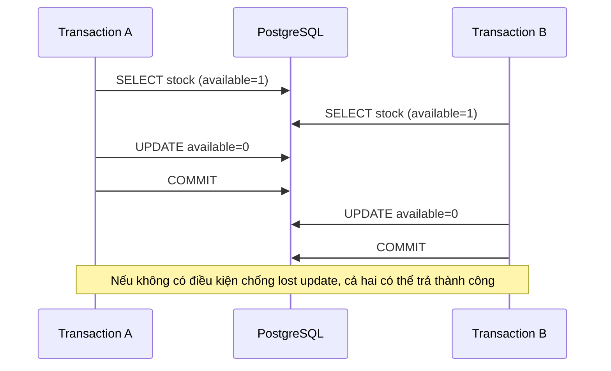

# Kiểm tra optimistic locking hoặc constraint

Hai người cùng giữ đơn vị tồn kho cuối cùng. Cả hai đọc `available = 1`, cùng ghi `available = 0`, rồi đều nhận thông báo thành công. Database không có số âm, nhưng hệ thống đã **xác nhận hai lần giữ cho một đơn vị**. Một test tuần tự với `@ApplicationModuleTest` có thể xanh hoàn toàn mà không phát hiện lỗi này.

**Kiểm tra optimistic locking hoặc constraint** có nghĩa là chủ động tạo *trạng thái tranh chấp hoặc dữ liệu sai*, để chứng minh hệ thống từ chối thay đổi không hợp lệ **tại ranh giới transaction/database thực**, rồi khẳng định invariant nghiệp vụ vẫn đúng. Đây không chỉ là test annotation `@Version` tồn tại hay `CREATE UNIQUE INDEX` đã chạy.

Bài thuộc chương **Database testing** của **SPRING_MODULITH_VERIFICATION_TESTING**: dùng Spring Modulith để bảo vệ ranh giới module bằng `ApplicationModules.verify()` và `@ApplicationModuleTest`, đồng thời kiểm tra PostgreSQL, transaction, sự kiện sau commit và quality gate CI. Trọng tâm bài là **các kịch bản kiểm chứng có thể bắt lỗi thực**, không lặp lại kiến thức nhập môn về repository hay fixture.

## 1. Chọn đúng cơ chế theo invariant cần bảo vệ

Trước khi viết test, chọn invariant và mức cưỡng chế:

| Invariant | Cơ chế phù hợp | Test phá vỡ cần viết |
| --- | --- | --- |
| Hai người cùng sửa một entity không được ghi đè thay đổi của nhau | JPA `@Version` / optimistic compare-and-swap | Hai transaction đọc cùng version rồi cùng update; một phải bị từ chối |
| Không có hai phiếu giữ `ACTIVE` trên một ghế/suất diễn | PostgreSQL partial `UNIQUE INDEX` | Hai transaction cùng INSERT key nghiệp vụ; tối đa một commit |
| `available >= 0` trong mọi hàng | `CHECK (available >= 0)` | INSERT/UPDATE âm phải bị database từ chối |
| `quantity > 0` | Validation đầu vào **và** `CHECK (quantity > 0)` | Bỏ qua validation service bằng SQL test; database vẫn từ chối |
| Mỗi reservation tham chiếu SKU tồn tại | Foreign key | INSERT reservation cho SKU chưa có phải thất bại |
| Hai người giữ hàng không được cùng thành công khi tổng cầu vượt tồn | Atomic conditional UPDATE, optimistic locking hoặc locking policy phù hợp | Hai transaction tranh đơn vị cuối; tổng số thành công và bản ghi phải đúng |
| Retry cùng `requestId` không giữ hàng lần hai | Unique key + idempotency logic | Gửi lại request; tồn không giảm thêm dù kết quả retry được xử lý |

Không có quy tắc “`@Version` **hoặc** constraint, chọn một”. Nhiều hệ thống cần cả hai: `@Version` phát hiện sửa entity dựa trên dữ liệu cũ, constraint bảo vệ những invariant mà **mọi đường ghi** — kể cả native SQL — đều phải tuân thủ.

**Giới hạn quan trọng:** `CHECK (available >= 0)` **không** ngăn tình huống *hai request đều báo thành công nhưng cuối cùng tồn vẫn bằng 0*. Muốn chứng minh không oversell, test phải kiểm tra **số reservation được chấp nhận** và số thành công, không chỉ giá trị tồn.

## 2. Tái hiện lỗi mất cập nhật trước khi sửa

Phản mẫu read–modify–write:

```java
// Mô tả đoạn logic dễ mắc lỗi, chưa có @Version/lock.
StockRow row = repository.findById(sku).orElseThrow();
if (row.getAvailable() < quantity) {
    throw new InsufficientStock(sku);
}
row.setAvailable(row.getAvailable() - quantity);
repository.save(row);
```

Với hai transaction riêng:



Thực tế thứ tự UPDATE còn phụ thuộc khóa hàng, isolation và flush; sơ đồ chỉ mô tả một lịch xen kẽ nguy hiểm. **Điều cần chứng minh là kết quả**, không phải cố tạo race bằng `Thread.sleep(100)` rồi hy vọng hai thread đọc trùng lúc.

Thiết kế hai tầng test:

1. **Test ép xung đột có kiểm soát:** Hai transaction đều đọc cùng version, chờ tại barrier rồi mới update; kiểm chứng optimistic locking.
2. **Test use case production:** Hai caller cùng gửi lệnh giữ hàng; assert không có hai lần chấp nhận hoặc hai reservation vượt tồn. Bài này kiểm tra toàn bộ service/repository/transaction, không chỉ JPA.

## 3. Entity JPA có `@Version` và repository nội bộ

Trong module `inventory`, entity đơn giản:

```java
package com.example.shop.inventory.internal.persistence;

import jakarta.persistence.Entity;
import jakarta.persistence.Id;
import jakarta.persistence.Table;
import jakarta.persistence.Version;

@Entity
@Table(name = "inventory_stock")
public class StockRow {

    @Id
    private String sku;

    private int available;

    @Version
    private Long version;

    protected StockRow() {}

    public StockRow(String sku, int available) {
        if (sku == null || sku.isBlank() || available < 0) {
            throw new IllegalArgumentException("Stock không hợp lệ");
        }
        this.sku = sku;
        this.available = available;
    }

    public void reserve(int quantity) {
        if (quantity <= 0) {
            throw new IllegalArgumentException("Số lượng phải dương");
        }
        if (available < quantity) {
            throw new InsufficientStock(sku);
        }
        available -= quantity;
    }

    public int getAvailable() { return available; }
    public Long getVersion() { return version; }
}
```

`InsufficientStock` là exception nghiệp vụ được định nghĩa trong Inventory (ví dụ ở API `inventory.reservations`); import tương ứng cần thêm khi áp dụng code. `@Version` sử dụng `Long` để JPA nhận biết entity mới hợp lệ khi version chưa được gán. Ta không tự gọi `setVersion(...)` trong logic nghiệp vụ.

Repository nằm trong package **nội bộ** của Inventory:

```java
package com.example.shop.inventory.internal.persistence;

import org.springframework.data.jpa.repository.JpaRepository;

public interface StockJpaRepository extends JpaRepository<StockRow, String> {}
```

Migration PostgreSQL tối thiểu:

```sql
CREATE TABLE inventory_stock (
    sku VARCHAR(80) PRIMARY KEY,
    available INTEGER NOT NULL,
    version BIGINT NOT NULL DEFAULT 0,
    CONSTRAINT ck_inventory_available CHECK (available >= 0)
);
```

Ở trạng thái được quản lý qua JPA, khi flush một entity đã thay đổi có `@Version`, provider điển hình phát ra SQL về mặt ý nghĩa như:

```sql
UPDATE inventory_stock
   SET available = ?, version = ?
 WHERE sku = ?
   AND version = ?;
```

Nếu câu UPDATE tác động **0 hàng** vì version hiện tại đã thay đổi, provider báo xung đột optimistic locking thay vì ghi đè im lặng. Mẫu SQL là **mô hình khái niệm**: tên cột, cách bind và thời điểm query thực tế phụ thuộc JPA provider.

### 3.1. `@Version` chỉ có tác dụng trên đường cập nhật tham gia cơ chế đó

`@Version` không làm mọi câu SQL viết tay tự kiểm tra version. Các đường cần review riêng:

- `EntityManager` quản lý một entity đã load và cập nhật thông qua dirty checking.
- Spring Data JPA repository `save(...)`/`saveAndFlush(...)` trên entity có version.
- JPQL/HQL bulk `UPDATE`/`DELETE` hoặc native SQL tác động trực tiếp vào bảng.
- JDBC/jOOQ truy vấn cập nhật không đi qua JPA version.
- Một module khác sửa bảng bằng SQL string.

Vì vậy test optimistic locking phải dùng **đường JPA có version**; nếu production có bulk SQL, cần test riêng cho **điều kiện đồng thời của SQL đó**.

## 4. Test quyết định: hai transaction cùng đọc một version

Đây là bài test quan trọng nhất cho `@Version`: **ép cả hai worker tải trạng thái trước khi bất kỳ worker nào cập nhật**.

### 4.1. Điều kiện test

- PostgreSQL thật (qua Testcontainers), migration có cột `version`.
- Hai transaction riêng với connection/persistence context riêng.
- Không có `@Transactional` trên test method/lớp test.
- Fixture `sku` mới được **commit** trước khi worker chạy.
- Hai thread dùng cùng SKU nhưng **không chia sẻ entity instance**.
- Chờ cả hai đọc xong bằng `CountDownLatch`, rồi mới cho update.
- Connection pool có đủ connection cho hai transaction đồng thời.

Nếu không có barrier sau read, một worker có thể đọc version `1` **sau khi** worker trước đã commit; cả hai lần cập nhật khi đó đều hợp lệ tuần tự và test không thực sự gây conflict.

### 4.2. Code test ép tranh chấp

Ví dụ sau đặt trong lớp test của module Inventory; các import được ghi đầy đủ để dễ chuyển vào dự án:

```java
package com.example.shop.inventory;

import static org.assertj.core.api.Assertions.assertThat;

import com.example.shop.inventory.internal.persistence.StockJpaRepository;
import jakarta.persistence.OptimisticLockException;
import java.util.UUID;
import java.util.concurrent.Callable;
import java.util.concurrent.CountDownLatch;
import java.util.concurrent.Executors;
import java.util.concurrent.TimeUnit;
import java.util.stream.Stream;
import org.junit.jupiter.api.Test;
import org.springframework.beans.factory.annotation.Autowired;
import org.springframework.dao.OptimisticLockingFailureException;
import org.springframework.jdbc.core.JdbcTemplate;
import org.springframework.modulith.test.ApplicationModuleTest;
import org.springframework.transaction.PlatformTransactionManager;
import org.springframework.transaction.TransactionDefinition;
import org.springframework.transaction.support.TransactionTemplate;

@ApplicationModuleTest
class StockVersionConflictTests {

    enum Outcome { COMMITTED, CONFLICT }

    @Autowired StockJpaRepository stocks;
    @Autowired JdbcTemplate jdbc;
    @Autowired PlatformTransactionManager transactions;

    @Test
    void staleEntityIsRejectedRatherThanOverwritten() throws Exception {
        String sku = "IT-" + UUID.randomUUID();
        jdbc.update(
            "INSERT INTO inventory_stock(sku, available, version) VALUES (?, 2, 0)",
            sku
        );

        var bothRead = new CountDownLatch(2);
        var releaseWrites = new CountDownLatch(1);
        var pool = Executors.newFixedThreadPool(2);

        Callable<Outcome> update = () -> {
            var tx = new TransactionTemplate(transactions);
            tx.setPropagationBehavior(
                TransactionDefinition.PROPAGATION_REQUIRES_NEW
            );

            try {
                tx.executeWithoutResult(status -> {
                    var row = stocks.findById(sku).orElseThrow();
                    bothRead.countDown();
                    try {
                        if (!releaseWrites.await(5, TimeUnit.SECONDS)) {
                            throw new IllegalStateException("Barrier timeout");
                        }
                    } catch (InterruptedException ex) {
                        Thread.currentThread().interrupt();
                        throw new IllegalStateException(ex);
                    }
                    row.reserve(1);
                    stocks.saveAndFlush(row);
                });
                return Outcome.COMMITTED;
            } catch (OptimisticLockingFailureException
                     | OptimisticLockException conflict) {
                return Outcome.CONFLICT;
            }
        };

        try {
            var first = pool.submit(update);
            var second = pool.submit(update);
            assertThat(bothRead.await(5, TimeUnit.SECONDS)).isTrue();
            releaseWrites.countDown();

            var results = Stream.of(
                first.get(10, TimeUnit.SECONDS),
                second.get(10, TimeUnit.SECONDS)
            ).toList();

            assertThat(results)
                .containsExactlyInAnyOrder(
                    Outcome.COMMITTED, Outcome.CONFLICT
                );

            Integer available = jdbc.queryForObject(
                "SELECT available FROM inventory_stock WHERE sku = ?",
                Integer.class, sku
            );
            Long version = jdbc.queryForObject(
                "SELECT version FROM inventory_stock WHERE sku = ?",
                Long.class, sku
            );

            assertThat(available).isEqualTo(1);
            assertThat(version).isEqualTo(1L);
        } finally {
            releaseWrites.countDown();
            pool.shutdownNow();
            boolean stopped = pool.awaitTermination(5, TimeUnit.SECONDS);
            if (!stopped) {
                throw new IllegalStateException(
                    "Worker chưa dừng; giữ nguyên DB test để điều tra"
                );
            }
            jdbc.update(
                "DELETE FROM inventory_stock WHERE sku = ?", sku
            );
        }
    }
}
```

Đây là bài test **theo cấu trúc thực thi**, nhưng còn cần entity/repository `StockRow` ở mục 3, migration chạy khi context khởi động và cấu hình PostgreSQL. Với các phiên bản JPA/Spring khác nhau, exception có thể được translate/wrap theo đường repository/transaction; nếu nhận exception không nằm trong hai loại được bắt, test nên **đỏ và điều tra**, không tự gộp mọi lỗi DB thành `CONFLICT`.

### 4.3. Bài test này thực sự chứng minh gì?

Test tạo `available = 2`, `version = 0`; hai worker đều load version 0, cùng muốn trừ một. Khi transaction đầu tiên hoàn tất, phiên bản trên DB tăng. Worker còn lại giữ entity đã cũ nên **phải bị từ chối**:

| Quan sát | Kỳ vọng |
| --- | --- |
| Số transaction `COMMITTED` | `1` |
| Số transaction `CONFLICT` | `1` |
| `available` cuối | `1` |
| `version` cuối | `1` |
| Hai transaction cùng commit | **Không được phép** |

Nếu không bật `@Version`, hoặc một đường cập nhật JPA bỏ qua version, hai worker có thể cùng commit và test phải phát hiện. Với riêng test này, **từ chối một update stale là kết quả mong muốn**, không phải lỗi test cần retry vô hạn.

### 4.4. Vì sao không test bằng một `@Transactional` bao ngoài?

Nếu test method có `@Transactional`, fixture có thể chưa commit nên worker khác không thấy. Nếu hai lần update chạy trong **cùng transaction/persistence context**, chúng không phải hai transaction tranh version. Ta sẽ kiểm tra hành vi khác hoàn toàn với production.

Ở đây `TransactionTemplate` được gọi trong từng worker thread để mở transaction độc lập, còn JDBC seed dùng auto-commit khi không có transaction test bao ngoài. Barrier là công cụ làm rõ lịch xen kẽ, không phải cách production code đồng bộ hóa nghiệp vụ.

## 5. Kiểm tra use case: tránh nhầm “version conflict” với “hết hàng”

Test ở mục 4 chỉ chứng minh *cơ chế phát hiện stale entity*. Một use case `InventoryReservations.reserve(...)` còn phải có hợp đồng business rõ:

```java
package com.example.shop.inventory.reservations;

public interface InventoryReservations {
    ReservationReceipt reserve(ReserveStock command);
}
```

Khi hai caller tranh một đơn vị:

- Nếu dùng `@Version`, một caller có thể nhận **optimistic conflict** và cần quyết định có reload/retry không.
- Nếu sau reload tồn đã hết, caller nên nhận lỗi nghiệp vụ **không đủ tồn**, không phải trả “đã giữ hàng”.
- Nếu lỗi infrastructure/transient, caller cần chính sách retry riêng.
- Nếu một request đã commit nhưng client không nhận response do timeout, retry phải dùng **idempotency key**, tránh giữ hai lần.

### 5.1. Không bắt conflict bên trong transaction đã hỏng rồi cập nhật lại

Phản mẫu:

```java
@Transactional
public void reserve() {
    try {
        stocks.saveAndFlush(row);
    } catch (OptimisticLockingFailureException ex) {
        var latest = stocks.findById(sku).orElseThrow();
        latest.reserve(1);
        stocks.save(latest); // Không có gì bảo đảm transaction cũ còn dùng được.
    }
}
```

Sau lỗi optimistic/JPA, transaction hiện tại thường đã bị đánh dấu rollback-only hoặc persistence context không còn phù hợp để tiếp tục. Đường retry an toàn cần **transaction mới và đọc lại state**, có giới hạn số lần và kiểm tra lại invariant.

### 5.2. Retry thuộc lớp nào?

Một phương án là đặt retry **ở caller/application orchestration** bên ngoài transaction cần retry:

```text
Caller
  |
  +-- Attempt 1: Inventory transaction
  |      → load stock version 0
  |      → conflict, rollback
  |
  +-- Attempt 2 (nếu policy cho phép):
         → transaction mới
         → load stock version mới
         → kiểm tra đủ hàng
         → commit hoặc từ chối nghiệp vụ
```

Không retry vô hạn. Một xung đột có thể hợp lệ và không có nghĩa phải thử lại; dưới tải cao cần backoff/bounded attempts, metrics và idempotency. Đặc biệt không retry thao tác **đã gọi payment API** hoặc phát side effect ngoài DB mà chưa có cơ chế chống lặp.

### 5.3. Test service-level phải đo business state

Với `available = 1`, hai caller đồng thời gọi `reserve(sku, 1, requestIdKhácNhau)`:

1. Seed SKU đã commit và dùng cùng key trong hai worker.
2. Chờ cả hai hoàn tất transaction.
3. Assert **tối đa một** lời gọi được chấp nhận theo hợp đồng.
4. Assert tồn không âm và đúng số đơn vị còn lại.
5. Assert **không quá một reservation được chấp nhận** cho SKU đó.
6. Nếu có event `StockReserved`, không có hai success events đại diện cho hai reservation đã commit.

Chỉ assert `CHECK available >= 0` không đủ. Nếu một transaction bị retry rồi thành công theo policy, số request **được chấp nhận cuối cùng** mới là thước đo, không chỉ số exception `OptimisticLockingFailureException`.

## 6. Khi không dùng `@Version`: atomic conditional UPDATE

Một use case chỉ cần **giảm tồn nếu còn đủ** có thể dùng một SQL atomic update thay cho read–modify–write của JPA:

```sql
UPDATE inventory_stock
   SET available = available - :quantity,
       version = version + 1
 WHERE sku = :sku
   AND available >= :quantity;
```

Repository thực hiện câu lệnh và trả số hàng bị tác động:

```java
@Modifying
@Query(value = """
    UPDATE inventory_stock
       SET available = available - :qty,
           version = version + 1
     WHERE sku = :sku
       AND available >= :qty
    """, nativeQuery = true)
int decrementIfEnough(
    @Param("sku") String sku,
    @Param("qty") int qty
);
```

Đặt method trong repository nội bộ Inventory và gọi nó **trong transaction service**. Với PostgreSQL, UPDATE có điều kiện trên cùng hàng xử lý cạnh tranh theo cơ chế row locking/recheck; khi chỉ còn một đơn vị, hai yêu cầu trừ một có thể được xử lý sao cho chỉ một UPDATE tác động một hàng. Điều này vẫn cần kiểm chứng trên engine/isolation production.

### 6.1. Không nhầm atomic update với optimistic version check

Ở câu SQL trên, điều kiện quyết định là `available >= :qty`, không phải `WHERE version = :expectedVersion`. Đây là **atomic conditional update**. Việc tăng `version` giúp các JPA reader đã tải version cũ có thể nhận biết cập nhật stale trong những bước sau.

Nếu muốn tự thực hiện optimistic compare-and-swap:

```sql
UPDATE inventory_stock
   SET available = :newAvailable,
       version = version + 1
 WHERE sku = :sku
   AND version = :expectedVersion;
```

Khi affected rows bằng `0`, phải coi là conflict/missing row và xử lý riêng; không trả thành công. Sự khác biệt giữa hai phương án là **điều kiện tiền đề được DB kiểm tra**, nên test cần phản ánh điều kiện thực sự của business use case.

### 6.2. Bulk update bỏ qua JPA dirty checking/version mặc định

JPQL bulk update và native SQL thường không đi qua cơ chế update từng managed entity có `@Version` như phần 3. Nếu code ghi:

```sql
UPDATE inventory_stock SET available = 0 WHERE sku = :sku;
```

thì annotation `@Version` trên entity **không tự thêm** điều kiện version cho câu SQL này. Nếu một persistence context đã load entity, state trong bộ nhớ có thể stale; cần flush/clear/refresh thích hợp khi trộn JPA entity và bulk SQL.

**Test cần có** khi production sử dụng bulk update:

- Tác động số hàng đúng điều kiện.
- Không cập nhật nhầm hàng/tenant khác.
- Không giảm âm hoặc vượt invariant.
- Đồng thời với JPA update, không ghi đè stale không phát hiện.
- Version được tăng có chủ đích nếu các JPA reader phụ thuộc vào nó.

Không chọn `@Version` hay SQL atomic theo sở thích: hãy chọn theo **đơn vị nhất quán** cần bảo vệ và kiểm chứng.

## 7. Constraint bảo vệ invariant ngay tại database

Với bài toán giữ ghế cho sự kiện, chỉ dựa vào `@Version` của hai entity riêng biệt chưa chắc ngăn được **hai INSERT cho cùng ghế**. Chúng có thể mang hai ID khác nhau, nên không cùng tranh một JPA row/version. Quy tắc “mỗi ghế chỉ có một phiếu giữ hiệu lực” cần một **business key** được cưỡng chế tập trung.

Ví dụ PostgreSQL:

```sql
CREATE TABLE seat_hold (
    hold_id UUID PRIMARY KEY,
    show_id UUID NOT NULL,
    seat_code VARCHAR(20) NOT NULL,
    status VARCHAR(16) NOT NULL,
    expires_at TIMESTAMPTZ,
    CONSTRAINT ck_seat_hold_status
        CHECK (status IN ('ACTIVE', 'RELEASED')),
    CONSTRAINT ck_seat_hold_active_expiry
        CHECK (status <> 'ACTIVE' OR expires_at IS NOT NULL)
);

CREATE UNIQUE INDEX ux_active_seat_per_show
    ON seat_hold(show_id, seat_code)
    WHERE status = 'ACTIVE';
```

Những gì schema này bảo vệ:

1. `hold_id` không trùng.
2. `status` thuộc tập giá trị có ý nghĩa.
3. Một hàng `ACTIVE` có `expires_at`.
4. Trong cùng một suất diễn, mỗi `seat_code` có **tối đa một hàng `ACTIVE`**.
5. Nhiều hàng `RELEASED` cùng seat/show được cho phép, phục vụ lịch sử.

**Đọc kỹ:** Partial unique index không phải quy tắc “đến giờ hết hạn thì tự xem hàng là không active”. Nếu ứng dụng để `status='ACTIVE'` sau khi `expires_at` đã qua, index **vẫn** cấm một `ACTIVE` mới. Service/job phải chuyển trạng thái cũ sang `RELEASED`/`EXPIRED` hoặc có workflow phù hợp trước khi nhận hold tiếp theo.

Không nên cố tạo predicate kiểu `WHERE expires_at > now()` để “index tự biết giờ hiện tại”: predicate index trong PostgreSQL có yêu cầu tính ổn định/immutability của các biểu thức, và cách diễn đạt dựa trên thời gian hiện tại không tương đương một invariant lưu trữ bền vững. Dùng **trạng thái được cập nhật có chủ đích** và test chuyển trạng thái.

### 7.1. Khi nào `UNIQUE` là giải pháp tốt hơn `@Version`?

| Tình huống | `@Version` | Unique constraint/index |
| --- | --- | --- |
| Hai transaction cập nhật **cùng một entity** đã load | Phát hiện stale update | Không trực tiếp bảo vệ nếu không có business key thích hợp |
| Hai transaction **INSERT hai hàng khác ID** cho cùng ghế | Không đủ nếu không cùng cập nhật một aggregate/version chung | Bảo vệ trực tiếp business key |
| Một module khác dùng native SQL ghi trùng ghế | Có thể bypass JPA version | Database vẫn cưỡng chế index |
| Đọc và cập nhật nhiều hàng của một aggregate | Có thể hữu ích nếu thiết kế root/version nhất quán | Constraint bảo vệ các điều kiện biểu diễn được ở DB |
| “Chỉ một ACTIVE” theo cặp `(show, seat)` | Không tự nhiên khi mỗi hold là row riêng | Partial unique index phù hợp PostgreSQL |

Một invariant có thể cần nhiều lớp: API validation cung cấp lỗi dễ hiểu, JPA version ngăn ghi đè và database unique/check là **tuyến phòng thủ cuối** cho những đường ghi không đi qua service.

## 8. Test UNIQUE trực tiếp: lỗi phải đến từ database

Test này cố ý bypass validation/service để chứng minh **cơ sở dữ liệu thật** cưỡng chế business key. Dùng schema test riêng và `JdbcTemplate` (không bọc method trong test-managed transaction):

```java
package com.example.tickets.seating;

import static org.assertj.core.api.Assertions.assertThat;
import static org.assertj.core.api.Assertions.assertThatThrownBy;

import java.time.OffsetDateTime;
import java.util.UUID;
import org.junit.jupiter.api.Test;
import org.springframework.beans.factory.annotation.Autowired;
import org.springframework.dao.DuplicateKeyException;
import org.springframework.jdbc.core.JdbcTemplate;
import org.springframework.modulith.test.ApplicationModuleTest;

@ApplicationModuleTest
class SeatHoldUniqueIndexTests {

    @Autowired JdbcTemplate jdbc;

    @Test
    void twoActiveHoldsForSameSeatCannotExist() {
        UUID showId = UUID.randomUUID();
        String seat = "A-01";
        var expiry = OffsetDateTime.parse("2027-01-01T10:00:00Z");

        try {
            insertActive(UUID.randomUUID(), showId, seat, expiry);

            assertThatThrownBy(() ->
                insertActive(UUID.randomUUID(), showId, seat, expiry)
            ).isInstanceOf(DuplicateKeyException.class);

            Integer activeCount = jdbc.queryForObject("""
                SELECT count(*) FROM seat_hold
                 WHERE show_id = ?
                   AND seat_code = ?
                   AND status = 'ACTIVE'
                """, Integer.class, showId, seat);

            assertThat(activeCount).isEqualTo(1);
        } finally {
            jdbc.update(
                "DELETE FROM seat_hold WHERE show_id = ?", showId
            );
        }
    }

    private void insertActive(
        UUID holdId,
        UUID showId,
        String seat,
        OffsetDateTime expiry
    ) {
        jdbc.update("""
            INSERT INTO seat_hold
              (hold_id, show_id, seat_code, status, expires_at)
            VALUES (?, ?, ?, 'ACTIVE', ?)
            """, holdId, showId, seat, expiry);
    }
}
```

Điều kiện: migration tạo index `ux_active_seat_per_show`, PostgreSQL datasource thật được cấu hình, và không có test-managed transaction trên lớp. Spring JDBC thường translate PostgreSQL unique violation (`SQLSTATE 23505`) thành `DuplicateKeyException`; với driver/translator khác cần kiểm tra type thực nhận thay vì bắt mọi exception chung chung.

**Lưu ý cleanup:** `finally` chỉ xóa hàng có `showId` riêng của test. Nếu còn bảng con/FK hoặc consumer giữ reference tới hold, cần dọn đúng thứ tự và bảo đảm worker đã dừng. Không dùng `DELETE FROM seat_hold` toàn bảng nếu suite có thể chạy parallel.

### 8.1. Test trường hợp hợp lệ đi cùng trường hợp bị từ chối

Một index thiết kế sai có thể từ chối quá nhiều. Vì vậy bổ sung:

| Given | When | Then |
| --- | --- | --- |
| ACTIVE `(show A, seat 01)` | INSERT ACTIVE `(show A, seat 01)` | Bị từ chối |
| ACTIVE `(show A, seat 01)` | INSERT ACTIVE `(show A, seat 02)` | Thành công |
| ACTIVE `(show A, seat 01)` | INSERT ACTIVE `(show B, seat 01)` | Thành công |
| RELEASED `(show A, seat 01)` | INSERT ACTIVE `(show A, seat 01)` | Thành công |
| ACTIVE `(show A, seat 01)` | Chuyển hàng cũ sang RELEASED rồi INSERT ACTIVE mới | Thành công theo transaction/policy |

Các case này giúp phát hiện index vô tình `UNIQUE(seat_code)` trên toàn hệ thống, hoặc index không có predicate `WHERE status = 'ACTIVE'` khiến lịch sử giữ ghế bị chặn.

## 9. Test CHECK và FOREIGN KEY: từ chối dữ liệu sai dù bỏ qua service

Đối với `inventory_stock`:

```java
@Test
void databaseRejectsNegativeAvailable() {
    String sku = "IT-" + UUID.randomUUID();
    jdbc.update(
        "INSERT INTO inventory_stock(sku, available, version) VALUES (?, 2, 0)",
        sku
    );

    try {
        assertThatThrownBy(() -> jdbc.update(
            "UPDATE inventory_stock SET available = -1 WHERE sku = ?",
            sku
        )).isInstanceOf(DataIntegrityViolationException.class);

        Integer stillAvailable = jdbc.queryForObject(
            "SELECT available FROM inventory_stock WHERE sku = ?",
            Integer.class, sku
        );
        assertThat(stillAvailable).isEqualTo(2);
    } finally {
        jdbc.update(
            "DELETE FROM inventory_stock WHERE sku = ?", sku
        );
    }
}
```

Đoạn này giả định các import từ AssertJ/JUnit/JDBC có sẵn như test ở mục 8 và thêm `org.springframework.dao.DataIntegrityViolationException`. Câu UPDATE lỗi được thực hiện dưới auto-commit khi không có test-managed transaction; nếu đặt trong transaction đang hoạt động, PostgreSQL có thể để transaction ở trạng thái **aborted** và cần rollback trước khi thực hiện SELECT tiếp theo.

**CHECK không thay thế optimistic locking:** Nó từ chối giá trị `-1`, nhưng không từ chối hai transaction đều ghi `0` từ snapshot `1` mà đồng thời báo thành công. Vì thế test `CHECK` và test cạnh tranh có mục tiêu khác nhau.

### 9.1. Test foreign key

Giả sử schema reservation có:

```sql
CREATE TABLE stock_reservation (
    reservation_id UUID PRIMARY KEY,
    sku VARCHAR(80) NOT NULL,
    quantity INTEGER NOT NULL CHECK (quantity > 0),
    CONSTRAINT fk_reservation_stock
        FOREIGN KEY (sku) REFERENCES inventory_stock(sku)
);
```

Test trực tiếp:

```java
String missingSku = "IT-NOT-EXIST-" + UUID.randomUUID();

assertThatThrownBy(() -> jdbc.update("""
    INSERT INTO stock_reservation(reservation_id, sku, quantity)
    VALUES (?, ?, 1)
    """, UUID.randomUUID(), missingSku))
    .isInstanceOf(DataIntegrityViolationException.class);
```

Mục tiêu là **database không cho ghi một liên kết không hợp lệ**, không phải test API Inventory xử lý thông báo lỗi dễ hiểu. Một test ở tầng service cần xác nhận lỗi database được translate phù hợp, nếu đó là hành vi có thể xảy ra từ lệnh người dùng.

### 9.2. Test dữ liệu hợp lệ cũng cần có

Một constraint sai có thể khiến mọi thao tác ghi đều thất bại nhưng các test “dữ liệu xấu phải thất bại” vẫn xanh. Vì vậy mỗi nhóm constraint nên có **ca dương tính** tương ứng: `available=0` được chấp nhận, `quantity=1` hợp lệ, reservation tham chiếu SKU tồn tại được lưu, active unique khác ghế vẫn thành công.

## 10. Test UNIQUE khi hai transaction INSERT đồng thời

Test mục 8 tạo hai bản ghi **tuần tự**. Nó chứng minh index đã được khai báo đúng, nhưng không chứng minh service xử lý đúng **cuộc đua giữa hai caller**.

Một bài contention test cần:

1. Cấp một `showId` chỉ thuộc scenario này.
2. Hai worker transaction riêng, không dùng test-level `@Transactional`.
3. Cả hai nhận cùng `showId` và `seatCode`, nhưng `holdId/requestId` khác nhau.
4. Barrier cho hai worker cùng bắt đầu bước INSERT (không bắt buộc chúng commit đúng một thời điểm).
5. Chờ cả hai **hoàn tất transaction** bằng `Future.get(...)`.
6. Assert **một commit**, **một unique conflict** hoặc lỗi được service chuyển thành `SeatAlreadyHeld` theo hợp đồng.
7. Assert database có **đúng một `ACTIVE`**, không có hai success receipts.
8. Dọn dữ liệu scenario sau khi tất cả worker đã ngừng.

```mermaid
sequenceDiagram
    participant A as Worker A / Tx A
    participant DB as PostgreSQL seat_hold
    participant B as Worker B / Tx B
    A->>DB: INSERT ACTIVE(show=S, seat=A-01, hold=H1)
    B->>DB: INSERT ACTIVE(show=S, seat=A-01, hold=H2)
    Note over DB: Partial UNIQUE khóa business key
    DB-->>A: Một transaction commit
    DB-->>B: Transaction còn lại bị unique conflict
    Note over A,B: Trường hợp winner A/B có thể đảo; invariant không được đảo
```

Với PostgreSQL, một transaction INSERT có key trùng một hàng chưa commit có thể phải **chờ** transaction kia để xác định commit/rollback. Không được viết test chờ một worker báo lỗi **trước khi** cho worker còn lại commit, vì có thể tạo deadlock ngay trong cấu trúc test. Test cần timeout và chờ transaction kết thúc; không dựa vào `Thread.sleep` cố định.

### 10.1. Phân biệt lỗi database với lỗi domain

Một repository-level test có thể assert `DuplicateKeyException`. Nhưng một **API module công khai** nên quyết định message/kết quả nghiệp vụ:

```java
// API module seating.holds, không lộ SQLState/ConstraintViolationException.
public class SeatAlreadyHeld extends RuntimeException {
    public SeatAlreadyHeld(String seat) {
        super("Ghế đã được giữ: " + seat);
    }
}
```

Một implementation có thể dùng `INSERT ... ON CONFLICT ... DO NOTHING` với affected rows để xử lý conflict như một nhánh nghiệp vụ, hoặc translate violation ở **ranh giới transaction phù hợp**. Không phải mọi `DataIntegrityViolationException` đều là `SeatAlreadyHeld`: lỗi FK, status, khóa khác và lỗi schema là những vấn đề khác, cần phân biệt.

Nếu exception chỉ phát sinh **tại commit sau khi service method đã return**, `try/catch` nằm bên trong method có thể không bắt được. Khi đó cần thiết kế nơi thực hiện flush/transaction boundary và error mapping phù hợp.

## 11. Thời điểm thất bại: `save()`, `flush()` hay `commit()`?

Cùng một invariant nhưng lỗi xuất hiện ở các thời điểm khác nhau:

| Tác vụ | Có thể quan sát | Không thể kết luận |
| --- | --- | --- |
| `entityManager.persist(...)`/`repository.save(...)` | JPA đã nhận entity, có thể đã gửi SQL tùy cơ chế | Dữ liệu đã commit |
| `flush()`/`saveAndFlush(...)` | SQL pending được đẩy tới DB, một số constraint/version conflict bị phát hiện | Transaction đã commit |
| `commit` | Giao dịch hoàn tất hoặc báo lỗi | Consumer async đã xử lý |
| Đọc DB sau proxy service return thành công | State đã được commit trong mô hình service transaction thông thường | Mọi side effect ngoài DB đã thành công |

### 11.1. Vì sao test `save` rồi assert entity chưa đủ?

```java
StockRow row = stocks.findById(sku).orElseThrow();
row.reserve(1);
stocks.save(row);
assertThat(row.getAvailable()).isEqualTo(1);
```

Assertion này chỉ kiểm tra object đang nằm trong bộ nhớ sau khi gọi `reserve`, có thể đúng ngay cả khi transaction sau đó bị optimistic conflict và rollback. Cần test kết thúc transaction, đọc **từ DB bằng scope mới**, và kiểm tra kết quả của cả hai transaction.

### 11.2. Deferrable constraint và lỗi tại commit

Một số ràng buộc được database hỗ trợ có thể khai báo `DEFERRABLE`, với thời điểm kiểm tra được hoãn đến commit theo cấu hình. Khi đó `flush()` **không đủ** để kết luận dữ liệu cuối cùng hợp lệ.

Lưu ý chính xác với PostgreSQL:

- Một **UNIQUE constraint** thông thường có thể hỗ trợ `DEFERRABLE` theo cú pháp phù hợp.
- Partial unique index `WHERE status='ACTIVE'` ở mục 7 **không** là một deferrable unique constraint theo cùng cách.
- `CHECK` constraint trong PostgreSQL **không** được khai báo deferrable như foreign key/unique constraints.
- Khi một violation làm transaction hiện tại thất bại, không tiếp tục query trên transaction đã aborted.

Đối với test lỗi tại commit, hãy gọi một **Spring transactional service thật** từ test **không bọc transaction ngoài** hoặc chủ động dùng `TransactionTemplate` rồi bắt exception từ scope `execute(...)`, sau đó xác minh dữ liệu không thay đổi bằng transaction mới.

### 11.3. Phát hiện lỗi tại đâu thì dịch lỗi ở đó

Nếu API muốn trả `409 Conflict` cho optimistic version conflict, cần xác định transaction boundary của API (HTTP, service proxy hoặc orchestration). Một `try/catch` bao quanh `repository.save(...)` trong method không bắt được lỗi xảy ra **sau khi method kết thúc**, lúc transaction interceptor commit.

Do đó integration test nên bao gồm cả **caller của service** để xác nhận error mapping, không chỉ một repository test bắt exception khi `saveAndFlush`.

## 12. Isolation level và locking policy ảnh hưởng bài test

`@Version` và constraint hoạt động trên DB engine/isolation cụ thể; không thể thay PostgreSQL bằng H2 rồi mặc định mọi lịch interleaving giống nhau.

### 12.1. Những khác biệt cần để ý

- **READ COMMITTED:** mỗi statement có thể nhìn thấy snapshot mới; PostgreSQL UPDATE có thể chờ row lock rồi đánh giá điều kiện phù hợp sau khi transaction khác commit.
- **REPEATABLE READ/SERIALIZABLE:** các tình huống tranh chấp có thể kết thúc bằng serialization failure hoặc các loại lỗi khác; chính sách retry cần phản ánh exception thực tế.
- **Pessimistic locking** (`SELECT ... FOR UPDATE`, `LockModeType.PESSIMISTIC_WRITE`) giữ row lock để tuần tự hóa thao tác, đổi lại có thể tăng chờ/deadlock.
- **Optimistic locking** thường không chặn người đọc; xung đột phát sinh khi cập nhật stale state.
- **Unique index** buộc những INSERT cùng business key phải tranh chấp tại DB, kể cả khi chúng không đọc trước.

### 12.2. Kịch bản kiểm chứng tối thiểu

| Test | Dữ liệu ban đầu | Cạnh tranh | Hậu điều kiện |
| --- | --- | --- | --- |
| Optimistic stale update | Stock version 0, available 2 | 2 transaction đọc 0, cùng trừ 1 | 1 commit, 1 conflict, version 1 |
| Atomic update | Available 1 | 2 transaction chạy `WHERE available>=1` | 1 affected row, 1 không, tồn 0 |
| Unique seat hold | Chưa có ACTIVE cho show/seat | 2 INSERT ACTIVE | 1 bản ghi ACTIVE |
| Check | Available 2 | UPDATE thành -1 | Bị từ chối, vẫn 2 |
| Foreign key | SKU không tồn tại | INSERT reservation tham chiếu SKU | Bị từ chối |
| Retry idempotent | Request R đã chấp nhận một lần | Gửi R lại | Không giảm tồn hai lần |

Không nên ép mọi lỗi concurrency thành một class exception cố định khi engine/isolation đã thay đổi. Hãy tách **invariant phải đúng** khỏi **loại lỗi kỹ thuật có thể được phép** theo contract.

### 12.3. Một test lặp lại vẫn không chứng minh hình thức

Chạy contention test nhiều lần giúp tăng khả năng bắt race, nhưng không bảo đảm bao phủ tất cả lịch xen kẽ. Đầu tư vào **ràng buộc dữ liệu, điều kiện SQL, transaction semantics và test điều khiển lịch** sẽ hữu ích hơn việc tăng hàng nghìn lần `Thread.sleep`.

## 13. Cấu hình `@ApplicationModuleTest` với PostgreSQL thật

Những ví dụ ở các mục trước cần một database có **cùng engine và DDL thật** với môi trường production. Một cấu hình khả thi khi dùng Spring Boot có hỗ trợ `@ServiceConnection`:

```java
package com.example.shop.inventory;

import org.springframework.boot.testcontainers.service.connection.ServiceConnection;
import org.springframework.modulith.test.ApplicationModuleTest;
import org.testcontainers.containers.PostgreSQLContainer;
import org.testcontainers.junit.jupiter.Container;
import org.testcontainers.junit.jupiter.Testcontainers;

@Testcontainers
@ApplicationModuleTest
class InventoryPostgresConstraintTests {

    @Container
    @ServiceConnection
    static PostgreSQLContainer<?> postgres =
        new PostgreSQLContainer<>("postgres:16-alpine");

    // Thêm @Autowired JdbcTemplate, repositories và các @Test
    // như test optimistic/constraint đã trình bày.
}
```

Đây là **khung cấu hình**, không phải một test hoàn chỉnh vì chưa có assertions. Để chạy cần Spring Modulith test, Spring Boot test/testcontainers integration (phù hợp với Spring Boot 3.1+), Testcontainers JUnit/PostgreSQL, JDBC driver, JPA/JDBC và container runtime. Chọn major PostgreSQL và extension tương ứng với production, không mặc định image ví dụ là version đang triển khai.

Ví dụ các property test khi dùng Flyway:

```properties
spring.flyway.enabled=true
spring.flyway.locations=classpath:db/migration
spring.jpa.hibernate.ddl-auto=validate
spring.datasource.hikari.maximum-pool-size=8
```

Connection pool `8` chỉ là giá trị minh họa: test với hai transaction cùng sống cần tối thiểu đủ connection hoạt động đồng thời, cộng các truy vấn/hạ tầng khác nếu có. Nếu pool chỉ cho một connection, test có thể **timeout trước barrier** và đó không phải optimistic conflict cần kiểm tra.

### 13.1. Mỗi test có một fixture độc lập

Tránh:

```sql
DELETE FROM inventory_stock;
INSERT INTO inventory_stock(sku, available, version)
VALUES ('SKU-SHARED', 2, 0);
```

trên database/schema có nhiều test chạy song song. Với contention test, tạo `String sku = "IT-" + UUID.randomUUID()`, INSERT một hàng đã commit, cho cả hai worker của **cùng test** tranh SKU đó, và chỉ xóa đúng SKU sau khi worker hoàn tất.

Không dùng `@Transactional` trên lớp test nếu mục tiêu là chứng minh **hai transaction commit/rollback riêng**. Nếu test chỉ kiểm tra một unique violation tuần tự, `JdbcTemplate` auto-commit với fixture độc quyền giúp quan sát hậu điều kiện đơn giản hơn.

### 13.2. Hai loại isolation, không được nhầm

```text
Giữa các test scenarios:
  Test A (SKU-A)       Test B (SKU-B)
  → dữ liệu khác nhau  → dữ liệu khác nhau

Bên trong Test A:
  Worker A1 ------+
                  +----> CÙNG SKU-A, khác transaction
  Worker A2 ------+
```

Nếu cấp mỗi worker trong contention test **một SKU hoặc một database khác nhau**, test đã đánh mất mục tiêu kiểm tra tranh chấp. Ngược lại, để các test class khác cũng cùng sửa SKU-A sẽ khiến kết quả nhiễu và không thể gán lỗi cho scenario.

### 13.3. Chú ý lifecycle Testcontainers và Spring context cache

`static @Container` thường có lifecycle theo test class. Spring Test có thể cache `ApplicationContext` giữa các class có cấu hình tương ứng. Cần đảm bảo datasource trong context **không trỏ vào container đã stop**, hoặc dùng chiến lược singleton container sống đủ lâu cùng namespace dữ liệu rõ ràng.

`@DirtiesContext` tác động vào cache context; nó không phải lệnh xóa những hàng đã commit trong database. Một container dùng chung giúp giảm startup nhưng không tự cấp schema riêng cho từng test.

### 13.4. Khi cần kiểm thử Seating cùng Inventory

`@ApplicationModuleTest` được đặt trong package của module đang test. Với SeatAllocation/Seating, khai báo một test riêng **trong module đó** và đảm bảo migration tạo index `ux_active_seat_per_show`; không phải thêm toàn bộ module vào một context Inventory chỉ để test SQL của Seating.

Khi cần test workflow Booking → Seating, lựa chọn `BootstrapMode.DIRECT_DEPENDENCIES` hoặc integration test nhiều module có chủ đích. Nó không tự tách database, tạo fixture hay chứng minh locking đúng.

## 14. Module boundary: chỉ module sở hữu dữ liệu được quyết định invariant

Nếu `ordering` có thể inject repository của `inventory` rồi tự trừ tồn, một test optimistic locking của Inventory **không bảo vệ** được đường code Ordering khác cố tình bỏ qua version.

Mẫu cấu trúc:

```text
com.example.shop/
├── inventory/
│   ├── reservations/
│   │   ├── package-info.java
│   │   ├── InventoryReservations.java
│   │   └── ReserveStock.java
│   ├── events/
│   │   ├── package-info.java
│   │   └── StockReserved.java
│   └── internal/
│       ├── StockReservationService.java
│       └── persistence/
│           ├── StockRow.java
│           └── StockJpaRepository.java
└── ordering/
    ├── package-info.java
    └── internal/PlaceOrderService.java
```

Trong `inventory/reservations/package-info.java`:

```java
@org.springframework.modulith.NamedInterface("reservations")
package com.example.shop.inventory.reservations;
```

Trong `ordering/package-info.java`:

```java
@org.springframework.modulith.ApplicationModule(
    allowedDependencies = "inventory::reservations"
)
package com.example.shop.ordering;
```

Ordering chỉ gọi `InventoryReservations.reserve(...)`; phần `StockJpaRepository`, `@Version`, locking policy và câu SQL atomic thuộc Inventory.

### 14.1. Test kiến trúc bắt một lỗi mà database test bỏ sót

```java
package com.example.shop;

import org.junit.jupiter.api.Test;
import org.springframework.modulith.core.ApplicationModules;

class ModularityTests {

    @Test
    void modulesKeepPublishedBoundaries() {
        ApplicationModules.of(ShopApplication.class).verify();
    }
}
```

`verify()` có thể phát hiện phụ thuộc vòng, import kiểu nội bộ của closed module và dependency ngoài `allowedDependencies`. Nhưng nó **không tự**:

- Thực thi hai transaction đồng thời.
- Kiểm tra version thực sự được tăng.
- Kiểm tra partial unique index đã được migrate.
- Phát hiện mọi SQL string dùng `JdbcTemplate` ghi bảng module khác.
- Xác minh event chỉ phát sau một transaction được chấp nhận.

Vì vậy cần **architecture test + database constraint tests + service-level concurrency test**. Một kết quả xanh ở lớp này không thay thế hai lớp còn lại.

### 14.2. Kiểm tra review SQL xuyên module

Phản mẫu:

```java
// ordering/internal/PlaceOrderService.java
jdbc.update("""
    UPDATE inventory_stock
       SET available = available - 1
     WHERE sku = ?
    """, sku);
```

Đoạn này có thể **không tạo dependency Java** tới một class Inventory, vì chỉ tham chiếu `JdbcTemplate` và tên bảng trong string. `ApplicationModules.verify()` không nhất thiết phát hiện. Code review, kiểm tra ownership của SQL và quyền database khi phù hợp phải ngăn đường ghi đó.

## 15. Event sau transaction thành công: một phiên bản xung đột không được “phát thành công”

Giả sử Inventory ghi `StockReserved` từ aggregate sau `repository.save(...)`, hoặc service publish application event trong transaction. Một request **thất bại vì optimistic lock hoặc unique constraint** không được khiến Fulfillment coi có reservation đã commit.

Một lỗi dễ xảy ra:

```text
Transaction A:
  đọc version 0
  chuẩn bị reservation + register StockReserved
  repository.save(...) có thể publish event trong transaction
  flush/commit phát hiện optimistic conflict
  ROLLBACK
```

`PublishedEvents` có thể quan sát một event đã được publish **trước khi** transaction rollback. Nó không tự chứng minh event đại diện một kết quả đã commit.

### 15.1. Ba assertion khác nhau

| Điều muốn kiểm tra | Cách kiểm tra |
| --- | --- |
| Event domain đã được publish | `PublishedEvents` với đúng request/reservation ID |
| Reservation/stock đã commit | Đọc database sau khi transaction service kết thúc |
| Consumer có side effect sau commit | Quan sát listener `AFTER_COMMIT`/`@ApplicationModuleListener` và dữ liệu consumer |

### 15.2. Kịch bản conflict + event

1. Seed stock/seat và hai request khác nhau.
2. Cho hai request tranh nhau sao cho đúng **một** reservation được commit.
3. Assert **số bản ghi accepted là một** và trạng thái stock/seat đúng.
4. Nếu consumer là listener sau commit, chờ consumer hoàn thành rồi assert **một business side effect** gắn với reservation được chấp nhận.
5. Assert không có side effect cho request/hold bị từ chối.
6. Khi event có thể retry, assert consumer idempotent (ví dụ unique `reservation_id` trong bảng Fulfillment).

Không dùng `PublishedEvents` count đơn thuần làm tiêu chí của **số reservation thành công** nếu event publish trước commit. Ngoài ra, với `@ApplicationModuleTest(STANDALONE)`, consumer ở module khác có thể không được bootstrap, nên phải dùng integration test đúng phạm vi.

### 15.3. `@ApplicationModuleListener` và publication registry

Khi Spring Modulith dùng `@ApplicationModuleListener` và Event Publication Registry phù hợp, cần test riêng các đường: producer commit, consumer thất bại, publication chưa hoàn tất, retry/resubmission và xử lý lặp. Cấu hình persistence/schema của registry phụ thuộc phiên bản và module được dùng, không được mặc định mọi application event tự được lưu bền vững chỉ nhờ annotation.

**Sau commit của producer, consumer failure không thể tự rollback transaction producer đã hoàn tất.** Nếu workflow cần trạng thái xác nhận cuối cùng sau consumer, phải thiết kế trạng thái/bù trừ/idempotency theo nhu cầu nghiệp vụ.

## 16. Khi thêm `@Version` hoặc UNIQUE vào schema đã có dữ liệu

Một bài test trên database trống có thể xanh, còn migration trên dữ liệu sản xuất có thể thất bại.

### 16.1. Thêm version cho bảng cũ

Ví dụ khi `inventory_stock` trước đây chưa có `version`:

```sql
ALTER TABLE inventory_stock
    ADD COLUMN version BIGINT NOT NULL DEFAULT 0;
```

Trên dữ liệu cũ, cần xác minh toàn bộ hàng có version hợp lệ và ORM mapping mới đọc/ghi được. Khi nhiều phiên bản application còn cùng chạy, code cũ có thể UPDATE mà không tăng version, làm **mất ý nghĩa của optimistic locking đối với writer cũ**. Đây là vấn đề tương thích rollout, không giải quyết chỉ bằng `DEFAULT 0`.

**Test upgrade:** Dựng schema cũ, seed hai hàng lịch sử, chạy migration mới, assert version được backfill, rồi chạy contention test **với code mới**. Nếu cho phép app cũ chạy đồng thời, phải có compatibility test hoặc chiến lược ngừng writer cũ trước khi coi version protection đủ hiệu lực.

### 16.2. Thêm UNIQUE khi dữ liệu đã trùng

Giả sử `seat_hold` cũ có hai hàng `ACTIVE` cho cùng `(show_id, seat_code)`:

```sql
SELECT show_id, seat_code, count(*)
FROM seat_hold
WHERE status = 'ACTIVE'
GROUP BY show_id, seat_code
HAVING count(*) > 1;
```

`CREATE UNIQUE INDEX ... WHERE status='ACTIVE'` sẽ **không thể thành công** nếu dữ liệu hiện tại vi phạm index. Không tự xóa một phiếu giữ bất kỳ cho migration chạy qua: cần chính sách nghiệp vụ xác định hold nào còn hiệu lực, cách xử lý payment/booking liên quan và audit trail.

**Test upgrade:** Dựng database ở version cũ với dữ liệu hợp lệ theo quy tắc cũ, bao gồm một trường hợp trùng nếu đã từng được cho phép. Chạy bước chuẩn hóa dữ liệu có chủ đích, rồi tạo unique index; assert dữ liệu được bảo toàn/đổi trạng thái đúng policy và index mới từ chối trùng.

### 16.3. Version schema và code đang triển khai

Nếu triển khai rolling update:

- Code mới chỉ được phụ thuộc column/index mới **sau khi migration tương thích đã áp dụng**.
- Code cũ không được tiếp tục ghi theo cách bỏ qua version hoặc vi phạm constraint mới.
- Với thay đổi không backward-compatible, dùng kế hoạch expand–contract hoặc thời điểm cắt chuyển writer có kiểm soát.
- Chạy cả **fresh migration test** và **upgrade test với dữ liệu cũ**, không dựa duy nhất vào `hibernate.ddl-auto=create-drop`.

Một constraint là biện pháp bảo vệ dữ liệu, nhưng nếu bật khi ứng dụng cũ chưa tương thích, người dùng có thể bắt đầu nhận lỗi. Quality gate cần đánh giá **cả invariant và vận hành rollout**.

## 17. Các test xanh giả cần chủ động loại bỏ

| Test nhìn có vẻ đúng | Vì sao không đủ | Sửa thế nào |
| --- | --- | --- |
| Có field `@Version`, assert `version != null` | Không chứng minh hai cập nhật stale xung đột | Hai transaction cùng đọc version rồi cùng update |
| Gọi `reserve()` hai lần **tuần tự** và assert không âm | Không tái hiện hai snapshot cùng version | Barrier sau read hoặc contention test thật |
| `assertThat(entity.getAvailable()).isEqualTo(0)` | Chỉ kiểm tra object trong persistence context | Kiểm tra DB sau commit/rollback |
| Test có `@Transactional` và rollback cuối test | Service có thể chưa tự commit; transaction do test mở | Test production-style không có transaction ngoài |
| Dùng H2 với `@Version` và coi như PostgreSQL | Dialect, lock, exception, isolation có thể khác | Testcontainers dùng engine production-type |
| Chỉ assert PostgreSQL `CHECK available >= 0` | Hai success receipts có thể cùng ghi `0` | Assert kết quả accepted và reservation count |
| Chỉ test unique INSERT tuần tự | Chưa kiểm tra contention/service mapping | Hai transaction INSERT cùng business key |
| Bắt mọi `DataIntegrityViolationException` và trả `SeatAlreadyHeld` | Có thể che FK/CHECK/schema lỗi | Phân loại constraint/SQLState ở tầng phù hợp |
| Test `repository.save(...)` không throw | Conflict có thể xuất hiện lúc flush/commit | Kết thúc transaction và bắt exception từ boundary |
| Bulk SQL `UPDATE` vẫn tin `@Version` tự hoạt động | Bulk/native query có thể bỏ qua version check | CAS/conditional update và test riêng |
| Assert chỉ event được publish | Event có thể publish trước rollback | Kiểm tra DB commit và listener AFTER_COMMIT |
| `verify()` xanh | Chỉ chứng minh quan hệ module theo rule, không chứng minh DB constraint | Architecture + database/integration test |
| Unique index tạo thành công trên DB sạch | Không chứng minh migration trên dữ liệu lịch sử | Upgrade test chứa dữ liệu cũ có rủi ro |
| Retry conflict trong cùng transaction | Persistence context có thể rollback-only | Retry từ transaction mới, bounded và idempotent |

### 17.1. Một câu hỏi kiểm tra chất lượng test

Hãy thử **cố ý vô hiệu hóa cơ chế bảo vệ** trong môi trường test:

- Bỏ `@Version` hoặc cập nhật bằng một SQL không kiểm tra version.
- Bỏ unique index (trên database test được cấp mới) rồi chạy test duplicate.
- Thay `WHERE available >= :quantity` bằng cập nhật không điều kiện.

Một bài test chất lượng phải **đỏ ở đúng chỗ** hoặc lộ invariant bị phá. Nếu test vẫn xanh hoàn toàn, nó có thể đang assert một thứ không liên quan. Thí nghiệm mutation này chỉ thực hiện trong môi trường test; **không** xóa constraint trên database dùng chung/production và không sửa migration đã triển khai để đối phó với bài test.

## 18. Ma trận quality gate CI cho optimistic locking và constraint

Đề xuất phân tầng:

```text
Pull request
   |
   +-- Domain/unit tests
   |      → reserve() từ chối quantity không hợp lệ
   |
   +-- Architecture
   |      → ApplicationModules.verify()
   |      → Ordering không import Inventory repository
   |
   +-- PostgreSQL module tests
   |      → JPA @Version: 2 transactions, 1 conflict
   |      → Atomic SQL: affected rows và available đúng
   |      → CHECK/UNIQUE/FK: trực tiếp từ chối dữ liệu sai
   |
   +-- Use-case integration
   |      → Hai caller, không oversell/duplicate hold
   |      → Retry đúng transaction và idempotency
   |
   +-- Event/transaction tests
   |      → Loser rollback, không có AFTER_COMMIT side effect sai
   |
   +-- Migration/compatibility tests
   |      → Fresh schema và upgrade dữ liệu cũ
   |
   +-- Tất cả gate bắt buộc đạt → xét merge
```

### 18.1. Kết quả phải được đo ở ba lớp

| Lớp | Bằng chứng | Nếu thất bại |
| --- | --- | --- |
| **ORM/SQL** | Stale update bị từ chối; atomic update trả affected rows đúng | Kiểm tra query/version/transaction |
| **Database** | UNIQUE/CHECK/FK cưỡng chế invariant, dữ liệu cuối hợp lệ | Kiểm tra DDL/migration/engine |
| **Nghiệp vụ/module** | API chỉ chấp nhận đúng số yêu cầu, trả lỗi phù hợp; event không báo thành công sai | Sửa orchestration/error mapping/idempotency |

Thêm architecture gate vì nếu module khác có quyền bypass repository/constraint logic, việc test service owner không đủ để đảm bảo toàn ứng dụng giữ đúng ranh giới.

### 18.2. Điều kiện chạy CI đáng tin

- PostgreSQL/Testcontainers phải chạy thật; container runtime thiếu thì job **fail rõ**, không âm thầm fallback sang H2.
- Migration Flyway/Liquibase tạo bảng/index; không dùng Hibernate `create-drop` để che thiếu DDL.
- Test contention dùng **hai transaction**, fixture đã commit, connection pool đủ, timeout hữu hạn.
- Không đặt `@Transactional` trên method test khi cần service commit riêng.
- Dữ liệu/`requestId` của mỗi test có namespace riêng; tránh `DELETE` toàn bảng trên schema có nhiều test song song.
- Cả transaction `COMMITTED` và `CONFLICT` phải hoàn thành trước khi đọc hậu điều kiện.
- Không nuốt mọi exception; lỗi connection, deadlock không mong đợi hoặc timeout phải hiện rõ.
- Các test async/event dùng điều kiện chờ với timeout và cleanup sau khi consumer kết thúc.
- Test discovery đúng với JUnit/Maven/Gradle; kiến trúc, DB và integration jobs là **gates bắt buộc**.

Một bài test được viết nhưng bị skip vì tag/profile không phải quality gate thực sự.

## 19. Bài thực hành: hai người giữ ghế cuối cùng

Ứng dụng đặt vé có ba module:

```text
booking → seatallocation::holds
payment → booking::events

seatallocation:
  tables: show_seat, seat_hold
  invariant: chỉ một ACTIVE hold / (showId, seatCode)

booking:
  contract: đặt vé sau khi giữ ghế được chấp nhận

payment:
  contract: một payment request / bookingId
```

### 19.1. Đề bài kỹ thuật

1. Xây schema `show_seat(show_id, seat_code, version, state)` và `seat_hold(hold_id, show_id, seat_code, status, expires_at)`.
2. Chọn rõ **invariant nào** do `@Version` của `show_seat` bảo vệ và **invariant nào** do partial unique index của `seat_hold` bảo vệ.
3. Cài `SeatHolds.hold(showId, seatCode, requestId)` qua API được công bố `@NamedInterface("holds")`.
4. Viết repository test: hai transaction cùng load `show_seat.version = 0`, barrier sau read, update; assert một optimistic conflict.
5. Viết constraint test: hai active holds khác `holdId` nhưng cùng show/seat; assert duplicate bị từ chối.
6. Viết contention test ở cấp **API**: hai request khác nhau cùng giữ một ghế; chỉ một request được chấp nhận và đúng một `ACTIVE` hold.
7. Viết test trường hợp hợp lệ: ghế khác trong cùng show, hoặc cùng seat code ở show khác, được chấp nhận.
8. Thử chuyển hold cũ `ACTIVE → RELEASED`; sau đó tạo hold mới và assert partial index không chặn sai.
9. Mô phỏng Booking transaction rollback sau khi hold được tạo. Nêu rõ nếu Booking/SeatAllocation cùng transaction manager thì rollback nào là bắt buộc; nếu khác resource thì cần compensation gì.
10. Test `BookingPlaced` và listener Payment: request giữ ghế thất bại không được tạo payment request sau commit.
11. Chạy `ApplicationModules.verify()` để chặn `booking` import `seatallocation.internal.SeatHoldRepository`.
12. Nêu kế hoạch migration khi database hiện tại đã có **hai ACTIVE hold** trên cùng ghế.

### 19.2. Hướng đáp án

| Quyết định | Phương án nên cân nhắc | Bằng chứng test |
| --- | --- | --- |
| Update một hàng `show_seat` | `@Version` hoặc atomic CAS | Hai transaction cùng version; một stale update bị chặn |
| Không trùng ACTIVE hold | `UNIQUE INDEX ... WHERE status='ACTIVE'` | Duplicate INSERT bị từ chối trên PostgreSQL |
| Lỗi “ghế bận” ở API | Exception/result nghiệp vụ do SeatAllocation quyết định | Caller nhận lỗi đúng, không lộ SQLState |
| Booking không được ghi thẳng `seat_hold` | Named interface + allowedDependencies | `ApplicationModules.verify()` |
| Producer rollback | Không có hold/booking committed sai | DB read sau transaction |
| Payment event | `AFTER_COMMIT`, idempotency theo booking ID | Không có payment cho booking rollback; retry không tạo bản ghi trùng |
| Upgrade schema | Backfill/xử lý duplicate trước khi tạo index | Migration test trên dữ liệu V1 có duplicate |

### 19.3. Một câu hỏi phân biệt hai cơ chế

Giả sử chỉ có `@Version` trên mỗi `SeatHoldRow`, nhưng mỗi request tạo một **row khác ID**. Hai request có chắc chắn đụng cùng version không? **Không**. Mỗi row mới có version riêng, nên cả hai có thể insert. Nếu invariant là **tối đa một ACTIVE theo cặp show/seat**, cần unique business key hoặc một chiến lược khóa/aggregate chung khác có kiểm chứng. Trong PostgreSQL, partial unique index là một tuyến phòng thủ rất phù hợp với biểu diễn `status='ACTIVE'`.

## 20. Checklist nghiệm thu

- [ ] Xác định invariant cụ thể trước khi chọn `@Version`, atomic update hay database constraint.
- [ ] Test optimistic locking dùng **hai transaction/persistence context độc lập**.
- [ ] Barrier bảo đảm hai worker đọc cùng version trước khi update.
- [ ] Fixture được commit trước khi worker chạy; test không vô tình bọc trong transaction ngoài.
- [ ] Test assert **một commit, một conflict**, version và giá trị DB sau khi kết thúc.
- [ ] Không bắt mọi exception thành optimistic conflict; timeout/connection error vẫn làm test đỏ.
- [ ] Nếu service có retry, retry bắt đầu transaction mới, đọc state mới và có giới hạn.
- [ ] Request lặp có idempotency key; không giữ/trừ tồn hai lần sau timeout.
- [ ] Bulk JPQL/native SQL được review vì có thể bỏ qua `@Version`.
- [ ] Nếu dùng atomic update, assert affected rows và invariant qua hai caller thực.
- [ ] `CHECK` được test bằng SQL bỏ qua validation service.
- [ ] `UNIQUE`/partial unique index được test cả trường hợp vi phạm và trường hợp hợp lệ.
- [ ] Foreign key được test với reference tồn tại và không tồn tại.
- [ ] Không nhầm `saveAndFlush` với commit; test đọc dữ liệu sau transaction thực sự kết thúc.
- [ ] Với constraint deferred, test bắt lỗi tại commit thay vì chỉ lúc `save()`.
- [ ] Không dùng chỉ `available >= 0` làm bằng chứng không oversell.
- [ ] Không dùng `Thread.sleep` cố định để giả lập contention.
- [ ] Test PostgreSQL/engine production-type với migration thật, không fallback H2 âm thầm.
- [ ] Test concurrent workers hoàn thành trước khi fixture bị cleanup.
- [ ] Khi có `AFTER_COMMIT` event, loser không tạo side effect như một request thành công.
- [ ] Event publication/retry được test riêng khi dùng registry/async consumer.
- [ ] `@ApplicationModuleTest` kiểm tra behavior của module sở hữu repository.
- [ ] `ApplicationModules.verify()` chặn import internal/cycle/trái allowedDependencies.
- [ ] Review SQL string xuyên module vì không phải quan hệ nào cũng tạo Java dependency.
- [ ] Migration thêm version/constraint được test cả DB mới và DB cũ có dữ liệu.
- [ ] CI chạy đủ architecture, DB contention, service/event và migration gates.

## 21. Kết luận

**Optimistic locking kiểm tra “tôi có đang sửa đúng phiên bản mình đã đọc?”; constraint kiểm tra “trạng thái database này có được phép tồn tại không?”.** Hai cơ chế bảo vệ những loại lỗi khác nhau và thường bổ sung cho nhau. `@Version` phù hợp phát hiện stale update trên entity được quản lý; `UNIQUE`/`CHECK`/foreign key bảo vệ dữ liệu kể cả khi có đường ghi không đi qua Java model; một atomic conditional UPDATE có thể trực tiếp bảo vệ điều kiện tồn khả dụng.

Một bài test đủ sức phát hiện hồi quy phải **ép đúng xung đột**, kết thúc transaction thật và xác minh **kết quả nghiệp vụ cùng dữ liệu đã commit**. Đặt bài kiểm tra này trong module sở hữu dữ liệu, kiểm tra consumer/event sau commit khi cần, rồi kết hợp `ApplicationModules.verify()` và PostgreSQL/Testcontainers trong quality gate CI. Khi đó, “test xanh” không chỉ có nghĩa annotation hay index hiện diện, mà là các request cạnh tranh **không thể phá vỡ invariant mà module cam kết bảo vệ**.
