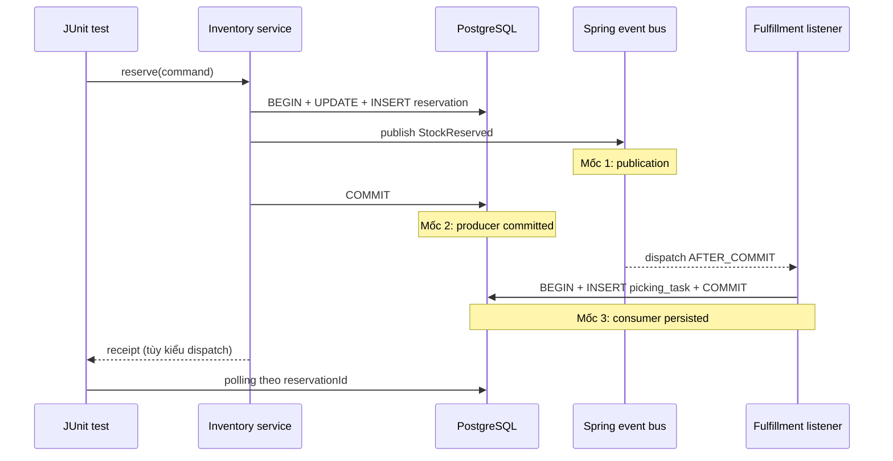
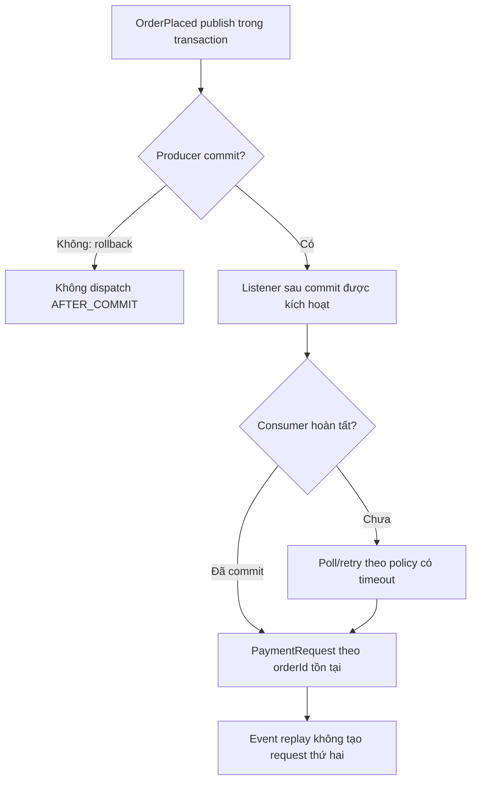

# Chờ transaction commit trước khi quan sát event

Một test gọi `inventory.reserve(...)`, thấy `StockReserved` trong `PublishedEvents`, rồi kết luận Fulfillment đã nhận và xử lý phiếu giữ hàng. Kết luận đó có thể sai: **event được publish** không đồng nghĩa với **transaction chứa thay đổi dữ liệu đã commit**, và commit của producer cũng không đồng nghĩa với **consumer bất đồng bộ đã hoàn tất**.

Bài này giải quyết trực tiếp câu hỏi: **phải chờ mốc nào, quan sát bằng gì và viết test ra sao để không báo xanh giả?** Ta kiểm chứng ba mốc bằng test có thể thực hiện: *publish → commit → consumer side effect*. Đây là nội dung chuyên sâu của chương **Database testing**, thuộc dịch vụ **SPRING_MODULITH_VERIFICATION_TESTING**: kiểm chứng ranh giới kiến trúc bằng `ApplicationModules`, thực hành `@ApplicationModuleTest`, kiểm thử event/database/integration và đưa các phép thử này vào quality gate CI.

> **Quy tắc thực hành:** Nếu câu hỏi là “consumer đã xử lý một thay đổi nghiệp vụ thành công chưa?”, hãy **để producer transaction commit thật**, chờ điều kiện hậu xử lý của consumer và assert trên dữ liệu/side effect bền vững. Không lấy một assertion rằng event đã được publish để thay thế hai bước đó.

## 1. Ba mốc phải đo riêng

Giả sử Inventory lưu một reservation và phát `StockReserved`; Fulfillment tạo picking task dựa trên event.



Sơ đồ cho thấy **quan hệ nhân quả**, không cam kết thứ tự chính xác giữa callback bất đồng bộ và thời điểm proxy service trả về. Với listener đồng bộ sau commit, callback có thể chạy trong lúc commit callback được xử lý trước khi caller nhận kết quả; với `@ApplicationModuleListener` bất đồng bộ, consumer có thể chỉ bắt đầu **sau khi service đã trả về**.

| Mốc | Cách quan sát đúng | Điều **chưa** chứng minh |
| --- | --- | --- |
| **1. Publish** | `PublishedEvents`, test event publisher hoặc listener ghi nhận event | Transaction producer đã commit |
| **2. Commit producer** | Gọi service `@Transactional` từ bên ngoài transaction test và đọc DB sau khi transaction kết thúc; hoặc chủ động commit `TransactionTemplate` | Listener async đã lưu kết quả |
| **3. Commit consumer** | Poll bảng/read model bên consumer hoặc một tín hiệu completion đáng tin, đúng `reservationId`, có timeout | Mọi consumer khác cũng đã hoàn tất |

**Không cần “chờ commit” bằng sleep.** Ta cần điều khiển transaction boundary hoặc chờ một **điều kiện quan sát đã được commit**.

## 2. Khi nào event listener thực sự được gọi?

Phân biệt ba kiểu:

```java
@EventListener
void onPublished(StockReserved event) { ... }
```

`@EventListener` với cơ chế multicaster đồng bộ mặc định có thể chạy ngay khi publisher gọi `publishEvent`, **trước commit**. Nếu multicaster/event infrastructure được cấu hình bất đồng bộ, thời điểm xử lý còn phụ thuộc cấu hình. Annotation này **không tự ràng buộc callback vào commit**.

```java
@TransactionalEventListener(phase = TransactionPhase.AFTER_COMMIT)
void onCommitted(StockReserved event) { ... }
```

`@TransactionalEventListener` chỉ gọi ở phase đã chỉ định của transaction tương thích; mặc định `fallbackExecution = false`, tức là event publish **không có transaction đang hoạt động** thường không được listener này xử lý. Callback `AFTER_COMMIT` là **sau một commit thành công**, không phải “sau khi publisher gọi”.

```java
@ApplicationModuleListener
void onCommittedAsync(StockReserved event) { ... }
```

`@ApplicationModuleListener` của Spring Modulith kết hợp cơ chế transactional event listening và xử lý bất đồng bộ/transaction riêng theo phiên bản và cấu hình tương ứng. Đây là lựa chọn thường dùng cho giao tiếp sự kiện liên module, nhưng **thời điểm consumer hoàn tất không được bảo đảm ngay khi producer service trả về**. Cần integration test kiểm tra side effect và idempotency.

### 2.1. Các phase không giống nhau

| Phase Spring | Ý nghĩa kiểm chứng | Điểm lưu ý |
| --- | --- | --- |
| `BEFORE_COMMIT` | Trước khi transaction commit | Listener có thể chạy rồi transaction vẫn rollback hoặc commit lỗi |
| `AFTER_COMMIT` | Sau khi commit thành công | Không chạy khi transaction rollback theo semantics phù hợp |
| `AFTER_ROLLBACK` | Sau khi rollback | Phù hợp quan sát failure/compensation riêng, không phải nghiệp vụ thành công |
| `AFTER_COMPLETION` | Sau khi transaction hoàn tất, commit hoặc rollback | Phải phân biệt outcome nếu logic cần |

**Lưu ý đặc biệt:** Một callback `AFTER_COMMIT` muốn **ghi thêm dữ liệu** không nên mặc định dựa trên transaction producer đã kết thúc. Ở pha callback, một số transaction resource có thể còn gắn với thread, nhưng những thay đổi mới không tự được commit bền vững. Nếu consumer cần ghi DB, dùng transaction riêng được mở đúng cách qua Spring proxy, hoặc cơ chế transaction của `@ApplicationModuleListener` theo cấu hình thực.

## 3. Test trọng tâm: chứng minh callback CHƯA chạy trước commit

Đầu tiên viết một test **chỉ kiểm tra semantics transaction phase**, không cần service Inventory. Nó chủ động publish một event trong `TransactionTemplate`, assert listener chưa thấy event ở **bên trong** transaction, rồi assert listener đã thấy event **sau khi scope commit**.

### 3.1. Test với probe đồng bộ và ID riêng

```java
package com.example.shop.inventory;

import static org.assertj.core.api.Assertions.assertThat;

import java.util.Set;
import java.util.UUID;
import java.util.concurrent.ConcurrentHashMap;

import org.junit.jupiter.api.Test;
import org.springframework.beans.factory.annotation.Autowired;
import org.springframework.boot.test.context.TestConfiguration;
import org.springframework.context.ApplicationEventPublisher;
import org.springframework.context.annotation.Bean;
import org.springframework.context.annotation.Import;
import org.springframework.modulith.test.ApplicationModuleTest;
import org.springframework.transaction.PlatformTransactionManager;
import org.springframework.transaction.event.TransactionPhase;
import org.springframework.transaction.event.TransactionalEventListener;
import org.springframework.transaction.support.TransactionTemplate;

@ApplicationModuleTest
@Import(CommitPhaseTests.ProbeConfig.class)
class CommitPhaseTests {

    record ReservationRecorded(UUID id) {}

    @Autowired ApplicationEventPublisher publisher;
    @Autowired PlatformTransactionManager transactionManager;
    @Autowired AfterCommitProbe probe;

    @Test
    void eventIsNotObservedByAfterCommitListenerBeforeCommit() {
        UUID id = UUID.randomUUID();
        var template = new TransactionTemplate(transactionManager);

        template.executeWithoutResult(status -> {
            publisher.publishEvent(new ReservationRecorded(id));

            // Event đã publish, nhưng transaction chưa commit.
            assertThat(probe.hasSeen(id)).isFalse();
        });
        // executeWithoutResult đã kết thúc bằng commit thành công.
        // Probe này là listener đồng bộ; không cần sleep.
        assertThat(probe.hasSeen(id)).isTrue();
    }

    @Test
    void eventIsNotDeliveredToAfterCommitListenerWhenRolledBack() {
        UUID id = UUID.randomUUID();
        var template = new TransactionTemplate(transactionManager);

        template.executeWithoutResult(status -> {
            publisher.publishEvent(new ReservationRecorded(id));
            status.setRollbackOnly();
        });

        assertThat(probe.hasSeen(id)).isFalse();
    }

    @TestConfiguration(proxyBeanMethods = false)
    static class ProbeConfig {
        @Bean
        AfterCommitProbe afterCommitProbe() {
            return new AfterCommitProbe();
        }
    }

    static class AfterCommitProbe {
        private final Set<UUID> observed =
            ConcurrentHashMap.newKeySet();

        @TransactionalEventListener(phase = TransactionPhase.AFTER_COMMIT)
        public void on(ReservationRecorded event) {
            observed.add(event.id());
        }

        boolean hasSeen(UUID id) {
            return observed.contains(id);
        }
    }
}
```

**Vì sao test này có giá trị?**

- Event có **ID ngẫu nhiên của riêng mỗi scenario**; probe không cần `clear()` một danh sách global mà test khác có thể dùng.
- `TransactionTemplate` mở transaction đúng scope; `executeWithoutResult` kết thúc transaction khi callback trả về.
- Listener là `@TransactionalEventListener(AFTER_COMMIT)` **đồng bộ** và chỉ cập nhật `Set` trong bộ nhớ, không lẫn với câu hỏi transaction ghi DB của consumer.
- Test thứ nhất phân biệt **trạng thái trước commit** và **trạng thái sau commit**.
- Test thứ hai chứng minh **rollback không kích hoạt callback thành công**.

**Giới hạn:** Đây là test semantics của Spring transaction/event infrastructure và probe, **chưa** xác minh service Inventory có lưu reservation thành công hay consumer Fulfillment bất đồng bộ có ghi database. Phải có test use case thực ở các mục tiếp theo.

### 3.2. Những điều kiện để test trên tin cậy

1. Cần Spring Test context với **một transaction manager rõ**; nếu có nhiều datasource/manager, dùng `@Qualifier` hoặc chỉ định manager đúng.
2. Cần transaction manager thực sự kích hoạt transaction synchronization; với datasource PostgreSQL/JPA của ứng dụng sẽ phù hợp khi cấu hình đúng.
3. Không đặt `@Transactional` lên **test class** ở ví dụ này; ta muốn `TransactionTemplate` quyết định điểm commit.
4. Không đổi probe thành `@Async` rồi vẫn assert ngay sau `executeWithoutResult`: với async phải chờ điều kiện.
5. Nếu một listener khác cho event này ném exception hoặc thay đổi transaction, phải xử lý scope/fixture có chủ đích; ví dụ dùng event type test riêng để cô lập semantics.

## 4. Bẫy: `@Transactional` trên test giữ commit ở cuối

Trong Spring Test, một test được chú thích `@Transactional` thường được bao bởi **test-managed transaction** và mặc định **rollback** sau test.

```java
@ApplicationModuleTest
@Transactional
class ReservationPublicationTests {

    @Autowired InventoryReservations inventory;

    @Test
    void publishesAReservationEvent(PublishedEvents events) {
        UUID requestId = UUID.randomUUID();
        var receipt = inventory.reserve(
            new ReserveStock("SKU-FIXTURE", 1, requestId)
        );

        assertThat(
            events.ofType(StockReserved.class)
                .matching(event ->
                    event.reservationId().equals(receipt.reservationId())
                )
        ).hasSize(1);
    }
}
```

Ví dụ giả định đã có fixture `SKU-FIXTURE`, các kiểu `InventoryReservations`, `ReserveStock`, `StockReserved` và import tương ứng (bao gồm `org.springframework.modulith.test.PublishedEvents`). Dạng lọc event có thể thay đổi nhỏ theo version Spring Modulith; dùng API được dependency hiện tại hỗ trợ.

**Test này chứng minh đúng một điều hẹp:** event đã được publish với ID cần tìm. Vì service có `@Transactional(REQUIRED)` và test đã có transaction ngoài, service thường **tham gia transaction của test**. Khi method `inventory.reserve(...)` trả về, transaction vật lý **chưa commit**; mặc định Spring Test rollback ở cuối. Listener `AFTER_COMMIT` không được gọi vì một commit của producer chưa diễn ra.

### 4.1. `PublishedEvents` không phải commit receipt

`PublishedEvents` là công cụ hữu ích để xác minh **event contract/payload** trong module test, nhưng không chứng minh:

- Row dữ liệu producer đã commit.
- Listener `AFTER_COMMIT` đã được chạy.
- `@ApplicationModuleListener` của một module khác có nằm trong bootstrap scope.
- Consumer async đã hoàn tất.
- Event Publication Registry đã ghi nhận/đánh dấu hoàn tất theo cấu hình.

**Đừng đặt tên test là `listenerProcessedAfterCommit` nếu assertion chỉ đọc `PublishedEvents`.**

### 4.2. Khi nào nên giữ test có rollback?

Khi mục tiêu là xác minh aggregate publish đúng sự kiện, mapping dữ liệu hoặc logic thuần theo module, test transaction rollback có thể nhanh và dễ giữ fixture sạch. Chỉ cần ghi rõ **mục tiêu hẹp**. Khi mục tiêu là event sau commit, hãy đổi chiến lược ở mục 5–7.

## 5. Hai cách chủ động đưa test qua điểm commit

### Cách A — ưu tiên: không bọc transaction trên test

```java
@ApplicationModuleTest
class InventoryCommitTests {

    @Autowired InventoryReservations inventory;
    @Autowired JdbcTemplate jdbc;

    @Test
    void producerStateIsCommittedWhenServiceReturns() {
        // Given: SKU có tồn đã được seed và commit.
        UUID requestId = UUID.randomUUID();

        var receipt = inventory.reserve(
            new ReserveStock("SKU-FIXTURE", 1, requestId)
        );

        // Khi lời gọi qua Spring proxy @Transactional kết thúc
        // mà KHÔNG có transaction ngoài, service đã commit.
        Integer rows = jdbc.queryForObject("""
            SELECT count(*) FROM stock_reservation
             WHERE reservation_id = ?
            """, Integer.class, receipt.reservationId());
        assertThat(rows).isEqualTo(1);
    }
}
```

Đây là **khung test**: cần fixture/migration, cleanup và implementation service thật. Việc đọc qua `JdbcTemplate` sau service proxy return giúp chứng minh dữ liệu producer có thể quan sát ở một scope mới, thay vì chỉ đọc entity còn nằm trong persistence context của test.

**Điều kiện cần kiểm tra:** bean được inject từ Spring và lời gọi đi qua transactional proxy; transaction manager đúng datasource; service `@Transactional` không chỉ tham gia một transaction ngoài ẩn; assert dùng đúng database.

### Cách B — có chủ đích: `TestTransaction` khi test đang transactional

```java
@ApplicationModuleTest
@Transactional
class InventoryExplicitCommitTests {

    @Test
    void observesOnlyAfterExplicitCommit() {
        var receipt = inventory.reserve(command);

        // Test-managed transaction vẫn đang hoạt động.
        assertThat(TestTransaction.isActive()).isTrue();

        TestTransaction.flagForCommit();
        TestTransaction.end(); // Commit ngay tại mốc này.

        assertThat(TestTransaction.isActive()).isFalse();

        // Bây giờ mới assert callback AFTER_COMMIT/consumer side effect.
        // Với consumer async, vẫn phải chờ điều kiện có timeout.
    }
}
```

Đây là **trích đoạn** cần biến/bean `inventory`, `command` và import `org.springframework.test.context.transaction.TestTransaction`. Nó minh họa đúng mốc commit, không phải một test hoàn chỉnh. `TestTransaction` chỉ áp dụng khi Spring Test đã kích hoạt test-managed transaction.

`@Commit` hoặc `@Rollback(false)` có thể yêu cầu commit **ở cuối test**, nhưng nếu tất cả assertion nằm **bên trong test method trước khi commit**, chúng chưa quan sát được hậu điều kiện sau commit. `TestTransaction.end()` cho phép xác định mốc để kiểm tra; sau khi commit, rollback cuối test **không thể** hoàn tác phần đã commit.

### 5.1. Điều kiện dọn dữ liệu thay đổi theo cách commit

| Kiểu test | Commit xảy ra ở đâu? | Cleanup |
| --- | --- | --- |
| `@Transactional` mặc định rollback | Không có commit của test transaction | Thay đổi cùng transaction được rollback |
| Không `@Transactional` trên test; service tự mở transaction | Trong transactional proxy của service | Fixture/side effect đã commit phải dọn riêng |
| `TestTransaction.flagForCommit(); end()` | Ở `end()` | Dữ liệu đã commit cần cleanup riêng |
| `@Commit` | Khi Spring Test kết thúc test-managed transaction | Không dùng rollback cuối test để dọn dữ liệu đã commit |

Không dùng `@DirtiesContext` thay cho cleanup database: nó tác động cache Spring context, không tự xóa dữ liệu đã commit trong PostgreSQL.

## 6. Ví dụ thật: Inventory commit reservation rồi Fulfillment lưu picking task

Để kiểm chứng consumer, hãy có một luồng **production** và hai bảng do hai module sở hữu.

```text
com.example.shop
├── ShopApplication.java
├── inventory/
│   ├── reservations/
│   │   ├── package-info.java
│   │   ├── InventoryReservations.java
│   │   ├── ReserveStock.java
│   │   └── ReservationReceipt.java
│   ├── events/
│   │   ├── package-info.java
│   │   └── StockReserved.java
│   └── internal/
│       ├── InventoryReservationService.java
│       └── persistence/...
└── fulfillment/
    ├── package-info.java
    └── internal/
        └── PickingTaskOnStockReserved.java
```

PostgreSQL migration cho ví dụ:

```sql
CREATE TABLE inventory_stock (
    sku VARCHAR(80) PRIMARY KEY,
    available INTEGER NOT NULL
        CHECK (available >= 0)
);

CREATE TABLE stock_reservation (
    reservation_id UUID PRIMARY KEY,
    request_id UUID NOT NULL UNIQUE,
    sku VARCHAR(80) NOT NULL REFERENCES inventory_stock(sku),
    quantity INTEGER NOT NULL CHECK (quantity > 0)
);

CREATE TABLE picking_task (
    task_id UUID PRIMARY KEY,
    reservation_id UUID NOT NULL UNIQUE,
    sku VARCHAR(80) NOT NULL,
    quantity INTEGER NOT NULL CHECK (quantity > 0)
);
```

Đây là schema tối giản cho **test event sau commit**. Trong dự án thật nên dùng migration production của Inventory/Fulfillment, không tự copy một schema test thiếu constraint. `picking_task.reservation_id UNIQUE` là một tuyến bảo vệ idempotency cho consumer.

### 6.1. Contract công khai và event

```java
// inventory/reservations/ReserveStock.java
package com.example.shop.inventory.reservations;

import java.util.UUID;

public record ReserveStock(String sku, int quantity, UUID requestId) {}
```

```java
// inventory/reservations/ReservationReceipt.java
package com.example.shop.inventory.reservations;

import java.util.UUID;

public record ReservationReceipt(UUID reservationId) {}
```

```java
// inventory/reservations/InventoryReservations.java
package com.example.shop.inventory.reservations;

public interface InventoryReservations {
    ReservationReceipt reserve(ReserveStock command);
}
```

```java
// inventory/events/StockReserved.java
package com.example.shop.inventory.events;

import java.util.UUID;

public record StockReserved(
    UUID reservationId,
    String sku,
    int quantity
) {}
```

Các record dùng để minh họa contract; production cần validation đầu vào, giới hạn quantity, idempotency policy và xử lý retry theo nghiệp vụ. Event payload mang `reservationId` để consumer và test có thể đối chiếu một scenario chính xác.

### 6.2. Service producer có transaction boundary thực

```java
// inventory/internal/InventoryReservationService.java
@Service
class InventoryReservationService implements InventoryReservations {

    private final StockRepository stocks;
    private final ReservationRepository reservations;
    private final ApplicationEventPublisher events;

    InventoryReservationService(
        StockRepository stocks,
        ReservationRepository reservations,
        ApplicationEventPublisher events
    ) {
        this.stocks = stocks;
        this.reservations = reservations;
        this.events = events;
    }

    @Override
    @Transactional
    public ReservationReceipt reserve(ReserveStock command) {
        int affected = stocks.decrementIfEnough(
            command.sku(), command.quantity()
        );
        if (affected != 1) {
            throw new InsufficientStock(command.sku());
        }

        UUID id = UUID.randomUUID();
        reservations.save(new ReservationRow(
            id, command.requestId(),
            command.sku(), command.quantity()
        ));
        events.publishEvent(new StockReserved(
            id, command.sku(), command.quantity()
        ));
        return new ReservationReceipt(id);
    }
}
```

Đây là **lớp minh họa luồng nghiệp vụ**, cần định nghĩa `StockRepository`, `ReservationRepository`, `ReservationRow`, `InsufficientStock` và imports khi đưa vào dự án. `decrementIfEnough` thực hiện SQL có điều kiện trong transaction để không oversell. Điểm cần quan sát:

- `events.publishEvent(...)` xảy ra **trong transaction** của service.
- `save(...)` và publication **không phải commit**.
- Nếu transaction sau đó rollback vì exception/constraint, callback `AFTER_COMMIT` **không** xử lý event đó.
- Khi gọi service qua Spring proxy từ một test **không có transaction bao ngoài**, transactional boundary của service kết thúc trước khi caller nhận kết quả thành công.

Đặt `@Transactional` trên method public được gọi qua Spring bean; tránh self-invocation `this.reserve(...)` làm annotation không được proxy intercept trong chế độ proxy thông thường.

### 6.3. Consumer của module khác, có transaction riêng

```java
// fulfillment/internal/PickingTaskOnStockReserved.java
@Component
class PickingTaskOnStockReserved {

    private final JdbcTemplate jdbc;

    PickingTaskOnStockReserved(JdbcTemplate jdbc) {
        this.jdbc = jdbc;
    }

    @ApplicationModuleListener
    void on(StockReserved event) {
        jdbc.update("""
            INSERT INTO picking_task
              (task_id, reservation_id, sku, quantity)
            VALUES (?, ?, ?, ?)
            ON CONFLICT (reservation_id) DO NOTHING
            """,
            UUID.randomUUID(),
            event.reservationId(),
            event.sku(),
            event.quantity()
        );
    }
}
```

Đây là **mẫu consumer PostgreSQL**; cần các imports Spring Modulith (`org.springframework.modulith.events.ApplicationModuleListener`), Spring/JDBC, `UUID`, và bean thực tế. Dùng `@ApplicationModuleListener` theo phiên bản Spring Modulith có hỗ trợ transactional event listener bất đồng bộ/transaction riêng; xác minh dependency và cấu hình event infrastructure đang dùng.

`ON CONFLICT (reservation_id) DO NOTHING` giúp **tránh tạo picking task trùng** khi event bị giao lại, nhưng production còn phải quyết định xử lý thế nào nếu payload replay có `quantity/sku` khác. Không coi nó là bảo đảm exactly-once delivery hay tự xử lý mọi loại corruption.

### 6.4. Module boundary vẫn được giữ

```java
// inventory/events/package-info.java
@org.springframework.modulith.NamedInterface("events")
package com.example.shop.inventory.events;
```

```java
// fulfillment/package-info.java
@org.springframework.modulith.ApplicationModule(
    allowedDependencies = "inventory::events"
)
package com.example.shop.fulfillment;
```

Fulfillment được phép import **event DTO** `StockReserved`, không import `inventory.internal.ReservationRepository`. **Dữ liệu picking task do Fulfillment sở hữu**, dù cả hai bảng đang ở cùng database vật lý.

## 7. Integration test: chờ consumer bằng điều kiện sau producer commit

Đây là bài test quyết định cho workflow. Nó cần bootstrap **cả Inventory và Fulfillment**. Với một modular monolith, `@SpringBootTest` trên ứng dụng đầy đủ là lựa chọn rõ ràng; không nên dùng `@ApplicationModuleTest(STANDALONE)` của Inventory rồi kỳ vọng listener thuộc Fulfillment luôn tồn tại trong context.

Ví dụ Spring Boot/Testcontainers/Awaitility:

```java
package com.example.shop;

import static org.assertj.core.api.Assertions.assertThat;
import static org.awaitility.Awaitility.await;

import com.example.shop.inventory.reservations.InventoryReservations;
import com.example.shop.inventory.reservations.ReserveStock;
import java.time.Duration;
import java.util.UUID;
import org.junit.jupiter.api.Test;
import org.springframework.beans.factory.annotation.Autowired;
import org.springframework.boot.test.context.SpringBootTest;
import org.springframework.boot.testcontainers.service.connection.ServiceConnection;
import org.springframework.jdbc.core.JdbcTemplate;
import org.testcontainers.containers.PostgreSQLContainer;
import org.testcontainers.junit.jupiter.Container;
import org.testcontainers.junit.jupiter.Testcontainers;

@SpringBootTest
@Testcontainers
class StockReservedAfterCommitIT {

    @Container
    @ServiceConnection
    static PostgreSQLContainer<?> postgres =
        new PostgreSQLContainer<>("postgres:16-alpine");

    @Autowired InventoryReservations inventory;
    @Autowired JdbcTemplate jdbc;

    @Test
    void fulfillmentCreatesTaskAfterReservationCommit() {
        // Bài test dùng database/container dành riêng cho class này.
        String sku = "IT-" + UUID.randomUUID();
        UUID requestId = UUID.randomUUID();
        jdbc.update(
            "INSERT INTO inventory_stock(sku, available) VALUES (?, 5)",
            sku
        );

        var receipt = inventory.reserve(
            new ReserveStock(sku, 2, requestId)
        );

        // Producer đã trả thành công qua transaction proxy:
        // đọc bằng JdbcTemplate ở scope mới, không dùng test @Transactional.
        Integer producerRows = jdbc.queryForObject("""
            SELECT count(*) FROM stock_reservation
             WHERE reservation_id = ?
            """, Integer.class, receipt.reservationId());
        assertThat(producerRows).isEqualTo(1);

        // Consumer chạy bất đồng bộ: chỉ thành công khi
        // hậu điều kiện đã commit ở bảng do Fulfillment sở hữu.
        await()
            .atMost(Duration.ofSeconds(10))
            .untilAsserted(() -> {
                Integer count = jdbc.queryForObject("""
                    SELECT count(*) FROM picking_task
                     WHERE reservation_id = ?
                    """, Integer.class, receipt.reservationId());

                assertThat(count).isEqualTo(1);
            });
    }
}
```

### 7.1. Điều kiện khiến ví dụ là một test có ý nghĩa

- Đã khai báo những bean/contract producer–consumer và Flyway/Liquibase migration của mục 6.
- Có Spring Modulith test/events dependencies, PostgreSQL JDBC driver, Spring Boot Testcontainers integration và Testcontainers runtime.
- Có **Awaitility** hoặc một công cụ chờ điều kiện tương đương trong test scope.
- Test **không** có `@Transactional`, vì cần producer tự commit trước khi chờ consumer.
- `@SpringBootTest` khởi tạo listener Fulfillment và event infrastructure thật; nếu cần mock external resources phải làm rõ phần nào đang được thay thế.
- `@ServiceConnection` được hỗ trợ bởi phiên bản Spring Boot đang dùng; chọn PostgreSQL image phù hợp production.
- Container/database trong ví dụ thuộc riêng test class và có đúng migration; test dùng ID ngẫu nhiên, không đụng fixture của test khác.
- Với các test class khác dùng context cache, cần phối hợp lifecycle container/context để không reuse datasource tới container đã dừng.

### 7.2. Vì sao đây không phải test `Thread.sleep(...)`?

Phản mẫu:

```java
inventory.reserve(command);
Thread.sleep(1000);
assertThat(countPickingTasks()).isEqualTo(1);
```

Một giây có thể quá dài trên máy nhanh hoặc quá ngắn dưới tải CI. Nó không đo **điều kiện nghiệp vụ nào** đã hoàn thành. `await().atMost(...).untilAsserted(...)` cho test tự kết thúc khi dữ liệu đã xuất hiện, và lỗi có timeout rõ khi consumer không commit.

### 7.3. Đừng poll trong một transaction snapshot cố định

Nếu test đặt `@Transactional` trên method hoặc dùng một JPA persistence context giữ cache/snapshot, các lần query có thể **không quan sát được thay đổi từ consumer transaction khác** theo isolation/ORM context. Để chờ consumer, đọc bằng `JdbcTemplate` trong các lần truy vấn ngoài transaction test kéo dài, hoặc mở một transaction đọc mới mỗi lần. Hạn chế `READ COMMITTED`/isolation tùy engine phải được xét theo cấu hình thật.

### 7.4. Chờ đúng ID, không đếm tổng số hàng

```sql
-- Dễ xanh giả khi dữ liệu của test khác đang còn:
SELECT count(*) FROM picking_task;

-- Đúng scenario:
SELECT count(*) FROM picking_task
WHERE reservation_id = :reservationId;
```

Khi chạy nhiều test song song, tổng số picking tasks không phải một tín hiệu về riêng event vừa phát. ID tương quan (correlation key) là điều kiện thiết yếu của fixture và assertion.

## 8. Test rollback: không được xuất hiện thành công sau một event publish

Một ca tiêu cực cần chủ động tạo tình huống **đã publish event nhưng producer transaction rollback**. Không nên chỉ ném lỗi trước khi gọi publisher: khi ấy test chưa kiểm chứng phase listener.

### 8.1. Dùng `TransactionTemplate` để tạo rollback chắc chắn

```java
@Autowired PlatformTransactionManager txManager;
@Autowired ApplicationEventPublisher publisher;
@Autowired JdbcTemplate jdbc;

@Test
void rolledBackProducerDoesNotCommitReservation() {
    UUID reservationId = UUID.randomUUID();
    String sku = "IT-" + UUID.randomUUID();
    // Seed một SKU nếu scenario cần; fixture phải có owner riêng.

    var tx = new TransactionTemplate(txManager);
    tx.executeWithoutResult(status -> {
        jdbc.update("""
            INSERT INTO stock_reservation
              (reservation_id, request_id, sku, quantity)
            VALUES (?, ?, ?, 1)
            """, reservationId, UUID.randomUUID(), sku);

        publisher.publishEvent(new StockReserved(
            reservationId, sku, 1
        ));

        // Cố ý rollback SAU khi publication đã diễn ra.
        status.setRollbackOnly();
    });

    Integer rows = jdbc.queryForObject("""
        SELECT count(*) FROM stock_reservation
         WHERE reservation_id = ?
        """, Integer.class, reservationId);
    assertThat(rows).isZero();
}
```

Đây là **trích đoạn tích hợp**: phải đặt trong test có đầy đủ bean/import, và seed `inventory_stock(sku)` **đã commit** trước INSERT để không vi phạm foreign key trước khi publish. Cách gọn hơn là chỉ publish `StockReserved` trong transaction mà không INSERT nếu test đang kiểm tra duy nhất phase; còn nếu test định chứng minh dữ liệu producer rollback thì nên có INSERT như trên.

### 8.2. Chứng minh callback không chạy: đừng chỉ nhìn “chưa có task”

Một assertion `countPickingTask = 0` **ngay lập tức** sau rollback có thể xanh dù consumer bất đồng bộ chỉ chưa chạy tới. Cách kiểm chứng mạnh hơn:

1. Dùng test ở mục 3 chứng minh **đồng bộ và quyết định** rằng callback `AFTER_COMMIT` không được dispatch khi rollback.
2. Dùng integration test rollback của service và đọc DB sau transaction, không có producer row đã commit.
3. Nếu muốn khẳng định consumer không gây side effect, dùng một **probe ở điểm scheduling/dispatch đã kiểm soát**, hoặc quan sát trong khoảng thời gian hữu hạn với các điều kiện nhất quán; không coi “0 ngay bây giờ” là bằng chứng tuyệt đối về hành vi async trong tương lai.
4. Trên hạ tầng có registry/retry, kiểm tra không có publication hợp lệ nào của transaction rollback bị xử lý lại theo cơ chế persistence đang dùng.

Việc dùng timeout để kiểm tra **sự hiện diện cuối cùng** của một side effect là đáng tin nếu side effect cuối cùng xảy ra; nhưng dùng “đợi 100ms không thấy” để chứng minh **sự vắng mặt mãi mãi** là suy luận yếu. Hãy tách unit/phase test quyết định với negative integration test.

### 8.3. Nếu transaction tự rollback do lỗi ở commit

Một số constraint có thể lỗi **tại commit** sau khi method service đã return ở bên trong transaction boundary. Khi test gọi service qua Spring proxy (không có transaction test), exception có thể được ném ở lúc proxy kết thúc. Listener `AFTER_COMMIT` **không** được coi là đã xử lý một transaction thất bại.

Để phát hiện trường hợp này, cần test conflict/constraint thật và xác minh transaction đã rollback, thay vì chỉ gọi `save()` rồi assert event đã publish.

## 9. `@ApplicationModuleTest` nhìn thấy event nhưng có thể không nạp consumer

`@ApplicationModuleTest` rất hữu ích khi cần tập trung kiểm thử **một module**, nhưng sự hiện diện của `PublishedEvents` không có nghĩa mọi listener trong hệ thống đã được bootstrap.

| Phạm vi test | Phép đo phù hợp | Cẩn trọng |
| --- | --- | --- |
| `@ApplicationModuleTest` ở Inventory, `STANDALONE` | Inventory publish `StockReserved` đúng payload | Fulfillment listener có thể nằm ngoài context |
| `@ApplicationModuleTest` ở module listener với dependency trực tiếp | Listener và contract với dependency được nạp theo cấu hình | Dependency module được bootstrap chưa chắc có đủ fixture/workflow |
| `@SpringBootTest` chạy toàn ứng dụng | Producer/consumer event end-to-end, registry, DB | Tốn tài nguyên hơn, cần cô lập infrastructure |
| Test thuần `TransactionTemplate` với probe | Phase `AFTER_COMMIT`/rollback | Chưa chứng minh business producer hoặc consumer thực |

### 9.1. Hai test có mục tiêu khác nhau

**Producer contract test:**

```java
@ApplicationModuleTest
class InventoryEventContractTests {

    @Test
    void publishesStockReserved(PublishedEvents events) {
        // Given: Inventory fixture riêng, đã chuẩn bị.
        // When: inventory.reserve(...)
        // Then: PublishedEvents chứa StockReserved đúng reservationId.
    }
}
```

**Consumer integration test:** Dùng ví dụ `StockReservedAfterCommitIT` ở mục 7, đảm bảo Fulfillment listener được bootstrap, producer commit thật và truy vấn `picking_task` ở transaction đọc khác.

Không sửa mọi producer module test từ `STANDALONE` sang `ALL_DEPENDENCIES` chỉ để “chờ được event”: **dependency theo chiều nào** mới quan trọng. Fulfillment import kiểu `StockReserved`, tức Java dependency hướng `fulfillment → inventory::events`, còn event runtime được phát từ Inventory tới Fulfillment.

### 9.2. Kiểm chứng ranh giới bằng `ApplicationModules`

```java
package com.example.shop;

import org.junit.jupiter.api.Test;
import org.springframework.modulith.core.ApplicationModules;

class ModularityTests {

    @Test
    void publishedDependenciesRemainValid() {
        ApplicationModules.of(ShopApplication.class).verify();
    }
}
```

Quy tắc `allowedDependencies = "inventory::events"` cho Fulfillment giúp chặn import repository nội bộ Inventory khi module được cấu hình theo mô hình đóng. `verify()` **không tự chứng minh** transaction có commit, event đã được dispatch hoặc consumer đã hoàn tất. Phải chạy architecture gate cùng các event/database tests.

## 10. Event Publication Registry: chờ commit chưa phải giao nhận đúng

Spring Modulith có cơ chế lưu trữ/ghi nhận **event publications** cho những listener phù hợp qua Event Publication Registry. Trong cấu hình hỗ trợ persistence và resubmission, publication chưa hoàn tất có thể được xử lý lại khi hệ thống khôi phục.

Đặt các câu hỏi theo vòng đời:

```text
Producer transaction bắt đầu
  → lưu reservation
  → publish StockReserved
  → ghi trạng thái publication theo hạ tầng được cấu hình
  → COMMIT producer
  → listener bất đồng bộ xử lý
        ├─ commit picking_task và hoàn tất publication
        └─ hoặc lỗi → publication có thể còn chưa hoàn tất
                         để retry/resubmit theo policy
```

Đây là **sơ đồ logic**, không cam kết thứ tự câu SQL nội bộ hoặc schema cụ thể của mọi phiên bản Spring Modulith. Hành vi thực tế phụ thuộc dependency persistence, listener registration và policy retry/republication. **Không** suy rằng chỉ thêm `@ApplicationModuleListener` là mọi event tự được lưu bền vững trong database.

### 10.1. Mục tiêu test khi có registry

| Kịch bản | Điều cần kiểm tra |
| --- | --- |
| Producer commit, consumer thành công | Dữ liệu producer bền vững; consumer task tồn tại; publication được đánh dấu hoàn tất theo cơ chế dùng |
| Producer rollback sau publish | Không có publication hợp lệ của transaction thất bại được replay như một business success |
| Consumer ném exception | Không đánh dấu thành công giả; publication chưa hoàn tất theo chính sách |
| Khởi động lại/resubmit | Publication chưa hoàn tất được xử lý lại và cuối cùng hoàn tất |
| Cùng event được giao hai lần | Chỉ một tác dụng nghiệp vụ (`reservation_id` unique/idempotent) |
| Registry schema sai/chưa migrate | CI phát hiện lỗi migration/persistence, không im lặng skip |

Một test restart/republication đáng tin thường cần **integration lifecycle test** có database registry đã commit, consumer được tắt/cho lỗi có kiểm soát rồi khởi động lại/resubmit. Một `PublishedEvents` assertion trong cùng phương thức test không thể kiểm tra trường hợp này.

### 10.2. Idempotency là điều kiện khi chờ eventual completion

Giả sử listener đã `INSERT picking_task` thành công nhưng process crash trước khi ghi nhận publication hoàn tất. Khi retry, cùng `StockReserved` có thể xuất hiện lần nữa. Nếu consumer chỉ cần một task cho mỗi reservation, dùng **business key idempotent**:

```sql
CREATE UNIQUE INDEX ux_picking_task_reservation
    ON picking_task(reservation_id);
```

Hoặc `reservation_id` đã `UNIQUE` trong schema mục 6, không cần tạo thêm index trùng một cách vô nghĩa. Khi dùng `ON CONFLICT DO NOTHING`, phải kiểm tra rằng **retry không tạo task thứ hai** và không bỏ qua một payload bị sửa sai.

**Chờ được một side effect là chưa đủ** nếu consumer có thể tạo side effect trùng ở lần giao lại. Quality gate nên có cả test *eventually one* và *replay still one*.

## 11. Đọc dấu hiệu lỗi: test xanh giả và test thất bại giả

| Biểu hiện | Nguyên nhân hay gặp | Cách kiểm chứng/sửa |
| --- | --- | --- |
| `PublishedEvents` thấy event nhưng `picking_task` không có | Test rollback, listener ngoài module scope hoặc consumer chưa xong | Kiểm tra transaction, bootstrap listener, dùng polling có timeout |
| Listener `AFTER_COMMIT` không chạy | Event publish không có transaction; transaction rollback; annotation/config sai | `fallbackExecution`, transaction manager, commit boundary |
| Test `@Transactional` xong mà hậu xử lý không có | Test-managed transaction rollback mặc định | Test không bọc transaction hoặc dùng `TestTransaction.end()` |
| `@Commit` test nhưng assert trong method vẫn fail | Commit xảy ra ở cuối test sau assertion | Chủ động commit trước assertion |
| Gọi service trả về, task chưa tồn tại | Listener bất đồng bộ chưa kết thúc | Poll đúng `reservationId` với timeout |
| Task tồn tại trong listener nhưng test không thấy | Listener transaction chưa commit, test giữ snapshot/cache cũ | Đọc ở scope mới, tránh long-lived test transaction |
| `Thread.sleep(1000)` lúc xanh lúc đỏ | Delay tùy tải CI và scheduler | Chờ điều kiện DB bền vững |
| Test đếm tất cả picking tasks ra `1` | Hàng từ test cũ/thử nghiệm khác | Lọc theo `reservation_id` hoặc correlation ID |
| Thấy `AFTER_COMMIT` rồi INSERT consumer không bền vững | Callback dùng transaction resource producer đã hoàn tất | Consumer mở transaction mới qua proxy hoặc dùng `@ApplicationModuleListener` đúng cấu hình |
| Assert “không có task” ngay sau rollback | Consumer async có thể chưa chạy, kết luận vắng mặt yếu | Test phase rollback quyết định; quan sát integration trong khoảng hữu hạn |
| Đã commit nhưng listener không tồn tại | Test `STANDALONE` không bootstrap Fulfillment | `@SpringBootTest` hoặc scope module đúng |
| Event được giao lại làm hai tasks | Thiếu idempotency/business UNIQUE | Unique `reservation_id`, replay test |
| Registry chứa publication cũ | Test không cô lập DB/cleanup và có retry sau restart | DB/schema riêng, namespace, kiểm tra registry lifecycle |
| DB assertion flakey khi chạy parallel | Fixture/query chung key hoặc xóa toàn bảng | ID riêng, cleanup theo scenario hoặc DB riêng |
| `verify()` xanh nhưng event không tới | Kiến trúc hợp lệ không bảo đảm runtime delivery | Integration test đầy đủ và logs/metrics |

### 11.1. Quy trình debug theo thứ tự có bằng chứng

1. **Event được publish ở đâu?** Trước/ngoài transaction hay trong service `@Transactional`?
2. **Service được gọi qua Spring bean proxy không?** Có self-invocation `this.method()` không?
3. **Ai là transaction owner?** Test-managed, application service, `TransactionTemplate` hay resource khác?
4. **Có commit thật chưa?** Nếu test có `@Transactional`, commit nằm ở đâu?
5. **Listener thuộc phase nào?** `@EventListener`, `AFTER_COMMIT` hay `@ApplicationModuleListener`?
6. **Listener có được bootstrap không?** Module scope của test gồm những bean nào?
7. **Listener sync hay async?** Có executor, retry và transaction riêng?
8. **Consumer đã commit chưa?** Assertion đang đọc đúng datasource và transaction mới?
9. **Correlation key nào?** Đúng event/reservation ID hay đếm hàng toàn bảng?
10. **Có publication chưa hoàn tất/retry?** Registry persistence và migration có được bật không?
11. **Có lỗi listener bị nuốt/log mà test không thấy?** Kiểm tra error handling và observability.
12. **Dữ liệu đã được dọn trước khi listener xong chưa?** Teardown/`@Sql` có thể đang chạy sớm.

Đừng tăng thời gian sleep trước khi trả lời được các câu hỏi này.

## 12. Một ma trận nghiệm thu nhỏ nhưng đủ khác biệt

| ID | Scenario | Transaction/cấu hình test | Assertion quyết định |
| --- | --- | --- | --- |
| E1 | Publish event trong transaction, chưa commit | `TransactionTemplate` đang mở | Probe `AFTER_COMMIT` **chưa thấy** ID |
| E2 | Commit producer thành công | Kết thúc `TransactionTemplate` | Probe đồng bộ đã thấy ID |
| E3 | Rollback sau publish | `setRollbackOnly()` | Probe `AFTER_COMMIT` **không thấy** ID |
| E4 | Production service commit reservation | Test **không** `@Transactional` | Row producer tồn tại sau service return |
| E5 | Fulfillment xử lý event | Full integration context, listener async | `await` cho task theo `reservationId` |
| E6 | Consumer xử lý lặp | Replay cùng event ID | Chỉ một picking task |
| E7 | Consumer lỗi rồi retry | Registry/persistence thật | Publication vẫn theo dõi được và hoàn tất sau retry |
| E8 | Module Inventory publish contract | `@ApplicationModuleTest` | `PublishedEvents` có đúng payload |
| E9 | Ranh giới Java không bị xuyên thủng | Không cần DB | `ApplicationModules.verify()` thành công |

Tối thiểu nên có **E1–E5 + E9** cho mục tiêu kiểm tra đúng điểm commit, và bổ sung **E6–E7** nếu hệ thống triển khai retry/registry. Các tests không cần nằm chung một class hay cùng bootstrap scope.

## 13. Bài thực hành: đặt hàng chỉ tạo yêu cầu thanh toán sau commit

Hệ thống có:

- `ordering`: tạo `SalesOrder` trong transaction và publish `OrderPlaced(orderId, amount)`.
- `payment`: dùng `@ApplicationModuleListener` tạo `PaymentRequest` sau commit của Ordering.
- `OrderPlaced` có `orderId` riêng; PaymentRequest có unique key theo `orderId`.

Một test hiện tại:

```java
@ApplicationModuleTest
@Transactional
class OrderingTests {

    @Test
    void createsPayment(PublishedEvents events) {
        ordering.placeOrder(...);
        assertThat(events.ofType(OrderPlaced.class)).hasSize(1);
        // Test được coi là xác nhận payment đã được tạo.
    }
}
```

Test này **chưa** xác nhận Payment đã được tạo; transaction test sẽ rollback mặc định, module Payment có thể không nằm trong context, và `PublishedEvents` chỉ chứng minh event publish.

### 13.1. Nhiệm vụ

1. Viết **phase test** dùng `TransactionTemplate` publish `OrderPlaced` rồi assert probe `AFTER_COMMIT` chưa thấy event trước commit.
2. Commit transaction; assert probe đồng bộ thấy đúng `orderId`.
3. Rollback sau publish; assert probe không thấy `orderId` thất bại.
4. Viết **application service test** không có `@Transactional` ở cấp test, gọi Ordering qua Spring proxy và assert `sales_order` đã commit.
5. Viết **full integration test** bootstrap Payment listener, dùng Awaitility đợi `payment_request` theo `orderId`.
6. Cố ý gây lỗi trước commit Ordering; kiểm tra không có `sales_order` được commit và callback `AFTER_COMMIT` không được dispatch.
7. Publish lại `OrderPlaced` hợp lệ; assert Payment không tạo request thứ hai.
8. Nếu dùng Event Publication Registry, gây lỗi Payment một lần, rồi chạy retry/resubmit và kiểm tra publication được hoàn tất.
9. Viết `ApplicationModules.verify()` và khai báo `allowedDependencies = "ordering::events"` cho Payment; Payment không được import `ordering.internal.SalesOrderRepository`.
10. Thêm các test vào CI, dùng PostgreSQL test riêng và correlation key để tránh kết quả xanh giả.

### 13.2. Một sơ đồ kết quả mong muốn



**Câu hỏi phản biện:** Nếu `payment_request` chưa xuất hiện ngay sau khi `ordering.placeOrder(...)` trả về, test có nên fail lập tức không? **Không, nếu listener là bất đồng bộ**. Lúc đó cần chờ theo điều kiện có timeout. Nhưng nếu hết timeout vẫn không thấy, test phải **đỏ thật** và điều tra listener/registry; không được đánh dấu pass chỉ vì event đã được publish.

## 14. Checklist kiểm chứng trước khi kết luận event đã được xử lý

- [ ] Xác định đang assert **publication**, **commit producer** hay **commit consumer**.
- [ ] `PublishedEvents` chỉ dùng làm bằng chứng publication/contract, không coi là receipt của consumer.
- [ ] Test `AFTER_COMMIT` có một probe đồng bộ và điểm commit xác định được.
- [ ] Test rollback publish event **trước** khi rollback để chứng minh callback không chạy.
- [ ] Khi cần service commit thật, không đặt `@Transactional` ở cấp test một cách vô thức.
- [ ] Nếu dùng `TestTransaction`, đã gọi `flagForCommit()` và `end()` **trước** assertion sau commit.
- [ ] Không dùng `@Commit` với assertion nằm trong method rồi tưởng commit đã xảy ra.
- [ ] Service được gọi qua Spring proxy, không bypass `@Transactional` bằng self-invocation hoặc `new`.
- [ ] Producer được đọc bằng transaction/connection mới sau khi commit.
- [ ] `@TransactionalEventListener` dùng đúng phase; biết `fallbackExecution` mặc định khi không có transaction.
- [ ] Consumer `AFTER_COMMIT` cần ghi DB có transaction riêng phù hợp, không dựa vào resource đã commit của producer.
- [ ] Khi dùng `@ApplicationModuleListener`, kiểm tra cấu hình async/transaction đúng phiên bản.
- [ ] Test consumer chạy trong context có **listener thật**, không chỉ module producer `STANDALONE`.
- [ ] Chờ side effect bằng điều kiện (`Awaitility`/polling) có **timeout hữu hạn**, không dùng `Thread.sleep` cố định.
- [ ] Mỗi lần poll có thể thấy dữ liệu consumer đã commit, không bị persistence-context cache hoặc long transaction che.
- [ ] Assertion lọc theo `reservationId`/`orderId`, không đếm dữ liệu toàn database.
- [ ] Không kết luận “event không bao giờ được xử lý” từ một lần SELECT trả `0` ngay lập tức.
- [ ] Fixture producer có dữ liệu đã commit khi các transaction khác cần đọc.
- [ ] Test cleanup sau khi async worker liên quan hoàn tất; schema/database cô lập cho integration test.
- [ ] Nếu bật Event Publication Registry, test schema/persistence/retry và publication chưa hoàn tất.
- [ ] Consumer idempotent với event replay; unique key bảo vệ business side effect.
- [ ] `ApplicationModules.verify()` được chạy để chặn import nội bộ và phụ thuộc sai.
- [ ] CI thực thi cả phase test, producer DB test, consumer integration test và architecture gate.
- [ ] Nếu thiếu PostgreSQL/Testcontainers runtime, integration gate báo lỗi rõ thay vì âm thầm bỏ qua.

## 15. Kết luận

**Chờ transaction commit trước khi quan sát event** không có nghĩa là ngủ vài mili giây. Nó là việc xác định **mốc đảm bảo nào** đang được kiểm chứng:

1. **Publication:** một event được phát trong luồng transaction — có thể bị rollback sau đó.
2. **Producer commit:** dữ liệu nghiệp vụ đã commit, listener `AFTER_COMMIT` mới có điều kiện được dispatch.
3. **Consumer completion:** listener bất đồng bộ đã xử lý và commit side effect; test cần **chờ một hậu điều kiện quan sát được**.

Khi đặt đúng ba mốc, test Spring Modulith sẽ không còn xanh giả vì chỉ thấy `PublishedEvents` hoặc fail giả vì kiểm tra consumer quá sớm. Hãy dùng `TransactionTemplate` để chứng minh phase, `@ApplicationModuleTest` để kiểm tra event contract của module, full integration test với PostgreSQL và polling để kiểm tra consumer, và `ApplicationModules.verify()` cùng CI quality gate để bảo vệ ranh giới kiến trúc và hành vi sau commit.
