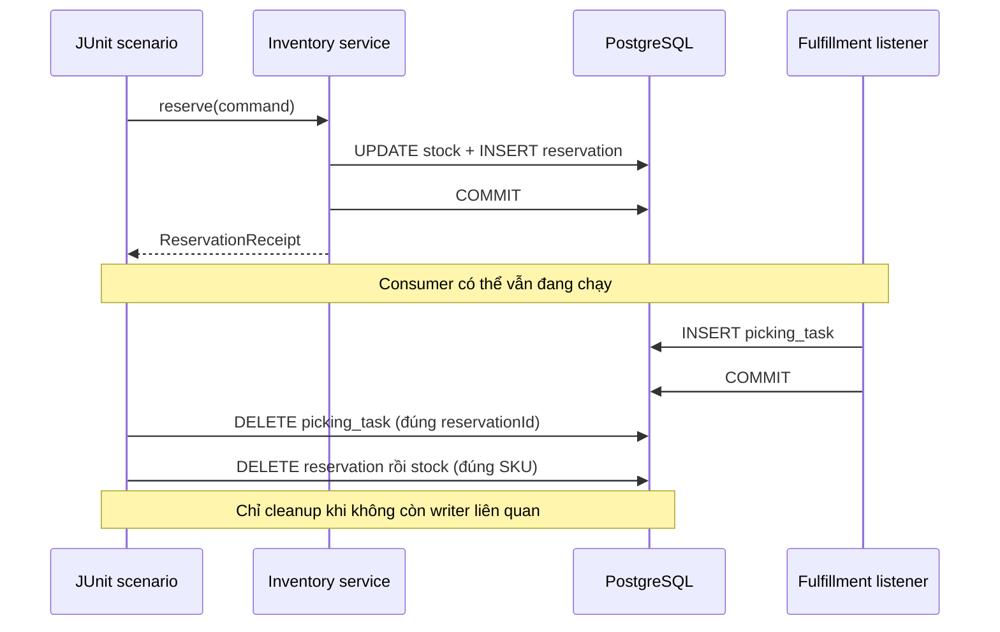

# Dọn database sau scenario

Test `InventoryReservations.reserve()` chạy xanh, nhưng đến test `reserveWhenInsufficientStock()` thì báo SKU đã tồn tại. Nhóm thêm `@AfterEach` với `DELETE FROM inventory_stock` để dọn sạch; khi CI chạy hai test cùng lúc, đoạn cleanup lại xóa fixture của test khác. Có trường hợp test producer đã kết thúc nhưng listener `@ApplicationModuleListener` vẫn đang ghi `picking_task`, khiến bản ghi **xuất hiện trở lại sau khi cleanup**.

**Dọn database sau scenario** không đơn giản là chạy một lệnh `DELETE`. Cần xác định: **scenario sở hữu những hàng nào, transaction nào đã commit, còn tác vụ nào đang dùng dữ liệu, thứ tự xóa theo ràng buộc nào và làm sao chứng minh cleanup không xóa nhầm dữ liệu của scenario khác?**

Đây là bài chuyên sâu trong chương **Database testing** của **SPRING_MODULITH_VERIFICATION_TESTING**. Mục tiêu bám sát việc kiểm chứng ranh giới kiến trúc bằng `ApplicationModules`, quy tắc dependency giữa các module, `@ApplicationModuleTest`, kiểm thử event/database/integration và quality gate CI. Các ví dụ tập trung trực tiếp vào **teardown sau một scenario thực**, thay vì lặp phần nhập môn về repository hoặc tạo fixture.

> **Nguyên tắc:** Chỉ dọn dữ liệu **thuộc quyền sở hữu của scenario**, **sau khi mọi transaction/consumer liên quan đã kết thúc**, theo **thứ tự phụ thuộc an toàn**. Nếu không chứng minh được hai điều đầu, hãy cô lập database/schema và hủy cả môi trường thử nghiệm, thay vì xóa dữ liệu dùng chung khi worker vẫn còn chạy.

## 1. Khi nào một scenario thật sự kết thúc?

Với luồng Inventory phát `StockReserved`, một phương thức JUnit trả về **chưa chắc** mọi tác dụng phụ đã kết thúc:



Phân biệt bốn mốc:

| Mốc | Điều đã biết | Điều **chưa** được bảo đảm |
| --- | --- | --- |
| Test gọi xong service | Lời gọi trả kết quả hoặc ném lỗi | Nếu có transaction ngoài test, producer có thể chưa commit |
| Transaction của producer kết thúc | Data producer đã commit/rollback | Listener async có thể chưa hoàn tất |
| Consumer xác nhận hoàn tất | Side effect consumer đã commit theo cơ chế kiểm chứng | Những retry, scheduler hoặc workflow khác có thể còn tiếp diễn |
| Teardown được phép bắt đầu | Không còn writer liên quan đến scenario; đã có danh sách dữ liệu cần dọn | Chưa có nghĩa mọi `DELETE` sẽ thành công nếu ràng buộc phụ thuộc không được xét |

Trong một test chỉ gọi repository bên trong test-managed transaction rồi rollback, không có consumer/external side effect, mốc kết thúc có thể đơn giản hơn. Với test event/integration, phải **chờ điều kiện hoàn tất** hoặc dùng **database độc quyền có thể bỏ đi** nếu worker không kiểm soát được.

### 1.1. Một rủi ro rất cụ thể

```text
Test A:
  t0: producer commit reservation R-A
  t1: @AfterEach xóa reservation R-A
  t2: listener bất đồng bộ nhận StockReserved(R-A)
  t3: listener INSERT picking_task(R-A)

Test B:
  t4: nhìn thấy picking_task(R-A) từ scenario A
```

Việc `@AfterEach` đã chạy không chứng minh database còn sạch ở `t4`. Nếu `picking_task` có FK tới reservation, listener có thể thất bại thay vì tái tạo hàng; đó vẫn là **lỗi đồng bộ hóa/lifecycle test**, không phải một cách cleanup tốt.

### 1.2. Tiêu chí hoàn thành

Một teardown đáng tin nên chứng minh được:

1. Scenario có **correlation ID** hoặc business key để phân biệt dữ liệu của nó.
2. Những transaction cần xác minh đã **kết thúc**, không chỉ `flush()`.
3. Không còn consumer/scheduler/retry nào có thể tiếp tục ghi dữ liệu đã được chọn để dọn, **hoặc** dữ liệu thuộc môi trường riêng sắp được hủy.
4. Dữ liệu child/parent được dọn theo FK, domain ownership và policy lưu giữ.
5. Sau teardown, các hàng thuộc scenario không còn; những hàng của scenario khác **không đổi**.

## 2. Chọn cơ chế cleanup theo nguồn state, không theo annotation

Quyết định cần dựa vào **nơi dữ liệu được commit**, không dựa vào cảm giác rằng test “có transaction”.

| State/tác vụ | Cách cleanup phù hợp | Ranh giới thường bị hiểu sai |
| --- | --- | --- |
| Repository insert trong **test-managed transaction** sẽ rollback | Dùng rollback mặc định của Spring Test | Chỉ áp cho những thao tác thật sự cùng transaction |
| Service `@Transactional(REQUIRED)` được gọi **không có test transaction ngoài** | Cleanup committed rows theo scenario, hoặc DB/schema riêng | Service đã commit khi transactional proxy trả thành công |
| `@Transactional(REQUIRES_NEW)` commit dữ liệu audit | Xóa audit đúng ID bằng transaction khác hoặc hủy DB riêng | Rollback transaction ngoài **không** hoàn tác audit |
| `@Sql` seed bằng `ISOLATED` | Cleanup riêng vì seed đã commit | `@Rollback` của test không dọn được |
| HTTP test `RANDOM_PORT` | Cleanup dữ liệu do server thread đã commit | Transaction ở JUnit thread không bao trùm server thread |
| Listener `@ApplicationModuleListener` hoặc `@Async` | Đợi xử lý xong; dọn cả dữ liệu consumer và publication state theo policy | Method test kết thúc không phải consumer kết thúc |
| Migration/DDL tạo bảng, index | Database/schema/container mới, reset theo môi trường | Rollback test không đưa schema trở lại version cũ |
| Broker/cache/API bên ngoài | Namespace/sandbox và cleanup phù hợp riêng | SQL `DELETE` không hoàn tác side effect ngoài database |

Một chiến lược có thể kết hợp **rollback cho repository test nhỏ**, **cleanup theo ID cho integration test**, và **hủy database/schema** cho migration hoặc workflow có asynchronous retry phức tạp.

### 2.1. Bản đồ ownership của một scenario

Ví dụ:

```text
ScenarioId (trong test infrastructure)
  |
  +-- Inventory [owner: inventory]
  |      inventory_stock(sku = IT-<id>)
  |      stock_reservation(request_id = R, reservation_id = X)
  |
  +-- Fulfillment [owner: fulfillment]
  |      picking_task(reservation_id = X)
  |
  +-- Event infrastructure
         publication(s) gắn với StockReserved(X), nếu persistence bật
```

**Inventory production code không được tự xóa bảng Fulfillment.** Nhưng một **integration test harness** quản lý toàn bộ workflow có thể được quyền teardown dữ liệu của các module tham gia, nếu đó là database test độc quyền và việc này không tạo dependency production. Khi hệ thống chạy với nhiều datasource/service riêng, việc cleanup xuyên module cần adapter test của từng owner hoặc xóa cả môi trường tạm; không thể chỉ dùng một `JdbcTemplate` cho tất cả.

## 3. Chiến lược A: rollback của test-managed transaction

Nếu test chỉ kiểm chứng repository hoặc trạng thái đồng bộ trong **cùng transaction**, rollback giúp tránh cleanup SQL dễ sai:

```java
package com.example.shop.inventory;

import static org.assertj.core.api.Assertions.assertThat;

import org.junit.jupiter.api.Test;
import org.springframework.beans.factory.annotation.Autowired;
import org.springframework.modulith.test.ApplicationModuleTest;
import org.springframework.transaction.annotation.Transactional;

@ApplicationModuleTest
@Transactional
class InventoryPersistenceTests {

    @Autowired StockJpaRepository stocks;

    @Test
    void storesRowWithinRollbackOnlyTest() {
        var row = stocks.save(new StockRow(
            "IT-ROLLBACK-" + java.util.UUID.randomUUID(), 5
        ));

        assertThat(stocks.findById(row.getSku())).isPresent();
        // Spring Test rollback những thay đổi tham gia transaction này.
    }
}
```

Ví dụ giả định `StockRow`, `StockJpaRepository` thuộc package persistence nội bộ Inventory và entity có constructor/getter tương ứng. Với JPA, method `findById` trong cùng persistence context có thể đọc object chưa commit, nên test này **không chứng minh** production commit hoạt động đúng; nó chỉ phù hợp khi mục tiêu là logic persistence trong test transaction.

### 3.1. Điều rollback **không** dọn

- Công việc trong `REQUIRES_NEW` đã commit.
- Một thread khác hoặc listener mở transaction riêng.
- SQL seed `@SqlConfig(transactionMode = ISOLATED)` đã commit.
- Message/event đã đưa tới hệ thống khác hoặc cache đã sửa.
- Dữ liệu được ghi qua datasource/transaction manager khác không tham gia cùng transaction.
- Giá trị sequence PostgreSQL đã tăng qua `nextval()`; sequence không rollback giống row.

Nếu muốn test event `AFTER_COMMIT`, bao cả method bằng `@Transactional` mặc định rollback có thể khiến listener không chạy. **Không ép mọi integration test vào rollback chỉ để dọn dữ liệu**.

### 3.2. `TestTransaction` và dữ liệu đã commit

```java
// Chỉ dùng trong test có test-managed transaction đang active.
TestTransaction.flagForCommit();
TestTransaction.end();  // Commit transaction test tại đây.

// Từ đây phải tự cleanup dữ liệu đã commit.
```

Sau khi đã commit bằng `TestTransaction.end()`, không thể trông chờ rollback cuối test làm hàng biến mất. Điều này cũng đúng với `@Commit` hoặc `@Rollback(false)` khi transaction test thực sự kết thúc bằng commit.

### 3.3. Dấu hiệu nên chuyển từ rollback sang isolation/cleanup rõ ràng

Nếu bài test cần kiểm chứng listener sau commit, HTTP request ở server thread, version conflict giữa hai transaction, event publication registry hoặc logic transaction `REQUIRES_NEW`, hãy **chủ động chọn** cơ chế cleanup committed data hoặc database/schema riêng. Đừng cố kết hợp `@Transactional` và sleep để làm một test không commit trông giống production.

## 4. Chiến lược B: xóa theo khóa scenario và thứ tự FK

Đối với database tích hợp đã commit, một cleanup tốt phải **đúng phạm vi** và **có thể chạy lại**. Giả sử schema minh họa:

```sql
CREATE TABLE inventory_stock (
    sku VARCHAR(80) PRIMARY KEY,
    available INTEGER NOT NULL CHECK (available >= 0)
);

CREATE TABLE stock_reservation (
    reservation_id UUID PRIMARY KEY,
    request_id UUID NOT NULL UNIQUE,
    sku VARCHAR(80) NOT NULL
        REFERENCES inventory_stock(sku),
    quantity INTEGER NOT NULL CHECK (quantity > 0)
);

CREATE TABLE picking_task (
    task_id UUID PRIMARY KEY,
    reservation_id UUID NOT NULL UNIQUE
        REFERENCES stock_reservation(reservation_id),
    sku VARCHAR(80) NOT NULL
);
```

Đây là schema **minh họa**. Trong dự án thật, test phải chạy Flyway/Liquibase migration production. Foreign key từ Fulfillment tới Inventory là coupling database cần quyết định có chủ đích; ở đây nó được sử dụng để làm rõ thứ tự cleanup.

### 4.1. Chuỗi xóa đúng

Nếu scenario có `sku = "IT-" + UUID`, và **không có scenario khác dùng SKU đó**, thứ tự cleanup:

```sql
-- 1. Child của Fulfillment.
DELETE FROM picking_task
WHERE reservation_id IN (
    SELECT reservation_id
    FROM stock_reservation
    WHERE sku = :scenarioSku
);

-- 2. Child của Inventory.
DELETE FROM stock_reservation
WHERE sku = :scenarioSku;

-- 3. Parent Inventory.
DELETE FROM inventory_stock
WHERE sku = :scenarioSku;
```

**Không** dùng:

```sql
TRUNCATE picking_task, stock_reservation, inventory_stock CASCADE;
```

trong shared database đang chạy parallel. `CASCADE` có thể xóa các hàng/quan hệ ngoài phạm vi scenario, làm lỗi bị che và khiến test khác bất ổn.

### 4.2. Mã cleanup có transaction riêng

Đặt trong **test source set** của integration test harness, không trong code production của Ordering:

```java
package com.example.shop.testsupport;

import org.springframework.jdbc.core.JdbcTemplate;
import org.springframework.transaction.PlatformTransactionManager;
import org.springframework.transaction.support.TransactionTemplate;

public final class ScenarioDbCleanup {

    private final JdbcTemplate jdbc;
    private final TransactionTemplate transaction;

    public ScenarioDbCleanup(
        JdbcTemplate jdbc,
        PlatformTransactionManager transactionManager
    ) {
        this.jdbc = jdbc;
        this.transaction = new TransactionTemplate(transactionManager);
    }

    public void cleanInventoryScenario(String sku) {
        if (sku == null || !sku.startsWith("IT-")) {
            throw new IllegalArgumentException(
                "Từ chối dọn SKU không thuộc test"
            );
        }
        transaction.executeWithoutResult(status -> {
            jdbc.update("""
                DELETE FROM picking_task
                 WHERE reservation_id IN (
                     SELECT reservation_id
                       FROM stock_reservation
                      WHERE sku = ?
                 )
                """, sku);

            jdbc.update(
                "DELETE FROM stock_reservation WHERE sku = ?", sku
            );
            jdbc.update(
                "DELETE FROM inventory_stock WHERE sku = ?", sku
            );
        });
    }
}
```

Đoạn code giả định `JdbcTemplate` và `TransactionTemplate` dùng **cùng datasource/transaction manager** và tất cả bảng đã được tạo bằng migration. Kiểm tra prefix `IT-` là **lớp phòng vệ bổ sung**, **không thay thế** quyền DB test độc quyền, kiểm tra JDBC URL/schema và chính sách không ghi cùng SKU giữa các scenarios. Nếu cần nhiều tenant, cần thêm tenant ID vào **tất cả query** liên quan.

Việc dùng một transaction cho ba `DELETE` khiến cleanup hoặc commit cùng nhau, hoặc rollback khi có lỗi SQL. Nếu cleanup thất bại, phải làm test/job **đỏ**, không nuốt exception rồi giả vờ environment sạch.

### 4.3. Cleanup nên idempotent

Với điều kiện không còn worker ghi lại các hàng, gọi `cleanInventoryScenario(sku)` lần hai nên:

- Không ném lỗi vì hàng không tồn tại.
- Không xóa hàng thuộc SKU khác.
- Không tạo event/side effect nghiệp vụ mới.
- Không làm schema hoặc reference data thay đổi.

**Idempotent cleanup** không đồng nghĩa chạy cleanup sớm là an toàn. Nếu listener vẫn đang giữ event của SKU, các hàng có thể được ghi lại **sau** cả hai lần xóa.

### 4.4. Đừng cleanup bằng business service nếu nó tạo side effect

Một cách làm dễ gây nhiễu:

```java
// Nguy cơ: gọi service để "cancel" có thể publish nhiều event mới.
inventory.cancelReservation(reservationId);
```

Nếu mục tiêu test là kiểm tra nghiệp vụ hủy, gọi service là đúng trong **When**. Nhưng nếu chỉ cần teardown, đường business service có thể kích hoạt listener, audit, email hoặc transactional outbox mới. Trên một **test database được sở hữu**, dùng cleanup infrastructure hoặc reset environment thường ít side effect hơn, miễn là chỉ dọn dữ liệu thuộc scenario.

## 5. `@AfterEach` và `@Sql`: đúng thời điểm chưa chắc đúng transaction

Spring Test và JUnit có nhiều điểm hook để dọn dữ liệu. Chọn hook phải đi cùng transaction mode và khả năng điều khiển **scope dữ liệu**.

### 5.1. `@AfterEach` theo ID động của từng test

Khi mỗi test tạo `sku`/`requestId` riêng, `@AfterEach` là nơi thuận tiện để dùng helper từ mục 4:

```java
@ApplicationModuleTest
class InventoryCommittedScenarioTests {

    @Autowired JdbcTemplate jdbc;
    @Autowired PlatformTransactionManager txManager;

    private String scenarioSku;

    @Test
    void reservesStock() {
        scenarioSku = "IT-" + UUID.randomUUID();
        jdbc.update(
            "INSERT INTO inventory_stock(sku, available) VALUES (?, 5)",
            scenarioSku
        );
        // Gọi API Inventory qua bean Spring, không bọc test transaction.
        // Assert kết quả từ DB sau service commit.
    }

    @AfterEach
    void tearDown() {
        if (scenarioSku != null) {
            new ScenarioDbCleanup(jdbc, txManager)
                .cleanInventoryScenario(scenarioSku);
        }
    }
}
```

Các import từ JUnit/Spring phù hợp cần có, cùng helper `ScenarioDbCleanup` ở mục 4. **Giả định quan trọng:** Đây là test đang có đầy đủ bảng `picking_task` và các bảng Inventory trong test datasource; nếu chỉ bootstrap module Inventory và database migration không có bảng Fulfillment, helper tích hợp phải được điều chỉnh để chỉ xóa dữ liệu thực sự có trong scenario. Không biến một test Inventory standalone thành phụ thuộc vào service Fulfillment chỉ vì chung một helper cleanup.

`@AfterEach` được JUnit gọi ngay cả khi test ném exception thông thường, nhưng cleanup cũng có thể thất bại do connection lỗi, deadlock hoặc async writer còn chạy. **Đừng nuốt lỗi cleanup**: một suite với môi trường bẩn không thể được coi là đã dọn thành công.

### 5.2. `@Sql(AFTER_TEST_METHOD)` dùng cho fixture cố định

Với **database/schema riêng của class** và fixture dùng khóa cố định:

```java
@Sql(
    scripts = "/fixtures/inventory/cleanup.sql",
    executionPhase = Sql.ExecutionPhase.AFTER_TEST_METHOD,
    config = @SqlConfig(
        transactionMode = SqlConfig.TransactionMode.ISOLATED
    )
)
```

Ví dụ `cleanup.sql` cho một class **độc quyền** sử dụng SKU `IT-CASE-001`:

```sql
DELETE FROM picking_task
WHERE reservation_id IN (
    SELECT reservation_id FROM stock_reservation
    WHERE sku = 'IT-CASE-001'
);

DELETE FROM stock_reservation WHERE sku = 'IT-CASE-001';
DELETE FROM inventory_stock WHERE sku = 'IT-CASE-001';
```

`ISOLATED` yêu cầu script chạy trong transaction riêng, commit theo cấu hình Spring Test/transaction manager tương ứng. Vì thế cleanup có thể dọn **dữ liệu đã commit** từ scenario, khác với cleanup tham gia một test-managed transaction sắp rollback.

Tuy nhiên:

- `@Sql` với một file tĩnh **không tự biết** ID mà test vừa sinh ngẫu nhiên.
- Nếu hai test dùng cùng SKU hoặc script xóa toàn bảng, `AFTER_TEST_METHOD` vẫn có thể xóa dữ liệu của test khác đang chạy.
- Khi test có `@Transactional`, cách script tham gia transaction phụ thuộc `@SqlConfig`/manager; cleanup mặc định có thể rollback cùng test và **không** dọn side effect đã commit nơi khác.
- Nếu listener async chưa kết thúc, script chạy sau method vẫn có thể quá sớm.

**Khuyến nghị:** Dùng `@Sql` cho fixture/reset của database độc quyền, hoặc dữ liệu static thật sự thuộc riêng test. Với các scenario nhận ID động và có khả năng chạy song song, cleanup theo correlation key bằng JDBC/test helper thường rõ phạm vi hơn.

### 5.3. Các callback transaction của Spring Test

| Điểm hook | Vị trí tương đối với test-managed transaction | Nên dùng khi |
| --- | --- | --- |
| `@BeforeEach` | Thường trong transaction của test khi `@Transactional` active | Tạo dữ liệu sẽ được rollback cùng test |
| `@AfterEach` | Thường vẫn trong transaction của test khi `@Transactional` active | Cleanup/test assertions trong cùng transaction |
| `@BeforeTransaction` | Trước khi test transaction bắt đầu | Seed baseline **đã commit** cho bài test rollback |
| `@AfterTransaction` | Sau khi test transaction kết thúc | Assert hậu điều kiện rollback/commit bằng scope mới |
| `@Sql` `AFTER_TEST_METHOD` | Phase sau test method; transaction mode quyết định scope | Script teardown có kiểm soát |

Không lẫn **sau khi method kết thúc** với **sau khi transaction commit**. Nếu test dùng `@Transactional` và mặc định rollback, callback `AFTER_COMMIT` của ứng dụng sẽ không hoạt động như khi production service commit.

### 5.4. Có thể dọn bằng `TRUNCATE` không?

Có, **chỉ khi** đã cấp một database/schema riêng và toàn bộ bảng trong danh sách đều thuộc môi trường được phép reset. Ví dụ performance/migration test trên DB disposable có thể dùng truncate để khôi phục baseline nhanh. Trên database chia sẻ, `TRUNCATE ... CASCADE` hoặc `DELETE` không lọc là rủi ro cao cho dữ liệu của test khác.

Đối với bảng có identity/sequence, `TRUNCATE ... RESTART IDENTITY` còn thay đổi sequence state; chỉ dùng khi việc reset sequence được sở hữu bởi test. Không viết assertion mặc định `id=1` sau mọi lần reset nếu suite có nhiều scenario độc lập.

## 6. Listener bất đồng bộ và Event Publication Registry: chờ xong mới dọn

Giả sử service Inventory gọi:

```java
events.publishEvent(new StockReserved(
    reservationId, sku, quantity
));
```

và Fulfillment lắng nghe:

```java
@ApplicationModuleListener
void on(StockReserved event) {
    // Ghi picking_task trong transaction xử lý event.
}
```

`@ApplicationModuleListener` ở các cấu hình Spring Modulith hỗ trợ transactional listener và xử lý bất đồng bộ. Vì vậy sau `InventoryReservations.reserve(...)` return, **không thể tự kết luận** consumer đã ghi `picking_task`.

### 6.1. Chờ một điều kiện DB đã commit

Một test full integration có thể dùng Awaitility (khi dependency có trong test scope):

```java
await()
    .atMost(Duration.ofSeconds(10))
    .untilAsserted(() -> {
        Integer rows = jdbc.queryForObject("""
            SELECT count(*) FROM picking_task
             WHERE reservation_id = ?
            """, Integer.class, receipt.reservationId());
        assertThat(rows).isEqualTo(1);
    });
```

Điểm quan trọng:

1. Đọc bằng connection/transaction mới ngoài một test transaction dài, để thấy thay đổi consumer đã commit.
2. Lọc theo **đúng `reservationId`**, không đếm tất cả picking tasks.
3. Có timeout hữu hạn: consumer lỗi hoặc không được bootstrap thì test **phải đỏ**.
4. Không dùng `Thread.sleep(1000)` như một cam kết về thời gian hoàn tất.
5. Đợi **toàn bộ** hậu xử lý liên quan trước khi cleanup, không chỉ tác vụ đầu tiên nếu workflow còn nhiều bước.

### 6.2. Một hàng xuất hiện chưa chắc mọi retry đã kết thúc

Khi bật Event Publication Registry, có thể còn publication đang chờ retry/resubmission ngay cả sau khi một side effect đã có. Ví dụ:

```text
Listener INSERT picking_task và commit
Process lỗi trước khi ghi nhận publication đã hoàn tất
→ publication vẫn có thể được resubmit
→ listener được gọi lại sau khi test cleanup
```

Nếu consumer được thiết kế idempotent (ví dụ `picking_task.reservation_id UNIQUE`), replay trong lúc row còn tồn tại sẽ không tạo task thứ hai. **Nhưng nếu cleanup xóa row trước khi retry kết thúc, replay có thể tạo lại row**. Do đó cần một trong các chính sách:

- **Drain/quiescence:** Điều khiển listener, retry/scheduler và registry để xác nhận không còn publication liên quan đến scenario cần xử lý, trước khi dọn hàng.
- **Resource isolation:** Đưa workflow vào database/broker namespace riêng và hủy tài nguyên sau test, thay vì kỳ vọng xóa hàng là đủ.
- **Test-specific coordination:** Cơ chế completion/probe cho từng event và từng consumer, có timeout; không phải chỉ đợi một lần INSERT.

Không hard-code tên bảng/field registry vì nó phụ thuộc Spring Modulith persistence module và phiên bản sử dụng; kiểm tra thông qua infrastructure/API đã cấu hình. Một probe chỉ báo “listener đã bắt đầu” **không** đủ: phải biết transaction consumer đã commit/rollback và có còn retry không.

### 6.3. Nếu consumer không hoàn tất trước timeout

**Không nên xóa các bảng shared một cách mù quáng ngay sau timeout.** Worker có thể tiếp tục INSERT sau khi xóa, tạo dữ liệu mồ côi hoặc làm đỏ test khác.

Quy trình an toàn hơn:

1. Đánh dấu test thất bại rõ, giữ correlation ID và log lỗi.
2. Yêu cầu consumer dừng/drain thông qua cơ chế được hỗ trợ, nếu test harness kiểm soát được.
3. Khi chắc chắn không còn writer, mới cleanup theo ID.
4. Nếu không thể chắc chắn, **bỏ cả database/container/sandbox chỉ thuộc scenario**, không trả môi trường đang bị ảnh hưởng cho test khác.

Việc “chờ xong” cần đúng scope: nếu producer publish nhiều event hoặc listener tạo tác vụ thứ hai, một picking task tồn tại không đảm bảo toàn bộ workflow đã quiescent. Từng bài test phải xác định **completion contract** phù hợp.

### 6.4. Không thể rollback side effect ngoài DB chỉ bằng SQL

Nếu Fulfillment còn gọi email provider hoặc queue, việc xóa `picking_task` không xóa email đã gửi. Integration test nên dùng provider sandbox, fake transport có reset đúng scope, hoặc môi trường message broker/queue được cấp riêng. Cần kiểm tra **data cleanup và external side-effect cleanup** như hai việc khác nhau.

## 7. Chiến lược C: xóa cả schema/database/container thay vì từng hàng

Trong các kịch bản sau, **hủy môi trường** thường an toàn và đơn giản hơn dọn từng bảng:

- Test chạy migration version cũ → mới, thay đổi DDL/index/schema history.
- Test event có nhiều consumer, retries, registry và async jobs khó chứng minh đã hoàn tất.
- Test tạo hàng trăm bảng/khóa ngoại và cần reset toàn bộ state.
- Test dùng transaction/concurrency hoặc fault injection có thể khiến worker sống quá vòng đời test.
- CI chạy nhiều shards/forks cần database riêng, tránh `TRUNCATE` từ job này xóa fixture job kia.

### 7.1. Phạm vi cô lập và chi phí

| Chiến lược | Sở hữu state | Mạnh ở đâu | Giới hạn |
| --- | --- | --- | --- |
| **Cleanup theo key** | Các hàng có correlation/tenant/test key | Nhanh, không cần DB mới; có thể chạy parallel nếu đúng namespace | Không xử lý DDL/sequence/retry không rõ owner |
| **Schema riêng** | Tables/index/history thuộc schema được cấp | Fresh schema, migration và fixture cô lập phần lớn | JDBC `search_path`, JPA schema, Flyway và SQL hard-coded phải thống nhất |
| **Database riêng** | Toàn DB state, history, constraints | Dễ bỏ toàn bộ khi lỗi, phù hợp integration | Provision/teardown và quyền kết nối |
| **Container riêng** | Engine/DB process test | Cô lập mạnh và gần production | Tốn startup/RAM, cần quản lý context cache/lifecycle |

Một PostgreSQL container duy nhất dùng chung bởi nhiều test class **không** cho isolation từng class nếu tất cả trỏ vào cùng database/schema.

### 7.2. Testcontainers và vòng đời Spring context

Ví dụ đơn giản:

```java
@SpringBootTest
@Testcontainers
@DirtiesContext(classMode = DirtiesContext.ClassMode.AFTER_CLASS)
class FullWorkflowIT {

    @Container
    @ServiceConnection
    static PostgreSQLContainer<?> postgres =
        new PostgreSQLContainer<>("postgres:16-alpine");

    // Một scenario đầy đủ; container được dùng trong phạm vi class.
}
```

Ví dụ cần các dependency Spring Boot Testcontainers, JUnit Jupiter/Testcontainers, PostgreSQL driver và runtime container phù hợp. `@DirtiesContext` làm Spring Test loại context cache theo lifecycle tương ứng; **nó không tự xóa dữ liệu PostgreSQL**. Việc bỏ dữ liệu ở ví dụ này phụ thuộc **container thực sự riêng, được stop/remove theo lifecycle**, và không sử dụng chế độ reuse/shared database ngoài dự định.

Một lỗi thường gặp là để context được cache giữ datasource trỏ tới **container đã stop**, rồi class khác tái sử dụng context đó. Khi dùng per-class container, quản lý context scope/cache rõ ràng; khi dùng suite-wide singleton container, giữ container sống đủ lâu và tách schema/namespace cho các test song song.

### 7.3. Flyway/Liquibase không phải cleanup của từng test

Muốn test migration từ schema cũ, phải dựng **schema/database tạm ở version cũ**, seed dữ liệu, rồi chạy migration; rollback của test không hạ schema version. Hạn chế `Flyway.clean()` chỉ trong môi trường test được cấp riêng, vì nó phá hủy các object thuộc schema được cấu hình. Đừng gọi `clean()` hoặc `DROP SCHEMA ... CASCADE` trên shared database để “tiết kiệm thời gian”.

Nếu dùng schema-per-job, teardown chỉ xóa **schema có định danh job đã được cấp**, sau khi toàn bộ connection/worker của job kết thúc. Kiểm tra JDBC URL, database name, schema và quyền thực tế trước câu lệnh phá hủy.

### 7.4. Vì sao `@DirtiesContext` hoặc reset singleton không đủ?

Một `ApplicationContext` mới không xóa row đã commit trên database external. Một `@DirtiesContext` còn có thể khiến job chậm hơn khi nạp lại Spring context mà vẫn để data leak. **Reset state đúng tài nguyên**: database do database/schema/container lifecycle quyết định, cache do context lifecycle quyết định, event broker do namespace/consumer lifecycle quyết định.

## 8. Ví dụ Java/JUnit tích hợp: commit → quan sát → teardown

Ta kiểm chứng luồng **Inventory giữ hàng → phát `StockReserved` sau commit → Fulfillment tạo picking task**, rồi xóa dữ liệu scenario. Để tách hẳn rủi ro của listener async khỏi test khác, ví dụ chọn **một PostgreSQL container dành riêng cho test class có một scenario**.

### 8.1. Contract và điều kiện tiền đề

Giả sử API công khai của Inventory:

```java
// Các kiểu nằm trong com.example.shop.inventory.reservations
public record ReserveStock(
    String sku,
    int quantity,
    UUID requestId
) {}

public record ReservationReceipt(UUID reservationId) {}

public interface InventoryReservations {
    ReservationReceipt reserve(ReserveStock command);
}
```

Ví dụ giả định Spring service `reserve` dùng `@Transactional`: giảm tồn + lưu `stock_reservation` cùng transaction và publish `StockReserved` mang `reservationId`. Fulfillment có listener `@ApplicationModuleListener` tạo một `picking_task` (khóa `reservation_id UNIQUE`). PostgreSQL schema được tạo bằng migration thật, không phải Hibernate `create-drop`.

Tách đúng hai loại test:

| Loại | Bootstrap | Mục tiêu |
| --- | --- | --- |
| `@ApplicationModuleTest` ở Inventory | Module owner theo bootstrap mode | Kiểm tra reservation, contract event và DB của Inventory; không giả định Fulfillment đã được nạp |
| `@SpringBootTest` full integration | Inventory **và** Fulfillment cùng event infrastructure | Kiểm tra listener thực sự hoàn tất, transaction consumer và teardown xuyên module |

Ở ví dụ thứ hai, `@SpringBootTest` là chủ đích: **Fulfillment cần được bootstrap**. Dùng `@ApplicationModuleTest(STANDALONE)` ở Inventory rồi poll bảng Fulfillment có thể luôn timeout vì listener không tồn tại.

### 8.2. Một scenario có cleanup tường minh

```java
package com.example.shop;

import static org.assertj.core.api.Assertions.assertThat;
import static org.awaitility.Awaitility.await;

import com.example.shop.inventory.reservations.InventoryReservations;
import com.example.shop.inventory.reservations.ReserveStock;
import com.example.shop.testsupport.ScenarioDbCleanup;
import java.time.Duration;
import java.util.UUID;
import org.junit.jupiter.api.AfterEach;
import org.junit.jupiter.api.Test;
import org.springframework.beans.factory.annotation.Autowired;
import org.springframework.boot.test.context.SpringBootTest;
import org.springframework.boot.testcontainers.service.connection.ServiceConnection;
import org.springframework.jdbc.core.JdbcTemplate;
import org.springframework.test.annotation.DirtiesContext;
import org.springframework.transaction.PlatformTransactionManager;
import org.testcontainers.containers.PostgreSQLContainer;
import org.testcontainers.junit.jupiter.Container;
import org.testcontainers.junit.jupiter.Testcontainers;

@SpringBootTest
@Testcontainers
@DirtiesContext(classMode = DirtiesContext.ClassMode.AFTER_CLASS)
class StockReservationCleanupIT {

    // Lớp chỉ có một scenario và container không chia sẻ với lớp khác.
    @Container
    @ServiceConnection
    static PostgreSQLContainer<?> postgres =
        new PostgreSQLContainer<>("postgres:16-alpine");

    @Autowired InventoryReservations inventory;
    @Autowired JdbcTemplate jdbc;
    @Autowired PlatformTransactionManager transactionManager;

    private String sku;
    private UUID reservationId;
    private boolean consumerCompleted;

    @Test
    void cleansOnlyAfterFulfillmentHasPersistedItsTask() {
        // GIVEN: fixture thuộc riêng scenario này, đã commit.
        sku = "IT-" + UUID.randomUUID();
        UUID requestId = UUID.randomUUID();
        jdbc.update(
            "INSERT INTO inventory_stock(sku, available) VALUES (?, 5)",
            sku
        );

        // WHEN: transaction producer commit qua Spring proxy.
        var receipt = inventory.reserve(
            new ReserveStock(sku, 2, requestId)
        );
        reservationId = receipt.reservationId();

        Integer producerRows = jdbc.queryForObject("""
            SELECT count(*) FROM stock_reservation
             WHERE reservation_id = ?
            """, Integer.class, reservationId);
        assertThat(producerRows).isEqualTo(1);

        // THEN: chờ consumer commit qua một query độc lập.
        await()
            .atMost(Duration.ofSeconds(10))
            .untilAsserted(() -> {
                Integer tasks = jdbc.queryForObject("""
                    SELECT count(*) FROM picking_task
                     WHERE reservation_id = ?
                    """, Integer.class, reservationId);
                assertThat(tasks).isEqualTo(1);
            });

        // Giả định một consumer ổn định, không có retry pending.
        consumerCompleted = true;
    }

    @AfterEach
    void tearDownAfterScenario() {
        if (sku == null) {
            return;
        }

        if (!consumerCompleted) {
            // Test đã thất bại hoặc consumer chưa hoàn tất.
            // KHÔNG xóa dữ liệu khi async writer còn có thể chạy.
            // Container riêng của class sẽ bị loại bỏ sau class.
            return;
        }

        new ScenarioDbCleanup(jdbc, transactionManager)
            .cleanInventoryScenario(sku);

        // Assert teardown, không chỉ hy vọng DELETE thành công.
        Integer stockRows = jdbc.queryForObject("""
            SELECT count(*) FROM inventory_stock WHERE sku = ?
            """, Integer.class, sku);
        Integer reservationRows = jdbc.queryForObject("""
            SELECT count(*) FROM stock_reservation WHERE sku = ?
            """, Integer.class, sku);
        Integer taskRows = jdbc.queryForObject("""
            SELECT count(*) FROM picking_task
             WHERE reservation_id = ?
            """, Integer.class, reservationId);

        assertThat(stockRows).isZero();
        assertThat(reservationRows).isZero();
        assertThat(taskRows).isZero();
    }
}
```

### 8.3. Tại sao đây không phải một mẫu cleanup dùng cho mọi suite?

Ví dụ có **các giả định rõ ràng**:

1. **Một scenario trong một test class với container riêng**. Nếu test fail trước `consumerCompleted = true`, bỏ dữ liệu cho container disposable, **không** cho một test tiếp theo dùng lại DB đó.
2. `@ServiceConnection` cần Spring Boot/Testcontainers integration hỗ trợ và dependency tương thích. PostgreSQL image là ví dụ; chọn engine gần production.
3. `@DirtiesContext` giúp context của class không bị tái dùng sau khi container bị stop; nó **không** dọn database.
4. Dữ liệu mới có `sku`/`reservationId` riêng, `jdbc` dùng datasource đã được cấu hình bởi container.
5. Consumer Fulfillment thật sự nằm trong full context, ghi bảng cùng PostgreSQL datasource, và migration tương ứng đã chạy.
6. Test không có `@Transactional` trên class/method; service producer tự commit.
7. `consumerCompleted` ở đây chỉ chứng minh **task đã xuất hiện ở DB**. Nếu Event Publication Registry có retries còn pending hoặc workflow có nhiều consumer, **không được coi cờ này là bằng chứng quiescence**; khi đó tốt nhất bỏ container mà không làm row cleanup thủ công, hoặc bổ sung test harness để drain và xác minh toàn bộ publication.

Chính vì điều 7, ví dụ này thích hợp để giải thích **teardown theo một completion contract hẹp** trong DB disposable. **Không copy nguyên `@AfterEach` sang database shared** mà không kiểm soát retry; việc một row đã xuất hiện không ngăn listener khác ghi thêm sau cleanup.

### 8.4. Nếu không dùng container riêng cho mỗi class?

Khi toàn test suite dùng một PostgreSQL server để tiết kiệm startup, cần cấp:

- **Schema/database riêng theo suite/job**, hoặc
- **Namespace theo test case** kết hợp cleanup thật sự có thể chứng minh các worker đã hoàn tất.

Không áp `DELETE FROM picking_task` toàn bảng, không hard-code SKU `IT-001` dùng ở nhiều worker, và không dựa vào `@ResourceLock` của JUnit để điều phối giữa **các JVM forks hoặc CI jobs**. Nó chỉ có hiệu lực trong phạm vi execution engine tương ứng.

## 9. Kiểm chứng teardown bằng các ca phá giả định

Đừng chỉ test “xóa xong không còn hàng”. Cần kiểm tra cả **phạm vi xóa**, **khả năng chạy lại** và **hành vi khi test thất bại**.

### 9.1. Cleanup A không được xóa B

Một test riêng dùng cùng `ScenarioDbCleanup`, nhưng tạo **hai scenario độc lập trong chính phương thức test**:

```java
@Test
void cleanupIsScopedAndIdempotent() {
    String skuA = "IT-" + UUID.randomUUID();
    String skuB = "IT-" + UUID.randomUUID();
    var cleanup = new ScenarioDbCleanup(jdbc, transactionManager);

    jdbc.update(
        "INSERT INTO inventory_stock(sku, available) VALUES (?, 2)",
        skuA
    );
    jdbc.update(
        "INSERT INTO inventory_stock(sku, available) VALUES (?, 4)",
        skuB
    );

    try {
        cleanup.cleanInventoryScenario(skuA);
        cleanup.cleanInventoryScenario(skuA); // Lần 2 phải an toàn.

        Integer remainingA = jdbc.queryForObject(
            "SELECT count(*) FROM inventory_stock WHERE sku = ?",
            Integer.class, skuA
        );
        Integer remainingB = jdbc.queryForObject(
            "SELECT available FROM inventory_stock WHERE sku = ?",
            Integer.class, skuB
        );

        assertThat(remainingA).isZero();
        assertThat(remainingB).isEqualTo(4);
    } finally {
        cleanup.cleanInventoryScenario(skuB);
    }
}
```

Đặt trong test class có `JdbcTemplate jdbc`, `PlatformTransactionManager transactionManager`, migration đầy đủ cho các bảng mà helper cần. Đoạn này không phát event, nên có thể kiểm tra tính đúng đắn của **scope cleanup** tách khỏi vấn đề async.

Test này đặc biệt quan trọng khi CI chạy parallel: một cleanup dùng `DELETE FROM inventory_stock` không lọc sẽ khiến assertion với `skuB` thất bại. Tuy nhiên nó **không đủ** để chứng minh không có race với listener/transaction khác; phải test hạ tầng async riêng.

### 9.2. Bảo vệ cleanup khi phần `When` ném exception

Một scenario tiêu cực cũng phải dọn fixture:

```java
@Test
void cleanupRunsEvenWhenScenarioThrows() {
    String sku = "IT-" + UUID.randomUUID();
    var cleanup = new ScenarioDbCleanup(jdbc, transactionManager);

    assertThatThrownBy(() -> {
        try {
            jdbc.update(
                "INSERT INTO inventory_stock(sku, available) VALUES (?, 5)",
                sku
            );
            throw new IllegalStateException("Simulated scenario failure");
        } finally {
            cleanup.cleanInventoryScenario(sku);
        }
    }).isInstanceOf(IllegalStateException.class);

    Integer rows = jdbc.queryForObject(
        "SELECT count(*) FROM inventory_stock WHERE sku = ?",
        Integer.class, sku
    );
    assertThat(rows).isZero();
}
```

Đoạn này minh họa **`try/finally` luôn chạy cleanup** nếu không có sự cố nghiêm trọng của JVM. Với test JUnit thực, `@AfterEach` cũng thường là lựa chọn phù hợp; cần xem những side effect không tham gia cùng transaction và trạng thái async như mục 6.

### 9.3. Khi cleanup lỗi, có nên tiếp tục chạy test khác trên cùng DB?

Không nên mặc định **có**. Ví dụ cleanup bị lỗi FK do một bảng child không được tính đến. Nếu bỏ qua exception, các test kế tiếp sẽ dùng một DB bẩn và tạo kết quả không đáng tin.

Chính sách:

- Log scenario ID, schema, bảng/constraint và exception (không log secrets).
- Fail test/job, không cố “chữa nhanh” bằng `TRUNCATE CASCADE` trên DB shared.
- Với DB riêng, có thể loại bỏ toàn DB/container sau khi worker dừng.
- Với DB shared, cách ly shard/test group bị ảnh hưởng, sửa cleanup query hoặc fixture ownership trước khi rerun.

### 9.4. Cleanup không đồng nghĩa logic production đã đúng

Nếu test chỉ assert bảng đã được dọn, nó có thể xanh dù `InventoryReservations.reserve()` tạo reservation sai. **Thứ tự chuẩn:** assert use case trước, chờ consumer theo contract, cleanup sau, rồi assert dữ liệu scenario biến mất. Không để cleanup chạy trước khi kịp kiểm tra business state.

### 9.5. Test độc lập không cần test khác dọn hộ

Không chia thành:

```text
Test A: create reservation
Test B: assert reservation
Test C: delete reservation
```

Đó là **một workflow** bị chia nhỏ thành ba phương thức phụ thuộc thứ tự. Nếu muốn test create–assert–cleanup, gói các bước trong **cùng scenario**; hoặc mỗi test tự cấp fixture và teardown theo lifecycle riêng. Không dùng `@TestMethodOrder` như cách bảo vệ một luồng có state leak.

## 10. Quality gate CI và ranh giới module sau cleanup

Dọn database đúng là **một bằng chứng về isolation**, không thay thế kiểm thử nghiệp vụ và kiến trúc. Trong Spring Modulith, các lỗi khác nhau cần các gate khác nhau.

### 10.1. Kiểm tra dependency được phép

Ví dụ Inventory công bố API và event:

```java
// inventory/reservations/package-info.java
@org.springframework.modulith.NamedInterface("reservations")
package com.example.shop.inventory.reservations;
```

```java
// inventory/events/package-info.java
@org.springframework.modulith.NamedInterface("events")
package com.example.shop.inventory.events;
```

```java
// ordering/package-info.java
@org.springframework.modulith.ApplicationModule(
    allowedDependencies = "inventory::reservations"
)
package com.example.shop.ordering;
```

```java
// fulfillment/package-info.java
@org.springframework.modulith.ApplicationModule(
    allowedDependencies = "inventory::events"
)
package com.example.shop.fulfillment;
```

Kiểm chứng:

```java
package com.example.shop;

import org.junit.jupiter.api.Test;
import org.springframework.modulith.core.ApplicationModules;

class ModularityTests {

    @Test
    void dependenciesStayWithinPublishedInterfaces() {
        ApplicationModules.of(ShopApplication.class).verify();
    }
}
```

`verify()` giúp kiểm tra các điều kiện như phụ thuộc vòng và việc dùng API/named interface theo quy tắc đã khai báo. Nhưng nó **không** tự biết một `JdbcTemplate` trong code production đang chạy câu SQL ghi bảng của module khác.

**Phân ranh:** Test helper `ScenarioDbCleanup` có thể xóa dữ liệu của nhiều module trong **test infrastructure**, khi nó sở hữu workflow/integration database đó. Ngược lại, Ordering production không được có method `clearInventoryTestData()` hoặc import repository nội bộ của Fulfillment. Đừng đem helper cleanup test vào dependency runtime để lách module boundary.

### 10.2. CI phải kiểm chứng cả nội dung và isolation

```text
Pull request
  |
  +-- Architecture gate
  |     ApplicationModules.verify()
  |     → Chặn import internal, vòng phụ thuộc, allowedDependencies sai
  |
  +-- Module DB gate
  |     @ApplicationModuleTest, rollback/transaction behavior
  |     → Fixture và repository của module owner
  |
  +-- Full integration gate (PostgreSQL)
  |     Service commit + event consumer + teardown
  |     → Dữ liệu consumer đã commit mới được cleanup
  |
  +-- Isolation gate
  |     A và B cùng tồn tại; dọn A không ảnh hưởng B
  |     → Không xóa nhầm key/schema
  |
  +-- Parallel/repeatability gate
  |     Chạy lại test, đảo thứ tự và chia class/shard
  |     → Không phụ thuộc state còn sót
  |
  +-- Tất cả gate bắt buộc đạt
```

Khi CI có Maven/Gradle forks hoặc shards, `@ResourceLock` trong JUnit **không** khóa các JVM/process khác. Nếu các job trỏ cùng PostgreSQL, cần cấp database/schema riêng theo `runId/shardId`, hoặc một cơ chế isolation có phạm vi đúng. Một class test có `@Execution(SAME_THREAD)` cũng không ngăn class khác xóa cùng bảng.

### 10.3. Bằng chứng tối thiểu trong log khi teardown lỗi

| Ghi nhận | Vì sao cần |
| --- | --- |
| Test class/scenario ID | Gắn lỗi với đúng luồng |
| JDBC database/schema (không credentials) | Xác định có kết nối nhầm DB không |
| SKU/request ID/reservation ID | Biết những hàng nào thuộc scenario |
| Consumer completion/retry state | Biết có writer còn chạy không |
| Thứ tự và số hàng bị xóa theo bảng | Phát hiện child/FK/cleanup thiếu |
| Transaction manager/exception | Phân biệt rollback và lỗi commit cleanup |
| Thời điểm container/schema bị hủy | Xác minh không tái sử dụng DB bẩn |

Không log dữ liệu nhạy cảm từ production hoặc connection secrets. Nếu cleanup thất bại vì timeout, hãy giữ log correlation ID để điều tra; **không** retry tự động một lệnh xóa toàn bảng nhằm khiến CI xanh.

### 10.4. Ba lỗi làm quality gate “xanh giả”

1. **Test không được discover:** Class `StockReservationCleanupIT` dùng hậu tố `IT`; cần cấu hình test task/Surefire/Failsafe hoặc Gradle tương ứng để **thực sự chạy** nó.
2. **Container unavailable thì skip:** Với quality gate cần PostgreSQL, thiếu Docker/container runtime phải báo lỗi; không âm thầm dùng H2 và coi locking/DDL tương đương.
3. **Cleanup lỗi nhưng bị swallow:** `try { cleanup(); } catch (Exception ignored) {}` khiến test qua gate dù môi trường vẫn bẩn. Phải báo failure và bỏ môi trường không còn đáng tin.

## 11. Bài thực hành và checklist nghiệm thu

### 11.1. Tình huống Booking–SeatAllocation–Payment

Một modular monolith có:

- `seatallocation` sở hữu `seat_hold(hold_id, show_id, seat_code, status)`.
- `booking` sở hữu `booking(booking_id, hold_id, status)`, gọi `SeatHolds.hold(...)`.
- `payment` sở hữu `payment_request(payment_id, booking_id, status)`, nghe `BookingPlaced` qua `@ApplicationModuleListener`.
- Event Publication Registry được bật với persistence; consumer có thể retry.

Test hiện tại:

```java
@Test
void bookingCreatesPaymentRequest() {
    booking.placeOrder("SHOW-1", "A-01");
    Thread.sleep(1000);
    assertThat(paymentRequestCount()).isEqualTo(1);
}

@AfterEach
void cleanup() {
    jdbc.execute("DELETE FROM seat_hold");
}
```

**Vấn đề:** Test dùng key cố định, sleep không chứng minh consumer hoàn tất, chỉ xóa `seat_hold` mà không xét `booking`/`payment_request` hoặc registry, và có thể xóa nhầm dữ liệu của test khác.

### 11.2. Nhiệm vụ thực hành

1. Tạo một `scenarioId`, `showId`, `seatCode`, `bookingId` thuộc riêng test.
2. Cấp database/schema riêng hoặc phân vùng fixture theo scenario để chạy song song.
3. Gọi API `Booking` thật, để transaction producer commit; không bọc toàn test bằng transaction rollback nếu cần kiểm chứng event `AFTER_COMMIT`.
4. Dùng Awaitility chờ `payment_request` theo đúng `bookingId`, có timeout.
5. Kiểm tra **consumer đã hoàn tất và không còn publication cần retry** theo infrastructure đang dùng, trước khi xóa hàng; nếu không thể, hủy môi trường disposable.
6. Thiết kế thứ tự xóa dựa trên FK thực. Ví dụ nếu `payment_request → booking → seat_hold → seat`, xóa child trước parent. **Không** dựa vào thứ tự module trong source code để đoán FK.
7. Viết cleanup dùng `WHERE booking_id = ?`, `WHERE hold_id = ?` hoặc `WHERE show_id = ?` đúng owner; không `DELETE` toàn bảng trên shared DB.
8. Thử chạy cleanup hai lần và kiểm tra không ném lỗi/không xóa dữ liệu khác.
9. Seed thêm scenario B, dọn scenario A rồi assert B vẫn nguyên vẹn.
10. Giả lập consumer timeout: test phải thất bại và **không tái sử dụng database có writer còn sống**.
11. Chạy `ApplicationModules.verify()` và chứng minh `booking` không inject `seatallocation.internal.SeatHoldRepository`; `payment` chỉ import event API đã công bố.
12. Bổ sung các ca vào CI để chúng thật sự chạy khi test order thay đổi hoặc có nhiều worker.

### 11.3. Ma trận nghiệm thu

| Case | Đầu vào | Kết quả mong đợi |
| --- | --- | --- |
| C1 — Rollback scope | Insert trong test transaction thuần | Không còn row sau rollback |
| C2 — Service commit | Dữ liệu producer đã commit | Teardown xóa đúng rows theo scenario |
| C3 — `REQUIRES_NEW` | Có audit/side effect đã commit riêng | Rollback ngoài không che rò dữ liệu; cleanup đúng scope |
| C4 — Async consumer | Event sau commit tạo payment/picking task | Chờ completion rồi mới xóa |
| C5 — Async timeout | Listener chưa hoàn tất | Fail rõ; giữ hoặc hủy database riêng, không xóa shared DB mù quáng |
| C6 — Idempotency cleanup | Dọn cùng scenario hai lần | Không còn row; lần hai không ảnh hưởng khác |
| C7 — Scope isolation | Hai scenario A, B cùng DB | Dọn A, B còn nguyên |
| C8 — FK order | Parent và nhiều child đã commit | Xóa child trước parent trong một transaction |
| C9 — Registry retry | Publication chưa hoàn tất | Không teardown shared state khi còn khả năng replay |
| C10 — CI + architecture | Nhiều test/forks và dependency rules | Không state leak, `verify()` đạt |

### 11.4. Checklist trước khi xác nhận teardown thành công

- [ ] Biết rõ **scenario key** nào phân biệt dữ liệu test với dữ liệu khác.
- [ ] Dữ liệu được tạo thuộc transaction nào; test có `@Transactional` hay service tự commit?
- [ ] Không kỳ vọng test rollback dọn `REQUIRES_NEW`, HTTP thread, listener hoặc `@Sql(ISOLATED)`.
- [ ] Đã assert hành vi nghiệp vụ **trước** khi cleanup xóa hậu điều kiện.
- [ ] Đã chờ producer commit và những consumer cần thiết hoàn tất.
- [ ] Nếu có registry/retry, đã xác định chính sách quiescence hoặc dùng DB/container disposable.
- [ ] Không dùng “sleep đủ lâu” thay cho completion condition có timeout.
- [ ] Không dựa trên một query trả `0` tức thời để kết luận async writer không còn sống.
- [ ] Mọi câu DELETE có điều kiện theo key/tenant/scenario **hoặc** đang chạy trên DB/schema độc quyền.
- [ ] Đã kiểm tra thứ tự FK và các bảng child/association thực tế.
- [ ] Cleanup không publish thêm event/email/audit ngoài dự định.
- [ ] Cleanup dữ liệu đã commit bằng transaction phù hợp, và lỗi cleanup làm test/job thất bại.
- [ ] Cleanup có thể chạy lại; không xóa hàng thuộc scenario B.
- [ ] Nếu test bị lỗi/timeout, không tái sử dụng một database còn worker liên quan.
- [ ] Các tài nguyên ngoài DB (broker, cache, sandbox) có chiến lược cleanup riêng.
- [ ] Test dùng schema/database/container có lifecycle phối hợp với Spring context cache.
- [ ] Không dùng `@DirtiesContext` như một giải pháp thay cho database cleanup.
- [ ] Không dùng Flyway `clean()` hoặc `DROP SCHEMA CASCADE` ngoài môi trường được cấp riêng.
- [ ] `@ApplicationModuleTest` được dùng đúng phạm vi; full integration test bootstrap đủ listener.
- [ ] `ApplicationModules.verify()` chạy để bảo vệ ranh giới Java và named interfaces.
- [ ] Helper cleanup xuyên module chỉ thuộc **test infrastructure**, không trở thành dependency production.
- [ ] CI thực thi cả các case thành công, lỗi, parallel/repeat và cleanup scope.

**Kết luận:** Dọn database sau scenario là một **hợp đồng về sở hữu dữ liệu và thời điểm hoàn tất**, không phải một câu `DELETE` ở `@AfterEach`. Rollback phù hợp với những thay đổi nằm trong cùng test transaction; cleanup theo correlation key phù hợp với dữ liệu đã commit **và các worker đã dừng**; schema/database/container disposable phù hợp khi có migration, listener và retry khó kiểm soát. Kết hợp các bằng chứng đó với `@ApplicationModuleTest`, integration test PostgreSQL và `ApplicationModules.verify()` sẽ giúp quality gate vừa bắt được hồi quy nghiệp vụ, vừa không tự tạo lỗi do state rò giữa các test.
