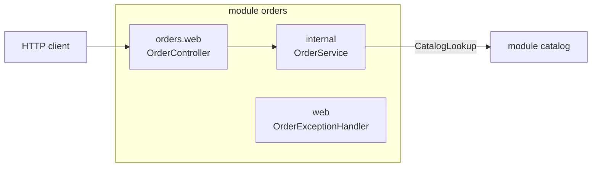
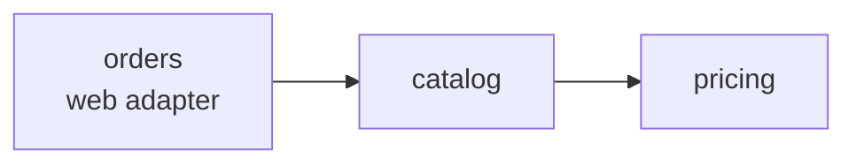

# Kiểm thử module có web adapter bằng bootstrap phù hợp

## Mục tiêu học tập

Sau bài này, bạn có thể:

1. Phân biệt kiểm thử **web adapter** của một application module với kiểm thử MVC slice và kiểm thử HTTP toàn hệ thống.
2. Cấu hình `@ApplicationModuleTest` cho module chứa `@RestController` bằng `webEnvironment = MOCK` và `@AutoConfigureMockMvc`.
3. Chọn `BootstrapMode.STANDALONE`, `DIRECT_DEPENDENCIES` hay `ALL_DEPENDENCIES` theo đúng mục đích, tránh khởi tạo cả ứng dụng chỉ để kiểm tra một endpoint.
4. Dùng `@MockitoBean` thay thế một bean thuộc module khác, kiểm thử HTTP status, JSON, validation và ánh xạ lỗi nghiệp vụ.
5. Chẩn đoán lỗi khởi tạo context, thiếu `MockMvc`, lỗi Spring Security, dữ liệu và phụ thuộc xuyên module.
6. Kết hợp kiểm thử web module với `ApplicationModules.verify()`, `@ApplicationModuleTest`, các bài kiểm thử sự kiện/database và quality gate CI.

Bài thuộc chương **Web module testing** trong lộ trình **SPRING_MODULITH_VERIFICATION_TESTING**: rèn kỹ năng kiểm chứng ranh giới kiến trúc bằng `ApplicationModules`, quy tắc phụ thuộc và các lớp kiểm thử module, sự kiện, cơ sở dữ liệu, tích hợp. Trọng tâm bài này là **chọn phạm vi bootstrap hợp lý cho module có web adapter**, không đánh đồng một bài kiểm thử HTTP với việc chạy toàn bộ hệ thống.

> **Phạm vi phiên bản của ví dụ:** Mã Java bên dưới minh họa Spring Boot **3.4–3.5**, Spring Modulith **1.3–1.4**, JUnit 5 và Spring MVC. Ở Spring Boot 4, một số package của annotation kiểm thử MVC đã đổi; hãy dùng import theo phiên bản Boot thực tế. `@MockitoBean` là API Spring Framework 6.2+/Spring Boot 3.4+; với dự án cũ hơn cần đối chiếu API mock được hỗ trợ thay vì sao chép nguyên import.

## 1. Web adapter nằm ở đâu trong một application module?

Giả sử ứng dụng `com.example.shop` có hai module nghiệp vụ `orders` và `catalog`. Module `orders` nhận HTTP request, thực thi quy tắc đặt hàng, rồi gọi một hợp đồng công khai của `catalog` để kiểm tra sản phẩm.

```text
src/main/java/com/example/shop/
├── ShopApplication.java
├── catalog/
│   └── CatalogLookup.java                <- API công khai của catalog
└── orders/
    ├── OrderManagement.java              <- API công khai của orders
    ├── internal/
    │   ├── OrderService.java             <- service nghiệp vụ
    │   └── ProductUnavailableException.java
    └── web/
        ├── OrderController.java          <- web adapter
        └── OrderExceptionHandler.java    <- ánh xạ lỗi HTTP

src/test/java/com/example/shop/orders/
└── OrdersWebModuleTests.java
```

Trong cấu trúc này:

- `orders` là **một application module** được phát hiện theo package con trực tiếp của `com.example.shop`.
- `orders.web` là **package con của orders**, không phải module độc lập.
- `OrderController` chuyển HTTP/JSON thành lệnh gọi `OrderManagement`; việc xử lý nghiệp vụ nằm trong `OrderService`.
- `catalog.CatalogLookup` là một hợp đồng **bên ngoài module orders**. Với bootstrap `STANDALONE`, bean triển khai trong `catalog` không tự được kéo vào context test.



Mục tiêu của bài test web module là kiểm chứng luồng **HTTP → controller → service trong module** với Spring MVC thật, nhưng quyết định rõ **module ngoài được mock hay chạy thật**. Nó khác một unit test chỉ gọi trực tiếp phương thức controller và khác một bài end-to-end test chạy mọi module, database và hệ thống ngoài.

## 2. `@ApplicationModuleTest` thay đổi bootstrap như thế nào?

Spring Modulith cung cấp `org.springframework.modulith.test.ApplicationModuleTest`. Annotation này được xây dựng trên `@SpringBootTest`, nhưng giới hạn việc khởi tạo Spring context theo application module của lớp test.

Theo mặc định, test:

```java
@ApplicationModuleTest
class OrdersWebModuleTests {
}
```

có hai đặc điểm:

1. **`BootstrapMode.STANDALONE`**: chỉ khởi tạo các bean nằm trong module đang kiểm thử, bên cạnh các thành phần framework cần cho context.
2. **`webEnvironment = SpringBootTest.WebEnvironment.MOCK`**: tạo web application context dạng mock khi ứng dụng sử dụng stack web phù hợp; **không mở cổng HTTP thật**.

Spring Modulith còn điều chỉnh phạm vi component scanning và các package liên quan auto-configuration/entity scanning để test tập trung vào module. Một số auto-configuration nền tảng vẫn tham gia; do đó “STANDALONE” không có nghĩa chỉ tồn tại vài đối tượng Java thuần, cũng không bảo đảm test không cần database nếu chính module có repository yêu cầu database.

### Ba bootstrap mode

| `BootstrapMode` | Những module được bootstrap | Khi nào chọn? |
| --- | --- | --- |
| `STANDALONE` *(mặc định)* | Module của lớp test | Kiểm tra web adapter và service của module, mock dependency ngoài module |
| `DIRECT_DEPENDENCIES` | Module hiện tại và các module mà nó phụ thuộc **trực tiếp** | Cần kiểm thử phối hợp thật với module sát bên |
| `ALL_DEPENDENCIES` | Module hiện tại và toàn bộ cây dependency theo chiều đi ra, gồm bắc cầu | Cần tích hợp nhiều module upstream của module đang test |

**Không có chế độ nào đồng nghĩa “chạy tất cả các module của ứng dụng”.** Những module không nằm trong cây phụ thuộc của module test sẽ không tự được chọn chỉ vì chúng cùng tồn tại trong dự án.

Trong ví dụ `orders → catalog`, `STANDALONE` không khởi tạo bean triển khai `CatalogLookup` nằm trong `catalog`; `DIRECT_DEPENDENCIES` có thể bao gồm `catalog`. `ALL_DEPENDENCIES` chỉ khác thêm nếu `catalog` lại phụ thuộc module khác.

## 3. Chuẩn bị project và các hợp đồng Java

Đặt `ShopApplication` tại package gốc:

```java
// src/main/java/com/example/shop/ShopApplication.java
package com.example.shop;

import org.springframework.boot.SpringApplication;
import org.springframework.boot.autoconfigure.SpringBootApplication;

@SpringBootApplication
public class ShopApplication {

    public static void main(String[] args) {
        SpringApplication.run(ShopApplication.class, args);
    }
}
```

Các phụ thuộc cơ bản, minh họa cho Gradle Groovy DSL khi dự án đã quản lý phiên bản Spring Modulith qua BOM:

```groovy
dependencies {
    implementation 'org.springframework.boot:spring-boot-starter-web'
    implementation 'org.springframework.boot:spring-boot-starter-validation'
    implementation 'org.springframework.modulith:spring-modulith-starter-core'

    testImplementation 'org.springframework.boot:spring-boot-starter-test'
    testImplementation 'org.springframework.modulith:spring-modulith-starter-test'
}
```

Ví dụ dùng Spring MVC/Servlet. Nếu ứng dụng dùng Spring WebFlux thuần hoặc Spring Boot 4, cần chọn các starter, import và công cụ kiểm thử tương ứng. Một đoạn khai báo dependency **không đủ** để xác định phiên bản tương thích; nên dùng BOM/parent phù hợp với Spring Boot đang chạy.

### API của module catalog

```java
// src/main/java/com/example/shop/catalog/CatalogLookup.java
package com.example.shop.catalog;

public interface CatalogLookup {
    boolean available(String sku);
}
```

Ở giai đoạn test `STANDALONE`, ta chỉ cần **kiểu hợp đồng** này trên classpath, không cần khởi tạo service/repository thật của `catalog`.

### API và service trong module orders

```java
// src/main/java/com/example/shop/orders/OrderManagement.java
package com.example.shop.orders;

public interface OrderManagement {
    String place(String sku);
}
```

```java
// src/main/java/com/example/shop/orders/internal/ProductUnavailableException.java
package com.example.shop.orders.internal;

public class ProductUnavailableException extends RuntimeException {

    public ProductUnavailableException(String sku) {
        super("Product unavailable: " + sku);
    }
}
```

```java
// src/main/java/com/example/shop/orders/internal/OrderService.java
package com.example.shop.orders.internal;

import com.example.shop.catalog.CatalogLookup;
import com.example.shop.orders.OrderManagement;
import org.springframework.stereotype.Service;

@Service
class OrderService implements OrderManagement {

    private final CatalogLookup catalog;

    OrderService(CatalogLookup catalog) {
        this.catalog = catalog;
    }

    @Override
    public String place(String sku) {
        if (!catalog.available(sku)) {
            throw new ProductUnavailableException(sku);
        }
        return "ord-" + sku;
    }
}
```

`OrderService` thực thi hợp đồng `OrderManagement` của chính `orders` và dùng API công khai `CatalogLookup` của module khác. Phần tạo ID cố định theo SKU chỉ để bài test dễ quan sát; hệ thống thực thường có repository, ID sinh riêng và transaction cần kiểm thử ở cấp tích hợp.

## 4. Tạo web adapter và ánh xạ lỗi

```java
// src/main/java/com/example/shop/orders/web/OrderController.java
package com.example.shop.orders.web;

import com.example.shop.orders.OrderManagement;
import jakarta.validation.Valid;
import jakarta.validation.constraints.NotBlank;
import org.springframework.http.HttpStatus;
import org.springframework.http.ResponseEntity;
import org.springframework.web.bind.annotation.PostMapping;
import org.springframework.web.bind.annotation.RequestBody;
import org.springframework.web.bind.annotation.RequestMapping;
import org.springframework.web.bind.annotation.RestController;

@RestController
@RequestMapping("/orders")
public class OrderController {

    private final OrderManagement orders;

    OrderController(OrderManagement orders) {
        this.orders = orders;
    }

    @PostMapping
    ResponseEntity<CreatedOrder> create(
            @Valid @RequestBody NewOrder request) {

        String id = orders.place(request.sku());

        return ResponseEntity.status(HttpStatus.CREATED)
                .body(new CreatedOrder(id));
    }

    public record NewOrder(@NotBlank String sku) {}
    public record CreatedOrder(String orderId) {}
}
```

`@Valid` kết hợp `@NotBlank` yêu cầu Bean Validation provider có mặt; trong Spring Boot 3, `spring-boot-starter-validation` là lựa chọn thông thường. Nếu thiếu dependency phù hợp, một bài test mong đợi HTTP 400 cho SKU rỗng có thể không hoạt động như dự tính.

Định nghĩa cách chuyển lỗi nghiệp vụ thành HTTP 409:

```java
// src/main/java/com/example/shop/orders/web/OrderExceptionHandler.java
package com.example.shop.orders.web;

import java.util.Map;
import com.example.shop.orders.internal.ProductUnavailableException;
import org.springframework.http.HttpStatus;
import org.springframework.http.ResponseEntity;
import org.springframework.web.bind.annotation.ExceptionHandler;
import org.springframework.web.bind.annotation.RestControllerAdvice;

@RestControllerAdvice
class OrderExceptionHandler {

    @ExceptionHandler(ProductUnavailableException.class)
    ResponseEntity<Map<String, String>> handleUnavailable(
            ProductUnavailableException exception) {

        return ResponseEntity.status(HttpStatus.CONFLICT)
                .body(Map.of("error", "PRODUCT_UNAVAILABLE"));
    }
}
```

Các kiểu `OrderController`, `OrderExceptionHandler`, `OrderService` đều thuộc module `orders`, dù chúng nằm trong các package con khác nhau. Không cần biến `orders.web` thành module riêng để kiểm thử web adapter của `orders`.

## 5. Test HTTP bằng `@ApplicationModuleTest` và `MockMvc`

Đặt test **dưới package của module `orders`** để Spring Modulith biết module nào cần bootstrap:

```java
// src/test/java/com/example/shop/orders/OrdersWebModuleTests.java
package com.example.shop.orders;

import static org.mockito.BDDMockito.given;
import static org.mockito.BDDMockito.then;
import static org.springframework.test.web.servlet.request.MockMvcRequestBuilders.post;
import static org.springframework.test.web.servlet.result.MockMvcResultMatchers.jsonPath;
import static org.springframework.test.web.servlet.result.MockMvcResultMatchers.status;

import com.example.shop.catalog.CatalogLookup;
import org.junit.jupiter.api.Test;
import org.springframework.beans.factory.annotation.Autowired;
import org.springframework.boot.test.autoconfigure.web.servlet.AutoConfigureMockMvc;
import org.springframework.boot.test.context.SpringBootTest;
import org.springframework.http.MediaType;
import org.springframework.modulith.test.ApplicationModuleTest;
import org.springframework.test.context.bean.override.mockito.MockitoBean;
import org.springframework.test.web.servlet.MockMvc;

@ApplicationModuleTest(
        webEnvironment = SpringBootTest.WebEnvironment.MOCK
)
@AutoConfigureMockMvc
class OrdersWebModuleTests {

    @Autowired
    MockMvc mvc;

    @MockitoBean
    CatalogLookup catalog;

    @Test
    void createsOrderThroughHttpAdapter() throws Exception {
        given(catalog.available("book-42")).willReturn(true);

        mvc.perform(post("/orders")
                .contentType(MediaType.APPLICATION_JSON)
                .content("""
                        {"sku":"book-42"}
                        """))
                .andExpect(status().isCreated())
                .andExpect(jsonPath("$.orderId")
                        .value("ord-book-42"));

        then(catalog).should().available("book-42");
    }
}
```

**Điều gì thực sự diễn ra?**

1. `@ApplicationModuleTest` tạo Spring test context giới hạn theo module `orders`; `STANDALONE` được dùng vì không chỉ định `mode`.
2. `webEnvironment = MOCK` dùng môi trường web giả lập, không mở TCP port.
3. `@AutoConfigureMockMvc` cung cấp bean `MockMvc`, cho phép gửi request qua Spring MVC `DispatcherServlet`, message converter và các thành phần MVC được cấu hình.
4. `@MockitoBean CatalogLookup` tạo mock thay cho bean thực ở module `catalog`. Nhờ vậy, `OrderService` vẫn có dependency cần thiết dù module `catalog` không được bootstrap.
5. Test đi qua **controller và service thật của `orders`**; nó không đơn thuần gọi thẳng `OrderController.create(...)` như unit test thuần.

`@AutoConfigureMockMvc` là **thành phần bổ sung cần thiết** cho ví dụ dùng `MockMvc` trong Spring Boot 3. Với Boot 4, import annotation này thay đổi (ví dụ sang `org.springframework.boot.webmvc.test.autoconfigure.AutoConfigureMockMvc`), nhưng ý tưởng bootstrap module và cấu hình MVC mock vẫn giữ nguyên.

> `@ApplicationModuleTest(webEnvironment = MOCK)` **không có nghĩa MockMvc tự xuất hiện**. `webEnvironment` chọn kiểu môi trường web; `@AutoConfigureMockMvc` đảm nhận việc cấu hình đối tượng test HTTP trong môi trường đó.

## 6. Kiểm tra validation và ánh xạ lỗi

Một web adapter không chỉ trả 201 cho trường hợp hợp lệ. Với cùng cấu hình `OrdersWebModuleTests`, bổ sung:

```java
@Test
void rejectsBlankSkuBeforeCallingBusinessService() throws Exception {
    mvc.perform(post("/orders")
            .contentType(MediaType.APPLICATION_JSON)
            .content("""
                    {"sku":""}
                    """))
            .andExpect(status().isBadRequest());

    then(catalog).shouldHaveNoInteractions();
}

@Test
void mapsUnavailableProductToConflict() throws Exception {
    given(catalog.available("missing")).willReturn(false);

    mvc.perform(post("/orders")
            .contentType(MediaType.APPLICATION_JSON)
            .content("""
                    {"sku":"missing"}
                    """))
            .andExpect(status().isConflict())
            .andExpect(jsonPath("$.error")
                    .value("PRODUCT_UNAVAILABLE"));

    then(catalog).should().available("missing");
}
```

Hai test trên là **phương thức bổ sung trong cùng lớp** `OrdersWebModuleTests` ở mục 5, nên dùng các field `mvc` và `catalog` đã khai báo tại đó.

Các nhóm assertion có ý nghĩa khác nhau:

| Kiểm tra | Mục đích | Thứ gì đang chạy thật? |
| --- | --- | --- |
| 201 + `$.orderId` | HTTP status, JSON response, route, service delegation | MVC + controller + service của `orders` |
| 400 cho `sku=""` | JSON binding và Bean Validation | MVC validation, không cần gọi catalog |
| 409 + mã lỗi | Ánh xạ exception nghiệp vụ ra hợp đồng HTTP | Service + `@RestControllerAdvice` |
| Mockito `should()` | Xác nhận lời gọi qua cổng phụ thuộc ngoài module | Mock thay cho implementation của `catalog` |

Nếu ứng dụng có **Spring Security**, request còn chạy qua filter chain. Khi endpoint yêu cầu xác thực, test phải chuẩn bị người dùng/authority và CSRF token theo chính sách bảo mật (thường qua `spring-security-test`). Không nên mặc định `@AutoConfigureMockMvc(addFilters = false)` để làm test xanh, vì như vậy bỏ qua một phần quan trọng của hợp đồng web.

## 7. Chọn bootstrap mode thay vì mở rộng theo phản xạ

Giả sử `orders` phụ thuộc trực tiếp `catalog`, và `catalog` lại phụ thuộc `pricing`:



| Mục tiêu test | Mode đề xuất | Cách xử lý dependency |
| --- | --- | --- |
| Kiểm tra request/response, validation, error mapping của orders | `STANDALONE` | Mock `CatalogLookup` |
| Kiểm tra orders thật sự tương tác với API và bean của catalog | `DIRECT_DEPENDENCIES` | Dùng implementation và cấu hình của catalog; mock phần ngoài nếu cần |
| Kiểm tra luồng phụ thuộc cả `pricing` ở cấp xa hơn | `ALL_DEPENDENCIES` | Khởi tạo chuỗi module phụ thuộc, chuẩn bị tài nguyên thực tế |

Ví dụ mở rộng sang direct dependencies:

```java
import static org.springframework.modulith.test.ApplicationModuleTest.BootstrapMode.DIRECT_DEPENDENCIES;

@ApplicationModuleTest(
        mode = DIRECT_DEPENDENCIES,
        webEnvironment = SpringBootTest.WebEnvironment.MOCK
)
@AutoConfigureMockMvc
class OrdersWithCatalogTests {
    // Kiểm thử khi muốn dùng bean CatalogLookup thật
}
```

Trong lựa chọn này, phải có **bean triển khai `CatalogLookup` thật** thuộc `catalog` và cấu hình các tài nguyên cần thiết. Nếu `catalog` không có implementation hoặc cần database chưa được cấu hình, test vẫn thất bại. Chọn `DIRECT_DEPENDENCIES` không tự tạo các bean còn thiếu.

Nếu muốn điều khiển toàn bộ chuỗi:

```java
import static org.springframework.modulith.test.ApplicationModuleTest.BootstrapMode.ALL_DEPENDENCIES;

@ApplicationModuleTest(
        mode = ALL_DEPENDENCIES,
        webEnvironment = SpringBootTest.WebEnvironment.MOCK
)
@AutoConfigureMockMvc
class OrdersUpstreamIntegrationTests {
    // Kiểm thử module orders cùng các dependency bắc cầu
}
```

**Không dùng `ALL_DEPENDENCIES` như cách chữa mọi lỗi thiếu bean.** Test sẽ kém cô lập, chạy chậm và có thể kéo thêm JPA, broker, hệ thống ngoài. Khi mục tiêu chỉ là HTTP contract của `orders`, mock hợp đồng ngoài module thường rõ ràng và ổn định hơn.

### Khi nào dùng `extraIncludes`?

`@ApplicationModuleTest` hỗ trợ `extraIncludes = {"ten-module"}` để thêm module ngoài phạm vi mode đã chọn. Đây là **lựa chọn chủ đích**, không thay cho thiết kế dependency có định hướng:

```java
@ApplicationModuleTest(
        mode = ApplicationModuleTest.BootstrapMode.STANDALONE,
        extraIncludes = "catalog"
)
class OrdersIncludingCatalogTests {
}
```

Nếu phải dùng `extraIncludes` quá nhiều, xem lại ranh giới hoặc cách test đang phụ thuộc vào implementation của nhiều module. Với web adapter, giữ test tối thiểu rồi chỉ mở rộng những module bắt buộc cho mục tiêu tích hợp đã nêu.

## 8. Kiểm thử ngoài package module: chỉ rõ module và lớp ứng dụng

Spring Modulith thường suy ra module cần chạy từ **package của lớp test**. Đặt `OrdersWebModuleTests` tại `com.example.shop.orders` (hoặc package con của nó) là cách ít cấu hình nhất.

Nếu tổ chức test trong một package kiểm thử chung ngoài các module, Spring Modulith **1.3+** hỗ trợ khai báo tường minh:

```java
// src/test/java/com/example/shop/testing/OrdersHttpContractTests.java
package com.example.shop.testing;

import com.example.shop.ShopApplication;
import org.springframework.boot.test.autoconfigure.web.servlet.AutoConfigureMockMvc;
import org.springframework.modulith.test.ApplicationModuleTest;

@ApplicationModuleTest(
        module = "orders",
        classes = ShopApplication.class
)
@AutoConfigureMockMvc
class OrdersHttpContractTests {
    // Có thể đặt MockMvc/MockitoBean và các @Test ở đây
}
```

`module = "orders"` là **định danh logic** được `ApplicationModules` phát hiện; không phải tên class `OrderController`. `classes` giúp tìm lớp Spring Boot chính khi vị trí test không đủ để suy ra cấu hình.

Với dự án có chiến lược đặt tên module riêng, in danh sách `getIdentifier()` trước khi sử dụng một chuỗi `module` cố định.

## 9. Vì sao không chỉ dùng `@WebMvcTest`?

`@WebMvcTest`, `@ApplicationModuleTest` và `@SpringBootTest` có mục tiêu khác nhau:

| Tiêu chí | `@WebMvcTest` | `@ApplicationModuleTest` + `@AutoConfigureMockMvc` | `@SpringBootTest` toàn ứng dụng |
| --- | --- | --- | --- |
| Đơn vị cần kiểm thử | MVC slice: controller và hạ tầng MVC | Application module có web adapter và các bean trong module | Cả ứng dụng theo cấu hình |
| Service nghiệp vụ trong module | Thường phải mock/import thêm | Có thể khởi tạo thật nếu thuộc phạm vi module | Thường được khởi tạo thật |
| Phụ thuộc module khác | Mock các bean cần thiết | Mock hoặc chọn bootstrap mode | Thường khởi tạo theo cấu hình ứng dụng |
| Khả năng thấy lỗi wiring trong module | Có giới hạn của MVC slice | Phù hợp để phát hiện wiring trong module | Rộng nhất nhưng tốn chi phí |
| Khả năng kiểm thử HTTP không mở port | Có với MockMvc | Có với `webEnvironment = MOCK` và MockMvc | Có nếu dùng MOCK và cấu hình MockMvc |

Ví dụ riêng cho MVC slice:

```java
// Test đặt tại com.example.shop.orders.web để truy cập OrderController
package com.example.shop.orders.web;

import com.example.shop.orders.OrderManagement;
import org.springframework.beans.factory.annotation.Autowired;
import org.springframework.boot.test.autoconfigure.web.servlet.WebMvcTest;
import org.springframework.test.context.bean.override.mockito.MockitoBean;
import org.springframework.test.web.servlet.MockMvc;

@WebMvcTest(controllers = OrderController.class)
class OrderControllerSliceTests {

    @Autowired
    MockMvc mvc;

    @MockitoBean
    OrderManagement orders;
}
```

Ở `@WebMvcTest`, `OrderManagement` được mock nên bài test **không đi qua `OrderService` thật**. Đây là lựa chọn rất tốt cho HTTP serialization, validation và mapping khi muốn một test hẹp. Với `@ApplicationModuleTest`, bạn muốn kiểm tra HTTP adapter phối hợp với các thành phần thật **bên trong cùng module**.

**Không nên đặt cả `@WebMvcTest` và `@ApplicationModuleTest` trên một lớp** rồi hy vọng framework tự kết hợp hai cơ chế bootstrap. Chúng sử dụng các thiết lập test context khác nhau (`@WebMvcTest` là slice, `@ApplicationModuleTest` dựa trên `@SpringBootTest`); chọn một chiến lược cho mỗi lớp test.

## 10. Khi nào cần `webEnvironment = RANDOM_PORT`?

Nếu yêu cầu là kiểm tra **cổng HTTP thật**, cấu hình server, filter/serialization trong môi trường embedded server, có thể dùng:

```java
import org.springframework.boot.test.context.SpringBootTest;
import org.springframework.modulith.test.ApplicationModuleTest;

@ApplicationModuleTest(
        webEnvironment = SpringBootTest.WebEnvironment.RANDOM_PORT
)
class OrdersHttpServerTests {
    // Dùng HTTP client được hỗ trợ để gửi request tới port ngẫu nhiên
}
```

Đây vẫn là test phạm vi module theo Spring Modulith, nhưng nó **mở embedded server** trên một cổng ngẫu nhiên. HTTP client thích hợp có thể là `TestRestTemplate` trong những phiên bản Spring Boot hỗ trợ hoặc client kiểm thử HTTP mới của phiên bản tương ứng.

Lưu ý:

- `RANDOM_PORT` không tự biến test thành end-to-end của toàn hệ thống; bootstrap mode vẫn quyết định module nào được khởi tạo.
- Các dependency ngoài module vẫn phải được mock hoặc bootstrap có chủ đích.
- Kiểm thử giao dịch qua HTTP thật có thể khác kiểm thử dùng transaction trực tiếp trong test thread; không nên mặc định một `@Transactional` ở test sẽ rollback mọi thao tác trên server thread.
- Khi chỉ cần xác minh controller mapping, JSON và HTTP status, **`MOCK + MockMvc` thường phù hợp hơn** vì không cần cổng mạng thật.

Nếu module sử dụng **WebFlux** thay cho Spring MVC, lựa chọn `WebTestClient` và auto-configuration tương ứng với phiên bản Spring Boot; không bê nguyên `MockMvc` của Servlet stack sang reactive stack.

## 11. Chẩn đoán lỗi bootstrap và web test

| Hiện tượng | Nguyên nhân thường gặp | Hướng xử lý |
| --- | --- | --- |
| `NoSuchBeanDefinitionException: CatalogLookup` | Test `STANDALONE` không bootstrap module `catalog` | Dùng `@MockitoBean CatalogLookup`, hoặc chủ động chọn `DIRECT_DEPENDENCIES` |
| Không inject được `MockMvc` | Có web context MOCK nhưng chưa cấu hình MockMvc | Thêm `@AutoConfigureMockMvc`, kiểm tra starter web/test |
| POST trả 404 | Controller không nằm trong module được bootstrap, sai mapping hoặc sai package test | Xác nhận package/module, URL và cấu hình MVC |
| Test mong đợi 201 nhưng trả 401/403 | Spring Security filter chain, xác thực hoặc CSRF | Dùng người dùng test và CSRF đúng chính sách; không tắt filter một cách tùy tiện |
| SKU rỗng nhưng không trả 400 | Thiếu Bean Validation provider, thiếu `@Valid`/`@NotBlank` | Kiểm tra starter validation và annotation trên DTO |
| Trả 500 thay vì 409 | Không quét được `@RestControllerAdvice` hoặc exception khác dự kiến | Đảm bảo advice cùng phạm vi module và đúng kiểu exception |
| Test chạy chậm, cần database và broker | Mode quá rộng hoặc module tự dùng JPA/broker | Thu hẹp mode, mock boundary phù hợp, cấp Testcontainers nếu kiểm thử tích hợp thật |
| Module test bootstraps nhầm module | Lớp test đặt sai package hoặc dùng ID không đúng | Đặt test dưới package module, hoặc khai báo `module`/`classes` |
| Context hợp lệ nhưng request không đi qua service | Đã dùng `@WebMvcTest` và mock service nội bộ | Chuyển sang module test nếu mục tiêu là wiring thật trong module |
| `verifyAutomatically` báo lỗi ranh giới | Dependency tĩnh sai, không phải chỉ lỗi web context | Sửa import/API giữa module; không vội tắt verify |

### Đọc log bootstrap để xác nhận phạm vi

Khi điều tra, bật DEBUG cho Spring Modulith trong test:

```properties
logging.level.org.springframework.modulith=DEBUG
```

Log giúp xác nhận **module nào đang được chạy** và các module nào được bootstrap thêm. Nó đặc biệt hữu ích khi vô tình đặt test dưới package gốc ứng dụng thay vì dưới package `orders`, hoặc khi tăng mode đã kéo vào những module không cần thiết.

### Không tắt tự kiểm chứng để “sửa” lỗi

`@ApplicationModuleTest` có thuộc tính `verifyAutomatically` (mặc định **`true`**). Nếu quá trình dựng mô hình phát hiện dependency sai, một cách xử lý thiếu an toàn là đổi sang:

```java
@ApplicationModuleTest(verifyAutomatically = false)
class TemporaryTest {
}
```

Cấu hình này chỉ nên dùng trong trường hợp có lý do kiểm chứng rõ ràng và có bài `ApplicationModules.verify()` độc lập kiểm soát rủi ro. Nó **không làm phụ thuộc sai trở thành hợp lệ**. Chất lượng bài web module test phụ thuộc vào việc mô hình đang phản ánh đúng ranh giới đã thống nhất.

## 12. Phối hợp test web với kiến trúc, sự kiện và database

Web adapter là **cửa vào** của module, nhưng không phải toàn bộ hệ thống. Một bộ kiểm thử cân đối có thể gồm:

| Lớp kiểm thử | Câu hỏi cần trả lời | Ví dụ |
| --- | --- | --- |
| `ApplicationModules.verify()` | Dependency giữa module có vi phạm ranh giới? | `orders` có lén gọi `catalog.internal`? |
| `@WebMvcTest` | HTTP adapter xử lý request/response đúng? | JSON, path, validation |
| `@ApplicationModuleTest` + MockMvc | Web adapter có phối hợp đúng với bean nội bộ của module? | POST → `OrderService` → `CatalogLookup` mock |
| `@ApplicationModuleTest` với dependency thật | Module phối hợp đúng với một số module upstream? | `orders` dùng `catalog` thật |
| Test sự kiện | Sự kiện đã được publish và listener xử lý đúng? | `OrderPlaced` được ghi nhận |
| Test database/tích hợp | Transaction, repository và kết nối đúng? | Lưu đơn hàng rồi đọc lại từ DB |

Để có một quality gate kiến trúc độc lập:

```java
// src/test/java/com/example/shop/ModuleArchitectureTests.java
package com.example.shop;

import org.junit.jupiter.api.Test;
import org.springframework.modulith.core.ApplicationModules;

class ModuleArchitectureTests {

    @Test
    void verifyModuleDependencies() {
        ApplicationModules.of(ShopApplication.class).verify();
    }
}
```

Với những luồng đơn hàng thật có database, ngoài bài HTTP mock cần thêm test repository/transaction với DB kiểm thử phù hợp (ví dụ Testcontainers). Với nghiệp vụ phát `OrderPlaced`, thêm module/integration test chứng minh sự kiện được công bố và tiêu thụ như kỳ vọng; **một HTTP 201 không tự chứng minh giao dịch đã commit hoặc listener đã chạy**.

### Tổ chức chạy trong CI

Trong dự án Gradle đã có JUnit 5 và dependency phù hợp:

```bash
./gradlew test
```

Hoặc Maven:

```bash
./mvnw test
```

Đưa các bài test web module, kiểm chứng kiến trúc và những integration test bắt buộc vào pipeline. Nếu chia test thành nhiều task/profile, bảo đảm CI thực sự chạy mọi nhóm cần thiết; lệnh `test` đơn lẻ chỉ chạy các test được build tool cấu hình cho task đó.

Nên xem thời gian chạy và lỗi theo nhóm: nếu một test HTTP contract đơn giản bắt buộc khởi động nhiều hệ thống ngoài, kiểm tra lại bootstrap mode trước khi chấp nhận chi phí tăng.

## 13. Bài thực hành

**Bối cảnh:** Nhóm muốn bảo đảm endpoint `POST /orders` hoạt động đúng, nhưng không muốn mỗi thay đổi controller lại phải khởi động database và module `catalog` thật.

**Nhiệm vụ:**

1. Tạo hai module `orders`, `catalog` và lớp `ShopApplication` theo cấu trúc mục 1.
2. Viết `CatalogLookup`, `OrderManagement`, `OrderService`, `OrderController`, `OrderExceptionHandler` như ví dụ. Đảm bảo test có dependency MVC, validation và Spring Modulith phù hợp.
3. Đặt `OrdersWebModuleTests` dưới `com.example.shop.orders`, gắn `@ApplicationModuleTest(webEnvironment = MOCK)` và `@AutoConfigureMockMvc`.
4. Bắt đầu **không có `@MockitoBean CatalogLookup`** để quan sát lỗi bean phụ thuộc từ module ngoài trong `STANDALONE`; sau đó thêm mock và chạy lại.
5. Viết test HTTP 201 cho SKU hợp lệ, 400 cho SKU rỗng, 409 khi sản phẩm không có; xác nhận JSON và lời gọi mock.
6. Bật logging `org.springframework.modulith=DEBUG`, ghi nhận module nào được bootstrap và giải thích vì sao `catalog` không chạy trong bước 5.
7. Tạo một implementation `CatalogLookup` thật trong module `catalog`, thử `DIRECT_DEPENDENCIES` trên nhánh thực hành và bỏ mock; giải thích sự thay đổi phạm vi và các bean bắt đầu cần thiết.
8. So sánh một test `@WebMvcTest(OrderController.class)` mock `OrderManagement` với test `@ApplicationModuleTest` dùng `OrderService` thật.
9. Viết `ApplicationModules.of(ShopApplication.class).verify()` trong bài test kiến trúc; bổ sung test sự kiện/database nếu luồng đặt hàng thực tế sử dụng chúng.

**Tiêu chí hoàn thành:** Bạn giải thích được vì sao `MOCK` không tương đương có sẵn `MockMvc`, khi nào cần `@MockitoBean`, ba bootstrap mode khác nhau thế nào, và vì sao web module test chưa thay thế kiểm thử database, sự kiện hay end-to-end.

## 14. Câu hỏi tự kiểm tra

1. `@ApplicationModuleTest` mặc định bootstrap những module nào và sử dụng `webEnvironment` gì?
2. Vì sao `@AutoConfigureMockMvc` cần có trong ví dụ mặc dù `webEnvironment = MOCK`?
3. Ở `STANDALONE`, điều gì xảy ra khi `OrderService` yêu cầu một bean `CatalogLookup` thực thi trong module `catalog`?
4. Khi nào nên mock module ngoài, khi nào nên dùng `DIRECT_DEPENDENCIES`?
5. Vì sao `ALL_DEPENDENCIES` không mặc nhiên tương đương khởi động toàn bộ ứng dụng?
6. `@WebMvcTest` khác `@ApplicationModuleTest` ở mức bean mà bài test kiểm tra như thế nào?
7. Điều gì thay đổi khi chọn `RANDOM_PORT` thay vì `MOCK`?
8. Nếu POST trả 403 trong một dự án có Spring Security, vì sao không nên tắt mọi filter chỉ để bài test xanh?
9. HTTP 201 có chứng minh event đã được tiêu thụ và transaction đã commit hay chưa? Bạn sẽ thêm kiểu kiểm thử nào?

## Tổng kết

Với module có web adapter, **bootstrap đúng phạm vi quan trọng hơn bootstrap thật rộng**. Dùng `@ApplicationModuleTest` cùng `webEnvironment = MOCK` và `@AutoConfigureMockMvc` để kiểm thử HTTP qua controller và bean nội bộ của module mà không mở server thật. Giữ `STANDALONE` khi muốn cô lập module và mock API bên ngoài bằng `@MockitoBean`; chỉ dùng `DIRECT_DEPENDENCIES` hoặc `ALL_DEPENDENCIES` khi mục tiêu thực sự cần tích hợp với các module upstream. `@WebMvcTest` phù hợp cho MVC slice hẹp, còn `RANDOM_PORT` dành cho kiểm thử HTTP qua server thật. Kết hợp `ApplicationModules.verify()`, test web, `@ApplicationModuleTest`, kiểm thử sự kiện, database và tích hợp trong CI để ngăn cả **phụ thuộc sai** lẫn **hồi quy hành vi**.

### Tài liệu tham khảo

- [Spring Modulith — Integration Testing Application Modules](https://docs.spring.io/spring-modulith/reference/testing.html)
- [Spring Modulith — ApplicationModuleTest API](https://docs.spring.io/spring-modulith/docs/current/api/org/springframework/modulith/test/ApplicationModuleTest.html)
- [Spring Modulith — BootstrapMode API](https://docs.spring.io/spring-modulith/docs/current/api/org/springframework/modulith/test/ApplicationModuleTest.BootstrapMode.html)
- [Spring Boot — Testing Spring Boot Applications](https://docs.spring.io/spring-boot/reference/testing/spring-boot-applications.html)
- [Spring Modulith — Verifying Application Module Structure](https://docs.spring.io/spring-modulith/reference/verification.html)
