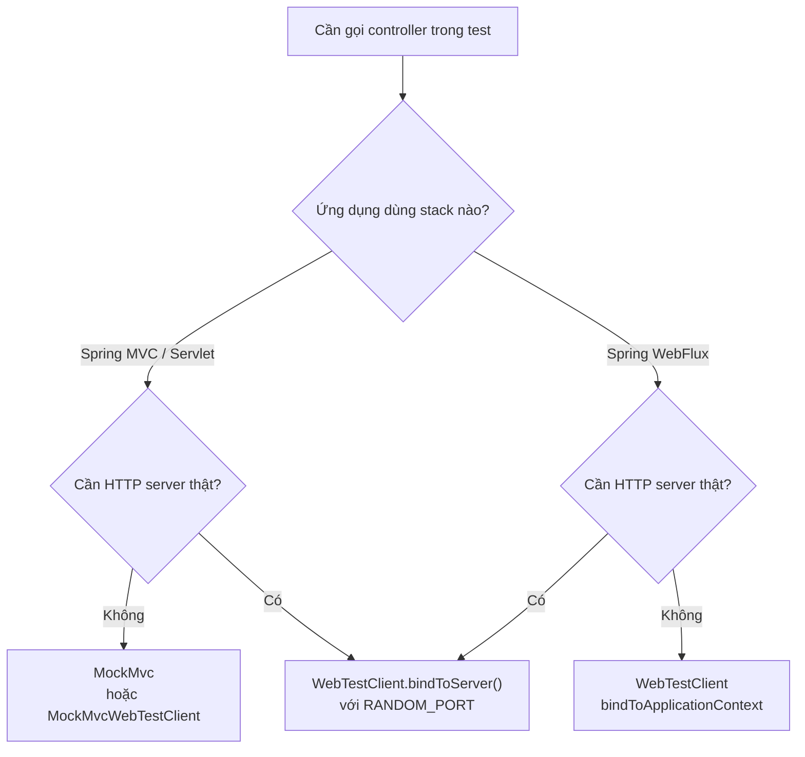
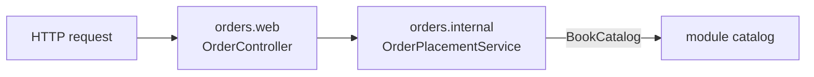

# Gọi controller qua MockMvc hoặc WebTestClient

## Mục tiêu học tập

Sau bài học, bạn có thể:

1. Chọn `MockMvc` hoặc `WebTestClient` theo **Spring MVC**, **Spring WebFlux** và kiểu môi trường kiểm thử đang dùng.
2. Thực hiện HTTP request tới controller trong một `@ApplicationModuleTest` mà không phải khởi động toàn bộ hệ thống.
3. Viết assertion cho status code, header, JSON body, validation, lỗi nghiệp vụ và lời gọi qua API module khác.
4. Dùng `MockMvcWebTestClient` để kiểm thử Spring MVC bằng giao diện `WebTestClient` mà vẫn không mở HTTP server.
5. Phân biệt `WebTestClient.bindToApplicationContext(...)`, `MockMvcWebTestClient.bindTo(...)` và `WebTestClient.bindToServer()`.
6. Chẩn đoán sự cố bootstrap, security, reactive/Servlet stack, test bất đồng bộ và dữ liệu phụ thuộc.
7. Kết hợp kiểm thử HTTP với `ApplicationModules.verify()`, kiểm thử sự kiện, cơ sở dữ liệu và quality gate CI để ngăn phụ thuộc sai và hồi quy.

Bài này thuộc chương **Web module testing** của lộ trình **SPRING_MODULITH_VERIFICATION_TESTING**. Trọng tâm là **gọi controller qua một HTTP test client** và đọc đúng ý nghĩa từng assertion: request có thực sự đi qua các thành phần Spring Web mong đợi hay không, module bên ngoài có được cô lập đúng không, và kết quả HTTP chứng minh điều gì. Kiểm thử kiến trúc tĩnh, kiểm thử module và kiểm thử tích hợp runtime hỗ trợ nhau nhưng không thay thế nhau.

> **Phiên bản ví dụ:** Các import Java dưới đây ưu tiên **Spring Boot 3.4–3.5, Spring Framework 6.2, Spring Modulith 1.3–1.4, Java 17+ và JUnit 5**. Spring Boot 4 có thay đổi về starter và package annotation kiểm thử: hãy kiểm tra Javadoc đúng phiên bản khi áp dụng. Với Spring Boot 3.4+, `@MockitoBean` nằm trong `org.springframework.test.context.bean.override.mockito`.

## 1. Chọn công cụ trước khi viết test

`MockMvc` và `WebTestClient` đều có thể gửi yêu cầu theo cách giống HTTP và kiểm tra response. Nhưng cơ chế thực thi bên dưới có sự khác biệt quan trọng.

| Tiêu chí | `MockMvc` | `WebTestClient` |
| --- | --- | --- |
| Môi trường tự nhiên | Spring **MVC** dựa trên Servlet | Spring **WebFlux**, HTTP live server, hoặc adapter MVC |
| Kiểu API | `perform(...).andExpect(...)` | `get()/post()...exchange().expectStatus()...` |
| Chạy không mở cổng mạng | Có | Có, khi bind tới controller/context mock |
| Chạy qua server HTTP thật | Không trực tiếp; dùng HTTP client riêng | Có với `bindToServer()` |
| Kiểm tra MVC `DispatcherServlet`, filter và validation | Có theo cấu hình `MockMvc` | Có khi dùng **`MockMvcWebTestClient`** |
| Kiểm tra reactive WebFlux handler | Không phải lựa chọn tự nhiên | Có với `WebTestClient.bindToApplicationContext(...)` |
| Streaming và reactive response | Có một số cơ chế MVC async; giới hạn khi không có server thật | API phù hợp hơn với reactive/streaming; dùng live server cho đặc tính mạng thật |

Ba lựa chọn thường dùng trong một ứng dụng Spring Modulith:



**Không dùng trực tiếp `WebTestClient.bindToApplicationContext(...)` để thay cho `MockMvc` của Spring MVC.** Phương thức đó thiết lập chuỗi xử lý WebFlux. Nếu ứng dụng là Spring MVC, cần `MockMvcWebTestClient` hoặc khởi động server rồi dùng `WebTestClient.bindToServer()`.

**Ranh giới kiểm thử:** `@ApplicationModuleTest` quyết định **module nào được bootstrap**; `MockMvc` hoặc `WebTestClient` quyết định **cách gửi yêu cầu tới web adapter**. Hai lựa chọn này độc lập về mục đích.

## 2. Cấu trúc ví dụ Spring MVC: module orders

Ta bắt đầu từ ứng dụng `com.acme.bookstore`:

```text
src/main/java/com/acme/bookstore/
├── BookstoreApplication.java
├── catalog/
│   └── BookCatalog.java                 <- API module catalog
└── orders/
    ├── OrderPlacement.java             <- API module orders
    ├── internal/
    │   ├── OrderPlacementService.java  <- service thật thuộc orders
    │   └── BookUnavailableException.java
    └── web/
        ├── OrderController.java        <- controller được test
        └── OrderErrorHandler.java      <- ánh xạ lỗi HTTP

src/test/java/com/acme/bookstore/orders/
└── OrdersMvcHttpTests.java
```

Trong cấu trúc mặc định, `catalog` và `orders` là hai application module ngang hàng. `orders.web` và `orders.internal` là package con thuộc **cùng module orders**, không tự động là những module riêng.



Đặt lớp Spring Boot ở package root:

```java
// src/main/java/com/acme/bookstore/BookstoreApplication.java
package com.acme.bookstore;

import org.springframework.boot.SpringApplication;
import org.springframework.boot.autoconfigure.SpringBootApplication;

@SpringBootApplication
public class BookstoreApplication {

    public static void main(String[] args) {
        SpringApplication.run(BookstoreApplication.class, args);
    }
}
```

Khai báo API của module `catalog`:

```java
// src/main/java/com/acme/bookstore/catalog/BookCatalog.java
package com.acme.bookstore.catalog;

public interface BookCatalog {
    boolean available(String isbn);
}
```

Khai báo API của `orders`:

```java
// src/main/java/com/acme/bookstore/orders/OrderPlacement.java
package com.acme.bookstore.orders;

public interface OrderPlacement {
    String place(String isbn);
}
```

Triển khai nghiệp vụ trong module `orders`:

```java
// src/main/java/com/acme/bookstore/orders/internal/BookUnavailableException.java
package com.acme.bookstore.orders.internal;

public class BookUnavailableException extends RuntimeException {

    public BookUnavailableException(String isbn) {
        super("Book is unavailable: " + isbn);
    }
}
```

```java
// src/main/java/com/acme/bookstore/orders/internal/OrderPlacementService.java
package com.acme.bookstore.orders.internal;

import com.acme.bookstore.catalog.BookCatalog;
import com.acme.bookstore.orders.OrderPlacement;
import org.springframework.stereotype.Service;

@Service
class OrderPlacementService implements OrderPlacement {

    private final BookCatalog catalog;

    OrderPlacementService(BookCatalog catalog) {
        this.catalog = catalog;
    }

    @Override
    public String place(String isbn) {
        if (!catalog.available(isbn)) {
            throw new BookUnavailableException(isbn);
        }

        // ID cố định nhằm minh họa HTTP test, không dùng cho production.
        return "order-" + isbn;
    }
}
```

Vì `OrderPlacementService` tham chiếu `BookCatalog`, mô hình tĩnh có dependency **`orders → catalog`**. Trong test module `orders` ở chế độ `STANDALONE`, implementation thật của `catalog` không được bootstrap. Ta sẽ thay cổng `BookCatalog` bằng mock.

## 3. Controller HTTP và hợp đồng request/response

```java
// src/main/java/com/acme/bookstore/orders/web/OrderController.java
package com.acme.bookstore.orders.web;

import com.acme.bookstore.orders.OrderPlacement;
import jakarta.validation.Valid;
import jakarta.validation.constraints.NotBlank;
import org.springframework.http.HttpStatus;
import org.springframework.http.ResponseEntity;
import org.springframework.web.bind.annotation.PostMapping;
import org.springframework.web.bind.annotation.RequestBody;
import org.springframework.web.bind.annotation.RequestMapping;
import org.springframework.web.bind.annotation.RestController;

@RestController
@RequestMapping("/orders")
public class OrderController {

    private final OrderPlacement orders;

    public OrderController(OrderPlacement orders) {
        this.orders = orders;
    }

    @PostMapping
    public ResponseEntity<CreatedOrder> create(
            @Valid @RequestBody CreateOrder request) {

        String id = orders.place(request.isbn());
        return ResponseEntity.status(HttpStatus.CREATED)
                .body(new CreatedOrder(id));
    }

    public record CreateOrder(@NotBlank String isbn) {}
    public record CreatedOrder(String id) {}
}
```

Các lớp record là DTO cho web adapter; `@NotBlank` và `@Valid` mô tả điều kiện đầu vào. Muốn HTTP 400 cho `isbn` trống, dự án phải có Bean Validation provider (với Boot 3 thường là `spring-boot-starter-validation`).

Ánh xạ một lỗi nghiệp vụ có chủ đích:

```java
// src/main/java/com/acme/bookstore/orders/web/OrderErrorHandler.java
package com.acme.bookstore.orders.web;

import com.acme.bookstore.orders.internal.BookUnavailableException;
import java.util.Map;
import org.springframework.http.HttpStatus;
import org.springframework.http.ResponseEntity;
import org.springframework.web.bind.annotation.ExceptionHandler;
import org.springframework.web.bind.annotation.RestControllerAdvice;

@RestControllerAdvice
public class OrderErrorHandler {

    @ExceptionHandler(BookUnavailableException.class)
    public ResponseEntity<Map<String, String>> unavailable(
            BookUnavailableException error) {

        return ResponseEntity.status(HttpStatus.CONFLICT)
                .body(Map.of("code", "BOOK_UNAVAILABLE"));
    }
}
```

**Hợp đồng HTTP dự kiến:**

| Request | Điều kiện | Response |
| --- | --- | --- |
| `POST /orders`, JSON `{"isbn":"isbn-7"}` | Catalog trả `true` | 201, JSON `{"id":"order-isbn-7"}` |
| `POST /orders`, JSON `{"isbn":""}` | Không vượt qua validation | 400 |
| `POST /orders`, JSON `{"isbn":"missing"}` | Catalog trả `false` | 409, JSON có `code=BOOK_UNAVAILABLE` |
| `POST /orders`, `text/plain` | Controller chỉ nhận dữ liệu gắn vào `@RequestBody CreateOrder` | Thường 415 nếu không có converter phù hợp |

Bài test không nên chỉ khẳng định status thành công; nó cần bảo vệ cả **dữ liệu trả về** và **đường đi thực sự qua service bên trong module**.

## 4. Cấu hình để gọi controller bằng MockMvc

Thêm dependency của Spring MVC, validation và test starter tương ứng với Spring Boot/Spring Modulith. Ví dụ Gradle Groovy DSL với BOM Spring Modulith đã được cấu hình ở dự án:

```groovy
dependencies {
    implementation 'org.springframework.boot:spring-boot-starter-web'
    implementation 'org.springframework.boot:spring-boot-starter-validation'
    implementation 'org.springframework.modulith:spring-modulith-starter-core'

    testImplementation 'org.springframework.boot:spring-boot-starter-test'
    testImplementation 'org.springframework.modulith:spring-modulith-starter-test'
}
```

Đặt test **bên dưới package module `orders`**:

```java
// src/test/java/com/acme/bookstore/orders/OrdersMvcHttpTests.java
package com.acme.bookstore.orders;

import com.acme.bookstore.catalog.BookCatalog;
import org.junit.jupiter.api.Test;
import org.springframework.beans.factory.annotation.Autowired;
import org.springframework.boot.test.autoconfigure.web.servlet.AutoConfigureMockMvc;
import org.springframework.modulith.test.ApplicationModuleTest;
import org.springframework.test.context.bean.override.mockito.MockitoBean;
import org.springframework.test.web.servlet.MockMvc;

@ApplicationModuleTest
@AutoConfigureMockMvc
class OrdersMvcHttpTests {

    @Autowired
    MockMvc mvc;

    @MockitoBean
    BookCatalog catalog;

    // Các phương thức @Test đặt ở đây.
}
```

Giải thích cấu hình:

- `@ApplicationModuleTest`: bootstrap module chứa test (`orders`), mặc định dùng `STANDALONE` và `webEnvironment = MOCK`.
- `@AutoConfigureMockMvc`: cung cấp `MockMvc` dựa trên Spring MVC `WebApplicationContext`. Chỉ `webEnvironment = MOCK` **không bảo đảm tự có bean MockMvc**.
- `@MockitoBean BookCatalog`: cung cấp dependency mock cho service `OrderPlacementService` khi module `catalog` không chạy thật.
- `@Autowired MockMvc`: điểm gửi HTTP request giả lập qua MVC stack, không qua cổng TCP.

Vì `@ApplicationModuleTest` xây dựng trên `@SpringBootTest`, **không gắn thêm `@SpringBootTest`** lên cùng lớp như một cấu hình thứ hai. Nếu cần chỉ rõ web environment, có thể khai báo `@ApplicationModuleTest(webEnvironment = SpringBootTest.WebEnvironment.MOCK)` nhưng đó vốn là mặc định.

## 5. Gọi POST bằng MockMvc và kiểm tra phản hồi

Trong `OrdersMvcHttpTests`, thêm các import tĩnh:

```java
import static org.mockito.BDDMockito.given;
import static org.mockito.BDDMockito.then;
import static org.springframework.test.web.servlet.request.MockMvcRequestBuilders.post;
import static org.springframework.test.web.servlet.result.MockMvcResultMatchers.content;
import static org.springframework.test.web.servlet.result.MockMvcResultMatchers.jsonPath;
import static org.springframework.test.web.servlet.result.MockMvcResultMatchers.status;
```

Sau đó thêm test:

```java
@Test
void placesOrderThroughMvc() throws Exception {
    given(catalog.available("isbn-7")).willReturn(true);

    mvc.perform(post("/orders")
            .contentType("application/json")
            .accept("application/json")
            .content("""
                    {"isbn":"isbn-7"}
                    """))
            .andExpect(status().isCreated())
            .andExpect(content().contentTypeCompatibleWith(
                    "application/json"))
            .andExpect(jsonPath("$.id").value("order-isbn-7"));

    then(catalog).should().available("isbn-7");
}
```

Test này xác minh **nhiều tầng cùng lúc**:

1. MVC routing tìm được `POST /orders`.
2. JSON request body được deserialize thành `CreateOrder`.
3. Controller gọi `OrderPlacement` thật trong module `orders`.
4. Service đi qua `BookCatalog` mock tại ranh giới module.
5. HTTP response có status 201 và JSON đúng hợp đồng.

Ở ví dụ, dùng chuỗi `"application/json"` cho ngắn; có thể dùng `MediaType.APPLICATION_JSON` để tránh lặp literal. `contentTypeCompatibleWith` cho phép content type tương thích với JSON thay vì buộc mọi tham số `charset` phải giống hệt.

### Kiểm tra cả header

Nếu controller cam kết trả header nhất định (ví dụ `Location`), hãy triển khai ở controller rồi kiểm tra:

```java
import static org.springframework.test.web.servlet.result.MockMvcResultMatchers.header;

// Chỉ áp dụng khi controller thật sự đặt header Location.
// .andExpect(header().string("Location", "/orders/order-isbn-7"));
```

Không viết assertion đòi `Location` nếu controller chưa tạo header đó. HTTP 201 không bắt buộc đồng nghĩa response có URL tài nguyên cụ thể.

### Khi cần xem kết quả để chẩn đoán

```java
import static org.springframework.test.web.servlet.result.MockMvcResultHandlers.print;

mvc.perform(post("/orders")
        .contentType("application/json")
        .content("""
                {"isbn":"isbn-7"}
                """))
        .andDo(print());
```

Đây là cách in request/response của `MockMvc` khi điều tra. Không nên phụ thuộc nội dung log để viết assertion; dùng matcher để kiểm tra có cấu trúc.

## 6. Gọi những ca lỗi quan trọng bằng MockMvc

Hai ca lỗi phổ biến là input không hợp lệ và nghiệp vụ từ chối thao tác. Đặt các test sau trong cùng `OrdersMvcHttpTests`.

### Validation: HTTP 400

```java
@Test
void rejectsBlankIsbn() throws Exception {
    mvc.perform(post("/orders")
            .contentType("application/json")
            .content("""
                    {"isbn":""}
                    """))
            .andExpect(status().isBadRequest());

    then(catalog).shouldHaveNoInteractions();
}
```

`@Valid` và `@NotBlank` khiến request bị từ chối **trước khi service được gọi**. Assertion Mockito giúp chứng minh test thực sự kiểm tra biên đầu vào thay vì cho phép một đường gọi nghiệp vụ không cần thiết. Nếu không có Bean Validation provider, kết quả 400 có thể không đúng như mong đợi.

### Lỗi nghiệp vụ: HTTP 409

```java
@Test
void convertsBusinessErrorToConflict() throws Exception {
    given(catalog.available("missing")).willReturn(false);

    mvc.perform(post("/orders")
            .contentType("application/json")
            .content("""
                    {"isbn":"missing"}
                    """))
            .andExpect(status().isConflict())
            .andExpect(jsonPath("$.code").value("BOOK_UNAVAILABLE"));

    then(catalog).should().available("missing");
}
```

Sự khác biệt:

| Test | Điều cần bảo vệ | Loại lỗi |
| --- | --- | --- |
| ISBN rỗng | Tính hợp lệ của dữ liệu ở web boundary | 400, không gọi service |
| Sách không có | Chính sách nghiệp vụ và ánh xạ exception | 409, có gọi service |
| Controller không được tìm thấy | Package scan/mapping sai | 404 |
| Chưa xác thực hoặc không đủ quyền | Security filter chain | 401 hoặc 403 |
| Trục trặc không được xử lý | Lỗi trong handler/service/configuration | 5xx hoặc exception test |

Đừng chỉ đổi `status().isCreated()` thành `isConflict()` mà không thay mock setup. Đường thực thi phải tạo ra **điều kiện nghiệp vụ cụ thể** mà assertion mô tả.

### Khác biệt giữa lỗi JSON và lỗi nghiệp vụ

Ví dụ JSON sai cú pháp có thể bị MVC từ chối trước khi gọi controller, trong khi JSON hợp lệ nhưng không đạt validation đi qua bước binding rồi không gọi service. Khi cần chẩn đoán nguyên nhân HTTP 400, có thể xem loại exception:

```java
import static org.springframework.test.web.servlet.result.MockMvcResultMatchers.*;

mvc.perform(post("/orders")
        .contentType("application/json")
        .content("{broken-json"))
        .andExpect(status().isBadRequest());
```

Nếu ứng dụng có `@RestControllerAdvice` xử lý lỗi binding/validation theo contract riêng, hãy kiểm tra **error body của chính ứng dụng** thay vì mặc định rằng mọi ứng dụng trả cùng một JSON lỗi.

## 7. WebTestClient cho Spring MVC: `MockMvcWebTestClient`

Một số nhóm muốn dùng cú pháp `WebTestClient` thống nhất để mô tả HTTP contract, nhưng ứng dụng thực tế vẫn là **Spring MVC/Servlet**. Spring Framework hỗ trợ bridge `MockMvcWebTestClient`.

Trong bài test MVC đã có `@Autowired MockMvc mvc`, có thể tạo client:

```java
import org.springframework.test.web.reactive.server.WebTestClient;
import org.springframework.test.web.servlet.client.MockMvcWebTestClient;

WebTestClient client = MockMvcWebTestClient.bindTo(mvc).build();
```

Ví dụ phương thức test **bổ sung trong `OrdersMvcHttpTests`**:

```java
@Test
void placesOrderWithWebTestClientFacade() {
    given(catalog.available("isbn-7")).willReturn(true);

    WebTestClient client =
            MockMvcWebTestClient.bindTo(mvc).build();

    client.post()
            .uri("/orders")
            .contentType(org.springframework.http.MediaType.APPLICATION_JSON)
            .bodyValue(java.util.Map.of("isbn", "isbn-7"))
            .exchange()
            .expectStatus().isCreated()
            .expectHeader().contentTypeCompatibleWith(
                    org.springframework.http.MediaType.APPLICATION_JSON)
            .expectBody()
            .jsonPath("$.id").isEqualTo("order-isbn-7");
}
```

**Điều quan trọng:** Client ở đây **không chuyển ứng dụng sang Spring WebFlux** và không mở một HTTP server. Nó chuyển yêu cầu từ API `WebTestClient` thành lời gọi qua `MockMvc`, nên vẫn kiểm tra Spring MVC controller, message converter, advice và các filter đã cấu hình trên `mvc`.

Để sử dụng bridge này, test classpath phải có `WebTestClient` và các lớp client WebFlux cần thiết. Với Boot 3.4–3.5 dự án Spring MVC, một cách bổ sung là:

```groovy
dependencies {
    testImplementation 'org.springframework:spring-webflux'
}
```

`spring-webflux` ở **test scope** cung cấp API client cần thiết; nó không yêu cầu đổi ứng dụng production sang reactive. Khi có cả MVC và WebFlux trên classpath, Spring Boot thường ưu tiên kiểu ứng dụng Servlet nếu không cấu hình khác.

### Cách bind khác: từ WebApplicationContext

```java
import org.springframework.test.web.servlet.client.MockMvcWebTestClient;
import org.springframework.web.context.WebApplicationContext;

WebTestClient client =
        MockMvcWebTestClient.bindToApplicationContext(webContext).build();
```

`webContext` là một `WebApplicationContext` có controller và Spring MVC infrastructure. **Lưu ý security/filters:** Nếu ứng dụng đang dùng Spring Security hoặc MockMvc có custom filter, bind trực tiếp vào `MockMvc` đã được `@AutoConfigureMockMvc` cấu hình thường rõ ràng hơn. Không giả định cấu hình filter của hai cách bind giống hệt nhau mà không kiểm tra.

### Có nên chuyển toàn bộ test MVC sang WebTestClient?

Không bắt buộc. `MockMvc` thường thuận tiện hơn khi cần kiểm tra chi tiết Servlet như `HandlerMethod`, `ModelAndView`, async dispatch, request attributes hoặc filter cụ thể. `WebTestClient` thuận tiện khi nhóm muốn dùng một cách viết HTTP assertion thống nhất giữa mock MVC, WebFlux và live server.

## 8. Ví dụ khác: kiểm thử module Spring WebFlux

**Đây là một biến thể ứng dụng độc lập, không thêm các controller sau vào project Spring MVC ở mục 2–7.** Một dự án WebFlux nên dùng stack reactive nhất quán; chỉ thêm `spring-boot-starter-webflux` vào project đang dùng MVC không tự biến controller MVC thành reactive controller.

Giả sử module `offers` trong ứng dụng `com.acme.bookstore` có API truy vấn ưu đãi:

```text
src/main/java/com/acme/bookstore/
├── BookstoreApplication.java
└── offers/
    ├── OfferView.java
    ├── OfferQuery.java
    ├── internal/OfferQueryService.java
    └── web/OfferController.java

src/test/java/com/acme/bookstore/offers/
└── OffersReactiveHttpTests.java
```

Khác biệt ở đây là **controller và service dùng Reactor `Mono`/`Flux`**, còn test gửi request bằng WebTestClient trong WebFlux mock environment.

Phụ thuộc chính cho biến thể WebFlux:

```groovy
dependencies {
    implementation 'org.springframework.boot:spring-boot-starter-webflux'
    implementation 'org.springframework.modulith:spring-modulith-starter-core'

    testImplementation 'org.springframework.boot:spring-boot-starter-test'
    testImplementation 'org.springframework.modulith:spring-modulith-starter-test'
}
```

Kiểu dữ liệu và hợp đồng truy vấn của module:

```java
// src/main/java/com/acme/bookstore/offers/OfferView.java
package com.acme.bookstore.offers;

public record OfferView(String id, String title) {}
```

```java
// src/main/java/com/acme/bookstore/offers/OfferQuery.java
package com.acme.bookstore.offers;

import reactor.core.publisher.Flux;
import reactor.core.publisher.Mono;

public interface OfferQuery {
    Mono<OfferView> findById(String id);
    Flux<OfferView> findAll();
}
```

Để bài test độc lập với database, triển khai một danh sách có sẵn:

```java
// src/main/java/com/acme/bookstore/offers/internal/OfferQueryService.java
package com.acme.bookstore.offers.internal;

import com.acme.bookstore.offers.OfferQuery;
import com.acme.bookstore.offers.OfferView;
import java.util.List;
import org.springframework.stereotype.Service;
import reactor.core.publisher.Flux;
import reactor.core.publisher.Mono;

@Service
class OfferQueryService implements OfferQuery {

    private final List<OfferView> offers = List.of(
            new OfferView("promo-a", "New customer"),
            new OfferView("promo-b", "Weekend sale")
    );

    @Override
    public Mono<OfferView> findById(String id) {
        return Flux.fromIterable(offers)
                .filter(offer -> offer.id().equals(id))
                .next();
    }

    @Override
    public Flux<OfferView> findAll() {
        return Flux.fromIterable(offers);
    }
}
```

Controller WebFlux:

```java
// src/main/java/com/acme/bookstore/offers/web/OfferController.java
package com.acme.bookstore.offers.web;

import com.acme.bookstore.offers.OfferQuery;
import com.acme.bookstore.offers.OfferView;
import org.springframework.http.ResponseEntity;
import org.springframework.web.bind.annotation.GetMapping;
import org.springframework.web.bind.annotation.PathVariable;
import org.springframework.web.bind.annotation.RequestMapping;
import org.springframework.web.bind.annotation.RestController;
import reactor.core.publisher.Flux;
import reactor.core.publisher.Mono;

@RestController
@RequestMapping("/offers")
public class OfferController {

    private final OfferQuery offers;

    public OfferController(OfferQuery offers) {
        this.offers = offers;
    }

    @GetMapping("/{id}")
    public Mono<ResponseEntity<OfferView>> byId(
            @PathVariable String id) {

        return offers.findById(id)
                .map(ResponseEntity::ok)
                .defaultIfEmpty(ResponseEntity.notFound().build());
    }

    @GetMapping
    public Flux<OfferView> all() {
        return offers.findAll();
    }
}
```

Ở endpoint `GET /offers/{id}`, `Mono.empty()` được ánh xạ thành HTTP 404; có dữ liệu thì trả HTTP 200 và JSON. Endpoint `GET /offers` trả về danh sách từ `Flux`; trong ví dụ hữu hạn này, client có thể thu toàn bộ body thành list.

## 9. Gọi WebFlux controller bằng WebTestClient

Spring Boot 3.4–3.5 hỗ trợ tự cấu hình `WebTestClient` trong môi trường WebFlux mock qua `@AutoConfigureWebTestClient`.

```java
// src/test/java/com/acme/bookstore/offers/OffersReactiveHttpTests.java
package com.acme.bookstore.offers;

import org.junit.jupiter.api.Test;
import org.springframework.beans.factory.annotation.Autowired;
import org.springframework.boot.test.autoconfigure.web.reactive.AutoConfigureWebTestClient;
import org.springframework.modulith.test.ApplicationModuleTest;
import org.springframework.test.web.reactive.server.WebTestClient;

@ApplicationModuleTest
@AutoConfigureWebTestClient
class OffersReactiveHttpTests {

    @Autowired
    WebTestClient client;

    @Test
    void readsExistingOffer() {
        client.get()
                .uri("/offers/promo-a")
                .exchange()
                .expectStatus().isOk()
                .expectBody()
                .jsonPath("$.id").isEqualTo("promo-a")
                .jsonPath("$.title").isEqualTo("New customer");
    }

    @Test
    void returns404WhenOfferIsMissing() {
        client.get()
                .uri("/offers/unknown")
                .exchange()
                .expectStatus().isNotFound();
    }

    @Test
    void readsOfferCollection() {
        client.get()
                .uri("/offers")
                .exchange()
                .expectStatus().isOk()
                .expectBodyList(OfferView.class)
                .hasSize(2);
    }
}
```

Ở đây test vẫn chỉ bootstrap module `offers` theo `@ApplicationModuleTest`; `WebTestClient` được bind vào WebFlux context ở chế độ mock, **không mở HTTP port**. Test đi qua WebFlux handler, decoder/encoder và service thuộc module đã khởi tạo.

**Lưu ý cho Spring Boot 3.4:** `@AutoConfigureWebTestClient` trong môi trường **mock** chỉ hỗ trợ WebFlux, không tự bind `WebTestClient` vào Spring MVC. Nếu thử `@AutoConfigureWebTestClient` trong một Servlet MVC `@ApplicationModuleTest(webEnvironment = MOCK)` rồi inject `WebTestClient`, bạn có thể gặp lỗi thiếu bean. Với MVC, dùng `@AutoConfigureMockMvc` và nếu muốn dùng giao diện client fluently thì chuyển qua `MockMvcWebTestClient.bindTo(mvc)`.

### Bind thủ công vào WebFlux ApplicationContext

Khi cần tự tạo client, có thể dùng:

```java
import org.springframework.context.ApplicationContext;
import org.springframework.test.web.reactive.server.WebTestClient;

WebTestClient client =
        WebTestClient.bindToApplicationContext(applicationContext)
                .build();
```

`applicationContext` phải là **WebFlux application context có WebFlux handler configuration thích hợp**. Cách này vẫn không chạy server mạng. Khi muốn dùng auto-config và các customizer của Spring Boot, ưu tiên `@AutoConfigureWebTestClient`.

### Trường hợp có luồng dữ liệu không kết thúc

`expectBodyList(...)` phù hợp với `Flux` hữu hạn. Với **server-sent events** hoặc response streaming vô hạn, không thể kỳ vọng client thu hết body rồi trả về. Khi đó kiểm thử số phần tử/điều kiện kết thúc phù hợp qua `returnResult(...)` và `StepVerifier`, hoặc chạy một test với server thật nếu cần xác minh cách truyền dữ liệu qua network.

```java
// Minh họa hướng kiểm thử một response stream hữu hạn:
var result = client.get()
        .uri("/offers")
        .exchange()
        .expectStatus().isOk()
        .returnResult(OfferView.class);

reactor.test.StepVerifier.create(result.getResponseBody())
        .expectNextCount(2)
        .verifyComplete();
```

Đoạn minh họa trên có thể dùng làm **phương thức test riêng** trong `OffersReactiveHttpTests` sau khi thêm `reactor-test` vào test classpath. Nó áp dụng cho endpoint `/offers` hữu hạn của ví dụ, không phải công thức để kiểm thử mọi stream vô hạn. Với SSE, cần xử lý media type `text/event-stream` và giới hạn chờ/phần tử để tránh test treo.

## 10. Dùng WebTestClient gọi một HTTP server thật

Muốn kiểm tra lớp mạng, Servlet/Netty container hoặc behavior khác biệt giữa môi trường mock và server, có thể dùng `RANDOM_PORT`.

Ví dụ **trong biến thể Spring MVC ở mục 2–7**, đặt một test độc lập dưới `com.acme.bookstore.orders`:

```java
package com.acme.bookstore.orders;

import static org.mockito.BDDMockito.given;

import com.acme.bookstore.catalog.BookCatalog;
import org.junit.jupiter.api.BeforeEach;
import org.junit.jupiter.api.Test;
import org.springframework.boot.test.context.SpringBootTest;
import org.springframework.boot.test.web.server.LocalServerPort;
import org.springframework.modulith.test.ApplicationModuleTest;
import org.springframework.test.context.bean.override.mockito.MockitoBean;
import org.springframework.test.web.reactive.server.WebTestClient;

@ApplicationModuleTest(
        webEnvironment = SpringBootTest.WebEnvironment.RANDOM_PORT
)
class OrdersLiveHttpTests {

    @LocalServerPort
    int port;

    @MockitoBean
    BookCatalog catalog;

    WebTestClient client;

    @BeforeEach
    void setUp() {
        client = WebTestClient.bindToServer()
                .baseUrl("http://localhost:" + port)
                .build();
    }

    @Test
    void placesOrderOverRealHttp() {
        given(catalog.available("isbn-7")).willReturn(true);

        client.post()
                .uri("/orders")
                .contentType(
                        org.springframework.http.MediaType.APPLICATION_JSON)
                .bodyValue(java.util.Map.of("isbn", "isbn-7"))
                .exchange()
                .expectStatus().isCreated()
                .expectBody()
                .jsonPath("$.id").isEqualTo("order-isbn-7");
    }
}
```

Đây là test dùng **server thật ở cổng ngẫu nhiên**, nhưng `@ApplicationModuleTest` vẫn kiểm soát **phạm vi module**. Nó không tự bootstrap mọi module trong ứng dụng, không cung cấp database và không biến test thành end-to-end của mọi hệ thống ngoài.

Thư viện `WebTestClient`/WebClient vẫn phải có trong test classpath. Trong dự án MVC ở Spring Boot 3, bạn có thể thêm `testImplementation 'org.springframework:spring-webflux'`; việc này không yêu cầu đưa WebFlux vào runtime production.

### So sánh ba cách dùng client

| Test | Server HTTP thật? | Framework xử lý request | Phạm vi module |
| --- | --- | --- | --- |
| `MockMvc` + `@ApplicationModuleTest` | Không | Spring MVC qua Servlet mocks | Theo `@ApplicationModuleTest` |
| `MockMvcWebTestClient.bindTo(mvc)` | Không | Cùng Spring MVC qua `MockMvc` | Theo `MockMvc` đã tạo từ module context |
| WebFlux `WebTestClient` bind to context | Không | Spring WebFlux handler chain | Theo `@ApplicationModuleTest` |
| `WebTestClient.bindToServer()` + `RANDOM_PORT` | Có | Server/container thật của ứng dụng test | Theo `@ApplicationModuleTest` |

**Khi nào cần live server?** Khi cần kiểm tra cấu hình container, filter hoạt động ở mức mạng, cookie/redirect/encoding qua HTTP thật, hoặc một số đặc tính streaming. Với phần lớn kiểm thử mapping/JSON/validation của một module MVC, `MockMvc` sẽ ngắn và ít tốn tài nguyên hơn.

## 11. Test security và xử lý bất đồng bộ

### Bảo vệ request có xác thực

Khi Spring Security có mặt trong ứng dụng, MockMvc có thể chạy qua Security filter chain đã được cấu hình. Nếu endpoint yêu cầu xác thực và CSRF, test `POST` cần chuẩn bị thông tin tương ứng:

```java
import static org.springframework.security.test.web.servlet.request
        .SecurityMockMvcRequestPostProcessors.csrf;
import static org.springframework.security.test.web.servlet.request
        .SecurityMockMvcRequestPostProcessors.user;

mvc.perform(post("/orders")
        .with(user("customer").roles("CUSTOMER"))
        .with(csrf())
        .contentType("application/json")
        .content("""
                {"isbn":"isbn-7"}
                """))
        .andExpect(status().isCreated());
```

Ví dụ này giả định endpoint cho phép role `CUSTOMER`, application context có security filter tương ứng và mock `catalog.available("isbn-7")` đã được cấu hình trả true. Cần `spring-security-test` trong test classpath. **Không xóa mọi filter hoặc cấu hình `addFilters = false` chỉ để test từ 403 chuyển thành 201**, trừ khi mục tiêu rõ ràng là test controller không có security và đã có bài security test riêng.

Với WebFlux, security tích hợp theo `SecurityWebFilterChain`, cách mô phỏng người dùng/CSRF khác Servlet `MockMvc`; xem `SecurityMockServerConfigurers` trong Spring Security Test. Đừng áp các `MockMvcRequestPostProcessors` của Servlet vào WebFlux client.

### Spring MVC controller trả kết quả bất đồng bộ

Nếu controller trả `Callable` hoặc `DeferredResult`, MockMvc có thể cần **async dispatch**:

```java
// Ví dụ một endpoint riêng trong Spring MVC controller:
@GetMapping("/health-async")
public java.util.concurrent.Callable<String> healthAsync() {
    return () -> "ready";
}
```

Test (trong lớp có `MockMvc mvc`):

```java
import static org.springframework.test.web.servlet.request
        .MockMvcRequestBuilders.asyncDispatch;
import static org.springframework.test.web.servlet.request
        .MockMvcRequestBuilders.get;
import static org.springframework.test.web.servlet.result
        .MockMvcResultMatchers.request;

var result = mvc.perform(get("/orders/health-async"))
        .andExpect(request().asyncStarted())
        .andReturn();

mvc.perform(asyncDispatch(result))
        .andExpect(status().isOk())
        .andExpect(content().string("ready"));
```

Đoạn controller trên chỉ minh họa hành vi MVC async; **không cần thêm vào ứng dụng nếu bài thực hành không có endpoint bất đồng bộ**. Khi dùng `MockMvcWebTestClient`, Spring test framework xử lý phần async dispatch tương ứng phía adapter để kiểm tra phản hồi.

## 12. Chẩn đoán khi HTTP test không đạt

| Hiện tượng | Nguyên nhân thường gặp | Cách xử lý |
| --- | --- | --- |
| Không inject được `MockMvc` | Thiếu `@AutoConfigureMockMvc`, test không chạy Servlet mock context | Kiểm tra Spring MVC starter, annotation, `webEnvironment=MOCK` |
| Không inject được `WebTestClient` trong MVC MOCK | Boot 3.4 `@AutoConfigureWebTestClient` dành cho WebFlux mock | Dùng `MockMvcWebTestClient.bindTo(mvc)` hoặc client live-server |
| `WebTestClient.bindToApplicationContext` không xử lý MVC controller | Đã dùng WebFlux binding trên Servlet MVC context | Dùng `MockMvcWebTestClient.bindToApplicationContext` hoặc bind vào `MockMvc` |
| POST trả 404 | Sai route, controller không được bootstrap, test nằm sai package module | Kiểm tra request mapping, module owner và package lớp test |
| POST trả 400 dù JSON có vẻ đúng | Validation thất bại, JSON binding lỗi, field không khớp | Xem request/response và exception; kiểm tra DTO và converter |
| POST trả 415 | `Content-Type` không được hỗ trợ | Dùng `application/json`, kiểm tra message converters |
| POST trả 401/403 | Security hoặc CSRF | Thiết lập người dùng/test principal và CSRF phù hợp |
| POST trả 500 thay vì 409 | Advice không được quét hoặc exception khác dự kiến | Kiểm tra `@RestControllerAdvice`, stack trace, mapping |
| `NoSuchBeanDefinitionException` cho API catalog | Bootstrap `STANDALONE` không tạo module ngoài | Dùng `@MockitoBean` hoặc mở rộng mode có chủ đích |
| WebFlux test treo/chờ lâu | Body stream vô hạn, subscription không kết thúc, timeout quá thấp | Giới hạn stream hoặc dùng StepVerifier và timeout có chủ đích |
| `WebTestClient` thiếu class lúc runtime test | Chưa thêm WebFlux/client dependencies vào test classpath | Khai báo test dependencies tương ứng, không lẫn stack |
| Controller test xanh nhưng lỗi database | Test HTTP dùng mock và không thực thi persistence | Thêm `@ApplicationModuleTest` với persistence thật/Testcontainers và integration test |

### Quy trình gỡ lỗi nhanh

1. **Xác định web stack:** Spring MVC/Servlet hay WebFlux? Có vô tình đưa cả hai starter vào và làm Boot chọn stack khác không?
2. **Kiểm tra phạm vi module:** Test nằm dưới package nào? `@ApplicationModuleTest` đang bootstrap `STANDALONE`, `DIRECT_DEPENDENCIES` hay `ALL_DEPENDENCIES`?
3. **Kiểm tra HTTP client:** `MockMvc`, WebFlux `WebTestClient`, adapter `MockMvcWebTestClient` hay live server?
4. **Đọc lỗi theo tầng:** 404 là routing, 400 là binding/validation, 401/403 là security, 409 là nghiệp vụ, 5xx là hệ thống/exception chưa xử lý.
5. **Đối chiếu API ngoài module:** Mock có đúng kiểu không? Module dependency đã được quét chưa? Có tham chiếu vào `internal` trái ranh giới không?
6. **Chạy kiến trúc và runtime test riêng:** `verify()` kiểm tra dependency tĩnh; HTTP test kiểm tra adapter, integration test kiểm tra database/sự kiện.

Khi nghi ngờ bootstrap không đúng, bật log:

```properties
logging.level.org.springframework.modulith=DEBUG
```

Log này giúp hiểu những module nào được bao gồm trong lần chạy test. Không suy ra “context đúng” chỉ vì HTTP status thành công: cần nhìn module được bootstrap và kiểm tra đúng đường đi của lời gọi.

## 13. Kết hợp quality gate kiến trúc và kiểm thử runtime

Một endpoint có thể trả 201 nhưng module vẫn phụ thuộc trái phép vào chi tiết nội bộ của module khác. Vì vậy, giữ một bài kiểm chứng tĩnh độc lập:

```java
// src/test/java/com/acme/bookstore/ModuleArchitectureTests.java
package com.acme.bookstore;

import org.junit.jupiter.api.Test;
import org.springframework.modulith.core.ApplicationModules;

class ModuleArchitectureTests {

    @Test
    void moduleDependenciesAreValid() {
        ApplicationModules.of(BookstoreApplication.class).verify();
    }
}
```

Quality gate nên có nhiều lớp bổ sung:

| Bài kiểm thử | Điều chứng minh được | Điều chưa chứng minh |
| --- | --- | --- |
| `ApplicationModules.verify()` | Ranh giới và dependency tĩnh thỏa các quy tắc được kiểm chứng | JSON binding hoặc hành vi HTTP |
| `MockMvc` trong module test | Spring MVC routing, validation, status/JSON, service nội bộ | Server HTTP thật, database nếu đang mock |
| WebFlux `WebTestClient` trong module test | Reactive handler, codec và body publisher phù hợp | Hành vi mạng thật nếu bind mock |
| `WebTestClient.bindToServer()` | HTTP trao đổi qua server thật của phạm vi test | Các module/hệ thống ngoài không được bootstrap |
| Test sự kiện | Publisher và listener xử lý sự kiện đúng trong phạm vi kiểm thử | Không mặc nhiên thay thế end-to-end |
| Test database/integration | Repository, transaction và kết nối thực tế theo cấu hình test | Không tự bảo vệ mọi quy tắc module |

Với Maven/Gradle đã cấu hình JUnit 5:

```bash
./gradlew test
```

Hoặc:

```bash
./mvnw test
```

Nếu dự án tách test HTTP integration sang task/source set riêng, CI phải chạy **cả bài kiến trúc và nhóm tích hợp bắt buộc**, không chỉ chọn một. Đặc biệt, test dùng database thật, Testcontainers hoặc broker có thể cần môi trường CI tương thích.

Một HTTP response đúng không chứng minh `OrderPlaced` đã được phát và nhận, cũng không xác nhận transaction ghi đơn hàng đã commit. Những điều đó phải có assertion của module test sự kiện và database/integration test tương ứng.

## 14. Bài thực hành

**Bối cảnh:** Ứng dụng Bookstore có module `orders` với HTTP adapter và module `catalog` chứa API kiểm tra tồn kho. Nhóm muốn kiểm tra endpoint tạo đơn mà không bootstrap toàn bộ hệ thống, đồng thời học cách chọn client cho hai web stack.

**Phần A — Spring MVC và MockMvc:**

1. Tạo cấu trúc MVC ở mục 2–3, thêm `spring-boot-starter-web`, validation và test dependencies phù hợp.
2. Tạo `OrdersMvcHttpTests` trong package `com.acme.bookstore.orders`, gắn `@ApplicationModuleTest` và `@AutoConfigureMockMvc`.
3. Dùng `@MockitoBean BookCatalog`, gửi POST JSON với `MockMvc`, kiểm tra HTTP 201 và `$.id`.
4. Bổ sung HTTP 400 cho ISBN trống và HTTP 409 cho sách không sẵn có; xác minh ca 400 không gọi catalog.
5. Dùng `MockMvcWebTestClient.bindTo(mvc)` để kiểm tra cùng hợp đồng 201 với cú pháp `WebTestClient`. Giải thích vì sao lúc này ứng dụng vẫn là MVC.
6. Nếu có Security, bổ sung request đã xác thực và CSRF vào test theo chính sách thực của ứng dụng.

**Phần B — Spring WebFlux (làm trong một biến thể project riêng):**

7. Dùng WebFlux starter và tạo module `offers`, `OfferQuery`, `OfferQueryService`, `OfferController` theo mục 8.
8. Gắn `@ApplicationModuleTest` và `@AutoConfigureWebTestClient`; gọi `GET /offers/promo-a`, `GET /offers/unknown` và `GET /offers`.
9. Kiểm tra HTTP 200/404, JSONPath và số phần tử qua `expectBodyList`. Thử `returnResult` với `StepVerifier` nếu đã thêm reactor-test.

**Phần C — phạm vi và quality gate:**

10. Chạy `ApplicationModules.of(BookstoreApplication.class).verify()`; cố ý thêm một tham chiếu từ `orders` vào `catalog.internal` trong nhánh thử nghiệm, quan sát vi phạm rồi khôi phục.
11. So sánh kết quả/tài nguyên của `MockMvc` trong `STANDALONE` với `WebTestClient.bindToServer()` ở `RANDOM_PORT`.
12. Bổ sung test sự kiện/database riêng nếu bài toán sản xuất dùng repository và phát sự kiện.

**Tiêu chí hoàn thành:** Bạn gửi được HTTP request qua công cụ phù hợp, kiểm tra cả status và body, phân biệt MVC bridge với WebFlux, giải thích được mock context so với live server, biết dùng mock ở ranh giới module và đặt được các bài test vào CI.

## 15. Câu hỏi tự kiểm tra

1. `MockMvc` dùng cơ chế nào để gọi Spring MVC controller mà không mở cổng TCP?
2. Với Spring MVC `@ApplicationModuleTest(webEnvironment = MOCK)`, vì sao thường cần thêm `@AutoConfigureMockMvc`?
3. Tại sao trong Spring Boot 3.4 không nên giả định `@AutoConfigureWebTestClient` tự tạo client cho MVC mock context?
4. Khác biệt giữa `MockMvcWebTestClient.bindTo(mvc)` và `WebTestClient.bindToApplicationContext(context)` là gì?
5. `WebTestClient.bindToServer()` với `RANDOM_PORT` kiểm tra điều gì mà mock client không trực tiếp kiểm tra?
6. Vì sao test POST trả 400 nên khẳng định mock `BookCatalog` không được gọi?
7. Nếu POST trả 403 trong ứng dụng có Spring Security, bạn kiểm tra những điều gì trước khi thay đổi controller?
8. Khi nào `expectBodyList(OfferView.class)` không phù hợp với endpoint WebFlux?
9. Nếu kiểm thử HTTP qua `MockMvc` xanh nhưng `verify()` báo phụ thuộc sai, bạn nên tin kết quả nào và sửa điều gì?
10. HTTP 201 có đủ để khẳng định sự kiện đã được xử lý và transaction database đã commit chưa?

## Tổng kết

Để **gọi controller trong web module test**, trước hết chọn đúng web stack và phạm vi `@ApplicationModuleTest`. Với **Spring MVC**, dùng `@AutoConfigureMockMvc` và `MockMvc.perform(...)` để kiểm tra route, JSON, validation và lỗi nghiệp vụ; nếu muốn cú pháp `WebTestClient` trên MVC mock context, dùng **`MockMvcWebTestClient`**. Với **Spring WebFlux**, dùng `@AutoConfigureWebTestClient` hoặc bind `WebTestClient` vào WebFlux context để kiểm tra reactive controller; khi cần kiểm tra HTTP server thật, chuyển sang `RANDOM_PORT` và `bindToServer()`. Giữ các phụ thuộc module ngoài được mock hoặc bootstrap có chủ đích. Trong CI, kết hợp test HTTP với **`ApplicationModules.verify()`**, `@ApplicationModuleTest`, kiểm thử sự kiện và database để bảo vệ cả **ranh giới kiến trúc** lẫn **hành vi runtime**.

### Tài liệu tham khảo

- [Spring Framework — MockMvc](https://docs.spring.io/spring-framework/reference/testing/spring-mvc-test-framework.html)
- [Spring Framework — WebTestClient (MVC và WebFlux)](https://docs.spring.io/spring-framework/reference/testing/webtestclient.html)
- [Spring Framework — MockMvcWebTestClient API](https://docs.spring.io/spring-framework/docs/6.2.x/javadoc-api/org/springframework/test/web/servlet/client/MockMvcWebTestClient.html)
- [Spring Boot — Testing Spring Boot Applications](https://docs.spring.io/spring-boot/3.5/reference/testing/spring-boot-applications.html)
- [Spring Boot 3.4 — AutoConfigureWebTestClient API](https://docs.spring.io/spring-boot/3.4/api/java/org/springframework/boot/test/autoconfigure/web/reactive/AutoConfigureWebTestClient.html)
- [Spring Modulith — Integration Testing Application Modules](https://docs.spring.io/spring-modulith/reference/testing.html)
- [Spring Modulith — ApplicationModuleTest API](https://docs.spring.io/spring-modulith/docs/current/api/org/springframework/modulith/test/ApplicationModuleTest.html)
- [Spring Modulith — Verifying Application Module Structure](https://docs.spring.io/spring-modulith/reference/verification.html)
