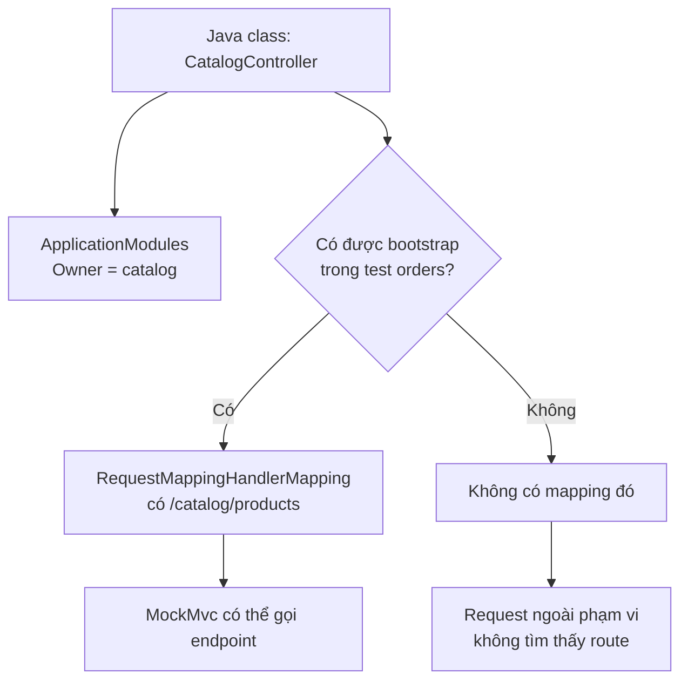
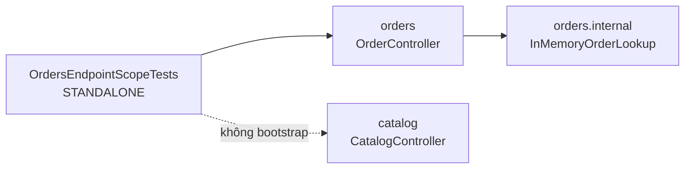

# Kiểm tra endpoint thuộc module mục tiêu

## Mục tiêu học tập

Sau bài học, bạn có thể:

1. Phân biệt **controller thuộc application module nào** với **endpoint đã được đăng ký trong Spring MVC test context hay chưa**.
2. Dùng `ApplicationModules.getModuleByType(...)` và `getModuleForPackage(...)` để xác định chủ sở hữu của controller.
3. Dùng `@ApplicationModuleTest` ở chế độ `STANDALONE` kết hợp `@AutoConfigureMockMvc` để chỉ kiểm thử web adapter của module mục tiêu.
4. Kiểm tra HTTP request tới endpoint **được phép xuất hiện** và endpoint **không được phép xuất hiện** trong context.
5. Đọc `RequestMappingHandlerMapping.getHandlerMethods()` để xác minh **method, path và controller thật sự được đăng ký**.
6. Xây một assertion duyệt mọi controller thuộc namespace ứng dụng, bảo đảm chúng đều được sở hữu bởi module đang test.
7. Hiểu các trường hợp dễ gây kết luận sai: HTTP 404 do route hay do dữ liệu, Spring Security 401/403, `@Import`, `extraIncludes`, nested module, Actuator và các handler khác MVC.
8. Đưa kiểm tra phạm vi endpoint vào CI, phối hợp `ApplicationModules.verify()`, `@ApplicationModuleTest`, kiểm thử sự kiện và database.

Bài thuộc chương **Web module testing** của lộ trình **SPRING_MODULITH_VERIFICATION_TESTING**. Mục tiêu học phần là bảo vệ ranh giới kiến trúc Spring Modulith và kiểm thử hành vi của module bằng JUnit, các module test, sự kiện, cơ sở dữ liệu và tích hợp. Trọng tâm bài này là **chứng minh web test context chỉ mang những endpoint ứng dụng được mong đợi**, không chỉ chứng minh một request trả về mã HTTP đúng.

> **Môi trường minh họa:** Spring Boot 3.4–3.5, Spring Framework 6.2, Spring Modulith 1.3–1.4, Spring MVC, Java 17+, JUnit 5. Với Spring Boot 4, một số package import của annotation cấu hình test MVC có thay đổi; khi triển khai thực tế hãy dùng Javadoc đúng phiên bản đang chạy.

## 1. Ba câu hỏi khác nhau về một endpoint

Giả sử hệ thống có:

- Module `orders` công bố API nghiệp vụ đặt hàng và có endpoint `GET /orders/{id}`.
- Module `catalog` quản lý danh mục và có endpoint `GET /catalog/products`.

Khi kiểm thử riêng `orders`, cần phân biệt:

| Câu hỏi | Nơi tìm câu trả lời | Ví dụ kết quả |
| --- | --- | --- |
| **Controller thuộc module nào?** | `ApplicationModules` | `OrderController → orders`, `CatalogController → catalog` |
| **Controller đã đăng ký mapping nào trong test context?** | `RequestMappingHandlerMapping` | `GET /orders/{id} → OrderController` |
| **Gửi request thật qua web test layer nhận gì?** | `MockMvc` | `GET /orders/order-100 → 200` |

Ba phép kiểm tra hỗ trợ nhau nhưng không tương đương:

- Một class nằm trong module `orders` **không tự động là controller được Spring khởi tạo**: nó có thể thiếu `@RestController`, nằm ngoài component scanning hoặc không có handler method.
- Một controller được Spring đăng ký **không nhất thiết thuộc module bạn muốn kiểm thử**: `@Import`, cấu hình quét ngoài phạm vi, hoặc bootstrap mở rộng có thể làm xuất hiện controller của module khác.
- HTTP **404 không đủ chứng minh endpoint không có mapping**: route có thể được đăng ký nhưng trả 404 vì không tìm thấy dữ liệu nghiệp vụ.



Do đó, mục tiêu không đơn thuần là đếm số URL. Ta cần kiểm tra **tính đúng của quan hệ route → controller → module**.

## 2. Dựng ứng dụng mẫu có hai web adapter

Cấu trúc package:

```text
src/main/java/com/acme/shop/
├── ShopApplication.java
├── orders/                                <- module orders
│   ├── OrderLookup.java
│   ├── OrderSummary.java
│   ├── internal/
│   │   └── InMemoryOrderLookup.java
│   └── web/
│       └── OrderController.java           <- GET /orders/{id}
└── catalog/                               <- module catalog
    └── web/
        └── CatalogController.java         <- GET /catalog/products

src/test/java/com/acme/shop/
├── orders/
│   └── OrdersEndpointScopeTests.java
└── ModuleArchitectureTests.java
```

Điểm quét ứng dụng:

```java
// src/main/java/com/acme/shop/ShopApplication.java
package com.acme.shop;

import org.springframework.boot.SpringApplication;
import org.springframework.boot.autoconfigure.SpringBootApplication;

@SpringBootApplication
public class ShopApplication {

    public static void main(String[] args) {
        SpringApplication.run(ShopApplication.class, args);
    }
}
```

Trong mô hình mặc định, `orders` và `catalog` là hai module ngang hàng. Các package `orders.web`, `orders.internal` thuộc `orders`, còn `catalog.web` thuộc `catalog`.

### Hợp đồng và service của `orders`

```java
// src/main/java/com/acme/shop/orders/OrderSummary.java
package com.acme.shop.orders;

public record OrderSummary(String id, String status) {}
```

```java
// src/main/java/com/acme/shop/orders/OrderLookup.java
package com.acme.shop.orders;

import java.util.Optional;

public interface OrderLookup {
    Optional<OrderSummary> findById(String id);
}
```

```java
// src/main/java/com/acme/shop/orders/internal/InMemoryOrderLookup.java
package com.acme.shop.orders.internal;

import com.acme.shop.orders.OrderLookup;
import com.acme.shop.orders.OrderSummary;
import java.util.Optional;
import org.springframework.stereotype.Service;

@Service
class InMemoryOrderLookup implements OrderLookup {

    @Override
    public Optional<OrderSummary> findById(String id) {
        return "order-100".equals(id)
                ? Optional.of(new OrderSummary(id, "PLACED"))
                : Optional.empty();
    }
}
```

Ví dụ dùng dữ liệu trong bộ nhớ để **không cần bootstrap database**. Đây chỉ là dữ liệu minh họa cho bài kiểm tra endpoint, không phải cách triển khai repository cho production.

### Controller của module `orders`

```java
// src/main/java/com/acme/shop/orders/web/OrderController.java
package com.acme.shop.orders.web;

import com.acme.shop.orders.OrderLookup;
import com.acme.shop.orders.OrderSummary;
import org.springframework.http.ResponseEntity;
import org.springframework.web.bind.annotation.GetMapping;
import org.springframework.web.bind.annotation.PathVariable;
import org.springframework.web.bind.annotation.RequestMapping;
import org.springframework.web.bind.annotation.RestController;

@RestController
@RequestMapping("/orders")
public class OrderController {

    private final OrderLookup orders;

    public OrderController(OrderLookup orders) {
        this.orders = orders;
    }

    @GetMapping("/{id}")
    public ResponseEntity<OrderSummary> find(
            @PathVariable String id) {
        return ResponseEntity.of(orders.findById(id));
    }
}
```

Ở đây `ResponseEntity.of(Optional)` trả **200** với JSON khi tìm thấy đơn hàng, hoặc **404** khi `Optional.empty()`. Tức cùng một mapping `GET /orders/{id}` có thể tạo hai status khác nhau tùy dữ liệu.

### Controller của module `catalog`

```java
// src/main/java/com/acme/shop/catalog/web/CatalogController.java
package com.acme.shop.catalog.web;

import java.util.List;
import org.springframework.web.bind.annotation.GetMapping;
import org.springframework.web.bind.annotation.RequestMapping;
import org.springframework.web.bind.annotation.RestController;

@RestController
@RequestMapping("/catalog")
public class CatalogController {

    @GetMapping("/products")
    public List<String> products() {
        return List.of("book-42", "book-99");
    }
}
```

Endpoint `GET /catalog/products` tồn tại trong mã ứng dụng nhưng **không thuộc phạm vi HTTP cần đưa vào context kiểm thử riêng `orders`**.



## 3. Xác nhận chủ sở hữu controller trong mô hình tĩnh

Trước khi kiểm tra Spring MVC, hãy chứng minh `ApplicationModules` hiểu đúng package chứa controller.

```java
// src/test/java/com/acme/shop/ModuleOwnerContractTests.java
package com.acme.shop;

import static org.junit.jupiter.api.Assertions.assertEquals;

import com.acme.shop.catalog.web.CatalogController;
import com.acme.shop.orders.web.OrderController;
import org.junit.jupiter.api.Test;
import org.springframework.modulith.core.ApplicationModules;

class ModuleOwnerContractTests {

    @Test
    void controllersBelongToExpectedModules() {
        ApplicationModules modules =
                ApplicationModules.of(ShopApplication.class);

        assertEquals("orders", modules
                .getModuleByType(OrderController.class)
                .orElseThrow()
                .getIdentifier().toString());

        assertEquals("catalog", modules
                .getModuleByType(CatalogController.class)
                .orElseThrow()
                .getIdentifier().toString());

        assertEquals("orders", modules
                .getModuleForPackage("com.acme.shop.orders.web")
                .orElseThrow()
                .getIdentifier().toString());
    }
}
```

`getModuleByType(...)` xác định module sở hữu **kiểu Java**, còn `getModuleForPackage(...)` hỏi quyền sở hữu **package**. Cả hai là thao tác trên mô hình tĩnh: test chưa biết controller có được Spring scan và tạo mapping hay không.

**Không kết luận chỉ từ tên package `web`.** Nếu ứng dụng cấu hình nested application modules hoặc custom detection strategy, một package `orders.web` có thể được gán vào một ranh giới khác dự đoán. Khi đó cần đọc ID được mô hình trả về, không suy bằng chuỗi `startsWith("orders")`.

## 4. Bootstrap riêng `orders` bằng `@ApplicationModuleTest`

Đặt lớp test **trong package của module mục tiêu**, ví dụ `com.acme.shop.orders`:

```java
// src/test/java/com/acme/shop/orders/OrdersEndpointScopeTests.java
package com.acme.shop.orders;

import org.junit.jupiter.api.Test;
import org.springframework.beans.factory.annotation.Autowired;
import org.springframework.boot.test.autoconfigure.web.servlet.AutoConfigureMockMvc;
import org.springframework.boot.test.context.SpringBootTest;
import org.springframework.modulith.test.ApplicationModuleTest;
import org.springframework.test.web.servlet.MockMvc;
import org.springframework.web.servlet.mvc.method.annotation
        .RequestMappingHandlerMapping;

import static org.springframework.modulith.test
        .ApplicationModuleTest.BootstrapMode.STANDALONE;

@ApplicationModuleTest(
        mode = STANDALONE,
        webEnvironment = SpringBootTest.WebEnvironment.MOCK
)
@AutoConfigureMockMvc
class OrdersEndpointScopeTests {

    @Autowired
    MockMvc mvc;

    @Autowired
    RequestMappingHandlerMapping mappings;

    // Các @Test được bổ sung ở những phần tiếp theo.
}
```

**Cơ chế:**

- `@ApplicationModuleTest` xác định module chứa package của lớp test. `STANDALONE` mặc định bootstrap **module orders**, không tự thêm `catalog`.
- `WebEnvironment.MOCK` tạo mock Servlet web context, không mở HTTP server thật.
- `@AutoConfigureMockMvc` tạo `MockMvc` để gửi request qua `DispatcherServlet` của Spring MVC.
- `RequestMappingHandlerMapping` là registry các handler method MVC đang được ứng dụng **thực sự đăng ký trong context test**.

Mặc dù đã giới hạn bootstrap, vẫn có thể xuất hiện một số mapping hạ tầng như xử lý lỗi mặc định tùy cấu hình Spring Boot. Ta sẽ **lọc controller thuộc namespace ứng dụng**, không đòi registry chỉ chứa một entry duy nhất.

**Lưu ý phiên bản:** `org.springframework.boot.test.autoconfigure.web.servlet.AutoConfigureMockMvc` là import của Spring Boot 3.x; từ Spring Boot 4, package test MVC được tổ chức lại. Đổi import đúng theo bản Spring Boot thực tế trước khi chạy test.

## 5. Gửi request tới endpoint thuộc module mục tiêu

Bổ sung phương thức test vào **cùng lớp `OrdersEndpointScopeTests`**:

```java
import static org.springframework.test.web.servlet.request
        .MockMvcRequestBuilders.get;
import static org.springframework.test.web.servlet.result
        .MockMvcResultMatchers.jsonPath;
import static org.springframework.test.web.servlet.result
        .MockMvcResultMatchers.status;

@Test
void ordersEndpointIsCallable() throws Exception {
    mvc.perform(get("/orders/order-100"))
            .andExpect(status().isOk())
            .andExpect(jsonPath("$.id").value("order-100"))
            .andExpect(jsonPath("$.status").value("PLACED"));
}
```

Test này chứng minh:

1. `GET /orders/order-100` được Spring MVC định tuyến tới một controller trong context test.
2. Controller gọi `OrderLookup` thực trong module `orders`.
3. Response được serialize thành JSON đúng hợp đồng.

Nhưng **chỉ test dương tính chưa chứng minh context không chứa controller khác**. Một `@SpringBootTest` chạy toàn ứng dụng cũng có thể khiến request này trả 200. Ta phải kiểm tra thêm **endpoint nào được phép đăng ký và endpoint nào không**.

## 6. Kiểm tra endpoint ngoài module không được phục vụ

Với `STANDALONE` và không có custom import/security gây nhiễu, thử gửi request tới route thuộc `catalog`:

```java
@Test
void catalogEndpointIsNotExposedByOrdersTest() throws Exception {
    mvc.perform(get("/catalog/products"))
            .andExpect(status().isNotFound());
}
```

Trong ứng dụng mẫu, kết quả dự kiến **404** vì `CatalogController` không được bootstrap. Đây là một kiểm tra thực tế hữu ích, nhưng có giới hạn:

- Có thể Spring Security từ chối request **trước khi tới handler**, trả 401/403 dù controller không tồn tại.
- Có thể một fallback controller hoặc router khác đã đăng ký đường dẫn bắt mọi request.
- Có thể URL đã đổi nên 404 xảy ra **dù controller vẫn ở trong context**.
- Có thể route `/catalog/products` tồn tại nhưng tự trả 404 do dữ liệu/logic; chỉ nhìn status không phân biệt được hai trường hợp.

Do đó, **không dùng status 404 làm bằng chứng duy nhất của việc không có endpoint ngoài module**. Bước kiểm tra registry ở phần sau mới kiểm chứng trực tiếp một mapping đã được đăng ký hay chưa.

### Cùng status 404, nhưng hai ý nghĩa

```java
@Test
void missingOrderReturnsBusinessNotFound() throws Exception {
    mvc.perform(get("/orders/unknown"))
            .andExpect(status().isNotFound());
}
```

Đây là 404 **bên trong một route hợp lệ**: `GET /orders/{id}` được đăng ký, `OrderLookup` trả `Optional.empty()`. Trái lại, `GET /catalog/products` trong test `orders` được kỳ vọng **không có route**.

| Request | Mapping tồn tại trong test orders? | HTTP status dự kiến | Ý nghĩa |
| --- | --- | --- | --- |
| `GET /orders/order-100` | Có: `/orders/{id}` | 200 | Route và dữ liệu đều hợp lệ |
| `GET /orders/unknown` | Có: `/orders/{id}` | 404 | Không tìm thấy đơn hàng |
| `GET /catalog/products` | Không, nếu chỉ bootstraps orders | 404 | Không có controller catalog trong phạm vi test |

## 7. Quan sát mọi handler method thực sự được đăng ký

Trong Spring MVC, `RequestMappingHandlerMapping` quản lý ánh xạ giữa **`RequestMappingInfo`** và **`HandlerMethod`**. Ta có thể lấy registry bằng:

```java
Map<RequestMappingInfo, HandlerMethod> registered =
        mappings.getHandlerMethods();
```

Thông tin then chốt:

| API | Ý nghĩa |
| --- | --- |
| `getHandlerMethods()` | Đọc các method mappings đã được Spring MVC đăng ký |
| `RequestMappingInfo.getPatternValues()` | Lấy các pattern route, ví dụ `/orders/{id}` |
| `getMethodsCondition().getMethods()` | Xem HTTP method được giới hạn, ví dụ `GET` |
| `getConsumesCondition()` | Điều kiện Content-Type của request, khi khai báo |
| `getProducesCondition()` | Điều kiện media type của response, khi khai báo |
| `HandlerMethod.getBeanType()` | Lớp controller định nghĩa handler method |
| `HandlerMethod.getMethod().getName()` | Tên phương thức Java được ánh xạ |

Ví dụ in các mapping thuộc namespace ứng dụng:

```java
@Test
void printApplicationControllerMappings() {
    mappings.getHandlerMethods().entrySet().stream()
            .filter(entry -> entry.getValue().getBeanType()
                    .getName().startsWith("com.acme.shop."))
            .flatMap(entry -> entry.getKey().getPatternValues()
                    .stream()
                    .map(pattern -> String.format("%s %s -> %s#%s",
                            entry.getKey()
                                    .getMethodsCondition()
                                    .getMethods(),
                            pattern,
                            entry.getValue().getBeanType().getName(),
                            entry.getValue().getMethod().getName())))
            .sorted()
            .forEach(System.out::println);
}
```

Với ví dụ tối giản, đầu ra gần như:

```text
[GET] /orders/{id} -> com.acme.shop.orders.web.OrderController#find
```

Đây là **đầu ra minh họa**, không phải snapshot nguyên văn bắt buộc. Tùy cấu hình, Spring MVC còn có mapping tới `BasicErrorController`, static resources, endpoint của thư viện hoặc các framework handler khác. Việc lọc theo namespace `com.acme.shop.` giúp ta tập trung vào web adapter do đội phát triển sở hữu.

### Một route có nhiều điều kiện

Hai mapping cùng pattern `/orders` vẫn có thể khác nhau về `GET`/`POST`, `consumes`, `produces` hay headers. Vì vậy **chỉ so khớp chuỗi path không đủ** nếu mục tiêu là khẳng định một HTTP contract chính xác.

Ví dụ dùng `getMethodsCondition().getMethods()` để bảo đảm route `GET /orders/{id}` tồn tại:

```java
import static org.junit.jupiter.api.Assertions.assertTrue;
import com.acme.shop.orders.web.OrderController;
import org.springframework.web.bind.annotation.RequestMethod;

@Test
void getOrderRouteIsRegisteredOnOrderController() {
    boolean found = mappings.getHandlerMethods()
            .entrySet()
            .stream()
            .anyMatch(entry ->
                    entry.getValue().getBeanType()
                            .equals(OrderController.class)
                    && entry.getKey().getPatternValues()
                            .contains("/orders/{id}")
                    && entry.getKey().getMethodsCondition()
                            .getMethods().contains(RequestMethod.GET));

    assertTrue(found, "GET /orders/{id} must belong to OrderController");
}
```

Đây là assertion cho **route pattern được đăng ký**, không phụ thuộc một đơn hàng cụ thể tồn tại hay không. Khi controller đổi path hoặc HTTP method mà không sửa test, test báo hiệu hợp đồng web đã thay đổi.

## 8. Kiểm tra không có controller của module khác

Thêm assertion trực tiếp vào registry:

```java
import static org.junit.jupiter.api.Assertions.assertFalse;
import static org.junit.jupiter.api.Assertions.assertTrue;
import com.acme.shop.catalog.web.CatalogController;
import com.acme.shop.orders.web.OrderController;

@Test
void onlyExpectedApplicationControllersAreRegistered() {
    var controllerTypes = mappings.getHandlerMethods()
            .values()
            .stream()
            .map(handler -> handler.getBeanType())
            .filter(type -> type.getName()
                    .startsWith("com.acme.shop."))
            .collect(java.util.stream.Collectors.toSet());

    assertTrue(controllerTypes.contains(OrderController.class));
    assertFalse(controllerTypes.contains(CatalogController.class));
}
```

Test này mạnh hơn việc chỉ gửi `GET /catalog/products` và đòi 404: nó xác minh **`CatalogController` không có handler method nào trong registry của module test**.

Tuy nhiên, liệt kê hai lớp cụ thể mới bảo vệ đúng hai lớp đó. Khi có hàng chục controller, một controller từ module thứ ba có thể vô tình lọt vào context mà test không nêu tên. Giải pháp là xây assertion dựa trên **mọi handler thuộc namespace ứng dụng**, rồi hỏi mô hình `ApplicationModules` controller đó thuộc module nào.

## 9. Quality gate: mọi application handler phải thuộc module mục tiêu

Đây là phần quan trọng nhất của bài. Ta kết hợp **mô hình tĩnh** và **registry runtime**:

```java
// Có thể đặt trực tiếp trong OrdersEndpointScopeTests.
import static org.junit.jupiter.api.Assertions.assertTrue;
import com.acme.shop.ShopApplication;
import java.util.ArrayList;
import java.util.List;
import org.springframework.modulith.core.ApplicationModules;

@Test
void allApplicationHandlerMethodsBelongToOrders() {
    ApplicationModules modules =
            ApplicationModules.of(ShopApplication.class);

    List<String> unexpected = new ArrayList<>();

    mappings.getHandlerMethods().forEach((info, handler) -> {
        Class<?> controllerType = handler.getBeanType();

        // Chỉ kiểm tra các controller do ứng dụng sở hữu.
        if (!controllerType.getName().startsWith("com.acme.shop.")) {
            return;
        }

        String owner = modules.getModuleByType(controllerType)
                .map(module -> module.getIdentifier().toString())
                .orElse("<không được gán module>");

        if (!"orders".equals(owner)) {
            unexpected.add(String.format(
                    "controller=%s owner=%s routes=%s",
                    controllerType.getName(),
                    owner,
                    info.getPatternValues()));
        }
    });

    assertTrue(unexpected.isEmpty(),
            () -> "Unexpected application endpoints in orders test: "
                    + unexpected);
}
```

**Cách hoạt động:**

1. `mappings.getHandlerMethods()` cung cấp các MVC endpoint **đang thực sự được đăng ký**.
2. Chỉ chọn các controller trong namespace ứng dụng `com.acme.shop.`, tránh nhầm mapping nền tảng với endpoint nghiệp vụ.
3. `modules.getModuleByType(controllerType)` xác định module sở hữu class controller.
4. Nếu owner khác `orders` hoặc kiểu đó không thuộc module nào, assertion thất bại và in tên class cùng route để điều tra.

Đây là **test phạm vi bootstrap**, không chỉ là test hợp đồng HTTP. Nó sẽ phát hiện một `CatalogController` bị đưa vào context kể cả khi test không biết trước path `/catalog/products`.

### Giới hạn của assertion trên

- Chỉ kiểm tra những **handler method hiện có trong `RequestMappingHandlerMapping`**. Một controller không được scan hoặc không có mapping sẽ không xuất hiện; phải có thêm test dương tính cho endpoint bắt buộc.
- Nó không tự kiểm tra **functional router** (ví dụ `RouterFunction`) hoặc endpoint được đăng ký qua cơ chế khác MVC `@RequestMapping`.
- Nếu controller được proxy bằng kỹ thuật đặc biệt, `HandlerMethod.getBeanType()` có thể cần chuẩn hóa về user class trước khi tra cứu owner. Với các `@RestController` thông thường ở ví dụ, kiểu trả về là lớp controller.
- Bộ lọc tiền tố `com.acme.shop.` phải phù hợp với **các root package thực** của ứng dụng. Nếu dự án có `@Modulithic(additionalPackages = ...)`, hãy bao gồm các namespace bổ sung khi xác minh.
- Assertion kiểm tra **tính sở hữu của class**, không chứng minh route đó hợp lý về API, security hoặc thiết kế REST.

Không nên chỉ cho phép bất kỳ class nào có package bắt đầu bằng `com.acme.shop.orders` rồi coi là đúng. Với nested module (ví dụ `orders.payments`), class có cùng tiền tố package vẫn có thể thuộc **module con khác**. Cách hỏi `getModuleByType(...)` chính xác hơn suy owner bằng chuỗi package.

## 10. Khi mở rộng bootstrap, kỳ vọng endpoint cũng phải thay đổi

Một test có thể chủ động khởi tạo thêm module để kiểm thử phối hợp. Khi đó **không được giữ nguyên assertion “tất cả endpoint thuộc orders”** nếu chính thiết kế test cho phép controller của module khác.

| Cấu hình `@ApplicationModuleTest` | Module được bootstrap | Hợp đồng endpoint nên xác minh |
| --- | --- | --- |
| `mode = STANDALONE` | Chỉ `orders` | Application controllers thuộc `orders` |
| `mode = DIRECT_DEPENDENCIES` | `orders` + các module mà `orders` phụ thuộc trực tiếp | Controllers thuộc tập module được cho phép nếu chúng có mapping |
| `mode = ALL_DEPENDENCIES` | `orders` + các dependency bắc cầu | Controllers thuộc tập module được cho phép nếu chúng có mapping |
| `extraIncludes = "catalog"` | Cố ý bổ sung `catalog` bất kể chiều dependency | Có thể có `CatalogController` trong test context |

Trong **ví dụ hai module độc lập** ở mục 2, `orders` chưa tham chiếu class nào của `catalog`. Vì thế chuyển từ `STANDALONE` sang `DIRECT_DEPENDENCIES` **không tự làm xuất hiện `catalog`**. Chỉ khi có dependency thực sự hoặc dùng `extraIncludes` có chủ đích, phạm vi mới mở rộng.

### Thử mở rộng bằng `extraIncludes`

```java
package com.acme.shop.orders;

import org.springframework.boot.test.autoconfigure.web.servlet.AutoConfigureMockMvc;
import org.springframework.modulith.test.ApplicationModuleTest;

@ApplicationModuleTest(extraIncludes = "catalog")
@AutoConfigureMockMvc
class OrdersWithCatalogEndpointsTests {
    // Với catalog được bao gồm và web context phù hợp,
    // GET /catalog/products có thể được đăng ký.
}
```

Đừng chép nguyên test `allApplicationHandlerMethodsBelongToOrders()` sang lớp này rồi gọi hành vi thất bại là lỗi framework: **scope đã thay đổi có chủ đích**.

### Assertion cho một tập module được phép

Khi cần test tích hợp nhiều module, thay `"orders".equals(owner)` bằng:

```java
import java.util.Set;

Set<String> allowedOwners = Set.of("orders", "catalog");

// Trong vòng duyệt handler:
if (!allowedOwners.contains(owner)) {
    unexpected.add("Unexpected endpoint owner " + owner
            + " for " + controllerType.getName());
}
```

Ví dụ trên là đoạn thay thế trong logic test ở mục 9, **không phải lớp Java hoàn chỉnh**. Nên tạo hai bộ test rõ mục tiêu: một bộ khẳng định **isolation của module orders**, một bộ khẳng định **sự tích hợp được cho phép với catalog**.

## 11. Phát hiện controller bị đưa vào context ngoài ý muốn

Một nguyên nhân phổ biến là import trực tiếp bean cấu hình/handler:

```java
// MINH HỌA SAI PHẠM VI — không đưa vào test isolation chính
@Import(com.acme.shop.catalog.web.CatalogController.class)
@ApplicationModuleTest
@AutoConfigureMockMvc
class OrdersAccidentallyImportingCatalogTests {
}
```

Nếu class này được Spring tạo bean như controller, `RequestMappingHandlerMapping` có thể đăng ký `GET /catalog/products` **dù bootstrap mode vẫn là STANDALONE**. Điều đó minh họa lý do chỉ dựa vào tên annotation test hoặc log bootstrap chưa đủ để chứng minh mọi endpoint trong context đều đúng phạm vi.

Test duyệt mọi handler ở mục 9 sẽ bắt được `CatalogController` có owner `catalog`.

Tương tự, một `@ComponentScan` quá rộng trong cấu hình test hoặc cấu hình `@Import` lấy vào những `@Configuration` không phù hợp có thể vô tình mang thêm controller. Để sửa:

1. Xem vì sao bean/controller đó được tạo.
2. Kiểm tra annotation `@Import`, `@ComponentScan`, `extraIncludes` và custom test configuration.
3. Thu hẹp cấu hình nếu mục tiêu là test isolation; hoặc điều chỉnh tập owner được phép nếu thật sự đang test tích hợp.
4. Chạy lại assertion registry và HTTP tests.

**Đừng “sửa” bằng cách bỏ qua endpoint lạ trong báo cáo** nếu chưa có quyết định kiến trúc cho phép nó.

## 12. Phân biệt API công khai và sự tồn tại của endpoint

Một controller nằm trong `orders.web` có thể là chi tiết **nội bộ của module** theo quy tắc package Spring Modulith, nhưng lại phục vụ HTTP request bên ngoài ứng dụng.

Hai khái niệm không mâu thuẫn:

- **API module Java**: những kiểu mà module khác được phép tham chiếu trực tiếp, ví dụ `orders.OrderLookup`.
- **API HTTP**: những đường dẫn/method được triển khai bởi web adapter, ví dụ `GET /orders/{id}`.

`orders.web.OrderController` có thể là kiểu không được module `catalog` import trực tiếp, nhưng HTTP client vẫn gọi được endpoint của nó khi ứng dụng đầy đủ chạy.

| Kiểm tra | Điều xác nhận |
| --- | --- |
| `getModuleByType(OrderController.class)` | Controller thuộc application module `orders` |
| `getNamedInterfaces()` | Java types nào của `orders` được công bố cho module khác |
| `RequestMappingHandlerMapping` | Controller method nào được đăng ký thành endpoint MVC |
| `MockMvc` | Request đi qua MVC processing và trả status/body gì |
| `ApplicationModules.verify()` | Phụ thuộc Java giữa các module có tuân thủ ranh giới |

**Đừng coi `@RestController` là một `@NamedInterface`**, và đừng coi một Java class `public` tự động tạo HTTP endpoint. Cần hiểu riêng cơ chế của framework web và của mô hình module.

## 13. Kiểm thử ở vị trí khác package module

Thông thường, đặt `OrdersEndpointScopeTests` trong `com.acme.shop.orders` là cách ngắn nhất để Spring Modulith suy ra module cần test.

Nếu test đặt trong package chung `com.acme.shop.testing`, có thể chỉ định module tường minh (Spring Modulith 1.3+):

```java
// src/test/java/com/acme/shop/testing/OrdersHttpScopeTests.java
package com.acme.shop.testing;

import com.acme.shop.ShopApplication;
import org.springframework.boot.test.autoconfigure.web.servlet.AutoConfigureMockMvc;
import org.springframework.modulith.test.ApplicationModuleTest;

@ApplicationModuleTest(
        module = "orders",
        classes = ShopApplication.class
)
@AutoConfigureMockMvc
class OrdersHttpScopeTests {
    // @Autowired MockMvc, RequestMappingHandlerMapping và các test.
}
```

`module = "orders"` dùng **định danh logic module**, không phải display name hoặc đường dẫn package đầy đủ. Khi ứng dụng có cách đặt tên module tùy chỉnh, in `ApplicationModules.stream().map(getIdentifier...)` để xác định ID thực tế.

Nếu đặt test ở package `com.acme.shop.catalog` nhưng lại kỳ vọng nó chỉ bootstrap `orders`, kết quả sẽ trái với cách suy module mặc định. Kiểm tra tên package của **lớp test** trước khi nghi ngờ `MockMvc` hoặc route mapping.

## 14. Spring Security, Actuator và các handler ngoài MVC

### Security có thể che khuất kết quả kiểm tra route

Trong ứng dụng có Spring Security, request tới một URL không tồn tại có thể bị filter từ chối trước khi MVC xác định handler, trả 401 hoặc 403 thay vì 404. Do đó:

- Dùng **registry mapping** để xác nhận controller/route có được đăng ký không.
- Dùng HTTP test có principal, role và CSRF phù hợp để kiểm tra contract bảo mật.
- Không tự động thêm `@AutoConfigureMockMvc(addFilters = false)` chỉ để biến 403 thành 404. Nếu thật sự test ngoài security, nêu rõ mục đích và giữ security test riêng.

Ví dụ khi test endpoint cần xác thực:

```java
// Cần spring-security-test trong test classpath.
import static org.springframework.security.test.web.servlet.request
        .SecurityMockMvcRequestPostProcessors.user;

mvc.perform(get("/orders/order-100")
        .with(user("customer").roles("CUSTOMER")))
        .andExpect(status().isOk());
```

Ví dụ giả định chính sách ứng dụng cho phép role `CUSTOMER`. Với request thay đổi trạng thái qua POST/PUT/DELETE và bật CSRF, cần thêm `.with(csrf())` theo cấu hình security.

### Mapping framework không phải endpoint nghiệp vụ từ module khác

Spring Boot có thể đăng ký `/error` hoặc những handler infrastructure. Nếu có Actuator, endpoint quản lý có thể nằm ở context hoặc cổng quản trị riêng. Chúng không nhất thiết do `RequestMappingHandlerMapping` chính của ứng dụng quản lý cùng cách với business controller.

Khi kiểm tra isolation:

- **Không** khẳng định tổng số `getHandlerMethods().size()` luôn bằng 1.
- **Không** coi một handler framework ở `org.springframework...` là vi phạm module nghiệp vụ.
- **Không** dùng kiểm tra annotation controller để suy rằng **mọi route** của hệ thống đã được kiểm kê; còn có static resources, functional routing hoặc WebFlux.

Nếu dự án dùng **Spring WebFlux** thay vì Spring MVC, bạn phải kiểm tra `RequestMappingHandlerMapping` thuộc package reactive (`org.springframework.web.reactive.result.method.annotation`) hoặc `RouterFunctionMapping` tùy cách khai báo endpoint. Bài này chủ đích tập trung **Spring MVC có `@RestController`**.

### Multiple web contexts và management port

Khi chạy `webEnvironment = MOCK`, các assertion xác minh **context test hiện tại**. Nếu Actuator được tách sang management context/port khi deploy, test không mặc nhiên kiểm tra mọi endpoint tại cổng quản trị. Muốn bảo vệ API quản trị, cần thêm test và cấu hình đúng context/cổng tương ứng.

## 15. Quality gate CI cho quyền sở hữu endpoint

Một bộ kiểm thử đáng tin cậy nên bảo vệ ba ràng buộc:

1. **Static ownership:** `OrderController` thuộc `orders`; `CatalogController` thuộc `catalog`.
2. **Runtime registration/scope:** test standalone `orders` phải có `GET /orders/{id}` và không được đăng ký application controller thuộc module khác.
3. **HTTP behavior:** request hợp lệ, không tìm thấy dữ liệu và các response contract hoạt động đúng qua MVC.

Thêm bài kiểm chứng kiến trúc độc lập:

```java
// src/test/java/com/acme/shop/ModuleArchitectureTests.java
package com.acme.shop;

import org.junit.jupiter.api.Test;
import org.springframework.modulith.core.ApplicationModules;

class ModuleArchitectureTests {

    @Test
    void moduleBoundariesAreValid() {
        ApplicationModules.of(ShopApplication.class).verify();
    }
}
```

| Nhóm test | Phát hiện lỗi gì? | Không chứng minh điều gì? |
| --- | --- | --- |
| `getModuleByType(...)` | Controller bị chuyển nhầm package/module | Controller đã đăng ký endpoint |
| `RequestMappingHandlerMapping` | Route mất, đổi method/path, controller ngoài module lọt vào context | Endpoint trả dữ liệu nghiệp vụ đúng |
| `MockMvc` | Routing, status, JSON, validation, response behavior | Không chứng minh toàn bộ mapping chỉ thuộc module |
| `ApplicationModules.verify()` | Vòng phụ thuộc, truy cập phần nội bộ, giới hạn `allowedDependencies` | Không kiểm chứng tất cả endpoint của Spring MVC |
| `@ApplicationModuleTest` cùng integration tests | Wiring/module behavior, sự kiện và database theo cấu hình | Không thể thay thế mọi test end-to-end |

Đặt các bài test trong `src/test/java` và cho CI chạy JUnit 5 qua Gradle/Maven:

```bash
./gradlew test
```

Hoặc:

```bash
./mvnw test
```

Nếu nhóm tách integration tests sang profile hoặc task khác, pipeline phải chạy đúng các task đó. Những test HTTP module dùng in-memory service không chứng minh transaction đã commit, event đã được phát hoặc listener xử lý thành công. Bổ sung `@ApplicationModuleTest` với database/test containers và bài test sự kiện khi chức năng sản xuất yêu cầu.

**Không sử dụng `verify()` làm thay thế cho test scope**: một cấu hình `@Import(CatalogController.class)` trong test có thể làm lộ endpoint không mong muốn mà dependency tĩnh của production vẫn hợp lệ. Ngược lại, một HTTP test xanh không chứng minh mô hình module không có phụ thuộc sai.

## 16. Chẩn đoán sai lệch thường gặp

| Hiện tượng | Nguyên nhân có thể | Hướng xử lý |
| --- | --- | --- |
| `OrderController` thuộc `orders` nhưng không có mapping | Class không được tạo bean, thiếu annotation, test bootstrap sai module | Đọc registry, package scanning và `@RestController` |
| `GET /orders/order-100` trả 404 | Không có route hoặc service không có dữ liệu | Kiểm tra mapping trước, sau đó kiểm tra kết quả nghiệp vụ |
| `GET /catalog/products` trả 200 trong test orders | Catalog controller được bootstrap hoặc import vào context | Xem `extraIncludes`, `@Import`, component scan và handler owner |
| `GET /catalog/products` trả 403 | Spring Security chặn trước routing | Kiểm tra security và registry, không kết luận endpoint đã/không tồn tại từ 403 |
| Registry có nhiều handler hơn số controller | Mapping framework, `/error`, actuator hoặc nhiều method mỗi controller | Lọc namespace ứng dụng và owner thực |
| Thấy `/orders/{id}`, nhưng test gửi `/orders/id` lỗi | Mapping tồn tại; dữ liệu `id` không tồn tại hoặc filter khác | Kiểm tra test data và logic service |
| Chuyển test sang `DIRECT_DEPENDENCIES` làm xuất hiện controller khác | Có dependency module thực hoặc import/config bổ sung | Điều chỉnh tập owner cho phép hoặc quay về `STANDALONE` |
| Dùng tiền tố `orders.` để quyết định owner sai | Có nested module hoặc detection strategy khác mặc định | Dùng `getModuleByType(...)` |
| Lớp handler từ module khác không được phát hiện | Filter namespace `com.acme.shop.` quá hẹp | Bổ sung các root package ứng dụng được cấu hình |
| Bộ kiểm tra không thấy functional endpoint | Endpoint khai báo bằng `RouterFunction`/WebFlux | Dùng registry/hạ tầng thích hợp cho web stack đó |
| HTTP test xanh nhưng DB/event lỗi | Test đang dùng in-memory service hoặc mock | Bổ sung DB/event integration tests |

### Quy trình điều tra 5 bước

1. **Owner:** xác định class controller thực thuộc module nào bằng `ApplicationModules.getModuleByType(...)`.
2. **Bootstrap:** xác định `STANDALONE` hay mode mở rộng, package lớp test, `extraIncludes` và `@Import`.
3. **Registry:** in `RequestMappingHandlerMapping.getHandlerMethods()` để đọc method/path/controller đã đăng ký.
4. **HTTP:** gọi route qua `MockMvc`, xem status, JSON và cách filter/security xử lý.
5. **Quality gate:** chạy assertion owner/scope, `ApplicationModules.verify()` và các test hành vi có liên quan.

## 17. Bài thực hành

**Bối cảnh:** Nhóm phát triển muốn khẳng định test module `orders` **không vô tình tạo ra endpoint của module `catalog`**, đồng thời vẫn kiểm tra hành vi truy vấn đơn hàng qua HTTP.

**Các bước:**

1. Tạo `ShopApplication`, module `orders`, `catalog`, các API và controller theo mục 2.
2. Viết `ModuleOwnerContractTests` để xác nhận `OrderController → orders`, `CatalogController → catalog`.
3. Tạo `OrdersEndpointScopeTests` bên dưới `com.acme.shop.orders` với `@ApplicationModuleTest(mode = STANDALONE)` và `@AutoConfigureMockMvc`.
4. Viết HTTP test `GET /orders/order-100` trả 200 và `GET /orders/unknown` trả 404 do dữ liệu.
5. Thử `GET /catalog/products` và giải thích vì sao dự kiến 404 trong context standalone không có Spring Security.
6. In registry `RequestMappingHandlerMapping`; chỉ ra rõ pattern `/orders/{id}`, HTTP method GET và `OrderController#find`.
7. Viết assertion route `GET /orders/{id}` được đăng ký; sau đó viết assertion mọi application handler đều có owner `orders`.
8. Trên nhánh thực hành, thêm `@Import(CatalogController.class)` vào một test class khác; xem registry thay đổi và quality gate phát hiện owner lạ. Khôi phục cấu hình đúng.
9. Thử `extraIncludes = "catalog"` để bootstrap hai module; giải thích vì sao test tích hợp có thể hợp lệ dù `CatalogController` xuất hiện.
10. Viết test `ApplicationModules.of(ShopApplication.class).verify()`, chạy cùng nhóm HTTP/scope tests trong CI.
11. Nếu ứng dụng triển khai Spring Security, bổ sung test đăng nhập/phân quyền trước khi dùng HTTP status để suy về routing. Nếu module có database hoặc sự kiện, thêm integration tests chứng minh trạng thái và transaction.

**Tiêu chí hoàn thành:** Bạn có thể phân biệt **class ownership**, **registry của endpoint** và **HTTP behavior**; viết được một quality gate tự động ngăn controller khác module lọt vào web module test, đồng thời chỉ ra những trường hợp cần thay đổi tập owner được phép vì mục đích tích hợp.

## 18. Câu hỏi tự kiểm tra

1. Vì sao `ApplicationModules.getModuleByType(OrderController.class)` không đủ chứng minh `GET /orders/{id}` đang có trong Spring MVC context?
2. Vì sao hai request đều trả 404 nhưng một có thể là route không tồn tại, một là route hợp lệ trả dữ liệu rỗng?
3. `RequestMappingHandlerMapping.getHandlerMethods()` trả những thông tin chính nào để xác minh một endpoint?
4. Nếu controller được `@Import` vào test standalone dù thuộc module khác, `verify()` có nhất thiết phát hiện điều đó không?
5. Vì sao nên hỏi `getModuleByType(handler.getBeanType())` thay vì kiểm tra chuỗi package bắt đầu bằng `orders`?
6. Trong test dùng `extraIncludes = "catalog"`, assertion “mọi endpoint thuộc orders” còn là hợp đồng đúng không? Cần thay thế bằng kiểm tra gì?
7. Nếu `MockMvc` trả 403 cho một URL ngoài module trong ứng dụng có Spring Security, bạn kết luận được gì về registry?
8. Vì sao `RequestMappingHandlerMapping` của MVC không thể thay cho danh sách mọi functional route hoặc reactive handler?
9. Cần thêm test nào khi module `orders` dùng database và phát sự kiện ngoài phần HTTP?

## Tổng kết

Muốn **kiểm tra endpoint thuộc module mục tiêu**, đừng chỉ gửi một request rồi nhìn HTTP status. Hãy dùng **`ApplicationModules.getModuleByType(...)`** để chứng minh controller thuộc module nào, dùng **`RequestMappingHandlerMapping.getHandlerMethods()`** để biết method/path/controller nào thật sự được đăng ký, và dùng **`MockMvc`** để xác nhận response contract. Trong `@ApplicationModuleTest(mode = STANDALONE)`, lập quality gate để tất cả application handler đều thuộc module mục tiêu; nếu có `DIRECT_DEPENDENCIES`, `ALL_DEPENDENCIES` hoặc `extraIncludes`, cập nhật tập module được phép một cách tường minh. Kết hợp những test này với **`ApplicationModules.verify()`**, kiểm thử sự kiện, database và tích hợp trong CI để bảo vệ cả **ranh giới kiến trúc** và **hành vi runtime**.

### Tài liệu tham khảo

- [Spring Modulith — Integration Testing Application Modules](https://docs.spring.io/spring-modulith/reference/testing.html)
- [Spring Modulith — ApplicationModuleTest API](https://docs.spring.io/spring-modulith/docs/current/api/org/springframework/modulith/test/ApplicationModuleTest.html)
- [Spring Modulith — ApplicationModules API](https://docs.spring.io/spring-modulith/docs/current/api/org/springframework/modulith/core/ApplicationModules.html)
- [Spring Framework 6.2 — RequestMappingHandlerMapping API](https://docs.spring.io/spring-framework/docs/6.2.x/javadoc-api/org/springframework/web/servlet/mvc/method/annotation/RequestMappingHandlerMapping.html)
- [Spring Framework 6.2 — RequestMappingInfo API](https://docs.spring.io/spring-framework/docs/6.2.x/javadoc-api/org/springframework/web/servlet/mvc/method/RequestMappingInfo.html)
- [Spring Framework — MockMvc](https://docs.spring.io/spring-framework/reference/testing/spring-mvc-test-framework.html)
- [Spring Modulith — Verifying Application Module Structure](https://docs.spring.io/spring-modulith/reference/verification.html)
