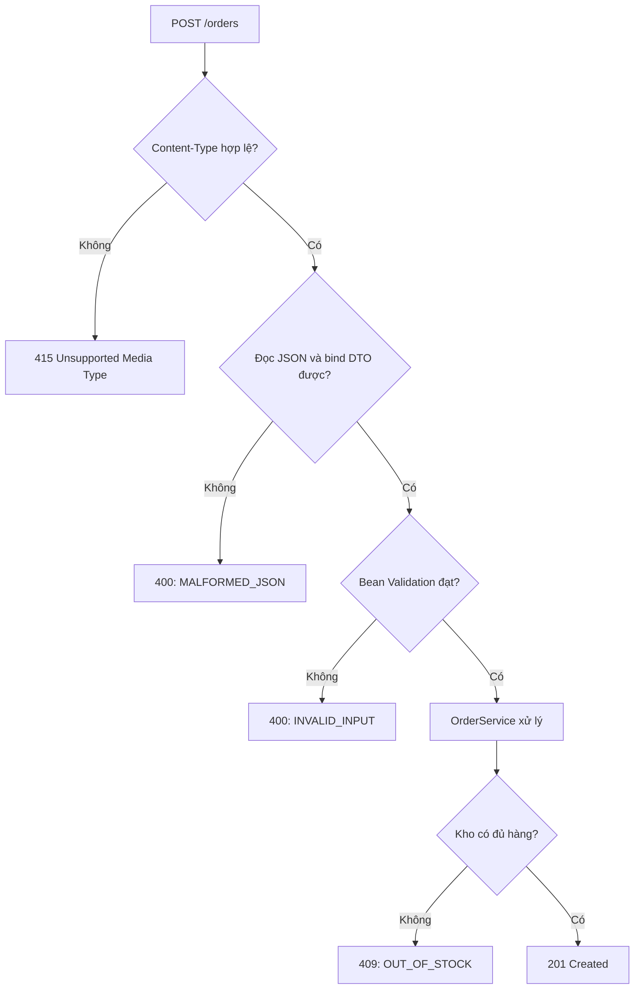
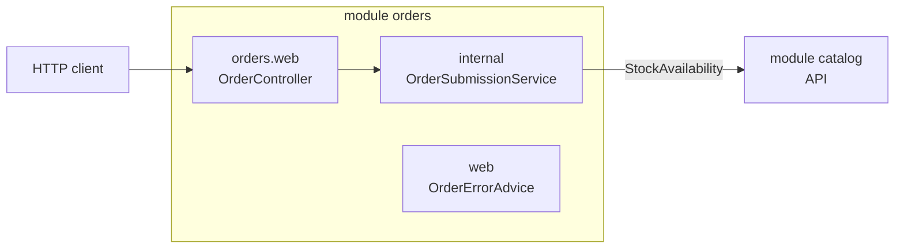

# Kiểm tra response và lỗi đầu vào

## Mục tiêu học tập

Sau bài học, bạn có thể:

1. Mô tả **hợp đồng HTTP response** của web adapter: status code, `Content-Type`, header, cấu trúc JSON và nội dung lỗi.
2. Phân biệt yêu cầu hợp lệ, vi phạm Bean Validation, JSON không đọc được, media type không hỗ trợ và lỗi từ quy tắc nghiệp vụ.
3. Dùng `@ApplicationModuleTest` kết hợp `@AutoConfigureMockMvc` và `MockMvc` để kiểm tra controller cùng service **thật trong module**, nhưng mock một dependency ngoài module.
4. Chuẩn hóa body lỗi bằng `ProblemDetail` và `@RestControllerAdvice`, tránh viết assertion phụ thuộc thông điệp lỗi mặc định của Spring.
5. Kiểm tra rằng yêu cầu sai được từ chối **trước khi thực hiện nghiệp vụ** và không gọi các API phụ thuộc ngoài module.
6. Thiết kế test chống hồi quy về validation, serialization, content negotiation, security và xử lý exception.
7. Kết hợp test web module với `ApplicationModules.verify()`, test sự kiện, database và CI quality gate.

Bài nằm trong chương **Web module testing** của lộ trình **SPRING_MODULITH_VERIFICATION_TESTING**. Lộ trình này hướng đến kiểm chứng ranh giới kiến trúc Spring Modulith, thực hành `@ApplicationModuleTest`, kiểm thử sự kiện, cơ sở dữ liệu và tích hợp. Riêng bài này tập trung vào một năng lực rất thực tế: **phản hồi HTTP phải đúng hợp đồng, và đầu vào không hợp lệ phải được chặn đúng tầng**.

> **Phiên bản mã mẫu:** Spring Boot **3.4–3.5**, Spring Framework **6.2**, Spring Modulith **1.3–1.4**, Java **17+**, JUnit 5, Spring MVC và Bean Validation. Ở Spring Boot 4, một số package và starter test đã được tổ chức lại; khi áp dụng cần chọn dependency/import theo bộ phiên bản thực tế. `@MockitoBean` dùng trong ví dụ có từ Spring Framework 6.2.

## 1. Hợp đồng response không chỉ có HTTP status

Giả sử module `orders` cung cấp endpoint:

```http
POST /orders
Content-Type: application/json
Accept: application/json

{"sku":"BK-42","quantity":2}
```

Yêu cầu hợp lệ có thể nhận:

```http
HTTP/1.1 201 Created
Content-Type: application/json
Location: /orders/ord-bk-42-2

{"id":"ord-bk-42-2","sku":"BK-42","quantity":2,"state":"CREATED"}
```

Một bài test chỉ kiểm tra `201` sẽ **không phát hiện** nếu field `id` bị đổi tên, `quantity` được serialize sai hoặc header `Location` biến mất.

Để bảo vệ hợp đồng bên ngoài module, nên kiểm tra những phần có ý nghĩa với client:

| Thành phần | Ví dụ assertion | Vấn đề có thể phát hiện |
| --- | --- | --- |
| HTTP status | `201 Created` | Controller trả 200 thay vì 201 |
| `Content-Type` | Tương thích `application/json` | Response bị trả text hoặc HTML |
| Header `Location` | `/orders/ord-bk-42-2` | API không chỉ ra URI tài nguyên mới |
| Trường JSON quan trọng | `id`, `sku`, `quantity`, `state` | DTO/serializer thay đổi ngoài dự kiến |
| Thông tin lỗi có mã ổn định | `INVALID_INPUT`, `OUT_OF_STOCK` | Client không phân loại được lỗi |
| Side effect | Không gọi stock service khi input sai | Validation bị bỏ qua hoặc xảy ra quá muộn |

**Không phải mọi response đều cần tất cả trường trên.** Ví dụ endpoint trả `204 No Content` không nên bị buộc có JSON body. Hãy viết test theo **hợp đồng API mà nhóm đã quyết định**, không theo một bộ matcher cố định.

## 2. Phân loại lỗi trước khi viết mã test

Một yêu cầu bị từ chối có thể sai ở nhiều giai đoạn:



Các tình huống cần phân biệt:

| Tình huống | Ví dụ | Status dự kiến | Thứ đang bị kiểm tra |
| --- | --- | --- | --- |
| Thành công | SKU đúng định dạng, quantity hợp lệ, đủ hàng | `201` | Controller + service + serialization |
| Vi phạm Bean Validation | SKU rỗng, quantity bằng 0 | `400` | `@Valid`, `@NotBlank`, `@Min` |
| JSON không đọc được | Thiếu dấu ngoặc hoặc quantity là chuỗi chữ | `400` | JSON parser và `HttpMessageConverter` |
| Body bắt buộc bị thiếu | Không gửi request body | `400` | `@RequestBody` và message converter |
| Sai `Content-Type` | Gửi `text/plain` thay cho JSON | `415` | Điều kiện `consumes` |
| Không chấp nhận media type response | `Accept: application/xml` nhưng endpoint chỉ xuất JSON | `406` | Điều kiện `produces` |
| Vi phạm quy tắc nghiệp vụ | SKU hợp lệ nhưng hết hàng | `409` | Service và exception mapping |

`400` không đồng nghĩa tất cả đều do Bean Validation. JSON sai cú pháp thường chưa tạo được DTO để validator chạy; ngược lại, SKU hết hàng không phải lỗi cú pháp hay dữ liệu đầu vào không hợp lệ, mà là **điều kiện nghiệp vụ**.

## 3. Thiết kế ví dụ theo ranh giới Spring Modulith

Ứng dụng `com.acme.shop` có hai module ngang hàng:

```text
src/main/java/com/acme/shop/
├── ShopApplication.java
├── catalog/                            <- module catalog
│   └── StockAvailability.java         <- API được công bố
└── orders/                             <- module orders
    ├── OrderSubmission.java           <- API được công bố
    ├── PlacedOrder.java                <- kết quả nghiệp vụ
    ├── internal/
    │   ├── OrderSubmissionService.java
    │   └── OutOfStockException.java
    └── web/
        ├── OrderController.java
        └── OrderErrorAdvice.java

src/test/java/com/acme/shop/
├── ModuleArchitectureTests.java
└── orders/
    └── OrdersResponseContractTests.java
```



`orders.web` là web adapter **thuộc module `orders`**, không phải application module độc lập. Phụ thuộc `orders → catalog` được tạo vì service sử dụng kiểu API `catalog.StockAvailability`.

Đặt lớp Spring Boot ở root:

```java
// src/main/java/com/acme/shop/ShopApplication.java
package com.acme.shop;

import org.springframework.boot.SpringApplication;
import org.springframework.boot.autoconfigure.SpringBootApplication;

@SpringBootApplication
public class ShopApplication {

    public static void main(String[] args) {
        SpringApplication.run(ShopApplication.class, args);
    }
}
```

API công khai của module `catalog`:

```java
// src/main/java/com/acme/shop/catalog/StockAvailability.java
package com.acme.shop.catalog;

public interface StockAvailability {
    boolean hasEnough(String sku, int quantity);
}
```

Hợp đồng và kết quả của module `orders`:

```java
// src/main/java/com/acme/shop/orders/OrderSubmission.java
package com.acme.shop.orders;

public interface OrderSubmission {
    PlacedOrder place(String sku, int quantity);
}
```

```java
// src/main/java/com/acme/shop/orders/PlacedOrder.java
package com.acme.shop.orders;

public record PlacedOrder(
        String id, String sku, int quantity, String state) {
}
```

Trong production, nhóm có thể tách response DTO của web adapter khỏi mô hình domain để tránh coupling serialization. Ví dụ giữ chung `PlacedOrder` để bài học tập trung vào **response và lỗi đầu vào**, không phải mapping nhiều tầng DTO.

## 4. Service thật và lỗi nghiệp vụ

```java
// src/main/java/com/acme/shop/orders/internal/OutOfStockException.java
package com.acme.shop.orders.internal;

public class OutOfStockException extends RuntimeException {

    public OutOfStockException(String sku) {
        super("Requested product is unavailable");
    }
}
```

```java
// src/main/java/com/acme/shop/orders/internal/OrderSubmissionService.java
package com.acme.shop.orders.internal;

import com.acme.shop.catalog.StockAvailability;
import com.acme.shop.orders.OrderSubmission;
import com.acme.shop.orders.PlacedOrder;
import java.util.Locale;
import org.springframework.stereotype.Service;

@Service
class OrderSubmissionService implements OrderSubmission {

    private final StockAvailability stock;

    OrderSubmissionService(StockAvailability stock) {
        this.stock = stock;
    }

    @Override
    public PlacedOrder place(String sku, int quantity) {
        if (!stock.hasEnough(sku, quantity)) {
            throw new OutOfStockException(sku);
        }

        String id = "ord-" + sku.toLowerCase(Locale.ROOT)
                + "-" + quantity;

        return new PlacedOrder(id, sku, quantity, "CREATED");
    }
}
```

ID được tạo theo SKU và quantity chỉ để test có dữ liệu **xác định trước**. Trong ứng dụng sản xuất phải dùng cơ chế sinh ID thực tế, có quản lý lưu trữ và kiểm tra transaction. Không dùng cách ghép chuỗi này như một thiết kế định danh production.

Ở `@ApplicationModuleTest` mặc định `STANDALONE`, Spring tạo service thật của `orders` nhưng không bootstrap implementation trong module `catalog`. Vì thế bài test sẽ dùng `@MockitoBean StockAvailability` để xác định kết quả kiểm tra tồn kho.

## 5. Controller: quy định rõ response contract

```java
// src/main/java/com/acme/shop/orders/web/OrderController.java
package com.acme.shop.orders.web;

import com.acme.shop.orders.OrderSubmission;
import com.acme.shop.orders.PlacedOrder;
import jakarta.validation.Valid;
import jakarta.validation.constraints.Max;
import jakarta.validation.constraints.Min;
import jakarta.validation.constraints.NotBlank;
import jakarta.validation.constraints.NotNull;
import jakarta.validation.constraints.Pattern;
import java.net.URI;
import org.springframework.http.MediaType;
import org.springframework.http.ResponseEntity;
import org.springframework.web.bind.annotation.PostMapping;
import org.springframework.web.bind.annotation.RequestBody;
import org.springframework.web.bind.annotation.RequestMapping;
import org.springframework.web.bind.annotation.RestController;

@RestController
@RequestMapping("/orders")
public class OrderController {

    private final OrderSubmission orders;

    public OrderController(OrderSubmission orders) {
        this.orders = orders;
    }

    @PostMapping(
            consumes = MediaType.APPLICATION_JSON_VALUE,
            produces = MediaType.APPLICATION_JSON_VALUE
    )
    public ResponseEntity<PlacedOrder> create(
            @Valid @RequestBody CreateOrderRequest request) {

        PlacedOrder placed = orders.place(
                request.sku(), request.quantity());

        return ResponseEntity
                .created(URI.create("/orders/" + placed.id()))
                .body(placed);
    }

    public record CreateOrderRequest(
            @NotBlank(message = "sku is required")
            @Pattern(
                    regexp = "[A-Z]{2}-[0-9]{2}",
                    message = "sku has invalid format"
            )
            String sku,

            @NotNull(message = "quantity is required")
            @Min(value = 1, message = "quantity must be positive")
            @Max(value = 5, message = "quantity exceeds per-order limit")
            Integer quantity
    ) {
    }
}
```

Các lựa chọn trong controller có ý nghĩa:

| Thành phần | Ý nghĩa |
| --- | --- |
| `@RequestBody` | Chuyển JSON request body thành `CreateOrderRequest` |
| `@Valid` | Yêu cầu Bean Validation kiểm tra các ràng buộc trên DTO |
| `@NotBlank` + `@Pattern` | SKU không rỗng và phải có định dạng như `BK-42` |
| `@NotNull` + `@Min` + `@Max` | Quantity bắt buộc, nằm từ 1 đến 5 |
| `consumes = application/json` | Chỉ chấp nhận body với media type hỗ trợ |
| `produces = application/json` | Công bố media type của response thành công |
| `ResponseEntity.created(...)` | Trả `201 Created` và header `Location` |

**Vì sao `Integer` thay cho `int`?** Trường JSON thiếu `quantity` có thể bind thành `null` và bị `@NotNull` phát hiện. Nếu dùng kiểu nguyên thủy `int`, giá trị mặc định hoặc hành vi deserialization có thể che khuất sự khác biệt giữa **thiếu field** và **giá trị 0**.

**Lưu ý về Bean Validation:** `@Valid` chỉ kích hoạt việc kiểm tra khi có validator tương thích trên classpath, thường thông qua `spring-boot-starter-validation`. Nếu thiếu starter/provider, test validation có thể không diễn ra như mong đợi.

## 6. Chuẩn hóa lỗi bằng ProblemDetail

Nếu không thống nhất error contract, client rất khó phân biệt `400` do JSON sai với `400` do dữ liệu vi phạm ràng buộc. Spring Framework 6 hỗ trợ `ProblemDetail` theo **RFC 9457**.

Ví dụ JSON khi validation thất bại:

```json
{
  "type": "about:blank",
  "title": "Invalid request",
  "status": 400,
  "detail": "Request fields violate validation rules",
  "code": "INVALID_INPUT",
  "violations": [
    {"field": "quantity", "message": "quantity must be positive"},
    {"field": "sku", "message": "sku is required"}
  ]
}
```

Các trường `type`, `title`, `status`, `detail`, `instance` là thành phần chuẩn của problem details. `code` và `violations` là **extension do ứng dụng tự thiết kế**, không phải field mà mọi Spring Boot API tự động trả giống nhau.

`ProblemDetail` cho phép thêm extension bằng `setProperty(...)`. Khi Jackson serialize kiểu này, các property mở rộng được đưa vào JSON, thuận tiện để client xử lý mã lỗi máy đọc được.

### Cài đặt `@RestControllerAdvice`

Để xử lý lỗi chuẩn của Spring MVC, ta mở rộng `ResponseEntityExceptionHandler` thay vì viết các `@ExceptionHandler` chồng lấn cho cùng một loại exception:

```java
// src/main/java/com/acme/shop/orders/web/OrderErrorAdvice.java
package com.acme.shop.orders.web;

import com.acme.shop.orders.internal.OutOfStockException;
import java.util.Comparator;
import java.util.Map;
import org.springframework.http.HttpHeaders;
import org.springframework.http.HttpStatus;
import org.springframework.http.HttpStatusCode;
import org.springframework.http.ProblemDetail;
import org.springframework.http.ResponseEntity;
import org.springframework.http.converter.HttpMessageNotReadableException;
import org.springframework.validation.FieldError;
import org.springframework.web.HttpMediaTypeNotSupportedException;
import org.springframework.web.bind.MethodArgumentNotValidException;
import org.springframework.web.bind.annotation.ExceptionHandler;
import org.springframework.web.bind.annotation.RestControllerAdvice;
import org.springframework.web.context.request.WebRequest;
import org.springframework.web.servlet.mvc.method.annotation
        .ResponseEntityExceptionHandler;

@RestControllerAdvice
public class OrderErrorAdvice extends ResponseEntityExceptionHandler {

    @Override
    protected ResponseEntity<Object> handleMethodArgumentNotValid(
            MethodArgumentNotValidException exception,
            HttpHeaders headers,
            HttpStatusCode status,
            WebRequest request) {

        var violations = exception.getBindingResult()
                .getFieldErrors()
                .stream()
                .sorted(Comparator.comparing(FieldError::getField))
                .map(field -> Map.of(
                        "field", field.getField(),
                        "message", String.valueOf(
                                field.getDefaultMessage())))
                .toList();

        ProblemDetail problem = problem(
                HttpStatus.BAD_REQUEST,
                "Invalid request",
                "Request fields violate validation rules",
                "INVALID_INPUT");
        problem.setProperty("violations", violations);

        return handleExceptionInternal(
                exception, problem, headers, status, request);
    }

    @Override
    protected ResponseEntity<Object> handleHttpMessageNotReadable(
            HttpMessageNotReadableException exception,
            HttpHeaders headers,
            HttpStatusCode status,
            WebRequest request) {

        ProblemDetail problem = problem(
                HttpStatus.BAD_REQUEST,
                "Malformed request",
                "Request body is missing or cannot be read",
                "MALFORMED_JSON");

        return handleExceptionInternal(
                exception, problem, headers, status, request);
    }

    @Override
    protected ResponseEntity<Object> handleHttpMediaTypeNotSupported(
            HttpMediaTypeNotSupportedException exception,
            HttpHeaders headers,
            HttpStatusCode status,
            WebRequest request) {

        ProblemDetail problem = problem(
                HttpStatus.UNSUPPORTED_MEDIA_TYPE,
                "Unsupported media type",
                "Send a JSON request body",
                "UNSUPPORTED_MEDIA_TYPE");

        return handleExceptionInternal(
                exception, problem, headers, status, request);
    }

    @ExceptionHandler(OutOfStockException.class)
    public ProblemDetail handleOutOfStock(
            OutOfStockException exception) {

        return problem(
                HttpStatus.CONFLICT,
                "Product unavailable",
                "Requested quantity cannot be fulfilled",
                "OUT_OF_STOCK");
    }

    private static ProblemDetail problem(
            HttpStatus status,
            String title,
            String detail,
            String code) {

        ProblemDetail problem =
                ProblemDetail.forStatusAndDetail(status, detail);
        problem.setTitle(title);
        problem.setProperty("code", code);
        return problem;
    }
}
```

`handleMethodArgumentNotValid`, `handleHttpMessageNotReadable` và `handleHttpMediaTypeNotSupported` là những điểm mở rộng có chữ ký phù hợp **Spring Framework 6.2**. Nếu trực tiếp thêm `@ExceptionHandler(MethodArgumentNotValidException.class)` trong subclass của `ResponseEntityExceptionHandler`, có thể tạo xử lý trùng với exception handler kế thừa. Dùng override như trên giúp tránh vấn đề đó.

### Tại sao không trả nguyên nội dung exception?

Không đưa trực tiếp `exception.getMessage()`, stack trace, thông tin database hoặc giá trị đầu vào nhạy cảm vào JSON lỗi. Một lỗi parsing có thể chứa chi tiết kỹ thuật từ Jackson; một lỗi validation có thể mang **rejected value**. Hợp đồng public nên trả:

- Status phù hợp.
- `code` ngắn, ổn định cho máy xử lý.
- `detail` có ý nghĩa nhưng không để lộ dữ liệu nhạy cảm.
- Với validation: tên field và thông điệp an toàn, khi cần.

Thứ tự các lỗi validation không nên là một phần của hợp đồng trừ khi nhóm có lý do chính đáng. Ví dụ đã sắp theo tên field cho dễ quan sát, nhưng assertion vẫn nên kiểm tra **tập field** hơn là đòi thứ tự.

**Content-Type:** Khi Spring MVC serialize `ProblemDetail` với JSON converter, response thường có `application/problem+json`. Đừng nhầm kiểu media này với `application/json` của response thành công.

## 7. Chuẩn bị `@ApplicationModuleTest` và `MockMvc`

Gradle Groovy DSL, với phiên bản Spring Boot/Spring Modulith được quản lý tương thích:

```groovy
dependencies {
    implementation 'org.springframework.boot:spring-boot-starter-web'
    implementation 'org.springframework.boot:spring-boot-starter-validation'
    implementation 'org.springframework.modulith:spring-modulith-starter-core'

    testImplementation 'org.springframework.boot:spring-boot-starter-test'
    testImplementation 'org.springframework.modulith:spring-modulith-starter-test'
}
```

Đặt bài test **bên dưới module `orders`**, không phải package root toàn ứng dụng:

```java
// src/test/java/com/acme/shop/orders/OrdersResponseContractTests.java
package com.acme.shop.orders;

import com.acme.shop.catalog.StockAvailability;
import org.junit.jupiter.api.Test;
import org.springframework.beans.factory.annotation.Autowired;
import org.springframework.boot.test.autoconfigure.web.servlet
        .AutoConfigureMockMvc;
import org.springframework.modulith.test.ApplicationModuleTest;
import org.springframework.test.context.bean.override.mockito.MockitoBean;
import org.springframework.test.web.servlet.MockMvc;

@ApplicationModuleTest
@AutoConfigureMockMvc
class OrdersResponseContractTests {

    @Autowired
    MockMvc mvc;

    @MockitoBean
    StockAvailability stock;

    // Các phương thức @Test ở các mục tiếp theo.
}
```

`@ApplicationModuleTest` mặc định bootstrap **`STANDALONE`** và dùng `webEnvironment = MOCK`. Bài test khởi tạo controller, advice và service của `orders` theo Spring context, nhưng không cần bean thật ở `catalog`.

`@AutoConfigureMockMvc` cấp `MockMvc` cho Spring MVC mock web context; `@MockitoBean` cấp dependency mock ở ranh giới module. Không cần chạy HTTP server thật để kiểm tra response contract ở đây.

**Điểm khác với `@WebMvcTest`:** MVC slice thường mock cả service nghiệp vụ, còn bài `@ApplicationModuleTest` này thực sự đi qua `OrderSubmissionService` của module `orders`. Nhờ vậy, response test cũng xác minh cách web adapter giao tiếp với hợp đồng nghiệp vụ bên trong module.

## 8. Kiểm tra response thành công: 201, JSON, Location

Thêm static imports vào `OrdersResponseContractTests`:

```java
import static org.mockito.BDDMockito.given;
import static org.mockito.BDDMockito.then;
import static org.springframework.test.web.servlet.request
        .MockMvcRequestBuilders.post;
import static org.springframework.test.web.servlet.result
        .MockMvcResultMatchers.content;
import static org.springframework.test.web.servlet.result
        .MockMvcResultMatchers.header;
import static org.springframework.test.web.servlet.result
        .MockMvcResultMatchers.jsonPath;
import static org.springframework.test.web.servlet.result
        .MockMvcResultMatchers.status;

import org.springframework.http.MediaType;
```

Kiểm thử hợp đồng thành công:

```java
@Test
void createsOrderWithExpectedResponse() throws Exception {
    given(stock.hasEnough("BK-42", 2)).willReturn(true);

    mvc.perform(post("/orders")
            .contentType(MediaType.APPLICATION_JSON)
            .accept(MediaType.APPLICATION_JSON)
            .content("""
                    {"sku":"BK-42","quantity":2}
                    """))
            .andExpect(status().isCreated())
            .andExpect(content().contentTypeCompatibleWith(
                    MediaType.APPLICATION_JSON))
            .andExpect(header().string(
                    "Location", "/orders/ord-bk-42-2"))
            .andExpect(jsonPath("$.id")
                    .value("ord-bk-42-2"))
            .andExpect(jsonPath("$.sku").value("BK-42"))
            .andExpect(jsonPath("$.quantity").value(2))
            .andExpect(jsonPath("$.state").value("CREATED"));

    then(stock).should().hasEnough("BK-42", 2);
}
```

**Tại sao kiểm tra cả Mockito?** Response có thể đúng do một implementation giả lập không đi qua hợp đồng module khác. Assertion `then(stock).should()` khẳng định luồng xử lý từ controller đến service đã thực sự hỏi cổng `StockAvailability` với dữ liệu mong đợi.

`Location` trong ví dụ là **URI tương đối** hợp lệ do controller chủ động thiết lập. Nếu API thực của nhóm yêu cầu URL tuyệt đối, hãy xây dựng URI đúng trong controller và điều chỉnh assertion; không nên mặc định mọi response 201 phải tự sinh một `Location`.

### Có nên so sánh toàn bộ JSON dưới dạng chuỗi?

Không nên dùng:

```java
// Dễ giòn khi thứ tự field hoặc khoảng trắng đổi.
// .andExpect(content().string(
//         "{\"id\":\"ord-bk-42-2\",...}"));
```

Jackson không cam kết mọi cách cấu hình đều giữ thứ tự các property giống nhau. `jsonPath("$.field")` hoặc so sánh JSON theo ngữ nghĩa giúp assertion tập trung vào nội dung hợp đồng.

Nếu một API có yêu cầu chính thức rằng body **chỉ** chứa một số field và không được thêm field khác, có thể bổ sung kiểm tra schema/JSON contract riêng. Đừng tùy tiện so sánh cả chuỗi JSON khi thứ tự không phải yêu cầu nghiệp vụ.

## 9. Vi phạm Bean Validation: 400 INVALID_INPUT

Bây giờ gửi DTO hợp lệ về cú pháp JSON nhưng **sai ràng buộc**:

```json
{"sku":"","quantity":0}
```

`@NotBlank`, `@Pattern` và `@Min` phát hiện vi phạm trong quá trình xử lý `@Valid @RequestBody`. Với controller của ví dụ, Spring MVC phát sinh `MethodArgumentNotValidException`; `OrderErrorAdvice` chuyển thành `ProblemDetail`.

```java
import static org.hamcrest.Matchers.hasItems;

@Test
void rejectsFieldsThatFailValidation() throws Exception {
    mvc.perform(post("/orders")
            .contentType(MediaType.APPLICATION_JSON)
            .content("""
                    {"sku":"","quantity":0}
                    """))
            .andExpect(status().isBadRequest())
            .andExpect(content().contentTypeCompatibleWith(
                    MediaType.APPLICATION_PROBLEM_JSON))
            .andExpect(jsonPath("$.status").value(400))
            .andExpect(jsonPath("$.code").value("INVALID_INPUT"))
            .andExpect(jsonPath("$.violations[*].field",
                    hasItems("sku", "quantity")));

    then(stock).shouldHaveNoInteractions();
}
```

Ở đây kiểm tra **cả hai tầng**:

- Response có mã lỗi ổn định và danh sách field sai.
- `StockAvailability` **không được gọi**, vì dữ liệu chưa vượt qua bước validation.

Trong ví dụ, SKU rỗng có thể vi phạm **cả `@NotBlank` và `@Pattern`**. Vì thế test **không đòi đúng hai phần tử** trong `violations`; nó chỉ khẳng định hai field `sku` và `quantity` có lỗi.

### Kiểm tra field bắt buộc bị thiếu

```java
@Test
void rejectsMissingQuantity() throws Exception {
    mvc.perform(post("/orders")
            .contentType(MediaType.APPLICATION_JSON)
            .content("""
                    {"sku":"BK-42"}
                    """))
            .andExpect(status().isBadRequest())
            .andExpect(jsonPath("$.code").value("INVALID_INPUT"))
            .andExpect(jsonPath("$.violations[*].field",
                    hasItems("quantity")));

    then(stock).shouldHaveNoInteractions();
}
```

Vì DTO dùng `Integer quantity`, trường bị thiếu được chuyển thành `null` và `@NotNull` xử lý. Đó là lỗi **ràng buộc**, không nhất thiết là JSON không đọc được.

### Kiểm tra định dạng sai nhưng có dữ liệu

```java
@Test
void rejectsSkuWithWrongFormat() throws Exception {
    mvc.perform(post("/orders")
            .contentType(MediaType.APPLICATION_JSON)
            .content("""
                    {"sku":"bk-42","quantity":2}
                    """))
            .andExpect(status().isBadRequest())
            .andExpect(jsonPath("$.code").value("INVALID_INPUT"))
            .andExpect(jsonPath("$.violations[*].field",
                    hasItems("sku")));
}
```

`@Pattern(regexp = "[A-Z]{2}-[0-9]{2}")` quy định chữ cái viết hoa, hai chữ số. Một ràng buộc định dạng là **quyết định hợp đồng API**; nếu SKU thực tế được phép có dấu gạch dưới, ký tự Unicode hay độ dài khác thì phải sửa regex và test để đúng nghiệp vụ, không giữ pattern ví dụ một cách máy móc.

## 10. JSON sai cú pháp hoặc không bind được DTO: 400 MALFORMED_JSON

Một JSON không hoàn chỉnh:

```json
{"sku":"BK-42","quantity":
```

không thể được Jackson chuyển thành DTO. Trong Spring MVC, đây thường là `HttpMessageNotReadableException`, được `OrderErrorAdvice` ánh xạ thành `MALFORMED_JSON`.

```java
@Test
void rejectsBrokenJsonBeforeBusinessLogic() throws Exception {
    mvc.perform(post("/orders")
            .contentType(MediaType.APPLICATION_JSON)
            .content("""
                    {"sku":"BK-42","quantity":
                    """))
            .andExpect(status().isBadRequest())
            .andExpect(content().contentTypeCompatibleWith(
                    MediaType.APPLICATION_PROBLEM_JSON))
            .andExpect(jsonPath("$.code")
                    .value("MALFORMED_JSON"));

    then(stock).shouldHaveNoInteractions();
}
```

Một JSON **đúng cú pháp** vẫn có thể gây lỗi đọc khi kiểu dữ liệu không tương thích:

```java
@Test
void rejectsWrongJsonType() throws Exception {
    mvc.perform(post("/orders")
            .contentType(MediaType.APPLICATION_JSON)
            .content("""
                    {"sku":"BK-42","quantity":"two"}
                    """))
            .andExpect(status().isBadRequest())
            .andExpect(jsonPath("$.code")
                    .value("MALFORMED_JSON"));

    then(stock).shouldHaveNoInteractions();
}
```

**Phân biệt rõ:** `"quantity":"two"` không thể được chuyển thành `Integer`, nên lỗi xảy ra ở **deserialization/binding** trước `@Min`. Ngược lại `"quantity":0` bind thành công, sau đó mới bị `@Min` từ chối.

### Không gửi request body

```java
@Test
void rejectsMissingRequestBody() throws Exception {
    mvc.perform(post("/orders")
            .contentType(MediaType.APPLICATION_JSON))
            .andExpect(status().isBadRequest())
            .andExpect(jsonPath("$.code")
                    .value("MALFORMED_JSON"));

    then(stock).shouldHaveNoInteractions();
}
```

Vì `@RequestBody` mặc định `required = true`, body thiếu sẽ gây lỗi đọc request. Nếu nhóm muốn phân biệt `EMPTY_BODY` với `MALFORMED_JSON`, cần xây một cơ chế phân loại rõ ràng hơn, nhưng **không tự suy** rằng Spring luôn trả hai mã lỗi khác nhau.

### Cẩn thận với unknown JSON fields

```json
{"sku":"BK-42","quantity":2,"unexpected":"value"}
```

không mặc nhiên trả 400. Hành vi khi gặp JSON property lạ phụ thuộc cấu hình Jackson, đặc biệt `FAIL_ON_UNKNOWN_PROPERTIES` và các annotation về deserialization. Trong cấu hình Spring Boot phổ biến, trường lạ có thể bị bỏ qua.

Nếu API phải **từ chối field không khai báo**, hãy bật chính sách deserialization phù hợp và thêm test riêng; đừng viết assertion 400 chỉ vì suy đoán về Jackson mặc định.

## 11. Content-Type sai: 415, Accept không phù hợp: 406

Hai header dễ bị nhầm:

- `Content-Type`: **client đang gửi dữ liệu ở định dạng nào**.
- `Accept`: **client chấp nhận định dạng response nào**.

Controller đã khai báo:

```java
@PostMapping(
        consumes = MediaType.APPLICATION_JSON_VALUE,
        produces = MediaType.APPLICATION_JSON_VALUE
)
```

Vì vậy một request gửi body `text/plain` sẽ không thỏa điều kiện `consumes`:

```java
@Test
void rejectsUnsupportedRequestMediaType() throws Exception {
    mvc.perform(post("/orders")
            .contentType(MediaType.TEXT_PLAIN)
            .content("BK-42,2"))
            .andExpect(status().isUnsupportedMediaType())
            .andExpect(jsonPath("$.code")
                    .value("UNSUPPORTED_MEDIA_TYPE"));

    then(stock).shouldHaveNoInteractions();
}
```

Trong ví dụ, `handleHttpMediaTypeNotSupported` đã chuẩn hóa lỗi này. Nếu ứng dụng không có custom advice, **chỉ nên mặc định status 415**, không giả định body có `code` giống ví dụ.

Ngược lại, khi client yêu cầu một response chỉ có `application/xml` nhưng endpoint chỉ công bố JSON:

```java
@Test
void rejectsUnsupportedResponseFormat() throws Exception {
    mvc.perform(post("/orders")
            .contentType(MediaType.APPLICATION_JSON)
            .accept(MediaType.APPLICATION_XML)
            .content("""
                    {"sku":"BK-42","quantity":2}
                    """))
            .andExpect(status().isNotAcceptable());

    then(stock).shouldHaveNoInteractions();
}
```

Đây là **406 Not Acceptable** từ cơ chế content negotiation. Bài test chỉ kiểm tra status, vì cấu trúc body của lỗi 406 có thể khác và cần được chuẩn hóa riêng nếu nhóm muốn coi đó là API contract.

Một lỗi khác là client quên gửi `Content-Type` trong POST. Tùy converter và `consumes`, request có thể bị từ chối trước validation. Không nên áp khẳng định JSON body ở mọi request khi media type không được xác định đúng.

## 12. Lỗi nghiệp vụ: 409 OUT_OF_STOCK

Đến đây client đã gửi JSON hợp lệ và DTO đã vượt qua validation. Tuy nhiên, tồn kho có thể không đủ:

```java
@Test
void returnsConflictWhenStockIsInsufficient() throws Exception {
    given(stock.hasEnough("BK-42", 2)).willReturn(false);

    mvc.perform(post("/orders")
            .contentType(MediaType.APPLICATION_JSON)
            .content("""
                    {"sku":"BK-42","quantity":2}
                    """))
            .andExpect(status().isConflict())
            .andExpect(content().contentTypeCompatibleWith(
                    MediaType.APPLICATION_PROBLEM_JSON))
            .andExpect(jsonPath("$.status").value(409))
            .andExpect(jsonPath("$.code")
                    .value("OUT_OF_STOCK"))
            .andExpect(jsonPath("$.title")
                    .value("Product unavailable"));

    then(stock).should().hasEnough("BK-42", 2);
}
```

So sánh với `400 INVALID_INPUT`:

| | `400 INVALID_INPUT` | `409 OUT_OF_STOCK` |
| --- | --- | --- |
| JSON được đọc thành DTO? | Có | Có |
| Bean Validation thành công? | Không | Có |
| `OrderSubmissionService` được gọi? | Không | Có |
| `StockAvailability` được gọi? | Không | Có |
| Nên hướng client làm gì? | Sửa field/format request | Thay đổi số lượng hoặc xử lý điều kiện tồn kho |

Việc chọn `409` là **hợp đồng HTTP của ví dụ**, phù hợp với tình trạng không thể thực hiện thao tác do xung đột với trạng thái hiện tại. Một số API có thể chọn mã lỗi nghiệp vụ khác nếu có quy ước rõ ràng. Điều quan trọng là chọn một quy tắc **nhất quán**, có test bảo vệ và tài liệu cho client.

Đối với lỗi bất ngờ không được xử lý, không nên trả `200` kèm `{"success":false}` rồi coi như thành công. Cần trả status thích hợp và ghi log chi tiết ở phía server, nhưng không tiết lộ stack trace hoặc thông tin nội bộ trong body public.

## 13. Tránh assertion quá giòn hoặc quá yếu

Khi kiểm thử lỗi đầu vào, có hai cực đoan:

1. **Quá yếu:** chỉ kiểm tra `400`, không biết đó là JSON sai cú pháp hay validation.
2. **Quá giòn:** so sánh nguyên văn toàn bộ thông điệp validation, thứ tự lỗi hoặc chuỗi JSON, khiến test thất bại khi chỉ đổi locale hoặc khoảng trắng.

Mức kiểm tra gợi ý:

| Thành phần | Có nên khóa bằng assertion? | Ghi chú |
| --- | --- | --- |
| HTTP status | Có | Quy tắc quan trọng nhất |
| Mã lỗi máy đọc được `code` | Có | Ổn định để client xử lý |
| Danh sách tên field sai | Có khi error contract công bố | So tập/có chứa, tránh thứ tự |
| Giá trị `status` trong `ProblemDetail` | Có nếu trả ProblemDetail | Phải khớp HTTP status |
| `Content-Type` tương thích | Nên | `application/json` hoặc `application/problem+json` |
| Từng từ trong thông điệp `message` | Chỉ khi là hợp đồng chính thức | Localization và wording dễ thay đổi |
| Nội dung `exception.getMessage()` | Không | Có thể chứa dữ liệu kỹ thuật/nhạy cảm |
| Toàn bộ chuỗi JSON theo thứ tự byte | Không, trừ yêu cầu đặc biệt | Thứ tự property/whitespace không phải ngữ nghĩa JSON |
| Gọi dependency ngoài module khi input sai | Nên khẳng định không được gọi | Bảo vệ thứ tự validation → business |

`ProblemDetail` cũng có trường `instance` có thể được framework điền theo URI của request. Nếu test không cam kết trường này, đừng buộc nó phải bằng một giá trị cố định.

### Test theo bảng dữ liệu lỗi

Khi nhiều trường hợp chỉ khác request và mã lỗi, có thể dùng JUnit parameterized tests để giảm trùng lặp:

```java
import static org.junit.jupiter.params.provider.Arguments.arguments;
import org.junit.jupiter.params.ParameterizedTest;
import org.junit.jupiter.params.provider.MethodSource;
import java.util.stream.Stream;

@ParameterizedTest
@MethodSource("invalidPayloads")
void invalidPayloadsReturnExpectedCode(
        String body, String expectedCode) throws Exception {

    mvc.perform(post("/orders")
            .contentType(MediaType.APPLICATION_JSON)
            .content(body))
            .andExpect(status().isBadRequest())
            .andExpect(jsonPath("$.code").value(expectedCode));

    then(stock).shouldHaveNoInteractions();
}

static Stream<org.junit.jupiter.params.provider.Arguments>
invalidPayloads() {
    return Stream.of(
            arguments(
                    "{\"sku\":\"\",\"quantity\":0}",
                    "INVALID_INPUT"),
            arguments(
                    "{\"sku\":\"BK-42\",\"quantity\":\"wrong\"}",
                    "MALFORMED_JSON"),
            arguments(
                    "{\"sku\":\"BK-42\"}",
                    "INVALID_INPUT")
    );
}
```

Đây là các phương thức **bổ sung trong `OrdersResponseContractTests`**; các import của `mvc`, `stock`, `post`, `status`, `jsonPath` đã được giới thiệu ở trên.

Nên giữ một hoặc hai test riêng giàu assertion cho mỗi loại lỗi quan trọng. Bảng dữ liệu giúp mở rộng coverage, nhưng đừng đánh mất khả năng giải thích vì sao một request bị từ chối.

## 14. Những điểm khó thường gặp

### A. `@Valid` không hoạt động

Nếu request `quantity=0` vẫn đi tới `OrderSubmissionService`, kiểm tra:

- Có `@Valid` trên `@RequestBody CreateOrderRequest` không?
- DTO có `@Min`/`@NotBlank`/`@NotNull` phù hợp không?
- Có Bean Validation provider trong classpath không?
- Controller có khai báo `BindingResult` ngay sau tham số, khiến Spring chuyển lỗi tới controller tự xử lý không?

`@Valid` tự nó không phải ràng buộc; nó yêu cầu chạy validation trên DTO có những constraint thực sự.

### B. Bắt nhầm loại validation exception

Trong Spring Framework 6.1+, kiểm tra `@Valid @RequestBody` trên DTO thường có lỗi `MethodArgumentNotValidException`. Nhưng nếu gắn constraint **trực tiếp lên method parameter**, Spring MVC có thể dùng **`HandlerMethodValidationException`**.

Ví dụ:

```java
// Đây là phương thức minh họa một kiểu ràng buộc KHÁC:
@GetMapping("/orders/lookup")
public String byQuantity(@RequestParam @Min(1) int quantity) {
    return "ok";
}
```

Nếu ứng dụng dùng cách này, error advice cần xử lý `HandlerMethodValidationException` (ví dụ override phương thức tương ứng của `ResponseEntityExceptionHandler`) để giữ error contract thống nhất. Đừng cho rằng mọi validation failure luôn đi qua `handleMethodArgumentNotValid`.

### C. Không đúng status do Spring Security

Khi Spring Security đã được cấu hình, POST có thể trả **401/403** trước khi đi tới controller vì chưa xác thực hoặc thiếu CSRF token. Lúc đó test chưa chứng minh được validation/response contract.

Với endpoint cần đăng nhập, test phải gửi principal và CSRF tương ứng:

```java
// Cần spring-security-test trong test classpath.
import static org.springframework.security.test.web.servlet.request
        .SecurityMockMvcRequestPostProcessors.csrf;
import static org.springframework.security.test.web.servlet.request
        .SecurityMockMvcRequestPostProcessors.user;

mvc.perform(post("/orders")
        .with(user("customer").roles("CUSTOMER"))
        .with(csrf())
        .contentType(MediaType.APPLICATION_JSON)
        .content("""
                {"sku":"BK-42","quantity":2}
                """))
        .andExpect(status().isCreated());
```

Ví dụ giả định chính sách cho phép role `CUSTOMER` và mock tồn kho đã được cấu hình trả true. Không mặc định tắt filter bằng `@AutoConfigureMockMvc(addFilters = false)` chỉ để bài test xanh: như vậy có thể bỏ qua một phần hợp đồng security quan trọng.

### D. Controller advice không có trong module context

Nếu lỗi đáng lẽ có `{"code":"INVALID_INPUT"}` nhưng response lại là body mặc định, hãy xác minh `OrderErrorAdvice`:

- Có `@RestControllerAdvice` không?
- Có được đặt trong phạm vi module `orders` mà `@ApplicationModuleTest` bootstraps không?
- Có `@ControllerAdvice` khác bắt cùng loại exception và cạnh tranh thứ tự xử lý không?
- Có lỗi serialization khi tạo `ProblemDetail` không?

Không sửa test để “chấp nhận mọi JSON lỗi” trước khi hiểu lý do advice bị bỏ qua.

### E. Test serialization xanh nhưng transaction vẫn sai

Ví dụ dùng service không có database; `201` không chứng minh đơn hàng đã được lưu. Với application thực, phải có test tích hợp repository, transaction, và nếu phát sự kiện thì kiểm tra sự kiện được phát/consume đúng.

## 15. Bảng chẩn đoán nhanh

| Triệu chứng | Nguyên nhân khả dĩ | Hướng xử lý |
| --- | --- | --- |
| HTTP 200 thay vì 201 | Controller trả object trực tiếp thay vì `ResponseEntity.created(...)` | Xác nhận contract status và sửa response |
| Không có header `Location` | Chưa tạo URI khi trả 201 | Kiểm tra `ResponseEntity.created(...)` |
| Body không có field `state` | DTO/serializer thay đổi | Xem Java record và JSON mapping |
| Input `quantity=0` vẫn trả 201 | Validator không chạy hoặc thiếu annotation | Kiểm tra `@Valid` và validation starter |
| JSON hỏng trả cùng mã lỗi với validation | Exception handler gộp cả hai | Phân biệt lỗi đọc JSON và lỗi ràng buộc |
| 415 thay vì 400 | Request gửi sai `Content-Type` | Kiểm tra `consumes` và header client |
| 406 thay vì 201 | `Accept` không phù hợp với `produces` | Sửa yêu cầu media type hoặc công bố format đúng |
| 409 bị biến thành 500 | `OutOfStockException` không được advice xử lý | Kiểm tra `@ExceptionHandler` |
| POST trả 403 trước mọi assertion | Security hoặc CSRF | Cấu hình người dùng test/token phù hợp |
| `NoSuchBeanDefinitionException: StockAvailability` | Module `catalog` không chạy trong STANDALONE | Dùng `@MockitoBean` hoặc chọn bootstrap mode có chủ đích |
| Test trông đúng nhưng dùng nhầm controller | Lớp test đặt ngoài module mục tiêu | Đặt test ở `com.acme.shop.orders` hoặc khai báo module rõ |
| Test HTTP xanh nhưng `verify()` đỏ | Phụ thuộc tĩnh xuyên module sai | Sửa dependency; HTTP success không hợp thức hóa vi phạm |
| Test HTTP xanh nhưng event/database lỗi | Mock không chạy các tài nguyên thật | Bổ sung integration/module tests thích hợp |

## 16. Đưa response contract vào CI

Bài kiểm thử HTTP bảo vệ **hành vi web adapter**; quality gate kiến trúc vẫn cần một kiểm tra độc lập:

```java
// src/test/java/com/acme/shop/ModuleArchitectureTests.java
package com.acme.shop;

import org.junit.jupiter.api.Test;
import org.springframework.modulith.core.ApplicationModules;

class ModuleArchitectureTests {

    @Test
    void moduleDependenciesRemainValid() {
        ApplicationModules.of(ShopApplication.class).verify();
    }
}
```

Khi có quy tắc `allowedDependencies`, hãy khai báo trên package module phù hợp và để `verify()` kiểm tra. Một web adapter trả JSON đúng **không tự chứng minh** nó không truy cập lớp nội bộ của module khác.

| Lớp kiểm thử | Điều đang được bảo vệ |
| --- | --- |
| `ApplicationModules.verify()` | Dependency tĩnh và ranh giới module |
| `@ApplicationModuleTest` + MockMvc | Response thành công, binding, validation, error advice, wiring nội bộ module |
| Test security | Authentication, authorization, CSRF theo cấu hình thật |
| Test database/transaction | Lưu, đọc dữ liệu và ranh giới commit/rollback |
| Test sự kiện | Publish/consume sự kiện và tương tác module |
| Test tích hợp HTTP qua server thật | Đặc tính container, network, filter và cấu hình khi cần |

Trong dự án đã cài các phụ thuộc test, chạy qua Gradle:

```bash
./gradlew test
```

Hoặc Maven:

```bash
./mvnw test
```

Với các nhóm integration test tách task/profile, CI phải chạy **đúng tất cả nhóm bắt buộc**. Đừng cho rằng chạy `test` mặc định đã bao gồm Testcontainers hoặc end-to-end khi build tool có cấu hình riêng.

**Cách đặt quality gate hợp lý:** đầu tiên kiểm tra module model và phụ thuộc bằng `verify()`, sau đó chạy response/validation contract tests, tiếp đến là những test integration thật sự cần để kiểm chứng giao dịch và sự kiện.

## 17. Bài thực hành

**Bối cảnh:** Nhóm phát triển module `orders` có endpoint tạo đơn. Đội tích hợp muốn hệ thống trả lỗi có mã ổn định để UI phân biệt dữ liệu nhập sai với lỗi hết hàng.

**Nhiệm vụ:**

1. Tạo `ShopApplication`, module `orders` và `catalog` theo cây package ở mục 3.
2. Viết `StockAvailability`, `OrderSubmission`, `PlacedOrder`, `OrderSubmissionService`, `OutOfStockException`.
3. Viết `OrderController` với `@Valid @RequestBody` và các ràng buộc `@NotBlank`, `@Pattern`, `@NotNull`, `@Min`, `@Max`. Đặt giới hạn quantity 1–5.
4. Tạo `OrderErrorAdvice` dùng `ProblemDetail` và mã `INVALID_INPUT`, `MALFORMED_JSON`, `UNSUPPORTED_MEDIA_TYPE`, `OUT_OF_STOCK`.
5. Tạo `OrdersResponseContractTests` trong package `orders`, dùng `@ApplicationModuleTest`, `@AutoConfigureMockMvc` và `@MockitoBean StockAvailability`.
6. Kiểm tra response thành công: **201**, `Content-Type`, `Location`, các field `id/sku/quantity/state`.
7. Kiểm tra validation: SKU rỗng, định dạng sai, quantity 0, vượt 5, quantity bị thiếu; với mỗi test, xác minh `stock` không được gọi.
8. Kiểm tra JSON sai cú pháp, kiểu quantity sai, body trống; xác định sự khác biệt giữa `MALFORMED_JSON` và `INVALID_INPUT`.
9. Kiểm tra `415` cho `text/plain`, `406` khi chỉ chấp nhận XML, `409` khi mock tồn kho trả false.
10. Bổ sung bài `ApplicationModules.of(ShopApplication.class).verify()` và chạy các test trong CI.
11. Nếu module `orders` của dự án thật dùng repository hoặc phát `OrderPlaced`, thêm test database, transaction và sự kiện. Không dùng kết quả HTTP 201 làm bằng chứng các hiệu ứng đó đã hoàn tất.

**Tiêu chí hoàn thành:** Bạn phân biệt được các lỗi 400, 406, 409, 415 theo nguồn gốc; có response contract ổn định với `ProblemDetail`; kiểm tra được việc input không hợp lệ không chạm tới service ngoài module; và đặt các test trong quality gate phù hợp.

## 18. Câu hỏi tự kiểm tra

1. Vì sao chỉ assertion `status().isCreated()` chưa đủ để bảo vệ hợp đồng response của một endpoint tạo tài nguyên?
2. `@Valid` đóng vai trò gì, và vì sao cần có Bean Validation provider?
3. `quantity=0` và `quantity="two"` dẫn tới hai loại lỗi nào trong ví dụ?
4. Vì sao `@NotNull` hữu ích khi DTO dùng `Integer` thay vì `int`?
5. Khác biệt giữa `400` do JSON không đọc được, `400` do validation và `409` do hết hàng là gì?
6. Khi nào client nhận `415 Unsupported Media Type`, khi nào nhận `406 Not Acceptable`?
7. Vì sao không nên trả trực tiếp `exception.getMessage()` hoặc rejected value trong ProblemDetail?
8. Có nên assertion chính xác thứ tự các lỗi validation trong mảng `violations` không? Khi nào?
9. Nếu POST trả 403, bạn phải kiểm tra điều gì trước khi cho rằng `@Valid` hoặc advice sai?
10. `@ApplicationModuleTest` bảo vệ phần nào của module, và vì sao cần `verify()` cùng integration test khác?

## Tổng kết

**Kiểm tra response và lỗi đầu vào** không chỉ là kiểm tra HTTP status. Với module có web adapter, hãy dùng `@ApplicationModuleTest` + `@AutoConfigureMockMvc` để gọi controller và service thật trong module, mock API ngoài module qua `@MockitoBean`, rồi assertion **status, header, Content-Type và các field JSON quan trọng**. Phân biệt `MethodArgumentNotValidException` với `HttpMessageNotReadableException`, `415` do media type và `409` do nghiệp vụ; dùng `ProblemDetail` với mã lỗi ổn định để client xử lý an toàn. Bổ sung assertion **không gọi nghiệp vụ khi input sai**, giữ `ApplicationModules.verify()` trong CI và dùng test database/sự kiện cho các hiệu ứng runtime chưa được kiểm tra bởi web contract tests.

### Tài liệu tham khảo

- [Spring Modulith — Integration Testing Application Modules](https://docs.spring.io/spring-modulith/reference/testing.html)
- [Spring Modulith — ApplicationModuleTest API](https://docs.spring.io/spring-modulith/docs/current/api/org/springframework/modulith/test/ApplicationModuleTest.html)
- [Spring Framework — MockMvc](https://docs.spring.io/spring-framework/reference/testing/spring-mvc-test-framework.html)
- [Spring Framework 6.2 — Validation](https://docs.spring.io/spring-framework/reference/6.2/web/webmvc/mvc-controller/ann-validation.html)
- [Spring Framework 6.2 — ResponseEntityExceptionHandler API](https://docs.spring.io/spring-framework/docs/6.2.x/javadoc-api/org/springframework/web/servlet/mvc/method/annotation/ResponseEntityExceptionHandler.html)
- [Spring Framework — Error Responses và ProblemDetail](https://docs.spring.io/spring-framework/reference/web/webmvc/mvc-ann-rest-exceptions.html)
- [Spring Boot 3.5 — Testing Spring Boot Applications](https://docs.spring.io/spring-boot/3.5/reference/testing/spring-boot-applications.html)
- [Spring Modulith — Verification](https://docs.spring.io/spring-modulith/reference/verification.html)
