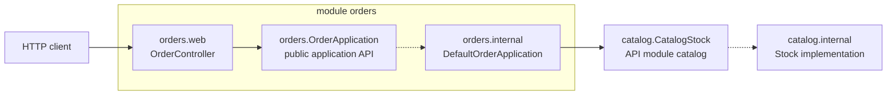
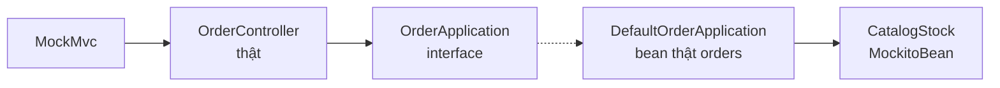

# Xác minh controller chỉ gọi public application API

## Mục tiêu học tập

Sau bài học, bạn có thể:

1. Phân biệt **public theo Java**, **API công bố của application module** và **application API phục vụ use case**.
2. Tổ chức web adapter để controller gọi một hợp đồng `OrderApplication` công khai, thay vì phụ thuộc trực tiếp vào repository, service triển khai hoặc lớp nội bộ.
3. Giải thích tại sao `ApplicationModules.verify()` không tự động áp đặt quy tắc **web → public application API** cho những lớp thuộc **cùng một module**.
4. Dùng **ArchUnit** kiểm tra package `orders.web` không tham chiếu `orders.internal` hoặc mã triển khai nội bộ của module khác.
5. Dùng **JUnit reflection** để khóa kiểu dependency được inject vào controller và **`@WebMvcTest` + `@MockitoBean`** để xác minh controller thực sự ủy quyền qua application API.
6. Dùng **`@ApplicationModuleTest` + `MockMvc`** kiểm thử controller cùng implementation thật của module, trong khi mock API của module khác.
7. Thiết lập quality gate CI kết hợp kiểm chứng cấu trúc, hợp đồng HTTP, sự kiện, database và tích hợp.

Bài thuộc chương **Web module testing** trong lộ trình **SPRING_MODULITH_VERIFICATION_TESTING**: rèn kỹ năng kiểm chứng ranh giới kiến trúc của Spring Modulith bằng `ApplicationModules`, các quy tắc phụ thuộc, `@ApplicationModuleTest` và các lớp kiểm thử runtime. Trọng tâm bài này không phải viết thêm một bài test HTTP tổng quát, mà là **chứng minh web adapter giao tiếp với application layer qua đúng cổng công khai**.

> **Phiên bản mã mẫu:** Java 17+, Spring Boot 3.4–3.5, Spring Framework 6.2, Spring Modulith 1.3–1.4, JUnit 5, Spring MVC và ArchUnit. Các package annotation test MVC có thể thay đổi ở Spring Boot 4; `@MockitoBean` trong ví dụ thuộc `org.springframework.test.context.bean.override.mockito` từ Spring Framework 6.2.

## 1. “Chỉ gọi public application API” nghĩa là gì?

Trong ứng dụng phân module, controller làm nhiệm vụ **web adapter**: nhận HTTP request, bind/validate dữ liệu, gọi use case và chuyển kết quả thành HTTP response.

Một quy tắc thiết kế hữu ích là:

> Khi cần thực hiện nghiệp vụ, controller chỉ phụ thuộc vào **hợp đồng application API có chủ đích được module công bố**, không gọi trực tiếp repository, entity manager, lớp triển khai use case hoặc implementation của module khác.

Quy tắc này **không cấm** controller sử dụng `ResponseEntity`, DTO, mapper hoặc thành phần validation trong web adapter. Từ “chỉ” giới hạn **đường đi từ web layer sang logic ứng dụng và hệ thống bên ngoài**, chứ không có nghĩa controller chỉ được gọi đúng một phương thức Java.

Ba khái niệm cần tách biệt:

| Khái niệm | Ví dụ | Điều nó bảo đảm |
| --- | --- | --- |
| **`public` theo Java** | `public class DefaultOrderService` | Package khác có thể tham chiếu nếu module Java/build cho phép |
| **API được Spring Modulith công bố** | Kiểu `public` trong base package `orders`; hoặc named interface | Module khác được phép tham chiếu theo ranh giới Modulith |
| **Application API được nhóm thiết kế** | `orders.OrderApplication` với `place(...)` | Web adapter gọi use case thông qua hợp đồng có chủ đích |

Một lớp `public` trong `orders.internal` **không tự thành API của application module**. Ngược lại, một `public OrderRepository` đặt ngay tại base package `orders` có thể vô tình nằm trong API mặc định của module, dù nhóm không muốn công bố repository.

**Kết luận:** Không thể chỉ dùng modifier `public` để suy rằng một lớp là application API nên được controller gọi.

## 2. Sơ đồ phụ thuộc mong muốn

Một cách tổ chức phù hợp:



Ký hiệu đường liền thể hiện dependency/call của tầng sử dụng; đường nét đứt thể hiện implementation đứng sau một interface. Về hướng phụ thuộc kiểu Java, **implementation phụ thuộc vào interface mà nó implements**, không phải interface `OrderApplication` tham chiếu ngược đến `DefaultOrderApplication`.

Theo quy tắc thiết kế của bài:

- `orders.web.OrderController` được phụ thuộc vào `orders.OrderApplication`, `orders.PlaceOrder`, `orders.OrderReceipt` và các kiểu hỗ trợ web.
- `orders.web` **không** trực tiếp phụ thuộc vào `orders.internal`.
- `orders.web` **không** trực tiếp phụ thuộc vào `catalog`; nếu use case cần danh mục, `orders.internal.DefaultOrderApplication` làm việc đó thông qua `catalog.CatalogStock`.
- `orders.internal` có thể gọi API `catalog` theo các quy tắc liên module, nhưng không được truy cập `catalog.internal`.

Một lời gọi trực tiếp từ controller sang `orders.internal.OrderRepository` có thể hợp lệ ở **cấp module** vì cả hai class vẫn thuộc `orders`. Tuy vậy, nó vi phạm **quy tắc phân tầng web → application API** mà chúng ta đang muốn thêm vào.

## 3. Cấu trúc ví dụ xuyên suốt

```text
src/main/java/com/acme/shop/
├── ShopApplication.java
├── catalog/
│   ├── CatalogStock.java                <- API công khai
│   └── internal/
│       └── DemoCatalogStock.java       <- implementation
└── orders/
    ├── OrderApplication.java           <- application API
    ├── PlaceOrder.java                  <- command công khai
    ├── OrderReceipt.java               <- kết quả công khai
    ├── internal/
    │   └── DefaultOrderApplication.java
    └── web/
        └── OrderController.java        <- HTTP adapter

src/test/java/com/acme/shop/
├── ModuleArchitectureTests.java
└── orders/
    ├── OrdersWebDependencyRulesTests.java
    ├── OrderControllerSignatureTests.java
    ├── OrderControllerSliceTests.java
    └── OrdersWebModuleTests.java
```

Đặt lớp ứng dụng ở package gốc:

```java
// src/main/java/com/acme/shop/ShopApplication.java
package com.acme.shop;

import org.springframework.boot.SpringApplication;
import org.springframework.boot.autoconfigure.SpringBootApplication;

@SpringBootApplication
public class ShopApplication {

    public static void main(String[] args) {
        SpringApplication.run(ShopApplication.class, args);
    }
}
```

Với cách phát hiện mặc định, `ApplicationModules.of(ShopApplication.class)` có các module `catalog` và `orders`; `orders.web` và `orders.internal` là **package con thuộc cùng module `orders`**.

### API của module catalog

```java
// src/main/java/com/acme/shop/catalog/CatalogStock.java
package com.acme.shop.catalog;

public interface CatalogStock {
    boolean hasEnough(String sku, int quantity);
}
```

Một implementation đơn giản để ví dụ có thể chạy trong ứng dụng hoàn chỉnh:

```java
// src/main/java/com/acme/shop/catalog/internal/DemoCatalogStock.java
package com.acme.shop.catalog.internal;

import com.acme.shop.catalog.CatalogStock;
import org.springframework.stereotype.Service;

@Service
class DemoCatalogStock implements CatalogStock {

    @Override
    public boolean hasEnough(String sku, int quantity) {
        return "BK-42".equals(sku) && quantity <= 5;
    }
}
```

Đây là implementation demo, **không phải persistence thực**. Trong module test `orders` với `STANDALONE`, bean này không được bootstrap; ta sẽ mock **chính interface công khai** `CatalogStock`.

## 4. Khai báo application API của orders

Hợp đồng nghiệp vụ được đặt trực tiếp ở **base package** `com.acme.shop.orders`:

```java
// src/main/java/com/acme/shop/orders/PlaceOrder.java
package com.acme.shop.orders;

public record PlaceOrder(String sku, int quantity) {}
```

```java
// src/main/java/com/acme/shop/orders/OrderReceipt.java
package com.acme.shop.orders;

public record OrderReceipt(
        String id, String sku, int quantity, String state) {
}
```

```java
// src/main/java/com/acme/shop/orders/OrderApplication.java
package com.acme.shop.orders;

public interface OrderApplication {
    OrderReceipt place(PlaceOrder command);
}
```

Đây là **public application API** của bài:

- `OrderApplication` mô tả **use case**, không lộ cách lưu dữ liệu hoặc gọi catalog.
- `PlaceOrder` là command rõ dữ liệu cần thiết để đặt hàng.
- `OrderReceipt` mô tả kết quả tối thiểu để web adapter tạo response.
- Không có tên implementation, repository hay Spring MVC type trong chữ ký hợp đồng.

Các kiểu trên được công bố ở cấp module Spring Modulith vì nằm trong base package `orders` và là `public`.

**Lưu ý:** Một kiểu nằm trong base package là API được framework nhận diện, nhưng vẫn cần nhóm thiết kế quyết định nó có thực sự là **application-facing API** hay không. Kiểm thử bên dưới sẽ khóa một số hợp đồng cụ thể thay vì dựa vào mọi kiểu `public` như nhau.

## 5. Implementation nghiệp vụ ở internal

```java
// src/main/java/com/acme/shop/orders/internal/DefaultOrderApplication.java
package com.acme.shop.orders.internal;

import com.acme.shop.catalog.CatalogStock;
import com.acme.shop.orders.OrderApplication;
import com.acme.shop.orders.OrderReceipt;
import com.acme.shop.orders.PlaceOrder;
import java.util.Locale;
import org.springframework.stereotype.Service;

@Service
class DefaultOrderApplication implements OrderApplication {

    private final CatalogStock stock;

    DefaultOrderApplication(CatalogStock stock) {
        this.stock = stock;
    }

    @Override
    public OrderReceipt place(PlaceOrder command) {
        if (!stock.hasEnough(command.sku(), command.quantity())) {
            throw new IllegalStateException("Stock unavailable");
        }

        String id = "ord-"
                + command.sku().toLowerCase(Locale.ROOT)
                + "-" + command.quantity();

        return new OrderReceipt(
                id, command.sku(), command.quantity(), "CREATED");
    }
}
```

`DefaultOrderApplication` để **package-private** để class ở `orders.web` không thể import trực tiếp theo quy tắc Java. Điều này giảm nguy cơ bypass interface từ bên ngoài package `internal`.

Nó vẫn là một Spring `@Service` có thể được tìm thấy qua component scanning. Spring có thể inject bean triển khai interface `OrderApplication` mà controller **không cần biết tên implementation**.

Để ví dụ tập trung vào ranh giới dependency, service dùng ID xác định trước và không có database. Trong production, cần sinh ID đúng cách, quản lý transaction, persistence và lỗi nghiệp vụ. `IllegalStateException` ở đây **chưa được ánh xạ thành HTTP error contract**; điều đó thuộc bài kiểm thử response/validation hoặc error advice riêng.

## 6. Controller chỉ gọi application API

```java
// src/main/java/com/acme/shop/orders/web/OrderController.java
package com.acme.shop.orders.web;

import com.acme.shop.orders.OrderApplication;
import com.acme.shop.orders.OrderReceipt;
import com.acme.shop.orders.PlaceOrder;
import jakarta.validation.Valid;
import jakarta.validation.constraints.Min;
import jakarta.validation.constraints.NotBlank;
import java.net.URI;
import org.springframework.http.ResponseEntity;
import org.springframework.web.bind.annotation.PostMapping;
import org.springframework.web.bind.annotation.RequestBody;
import org.springframework.web.bind.annotation.RequestMapping;
import org.springframework.web.bind.annotation.RestController;

@RestController
@RequestMapping("/orders")
public class OrderController {

    private final OrderApplication application;

    public OrderController(OrderApplication application) {
        this.application = application;
    }

    @PostMapping
    public ResponseEntity<CreatedOrderResponse> create(
            @Valid @RequestBody CreateOrderRequest request) {

        PlaceOrder command =
                new PlaceOrder(request.sku(), request.quantity());

        OrderReceipt receipt = application.place(command);

        return ResponseEntity
                .created(URI.create("/orders/" + receipt.id()))
                .body(new CreatedOrderResponse(
                        receipt.id(),
                        receipt.sku(),
                        receipt.quantity(),
                        receipt.state()));
    }

    public record CreateOrderRequest(
            @NotBlank String sku,
            @Min(1) int quantity) {
    }

    public record CreatedOrderResponse(
            String id,
            String sku,
            int quantity,
            String state) {
    }
}
```

Quan sát **phần import và constructor**:

- Controller dùng `orders.OrderApplication`, `orders.PlaceOrder`, `orders.OrderReceipt`.
- Controller **không** import `orders.internal.DefaultOrderApplication`.
- Controller **không** gọi `catalog.CatalogStock` hoặc `catalog.internal.DemoCatalogStock`.
- Spring MVC DTO `CreateOrderRequest` và `CreatedOrderResponse` là chi tiết **web layer**; controller chuyển chúng qua command/result ở application boundary.

Trong Spring Modulith, `OrderController` nằm ở `orders.web` nên là **kiểu nội bộ ở cấp Java API của module** theo mặc định. Tuy vậy, nó vẫn công bố một **HTTP endpoint** cho client. API HTTP và API Java liên module là **hai bề mặt khác nhau**.

### Hai luồng phụ thuộc cần phân biệt

```text
HTTP client
   |
   v
OrderController [web adapter]
   |
   |  chỉ gọi OrderApplication.place(PlaceOrder)
   v
OrderApplication [public application API]
   ^
   |  implements
   |
DefaultOrderApplication [internal implementation]
   |
   |  dùng CatalogStock.hasEnough(...)
   v
CatalogStock [API của module catalog]
```

Tại runtime, controller nhận một instance triển khai `OrderApplication`. Ở cấp dependency Java, **controller trỏ về interface**, còn implementation **implements interface**. Đây là điểm quan trọng để thay đổi implementation mà không kéo repository hay chi tiết persistence vào web adapter.

## 7. Ví dụ thiết kế sai: web adapter gọi internal

Một anti-pattern hay gặp:

```java
// MINH HỌA SAI — không đưa vào ứng dụng mẫu
package com.acme.shop.orders.web;

import com.acme.shop.orders.internal.PublicOrderRepository;
import org.springframework.web.bind.annotation.GetMapping;
import org.springframework.web.bind.annotation.RestController;

@RestController
class BadOrderController {

    private final PublicOrderRepository repository;

    BadOrderController(PublicOrderRepository repository) {
        this.repository = repository;
    }

    @GetMapping("/orders/count")
    long countOrders() {
        return repository.count();
    }
}
```

Đoạn code này giả định có `public PublicOrderRepository` trong `orders.internal`. Tên `Public...` và modifier `public` **không khiến repository trở thành application API**. Controller đang bỏ qua `OrderApplication`, phụ thuộc vào chi tiết lưu trữ và có nguy cơ mang quy tắc persistence lên HTTP layer.

Điểm tinh vi: vì `orders.web` và `orders.internal` thuộc **cùng module `orders`**, một kiểm tra `ApplicationModules.verify()` có thể vẫn **xanh**. Spring Modulith chủ yếu áp quy tắc giữa **các module được nhận diện**, không mặc định ép mọi class cùng module phải giao tiếp qua interface ở base package.

Đây là lý do phải bổ sung **quy tắc ArchUnit cấp package/layer** nếu đội muốn bảo vệ thiết kế này tự động.

## 8. Kiểm tra vị trí controller và API bằng ApplicationModules

Bài test thuần kiến trúc:

```java
// src/test/java/com/acme/shop/ModuleArchitectureTests.java
package com.acme.shop;

import static org.junit.jupiter.api.Assertions.assertEquals;

import com.acme.shop.orders.OrderApplication;
import com.acme.shop.orders.web.OrderController;
import org.junit.jupiter.api.Test;
import org.springframework.modulith.core.ApplicationModules;

class ModuleArchitectureTests {

    @Test
    void controllerAndApplicationApiBelongToOrders() {
        ApplicationModules modules =
                ApplicationModules.of(ShopApplication.class);

        assertEquals("orders", modules
                .getModuleByType(OrderController.class)
                .orElseThrow()
                .getIdentifier().toString());

        assertEquals("orders", modules
                .getModuleByType(OrderApplication.class)
                .orElseThrow()
                .getIdentifier().toString());

        assertEquals("orders", modules
                .getModuleForPackage("com.acme.shop.orders.web")
                .orElseThrow()
                .getIdentifier().toString());
    }

    @Test
    void crossModuleDependenciesMustRespectBoundaries() {
        ApplicationModules.of(ShopApplication.class).verify();
    }
}
```

Hai phương thức test có **giá trị khác nhau**:

| Kiểm tra | Khẳng định được | Không khẳng định được |
| --- | --- | --- |
| `getModuleByType(...)` | Controller và interface được gán đúng module `orders` | Controller có đang gọi `orders.internal` không |
| `getModuleForPackage(...)` | Package web thuộc đúng module | Có đúng một application API được inject không |
| `verify()` | Các module không vi phạm các ranh giới được Spring Modulith kiểm tra | Adapter trong **cùng module** chỉ đi qua application interface |

**Phân biệt quy tắc framework và quy tắc của nhóm:** Spring Modulith cho phép các class trong cùng module tương tác nội bộ; chính sách “controller chỉ gọi public application API” là **ràng buộc bổ sung**, không phải mặc định `verify()` đã bao phủ.

## 9. ArchUnit: cấm web adapter tham chiếu implementation nội bộ

ArchUnit kiểm tra **phụ thuộc giữa các kiểu Java**: field, constructor, method call, chữ ký phương thức, annotation và nhiều loại tham chiếu được phân tích từ bytecode.

Thêm ArchUnit vào test classpath. Nếu dự án dùng BOM quản lý phiên bản tương thích:

```groovy
dependencies {
    implementation 'org.springframework.boot:spring-boot-starter-web'
    implementation 'org.springframework.boot:spring-boot-starter-validation'
    implementation 'org.springframework.modulith:spring-modulith-starter-core'

    testImplementation 'org.springframework.boot:spring-boot-starter-test'
    testImplementation 'org.springframework.modulith:spring-modulith-starter-test'
    testImplementation 'com.tngtech.archunit:archunit-junit5'
}
```

Nếu dependency management của dự án không quản lý version ArchUnit, khai báo phiên bản tương thích một cách tường minh; không giả định mọi BOM đều quản lý mọi artifact.

### Quy tắc 1 — `orders.web` không được phụ thuộc `orders.internal`

```java
// src/test/java/com/acme/shop/orders/OrdersWebDependencyRulesTests.java
package com.acme.shop.orders;

import static com.tngtech.archunit.lang.syntax.ArchRuleDefinition.noClasses;

import com.tngtech.archunit.core.importer.ClassFileImporter;
import com.tngtech.archunit.core.importer.ImportOption;
import org.junit.jupiter.api.Test;

class OrdersWebDependencyRulesTests {

    @Test
    void webAdapterMustNotDependOnOrdersImplementation() {
        var imported = new ClassFileImporter()
                .withImportOption(
                        ImportOption.Predefined.DO_NOT_INCLUDE_TESTS)
                .importPackages("com.acme.shop");

        noClasses()
                .that().resideInAPackage(
                        "com.acme.shop.orders.web..")
                .should().dependOnClassesThat()
                .resideInAPackage(
                        "com.acme.shop.orders.internal..")
                .check(imported);
    }
}
```

Nếu ai đó sửa `OrderController` để inject `PublicOrderRepository` nằm trong `orders.internal.persistence`, ArchUnit sẽ phát hiện **dependency từ web package vào internal package**, ngay cả khi repository được khai báo `public`.

Quy tắc `dependOnClassesThat()` rộng hơn việc chỉ dò câu lệnh `import` trong source code: nó làm việc trên **quan hệ class được tìm thấy khi import bytecode**. Một dòng import không sử dụng thường không đủ để tạo dependency thực tế; ngược lại, tham chiếu thể hiện trong constructor hoặc lời gọi method sẽ được phân tích.

### Quy tắc 2 — Controller không gọi trực tiếp module catalog

Giả sử đội quy định mọi nghiệp vụ của endpoint đặt hàng phải đi qua `OrderApplication`. Khi đó web adapter không được bypass application layer để gọi `CatalogStock`:

```java
@Test
void webAdapterMustNotCallCatalogDirectly() {
    var imported = new ClassFileImporter()
            .withImportOption(
                    ImportOption.Predefined.DO_NOT_INCLUDE_TESTS)
            .importPackages("com.acme.shop");

    noClasses()
            .that().resideInAPackage(
                    "com.acme.shop.orders.web..")
            .should().dependOnClassesThat()
            .resideInAPackage(
                    "com.acme.shop.catalog..")
            .check(imported);
}
```

Đây là **phương thức test bổ sung** trong lớp `OrdersWebDependencyRulesTests`. Quy tắc này mạnh hơn `verify()`: một controller dùng `catalog.CatalogStock` trực tiếp có thể **được Spring Modulith cho phép** vì `CatalogStock` nằm trong API module `catalog`; tuy nhiên nó vi phạm **chính sách controller chỉ điều phối qua OrderApplication** của đội.

Không có một quy tắc mặc định áp dụng tốt cho mọi hệ thống. Một số web adapter chủ đích tổng hợp dữ liệu từ nhiều application API; khi đó đội phải chọn hợp đồng khác hoặc đặt orchestration vào một application service rõ trách nhiệm.

### Có thể gom hai quy tắc không?

Có. Ví dụ cấm web package phụ thuộc vào cả internal module mình và internal module khác:

```java
noClasses()
        .that().resideInAPackage("com.acme.shop.orders.web..")
        .should().dependOnClassesThat()
        .resideInAnyPackage(
                "com.acme.shop.orders.internal..",
                "com.acme.shop.catalog.internal..")
        .check(imported);
```

Đoạn code này tập trung vào **implementation internals**. Nó chưa cấm `orders.web → catalog.CatalogStock` vì đó là public API module catalog; muốn khóa chính sách **controller chỉ đi qua OrderApplication**, giữ thêm quy tắc 2.

### Giới hạn của luật package

Các luật trên không tự đánh giá **ý nghĩa nghiệp vụ** của một interface. Nếu ai đó tạo `public OrderRepository` trong base package `orders` rồi cho controller inject interface này, luật “không vào `internal`” sẽ vẫn xanh. Đây là lý do cần **hợp đồng constructor và API inventory** ở phần tiếp theo.

ArchUnit cũng không chứng minh một dependency được gọi bao nhiêu lần ở runtime hoặc có dùng reflection/dynamic lookup để lấy bean hay không. Với những cơ chế động, cần kiểm thử bổ sung và code review.

## 10. Khóa constructor: controller chỉ inject `OrderApplication`

Một assertion JUnit nhỏ có thể cố định **điểm mà controller đi vào application layer**:

```java
// src/test/java/com/acme/shop/orders/OrderControllerSignatureTests.java
package com.acme.shop.orders;

import static org.junit.jupiter.api.Assertions.assertArrayEquals;
import static org.junit.jupiter.api.Assertions.assertEquals;

import com.acme.shop.orders.web.OrderController;
import org.junit.jupiter.api.Test;

class OrderControllerSignatureTests {

    @Test
    void controllerInjectsOnlyPublishedApplicationPort() {
        var constructors =
                OrderController.class.getDeclaredConstructors();

        assertEquals(1, constructors.length);
        assertArrayEquals(
                new Class<?>[]{OrderApplication.class},
                constructors[0].getParameterTypes());
    }
}
```

Nếu developer đổi constructor thành:

```java
// Minh họa một thay đổi cần bị từ chối:
public OrderController(
        OrderApplication application,
        CatalogStock stock) {
    // ...
}
```

test chữ ký sẽ thất bại vì controller không còn chỉ inject `OrderApplication`. Luật ArchUnit ở phần trước cũng phát hiện dependency `orders.web → catalog`.

**Giới hạn:** Test constructor chỉ bảo vệ chữ ký dependency injection. Nó không phát hiện mọi cách gọi static method, factory hoặc `ApplicationContext.getBean(...)`. Vì vậy, đây là **một lớp hợp đồng bổ sung**, không thể thay thế quy tắc ArchUnit hoặc review.

Trong dự án lớn, có thể xây một rule kiểm tra mọi `@RestController` trong một namespace được định nghĩa và cho phép một **tập application interfaces** thay vì khóa từng lớp; ví dụ tập `OrderApplication`, `OrderQuery` nếu module thiết kế hai cổng. Nhưng nên xác định tập đó từ **thiết kế use case**, không tự cho phép mọi interface vì tên package khớp.

## 11. Khóa bề mặt API mặc định

Spring Modulith xem các kiểu `public` trong base package là API mặc định của module. Nếu đội dự kiến base package `orders` chỉ chứa `OrderApplication`, `PlaceOrder` và `OrderReceipt`, hãy bổ sung test inventory cho những kiểu public này.

```java
package com.acme.shop.orders;

import static org.junit.jupiter.api.Assertions.assertEquals;

import com.tngtech.archunit.core.domain.JavaModifier;
import com.tngtech.archunit.core.importer.ClassFileImporter;
import com.tngtech.archunit.core.importer.ImportOption;
import java.util.Set;
import java.util.stream.Collectors;
import org.junit.jupiter.api.Test;

class OrdersPublishedApiInventoryTests {

    @Test
    void publicTypesInOrdersBasePackageStayIntentional() {
        var imported = new ClassFileImporter()
                .withImportOption(
                        ImportOption.Predefined.DO_NOT_INCLUDE_TESTS)
                .importPackages("com.acme.shop.orders");

        Set<String> publicBaseTypes = imported.stream()
                .filter(type -> type.getPackageName()
                        .equals("com.acme.shop.orders"))
                .filter(type -> type.getModifiers()
                        .contains(JavaModifier.PUBLIC))
                .map(type -> type.getName())
                .collect(Collectors.toSet());

        assertEquals(Set.of(
                "com.acme.shop.orders.OrderApplication",
                "com.acme.shop.orders.PlaceOrder",
                "com.acme.shop.orders.OrderReceipt"
        ), publicBaseTypes);
    }
}
```

Nếu developer đưa `public OrderRepository` hoặc một public implementation khác ra base package, test này yêu cầu nhóm **xem xét và cập nhật hợp đồng có chủ đích**, thay vì vô tình mở thêm API module.

Chú ý:

- Luật là ví dụ cho package mẫu **chỉ có ba kiểu public**. Khi có `package-info`, shared API, nested classes hoặc các kiểu mới hợp lệ, hãy điều chỉnh chính sách.
- So sánh toàn bộ tập `Set` phù hợp với module có hợp đồng đóng, ít thay đổi. Với module cần mở rộng thường xuyên, có thể kiểm tra những kiểu **bắt buộc** và dùng review cho kiểu mới.
- Đây không phải một lệnh gọi API chính thức “liệt kê public application APIs của Spring Modulith”. Ta dùng ArchUnit đọc classpath để xây **quy tắc đội tự chọn**.

### Named interface thì sao?

Không phải application API nào cũng phải nằm trực tiếp ở base package. Spring Modulith cho phép công bố package con có `@NamedInterface`:

```java
// Ví dụ thay thế nếu muốn đặt API trong orders.application
@org.springframework.modulith.NamedInterface("application")
package com.acme.shop.orders.application;
```

Khi đó `OrderApplication` có thể nằm trong `orders.application` và được công bố qua named interface cho **module khác**. Tuy nhiên, controller **trong chính `orders`** vẫn có quyền truy cập nội bộ theo Java nếu visibility cho phép. Named interface **không tự ép** controller chỉ gọi giao diện application; nếu đặt API ở package khác, phải sửa lại **quy tắc ArchUnit và inventory** cho đúng thiết kế.

## 12. `@WebMvcTest`: chứng minh controller gọi đúng application port

Kiểm tra kiến trúc cho biết controller **được phép phụ thuộc vào những lớp nào**. Để kiểm tra khi một HTTP request tới, controller **có thực sự gọi `OrderApplication.place(...)` với command đúng không**, ta dùng Spring MVC slice test:

```java
// src/test/java/com/acme/shop/orders/OrderControllerSliceTests.java
package com.acme.shop.orders;

import static org.mockito.BDDMockito.given;
import static org.mockito.BDDMockito.then;
import static org.springframework.test.web.servlet.request
        .MockMvcRequestBuilders.post;
import static org.springframework.test.web.servlet.result
        .MockMvcResultMatchers.jsonPath;
import static org.springframework.test.web.servlet.result
        .MockMvcResultMatchers.status;

import com.acme.shop.orders.web.OrderController;
import org.junit.jupiter.api.Test;
import org.springframework.beans.factory.annotation.Autowired;
import org.springframework.boot.test.autoconfigure.web.servlet.WebMvcTest;
import org.springframework.http.MediaType;
import org.springframework.test.context.bean.override.mockito.MockitoBean;
import org.springframework.test.web.servlet.MockMvc;

@WebMvcTest(controllers = OrderController.class)
class OrderControllerSliceTests {

    @Autowired
    MockMvc mvc;

    @MockitoBean
    OrderApplication application;

    @Test
    void delegatesValidatedCommandToPublicApplicationApi()
            throws Exception {

        var command = new PlaceOrder("BK-42", 2);
        var receipt = new OrderReceipt(
                "ord-bk-42-2", "BK-42", 2, "CREATED");

        given(application.place(command)).willReturn(receipt);

        mvc.perform(post("/orders")
                .contentType(MediaType.APPLICATION_JSON)
                .content("""
                        {"sku":"BK-42","quantity":2}
                        """))
                .andExpect(status().isCreated())
                .andExpect(jsonPath("$.id")
                        .value("ord-bk-42-2"));

        then(application).should().place(command);
    }
}
```

Giải thích:

1. `@WebMvcTest` khởi tạo **MVC slice** của controller, không chạy `DefaultOrderApplication` thật.
2. `@MockitoBean OrderApplication` thay thế cổng application để test chỉ tập trung vào **web adapter**.
3. JUnit gửi JSON, Spring MVC bind vào `CreateOrderRequest`, controller tạo `PlaceOrder`.
4. `then(application).should().place(command)` xác minh command thực sự được gửi tới đúng interface.
5. Spring MVC serialize kết quả để trả HTTP 201 và JSON.

Đây là cách kiểm chứng **hành vi ủy quyền qua interface**. Nó không chứng minh service thật hoạt động, không chứng minh database đã lưu và cũng không đủ ngăn một controller đồng thời gọi implementation khác ở đường code chưa được test. Vì vậy vẫn cần ArchUnit.

### Bảo vệ validation ở web boundary

```java
@Test
void invalidRequestNeverCallsApplicationApi() throws Exception {
    mvc.perform(post("/orders")
            .contentType(MediaType.APPLICATION_JSON)
            .content("""
                    {"sku":"","quantity":0}
                    """))
            .andExpect(status().isBadRequest());

    then(application).shouldHaveNoInteractions();
}
```

Đoạn trên là phương thức bổ sung **trong `OrderControllerSliceTests`**. Nó cần Bean Validation starter/provider trên classpath. Mục tiêu là xác nhận dữ liệu không hợp lệ không được chuyển qua application boundary.

Nếu có Spring Security, test POST có thể nhận HTTP 401/403 vì chưa xác thực hoặc thiếu CSRF; khi đó hãy cấu hình test principal/CSRF theo chính sách thật thay vì tắt mọi filter để được 201.

## 13. `@ApplicationModuleTest`: chạy service thật nhưng giữ ranh giới module

Sau khi kiểm tra controller riêng, tiếp tục kiểm tra **toàn bộ module `orders`** với implementation thật của application API:

```java
// src/test/java/com/acme/shop/orders/OrdersWebModuleTests.java
package com.acme.shop.orders;

import static org.mockito.BDDMockito.given;
import static org.mockito.BDDMockito.then;
import static org.springframework.test.web.servlet.request
        .MockMvcRequestBuilders.post;
import static org.springframework.test.web.servlet.result
        .MockMvcResultMatchers.jsonPath;
import static org.springframework.test.web.servlet.result
        .MockMvcResultMatchers.status;

import com.acme.shop.catalog.CatalogStock;
import org.junit.jupiter.api.Test;
import org.springframework.beans.factory.annotation.Autowired;
import org.springframework.boot.test.autoconfigure.web.servlet.AutoConfigureMockMvc;
import org.springframework.http.MediaType;
import org.springframework.modulith.test.ApplicationModuleTest;
import org.springframework.test.context.bean.override.mockito.MockitoBean;
import org.springframework.test.web.servlet.MockMvc;

@ApplicationModuleTest
@AutoConfigureMockMvc
class OrdersWebModuleTests {

    @Autowired
    MockMvc mvc;

    @MockitoBean
    CatalogStock stock;

    @Test
    void controllerUsesRealApplicationServiceThroughItsPort()
            throws Exception {

        given(stock.hasEnough("BK-42", 2)).willReturn(true);

        mvc.perform(post("/orders")
                .contentType(MediaType.APPLICATION_JSON)
                .content("""
                        {"sku":"BK-42","quantity":2}
                        """))
                .andExpect(status().isCreated())
                .andExpect(jsonPath("$.id")
                        .value("ord-bk-42-2"))
                .andExpect(jsonPath("$.state")
                        .value("CREATED"));

        then(stock).should().hasEnough("BK-42", 2);
    }
}
```

Lúc này:

- `@ApplicationModuleTest` mặc định `STANDALONE` và `webEnvironment = MOCK`, nên bootstraps các bean của **module `orders`**.
- `@AutoConfigureMockMvc` cung cấp `MockMvc`.
- `OrderController` nhận **bean `OrderApplication` thật** được cung cấp bởi `DefaultOrderApplication` trong `orders.internal`.
- `@MockitoBean CatalogStock` thay thế cổng API của module `catalog` khi module này không được bootstrap.
- Assertion `stock.hasEnough(...)` chứng minh luồng HTTP đi qua implementation module thật đến **public API của module ngoài**, nhưng vẫn không khởi tạo implementation `catalog.internal`.



**Không nhầm hai mục tiêu test:**

| `@WebMvcTest` | `@ApplicationModuleTest` |
| --- | --- |
| Controller thật + **mock OrderApplication** | Controller thật + **service OrderApplication thật** |
| Xác minh mapping, DTO và lời gọi vào application port | Xác minh wiring/call flow bên trong module |
| Không cần `CatalogStock` vì service thật không chạy | Cần mock `CatalogStock` hoặc bootstrap module `catalog` |
| Nhanh và hẹp theo MVC slice | Rộng hơn, theo ranh giới module |

Hai kiểu test bổ sung cho nhau. **Đừng đặt `@WebMvcTest` và `@ApplicationModuleTest` trên cùng một lớp**, vì đó là hai cơ chế bootstrap khác nhau. Mỗi test nên có một mục tiêu rõ ràng.

## 14. Vì sao `verify()` vẫn cần, nhưng chưa đủ?

`ApplicationModules.verify()` kiểm tra những ràng buộc Spring Modulith nhận diện, điển hình như:

1. Không có **phụ thuộc vòng** giữa các module.
2. Không truy cập trái phép vào **kiểu nội bộ của module khác** khi module được cấu hình đóng.
3. Tuân thủ giới hạn `allowedDependencies` nếu đã khai báo.

Ví dụ:

```java
ApplicationModules.of(ShopApplication.class).verify();
```

Kết quả:

| Phụ thuộc | `verify()` có thể phát hiện sai phạm? | Luật bổ sung nào cần thiết? |
| --- | --- | --- |
| `orders.internal → catalog.CatalogStock` | Hợp lệ nếu API catalog được công bố và không vi phạm hạn chế khác | Không cần cấm nếu là hợp đồng thiết kế |
| `orders.internal → catalog.internal.DemoCatalogStock` | Có, vì đi vào phần nội bộ module khác | `verify()` bảo vệ ranh giới liên module |
| `orders.web → orders.internal.PublicOrderRepository` | **Không tự động**, vì cùng module `orders` | ArchUnit cấm web → internal |
| `orders.web → catalog.CatalogStock` | **Có thể hợp lệ**, vì public API module khác | ArchUnit cấm web gọi module ngoài, buộc đi qua `OrderApplication` |
| Controller inject `OrderApplication` **và** một interface thứ hai trong base package orders | Vẫn có thể hợp lệ ở cấp module | JUnit constructor signature và review các application port được phép |
| Controller dùng `ApplicationContext.getBean(...)` bằng reflection/dynamic lookup | Không có bảo đảm phát hiện mọi mục tiêu runtime | Test runtime, giới hạn service locator và code review |

Đặc biệt, **API của module** và **hợp đồng application API dành cho controller** không luôn trùng nhau. Module `orders` có thể công bố một `OrderQuery` cho các module khác, nhưng controller tạo đơn chỉ nên được inject `OrderApplication`. Thiết kế này là **quy ước của nhóm** và cần test phù hợp.

## 15. Kiểm tra khi API đặt ở named interface

Một ứng dụng lớn có thể đặt application-facing API vào package con thay vì base package:

```text
orders/
├── package-info.java
├── application/
│   ├── package-info.java         <- @NamedInterface("application")
│   └── OrderApplication.java
├── internal/
└── web/
```

```java
// src/main/java/com/acme/shop/orders/application/package-info.java
@org.springframework.modulith.NamedInterface("application")
package com.acme.shop.orders.application;
```

Annotation này công bố một **named interface của module orders**, không biến `orders.application` thành application module độc lập.

Các module khác có thể được cấp quyền sử dụng named interface theo cấu hình:

```java
// Ví dụ trong package-info.java của module sử dụng API đó
@org.springframework.modulith.ApplicationModule(
        allowedDependencies = "orders :: application")
package com.acme.shop.billing;
```

**Nhưng đối với controller trong chính module `orders`**, annotation named interface không tự giới hạn loại lớp mà controller gọi. ArchUnit và test hợp đồng constructor vẫn cần chỉnh theo ranh giới mong muốn, ví dụ cho phép `orders.application.OrderApplication` nhưng không cho phép `orders.internal.*`.

Nếu đang dùng cấu trúc ví dụ ở mục 3–13, **không áp đồng thời** quy tắc package mới này mà không di chuyển `OrderApplication` và cập nhật imports, test. Đây là một **phương án tổ chức thay thế**, không phải yêu cầu thêm annotation vào cùng bản mẫu.

## 16. Cách thiết kế quality gate trong CI

Một quality gate phù hợp nên có bốn lớp:

| Lớp kiểm tra | Công cụ | Mục tiêu |
| --- | --- | --- |
| **Cấu trúc module** | `ApplicationModules.of(...).verify()` | Ranh giới giữa `orders` và `catalog` hợp lệ |
| **Quy tắc web → application** | ArchUnit | `orders.web` không gọi `orders.internal`, không bypass `orders` để gọi catalog |
| **Hợp đồng controller** | Reflection JUnit + `@WebMvcTest` | Chỉ inject application port được phê duyệt; HTTP request gọi đúng API |
| **Tích hợp trong module** | `@ApplicationModuleTest` + MockMvc | Controller + application service thật phối hợp, API ngoài module được mock có chủ đích |

Với Gradle đã cấu hình JUnit 5 và dependencies:

```bash
./gradlew test
```

Hoặc Maven:

```bash
./mvnw test
```

Trên CI, cần bảo đảm các lớp test kiến trúc, slice test và module test đều nằm trong **task/profile thực sự được chạy**. Nếu integration tests sử dụng Testcontainers, database hoặc broker ở một task riêng, hãy cấu hình quality gate chạy thêm task đó khi có thay đổi liên quan.

### Ví dụ một pull request cố tình vi phạm

Giả sử developer sửa `OrderController` để gọi thẳng một public repository tại `orders.internal.persistence`:

| Test | Kết quả có thể thấy | Ý nghĩa |
| --- | --- | --- |
| `ApplicationModules.verify()` | Vẫn xanh | Đây là phụ thuộc **bên trong orders** |
| ArchUnit `webAdapterMustNotDependOnOrdersImplementation` | **Đỏ** | Web adapter đang truy cập implementation nội bộ |
| `controllerInjectsOnlyPublishedApplicationPort` | **Đỏ** nếu constructor bị đổi | Controller đã thêm dependency ngoài hợp đồng |
| `@WebMvcTest` | Có thể đỏ vì thiếu mock hoặc lời gọi khác | Hợp đồng tương tác với application port thay đổi |
| `@ApplicationModuleTest` | Có thể vẫn xanh nếu flow trả response đúng | Kiểm thử chức năng không thay thế ranh giới kiến trúc |

Không sửa test chỉ để “xanh trở lại” bằng cách cho phép mọi package `internal`. Hãy quyết định: phụ thuộc mới có đúng thiết kế không? Nếu cần thêm application use case, mở rộng **public application API** và cập nhật các kiểm tra theo quyết định kiến trúc.

### Khi thêm endpoint mới

Khi nhóm bổ sung `GET /orders/{id}`, có thể thiết kế thêm `OrderQuery` làm API truy vấn, thay vì cho controller inject repository:

```java
// Ví dụ public application API mới tại com.acme.shop.orders
package com.acme.shop.orders;

import java.util.Optional;

public interface OrderQuery {
    Optional<OrderReceipt> findById(String id);
}
```

Sau khi phê duyệt use case mới:

1. Cập nhật API inventory nếu đang khóa danh sách kiểu public.
2. Cập nhật constructor rule để cho phép `OrderApplication` và `OrderQuery`, thay vì cấm mọi phụ thuộc mới.
3. Giữ nguyên luật ArchUnit cấm controller tham chiếu `orders.internal`.
4. Thêm `@WebMvcTest` và `@ApplicationModuleTest` cho endpoint mới.

Quality gate nên **bảo vệ kiến trúc có chủ đích**, không biến mọi thay đổi API hợp lệ thành lỗi không thể xử lý.

## 17. Chẩn đoán những nhầm lẫn thường gặp

| Hiện tượng | Nguyên nhân có thể | Hướng xử lý |
| --- | --- | --- |
| `verify()` xanh nhưng controller inject repository | Repository và controller ở cùng `orders` | Bổ sung ArchUnit rule web → internal và constructor contract |
| Lớp `public` trong `orders.internal` bị tưởng là API | Nhầm Java visibility với Spring Modulith API | Đọc base package/named interfaces; không dùng `public` đơn độc |
| Đặt interface ở `orders.application` nhưng module khác không dùng được | Package con mặc định là nội bộ | Công bố named interface hoặc chuyển API về base package |
| Controller nằm ở `orders.web` nhưng API vẫn gọi được từ HTTP | API Java module và API HTTP khác nhau | Hiểu rằng kiểu controller nội bộ vẫn có thể phục vụ route |
| `@WebMvcTest` không tìm thấy `OrderApplication` | MVC slice không bootstrap service nghiệp vụ | Dùng `@MockitoBean OrderApplication` |
| `@ApplicationModuleTest` thiếu bean `CatalogStock` | `STANDALONE` không bootstrap `catalog` | Dùng `@MockitoBean CatalogStock` hoặc mở rộng bootstrap có mục tiêu |
| HTTP test xanh nhưng ArchUnit đỏ | Endpoint chạy đúng nhưng bypass ranh giới tầng | Sửa dependency để controller gọi application port |
| ArchUnit đỏ sau refactor hợp lệ | Package/API hoặc quy tắc đã đổi theo quyết định mới | Xem lại hợp đồng và cập nhật test có giải thích |
| Test validation trả 403 thay vì 400 | Spring Security/CSRF chạy trước validation | Cung cấp principal/CSRF phù hợp thay vì tắt security tùy tiện |
| Module test chạy nhưng database/sự kiện lỗi ở production | Bản mẫu dùng mock hoặc không có persistence | Thêm test transaction, event, database, integration |
| Controller dùng reflection/service locator mà ArchUnit không bắt hết | Phân tích tĩnh có giới hạn với dependency động | Tránh service locator khi không cần; thêm review và kiểm thử runtime |

### Quy trình điều tra

1. **Nhìn dependency constructor và import** của controller. Có `OrderApplication` hay có implementation/repository?
2. **Xác nhận module owner** bằng `ApplicationModules.getModuleByType(...)` và kiểm tra `verify()`.
3. **Chạy ArchUnit** với rule web → internal và web → module ngoài theo hợp đồng.
4. **Chạy MVC slice test** để xác nhận request gọi đúng application port.
5. **Chạy module integration test** để xác nhận controller và service thật trong module phối hợp.
6. **Nếu có side effect**, chạy thêm test database, sự kiện và tích hợp phù hợp.

## 18. Bài thực hành

**Bối cảnh:** Đội đang review module `orders`. Một developer muốn rút ngắn code bằng cách inject repository hoặc `CatalogStock` trực tiếp vào `OrderController`. Bạn cần thiết kế kiểm thử để chỉ cho phép controller gọi **application API đã được công bố và phê duyệt**.

**Nhiệm vụ:**

1. Tạo `ShopApplication`, hai module `orders`, `catalog` và cây package ở mục 3.
2. Tạo `OrderApplication`, `PlaceOrder`, `OrderReceipt` tại base package `orders`; đặt implementation ở `orders.internal`.
3. Tạo `OrderController` tại `orders.web`, chỉ inject `OrderApplication`.
4. Viết `ModuleArchitectureTests` để xác nhận owner của controller/interface và chạy `verify()`.
5. Viết ArchUnit rule cấm `orders.web → orders.internal`; thêm rule cấm `orders.web → catalog` nếu đó là chính sách team.
6. Viết `OrderControllerSignatureTests` xác nhận chỉ có constructor với tham số `OrderApplication`.
7. Dùng `@WebMvcTest(OrderController.class)` và `@MockitoBean OrderApplication`; gửi POST JSON, kiểm tra 201 và xác minh `place(PlaceOrder)` được gọi.
8. Dùng `@ApplicationModuleTest` + `MockMvc`, mock `CatalogStock` để test controller và implementation thật của `orders`.
9. Trên nhánh thực hành, tạo `public PublicOrderRepository` ở `orders.internal`, rồi cho controller phụ thuộc trực tiếp vào class này. Quan sát **`verify()` có thể vẫn xanh**, trong khi ArchUnit và constructor rule thất bại. Khôi phục đúng ranh giới.
10. Thử cho controller inject `CatalogStock` trực tiếp; so sánh kết quả `verify()` và luật web → catalog.
11. Thêm một API truy vấn mới `OrderQuery` theo use case thật; cập nhật inventory/constructor assertion **có chủ đích** và chạy lại CI.
12. Nếu module lưu đơn vào database hay phát `OrderPlaced`, tạo thêm test persistence/transaction và event; không xem kết quả HTTP 201 là bằng chứng các tác vụ đó đã hoàn tất.

**Tiêu chí hoàn thành:** Bạn giải thích được vì sao `public` không đủ để định nghĩa application API; viết được rule cấm controller tham chiếu implementation; kiểm tra cả chữ ký và hành vi controller; chứng minh cùng module vẫn cần policy phân tầng bổ sung ngoài `verify()`; đồng thời tích hợp các kiểm thử vào quality gate.

## 19. Câu hỏi tự kiểm tra

1. Lớp `public OrderRepository` nằm trong `orders.internal` có tự trở thành API được Spring Modulith công bố không?
2. Vì sao controller và repository cùng thuộc `orders` có thể không bị `verify()` từ chối dù controller gọi repository trực tiếp?
3. Sự khác nhau giữa **Java public**, **application module API** và **application use-case API** là gì?
4. ArchUnit rule `noClasses().that().resideInAPackage("..orders.web..").should().dependOnClassesThat().resideInAPackage("..orders.internal..")` bảo vệ điều gì?
5. Vì sao cần kiểm tra constructor của `OrderController` nếu đã có ArchUnit cấm import `internal`?
6. `@WebMvcTest` với `@MockitoBean OrderApplication` chứng minh điều gì mà test `ApplicationModules.getModuleByType(...)` không thể chứng minh?
7. `@ApplicationModuleTest` với `@MockitoBean CatalogStock` khác gì với `@WebMvcTest` mock `OrderApplication`?
8. Named interface giúp module **khác** truy cập API ở package con ra sao? Nó có tự cấm controller cùng module truy cập internal không?
9. Tại sao một test HTTP 201 không thể thay thế test kiến trúc, sự kiện hoặc transaction?
10. Khi thêm `OrderQuery` theo use case mới, cần cập nhật và giữ nguyên những quy tắc quality gate nào?

## Tổng kết

Để **xác minh controller chỉ gọi public application API**, cần nhiều hơn một HTTP test hoặc `ApplicationModules.verify()`. Spring Modulith xác định API module theo **base package/named interface** và kiểm chứng ranh giới **giữa các module**, nhưng không tự áp chính sách phân tầng **controller → application interface → internal implementation** bên trong cùng module. Hãy đặt hợp đồng use case như `OrderApplication` ở API được công bố, để controller inject interface thay vì repository hoặc implementation. Dùng **ArchUnit** chặn web adapter tham chiếu `internal`/module ngoài, **JUnit** khóa chữ ký dependency, **`@WebMvcTest`** xác nhận lời gọi qua cổng application và **`@ApplicationModuleTest`** kiểm tra wiring thật trong module. Chạy tất cả trong CI cùng `verify()`, và bổ sung kiểm thử sự kiện, database, tích hợp khi module có hành vi runtime tương ứng.

### Tài liệu tham khảo

- [Spring Modulith — Fundamentals: Application Modules và Named Interfaces](https://docs.spring.io/spring-modulith/reference/fundamentals.html)
- [Spring Modulith — Verifying Application Module Structure](https://docs.spring.io/spring-modulith/reference/verification.html)
- [Spring Modulith — Integration Testing Application Modules](https://docs.spring.io/spring-modulith/reference/testing.html)
- [Spring Modulith — ApplicationModules API](https://docs.spring.io/spring-modulith/docs/current/api/org/springframework/modulith/core/ApplicationModules.html)
- [ArchUnit — User Guide: Package Dependency Checks](https://www.archunit.org/userguide/html/000_Index.html#_package_dependency_checks)
- [Spring Boot — Testing Spring Boot Applications](https://docs.spring.io/spring-boot/3.5/reference/testing/spring-boot-applications.html)
- [Spring Framework — MockMvc](https://docs.spring.io/spring-framework/reference/testing/spring-mvc-test-framework.html)
