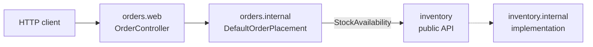

# Mock dependency ngoài module trong web test

## Mục tiêu học tập

Sau bài học, bạn có thể:

1. Giải thích vì sao `@ApplicationModuleTest` ở chế độ `STANDALONE` có thể thiếu bean của module khác dù mã production vẫn biên dịch đúng.
2. Phân biệt **API được module khác công bố** với **implementation nội bộ** và chọn đúng kiểu cần mock tại ranh giới.
3. Dùng `@MockitoBean` tạo một bean mock trong Spring test context, khác với `Mockito.mock(...)` hoặc `@Mock` thuần.
4. Kiểm thử HTTP với `@ApplicationModuleTest` + `@AutoConfigureMockMvc` sao cho controller và application service trong module mục tiêu chạy **thật**, còn dependency ngoài module được giả lập.
5. Kiểm tra đường thành công, thiếu tồn kho, lỗi dữ liệu đầu vào, lời gọi mock và tính độc lập giữa các ca test.
6. Chọn giữa `STANDALONE` + mock, `DIRECT_DEPENDENCIES`, `ALL_DEPENDENCIES` và test tích hợp với module bên ngoài.
7. Chẩn đoán lỗi mock sai kiểu, thiếu bean, trùng bean, security, repository/event side effect và `@MockitoBean(enforceOverride = true)`.
8. Bảo vệ ranh giới bằng `ApplicationModules.verify()` cùng quality gate CI, không dùng mock để che giấu dependency kiến trúc sai.

Bài thuộc chương **Web module testing** của lộ trình **SPRING_MODULITH_VERIFICATION_TESTING**. Mục tiêu chung là rèn kỹ năng kiểm chứng ranh giới kiến trúc Spring Modulith bằng `ApplicationModules` và quy tắc phụ thuộc; thực hành `@ApplicationModuleTest`, kiểm thử sự kiện, cơ sở dữ liệu, tích hợp và quality gate CI để ngăn hồi quy. Riêng bài này đi sâu vào **cách mô phỏng một cộng tác viên thuộc module khác khi đang kiểm thử web adapter của module mục tiêu**.

> **Phiên bản minh họa:** Spring Boot 3.4–3.5, Spring Framework 6.2, Spring Modulith 1.3–1.4, Java 17+, JUnit 5, Spring MVC và Mockito. `@MockitoBean` là annotation của Spring Framework 6.2; dự án dùng Spring Boot 4 hoặc bản cũ hơn cần đối chiếu import, starter và dependency management theo phiên bản thực tế.

## 1. Vấn đề: mã đúng nhưng module test thiếu bean

Giả sử ứng dụng bán hàng có module `orders` và `inventory`:

```text
com.acme.shop/
├── ShopApplication.java
├── inventory/
│   ├── StockAvailability.java        <- API công khai
│   └── internal/
│       └── DatabaseStockService.java <- implementation thật
└── orders/
    ├── OrderPlacement.java           <- API của orders
    ├── OrderReceipt.java
    ├── internal/
    │   ├── DefaultOrderPlacement.java
    │   └── InsufficientStockException.java
    └── web/
        ├── OrderController.java
        └── OrderExceptionHandler.java
```

Một request đặt hàng chạy theo đường:



Trong production, Spring tạo bean cho `DefaultOrderPlacement` và bean triển khai `StockAvailability`, sau đó nối chúng qua constructor injection.

Nhưng khi test riêng module `orders`:

```java
@ApplicationModuleTest
class OrdersWebTests {
}
```

`@ApplicationModuleTest` mặc định dùng **`BootstrapMode.STANDALONE`**. Spring Modulith chỉ đưa module `orders` cùng hạ tầng cần thiết vào context của test, không tự bootstrap implementation nằm ở module `inventory`. Do đó:

- Bean `DefaultOrderPlacement` trong `orders` **có mặt**.
- Kiểu Java `inventory.StockAvailability` vẫn **có trên classpath** và code vẫn biên dịch được.
- Bean implementation thuộc `inventory.internal` **không có mặt trong module test context**.
- Constructor của `DefaultOrderPlacement` cần `StockAvailability` nên context có thể báo **`UnsatisfiedDependencyException`** hoặc `NoSuchBeanDefinitionException`.

Đây **không nhất thiết là lỗi thiết kế**. Ngược lại, nó có thể chứng minh test đang thực sự giới hạn phạm vi đúng module. Nếu mục đích chỉ là kiểm tra HTTP adapter và logic `orders`, ta nên **mock đúng cổng API ở phía bên kia ranh giới**.

## 2. Phân biệt ranh giới module với ranh giới test

Có hai góc nhìn cần giữ riêng:

| Góc nhìn | Câu hỏi | Công cụ |
| --- | --- | --- |
| Ranh giới kiến trúc | `orders` **có được** tham chiếu `inventory.StockAvailability` không? | `ApplicationModules.verify()` |
| Ranh giới bootstrap | Test riêng `orders` **có tạo bean thật** của `inventory` không? | `@ApplicationModuleTest(mode = ...)` |
| Ranh giới mock | Bean `StockAvailability` trong test được **cung cấp bằng gì**? | `@MockitoBean`, `@TestConfiguration` hoặc bootstrap module thật |
| Hợp đồng HTTP | Controller có chuyển request/response đúng không? | `MockMvc` |
| Tích hợp runtime | Implementation thật với database/transaction hoạt động đúng không? | Module integration test, Testcontainers, event tests |

`StockAvailability` là kiểu `public` được đặt trong base package `inventory`, nên theo cơ chế module đóng mặc định, đây là **API được công bố của inventory**. Module `orders` được phép sử dụng nó nếu không có `allowedDependencies` hay quy tắc khác hạn chế.

**Mock không thay đổi đồ thị dependency tĩnh.** Dù bean test là Mockito mock, dependency Java `orders.internal.DefaultOrderPlacement → inventory.StockAvailability` vẫn tồn tại. `verify()` vẫn kiểm tra ranh giới tương ứng.

### Nên mock đối tượng nào?

| Kiểu | Nên mock trong test web module orders? | Vì sao |
| --- | --- | --- |
| `inventory.StockAvailability` | **Có** | API công khai ngoài module, phù hợp làm test double |
| `inventory.internal.DatabaseStockService` | **Không** | Coupling vào implementation và làm ranh giới sai |
| `orders.internal.DefaultOrderPlacement` | Thường **không** trong module test | Đây là logic thật của module đang kiểm thử |
| `orders.OrderPlacement` | Có thể mock trong **`@WebMvcTest` slice**, không phải mục tiêu của module test này | Slice test chỉ kiểm tra controller; module test nên kiểm tra cả application service |
| `ApplicationEventPublisher` | Không mặc định | Hạ tầng Spring trong module có thể được kiểm thử sự kiện bằng công cụ chuyên biệt |

Nguyên tắc thực hành: **giữ bean thuộc module mục tiêu càng thật càng tốt; giả lập các cổng đi ra ngoài module khi cần kiểm soát phạm vi**.

## 3. Tạo ứng dụng mẫu

Lớp Spring Boot ở package gốc:

```java
// src/main/java/com/acme/shop/ShopApplication.java
package com.acme.shop;

import org.springframework.boot.SpringApplication;
import org.springframework.boot.autoconfigure.SpringBootApplication;

@SpringBootApplication
public class ShopApplication {

    public static void main(String[] args) {
        SpringApplication.run(ShopApplication.class, args);
    }
}
```

Các dependency cần cho bản Spring MVC mẫu, với Spring Boot/Spring Modulith BOM hoặc dependency management đã được thiết lập tương thích:

```groovy
dependencies {
    implementation 'org.springframework.boot:spring-boot-starter-web'
    implementation 'org.springframework.boot:spring-boot-starter-validation'
    implementation 'org.springframework.modulith:spring-modulith-starter-core'

    testImplementation 'org.springframework.boot:spring-boot-starter-test'
    testImplementation 'org.springframework.modulith:spring-modulith-starter-test'
}
```

Ví dụ tập trung vào **Servlet MVC + MockMvc**, không áp dụng nguyên import cho WebFlux. Nếu dùng Java 21, JDK mới hoặc Boot 4, cấu hình project phải phù hợp với BOM của thế hệ framework tương ứng.

### API của module inventory

```java
// src/main/java/com/acme/shop/inventory/StockAvailability.java
package com.acme.shop.inventory;

public interface StockAvailability {
    boolean hasEnough(String sku, int quantity);
}
```

Implementation demo trong `inventory.internal`:

```java
// src/main/java/com/acme/shop/inventory/internal/DemoStockService.java
package com.acme.shop.inventory.internal;

import com.acme.shop.inventory.StockAvailability;
import org.springframework.stereotype.Service;

@Service
class DemoStockService implements StockAvailability {

    @Override
    public boolean hasEnough(String sku, int quantity) {
        return "BK-42".equals(sku) && quantity <= 5;
    }
}
```

Implementation này chỉ giúp giải thích sự khác nhau giữa **application chạy đủ module** và **test chỉ chạy orders**. Trong module test `STANDALONE`, bean `DemoStockService` **không phải bean đích cần mock**: ta chỉ cần mô phỏng interface `StockAvailability`.

## 4. Hợp đồng và service thật của module orders

```java
// src/main/java/com/acme/shop/orders/OrderPlacement.java
package com.acme.shop.orders;

public interface OrderPlacement {
    OrderReceipt place(String sku, int quantity);
}
```

```java
// src/main/java/com/acme/shop/orders/OrderReceipt.java
package com.acme.shop.orders;

public record OrderReceipt(
        String id, String sku, int quantity, String state) {
}
```

Ngoại lệ nghiệp vụ:

```java
// src/main/java/com/acme/shop/orders/internal/InsufficientStockException.java
package com.acme.shop.orders.internal;

public class InsufficientStockException extends RuntimeException {

    public InsufficientStockException(String sku) {
        super("Insufficient stock for requested product");
    }
}
```

Triển khai use case, **chỉ sử dụng API ngoài module**:

```java
// src/main/java/com/acme/shop/orders/internal/DefaultOrderPlacement.java
package com.acme.shop.orders.internal;

import com.acme.shop.inventory.StockAvailability;
import com.acme.shop.orders.OrderPlacement;
import com.acme.shop.orders.OrderReceipt;
import java.util.Locale;
import org.springframework.stereotype.Service;

@Service
class DefaultOrderPlacement implements OrderPlacement {

    private final StockAvailability stock;

    DefaultOrderPlacement(StockAvailability stock) {
        this.stock = stock;
    }

    @Override
    public OrderReceipt place(String sku, int quantity) {
        if (!stock.hasEnough(sku, quantity)) {
            throw new InsufficientStockException(sku);
        }

        String id = "order-"
                + sku.toLowerCase(Locale.ROOT)
                + "-" + quantity;

        return new OrderReceipt(id, sku, quantity, "PLACED");
    }
}
```

ID được xây từ SKU và số lượng để test có kết quả dễ dự đoán; **không sử dụng thuật toán này để sinh ID production**. Ví dụ chưa có database, payment hay publisher sự kiện; các side effect thật phải được bổ sung và kiểm thử riêng ở mức integration.

### Vì sao không mock `DefaultOrderPlacement`?

Nếu mock luôn `OrderPlacement`, test chỉ kiểm tra controller chuyển request sang interface. Điều đó phù hợp cho **MVC slice test** nhưng không kiểm tra cách `DefaultOrderPlacement` xử lý kết quả `StockAvailability`.

Trong bài này ta muốn giữ:

```text
MockMvc
  -> OrderController (thật)
     -> DefaultOrderPlacement (thật trong orders)
        -> StockAvailability (mock ở boundary với inventory)
```

Cách này cho phép test phát hiện cả lỗi serialization/routing của web adapter **và** lỗi phân nhánh nghiệp vụ của use case trong module `orders`.

## 5. Web adapter và ánh xạ lỗi

```java
// src/main/java/com/acme/shop/orders/web/OrderController.java
package com.acme.shop.orders.web;

import com.acme.shop.orders.OrderPlacement;
import com.acme.shop.orders.OrderReceipt;
import jakarta.validation.Valid;
import jakarta.validation.constraints.Min;
import jakarta.validation.constraints.NotBlank;
import jakarta.validation.constraints.NotNull;
import java.net.URI;
import org.springframework.http.MediaType;
import org.springframework.http.ResponseEntity;
import org.springframework.web.bind.annotation.PostMapping;
import org.springframework.web.bind.annotation.RequestBody;
import org.springframework.web.bind.annotation.RequestMapping;
import org.springframework.web.bind.annotation.RestController;

@RestController
@RequestMapping("/orders")
public class OrderController {

    private final OrderPlacement orders;

    public OrderController(OrderPlacement orders) {
        this.orders = orders;
    }

    @PostMapping(
            consumes = MediaType.APPLICATION_JSON_VALUE,
            produces = MediaType.APPLICATION_JSON_VALUE
    )
    public ResponseEntity<OrderReceipt> create(
            @Valid @RequestBody CreateOrderRequest request) {

        OrderReceipt receipt = orders.place(
                request.sku(), request.quantity());

        return ResponseEntity
                .created(URI.create("/orders/" + receipt.id()))
                .body(receipt);
    }

    public record CreateOrderRequest(
            @NotBlank String sku,
            @NotNull @Min(1) Integer quantity) {
    }
}
```

Controller không biết implementation inventory. Nó chỉ phụ thuộc vào `OrderPlacement` ở base package `orders`, còn service mới phụ thuộc vào `inventory.StockAvailability`.

Ánh xạ lỗi `InsufficientStockException` thành `409 Conflict`:

```java
// src/main/java/com/acme/shop/orders/web/OrderExceptionHandler.java
package com.acme.shop.orders.web;

import com.acme.shop.orders.internal.InsufficientStockException;
import org.springframework.http.HttpStatus;
import org.springframework.http.ProblemDetail;
import org.springframework.web.bind.annotation.ExceptionHandler;
import org.springframework.web.bind.annotation.RestControllerAdvice;

@RestControllerAdvice
public class OrderExceptionHandler {

    @ExceptionHandler(InsufficientStockException.class)
    public ProblemDetail outOfStock(
            InsufficientStockException exception) {

        ProblemDetail detail =
                ProblemDetail.forStatus(HttpStatus.CONFLICT);
        detail.setTitle("Insufficient stock");
        detail.setDetail("Requested quantity is unavailable");
        detail.setProperty("code", "OUT_OF_STOCK");
        return detail;
    }
}
```

Trong cấu hình có Jackson hỗ trợ `ProblemDetail`, `code` được serialize thành extension property của JSON lỗi. Không trả stack trace hoặc chi tiết nhạy cảm trong response.

**Giới hạn demo:** Handler này xử lý riêng lỗi hết tồn kho. Lỗi `@Valid` để Spring MVC xử lý theo cấu hình test, vì ở bài này điều quan trọng là status `400` và việc **không gọi inventory** khi dữ liệu sai; việc chuẩn hóa toàn bộ error contract là nội dung một bài riêng.

## 6. Vì sao `@Mock` đơn thuần không giải quyết thiếu bean?

Mockito thuần có thể tạo mock:

```java
import org.mockito.Mock;

@Mock
StockAvailability stock;
```

Nhưng annotation `@Mock` **không tự đăng ký một Spring bean** vào `ApplicationContext` của `@ApplicationModuleTest`. Kể cả có mở `MockitoExtension` để khởi tạo field mock, Spring vẫn không tự biết rằng `DefaultOrderPlacement` phải được inject từ field đó.

Tương tự:

```java
StockAvailability stock = org.mockito.Mockito.mock(
        StockAvailability.class);
```

chỉ tạo một Java object, không tự thay đổi bean factory của Spring.

Đối với integration/module test có Spring context, dùng:

```java
import org.springframework.test.context.bean.override.mockito.MockitoBean;

@MockitoBean
StockAvailability stock;
```

`@MockitoBean` đăng ký một **Mockito mock trong test ApplicationContext**. Các bean thật được tạo trong cùng context có thể nhận mock đó qua constructor injection.

| Công cụ | Có tự tạo Spring bean trong module test? | Mục đích |
| --- | --- | --- |
| `Mockito.mock(...)` | Không | Unit test Java thuần |
| `@Mock` + `MockitoExtension` | Không | Unit test hoặc khởi tạo object bằng Mockito |
| `@InjectMocks` | Không; tự tạo/inject vào subject ngoài Spring | Unit test không khởi động context |
| `@MockitoBean` | **Có** | Cung cấp/thay bean trong Spring test context |
| `@TestConfiguration` + `@Bean` trả fake | Có, nếu được import đúng | Test double tự viết, nhiều trạng thái/hành vi |

Trong **Spring Boot 3.4+**, ưu tiên `@MockitoBean` của Spring Framework. `@MockBean` thuộc Spring Boot test là API cũ đã bị đánh dấu deprecated từ Boot 3.4; dự án Boot cũ hơn cần dùng phiên bản annotation tương thích, không giả định một import mới luôn biên dịch.

## 7. Viết module web test với `@MockitoBean`

Lớp test đặt **trong package `orders`**:

```java
// src/test/java/com/acme/shop/orders/OrdersWebModuleTests.java
package com.acme.shop.orders;

import com.acme.shop.inventory.StockAvailability;
import org.junit.jupiter.api.Test;
import org.springframework.beans.factory.annotation.Autowired;
import org.springframework.boot.test.autoconfigure.web.servlet.AutoConfigureMockMvc;
import org.springframework.boot.test.context.SpringBootTest;
import org.springframework.modulith.test.ApplicationModuleTest;
import org.springframework.test.context.bean.override.mockito.MockitoBean;
import org.springframework.test.web.servlet.MockMvc;

import static org.springframework.modulith.test
        .ApplicationModuleTest.BootstrapMode.STANDALONE;

@ApplicationModuleTest(
        mode = STANDALONE,
        webEnvironment = SpringBootTest.WebEnvironment.MOCK
)
@AutoConfigureMockMvc
class OrdersWebModuleTests {

    @Autowired
    MockMvc mvc;

    @Autowired
    OrderPlacement application;

    @MockitoBean
    StockAvailability stock;

    // Các phương thức @Test ở phần tiếp theo.
}
```

Giải thích từng thành phần:

1. `@ApplicationModuleTest` dùng package của lớp test để chọn **module orders**. `STANDALONE` là mặc định; ví dụ ghi tường minh cho dễ học.
2. `webEnvironment = MOCK` là mặc định của `@ApplicationModuleTest` và không mở cổng HTTP.
3. `@AutoConfigureMockMvc` tạo `MockMvc` cho web context Spring MVC.
4. `@Autowired OrderPlacement application` lấy bean **thật của orders**, được thực thi bởi `DefaultOrderPlacement`.
5. `@MockitoBean StockAvailability stock` cung cấp Spring bean giả cho cổng **ngoài module orders**, giúp constructor `DefaultOrderPlacement` được thỏa mãn.

**Điều gì không xảy ra?** Spring không tự bootstrap `inventory.internal.DemoStockService` chỉ vì khai báo mock. Ta không biến mode thành `DIRECT_DEPENDENCIES`; phạm vi kiểm thử vẫn là module `orders` và hạ tầng test.

### Tại sao không dùng `enforceOverride = true`?

Theo cơ chế mặc định, `@MockitoBean` có thể **thay bean có sẵn hoặc tạo mock bean mới nếu không tồn tại**. Đó là điều cần thiết trong `STANDALONE`, bởi implementation `inventory` cố ý không có trong context.

```java
// KHÔNG phù hợp cho tình huống test STANDALONE bên trên:
@MockitoBean(enforceOverride = true)
StockAvailability stock;
```

`enforceOverride = true` yêu cầu **đã có bean tương ứng để thay**; nếu không có, quá trình tạo context sẽ thất bại. Tùy chọn này hữu ích trong test **đang kỳ vọng bean thật hiện diện** và muốn phát hiện thiếu bean, không phải trong module test chủ đích loại module ngoài khỏi bootstrap.

## 8. Test đường thành công: mock phản hồi tồn kho

Trong `OrdersWebModuleTests`, thêm static imports:

```java
import static org.mockito.BDDMockito.given;
import static org.mockito.BDDMockito.then;
import static org.springframework.test.web.servlet.request
        .MockMvcRequestBuilders.post;
import static org.springframework.test.web.servlet.result
        .MockMvcResultMatchers.header;
import static org.springframework.test.web.servlet.result
        .MockMvcResultMatchers.jsonPath;
import static org.springframework.test.web.servlet.result
        .MockMvcResultMatchers.status;

import org.springframework.http.MediaType;
```

Test hợp đồng `POST /orders`:

```java
@Test
void createsOrderWhenInventoryHasEnoughStock() throws Exception {
    given(stock.hasEnough("BK-42", 2)).willReturn(true);

    mvc.perform(post("/orders")
            .contentType(MediaType.APPLICATION_JSON)
            .content("""
                    {"sku":"BK-42","quantity":2}
                    """))
            .andExpect(status().isCreated())
            .andExpect(header().string(
                    "Location", "/orders/order-bk-42-2"))
            .andExpect(jsonPath("$.id")
                    .value("order-bk-42-2"))
            .andExpect(jsonPath("$.sku").value("BK-42"))
            .andExpect(jsonPath("$.quantity").value(2))
            .andExpect(jsonPath("$.state").value("PLACED"));

    then(stock).should().hasEnough("BK-42", 2);
}
```

Điểm kiểm tra:

- MVC đã bind JSON thành `CreateOrderRequest` và gọi controller thật.
- Controller gọi `OrderPlacement` thật; service dùng API `StockAvailability`.
- Mockito trả `true` theo cấu hình nên service đi vào nhánh tạo đơn.
- HTTP response có status, header và JSON đúng contract.
- `then(stock).should()` chứng minh luồng đã gọi đúng **cổng API ngoài module** với đúng tham số.

Đây không chỉ là test controller thuần; nó bảo vệ cách **web adapter + application service của orders** phối hợp với ranh giới inventory, nhưng không phụ thuộc trạng thái database tồn kho thực.

### Vì sao phải khai báo `given(...).willReturn(true)`?

Với Mockito mặc định, phương thức trả `boolean` thường trả **`false` nếu chưa stub**. Nếu quên:

```java
given(stock.hasEnough("BK-42", 2)).willReturn(true);
```

test sẽ đi vào nhánh hết tồn kho và trả 409 thay vì 201. Đây không nhất thiết là lỗi web adapter; đó là **hành vi mặc định của mock**.

Hãy khai báo dữ liệu test rõ ý đồ cho từng ca, kể cả khi Mockito đã có default value trùng với kết quả mong muốn.

## 9. Test khi module ngoài từ chối: 409

Một module web test tốt cần kiểm tra **hợp đồng lỗi** khi external collaborator trả kết quả không thuận lợi:

```java
@Test
void returnsConflictWhenInventoryCannotFulfill()
        throws Exception {

    given(stock.hasEnough("BK-42", 8)).willReturn(false);

    mvc.perform(post("/orders")
            .contentType(MediaType.APPLICATION_JSON)
            .content("""
                    {"sku":"BK-42","quantity":8}
                    """))
            .andExpect(status().isConflict())
            .andExpect(jsonPath("$.status").value(409))
            .andExpect(jsonPath("$.code")
                    .value("OUT_OF_STOCK"));

    then(stock).should().hasEnough("BK-42", 8);
}
```

Test này **không mock `OrderPlacement`**. Nó thực thi `DefaultOrderPlacement` thật để xác nhận service chuyển phản hồi `false` từ inventory thành `InsufficientStockException`, sau đó `OrderExceptionHandler` ánh xạ thành 409.

Đây là điểm khác biệt quan trọng với test `@WebMvcTest` chỉ mock application service: module test kiểm tra cả **quy tắc xử lý kết quả của API ngoài module**.

Nếu contract có trường `detail` hoặc `title`, có thể kiểm tra thêm khi đó là thành phần ổn định được client sử dụng. Tránh phụ thuộc toàn bộ `exception.getMessage()` hoặc dữ liệu kỹ thuật chưa được công bố.

## 10. Test input sai: không được chạm tới mock ngoài module

Đầu vào sai phải bị chặn trước khi gọi logic nghiệp vụ:

```java
@Test
void rejectsInvalidOrderWithoutCallingInventory()
        throws Exception {

    mvc.perform(post("/orders")
            .contentType(MediaType.APPLICATION_JSON)
            .content("""
                    {"sku":"","quantity":0}
                    """))
            .andExpect(status().isBadRequest());

    then(stock).shouldHaveNoInteractions();
}
```

`@NotBlank`, `@NotNull`, `@Min(1)` chỉ có hiệu lực khi Bean Validation provider được cấu hình; với Spring Boot 3, `spring-boot-starter-validation` thường cung cấp hạ tầng này.

Không chỉ xác nhận status 400: `shouldHaveNoInteractions()` chứng minh request chưa vượt qua **web boundary** để gọi cổng inventory.

### JSON hỏng cũng không được gọi API ngoài

```java
@Test
void rejectsUnreadableJsonWithoutCallingInventory()
        throws Exception {

    mvc.perform(post("/orders")
            .contentType(MediaType.APPLICATION_JSON)
            .content("""
                    {"sku":"BK-42","quantity":
                    """))
            .andExpect(status().isBadRequest());

    then(stock).shouldHaveNoInteractions();
}
```

JSON sai cú pháp thường bị từ chối ở bước deserialization, trước Bean Validation và trước controller. Nếu dự án có `@RestControllerAdvice` chuẩn hóa lỗi đầu vào, hãy thêm assertion về mã lỗi máy đọc được; không mặc định tất cả cấu hình Spring trả cùng body lỗi.

### Có nên luôn dùng `verifyNoMoreInteractions`?

`then(stock).shouldHaveNoMoreInteractions()` có thể hữu ích khi nhóm đặt chính sách rằng use case chỉ được gọi inventory đúng một lần. Nhưng dùng nó bừa bãi khiến test giòn nếu implementation hợp lệ thêm một truy vấn hoặc metric call.

Với các ca input sai, **không có tương tác nào** thường là hợp đồng rõ ràng. Với ca thành công, ưu tiên kiểm tra các lời gọi có ý nghĩa nghiệp vụ và chỉ kiểm tra không còn tương tác khác nếu đó là quy tắc thiết kế đã thống nhất.

## 11. Mockito matchers và dữ liệu tham số

Khi logic cần nhiều tổ hợp SKU/quantity, dùng argument matchers đúng cách:

```java
import static org.mockito.ArgumentMatchers.anyInt;
import static org.mockito.ArgumentMatchers.eq;

given(stock.hasEnough(eq("BK-42"), anyInt()))
        .willReturn(true);
```

**Không trộn matcher và giá trị thường trong cùng lời gọi mock**, ví dụ:

```java
// SAI: một argument dùng matcher, argument còn lại là literal.
// given(stock.hasEnough("BK-42", anyInt())).willReturn(true);
```

Nếu cần chắc chắn controller giữ đúng số lượng request, nên stub và verify **tham số cụ thể**:

```java
given(stock.hasEnough("BK-42", 2)).willReturn(true);
// ...
then(stock).should().hasEnough("BK-42", 2);
```

Đây là cách tốt hơn so với `anyString(), anyInt()` khi mục đích test là ngăn lỗi mapping số lượng hoặc SKU từ HTTP xuống application service.

### Kiểm tra từng test có độc lập không

Theo cấu hình mặc định của `@MockitoBean` (Spring Framework 6.2), mock được **reset sau mỗi phương thức test**, giúp các stubbing/interaction cũ không tràn sang test kế tiếp dù Spring context có thể được cache.

Đừng tự dùng một `static Mock` chung với state kéo dài giữa các test. Cũng không nên giả định **mọi** shared mutable bean trong context đều được reset như Mockito mock; nếu module thật có in-memory repository hoặc cache có state, cần quản lý fixture/transaction hoặc reset một cách phù hợp.

## 12. Test không nên mock sai lớp

Xét hai kiểu test:

### MVC slice: mock application API của chính module

```java
// Test riêng controller; đây là ví dụ cấu hình khác với module test.
package com.acme.shop.orders.web;

import com.acme.shop.orders.OrderPlacement;
import org.springframework.boot.test.autoconfigure.web.servlet.WebMvcTest;
import org.springframework.test.context.bean.override.mockito.MockitoBean;

@WebMvcTest(OrderController.class)
class OrderControllerSliceTests {

    @MockitoBean
    OrderPlacement orders;

    // Kiểm tra HTTP mapping, JSON, validation, controller delegation.
}
```

Trong slice test, service thật `DefaultOrderPlacement` không chạy; mock ở **cổng mà controller gọi trực tiếp**.

### Module test: mock cổng ngoài module

```java
@ApplicationModuleTest
@AutoConfigureMockMvc
class OrdersWebModuleTests {

    @MockitoBean
    StockAvailability stock;

    // Controller và DefaultOrderPlacement đều là bean thật của orders.
}
```

Không thể nói một annotation luôn “tốt hơn”. Chọn **mock ở ranh giới tương ứng với phạm vi đang kiểm thử**.

| Phương án | Bean thật được kiểm thử | Mock phù hợp |
| --- | --- | --- |
| Unit test `OrderController` | Chỉ object controller | `OrderPlacement` qua Mockito thuần |
| `@WebMvcTest(OrderController.class)` | Spring MVC controller/advice | `OrderPlacement` bằng `@MockitoBean` |
| `@ApplicationModuleTest(STANDALONE)` + MockMvc | Controller và application service của orders | `StockAvailability` |
| `@ApplicationModuleTest(DIRECT_DEPENDENCIES)` | orders + inventory thật nếu inventory là dependency trực tiếp | Thường không mock `StockAvailability` nếu muốn kiểm tra tích hợp thực |
| Full integration test | Các module và tài nguyên được cấu hình | Chỉ mock các hệ thống ngoài nếu cần |

Một test dùng `@ApplicationModuleTest` nhưng mock luôn `OrderPlacement` có thể khiến những lỗi nghiệp vụ trong module `orders` bị bỏ sót, làm giảm giá trị của bài test module.

## 13. Chọn BootstrapMode và thời điểm bỏ mock

`@ApplicationModuleTest` có ba chế độ:

| Mode | Module được khởi tạo | Chiến lược test |
| --- | --- | --- |
| `STANDALONE` *(mặc định)* | Chỉ module hiện tại | Mock cổng API thuộc module ngoài |
| `DIRECT_DEPENDENCIES` | Module hiện tại + module phụ thuộc trực tiếp | Dùng implementation thật của dependency gần nhất nếu cần |
| `ALL_DEPENDENCIES` | Module hiện tại + các module phụ thuộc bắc cầu | Chạy bài test tích hợp phạm vi rộng hơn |

Vì `DefaultOrderPlacement` tham chiếu `inventory.StockAvailability`, mô hình có dependency `orders → inventory`. Khi thực sự muốn kiểm tra **integration giữa orders và inventory**, có thể viết test khác:

```java
import static org.springframework.modulith.test
        .ApplicationModuleTest.BootstrapMode.DIRECT_DEPENDENCIES;

@ApplicationModuleTest(mode = DIRECT_DEPENDENCIES)
@AutoConfigureMockMvc
class OrdersInventoryIntegrationTests {
    // Không khai báo @MockitoBean StockAvailability nếu muốn dùng
    // bean inventory thật. Chuẩn bị dữ liệu/tài nguyên cần thiết.
}
```

Ở đây implementation `DemoStockService` có thể được tạo vì module inventory được bootstrap. Nếu inventory thực dùng database hay hạ tầng ngoài, test phải cung cấp môi trường phù hợp hoặc chọn một cách cô lập khác.

### Vì sao giữ `@MockitoBean` khi mở rộng mode dễ gây hiểu nhầm?

`@MockitoBean` không chỉ **tạo bean khi vắng mặt**, mà còn **thay thế bean có sẵn**. Nếu đổi mode thành `DIRECT_DEPENDENCIES` nhưng để nguyên:

```java
@MockitoBean
StockAvailability stock;
```

test có thể vẫn **sử dụng mock thay vì `DemoStockService`**, làm bạn tưởng rằng đã kiểm thử tích hợp inventory thật. Để kiểm tra implementation thật, hãy **bỏ mock** tương ứng và chuẩn bị fixture/database thích hợp.

**Không dùng `ALL_DEPENDENCIES` như cách sửa lỗi thiếu bean bất kỳ.** Nó làm test ít cô lập, có thể khởi tạo thêm database hoặc nhiều module không liên quan tới hợp đồng HTTP đang kiểm tra. Chọn mode theo mục tiêu test trước khi quyết định những bean nào cần mock.

## 14. Bổ sung nhiều mock ngoài module một cách có kiểm soát

Trong thực tế, một use case có thể tham chiếu nhiều module: inventory, pricing, payment, notifications.

Ví dụ khi **đã mở rộng implementation `DefaultOrderPlacement`** để thực sự inject thêm `PaymentAuthorization` từ module `payments`, lớp test có thể cần:

```java
@MockitoBean
StockAvailability stock;

@MockitoBean
PaymentAuthorization paymentAuthorization;
```

`PaymentAuthorization` ở đây là **ví dụ mở rộng giả định**: cần khai báo interface công khai trong module `payments` và code production sử dụng nó trước khi đoạn test trở thành ví dụ hoàn chỉnh. Không thêm field mock chỉ vì một module khác tồn tại trong project.

Quá nhiều mock ở một bài test web module có thể là **dấu hiệu coupling cao**:

- Module hiện tại gọi quá nhiều module đồng bộ.
- Một endpoint đang điều phối nhiều use case độc lập.
- Một số tương tác có thể phù hợp hơn với **sự kiện miền** hoặc application service điều phối rõ trách nhiệm.
- Test phải biết chi tiết tương tác nội bộ nhiều hơn mức mong muốn.

Spring Modulith cũng khuyến nghị xem lại việc phụ thuộc vào quá nhiều bean ngoài module. Nhưng **không mặc định thay mọi lời gọi đồng bộ bằng sự kiện**: nếu nghiệp vụ cần câu trả lời tồn kho tức thời để quyết định HTTP response, lời gọi đồng bộ có thể là lựa chọn có cơ sở. Phân tích transaction, độ trễ, consistency và khả năng thất bại trước khi refactor.

## 15. Bean trùng kiểu, qualifier và tên bean

Với `@MockitoBean`, Spring xác định bean theo **kiểu**, và khi cần có thể dùng **tên bean/qualifier**. Nếu context có hai implementation của cùng một interface, chỉ khai báo kiểu có thể gây nhập nhằng.

Ví dụ giả định một module test **cố ý đưa vào hai `StockAvailability` bean**, phân biệt:

```java
import org.springframework.beans.factory.annotation.Qualifier;
import org.springframework.test.context.bean.override.mockito.MockitoBean;

@MockitoBean
@Qualifier("regionalStock")
StockAvailability regionalStock;
```

Hoặc khi đã biết rõ tên bean trong context:

```java
@MockitoBean(name = "regionalStock")
StockAvailability regionalStock;
```

Các ví dụ này **chỉ áp dụng nếu project thật khai báo qualifier/tên bean tương ứng** và điểm inject của service cũng được thiết kế nhất quán. Trong ví dụ `STANDALONE` ban đầu không có inventory bean, `@MockitoBean StockAvailability stock` là đủ, không cần tự thêm `name`.

### Dấu hiệu cần đọc lại context

| Tình huống | Cách điều tra |
| --- | --- |
| `NoUniqueBeanDefinitionException` | Có nhiều bean cùng kiểu, cần qualifier hoặc thiết kế lại injection |
| Bean mock được tạo nhưng service nhận bean khác | Kiểm tra loại bean, tên, qualifier và mode bootstrap |
| `@MockitoBean(enforceOverride = true)` gây lỗi | Bean thật có thể đã bị module slicing loại khỏi context |
| Mock một scoped/prototype bean thất bại | Theo API Spring Framework 6.2, bean override Mockito hỗ trợ singleton; cần chọn chiến lược test khác |
| Test thêm mock nhưng không loại được lỗi | Bean thiếu có thể là dependency **bên trong chính module** hoặc hạ tầng JPA/security chứ không phải collaborator ngoài |

Thêm log:

```properties
logging.level.org.springframework.modulith=DEBUG
```

để quan sát module nào được bootstrap. Nếu vẫn khó chẩn đoán, kiểm tra danh sách bean theo kiểu trong test `ApplicationContext`; đừng đổi mode lên `ALL_DEPENDENCIES` trước khi biết bean thiếu thuộc module nào.

## 16. Mock không che được phụ thuộc kiến trúc sai

Xem hai tham chiếu:

```java
// HỢP LỆ nếu không có allowedDependencies chặn:
import com.acme.shop.inventory.StockAvailability;
```

```java
// MINH HỌA VI PHẠM: orders truy cập implementation nội bộ inventory.
import com.acme.shop.inventory.internal.DemoStockService;
```

Ở ví dụ thứ hai, `DemoStockService` được khai báo package-private, nên Java đã chặn import từ package `orders`. Giả sử ai đó đổi implementation thành `public`, code Java có thể biên dịch, nhưng Spring Modulith vẫn có thể phát hiện **truy cập phần nội bộ của module inventory**.

Không nên “khắc phục” bằng cách:

- Mock luôn implementation nội bộ ở test.
- Mở hết các module hoặc mọi package để tránh lỗi ranh giới.
- Tắt `verifyAutomatically` chỉ để test qua được.

Phải sửa dependency production sang **API công khai `inventory.StockAvailability`** rồi dùng `@MockitoBean` cho chính kiểu đó trong test.

### Kiểm chứng kiến trúc độc lập

```java
// src/test/java/com/acme/shop/ModuleArchitectureTests.java
package com.acme.shop;

import static org.junit.jupiter.api.Assertions.assertEquals;

import com.acme.shop.inventory.StockAvailability;
import org.junit.jupiter.api.Test;
import org.springframework.modulith.core.ApplicationModules;

class ModuleArchitectureTests {

    @Test
    void inventoryPortIsOwnedByInventory() {
        var modules = ApplicationModules.of(ShopApplication.class);

        assertEquals("inventory", modules
                .getModuleByType(StockAvailability.class)
                .orElseThrow()
                .getIdentifier().toString());
    }

    @Test
    void crossModuleDependenciesRespectBoundaries() {
        ApplicationModules.of(ShopApplication.class).verify();
    }
}
```

`verify()` kiểm tra các quy tắc liên module trên những module được nhận diện, như dependency vòng, truy cập internal và `allowedDependencies`. Nó **không chạy HTTP request**, không kiểm tra Mockito interaction hoặc xác nhận database transaction.

`@ApplicationModuleTest` cũng có cơ chế tự động xác minh cấu trúc module theo mặc định trong những phiên bản nêu ở đầu bài. Tuy vậy, một bài test `ApplicationModules.verify()` riêng vẫn hữu ích làm quality gate rõ ràng, ngay cả khi web integration test bị bỏ qua hoặc chạy trong task riêng.

### Nếu nhóm muốn giới hạn module orders chỉ phụ thuộc inventory

Ví dụ có thể khai báo:

```java
// src/main/java/com/acme/shop/orders/package-info.java
@org.springframework.modulith.ApplicationModule(
        allowedDependencies = "inventory")
package com.acme.shop.orders;
```

Khi đó `verify()` còn kiểm tra module `orders` không vượt quá danh sách dependency đã cho. Lưu ý `allowedDependencies = "inventory"` cho phép tham chiếu **API mặc định của inventory**, không mở toàn bộ `inventory.internal`.

Nếu sau này `orders` cần sử dụng thêm một module khác theo thiết kế, hãy cập nhật rule có review và test tương ứng; đừng thêm `:: **` hoặc bỏ quy tắc chỉ để sửa lỗi tạm.

## 17. Tổ chức fixture và kiểm tra trạng thái mock

Một bộ web module test cần ổn định giữa các lần chạy:

| Loại dữ liệu | Cách kiểm soát |
| --- | --- |
| Kết quả `StockAvailability` | Stub cụ thể trong từng test |
| Tham số gửi vào cổng inventory | `then(stock).should().hasEnough(...)` |
| Validation failure | `shouldHaveNoInteractions()` |
| Spring web context | Tạo bởi `@ApplicationModuleTest` + `@AutoConfigureMockMvc` |
| Mockito mock state | Dựa vào reset mặc định của `@MockitoBean`, tránh static mock |
| Dữ liệu lưu trong module orders | Dùng transaction rollback hoặc reset fixture nếu có repository |
| Sự kiện được phát | Dùng assertion sự kiện/module test riêng, không suy từ status HTTP |

Không dùng stub quá rộng như:

```java
// Có thể làm test bỏ sót lỗi mapping SKU/quantity:
given(stock.hasEnough(
        org.mockito.ArgumentMatchers.anyString(),
        org.mockito.ArgumentMatchers.anyInt()))
        .willReturn(true);
```

trong mọi trường hợp. Với endpoint `POST /orders`, ta thường muốn chắc rằng `"BK-42"` và `2` thực sự đi xuống use case; stub/verify theo tham số cụ thể giúp phát hiện lỗi mapping.

### `@TestConfiguration` làm test double thay Mockito

Nếu việc mô phỏng quá nhiều trạng thái khiến Mockito setup rối, có thể tạo một fake có state được quản lý rõ ràng:

```java
// Minh họa một cách thay thế, không dùng đồng thời với @MockitoBean
@TestConfiguration
class InventoryFakeConfiguration {

    @Bean
    StockAvailability stockAvailability() {
        return (sku, quantity) ->
                "BK-42".equals(sku) && quantity <= 5;
    }
}
```

Khi dùng, phải import cấu hình đó vào context test phù hợp; **không đồng thời khai báo `@MockitoBean StockAvailability`** nếu mục tiêu là sử dụng fake trên. Một fake có thể phù hợp cho các test có nhiều dữ liệu phức tạp, nhưng cũng tạo nguy cơ shared mutable state nếu không reset.

## 18. Phân biệt lỗi bootstrap, lỗi mock và lỗi HTTP

| Triệu chứng | Nguyên nhân có thể | Cách xử lý |
| --- | --- | --- |
| `NoSuchBeanDefinitionException: StockAvailability` | Module inventory bị loại khỏi STANDALONE, chưa có mock bean | Thêm `@MockitoBean StockAvailability` |
| Đã thêm `@Mock` nhưng vẫn thiếu bean | Mock Mockito không được đăng ký trong Spring context | Đổi sang `@MockitoBean` hoặc test configuration |
| `enforceOverride = true` làm test fail | Không có inventory bean thật để replace | Dùng mặc định `enforceOverride = false` cho STANDALONE |
| POST trả 409 dù test mong 201 | Chưa stub boolean mock, Mockito trả false | `given(...).willReturn(true)` với đúng tham số |
| Mockito `Wanted but not invoked` | Controller không đi qua service, tham số sai hoặc request bị chặn | Đọc status, validation, mock argument và path thực thi |
| Mockito `InvalidUseOfMatchersException` | Trộn matcher với giá trị thường | Dùng matchers cho mọi argument trong cùng lời gọi |
| POST trả 400 | JSON binding/Bean Validation lỗi | Kiểm tra JSON, DTO, starter validation |
| POST trả 401/403 | Spring Security/CSRF từ chối trước controller | Dùng principal/authority và CSRF test phù hợp |
| Không inject được `MockMvc` | Thiếu `@AutoConfigureMockMvc` hoặc sai web stack | Xác nhận MVC, annotation và dependency test |
| `NoUniqueBeanDefinitionException` | Có nhiều bean cùng interface | Dùng qualifier/tên bean nhất quán |
| `verify()` báo lỗi ranh giới | Production code phụ thuộc sai, mock không liên quan | Sửa API/import giữa các module |
| Mở `DIRECT_DEPENDENCIES` nhưng vẫn thấy mock | `@MockitoBean` đã thay bean thật | Bỏ mock khi muốn tích hợp thật |
| Test module xanh nhưng production gặp lỗi DB | Test chỉ mock inventory, không kiểm tra DB inventory thật | Thêm integration/testcontainers cho inventory |
| Context bị cache, dữ liệu ngoài mock còn nguyên | Bean thật trong test có state không tự reset | Tổ chức fixture/transaction/reset phù hợp |

### Quy trình chẩn đoán năm bước

1. **Định vị bean thiếu:** xem kiểu bean và package sở hữu nó. Có thuộc module ngoài hay thật ra là bean nội bộ chưa được cấu hình?
2. **Đọc phạm vi bootstrap:** `STANDALONE`, `DIRECT_DEPENDENCIES`, `ALL_DEPENDENCIES`, `extraIncludes` và package của lớp test.
3. **Kiểm tra mock:** annotation `@MockitoBean`, kiểu, qualifier, `enforceOverride`, stubbing và reset giữa các test.
4. **Đọc kết quả HTTP:** xem status trước khi suy về `then(stock).should()`; 400/403 có thể chặn request trước nghiệp vụ.
5. **Kiểm tra kiến trúc:** chạy `ApplicationModules.verify()`; nếu cần tích hợp thật, bỏ mock và chuẩn bị database/broker cho module được bootstrap.

## 19. Kiểm thử có Spring Security và sự kiện

### Security có thể khiến mock không bao giờ được gọi

Nếu ứng dụng có Spring Security, một `POST` chưa xác thực hoặc thiếu CSRF token có thể bị filter từ chối trước khi controller xử lý:

```java
// Ví dụ dùng trong test có spring-security-test.
import static org.springframework.security.test.web.servlet.request
        .SecurityMockMvcRequestPostProcessors.csrf;
import static org.springframework.security.test.web.servlet.request
        .SecurityMockMvcRequestPostProcessors.user;

given(stock.hasEnough("BK-42", 2)).willReturn(true);

mvc.perform(post("/orders")
        .with(user("customer").roles("CUSTOMER"))
        .with(csrf())
        .contentType(MediaType.APPLICATION_JSON)
        .content("""
                {"sku":"BK-42","quantity":2}
                """))
        .andExpect(status().isCreated());
```

Ví dụ chỉ đúng khi role `CUSTOMER` được ứng dụng cho phép và Spring Security test infrastructure tương thích. **Không tắt filter bằng `addFilters = false` chỉ để làm test xanh**, trừ khi mục tiêu rõ ràng là test contract không có security và đã có một nhóm security test riêng.

### Mock inventory không kiểm chứng event hoặc database

Nếu `DefaultOrderPlacement` còn lưu đơn qua repository hoặc publish `OrderPlaced`, test web với `StockAvailability` mock **không tự chứng minh**:

- Repository đã ghi vào database thật.
- Transaction đã commit và dữ liệu có thể đọc lại.
- Event đã được publish, listener ở module khác đã xử lý hoặc retry thành công.
- Hệ thống thanh toán và kho thực sự đồng bộ.

Cần thêm **`@ApplicationModuleTest` chuyên biệt cho sự kiện**, test repository/transaction và integration tests với tài nguyên phù hợp. Đừng lấy status HTTP 201 trong ví dụ không có persistence làm bằng chứng các side effect thực tế đã hoàn tất.

## 20. Thiết lập quality gate CI

Một pipeline phù hợp nên bảo vệ đồng thời:

| Nhóm kiểm tra | Ví dụ | Mục tiêu |
| --- | --- | --- |
| **Cấu trúc module** | `ApplicationModules.verify()` | Phụ thuộc giữa `orders` và `inventory` hợp lệ |
| **HTTP module test** | `OrdersWebModuleTests` | Controller + service thật của orders dùng đúng mock boundary |
| **Validation/error contract** | Test 400/409 và không tương tác khi input sai | Không bỏ lọt dữ liệu lỗi xuống nghiệp vụ |
| **Integration giữa module** | `DIRECT_DEPENDENCIES` không mock inventory | Implementation thực phối hợp khi được yêu cầu |
| **Sự kiện và DB** | Module/event/database tests | Kiểm tra transaction và side effects |

Với Gradle:

```bash
./gradlew test
```

Với Maven Wrapper:

```bash
./mvnw test
```

Chỉ sử dụng những lệnh trên khi dự án đã có build tool, dependency và test runtime phù hợp. Nếu integration tests tách task/profile, CI phải chạy thêm **những tác vụ đã cấu hình cho nhóm đó**; `test` mặc định không đảm bảo luôn chạy mọi nhóm.

### Không dùng một mock để né kiến trúc sai

Nếu xuất hiện lời gọi trực tiếp từ `orders.web` tới `inventory.internal`, mock API inventory không thể sửa hướng phụ thuộc production. `ApplicationModules.verify()` và các ArchUnit rules bổ sung vẫn cần chặn sai phạm. Test xanh vì mọi dependency đã được mock **không đồng nghĩa** chất lượng kiến trúc hoặc nghiệp vụ đã đúng.

## 21. Bài thực hành

**Bối cảnh:** Đội phát triển module `orders` có endpoint `POST /orders` và cần kết quả kiểm tra tồn kho từ module `inventory`. Muốn chạy web module test nhanh, ổn định và không đòi database inventory thật.

**Nhiệm vụ:**

1. Tạo `ShopApplication`, module `orders` và `inventory` theo cấu trúc mục 1–5.
2. Đặt `StockAvailability` tại base package `inventory`; đặt implementation trong `inventory.internal`.
3. Đặt `OrderPlacement`, `OrderReceipt` ở base package `orders`; triển khai `DefaultOrderPlacement` trong `orders.internal`.
4. Tạo `OrderController` và `OrderExceptionHandler` trong `orders.web`, trả 201 thành công và 409 khi hết hàng.
5. Tạo `OrdersWebModuleTests` dưới package `com.acme.shop.orders` với `@ApplicationModuleTest(STANDALONE)` và `@AutoConfigureMockMvc`.
6. Thử chạy context **chưa có `@MockitoBean`** để quan sát thiếu bean `StockAvailability`, sau đó bổ sung `@MockitoBean StockAvailability stock`.
7. Viết test 201 với `given(stock.hasEnough("BK-42", 2)).willReturn(true)`, kiểm tra header `Location` và JSON body.
8. Viết test 409 khi mock inventory trả `false`; kiểm tra `code=OUT_OF_STOCK` và Mockito interaction.
9. Viết test 400 với SKU rỗng/quantity 0, rồi khẳng định `stock` không được gọi.
10. Thử đổi thành `@MockitoBean(enforceOverride = true)`; giải thích vì sao không phù hợp trong `STANDALONE` khi inventory bean bị loại khỏi context.
11. Trên một lớp test khác, dùng `DIRECT_DEPENDENCIES` **không khai báo stock mock** để kiểm thử với implementation `inventory` thật; đối chiếu tốc độ, cấu hình và độ cô lập.
12. Viết `ApplicationModules.of(ShopApplication.class).verify()` và chạy cùng web module tests trong CI.
13. Nếu code thực còn dùng database/sự kiện, bổ sung test tích hợp chứng minh các hiệu ứng runtime và transaction.

**Tiêu chí hoàn thành:** Bạn mock đúng **API của module ngoài**, không mock implementation nội bộ hoặc chính service đang kiểm thử; hiểu cách mock được đưa vào Spring context, phân biệt kết quả kiểm thử với `DIRECT_DEPENDENCIES`, và có quality gate giữ cả ranh giới kiến trúc lẫn HTTP contract.

## 22. Câu hỏi tự kiểm tra

1. Vì sao `@ApplicationModuleTest(STANDALONE)` không tự tạo `DemoStockService` dù production có bean đó?
2. `@Mock StockAvailability` khác `@MockitoBean StockAvailability` như thế nào trong một Spring test context?
3. Tại sao mock `DefaultOrderPlacement` làm giảm giá trị của bài test web module so với mock `StockAvailability`?
4. `@MockitoBean(enforceOverride = true)` có thể gây lỗi gì khi không có bean inventory thật trong context?
5. Vì sao phải stub `hasEnough(...)` trả `true` cho test 201 thay vì tin vào default Mockito?
6. Làm thế nào để khẳng định request sai bị chặn **trước khi** gọi dependency ngoài module?
7. Nếu đổi sang `DIRECT_DEPENDENCIES` mà vẫn giữ `@MockitoBean`, ta có chắc đang test inventory thật không?
8. Nếu `orders` phụ thuộc vào `inventory.internal`, mock API inventory có làm dependency đó hợp lệ hơn không?
9. Khi test 201 thành công nhưng production lỗi khi lưu database, cần bổ sung kiểm thử nào?
10. Vì sao quá nhiều `@MockitoBean` ở một module test có thể là dấu hiệu nên xem lại thiết kế module?

## Tổng kết

Trong web module test, **mock dependency ngoài module tại API được công bố**, không mock implementation nội bộ hoặc service thuộc module đang kiểm thử nếu mục tiêu là kiểm tra tích hợp trong module. Với `@ApplicationModuleTest(STANDALONE)`, Spring Modulith giữ các bean của module mục tiêu nhưng không bootstrap các module bên ngoài; `@MockitoBean` tạo bean mock để thỏa constructor injection của service thật. Dùng `@AutoConfigureMockMvc` kiểm tra HTTP 201/400/409 và Mockito assertions để xác minh đúng dữ liệu đi qua boundary. Khi cần tích hợp thật, mở rộng bootstrap có chủ đích **và bỏ mock tương ứng**. Cuối cùng, giữ `ApplicationModules.verify()` trong CI, kết hợp kiểm thử sự kiện, database và tích hợp để ngăn cả **phụ thuộc kiến trúc sai** lẫn **hồi quy runtime**.

### Tài liệu tham khảo

- [Spring Modulith — Integration Testing Application Modules: Efferent Dependencies và Bootstrap Modes](https://docs.spring.io/spring-modulith/reference/testing.html)
- [Spring Modulith — ApplicationModuleTest API](https://docs.spring.io/spring-modulith/docs/current/api/org/springframework/modulith/test/ApplicationModuleTest.html)
- [Spring Framework 6.2 — `@MockitoBean` và `@MockitoSpyBean`](https://docs.spring.io/spring-framework/reference/6.2/testing/annotations/integration-spring/annotation-mockitobean.html)
- [Spring Framework 6.2 — `MockitoBean` API](https://docs.spring.io/spring-framework/docs/6.2.x/javadoc-api/org/springframework/test/context/bean/override/mockito/MockitoBean.html)
- [Spring Framework — MockMvc](https://docs.spring.io/spring-framework/reference/testing/spring-mvc-test-framework.html)
- [Spring Modulith — Verifying Application Module Structure](https://docs.spring.io/spring-modulith/reference/verification.html)
