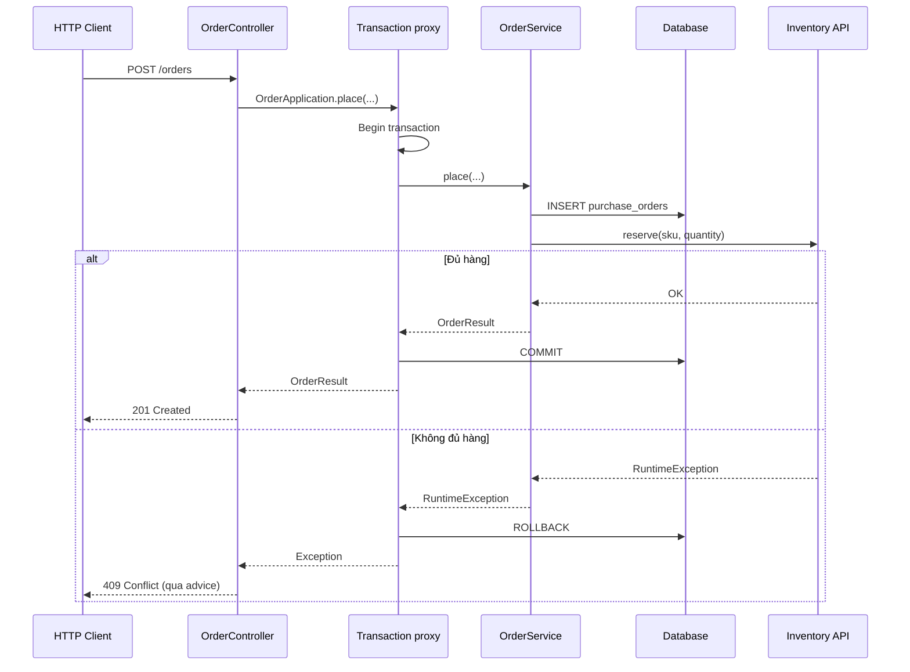
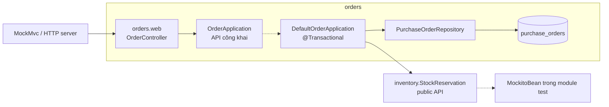

# Kiểm tra transaction boundary qua request

## Mục tiêu học tập

Sau bài học, bạn có thể:

1. Xác định **transaction boundary** của một HTTP use case: điểm bắt đầu, commit, rollback và các tài nguyên tham gia.
2. Giải thích vì sao `@Transactional` nên đặt tại application service/use case phù hợp thay vì mặc định đặt trên web controller.
3. Dùng `@ApplicationModuleTest`, `MockMvc` và một database test để xác nhận dữ liệu **đã commit sau request**, không chỉ được `save()` hoặc `flush()`.
4. Tạo một tình huống lỗi **sau khi ghi dữ liệu** và xác minh toàn bộ phần ghi trong transaction đã rollback.
5. Phân biệt transaction do Spring TestContext quản lý, transaction của application service và request xử lý ở **HTTP server thread**.
6. So sánh `webEnvironment = MOCK` với `RANDOM_PORT`, đặc biệt khi bài test có `@Transactional`.
7. Tránh các kết luận sai từ `REQUIRES_NEW`, self-invocation, checked exception, test rollback và event listener `AFTER_COMMIT`.
8. Kết hợp kiểm thử ranh giới transaction với `ApplicationModules.verify()`, kiểm thử sự kiện/database và CI quality gate.

Bài thuộc chương **Web module testing** của lộ trình **SPRING_MODULITH_VERIFICATION_TESTING**. Mục tiêu của lộ trình là kiểm chứng ranh giới kiến trúc Spring Modulith bằng `ApplicationModules`, quy tắc phụ thuộc, `@ApplicationModuleTest`, kiểm thử sự kiện, cơ sở dữ liệu và tích hợp, đồng thời xây dựng quality gate CI để ngăn phụ thuộc sai và hồi quy. Trọng tâm bài này là **quan sát tác động transaction của một request tới web adapter**, chứ không chỉ kiểm tra status HTTP.

> **Môi trường mã mẫu:** Java 17+, Spring Boot 3.4–3.5, Spring Framework 6.2, Spring Modulith 1.3–1.4, Spring MVC, Spring Data JPA, JUnit 5, Mockito và H2 cho test. Với Spring Boot 4, cần cập nhật một số starter/import kiểm thử theo phiên bản thực tế. Ví dụ dùng JDBC/JPA theo cơ chế **transaction gắn với thread** của Servlet; với WebFlux/reactive transactions cần cách kiểm thử phù hợp với Reactor context.

## 1. Transaction boundary của request là gì?

Giả sử endpoint `POST /orders` nhận yêu cầu đặt hàng. Trong một use case, hệ thống có thể cần:

1. Kiểm tra dữ liệu ở web adapter.
2. Tạo một đơn hàng mới.
3. Lưu đơn hàng vào database.
4. Yêu cầu module `inventory` xác nhận/giữ hàng.
5. Trả HTTP 201 nếu thành công, hoặc HTTP 409 nếu không đủ hàng.

Nếu dữ liệu đơn hàng đã được lưu nhưng bước 4 ném lỗi, **đơn hàng có được rollback không?** Chỉ nhìn HTTP 409 chưa trả lời được.



Sơ đồ thể hiện **transaction của phần database được quản lý bởi service** trong ví dụ, không có nghĩa lời gọi tới inventory từ xa tự trở thành một giao dịch phân tán. Nếu inventory thực đã ghi dữ liệu ở database khác, rollback database `orders` **không tự hủy** tác động đó.

### Những thời điểm cần phân biệt

| Thời điểm | Điều đã xảy ra | Có thể kết luận dữ liệu đã commit chưa? |
| --- | --- | --- |
| Controller nhận request | HTTP binding/validation | Chưa |
| Service gọi `repository.save(...)` | Entity được đưa vào persistence context; có thể đã phát sinh SQL tùy chiến lược ID | Chưa |
| Service gọi `saveAndFlush(...)` | JPA flush SQL xuống database trong transaction hiện tại | **Chưa** |
| Service trả kết quả ra khỏi transactional proxy | Transaction interceptor hoàn tất commit nếu không bị đánh dấu rollback và commit thành công | Có thể kiểm tra sau return |
| Service ném unchecked exception qua proxy | Transaction thường được đánh dấu rollback | Phải kiểm tra không còn dữ liệu sau request |
| Controller trả 201 | Client thấy request thành công về HTTP | Không tự chứng minh mọi side effect ngoài database đã hoàn tất |

**Kết luận:** `flush` và `commit` không đồng nghĩa. Bài test cần đọc dữ liệu **ngoài transaction vừa thực thi** để chứng minh kết quả bền vững theo phạm vi database đang kiểm tra.

## 2. Transaction không đồng nghĩa với ranh giới application module

Spring Modulith giúp phân tích module `orders`, `inventory` và các dependency giữa chúng. Nhưng module boundary và transaction boundary là **hai khái niệm độc lập**.

| Ranh giới | Mục đích | Cách xác minh |
| --- | --- | --- |
| Application module | Kiểu Java/module nào được phép phụ thuộc nhau | `ApplicationModules.verify()` |
| Application service transaction | Những thao tác DB nào phải commit/rollback cùng nhau | `@Transactional` + kiểm thử commit/rollback |
| HTTP adapter | Request/response/status/error mapping | `MockMvc`, live HTTP test |
| External integration | Những tác động ở inventory, payment, message broker | Integration test, contract test, outbox/saga khi cần |
| Event after commit | Listener chỉ nhận sau transaction thành công | `@TransactionalEventListener`, integration/event test |

Một module có thể có nhiều use case, mỗi use case có transaction riêng. Ngược lại, một use case có thể gọi API module khác nhưng không bảo đảm transaction của hai module dùng chung cùng một database/transaction manager.

`ApplicationModules.verify()` **không** chứng minh rằng `@Transactional` đã được proxy áp dụng, cũng không kiểm tra DB commit hay rollback. Vì thế phải kết hợp test tĩnh và runtime.

## 3. Thiết kế ví dụ có hai module

Ta dùng ứng dụng `com.acme.bookstore` với:

- Module **`orders`**: có web adapter, use case transactional và bảng `purchase_orders`.
- Module **`inventory`**: công bố API `StockReservation`, có thể có implementation thật nhưng được **mock** trong module test `orders`.

```text
src/main/java/com/acme/bookstore/
├── BookstoreApplication.java
├── inventory/
│   ├── StockReservation.java
│   ├── StockUnavailableException.java
│   └── internal/
│       └── DemoStockReservation.java
└── orders/
    ├── OrderApplication.java
    ├── PlaceOrder.java
    ├── OrderResult.java
    ├── OrderRejectedException.java
    ├── internal/
    │   ├── PurchaseOrder.java
    │   ├── PurchaseOrderRepository.java
    │   └── DefaultOrderApplication.java
    └── web/
        ├── OrderController.java
        └── OrderErrorAdvice.java

src/test/java/com/acme/bookstore/
├── ModuleArchitectureTests.java
└── orders/
    ├── OrdersTransactionBoundaryTests.java
    └── OrdersRealHttpTransactionTests.java
```

Theo cơ chế phát hiện mặc định, `orders` và `inventory` là các application module; `orders.web`, `orders.internal` không tự động là module con.



**Điểm có chủ đích:** `orders` dùng API của `inventory`, không import implementation `inventory.internal`. Database của `orders` được kiểm tra **thật** trong test, trong khi nghiệp vụ ngoài module được kiểm soát bằng Mockito.

## 4. Khởi tạo ứng dụng và dependency test

```java
// src/main/java/com/acme/bookstore/BookstoreApplication.java
package com.acme.bookstore;

import org.springframework.boot.SpringApplication;
import org.springframework.boot.autoconfigure.SpringBootApplication;

@SpringBootApplication
public class BookstoreApplication {

    public static void main(String[] args) {
        SpringApplication.run(BookstoreApplication.class, args);
    }
}
```

Minh họa Gradle Groovy DSL **khi dự án đã cấu hình BOM Spring Boot/Spring Modulith tương thích**:

```groovy
dependencies {
    implementation 'org.springframework.boot:spring-boot-starter-web'
    implementation 'org.springframework.boot:spring-boot-starter-validation'
    implementation 'org.springframework.boot:spring-boot-starter-data-jpa'
    implementation 'org.springframework.modulith:spring-modulith-starter-core'

    testImplementation 'org.springframework.boot:spring-boot-starter-test'
    testImplementation 'org.springframework.modulith:spring-modulith-starter-test'
    testRuntimeOnly 'com.h2database:h2'
}
```

H2 là database **trong test**, không đại diện đầy đủ cho PostgreSQL/MySQL production. Khi cần kiểm tra tính năng SQL, lock, isolation và commit semantics phụ thuộc database thực, nên dùng **Testcontainers với đúng engine production**.

Trong các lớp test ở bài, dùng `@TestPropertySource(properties = "spring.jpa.hibernate.ddl-auto=create-drop")` để tạo schema thử nghiệm. Cấu hình DDL tự động này **chỉ dành cho test**, không nên bật trên database production.

### API module inventory

```java
// src/main/java/com/acme/bookstore/inventory/StockReservation.java
package com.acme.bookstore.inventory;

public interface StockReservation {
    void reserve(String sku, int quantity);
}
```

```java
// src/main/java/com/acme/bookstore/inventory/StockUnavailableException.java
package com.acme.bookstore.inventory;

public class StockUnavailableException extends RuntimeException {

    public StockUnavailableException(String message) {
        super(message);
    }
}
```

Implementation demo để ứng dụng **đầy đủ module** có bean:

```java
// src/main/java/com/acme/bookstore/inventory/internal/DemoStockReservation.java
package com.acme.bookstore.inventory.internal;

import com.acme.bookstore.inventory.StockReservation;
import com.acme.bookstore.inventory.StockUnavailableException;
import org.springframework.stereotype.Service;

@Service
class DemoStockReservation implements StockReservation {

    @Override
    public void reserve(String sku, int quantity) {
        if (!"BK-42".equals(sku) || quantity > 5) {
            throw new StockUnavailableException(
                    "Insufficient stock");
        }
    }
}
```

Trong test `STANDALONE` của `orders`, bean này **không được bootstrap**. Thay vào đó, test cung cấp `@MockitoBean StockReservation`, giống cách xây một ranh giới kiểm thử ổn định.

## 5. Định nghĩa application API của orders

```java
// src/main/java/com/acme/bookstore/orders/PlaceOrder.java
package com.acme.bookstore.orders;

public record PlaceOrder(String sku, int quantity) {
}
```

```java
// src/main/java/com/acme/bookstore/orders/OrderResult.java
package com.acme.bookstore.orders;

public record OrderResult(
        Long id, String sku, int quantity, String state) {
}
```

```java
// src/main/java/com/acme/bookstore/orders/OrderApplication.java
package com.acme.bookstore.orders;

import java.util.Optional;

public interface OrderApplication {
    OrderResult place(PlaceOrder command);
    Optional<OrderResult> findById(Long id);
}
```

```java
// src/main/java/com/acme/bookstore/orders/OrderRejectedException.java
package com.acme.bookstore.orders;

public class OrderRejectedException extends RuntimeException {

    public OrderRejectedException(String message) {
        super(message);
    }
}
```

Các kiểu `public` đặt trong base package `orders` được Spring Modulith coi là API mặc định của module. Controller dùng `OrderApplication` để gọi nghiệp vụ mà không truy cập trực tiếp JPA repository.

## 6. Entity và repository nội bộ

```java
// src/main/java/com/acme/bookstore/orders/internal/PurchaseOrder.java
package com.acme.bookstore.orders.internal;

import jakarta.persistence.Column;
import jakarta.persistence.Entity;
import jakarta.persistence.GeneratedValue;
import jakarta.persistence.GenerationType;
import jakarta.persistence.Id;
import jakarta.persistence.Table;

@Entity
@Table(name = "purchase_orders")
class PurchaseOrder {

    @Id
    @GeneratedValue(strategy = GenerationType.IDENTITY)
    private Long id;

    @Column(nullable = false)
    private String sku;

    @Column(nullable = false)
    private int quantity;

    protected PurchaseOrder() {
    }

    PurchaseOrder(String sku, int quantity) {
        this.sku = sku;
        this.quantity = quantity;
    }

    Long getId() {
        return id;
    }

    String getSku() {
        return sku;
    }

    int getQuantity() {
        return quantity;
    }
}
```

```java
// src/main/java/com/acme/bookstore/orders/internal/PurchaseOrderRepository.java
package com.acme.bookstore.orders.internal;

import org.springframework.data.jpa.repository.JpaRepository;

interface PurchaseOrderRepository
        extends JpaRepository<PurchaseOrder, Long> {
}
```

`PurchaseOrder` và repository là chi tiết lưu trữ **bên trong module `orders`**. Web controller không import chúng; test xác nhận persistence qua `JdbcTemplate` để quan sát kết quả database độc lập với implementation repository.

### `save()`, `saveAndFlush()` và commit

Trong Spring Data JPA:

- `save()` đăng ký/thực hiện thao tác lưu entity theo trạng thái và chiến lược ID; database có thể nhận SQL sớm.
- `saveAndFlush()` yêu cầu đồng bộ thay đổi trong persistence context với database **ngay lúc đó**.
- **Cả hai không tự bảo đảm transaction hiện tại đã commit**. Nếu về sau một unchecked exception khiến transaction rollback, row vừa flush vẫn bị hủy theo transaction.

Để chứng minh rollback **sau khi SQL đã được gửi**, ví dụ tiếp theo cố ý dùng `saveAndFlush()` trước khi gọi inventory API.

## 7. Đặt `@Transactional` ở application service

```java
// src/main/java/com/acme/bookstore/orders/internal/DefaultOrderApplication.java
package com.acme.bookstore.orders.internal;

import com.acme.bookstore.inventory.StockReservation;
import com.acme.bookstore.inventory.StockUnavailableException;
import com.acme.bookstore.orders.OrderApplication;
import com.acme.bookstore.orders.OrderRejectedException;
import com.acme.bookstore.orders.OrderResult;
import com.acme.bookstore.orders.PlaceOrder;
import java.util.Optional;
import org.springframework.stereotype.Service;
import org.springframework.transaction.annotation.Transactional;

@Service
class DefaultOrderApplication implements OrderApplication {

    private final PurchaseOrderRepository repository;
    private final StockReservation stock;

    DefaultOrderApplication(
            PurchaseOrderRepository repository,
            StockReservation stock) {
        this.repository = repository;
        this.stock = stock;
    }

    @Override
    @Transactional
    public OrderResult place(PlaceOrder command) {
        PurchaseOrder saved = repository.saveAndFlush(
                new PurchaseOrder(
                        command.sku(), command.quantity()));

        try {
            stock.reserve(command.sku(), command.quantity());
        } catch (StockUnavailableException exception) {
            throw new OrderRejectedException(
                    "OUT_OF_STOCK");
        }

        return toResult(saved);
    }

    @Override
    @Transactional(readOnly = true)
    public Optional<OrderResult> findById(Long id) {
        return repository.findById(id).map(this::toResult);
    }

    private OrderResult toResult(PurchaseOrder entity) {
        return new OrderResult(
                entity.getId(),
                entity.getSku(),
                entity.getQuantity(),
                "PLACED");
    }
}
```

**Điểm đặt transaction:** `@Transactional` nằm trên **method công khai của concrete service bean**, được gọi qua `OrderApplication` Spring proxy. Đây là boundary của use case đặt hàng:

1. Transaction proxy bắt đầu transaction trước khi thực thi `place(...)`, nếu chưa có transaction phù hợp.
2. Repository lưu và flush entity.
3. Service gọi cổng `StockReservation`.
4. Nếu lời gọi thành công, method trả `OrderResult`; proxy tiến hành commit.
5. Nếu `StockUnavailableException` bị chuyển thành `OrderRejectedException` (unchecked) và thoát qua proxy, transaction bị rollback theo quy tắc mặc định.

`@Transactional(readOnly = true)` ở `findById` biểu thị mục đích đọc; **không nên coi read-only là cơ chế bảo mật cấm tuyệt đối mọi câu lệnh ghi**. Hành vi enforcement phụ thuộc transaction manager/database/ORM.

### Vì sao không đặt `@Transactional` lên controller?

Controller nên xử lý HTTP: mapping, DTO, validation, status. Application service mới biết một use case gồm những thao tác nghiệp vụ nào cần nguyên tử. Đặt transaction rộng quanh controller có thể:

- Kéo dài transaction qua logic tạo response không cần thiết.
- Che khuất boundary khi service được gọi từ nơi khác (batch, event listener, scheduler).
- Khiến test dễ kiểm tra nhầm thời điểm commit.
- Tạo phụ thuộc giữa giao thức HTTP và chính sách giao dịch nghiệp vụ.

Đây là định hướng thiết kế, không phải lệnh cấm kỹ thuật tuyệt đối. Một endpoint chỉ đọc vẫn nên đặt transaction đọc ở use case/repository tương ứng khi cần.

### Ranh giới không bao gồm hệ thống inventory từ xa

`stock.reserve(...)` trong demo được mô phỏng bằng mock. Nếu đó là HTTP/gRPC call đến dịch vụ khác hoặc database khác không cùng transaction manager, rollback JPA của `orders` **không hoàn tác** việc giữ hàng bên ngoài.

Nếu hệ thống cần atomicity xuyên dịch vụ, phải thiết kế **outbox, saga, idempotency hoặc compensation** phù hợp, không được suy từ một `@Transactional` địa phương rằng đã có distributed transaction.

## 8. Web controller và mapping lỗi

```java
// src/main/java/com/acme/bookstore/orders/web/OrderController.java
package com.acme.bookstore.orders.web;

import com.acme.bookstore.orders.OrderApplication;
import com.acme.bookstore.orders.OrderResult;
import com.acme.bookstore.orders.PlaceOrder;
import jakarta.validation.Valid;
import jakarta.validation.constraints.Min;
import jakarta.validation.constraints.NotBlank;
import jakarta.validation.constraints.NotNull;
import java.net.URI;
import org.springframework.http.MediaType;
import org.springframework.http.ResponseEntity;
import org.springframework.web.bind.annotation.GetMapping;
import org.springframework.web.bind.annotation.PathVariable;
import org.springframework.web.bind.annotation.PostMapping;
import org.springframework.web.bind.annotation.RequestBody;
import org.springframework.web.bind.annotation.RequestMapping;
import org.springframework.web.bind.annotation.RestController;

@RestController
@RequestMapping("/orders")
public class OrderController {

    private final OrderApplication orders;

    public OrderController(OrderApplication orders) {
        this.orders = orders;
    }

    @PostMapping(
            consumes = MediaType.APPLICATION_JSON_VALUE,
            produces = MediaType.APPLICATION_JSON_VALUE)
    public ResponseEntity<OrderResult> create(
            @Valid @RequestBody NewOrder request) {

        OrderResult result = orders.place(
                new PlaceOrder(
                        request.sku(), request.quantity()));

        return ResponseEntity
                .created(URI.create("/orders/" + result.id()))
                .body(result);
    }

    @GetMapping("/{id}")
    public ResponseEntity<OrderResult> find(
            @PathVariable Long id) {
        return ResponseEntity.of(orders.findById(id));
    }

    public record NewOrder(
            @NotBlank String sku,
            @NotNull @Min(1) Integer quantity) {
    }
}
```

Controller không quản lý transaction và không import `PurchaseOrderRepository`. Nó gọi một application API được Spring inject dưới dạng proxy khi transaction infrastructure được cấu hình.

Ánh xạ một lỗi nghiệp vụ ra HTTP 409:

```java
// src/main/java/com/acme/bookstore/orders/web/OrderErrorAdvice.java
package com.acme.bookstore.orders.web;

import com.acme.bookstore.orders.OrderRejectedException;
import org.springframework.http.HttpStatus;
import org.springframework.http.ProblemDetail;
import org.springframework.web.bind.annotation.ExceptionHandler;
import org.springframework.web.bind.annotation.RestControllerAdvice;

@RestControllerAdvice
public class OrderErrorAdvice {

    @ExceptionHandler(OrderRejectedException.class)
    public ProblemDetail rejected(
            OrderRejectedException exception) {

        ProblemDetail detail =
                ProblemDetail.forStatus(HttpStatus.CONFLICT);
        detail.setTitle("Order rejected");
        detail.setDetail("The requested stock is unavailable");
        detail.setProperty("code", "OUT_OF_STOCK");
        return detail;
    }
}
```

Lưu ý quan trọng: **exception được advice xử lý sau khi đã thoát khỏi transactional service proxy**, nên việc biến exception thành HTTP 409 ở tầng web **không ngăn** transaction service rollback.

Ngược lại, nếu **service bắt lỗi rồi trả một kết quả bình thường** mà không đánh dấu rollback, transaction có thể commit. Không nên dựa vào việc controller cuối cùng trả 409 để suy rằng DB chắc chắn rollback.

## 9. Cấu hình module test để kiểm tra transaction thật

Một bài test transaction qua `MockMvc` cần **database hoạt động**, không được mock repository:

```java
// src/test/java/com/acme/bookstore/orders/OrdersTransactionBoundaryTests.java
package com.acme.bookstore.orders;

import com.acme.bookstore.inventory.StockReservation;
import org.junit.jupiter.api.BeforeEach;
import org.junit.jupiter.api.Test;
import org.springframework.beans.factory.annotation.Autowired;
import org.springframework.boot.test.autoconfigure.web.servlet.AutoConfigureMockMvc;
import org.springframework.jdbc.core.JdbcTemplate;
import org.springframework.modulith.test.ApplicationModuleTest;
import org.springframework.test.context.TestPropertySource;
import org.springframework.test.context.bean.override.mockito.MockitoBean;
import org.springframework.test.web.servlet.MockMvc;

@ApplicationModuleTest
@AutoConfigureMockMvc
@TestPropertySource(properties =
        "spring.jpa.hibernate.ddl-auto=create-drop")
class OrdersTransactionBoundaryTests {

    @Autowired
    MockMvc mvc;

    @Autowired
    JdbcTemplate jdbc;

    @MockitoBean
    StockReservation stock;

    @BeforeEach
    void cleanDatabase() {
        jdbc.update("DELETE FROM purchase_orders");
    }

    // Các @Test được bổ sung bên dưới.
}
```

**Bốn lựa chọn có ý nghĩa quyết định:**

1. `@ApplicationModuleTest` mặc định **`STANDALONE`**: controller, service, entity và repository trong `orders` chạy thật; `inventory` không bootstrap.
2. `@AutoConfigureMockMvc` cho phép gửi HTTP qua Spring MVC test infrastructure mà không mở cổng mạng.
3. `@MockitoBean StockReservation` giả lập **API của module ngoài**, nhưng **không mock database/repository của orders**.
4. **Không có `@Transactional` trên lớp hoặc method test**. Điều này nhằm tránh Spring TestContext mở một transaction bao trùm cả test, làm kết quả rollback/commit bị diễn giải sai.

`@BeforeEach cleanDatabase()` dùng một test database dành riêng, chạy không song song và reset dữ liệu giữa các ca. Với database thật có foreign key/phụ thuộc khác, cần fixture/cleanup thích hợp; không sao chép câu `DELETE` đơn giản này cho hệ thống nhiều bảng mà chưa xem quan hệ dữ liệu.

### Vì sao không mock repository?

Nếu khai báo `@MockitoBean PurchaseOrderRepository`, bạn chỉ kiểm tra Mockito interaction, không có thao tác database thật. Không thể từ đó khẳng định transaction đã commit hoặc rollback.

Trong bài này, **StockReservation được mock** vì nằm ngoài module, nhưng **PurchaseOrderRepository được để thật** để kiểm chứng hành vi transaction trên database.

## 10. Test commit: đọc dữ liệu sau khi HTTP request kết thúc

Thêm các import tĩnh trong `OrdersTransactionBoundaryTests`:

```java
import static org.assertj.core.api.Assertions.assertThat;
import static org.mockito.Mockito.doNothing;
import static org.mockito.BDDMockito.then;
import static org.springframework.test.web.servlet.request
        .MockMvcRequestBuilders.get;
import static org.springframework.test.web.servlet.request
        .MockMvcRequestBuilders.post;
import static org.springframework.test.web.servlet.result
        .MockMvcResultMatchers.jsonPath;
import static org.springframework.test.web.servlet.result
        .MockMvcResultMatchers.status;

import com.fasterxml.jackson.databind.ObjectMapper;
import org.springframework.http.MediaType;
```

Inject Jackson mapper trong cùng lớp:

```java
@Autowired
ObjectMapper mapper;
```

Phương thức test:

```java
@Test
void successfulRequestCommitsOrder() throws Exception {
    doNothing().when(stock).reserve("BK-42", 1);

    var response = mvc.perform(post("/orders")
            .contentType(MediaType.APPLICATION_JSON)
            .content("""
                    {"sku":"BK-42","quantity":1}
                    """))
            .andExpect(status().isCreated())
            .andExpect(jsonPath("$.sku").value("BK-42"))
            .andExpect(jsonPath("$.quantity").value(1))
            .andReturn();

    long id = mapper.readTree(
            response.getResponse().getContentAsString())
            .path("id").asLong();

    // Request đã kết thúc; test KHÔNG nằm trong @Transactional.
    Integer persisted = jdbc.queryForObject(
            "SELECT COUNT(*) FROM purchase_orders WHERE id = ?",
            Integer.class,
            id);

    assertThat(persisted).isEqualTo(1);

    // Một request mới vẫn tìm thấy dữ liệu đã ghi.
    mvc.perform(get("/orders/{id}", id))
            .andExpect(status().isOk())
            .andExpect(jsonPath("$.id").value(Math.toIntExact(id)))
            .andExpect(jsonPath("$.state").value("PLACED"));

    then(stock).should().reserve("BK-42", 1);
}
```

**Vì sao đây là kiểm tra commit có ý nghĩa?**

- Request `POST` đi qua controller đến `DefaultOrderApplication.place(...)` có `@Transactional`.
- Service lưu entity vào H2, nhận kết quả mock inventory và trả về.
- Transaction proxy hoàn tất khi service trả về controller.
- Sau khi `MockMvc.perform(...)` kết thúc, test thực hiện **một truy vấn JDBC riêng**; vì test không có transaction bao trùm, truy vấn này không đọc từ transaction chưa commit của chính test.
- Request `GET` tiếp theo cũng đi qua use case đọc của module và thấy dữ liệu.

Test này vẫn có phạm vi của một bài **module integration test với database H2**. Nó không chứng minh durability khi database server gặp crash hoặc khi dữ liệu được sao chép sang một hệ thống khác.

### Có phải HTTP 201 là đủ?

**Không.** Nếu service trả `OrderResult` trước khi dữ liệu được ghi thật hoặc transactional proxy không được kích hoạt đúng, một controller vẫn có thể tạo HTTP 201. Chính assertion **hàng đã tồn tại trong database sau request** mới bảo vệ yêu cầu persistence.

## 11. Test rollback: cố tình lỗi sau `saveAndFlush()`

Đây là bài test quan trọng nhất của chủ đề. Ta mô phỏng inventory từ chối sau khi repository đã ghi/flush:

```java
import static org.mockito.Mockito.doThrow;

import com.acme.bookstore.inventory.StockUnavailableException;

@Test
void failedRequestRollsBackFlushedRow() throws Exception {
    doThrow(new StockUnavailableException(
            "Not enough stock"))
            .when(stock)
            .reserve("BK-42", 2);

    mvc.perform(post("/orders")
            .contentType(MediaType.APPLICATION_JSON)
            .content("""
                    {"sku":"BK-42","quantity":2}
                    """))
            .andExpect(status().isConflict())
            .andExpect(jsonPath("$.code")
                    .value("OUT_OF_STOCK"));

    Integer count = jdbc.queryForObject(
            "SELECT COUNT(*) FROM purchase_orders",
            Integer.class);

    assertThat(count).isZero();
    then(stock).should().reserve("BK-42", 2);
}
```

Chuỗi logic:

1. `repository.saveAndFlush(...)` xảy ra **trước khi** gọi `stock.reserve(...)`.
2. Mockito ném `StockUnavailableException` khi service gọi cổng inventory.
3. Service chuyển thành `OrderRejectedException` kế thừa `RuntimeException`.
4. Exception đi ra khỏi method qua transaction proxy → **rollback** thao tác insert/flush.
5. `OrderErrorAdvice` ánh xạ lỗi thành **409 Conflict**.
6. JDBC query **sau request** trả `COUNT(*) = 0`.

Điểm được chứng minh là **trạng thái database sau transaction thất bại không còn order mới**. Điều đó mạnh hơn việc chỉ kiểm tra Mockito đã ném exception hoặc HTTP trả 409.

**Cảnh báo:** Trong hệ thống thực, lời gọi `inventory.reserve` có thể đã thay đổi hệ thống kho trước khi ném lỗi. JPA rollback không tự đảo ngược thay đổi ngoài cùng transaction manager. Ví dụ mock chỉ kiểm tra boundary database của `orders`; một bài test tích hợp giữa các module/tài nguyên phải xác minh thêm tính nhất quán của kho.

### Test không gọi service khi đầu vào sai

```java
@Test
void invalidRequestDoesNotStartBusinessWrite()
        throws Exception {

    mvc.perform(post("/orders")
            .contentType(MediaType.APPLICATION_JSON)
            .content("""
                    {"sku":"","quantity":0}
                    """))
            .andExpect(status().isBadRequest());

    Integer count = jdbc.queryForObject(
            "SELECT COUNT(*) FROM purchase_orders",
            Integer.class);

    assertThat(count).isZero();
    then(stock).shouldHaveNoInteractions();
}
```

Ở ví dụ này, validation diễn ra ở web adapter và từ chối request trước khi gọi `OrderApplication.place(...)`. `COUNT(*) = 0` chỉ chứng minh **không có row mới**, còn `shouldHaveNoInteractions()` bảo vệ việc không gọi API inventory. Test không tự chứng minh không có transaction read-only nào được tạo bởi hạ tầng khác.

## 12. Vì sao `@Transactional` trên test có thể cho kết quả sai?

Đây là bẫy thường gặp khi người viết test quen với `@DataJpaTest` hoặc test repository:

```java
// MINH HỌA NGUY CƠ: đừng dùng cách này để kiểm tra commit
@ApplicationModuleTest
@AutoConfigureMockMvc
@Transactional
class MisleadingOrdersHttpTests {

    @Test
    void aRowInsideTestTransactionIsNotProofOfCommit()
            throws Exception {

        mvc.perform(post("/orders")
                .contentType(MediaType.APPLICATION_JSON)
                .content("""
                        {"sku":"BK-42","quantity":1}
                        """))
                .andExpect(status().isCreated());

        // Truy vấn trong CÙNG transaction của test có thể thấy row.
        assertThat(jdbc.queryForObject(
                "SELECT COUNT(*) FROM purchase_orders",
                Integer.class)).isEqualTo(1);
    }
}
```

Đây là đoạn minh họa **chỉ tập trung vào bẫy transaction**, chưa khai báo các field/mocks/import đầy đủ; không chép thành lớp test độc lập mà thiếu cấu hình còn lại.

Trong một `@Transactional` test do Spring TestContext quản lý:

- Test framework mở transaction trước method và mặc định rollback sau method.
- Với **`MockMvc` Servlet thông thường chạy trong cùng thread**, service `@Transactional(propagation = REQUIRED)` thường **tham gia transaction do test mở** thay vì tự commit khi service trả về.
- JDBC query trong test có thể nhìn thấy dữ liệu vừa ghi dù **chưa commit**.
- Kết thúc test, Spring TestContext rollback toàn bộ. Một assertion `COUNT(*) = 1` **bên trong transaction này không chứng minh commit**.

| Điều kiểm tra | `@Transactional` trên test + MockMvc | Test **không** `@Transactional` + MockMvc |
| --- | --- | --- |
| Có thể thấy row sau `saveAndFlush()` | Có, vì cùng transaction | Có, nếu service đã commit |
| Service `REQUIRED` tự tạo một transaction mới? | Thường **không**, nó join test transaction | Thường **có**, nếu không có transaction khác |
| Cuối test rollback tự động? | Có, mặc định | Không có test-managed transaction để rollback |
| Dùng để kiểm tra commit sau request? | Dễ gây nhầm lẫn | **Phù hợp hơn** |
| Dọn dữ liệu | Rollback test có thể dọn dữ liệu | Phải có fixture cleanup riêng |

### Nếu thật sự cần điều khiển test transaction

Spring TestContext cung cấp `TestTransaction`:

```java
import org.springframework.test.context.transaction.TestTransaction;

// Chỉ dùng trong bài test có test-managed transaction đang active.
TestTransaction.flagForCommit();
TestTransaction.end();

// Sau end(), kiểm tra dữ liệu bằng một transaction/connection mới.
// Có thể dùng TestTransaction.start() nếu cần test-managed transaction mới.
```

Cách này phù hợp cho test có yêu cầu điều khiển commit/rollback riêng, nhưng với bài **kiểm tra transaction boundary qua HTTP request**, thường đơn giản hơn là **không gắn `@Transactional` lên test** ngay từ đầu.

**Không áp `TestTransaction.end()` lên test không có test-managed transaction**: API đó yêu cầu trạng thái transaction tương ứng. Và đừng dùng `@Commit` để diễn giải dữ liệu được đọc **trước** khi commit là đã commit.

## 13. So sánh `MOCK` và `RANDOM_PORT` về transaction

`@ApplicationModuleTest` xây dựng trên `@SpringBootTest` và hỗ trợ `webEnvironment`. Với Spring MVC Servlet:

| Đặc điểm | `MOCK` + `MockMvc` | `RANDOM_PORT` + HTTP client |
| --- | --- | --- |
| HTTP server thật | Không | Có, cổng ngẫu nhiên |
| Request chạy ở đâu? | Thường trong thread của bài test | Server xử lý trong thread riêng |
| Test-managed `@Transactional` có thể bao trùm service `REQUIRED`? | **Có**, khi cùng thread | **Không** xuyên qua HTTP/network sang server thread |
| Rollback cuối test tự hoàn tác transaction server? | Có thể rollback phần service đã join test transaction | **Không** |
| Kiểm tra status/JSON | Có | Có |
| Kiểm tra commit thực của server | Cần chú ý test transaction | Cần đọc DB sau response và quản lý cleanup |
| Chi phí | Thường thấp hơn | Có embedded server và tài nguyên mạng |

Spring Boot nêu rõ rằng với `RANDOM_PORT` hoặc `DEFINED_PORT`, client và server xử lý ở **hai transaction khác nhau**; rollback của test `@Transactional` không tự rollback transaction của request phía server.

### Ví dụ HTTP server thật với `TestRestTemplate`

Lớp test sau là **biến thể độc lập** của `OrdersTransactionBoundaryTests`. Nó vẫn giới hạn module `orders`, nhưng mở HTTP server thực:

```java
// src/test/java/com/acme/bookstore/orders/OrdersRealHttpTransactionTests.java
package com.acme.bookstore.orders;

import static org.assertj.core.api.Assertions.assertThat;
import static org.mockito.Mockito.doNothing;

import com.acme.bookstore.inventory.StockReservation;
import java.util.Map;
import org.junit.jupiter.api.BeforeEach;
import org.junit.jupiter.api.Test;
import org.springframework.beans.factory.annotation.Autowired;
import org.springframework.boot.test.context.SpringBootTest;
import org.springframework.boot.test.web.client.TestRestTemplate;
import org.springframework.http.HttpStatus;
import org.springframework.http.ResponseEntity;
import org.springframework.jdbc.core.JdbcTemplate;
import org.springframework.modulith.test.ApplicationModuleTest;
import org.springframework.test.context.TestPropertySource;
import org.springframework.test.context.bean.override.mockito.MockitoBean;

@ApplicationModuleTest(
        webEnvironment = SpringBootTest.WebEnvironment.RANDOM_PORT)
@TestPropertySource(properties =
        "spring.jpa.hibernate.ddl-auto=create-drop")
class OrdersRealHttpTransactionTests {

    @Autowired
    TestRestTemplate http;

    @Autowired
    JdbcTemplate jdbc;

    @MockitoBean
    StockReservation stock;

    @BeforeEach
    void cleanDatabase() {
        jdbc.update("DELETE FROM purchase_orders");
    }

    @Test
    void serverTransactionCommitsIndependentlyOfClient()
            throws Exception {

        doNothing().when(stock).reserve("BK-42", 1);

        ResponseEntity<String> response = http.postForEntity(
                "/orders",
                Map.of("sku", "BK-42", "quantity", 1),
                String.class);

        assertThat(response.getStatusCode())
                .isEqualTo(HttpStatus.CREATED);

        Integer count = jdbc.queryForObject(
                "SELECT COUNT(*) FROM purchase_orders",
                Integer.class);

        assertThat(count).isEqualTo(1);
    }
}
```

Phải chạy HTTP server riêng, nhưng **bootstrap mode mặc định vẫn là `STANDALONE`**: inventory ngoài module vẫn được mock. `RANDOM_PORT` **không đồng nghĩa** với việc toàn bộ các module đều chạy.

Đừng thêm `@Transactional` vào lớp test này với giả định nó giúp tự dọn sạch dữ liệu do HTTP server ghi. Dù test thread có transaction, **server thread** đã tạo transaction riêng và commit của nó không bị rollback theo test client.

### Cleanup cho live HTTP test

Trong ví dụ, `@BeforeEach` dọn bảng bằng JDBC. Với hệ thống phức tạp, cần:

- Một database/schema test riêng, không dùng chung production/dev.
- Cơ chế cleanup có thứ tự đúng foreign key hoặc fixture ID riêng.
- Không chạy song song những bài test cùng sửa tập row mà không có chiến lược isolation.
- Khi dùng Testcontainers, xác định vòng đời container/schema phù hợp.

Không dùng `Thread.sleep(...)` để “đợi commit” cho một request HTTP đồng bộ thông thường. Khi controller chỉ trả response **sau khi transaction service hoàn tất**, truy vấn đọc DB ngay sau response là phép xác minh phù hợp. Nếu handler của ứng dụng cố ý xử lý bất đồng bộ, cần chờ trạng thái hoàn tất bằng điều kiện có giới hạn thời gian.

## 14. Nguyên tắc rollback: unchecked, checked và bắt lỗi

Spring `@Transactional` theo cấu hình mặc định thường rollback khi `RuntimeException` hoặc `Error` thoát khỏi transactional method.

| Tình huống | Kết quả mặc định cần lưu ý |
| --- | --- |
| `RuntimeException` thoát qua proxy | Transaction bị đánh dấu rollback |
| `Error` thoát qua proxy | Transaction bị đánh dấu rollback |
| Checked exception thoát qua proxy | **Không mặc định rollback** ở cấu hình truyền thống; cần quy tắc rõ |
| Checked exception có `rollbackFor = ...` | Rollback nếu khớp quy tắc được khai báo |
| Service bắt exception rồi trả kết quả bình thường | Transaction có thể **commit** nếu không bị đánh dấu rollback trước đó |
| `@Transactional(noRollbackFor = ...)` | Một loại exception có thể không gây rollback theo cấu hình |
| `@Transactional(propagation = REQUIRES_NEW)` ở bean khác | Tạo transaction riêng; commit có thể tồn tại dù transaction gọi phía ngoài rollback |

Nếu nghiệp vụ dùng một checked exception và muốn rollback:

```java
// Minh họa policy: chỉ áp dụng nếu method thực sự có thể ném
// một checked exception đã được khai báo trong chữ ký.
@Transactional(rollbackFor = BusinessCheckedException.class)
public void performBusinessOperation()
        throws BusinessCheckedException {
    // ...
}
```

`BusinessCheckedException` là **kiểu giả định cho ví dụ chính sách**, không có trong project demo ở mục 3–13. Khi áp dụng, cần định nghĩa exception và contract Java tương ứng.

### Bẫy bắt exception bên trong service

```java
// MINH HỌA NGUY CƠ — không thay thế method place(...) chính
@Transactional
public OrderResult placeSilently(PlaceOrder command) {
    repository.saveAndFlush(
            new PurchaseOrder(
                    command.sku(), command.quantity()));

    try {
        stock.reserve(command.sku(), command.quantity());
    } catch (StockUnavailableException ignored) {
        // Chỉ log rồi trả success: transaction có thể commit!
    }

    return new OrderResult(
            1L, command.sku(), command.quantity(), "PLACED");
}
```

Đoạn này chỉ minh họa anti-pattern. Trong hệ thống thực, nếu muốn giữ transaction rollback, phải để exception phù hợp thoát qua proxy, đặt transaction rollback-only bằng API transaction phù hợp hoặc thay đổi chính sách rõ ràng. Không sửa controller trả HTTP 409 rồi nghĩ như vậy tự hoàn tác dữ liệu đã được service commit.

### `REQUIRES_NEW` không cùng số phận với transaction ngoài

Nếu một bean khác có method:

```java
@Transactional(
        propagation = org.springframework.transaction
                .annotation.Propagation.REQUIRES_NEW)
public void persistAuditAttempt(...) {
    // Ghi log nghiệp vụ vào giao dịch mới.
}
```

và được gọi **qua Spring proxy** từ service chính, giao dịch audit có thể commit độc lập. Khi transaction đặt hàng sau đó rollback, không được khẳng định **mọi bảng** đều sạch. Nếu thiết kế chủ đích ghi audit dù đơn hàng thất bại, bài test nên xác minh riêng bảng audit vẫn có entry.

Ví dụ trên là **mã minh họa cho một bean/method bổ sung**; nó không phải đoạn Java độc lập có thể biên dịch nguyên xi với dấu `...`.

## 15. Self-invocation có thể làm `@Transactional` không được áp dụng

Trong chế độ quản lý transaction bằng proxy mặc định, Spring chỉ intercept lời gọi **đi qua proxy**. Ví dụ:

```java
@Service
class MisconfiguredOrderService {

    public void entry(PlaceOrder command) {
        persist(command);  // this.persist(...), không đi qua proxy
    }

    @Transactional
    public void persist(PlaceOrder command) {
        // Muốn một transaction mới ở đây, nhưng self-invocation
        // có thể bỏ qua transaction interceptor.
    }
}
```

Không thể kết luận transaction tồn tại chỉ vì thấy `@Transactional` trên method được gọi nội bộ. Với ví dụ chính, controller inject `OrderApplication` và gọi **method công khai qua Spring bean proxy**, nên boundary có cơ sở hoạt động đúng.

**Cách khắc phục phổ biến:** đưa use case transactional ra bean riêng, để điểm gọi đi qua Spring-managed proxy; hoặc thiết kế transaction ở public entry method. Đừng khuyến khích tự inject chính bean bằng vòng phụ thuộc chỉ để né self-invocation mà không xem xét kiến trúc.

Trong các test có database thật, **rollback test ở mục 11** là tín hiệu thực tế giúp phát hiện nhiều lỗi cấu hình transaction/proxy hơn việc chỉ kiểm tra annotation bằng reflection.

## 16. Transactional event sau commit

Một use case có thể publish `OrderPlaced` **bên trong transaction** và listener ở module khác chỉ nên thực hiện tác vụ sau commit thành công.

```java
// Kiểu event ví dụ ở base package orders:
package com.acme.bookstore.orders;

public record OrderPlaced(Long orderId) {
}
```

```java
// Mã minh họa bổ sung bên trong transactional method place(...):
events.publishEvent(new OrderPlaced(saved.getId()));
```

`events` ở đây là `ApplicationEventPublisher` do Spring inject vào service **khi bạn thực sự mở rộng ví dụ để phát event**. Đoạn này chưa được ghép vào implementation chính ở mục 7 để các bài test DB/rollback vẫn tự chứa.

Listener chỉ chạy sau commit có thể khai báo:

```java
@TransactionalEventListener(
        phase = TransactionPhase.AFTER_COMMIT)
void onOrderPlaced(OrderPlaced event) {
    // Gửi notification hoặc kích hoạt bước tiếp theo.
}
```

Đây là **phương thức ví dụ** trong một Spring bean listener, không phải lớp hoàn chỉnh. Cần import `TransactionalEventListener`, `TransactionPhase` và `OrderPlaced` khi triển khai thực tế.

**Các điểm phải phân biệt:**

- Publish event **bên trong transaction** không có nghĩa event listener `AFTER_COMMIT` đã chạy.
- Theo mặc định, `@TransactionalEventListener` gắn vào **phase commit**; nếu transaction rollback, listener `AFTER_COMMIT` không được kích hoạt.
- Nếu không có transaction đang hoạt động, listener kiểu này mặc định **không chạy** trừ khi bật `fallbackExecution`.
- Nếu listener nằm trong module **`notifications` bên ngoài `orders`**, test `STANDALONE` của `orders` không mặc định khởi tạo listener đó.
- `@ApplicationModuleListener` trong Spring Modulith còn có thể xử lý bất đồng bộ và giao dịch riêng, nên phải đợi sự kiện/side effect bằng công cụ test phù hợp.
- `PublishedEvents` có thể giúp test **event đã được publish**, nhưng bản thân việc publish không chứng minh **transaction đã commit hoặc listener sau commit đã xử lý**.

Spring Modulith cung cấp `Scenario` để kiểm thử event-driven interaction, chờ kết quả và cleanup. Khi stimulus tạo transaction riêng, dữ liệu có thể **không được rollback theo transaction test**: dùng các cơ chế cleanup mà Scenario/test framework cung cấp, không mặc định `@Transactional` trên test giải quyết mọi thứ.

### Cần bảo vệ ba trạng thái riêng

| Câu hỏi | Dạng test thích hợp |
| --- | --- |
| Đơn hàng tồn tại sau HTTP 201? | JDBC/JPA query sau request, ngoài test transaction |
| Đơn hàng không còn sau HTTP 409? | JDBC/JPA query sau request sau nhánh lỗi |
| Listener `AFTER_COMMIT` thực sự chạy? | Module/event integration test có listener được bootstrap và chờ kết quả |

Đó là lý do transaction test qua request **không thay thế** bài kiểm thử sự kiện của Spring Modulith.

## 17. Kiểm thử isolation, concurrency và database thực

H2 thích hợp để học transaction boundary, nhưng một số hành vi phải kiểm chứng trên **database production tương thích**:

| Chủ đề | H2 test đơn giản chứng minh được | Cần bổ sung gì khi production? |
| --- | --- | --- |
| Commit/rollback của một row | Có, trong phạm vi kết nối/database H2 | Test cùng engine production |
| Constraint và foreign key | Một phần, theo schema H2 | Migration và constraint của schema thật |
| Lock/timeout/deadlock | Không đại diện đầy đủ | Concurrency test trên database thật |
| Isolation level | Phụ thuộc engine và cấu hình | Test concurrent transactions |
| Nhiều transaction manager | Không được kiểm chứng trong demo một DB | Chỉ rõ manager và transaction scope |
| External API side effect | Không, vì inventory đang mock | Integration/contract test, idempotency, compensation |
| Crash sau commit trước HTTP response | Không | Thiết kế idempotency và retry từ client |
| Event listener after commit | Chưa có listener thật trong demo | Event integration test có Scenario/Awaitility |

Nếu một yêu cầu đặt hàng phải ngăn overselling, riêng transaction của `orders` chưa đủ. Cần kiểm tra **đồng thời nhiều request**, chiến lược khóa/tối ưu hóa phiên bản ở inventory và cách hai module thống nhất số lượng hàng.

### Không để `@Transactional` che giấu lỗi cleanup

Một chiến lược test tốt gồm:

1. Database test được tách khỏi dữ liệu dev/production.
2. Mỗi test biết **trạng thái ban đầu** và biết **sẽ dọn dữ liệu thế nào**.
3. Các assertion commit/rollback chạy **sau khi request/transaction thực sự kết thúc**.
4. Không dựa vào `COUNT(*) = 0` khi có test khác song song đang tạo row.
5. Không dùng `@DirtiesContext` trên mọi test như cách mặc định chữa state bẩn; nó đắt và không luôn thay thế cleanup DB đúng nghĩa.

## 18. Quality gate CI cho transaction boundary

Một bộ kiểm thử nên bảo vệ cả ranh giới module và transaction:

| Lớp kiểm tra | Câu hỏi | Ví dụ |
| --- | --- | --- |
| Cấu trúc module | `orders` có chỉ gọi API công khai của `inventory`? | `ApplicationModules.verify()` |
| Web validation | Input sai có bị chặn trước khi ghi DB? | HTTP 400, không có row |
| Commit | HTTP 201 có tạo row thấy được sau request? | JDBC query sau `MockMvc` |
| Rollback | Lỗi sau `saveAndFlush()` có hủy row? | HTTP 409, `COUNT(*)=0` |
| Live server | Transaction server có độc lập với transaction test? | `RANDOM_PORT` + `TestRestTemplate` |
| Event/database | Side effect sau commit có thực thi đúng? | `Scenario`, listener test, Testcontainers |

Thêm test kiến trúc độc lập:

```java
// src/test/java/com/acme/bookstore/ModuleArchitectureTests.java
package com.acme.bookstore;

import org.junit.jupiter.api.Test;
import org.springframework.modulith.core.ApplicationModules;

class ModuleArchitectureTests {

    @Test
    void moduleDependenciesRemainValid() {
        ApplicationModules.of(
                BookstoreApplication.class).verify();
    }
}
```

Chạy qua build tool đã cấu hình JUnit:

```bash
./gradlew test
```

Hoặc:

```bash
./mvnw test
```

Trong CI, nếu có integration tests/Testcontainers nằm ở task hoặc profile riêng, phải chạy thêm các nhóm bắt buộc ấy. Đừng kết luận “đã kiểm tra transaction” nếu pipeline chỉ chạy unit test có repository mock hoặc các bài `@Transactional` test chỉ quan sát dữ liệu chưa commit.

### Một refactor có thể làm test lộ lỗi

Giả sử developer bỏ `@Transactional` khỏi `DefaultOrderApplication.place(...)`. `saveAndFlush()` của repository vẫn có thể thực thi trong **transaction repository riêng**, commit row trước khi gọi inventory. Khi inventory ném exception sau đó, dữ liệu đã lưu **có thể không được rollback** cùng use case.

Khi ấy:

- Test HTTP 409 có thể vẫn xanh vì `OrderErrorAdvice` xử lý exception.
- Test `failedRequestRollsBackFlushedRow()` sẽ phát hiện row còn trong database.
- Một assertion kiểm tra annotation service cũng có thể phát hiện thay đổi, nhưng **test trạng thái DB** trực tiếp chứng minh hậu quả về mặt giao dịch.

Đây là ví dụ tại sao một **rollback test đặt lỗi sau thao tác ghi** mang lại giá trị khác với kiểm tra HTTP status đơn thuần.

## 19. Chẩn đoán lỗi thường gặp

| Hiện tượng | Nguyên nhân có thể | Cách xử lý |
| --- | --- | --- |
| HTTP 201 nhưng JDBC không tìm thấy row | Repository mock, transaction rollback, datasource khác hoặc code không lưu thật | Kiểm tra bean repository, datasource và đường gọi service |
| HTTP 409 nhưng row vẫn còn | `@Transactional` không có hiệu lực, rollback rule sai hoặc `REQUIRES_NEW` | Xem proxy, propagation và exception path |
| `saveAndFlush()` thành công nhưng test hiểu là commit | Nhầm flush với commit | Truy vấn độc lập **sau request** |
| Test `@Transactional` thấy row rồi tự rollback | Test-managed transaction bao quanh service | Bỏ `@Transactional` trên commit/rollback test |
| `RANDOM_PORT` test để lại row dù test có `@Transactional` | Server dùng transaction/thread riêng | Dọn DB tường minh hoặc dùng fixture/schema riêng |
| `NoSuchBeanDefinitionException: StockReservation` | Module inventory không được bootstrap trong STANDALONE | Dùng `@MockitoBean StockReservation` |
| Module test không có entity/repository | JPA auto-configuration, entity scan, package hoặc dependency sai | Kiểm tra module bootstrap và Spring Data JPA setup |
| H2 lỗi SQL/DDL | Bảng/column reserved, dialect khác hoặc schema chưa tạo | Kiểm tra `purchase_orders`, DDL test và dialect |
| Truy vấn rollback cho kết quả khó hiểu | Cùng transaction test hoặc cùng persistence context | Đọc từ transaction/kết nối phù hợp sau request |
| Không phát hiện rollback với checked exception | Rollback mặc định không áp cho mọi checked exception | Khai báo `rollbackFor` và test phù hợp |
| `@Transactional` ở private/internal call không chạy | Self-invocation hoặc method không được proxy | Dời transaction ra public service entry qua proxy |
| Test event đã publish nhưng listener chưa chạy | Listener `AFTER_COMMIT`, async hoặc không bootstrap | Kiểm tra commit và dùng event integration test |
| HTTP trả 403 trước khi vào service | Security/CSRF filter chặn request | Bổ sung test principal/CSRF theo chính sách |
| Test H2 xanh, production lỗi lock | H2 không đại diện concurrency/locking của production | Testcontainers + database engine thực |

### Quy trình điều tra

1. **Phạm vi module:** `@ApplicationModuleTest` có bootstrap `orders` đúng không? Inventory có được mock tại public API không?
2. **Transaction test:** test có `@Transactional` không, request dùng `MockMvc` hay live HTTP server?
3. **Service boundary:** method có `@Transactional` trên concrete bean và được gọi qua proxy không?
4. **Database:** `saveAndFlush` đã gửi SQL nhưng đã commit chưa? Test đọc sau request và ngoài test-managed transaction chưa?
5. **Exception:** lỗi có thoát qua transaction interceptor và kích hoạt rollback rule không?
6. **Tác động ngoài:** side effect nào thuộc tài nguyên khác transaction manager hoặc listener sau commit?
7. **Quality gate:** chạy `ApplicationModules.verify()`, test commit, rollback và event/integration tests phù hợp.

## 20. Bài thực hành

**Bối cảnh:** Endpoint `POST /orders` ghi vào `purchase_orders`, sau đó kiểm tra inventory. Trưởng nhóm muốn bảo đảm rằng **không có đơn hàng mồ côi** khi tồn kho không đủ, và request thành công thực sự commit.

**Nhiệm vụ:**

1. Tạo `BookstoreApplication`, các module `orders`, `inventory` và cây package ở mục 3.
2. Dùng Spring Data JPA, H2 test và `PurchaseOrderRepository` thật trong module `orders`.
3. Viết `DefaultOrderApplication.place(...)` với `@Transactional`, `saveAndFlush()` rồi gọi `StockReservation.reserve(...)`.
4. Viết `OrderController` trả 201 khi thành công và advice trả 409 khi inventory từ chối.
5. Tạo `OrdersTransactionBoundaryTests` dưới package `com.acme.bookstore.orders` với `@ApplicationModuleTest`, `@AutoConfigureMockMvc`, `@MockitoBean StockReservation` và **không gắn `@Transactional` lên test**.
6. Gửi HTTP 201 qua `MockMvc`, lấy ID response, kiểm tra `purchase_orders` bằng JDBC **sau request**, rồi dùng GET xác nhận đọc lại.
7. Cấu hình mock `doThrow(...)` sau `saveAndFlush()`, kiểm tra HTTP 409 và `COUNT(*)=0`.
8. Gửi request JSON/validation sai và xác minh **không có ghi DB** hoặc tương tác inventory.
9. Trên nhánh thử nghiệm, **bỏ `@Transactional` khỏi service**, quan sát test rollback thất bại rồi khôi phục.
10. Viết một test `@Transactional` bao `MockMvc`, quan sát thấy dữ liệu trong cùng transaction chưa chứng minh commit; giải thích sự khác biệt.
11. Tạo biến thể `RANDOM_PORT` với `TestRestTemplate` và dọn database tường minh, không dựa vào rollback test client.
12. Nếu bổ sung `OrderPlaced`, viết event test xác nhận listener `AFTER_COMMIT` chỉ được kích hoạt sau commit thành công.
13. Chạy `ApplicationModules.of(BookstoreApplication.class).verify()` và các test transaction trong CI; bổ sung Testcontainers nếu database production có đặc tính isolation/locking quan trọng.

**Tiêu chí hoàn thành:**

- Giải thích đúng **commit ≠ flush**, đồng thời xác định được điểm đặt `@Transactional` ở application service.
- Có test HTTP 201 chứng minh row thấy được **sau request**.
- Có test HTTP 409 chứng minh transaction hủy thao tác ghi đã flush khi service ném unchecked exception.
- Không sử dụng test `@Transactional` trong cùng thread làm bằng chứng commit.
- Phân biệt test MockMvc và live HTTP, biết cleanup dữ liệu trong cả hai tình huống.
- Có quality gate kiến trúc, database và sự kiện phù hợp với phạm vi nghiệp vụ.

## 21. Câu hỏi tự kiểm tra

1. `saveAndFlush()` có đồng nghĩa transaction đã commit không? Tại sao?
2. Vì sao `@Transactional` nên đặt ở use case/application service thay vì mặc định bọc toàn bộ controller?
3. Nếu test `@Transactional` gửi request qua `MockMvc` và đọc thấy row bằng JDBC, đã đủ chứng minh commit chưa?
4. HTTP 201 có thể xuất hiện khi database chưa thực sự lưu dữ liệu không? Nên bổ sung assertion nào?
5. Vì sao test 409 phải cố ý ném lỗi **sau khi `saveAndFlush()`** mới kiểm tra được rollback boundary có ý nghĩa?
6. Nếu bỏ `@Transactional` khỏi service, Spring Data repository có thể làm transaction độc lập như thế nào và tạo hậu quả gì?
7. `RANDOM_PORT` làm khác điều gì về thread và transaction so với `MockMvc`?
8. `@TransactionalEventListener(AFTER_COMMIT)` có được gọi khi transaction rollback không? Một `PublishedEvents` assertion riêng đủ chứng minh listener đã chạy chưa?
9. Vì sao local JPA rollback không tự hoàn tác một yêu cầu inventory đã thực hiện ở hệ thống ngoài?
10. Khi nào cần `rollbackFor`, và vì sao một method tự gọi method `@Transactional` khác của chính nó có thể bỏ qua proxy?
11. Nếu có `REQUIRES_NEW` ghi audit trong transaction riêng, test rollback của đơn hàng nên mong đợi gì?
12. Quality gate nên kết hợp `verify()`, HTTP contract, database state và event tests như thế nào?

## Tổng kết

**Kiểm tra transaction boundary qua request** là kiểm chứng tác động DB sau một HTTP use case, không chỉ kiểm tra `@Transactional` có mặt hoặc HTTP status đúng. Đặt transaction trên **application service** được gọi qua Spring proxy, dùng `@ApplicationModuleTest` và `MockMvc` để chạy controller, service và repository thật trong module, mock API ngoài module bằng `@MockitoBean`. Với bài test **không có test-managed transaction**, kiểm tra row tồn tại **sau HTTP 201** và không còn row **sau HTTP 409** do unchecked exception ném sau `saveAndFlush()`. Luôn phân biệt `MOCK` với `RANDOM_PORT`, hiểu `flush` khác `commit`, rollback mặc định và `REQUIRES_NEW`. Cuối cùng, giữ `ApplicationModules.verify()` trong CI và bổ sung kiểm thử sự kiện, database production-compatible, tích hợp để bảo vệ cả **ranh giới kiến trúc** lẫn **nhất quán nghiệp vụ**.

### Tài liệu tham khảo

- [Spring Modulith — Integration Testing Application Modules](https://docs.spring.io/spring-modulith/reference/testing.html)
- [Spring Modulith — Verifying Application Module Structure](https://docs.spring.io/spring-modulith/reference/verification.html)
- [Spring Boot 3.5 — Testing Spring Boot Applications](https://docs.spring.io/spring-boot/3.5/reference/testing/spring-boot-applications.html)
- [Spring Framework — TestContext Transaction Management](https://docs.spring.io/spring-framework/reference/testing/testcontext-framework/tx.html)
- [Spring Framework — Using `@Transactional` và proxy semantics](https://docs.spring.io/spring-framework/reference/data-access/transaction/declarative/annotations.html)
- [Spring Framework — Rolling Back Declarative Transactions](https://docs.spring.io/spring-framework/reference/data-access/transaction/declarative/rolling-back.html)
- [Spring Framework — Transaction-bound Events](https://docs.spring.io/spring-framework/reference/data-access/transaction/event.html)
- [Spring Modulith — Application Events và Event Publication Registry](https://docs.spring.io/spring-modulith/reference/events.html)
