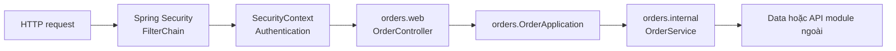
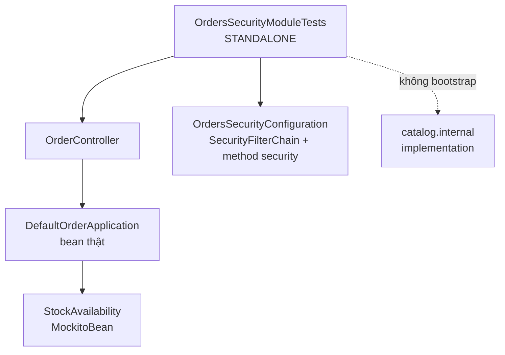

# Authentication và security context trong test

## Mục tiêu học tập

Sau bài học, bạn có thể:

1. Phân biệt **authentication** (xác định danh tính), **authorization** (kiểm tra quyền) và **SecurityContext** (ngữ cảnh xác thực của request/thread).
2. Tổ chức `@ApplicationModuleTest` cho web adapter để các quy tắc Spring Security cần kiểm tra thực sự có mặt trong test context.
3. Dùng `@WithMockUser`, `@WithAnonymousUser` và `MockMvcRequestPostProcessors.user(...)` để mô phỏng danh tính trong Spring MVC test.
4. Kiểm tra các trường hợp **401**, **403**, **200**, **201** cùng CSRF token mà không vô tình bỏ qua security filter chain.
5. Truyền danh tính từ controller qua application service, kiểm tra `@PreAuthorize` khi method security được bật, và bảo vệ truy cập tài nguyên theo chủ sở hữu.
6. Dùng `@WithUserDetails` hoặc `@WithSecurityContext` khi ứng dụng cần custom principal, thay vì luôn giả định `@WithMockUser` đủ dùng.
7. Phân biệt test security mock context với **đăng nhập thật** qua HTTP Basic, session, JWT hoặc OAuth2; hiểu vì sao `RANDOM_PORT` không tự nhận SecurityContext của test thread.
8. Kết hợp test bảo mật, `ApplicationModules.verify()`, kiểm thử sự kiện/database và quality gate CI.

Bài thuộc chương **Web module testing** của lộ trình **SPRING_MODULITH_VERIFICATION_TESTING**. Lộ trình hướng đến kiểm chứng ranh giới kiến trúc ứng dụng Spring Modulith bằng `ApplicationModules`, các quy tắc phụ thuộc và `@ApplicationModuleTest`, đồng thời kết hợp kiểm thử sự kiện, cơ sở dữ liệu và tích hợp để ngăn hồi quy trong CI. Trong bài này, đối tượng cần kiểm chứng là **danh tính và quyền hạn mà web adapter cùng application service thực sự nhận được trong một lần gọi request**.

> **Phạm vi ví dụ:** Java 17+, Spring Boot 3.4–3.5, Spring Framework 6.2, Spring Security 6.4–6.5, Spring Modulith 1.3–1.4, JUnit 5, Spring MVC. Import `@AutoConfigureMockMvc` và một số starter/package có thể khác ở Spring Boot 4. Các ví dụ dùng Servlet security context; WebFlux dùng reactive security context riêng.

## 1. Authentication, authorization và SecurityContext

Một request tới endpoint `GET /orders/order-1` có thể đi qua ba bước khác nhau:

1. **Authentication** — ai đang gọi? Ví dụ một người dùng có username `alice`.
2. **Authorization** — người dùng đó có được truy cập endpoint và use case không? Ví dụ phải có role `CUSTOMER`.
3. **Object-level authorization** — người đó có được xem **đơn hàng cụ thể** không? Ví dụ `alice` không được xem đơn hàng của `bob` dù cả hai đều mang role `CUSTOMER`.

Trong Spring Security, đối tượng `Authentication` thường chứa:

| Thuộc tính | Ý nghĩa |
| --- | --- |
| `principal` | Danh tính đại diện người dùng hoặc hệ thống |
| `getName()` | Tên/ID mà authentication công bố |
| `authorities` | Quyền được cấp, ví dụ `ROLE_CUSTOMER` |
| `credentials` | Thông tin xác thực, thường không nên đưa vào response/log |
| `isAuthenticated()` | Trạng thái xác thực do cơ chế Spring Security quản lý |

`SecurityContext` chứa `Authentication` hiện tại. Với ứng dụng Servlet theo cấu hình mặc định, Spring Security thường dùng `SecurityContextHolder` và chiến lược **gắn với thread** để các thành phần đang xử lý cùng request truy cập danh tính.



**Điểm cần nhớ:** Có `Authentication` trong test thread không đồng nghĩa request mạng thật đã đăng nhập. `@WithMockUser` tạo ngữ cảnh cho test, **không** gửi username/password qua một authentication provider và **không** kiểm tra chữ ký access token.

### Mã HTTP thường gặp

| Kết quả | Ý nghĩa điển hình | Ví dụ |
| --- | --- | --- |
| `401 Unauthorized` | Chưa cung cấp thông tin xác thực hợp lệ cho tài nguyên được bảo vệ | GET không có credentials khi dùng HTTP Basic |
| `403 Forbidden` | Đã xác thực nhưng không đủ quyền; hoặc request bị CSRF filter từ chối | Role `VIEWER` truy cập endpoint chỉ dành cho `CUSTOMER` |
| `200 OK` | Request đọc được phép và có dữ liệu | `alice` đọc đơn hàng của mình |
| `201 Created` | Request tạo tài nguyên được phép và thành công | `alice` tạo đơn có CSRF token hợp lệ |
| `404 Not Found` | Tài nguyên không tồn tại hoặc ứng dụng cố ý không công bố sự tồn tại | `bob` hỏi ID đơn hàng của `alice` |

**Không suy ra toàn bộ quy tắc từ status:** `401/403` còn phụ thuộc authentication entry point và chính sách filter chain; `404` có thể là dữ liệu không tồn tại, không phải security.

## 2. Security test phải thuộc đúng phạm vi module

Xây ứng dụng mẫu:

```text
src/main/java/com/acme/shop/
├── ShopApplication.java
├── catalog/
│   └── StockAvailability.java           <- API công khai của catalog
└── orders/
    ├── OrderApplication.java            <- API của orders
    ├── OrderView.java
    ├── StockUnavailableException.java
    ├── internal/
    │   ├── DefaultOrderApplication.java
    │   └── OrdersSecurityConfiguration.java
    └── web/
        └── OrderController.java

src/test/java/com/acme/shop/
├── ModuleArchitectureTests.java
└── orders/
    ├── OrdersSecurityModuleTests.java
    ├── OrdersMethodSecurityTests.java
    └── OrdersRealHttpSecurityTests.java
```

Với cách phát hiện module mặc định:

- `orders` và `catalog` là hai application module.
- `orders.internal` và `orders.web` thuộc **cùng module orders**.
- `DefaultOrderApplication` tham chiếu API công khai `catalog.StockAvailability`.
- `@ApplicationModuleTest` đặt trong `com.acme.shop.orders` sẽ bootstrap **orders ở chế độ `STANDALONE`**; implementation `catalog` không chạy.



Security configuration đặt trong `orders.internal` **chỉ để ví dụ tự chứa** và bảo đảm cấu hình nằm trong module được bootstrap. Trong dự án thực, security policy có thể ở một module/hạ tầng dùng chung, có nhiều `SecurityFilterChain` hoặc do API gateway đảm trách một phần; khi đó phải xác nhận test **đang dùng đúng policy**, không mặc định copy cấu trúc ví dụ.

## 3. Phụ thuộc cần thiết

Với Gradle Groovy DSL và Spring Boot/Spring Modulith BOM tương thích:

```groovy
dependencies {
    implementation 'org.springframework.boot:spring-boot-starter-web'
    implementation 'org.springframework.boot:spring-boot-starter-validation'
    implementation 'org.springframework.boot:spring-boot-starter-security'
    implementation 'org.springframework.modulith:spring-modulith-starter-core'

    testImplementation 'org.springframework.boot:spring-boot-starter-test'
    testImplementation 'org.springframework.security:spring-security-test'
    testImplementation 'org.springframework.modulith:spring-modulith-starter-test'
}
```

`spring-security-test` cung cấp `@WithMockUser`, `@WithAnonymousUser`, các request post-processor `user()`, `csrf()`, và các công cụ tích hợp security vào Spring test.

Không chỉ thêm `spring-security-test` rồi mặc định security policy của production đã được kiểm tra. Test cần **Spring Security runtime dependencies và cấu hình `SecurityFilterChain`/method security tương ứng**, nếu đó là nội dung hợp đồng cần xác minh.

Lớp Spring Boot ở root package:

```java
// src/main/java/com/acme/shop/ShopApplication.java
package com.acme.shop;

import org.springframework.boot.SpringApplication;
import org.springframework.boot.autoconfigure.SpringBootApplication;

@SpringBootApplication
public class ShopApplication {

    public static void main(String[] args) {
        SpringApplication.run(ShopApplication.class, args);
    }
}
```

## 4. Application API và cộng tác viên ngoài module

API công khai của module `catalog`:

```java
// src/main/java/com/acme/shop/catalog/StockAvailability.java
package com.acme.shop.catalog;

public interface StockAvailability {
    boolean available(String sku);
}
```

API của `orders`:

```java
// src/main/java/com/acme/shop/orders/OrderView.java
package com.acme.shop.orders;

public record OrderView(String id, String sku, String owner) {}
```

```java
// src/main/java/com/acme/shop/orders/OrderApplication.java
package com.acme.shop.orders;

import java.util.Optional;

public interface OrderApplication {

    Optional<OrderView> findVisible(String id, String requester);

    OrderView place(String sku, String requester);
}
```

```java
// src/main/java/com/acme/shop/orders/StockUnavailableException.java
package com.acme.shop.orders;

public class StockUnavailableException extends RuntimeException {

    public StockUnavailableException() {
        super("Requested stock is not available");
    }
}
```

Đây là **use-case API**; không dùng trực tiếp `HttpServletRequest`, `SecurityContextHolder` hoặc kiểu Spring MVC trong interface. Controller sẽ nhận danh tính từ security context của request rồi chuyển thành `requester` tường minh.

**Đây là một lựa chọn thiết kế:** Một số hệ thống muốn service tự lấy principal từ `SecurityContextHolder`, số khác truyền một `CurrentActor` domain abstraction để giảm coupling vào Spring Security. Trong ví dụ, truyền `requester` làm cho quy tắc *owner* có thể được test rõ và độc lập hơn.

## 5. Service thật trong orders: method security và object ownership

```java
// src/main/java/com/acme/shop/orders/internal/DefaultOrderApplication.java
package com.acme.shop.orders.internal;

import com.acme.shop.catalog.StockAvailability;
import com.acme.shop.orders.OrderApplication;
import com.acme.shop.orders.OrderView;
import com.acme.shop.orders.StockUnavailableException;
import java.util.Map;
import java.util.Optional;
import org.springframework.security.access.prepost.PreAuthorize;
import org.springframework.stereotype.Service;

@Service
class DefaultOrderApplication implements OrderApplication {

    private final StockAvailability catalog;

    // Fixture bất biến để tập trung vào authorization, không phải DB.
    private final Map<String, OrderView> orders = Map.of(
            "order-1", new OrderView("order-1", "BK-42", "alice"),
            "order-2", new OrderView("order-2", "BK-99", "bob")
    );

    DefaultOrderApplication(StockAvailability catalog) {
        this.catalog = catalog;
    }

    @Override
    @PreAuthorize("hasRole('CUSTOMER')")
    public Optional<OrderView> findVisible(
            String id, String requester) {

        return Optional.ofNullable(orders.get(id))
                .filter(order -> order.owner().equals(requester));
    }

    @Override
    @PreAuthorize("hasRole('CUSTOMER')")
    public OrderView place(String sku, String requester) {
        if (!catalog.available(sku)) {
            throw new StockUnavailableException();
        }

        return new OrderView("new-" + sku, sku, requester);
    }
}
```

Trong ứng dụng thực, `findVisible` thường đọc repository theo **cả ID và chủ sở hữu** hoặc dùng một authorization policy có kiểm soát; dữ liệu cố định trong ví dụ chỉ để làm rõ các nhánh security. Không dùng `Map` này như persistence production.

Phân biệt hai lớp quyền:

- `@PreAuthorize("hasRole('CUSTOMER')")` kiểm tra authority trước khi method service chạy.
- Điều kiện `order.owner().equals(requester)` ngăn **một customer đọc tài nguyên của customer khác**.

Nếu một user `VIEWER` gọi service trực tiếp thông qua Spring proxy, `@PreAuthorize` vẫn có thể chặn dù họ bỏ qua HTTP controller. Tuy nhiên, để method annotation có tác dụng, cần **bật method security** và gọi bean qua proxy, không tạo service bằng `new` rồi mong aspect chạy.

**Giới hạn của tham số `requester`:** Khi service bị gọi từ batch/job hoặc API khác, caller có thể truyền một tên khác. Với dữ liệu nhạy cảm, thiết kế production cần một identity/authorization contract tin cậy (chẳng hạn current actor abstraction hoặc kiểm tra principal ở service), không chỉ tin vào chuỗi tự do do caller cung cấp. Bài này dùng nó để tách biệt dữ liệu request với luật phân quyền HTTP.

## 6. SecurityFilterChain và method security trong module

```java
// src/main/java/com/acme/shop/orders/internal/OrdersSecurityConfiguration.java
package com.acme.shop.orders.internal;

import org.springframework.context.annotation.Bean;
import org.springframework.context.annotation.Configuration;
import org.springframework.http.HttpMethod;
import org.springframework.security.config.Customizer;
import org.springframework.security.config.annotation.method.configuration
        .EnableMethodSecurity;
import org.springframework.security.config.annotation.web.builders.HttpSecurity;
import org.springframework.security.web.SecurityFilterChain;

@Configuration(proxyBeanMethods = false)
@EnableMethodSecurity
class OrdersSecurityConfiguration {

    @Bean
    SecurityFilterChain ordersSecurityFilterChain(
            HttpSecurity http) throws Exception {

        http.authorizeHttpRequests(authorize -> authorize
                .requestMatchers(HttpMethod.GET, "/orders/**")
                        .hasRole("CUSTOMER")
                .requestMatchers(HttpMethod.POST, "/orders")
                        .hasRole("CUSTOMER")
                .anyRequest().denyAll());

        http.httpBasic(Customizer.withDefaults());

        // CSRF giữ theo mặc định (đang bật).
        return http.build();
    }
}
```

**Giải thích:**

1. GET `/orders/**` đòi `ROLE_CUSTOMER`.
2. POST `/orders` cũng đòi `ROLE_CUSTOMER`.
3. Các request còn lại bị từ chối theo policy minh họa.
4. `httpBasic` cung cấp authentication entry point HTTP Basic để bài test có thể phân biệt một GET chưa đăng nhập (thường là **401**) với request đã đăng nhập nhưng thiếu role (**403**).
5. CSRF mặc định được giữ cho Servlet request thay đổi trạng thái, ví dụ POST.
6. `@EnableMethodSecurity` kích hoạt xử lý `@PreAuthorize` cho các service Spring-managed.

Đây là **policy minh họa**, không phải cấu hình security nên sao chép nguyên cho production. Nếu ứng dụng cần public health endpoint, API dùng OAuth2 Resource Server, nhiều filter chain hay bảo vệ endpoint khác, hãy bổ sung matcher/chain tương ứng. Đặc biệt, `anyRequest().denyAll()` có thể ảnh hưởng `/error`, Actuator hoặc tài nguyên công khai tùy cách phân chia filter chains.

### Vì sao security config phải có trong module test?

`@ApplicationModuleTest(STANDALONE)` giới hạn component scanning theo module. Nếu production có `SecurityConfiguration` ở package/module **ngoài orders**, bài test có thể **không bootstrap policy ấy**, rồi dùng default chain của Spring Boot hoặc không có những rule mong đợi.

Test trả 401/403 theo một default chain **không chứng minh** chính sách phân quyền production của orders đã được kiểm tra. Có thể:

- Đưa security configuration thuộc module cần test vào phạm vi nếu thiết kế cho phép.
- Import có chủ đích cấu hình security tương ứng bằng `@Import` trong test; kiểm tra không vô tình kéo thêm controller/module khác.
- Tạo một cấu hình test **phản ánh rõ** policy cần bảo vệ, đồng thời giữ một test full-context xác nhận production configuration.

Không mở rộng vô điều kiện sang `ALL_DEPENDENCIES` chỉ để Spring tìm được security bean. Phải biết policy thuộc module nào và tại sao nó nằm ngoài phạm vi.

## 7. Controller nhận Authentication của request

```java
// src/main/java/com/acme/shop/orders/web/OrderController.java
package com.acme.shop.orders.web;

import com.acme.shop.orders.OrderApplication;
import com.acme.shop.orders.OrderView;
import com.acme.shop.orders.StockUnavailableException;
import jakarta.validation.Valid;
import jakarta.validation.constraints.NotBlank;
import java.net.URI;
import java.security.Principal;
import org.springframework.http.MediaType;
import org.springframework.http.ResponseEntity;
import org.springframework.web.bind.annotation.GetMapping;
import org.springframework.web.bind.annotation.PathVariable;
import org.springframework.web.bind.annotation.PostMapping;
import org.springframework.web.bind.annotation.RequestBody;
import org.springframework.web.bind.annotation.RequestMapping;
import org.springframework.web.bind.annotation.RestController;

@RestController
@RequestMapping("/orders")
public class OrderController {

    private final OrderApplication orders;

    public OrderController(OrderApplication orders) {
        this.orders = orders;
    }

    @GetMapping("/{id}")
    public ResponseEntity<OrderView> read(
            @PathVariable String id,
            Principal principal) {

        return ResponseEntity.of(
                orders.findVisible(id, principal.getName()));
    }

    @PostMapping(
            consumes = MediaType.APPLICATION_JSON_VALUE,
            produces = MediaType.APPLICATION_JSON_VALUE)
    public ResponseEntity<OrderView> create(
            @Valid @RequestBody CreateOrder request,
            Principal principal) {

        OrderView placed = orders.place(
                request.sku(), principal.getName());

        return ResponseEntity
                .created(URI.create("/orders/" + placed.id()))
                .body(placed);
    }

    public record CreateOrder(@NotBlank String sku) {}
}
```

Đây là cách nhận `Principal` đã được Spring Security/Servlet request cung cấp sau khi request đi qua filter chain. Trong policy ví dụ, anonymous request bị chặn trước controller; vì vậy những method này **chỉ được gọi khi có principal hợp lệ** theo cấu hình.

**Không lấy username từ JSON do client tự khai báo để quyết định owner.** Ví dụ `{"sku":"BK-42","owner":"alice"}` có thể bị user `bob` giả mạo. Controller lấy ID từ **ngữ cảnh đã xác thực**, rồi truyền vào use case.

Nếu production dùng JWT, `Principal.getName()` có thể là subject hoặc claim do hệ thống ánh xạ, không phải username đăng nhập. Hãy thống nhất ý nghĩa của `getName()` và ánh xạ principal thực tế trong cả test lẫn production.

### Advice cho lỗi tồn kho

```java
// src/main/java/com/acme/shop/orders/web/OrderErrorAdvice.java
package com.acme.shop.orders.web;

import com.acme.shop.orders.StockUnavailableException;
import org.springframework.http.HttpStatus;
import org.springframework.http.ProblemDetail;
import org.springframework.web.bind.annotation.ExceptionHandler;
import org.springframework.web.bind.annotation.RestControllerAdvice;

@RestControllerAdvice
public class OrderErrorAdvice {

    @ExceptionHandler(StockUnavailableException.class)
    public ProblemDetail unavailable(
            StockUnavailableException exception) {

        ProblemDetail problem =
                ProblemDetail.forStatus(HttpStatus.CONFLICT);
        problem.setTitle("Stock unavailable");
        problem.setProperty("code", "OUT_OF_STOCK");
        return problem;
    }
}
```

HTTP 409 là **lỗi nghiệp vụ sau khi đã qua xác thực/phân quyền**, không nên bị nhầm với 401/403 do Spring Security tạo trước controller.

## 8. Tạo `@ApplicationModuleTest` có security thật trong context

Đặt lớp test dưới package `orders`:

```java
// src/test/java/com/acme/shop/orders/OrdersSecurityModuleTests.java
package com.acme.shop.orders;

import com.acme.shop.catalog.StockAvailability;
import org.junit.jupiter.api.Test;
import org.springframework.beans.factory.annotation.Autowired;
import org.springframework.boot.test.autoconfigure.web.servlet.AutoConfigureMockMvc;
import org.springframework.modulith.test.ApplicationModuleTest;
import org.springframework.test.context.bean.override.mockito.MockitoBean;
import org.springframework.test.web.servlet.MockMvc;

@ApplicationModuleTest
@AutoConfigureMockMvc
class OrdersSecurityModuleTests {

    @Autowired
    MockMvc mvc;

    @MockitoBean
    StockAvailability catalog;

    // Các phương thức test tiếp theo nằm trong lớp này.
}
```

**Ở lớp test trên:**

- `@ApplicationModuleTest` mặc định `STANDALONE` và `webEnvironment = MOCK`: bootstrap orders và Spring infrastructure cần thiết.
- `@AutoConfigureMockMvc` cung cấp `MockMvc` và mặc định **không vô hiệu hóa filter** (`addFilters = true`).
- `OrdersSecurityConfiguration` thuộc `orders.internal` được quét và cấu hình policy.
- `OrderController`, `DefaultOrderApplication` và method security là các thành phần thật của module đang test.
- `@MockitoBean StockAvailability` cấp mock cho API catalog ở ngoài module.

`MockMvc` **không mở cổng HTTP thật**. Tuy vậy, request đi qua MVC và các Servlet filters được đăng ký trên `MockMvc`, bao gồm Spring Security filter chain khi cấu hình đúng.

Nếu test không tìm được `MockMvc`, kiểm tra `@AutoConfigureMockMvc`, web starter và Servlet stack; nếu request trả kết quả khác policy, kiểm tra có đúng `SecurityFilterChain` trong context trước khi sửa assertion.

## 9. Kiểm tra anonymous request: 401

GET chưa có người dùng:

```java
import static org.springframework.test.web.servlet.request
        .MockMvcRequestBuilders.get;
import static org.springframework.test.web.servlet.result
        .MockMvcResultMatchers.status;

@Test
void anonymousUserCannotReadOrders() throws Exception {
    mvc.perform(get("/orders/order-1"))
            .andExpect(status().isUnauthorized());
}
```

Với policy HTTP Basic ở mục 6, GET tới tài nguyên cần `CUSTOMER` nhưng không có credentials sẽ kích hoạt authentication entry point và trả **401**. Trong ứng dụng sử dụng form login, resource server hoặc entry point khác, phản hồi có thể là redirect/JSON khác; điều đó phải được nêu trong contract.

Khi muốn thể hiện anonymous tường minh:

```java
import org.springframework.security.test.context.support.WithAnonymousUser;

@Test
@WithAnonymousUser
void anonymousContextIsRejected() throws Exception {
    mvc.perform(get("/orders/order-1"))
            .andExpect(status().isUnauthorized());
}
```

`@WithAnonymousUser` hữu ích khi lớp test có annotation người dùng mặc định hoặc muốn chỉ rõ **không sử dụng danh tính được cấp ở cấp class**.

**Không dùng 401 làm bằng chứng duy nhất rằng method security đã bật.** Request có thể bị HTTP filter chain chặn **trước khi service chạy**. Test `@PreAuthorize` trực tiếp ở mục sau mới kiểm tra method-level protection.

## 10. `@WithMockUser`: người dùng tồn tại trong security context của test

Thêm:

```java
import org.springframework.security.test.context.support.WithMockUser;

import static org.springframework.test.web.servlet.result
        .MockMvcResultMatchers.jsonPath;
```

Test một customer được phép đọc đơn của mình:

```java
@Test
@WithMockUser(username = "alice", roles = "CUSTOMER")
void customerCanReadOwnOrder() throws Exception {
    mvc.perform(get("/orders/order-1"))
            .andExpect(status().isOk())
            .andExpect(jsonPath("$.id").value("order-1"))
            .andExpect(jsonPath("$.owner").value("alice"));
}
```

`@WithMockUser` sử dụng Spring Security test support để đưa một `Authentication` giả vào `SecurityContextHolder` của test. Với Spring MVC Test được cấu hình security đúng, ngữ cảnh đó được sử dụng khi request đi qua `MockMvc`.

**Không cần tạo user `alice` trong database** hoặc đăng nhập qua `AuthenticationManager` để chạy test này. Đây là một **test authorization và propagation của principal**, không phải test password, session login hay token verification.

### Kiểm tra cùng role nhưng khác chủ sở hữu

```java
@Test
@WithMockUser(username = "bob", roles = "CUSTOMER")
void customerCannotReadAnotherCustomersOrder()
        throws Exception {

    mvc.perform(get("/orders/order-1"))
            .andExpect(status().isNotFound());
}
```

Ở đây `bob` **có đúng role** để truy cập endpoint, nhưng service chỉ trả dữ liệu khi `order.owner().equals(requester)`. Vì vậy response là **404**, theo chính sách ví dụ không làm lộ sự tồn tại của order của người khác.

Một hệ thống khác có thể chủ động trả **403** khi tài nguyên tồn tại nhưng user không phải chủ sở hữu. Điều cần bảo vệ là **chính sách truy cập tài nguyên đã phê duyệt**, không mặc định mọi ứng dụng phải chọn cùng mã HTTP.

### Đủ role hay không?

```java
@Test
@WithMockUser(username = "alice", roles = "VIEWER")
void wrongRoleCannotReadOrders() throws Exception {
    mvc.perform(get("/orders/order-1"))
            .andExpect(status().isForbidden());
}
```

`VIEWER` đã xác thực theo test context nhưng thiếu role `CUSTOMER`; Spring Security chặn ở filter chain và trả **403**, trước khi service cần đọc dữ liệu.

## 11. Role và authority không giống nhau

Với cấu hình thông thường:

```java
@WithMockUser(username = "alice", roles = "CUSTOMER")
```

Spring Security test tạo một `GrantedAuthority` tên **`ROLE_CUSTOMER`**. Vì thế biểu thức:

```java
@PreAuthorize("hasRole('CUSTOMER')")
```

được thỏa mãn, vì `hasRole` áp dụng tiền tố role chuẩn `ROLE_`.

| Cách tạo user | Authority được tạo | Phù hợp với |
| --- | --- | --- |
| `roles = "CUSTOMER"` | `ROLE_CUSTOMER` | `hasRole("CUSTOMER")` |
| `authorities = "ROLE_CUSTOMER"` | `ROLE_CUSTOMER` | `hasRole("CUSTOMER")` hoặc `hasAuthority("ROLE_CUSTOMER")` |
| `authorities = "orders:read"` | `orders:read` | `hasAuthority("orders:read")` |
| `authorities = "SCOPE_orders.read"` | `SCOPE_orders.read` | `hasAuthority("SCOPE_orders.read")` |

Không viết `roles = "ROLE_CUSTOMER"` với kỳ vọng framework tự bỏ tiền tố; khi dùng `roles`, chỉ đưa **phần tên role**. Cũng không dùng đồng thời `roles` và `authorities` trong `@WithMockUser` rồi kỳ vọng hai tập được nối tự do; khi đặt authorities tường minh, cấu hình annotation có các quy tắc riêng cần tôn trọng.

Một test `@WithMockUser(roles = "CUSTOMER")` đi qua không bảo đảm quyền `orders:read` hoặc scope JWT đã tồn tại, nếu policy thực tế dùng `hasAuthority` cho những quyền đó.

## 12. `user(...)` cho từng request của MockMvc

Không phải lúc nào cũng muốn gắn một identity cho **toàn bộ phương thức test**. Khi cần so sánh hai người gọi trong cùng test, dùng request post-processor:

```java
import static org.springframework.security.test.web.servlet.request
        .SecurityMockMvcRequestPostProcessors.user;

@Test
void requestIdentityChangesVisibleOrders() throws Exception {
    mvc.perform(get("/orders/order-1")
            .with(user("alice").roles("CUSTOMER")))
            .andExpect(status().isOk())
            .andExpect(jsonPath("$.owner").value("alice"));

    mvc.perform(get("/orders/order-1")
            .with(user("bob").roles("CUSTOMER")))
            .andExpect(status().isNotFound());
}
```

`.with(user(...))` gắn identity vào **request đang được xử lý**. Để identity này được Spring Security đưa vào `SecurityContextHolder` trong quá trình xử lý MVC, `MockMvc` phải có tích hợp security filters. Trong ví dụ, `@AutoConfigureMockMvc` cùng security configuration đảm nhận điều đó.

### So sánh hai cách cấp danh tính

| Cách | Phạm vi | Dùng khi |
| --- | --- | --- |
| `@WithMockUser` | Security context của test method/class | Phần lớn test dùng một user |
| `.with(user("alice").roles("CUSTOMER"))` | Một request MockMvc cụ thể | So sánh nhiều user/request trong cùng bài test |
| `.with(authentication(...))` | Một request với `Authentication` do bạn tạo | Cần principal/authorities tùy chỉnh |
| `@WithUserDetails` | Security context từ `UserDetailsService` trong test context | Cần principal thực theo hệ thống |
| `@WithSecurityContext` | Security context tạo bằng factory tùy chỉnh | Cần domain principal/token đặc thù |

Đừng giả định `user(...)` kiểm tra quy trình đăng nhập. Nó **đặt authentication giả cho request**, không gửi password qua login filter.

## 13. CSRF: request có role đúng vẫn có thể bị 403

Trong ứng dụng Servlet dùng cơ chế session/browser và CSRF đang bật, các request thay đổi trạng thái như **POST** phải có token phù hợp.

Một test người dùng có role `CUSTOMER` nhưng thiếu CSRF:

```java
import static org.springframework.test.web.servlet.request
        .MockMvcRequestBuilders.post;
import org.springframework.http.MediaType;

@Test
@WithMockUser(username = "alice", roles = "CUSTOMER")
void postWithoutCsrfIsRejected() throws Exception {
    mvc.perform(post("/orders")
            .contentType(MediaType.APPLICATION_JSON)
            .content("""
                    {"sku":"BK-42"}
                    """))
            .andExpect(status().isForbidden());
}
```

Đây là **403 từ CSRF protection**, không có nghĩa `alice` thiếu `ROLE_CUSTOMER`.

Thêm CSRF cho request được phép:

```java
import static org.mockito.BDDMockito.given;
import static org.mockito.BDDMockito.then;
import static org.springframework.security.test.web.servlet.request
        .SecurityMockMvcRequestPostProcessors.csrf;

@Test
@WithMockUser(username = "alice", roles = "CUSTOMER")
void customerCanCreateOrderWithCsrf() throws Exception {
    given(catalog.available("BK-42")).willReturn(true);

    mvc.perform(post("/orders")
            .with(csrf())
            .contentType(MediaType.APPLICATION_JSON)
            .content("""
                    {"sku":"BK-42"}
                    """))
            .andExpect(status().isCreated())
            .andExpect(jsonPath("$.id").value("new-BK-42"))
            .andExpect(jsonPath("$.owner").value("alice"));

    then(catalog).should().available("BK-42");
}
```

Mã trên là phương thức test bổ sung trong `OrdersSecurityModuleTests`, sử dụng `catalog` field đã khai báo. `@MockitoBean` mặc định được reset giữa các test trong Spring Framework test support, tránh làm lẫn tương tác ở ca trước.

### CSRF hợp lệ không cấp thêm quyền

```java
@Test
@WithMockUser(username = "alice", roles = "VIEWER")
void csrfDoesNotGrantCustomerPermission() throws Exception {
    mvc.perform(post("/orders")
            .with(csrf())
            .contentType(MediaType.APPLICATION_JSON)
            .content("""
                    {"sku":"BK-42"}
                    """))
            .andExpect(status().isForbidden());

    then(catalog).shouldHaveNoInteractions();
}
```

CSRF token chỉ giải quyết một lớp bảo vệ; nó **không nâng authority** của một user. Ngược lại, role đúng không thể thay cho token nếu CSRF đang được áp dụng.

### CSRF token không hợp lệ

```java
@Test
@WithMockUser(username = "alice", roles = "CUSTOMER")
void invalidCsrfTokenIsRejected() throws Exception {
    mvc.perform(post("/orders")
            .with(csrf().useInvalidToken())
            .contentType(MediaType.APPLICATION_JSON)
            .content("""
                    {"sku":"BK-42"}
                    """))
            .andExpect(status().isForbidden());
}
```

Nếu ứng dụng là **stateless OAuth2 Resource Server** và policy đã được thiết kế để không dùng CSRF cho API bearer-token, phải kiểm tra theo cấu hình thực: không nên áp kỳ vọng 403 vì thiếu CSRF một cách máy móc. Quan trọng là **test đúng cơ chế bảo mật đang triển khai**, không tắt CSRF trong test chỉ vì muốn request qua được.

## 14. Method security: `@PreAuthorize` có thực sự được áp dụng?

Một request qua filter chain có thể bị chặn trước controller. Để kiểm tra **method-level security**, gọi application service qua bean Spring proxy trong context, với các user test tương ứng.

Tạo test khác trong package `orders`:

```java
// src/test/java/com/acme/shop/orders/OrdersMethodSecurityTests.java
package com.acme.shop.orders;

import static org.assertj.core.api.Assertions.assertThat;
import static org.assertj.core.api.Assertions.assertThatThrownBy;

import com.acme.shop.catalog.StockAvailability;
import org.junit.jupiter.api.Test;
import org.springframework.beans.factory.annotation.Autowired;
import org.springframework.modulith.test.ApplicationModuleTest;
import org.springframework.security.access.AccessDeniedException;
import org.springframework.security.test.context.support.WithMockUser;
import org.springframework.test.context.bean.override.mockito.MockitoBean;

@ApplicationModuleTest
class OrdersMethodSecurityTests {

    @Autowired
    OrderApplication orders;

    @MockitoBean
    StockAvailability catalog;

    @Test
    @WithMockUser(username = "alice", roles = "CUSTOMER")
    void customerCanInvokeProtectedUseCase() {
        assertThat(orders.findVisible("order-1", "alice"))
                .isPresent();
    }

    @Test
    @WithMockUser(username = "alice", roles = "VIEWER")
    void otherRoleCannotInvokeProtectedUseCase() {
        assertThatThrownBy(() ->
                orders.findVisible("order-1", "alice"))
                .isInstanceOf(AccessDeniedException.class);
    }
}
```

Ở đây `@EnableMethodSecurity` trong `OrdersSecurityConfiguration` kích hoạt các interceptor kiểm tra `@PreAuthorize` trên `DefaultOrderApplication`. Test lấy bean qua Spring context, **không tự new service**, nên lời gọi đi qua proxy.

Test cần phân biệt:

- **HTTP filter security:** chặn request dựa vào URL, method, role, CSRF.
- **Method security:** chặn lời gọi service cho dù entry point không phải HTTP.
- **Object ownership:** trong method thực, lọc dữ liệu theo người dùng/tenant.

Nếu method security bị quên cấu hình, test `otherRoleCannotInvokeProtectedUseCase()` sẽ thất bại. Điều này quan trọng vì một test HTTP 403 đôi khi vẫn xanh chỉ nhờ filter chain, che giấu việc `@PreAuthorize` chưa hoạt động.

### Giới hạn của `SecurityContextHolder` với async

Với Servlet synchronous request, SecurityContext gắn với thread đang xử lý. Nếu service tự tạo thread, dùng `CompletableFuture` hoặc `@Async`, **không mặc định truyền SecurityContext bằng cách chia sẻ một thread-local**.

Khi ứng dụng có tác vụ bất đồng bộ thực sự cần danh tính, xem cơ chế `DelegatingSecurityContext...` và thiết kế task executor/correlation context phù hợp. Không đặt `MODE_INHERITABLETHREADLOCAL` toàn cục rồi coi là giải pháp mặc định an toàn cho thread pool.

## 15. Bài test trực tiếp SecurityContext

Trong một test có `@WithMockUser`, có thể đọc context để khẳng định user và authority:

```java
import static org.assertj.core.api.Assertions.assertThat;
import org.springframework.security.core.context.SecurityContextHolder;

@Test
@WithMockUser(username = "alice", roles = "CUSTOMER")
void securityContextContainsExpectedIdentity() {
    var authentication =
            SecurityContextHolder.getContext().getAuthentication();

    assertThat(authentication).isNotNull();
    assertThat(authentication.getName()).isEqualTo("alice");
    assertThat(authentication.getAuthorities())
            .extracting("authority")
            .contains("ROLE_CUSTOMER");
}
```

Đoạn trên có thể đặt trong `OrdersMethodSecurityTests` ở mục 14 hoặc một test có Spring Security test listener. `@WithMockUser` do `WithSecurityContextTestExecutionListener` xử lý; Spring Security test support **dọn SecurityContext sau test** để tránh rò rỉ danh tính sang bài kế tiếp.

**Không lấy test này thay cho HTTP authorization test.** Nó chỉ chứng minh security context được thiết lập ở test thread; route/method/security filter chain có thể chưa được kiểm tra.

### Khi không có Authentication

`SecurityContextHolder.getContext().getAuthentication()` có thể là `null` ngoài luồng xử lý có security, hoặc là một **anonymous authentication** trong request đã qua filter chain. Đừng viết `getAuthentication().getName()` ở những nơi chưa xác minh request đã được xác thực theo chính sách.

Một **authenticated principal** không phải luôn là `org.springframework.security.core.userdetails.User`; JWT, OAuth2 Login hoặc SAML có thể cung cấp principal khác.

## 16. `@WithUserDetails` và principal ứng dụng tự định nghĩa

`@WithMockUser` tạo một Spring Security `User` mặc định. Nếu ứng dụng cần principal tự định nghĩa, ví dụ:

```java
public record ShopPrincipal(
        String customerId, String email)
        implements java.security.Principal {

    @Override
    public String getName() {
        return customerId;
    }
}
```

thì không thể giả định `@WithMockUser` sẽ tạo đúng kiểu này. Một controller dùng `@AuthenticationPrincipal ShopPrincipal principal` sẽ cần test cung cấp đúng domain principal.

Hai cách:

| Cách | Điều kiện | Khi nào nên dùng |
| --- | --- | --- |
| `@WithUserDetails("alice")` | Context có `UserDetailsService` trả user tương ứng, có thể là custom `UserDetails` | Principal thật của hệ thống dùng `UserDetailsService` |
| `@WithSecurityContext(factory = ...)` | Viết factory tạo `SecurityContext` với principal/authorities phù hợp | Principal/token của hệ thống không phải `UserDetails` thông thường |

Ví dụ `@WithUserDetails`:

```java
import org.springframework.security.test.context.support.WithUserDetails;

@Test
@WithUserDetails("alice")
void testWithUserDetails() {
    // Chỉ hợp lệ khi Spring context có UserDetailsService
    // tải được tài khoản "alice" từ test users/database.
}
```

`@WithUserDetails` không tự tạo account trong database hoặc `UserDetailsService`. Trong `STANDALONE`, nếu identity service thuộc module **ngoài orders** và không được bootstrap, cách này có thể thất bại. Khi đó hãy cung cấp test `UserDetailsService` có chủ đích hoặc dùng `@WithSecurityContext`.

## 17. Tạo custom security context cho domain principal

Nếu code thật yêu cầu principal `ShopPrincipal`, có thể tạo annotation test riêng. Ví dụ sau gồm các kiểu **test-only**, đặt trong test sources của dự án:

```java
// src/test/java/com/acme/shop/orders/ShopPrincipal.java
package com.acme.shop.orders;

import java.security.Principal;

public record ShopPrincipal(String customerId)
        implements Principal {

    @Override
    public String getName() {
        return customerId;
    }
}
```

```java
// src/test/java/com/acme/shop/orders/WithShopCustomer.java
package com.acme.shop.orders;

import java.lang.annotation.Retention;
import java.lang.annotation.Target;
import static java.lang.annotation.ElementType.METHOD;
import static java.lang.annotation.ElementType.TYPE;
import static java.lang.annotation.RetentionPolicy.RUNTIME;
import org.springframework.security.test.context.support
        .WithSecurityContext;

@Target({METHOD, TYPE})
@Retention(RUNTIME)
@WithSecurityContext(factory = ShopCustomerContextFactory.class)
public @interface WithShopCustomer {
    String value() default "alice";
}
```

```java
// src/test/java/com/acme/shop/orders/ShopCustomerContextFactory.java
package com.acme.shop.orders;

import java.util.List;
import org.springframework.security.authentication
        .UsernamePasswordAuthenticationToken;
import org.springframework.security.core.authority
        .SimpleGrantedAuthority;
import org.springframework.security.core.context.SecurityContext;
import org.springframework.security.core.context.SecurityContextHolder;
import org.springframework.security.test.context.support
        .WithSecurityContextFactory;

public class ShopCustomerContextFactory
        implements WithSecurityContextFactory<WithShopCustomer> {

    @Override
    public SecurityContext createSecurityContext(
            WithShopCustomer annotation) {

        var principal = new ShopPrincipal(annotation.value());
        var authorities = List.of(
                new SimpleGrantedAuthority("ROLE_CUSTOMER"));
        var authentication =
                UsernamePasswordAuthenticationToken.authenticated(
                        principal, "not-used", authorities);

        var context = SecurityContextHolder.createEmptyContext();
        context.setAuthentication(authentication);
        return context;
    }
}
```

Sử dụng:

```java
@Test
@WithShopCustomer("alice")
void applicationReceivesDomainPrincipal() {
    var authentication =
            SecurityContextHolder.getContext().getAuthentication();

    assertThat(authentication.getPrincipal())
            .isInstanceOf(ShopPrincipal.class);
    assertThat(authentication.getName()).isEqualTo("alice");
}
```

Đây là **công cụ tạo identity giả chỉ cho test**, không mô phỏng mật khẩu hợp lệ, token signature hay session login. Không đưa `ShopCustomerContextFactory` vào production để tạo authentication từ một chuỗi user không được kiểm chứng.

Nếu project thực đã có `ShopPrincipal` trong production, **tái sử dụng kiểu đó** và giữ lại factory ở test scope; đừng tạo một kiểu test khác trùng tên gây lệch contract.

## 18. Khi ứng dụng dùng OAuth2 Resource Server / JWT

Trong resource server, request thường gửi:

```http
GET /orders/order-1
Authorization: Bearer eyJ...
```

Khi đó Spring Security có thể dùng `JwtAuthenticationToken` và authority như `SCOPE_orders.read`, không phải username/password hay role `CUSTOMER`.

Nếu cấu hình production dùng **JWT resource server**, Spring Security Test cung cấp `jwt()` cho MockMvc:

```java
import static org.springframework.security.test.web.servlet.request
        .SecurityMockMvcRequestPostProcessors.jwt;
import org.springframework.security.core.authority
        .SimpleGrantedAuthority;

mvc.perform(get("/orders/order-1")
        .with(jwt()
                .jwt(token -> token.subject("alice"))
                .authorities(
                        new SimpleGrantedAuthority("ROLE_CUSTOMER"))))
        .andExpect(status().isOk());
```

Đây là **đoạn thay thế cách cấp authentication** trong một test mà classpath có các thành phần Spring Security OAuth2 Resource Server/JWT phù hợp và policy kiểm tra `ROLE_CUSTOMER` như ví dụ. Nếu policy thật dùng `SCOPE_orders.read`, cần sửa authority trong mock **và** rule security tương ứng.

**Điều quan trọng:** `.with(jwt())` không phát hành JWT có chữ ký thật, không liên hệ identity provider và không tự kiểm tra `JwtDecoder` hoạt động. Nó tiện để test **authorization sau khi có một JwtAuthenticationToken**.

Muốn kiểm tra bearer-token authentication thật:

- Đưa resource server filter chain và decoder/test keys phù hợp vào integration test.
- Gửi `Authorization: Bearer ...` với token hợp lệ hoặc không hợp lệ tới server/test context.
- Kiểm tra lỗi thiếu token, hết hạn, chữ ký sai, issuer/audience và claim mapping theo cấu hình production.
- Không log token thật hoặc đưa secret/private key vào bài học/test fixture công khai.

Không thêm cả `httpBasic` lẫn cấu hình JWT vào cùng ví dụ rồi xem kết quả là đại diện cho mọi môi trường. Hãy chọn **một security mode thật của dự án** và xây test tương ứng.

## 19. `RANDOM_PORT`: ngữ cảnh test không tự đi theo HTTP request

`@WithMockUser` và `@WithSecurityContext` tạo SecurityContext cho **test thread**. Khi dùng:

```java
@ApplicationModuleTest(
        webEnvironment = SpringBootTest.WebEnvironment.RANDOM_PORT)
```

request HTTP được gửi qua mạng tới embedded server và xử lý ở **server thread** khác. SecurityContext của client/test thread **không tự xuất hiện trong server thread**.

Muốn kiểm tra authentication thật, hãy gửi credentials/token theo giao thức HTTP. Ví dụ biến thể với **HTTP Basic test user**:

```java
// src/test/java/com/acme/shop/orders/OrdersRealHttpSecurityTests.java
package com.acme.shop.orders;

import static org.assertj.core.api.Assertions.assertThat;

import com.acme.shop.catalog.StockAvailability;
import org.junit.jupiter.api.Test;
import org.springframework.beans.factory.annotation.Autowired;
import org.springframework.boot.test.context.SpringBootTest;
import org.springframework.boot.test.context.TestConfiguration;
import org.springframework.boot.test.web.client.TestRestTemplate;
import org.springframework.context.annotation.Bean;
import org.springframework.context.annotation.Import;
import org.springframework.http.HttpStatus;
import org.springframework.modulith.test.ApplicationModuleTest;
import org.springframework.security.core.userdetails.User;
import org.springframework.security.core.userdetails.UserDetailsService;
import org.springframework.security.provisioning.InMemoryUserDetailsManager;
import org.springframework.test.context.bean.override.mockito.MockitoBean;

@ApplicationModuleTest(
        webEnvironment = SpringBootTest.WebEnvironment.RANDOM_PORT)
@Import(OrdersRealHttpSecurityTests.TestUsers.class)
class OrdersRealHttpSecurityTests {

    @Autowired
    TestRestTemplate http;

    @MockitoBean
    StockAvailability catalog;

    @TestConfiguration(proxyBeanMethods = false)
    static class TestUsers {

        @Bean
        UserDetailsService testUserDetailsService() {
            return new InMemoryUserDetailsManager(
                    User.withUsername("alice")
                            .password("{noop}test-password")
                            .roles("CUSTOMER")
                            .build());
        }
    }

    @Test
    void missingCredentialsAreRejected() {
        var response = http.getForEntity(
                "/orders/order-1", String.class);
        assertThat(response.getStatusCode())
                .isEqualTo(HttpStatus.UNAUTHORIZED);
    }

    @Test
    void realBasicHeaderAuthenticatesRequest() {
        var response = http
                .withBasicAuth("alice", "test-password")
                .getForEntity("/orders/order-1", String.class);

        assertThat(response.getStatusCode())
                .isEqualTo(HttpStatus.OK);
        assertThat(response.getBody())
                .contains("order-1");
    }
}
```

`{noop}` chỉ dùng trong **test-only in-memory user store** để ví dụ gọn. Production phải có password encoding và authentication provider phù hợp; không dùng password rõ trong mã triển khai thật.

Trong biến thể này `TestRestTemplate.withBasicAuth(...)` thực sự đưa HTTP Basic header lên request, cho server filter chain thực hiện authentication. Test có thể tiếp tục kiểm tra sai password, user thiếu role, CSRF với HTTP POST và policy session tùy yêu cầu thực tế.

**Đừng gắn `@WithMockUser` lên test RANDOM_PORT** rồi cho rằng nó thay thế HTTP Basic header. Đó là hai cơ chế hoàn toàn khác.

## 20. Spring Security trong MVC slice và module test

| Test | Hạ tầng được bootstrap | Identity thường dùng | Điều bảo vệ |
| --- | --- | --- | --- |
| Unit test `OrderController` bằng `new` | Không có Spring MVC/Security filter | Principal giả truyền trực tiếp | Logic chuyển dữ liệu trong controller |
| `@WebMvcTest(OrderController.class)` | MVC slice, có thể có security filters | `@WithMockUser` hoặc `user()` | Mapping, validation, authorization ở web layer |
| `@ApplicationModuleTest` + `MockMvc` | Web + application service trong module; security config trong scope | `@WithMockUser`, `user()`, `csrf()` | Web và service/method security trong module |
| `@ApplicationModuleTest(RANDOM_PORT)` | Module + embedded HTTP server | HTTP Basic, cookie, bearer token thật trong request | Authentication và HTTP exchange qua server |
| Full integration/E2E | Các module cùng hệ thống ngoài có thật/được mô phỏng | Login/token phù hợp môi trường | Chuỗi bảo mật/tích hợp toàn hệ thống |

Với `@WebMvcTest`, service `OrderApplication` thường được **mock**, nên test không thực thi `@PreAuthorize` trên `DefaultOrderApplication` thật. Với `@ApplicationModuleTest`, service thật trong module chạy, nên có thể xác minh method security nếu được bật.

### Cẩn thận với `@AutoConfigureMockMvc(addFilters = false)`

```java
// CẤU HÌNH NGUY HIỂM nếu mục tiêu là kiểm tra security:
@AutoConfigureMockMvc(addFilters = false)
```

Cấu hình trên loại bỏ việc thêm Servlet filters vào `MockMvc`. Test controller có thể trả 200/201 ngay cả khi thiếu authentication, authorization hoặc CSRF. Chỉ sử dụng nó **khi cố ý kiểm thử controller ngoài security** và có **nhóm security tests độc lập** bảo vệ filter chain.

Nếu test 403 “quá khó chạy”, việc tắt filter **không phải cách sửa lỗi phân quyền**. Kiểm tra role, authority, principal, CSRF, SecurityFilterChain thực tế trước.

## 21. Những bẫy thường gặp khi xác minh security context

### A. Chỉ dùng `@WithMockUser` nhưng production dùng JWT

`@WithMockUser` thường tạo `UsernamePasswordAuthenticationToken`. Trong production, code có thể kỳ vọng `JwtAuthenticationToken` với subject/scopes.

**Hậu quả:** Test xanh nhưng controller/service cast sai principal hoặc không ánh xạ được authority từ JWT.

**Cách xử lý:** Test authorization theo đúng loại authentication production; dùng `jwt()` cho test policy, đồng thời integration test decoder/filter cho token thật.

### B. Cấu hình security nằm ngoài module test

Ví dụ `SecurityConfiguration` ở module `platform-security`, trong khi `orders` đang chạy `STANDALONE`.

**Hậu quả:** Test dùng default chain hoặc cấu hình thiếu, không giống production.

**Cách xử lý:** Xác định policy thực sự được import/scanned; đưa đúng configuration vào scope test có chủ đích, hoặc thêm full-context security integration test.

### C. Không bật `@EnableMethodSecurity`

`@PreAuthorize` đặt trên service nhưng interceptor chưa được bật.

**Hậu quả:** HTTP filter có thể vẫn chặn role lạ, nhưng lời gọi application service từ job/batch không còn được bảo vệ ở method boundary.

**Cách xử lý:** Bật method security, test gọi service qua Spring proxy với `@WithMockUser(roles="VIEWER")` và mong đợi `AccessDeniedException`.

### D. 403 do CSRF bị hiểu là thiếu role

Người dùng có `ROLE_CUSTOMER` nhưng POST thiếu CSRF.

**Hậu quả:** Test thất bại 403, người viết tưởng `@WithMockUser` không có tác dụng.

**Cách xử lý:** Kiểm tra loại request, CSRF policy và thử `.with(csrf())` ở test phù hợp.

### E. Principal không có đúng kiểu/field

Controller dùng `@AuthenticationPrincipal ShopPrincipal`, nhưng `@WithMockUser` cấp Spring Security `User`.

**Hậu quả:** Principal không được resolve/cast như dự kiến.

**Cách xử lý:** `@WithUserDetails` hoặc custom `@WithSecurityContext` tạo đúng principal.

### F. Dùng `@Transactional` test để suy về authentication server

Test-managed transaction và SecurityContext là **hai cơ chế khác nhau**. Với `RANDOM_PORT`, cả transaction lẫn security context ở client thread đều **không tự đi theo HTTP request** sang server thread.

**Cách xử lý:** Dùng credentials/token trên HTTP request, quản lý database cleanup và kiểm chứng commit/rollback riêng.

## 22. Bảng chẩn đoán nhanh

| Triệu chứng | Nguyên nhân có thể | Cách kiểm tra/sửa |
| --- | --- | --- |
| GET anonymous trả 200 | Security filter chưa chạy, endpoint được permit hoặc chain khác match | Kiểm tra `SecurityFilterChain` và `addFilters` |
| GET anonymous trả 403 thay vì 401 | Entry point/filter config khác ví dụ | Kiểm tra exception translation và authentication entry point |
| GET với `@WithMockUser(CUSTOMER)` vẫn 403 | Authority/role mapping khác, request/chain config sai | So `ROLE_CUSTOMER` với policy `hasRole` |
| POST có user vẫn trả 403 | Thiếu hoặc sai CSRF token | Dùng `.with(csrf())` khi CSRF được bật |
| `@WithMockUser` xanh nhưng user không tồn tại | Annotation tạo mock user, không gọi identity store | Thêm authentication provider/login integration test |
| Test service `@PreAuthorize` không chặn | Chưa bật method security hoặc gọi không qua proxy | Kiểm tra `@EnableMethodSecurity`, injection và bean |
| `@WithUserDetails("alice")` lỗi | Không có `UserDetailsService` hoặc user tương ứng | Cấp test user store đúng scope |
| Custom principal cast lỗi | Test tạo loại principal khác production | Tạo custom SecurityContext hoặc mock Jwt authentication |
| Test `jwt()` xanh nhưng token xấu vẫn vào production | Chưa kiểm tra decoder/signature/issuer | Thêm full authentication integration test |
| `RANDOM_PORT` với `@WithMockUser` vẫn 401 | Test thread context không tự đi qua HTTP | Gửi HTTP Basic/bearer/cookie trên request |
| Test JWT scope thiếu quyền | Policy dùng `SCOPE_...` còn mock chỉ có role | Khai báo đúng authorities và claim conversion |
| `NoSuchBeanDefinitionException: StockAvailability` | Ngoài module trong `STANDALONE` | Dùng `@MockitoBean` ở API boundary |
| Test Spring Modulith không dùng đúng security policy | Security config nằm ngoài module scope | Kiểm tra bean config, `@Import` hoặc test full context |
| Dữ liệu customer khác trả 200 | Thiếu object ownership/tenant check | Thêm test cross-user và sửa use case/repository query |
| HTTP test xanh nhưng dependency module sai | HTTP behavior không kiểm tra kiến trúc tĩnh | Chạy `ApplicationModules.verify()` |

### Quy trình gỡ lỗi có thứ tự

1. **Xác nhận module:** test đang bootstrap module `orders` hay một phạm vi khác?
2. **Xác nhận policy:** `SecurityFilterChain` nào có trong context, request matcher nào áp dụng?
3. **Xác nhận identity:** anonymous, `WithMockUser`, `user()`, custom principal hay JWT?
4. **Xác nhận authority:** `ROLE_CUSTOMER` có khớp `hasRole("CUSTOMER")` không, hay policy cần `SCOPE_...`?
5. **Xác nhận CSRF:** request thay đổi trạng thái có cần token không?
6. **Xác nhận tầng xử lý:** bị filter chặn hay method security từ chối? Đọc assertion/log phù hợp.
7. **Xác nhận ownership:** đã kiểm tra user hợp lệ không đọc dữ liệu của user khác chưa?
8. **Xác nhận ranh giới:** chạy `verify()` và kiểm thử DB/event/transaction nếu use case có side effect.

Khi cần điều tra, có thể bật log **trong test**:

```properties
logging.level.org.springframework.security=DEBUG
logging.level.org.springframework.modulith=DEBUG
```

Không bật log chứa credentials, authorization headers, token hay dữ liệu khách hàng nhạy cảm tùy tiện trong CI/production.

## 23. Quality gate CI: security là một lớp kiểm thử độc lập

Một security test đúng vẫn chưa bảo vệ mọi ranh giới:

| Kiểm thử | Câu hỏi được trả lời |
| --- | --- |
| `ApplicationModules.verify()` | `orders` có tham chiếu đúng API công khai của `catalog` không? |
| `@ApplicationModuleTest` + MockMvc | Security filters, web adapter và service thật trong module hoạt động đúng không? |
| Anonymous/role/CSRF tests | 401/403/200/201 có xuất hiện theo policy mong muốn không? |
| Object ownership tests | User cùng role có bị ngăn xem đơn của người khác không? |
| Method security tests | `@PreAuthorize` bảo vệ use case khi không đi qua HTTP không? |
| Authentication integration tests | Password provider, session hoặc JWT decoder có xác minh credential/token thật không? |
| Database/transaction tests | Những side effect được commit/rollback đúng và dữ liệu thuộc tenant phù hợp không? |
| Event tests | Event/listener giữ chính sách authorization và xử lý khi chạy bất đồng bộ đúng không? |

Đặt quality gate kiến trúc độc lập:

```java
// src/test/java/com/acme/shop/ModuleArchitectureTests.java
package com.acme.shop;

import org.junit.jupiter.api.Test;
import org.springframework.modulith.core.ApplicationModules;

class ModuleArchitectureTests {

    @Test
    void boundariesRemainValid() {
        ApplicationModules.of(ShopApplication.class).verify();
    }
}
```

Chạy JUnit qua Gradle:

```bash
./gradlew test
```

Hoặc Maven:

```bash
./mvnw test
```

Nếu các bài integration test cho resource server, database hoặc event được tổ chức ở task/profile riêng, CI phải chạy thêm những nhóm cần thiết. Đừng để một thay đổi `SecurityFilterChain` chỉ đi qua unit test không có filter chain.

### Ví dụ hồi quy cần chặn

Giả sử một developer vô tình đổi:

```java
// Sai policy: mở public endpoint nhạy cảm
// .requestMatchers(HttpMethod.GET, "/orders/**").permitAll()
```

Khi ấy `anonymousUserCannotReadOrders()` phải thất bại. Nếu thay bằng:

```java
// Sai policy: cho mọi authenticated user đọc order
// .requestMatchers(HttpMethod.GET, "/orders/**").authenticated()
```

test `wrongRoleCannotReadOrders()` phải thất bại. Nếu bỏ object ownership, test `customerCannotReadAnotherCustomersOrder()` sẽ thất bại. Nếu tắt method security, test gọi service trực tiếp với `VIEWER` cần thất bại.

Đó là lý do các ca **âm tính** về security có giá trị đặc biệt: test chỉ kiểm tra một customer hợp lệ nhận 200 không đủ phát hiện policy mở quyền quá rộng.

## 24. Bài thực hành

**Bối cảnh:** Module `orders` cung cấp `GET /orders/{id}` và `POST /orders`. Đội phát triển muốn bảo đảm request chỉ thực thi khi có danh tính, role và CSRF phù hợp; đồng thời một user không được xem đơn hàng của user khác.

**Nhiệm vụ:**

1. Tạo `ShopApplication`, module `orders` và `catalog` theo cấu trúc mục 2.
2. Tạo `OrderApplication`, `OrderView`, `DefaultOrderApplication`, `OrderController` và `StockAvailability` theo ví dụ. Dùng dữ liệu mẫu `order-1` của `alice`, `order-2` của `bob`.
3. Đặt `OrdersSecurityConfiguration` trong module `orders`, cấu hình GET/POST đòi role `CUSTOMER`, bật HTTP Basic và `@EnableMethodSecurity`, giữ CSRF.
4. Tạo `OrdersSecurityModuleTests` với `@ApplicationModuleTest`, `@AutoConfigureMockMvc` và `@MockitoBean StockAvailability`.
5. Kiểm tra anonymous GET trả **401**, GET `alice` có `CUSTOMER` trả **200**, GET `alice` chỉ có `VIEWER` trả **403**.
6. Kiểm tra `bob` có cùng role nhưng không xem được `order-1` của `alice`; giải thích vì sao test kỳ vọng **404** trong policy ví dụ.
7. Kiểm tra POST của `CUSTOMER` không có CSRF trả **403**; thêm `.with(csrf())`, stub inventory và kiểm tra **201**; dùng token sai để kiểm tra **403**.
8. Thay `@WithMockUser` bằng `.with(user("alice").roles("CUSTOMER"))` cho một request; so sánh scope identity theo test method và theo request.
9. Viết `OrdersMethodSecurityTests` với `@WithMockUser(roles="VIEWER")`, gọi `OrderApplication` qua Spring proxy và xác nhận bị `AccessDeniedException`. Trên nhánh thử nghiệm tắt `@EnableMethodSecurity` để quan sát test phát hiện sai phạm rồi khôi phục.
10. Nếu ứng dụng dùng custom principal, tạo `@WithSecurityContext` factory hoặc test `@WithUserDetails` theo identity store phù hợp. Nếu dùng JWT, thử `jwt()` rồi ghi rõ đó **không phải** test token signature.
11. Tạo một test `RANDOM_PORT` dùng HTTP Basic credentials test-only, xác nhận `@WithMockUser` không tự xác thực request chạy trên server thread.
12. Chạy `ApplicationModules.of(ShopApplication.class).verify()` cùng web security tests. Nếu module có database, tenant ownership hoặc event-driven side effect, bổ sung integration tests xác nhận chúng không bị bỏ qua do lỗi authorization.

**Tiêu chí hoàn thành:**

- Phân biệt được `Authentication`, `SecurityContext`, role/authority và object ownership.
- Kiểm tra đúng các nhánh 401, 403, 200, 201 và CSRF mà không tắt filter chain.
- Chỉ ra sự khác nhau giữa `@WithMockUser`, `user()`, `@WithUserDetails`, `@WithSecurityContext` và JWT test support.
- Kiểm chứng method security trên Spring-managed service, không chỉ trên HTTP route.
- Biết vì sao context test-thread không thay thế credentials của HTTP request qua `RANDOM_PORT`.
- Có quality gate CI cho cả security policy, ranh giới module và hành vi nghiệp vụ.

## 25. Câu hỏi tự kiểm tra

1. Sự khác nhau giữa authentication, authorization và object ownership là gì?
2. `@WithMockUser(roles = "CUSTOMER")` tạo authority nào? Nó có gọi authentication provider thật không?
3. Vì sao một POST có role đúng vẫn có thể trả 403?
4. `.with(user("alice"))` và `@WithMockUser(username = "alice")` khác nhau về phạm vi áp dụng thế nào?
5. Trong test `STANDALONE`, tại sao security configuration ở module khác có thể không được bootstrap?
6. Vì sao chỉ test HTTP 403 không đủ chứng minh `@PreAuthorize` đã hoạt động trên application service?
7. Vì sao người dùng `bob` có `ROLE_CUSTOMER` vẫn không được xem `order-1` của `alice`?
8. Khi nào nên dùng `@WithUserDetails` thay cho `@WithMockUser`? Khi nào cần `@WithSecurityContext`?
9. `jwt()` có tự kiểm tra signature, issuer và expiration của access token thật không?
10. Vì sao `@WithMockUser` trên test `RANDOM_PORT` không tự truyền identity qua HTTP server?
11. `@AutoConfigureMockMvc(addFilters = false)` có thể gây nguy hiểm gì cho security regression tests?
12. Vì sao `ApplicationModules.verify()`, test security và test database/event vẫn phải được chạy cùng nhau?

## Tổng kết

**Authentication và security context trong test** đòi hỏi kiểm tra đúng cả **danh tính**, **quyền truy cập** và **đường truyền ngữ cảnh** giữa web adapter với application service. Trong Spring Modulith, dùng `@ApplicationModuleTest(STANDALONE)` và `@AutoConfigureMockMvc` để chạy security filters, controller và service thật của module; mock API của module khác qua `@MockitoBean`. Dùng `@WithMockUser`, `@WithAnonymousUser` và `.with(user(...))` cho các tình huống 401/403/200; dùng `.with(csrf())` khi request yêu cầu CSRF; kiểm tra `@PreAuthorize` trên service qua Spring proxy. Với custom principal hay JWT, tạo đúng SecurityContext/Authentication phù hợp, và nhớ rằng **mock identity không phải xác minh credentials thật**. Với `RANDOM_PORT`, phải xác thực bằng header/cookie/token của **HTTP request**, không dựa vào test-thread SecurityContext. Kết hợp những test này với `ApplicationModules.verify()`, kiểm thử sự kiện, database và tích hợp trong CI để ngăn cả **phụ thuộc kiến trúc sai** lẫn **hồi quy bảo mật**.

### Tài liệu tham khảo

- [Spring Security — Testing Method Security](https://docs.spring.io/spring-security/reference/servlet/test/method.html)
- [Spring Security — Running a Test as a User in MockMvc](https://docs.spring.io/spring-security/reference/servlet/test/mockmvc/authentication.html)
- [Spring Security — CSRF Testing with MockMvc](https://docs.spring.io/spring-security/reference/servlet/test/mockmvc/csrf.html)
- [Spring Security — JWT Testing in MockMvc](https://docs.spring.io/spring-security/reference/servlet/test/mockmvc/oauth2.html)
- [Spring Security — `@WithMockUser` API](https://docs.spring.io/spring-security/site/docs/6.4.5/api/org/springframework/security/test/context/support/WithMockUser.html)
- [Spring Modulith — Integration Testing Application Modules](https://docs.spring.io/spring-modulith/reference/testing.html)
- [Spring Modulith — Verifying Application Module Structure](https://docs.spring.io/spring-modulith/reference/verification.html)
- [Spring Boot — Testing Spring Boot Applications](https://docs.spring.io/spring-boot/3.5/reference/testing/spring-boot-applications.html)
