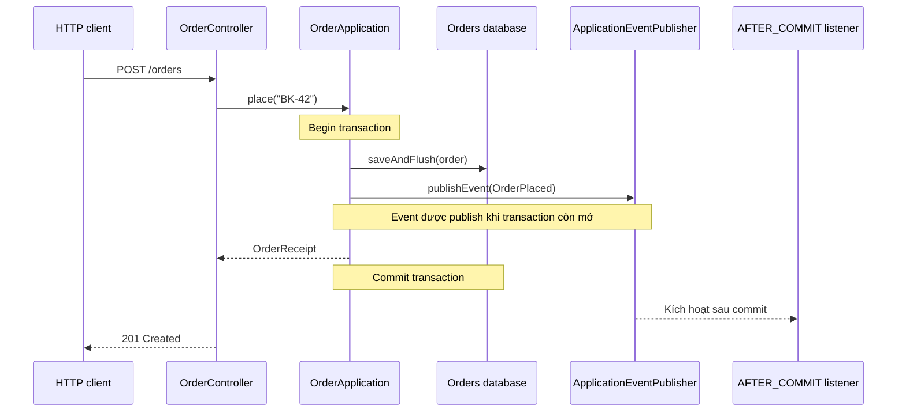
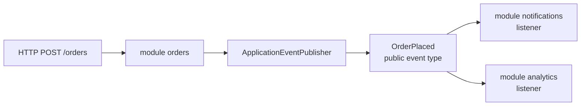
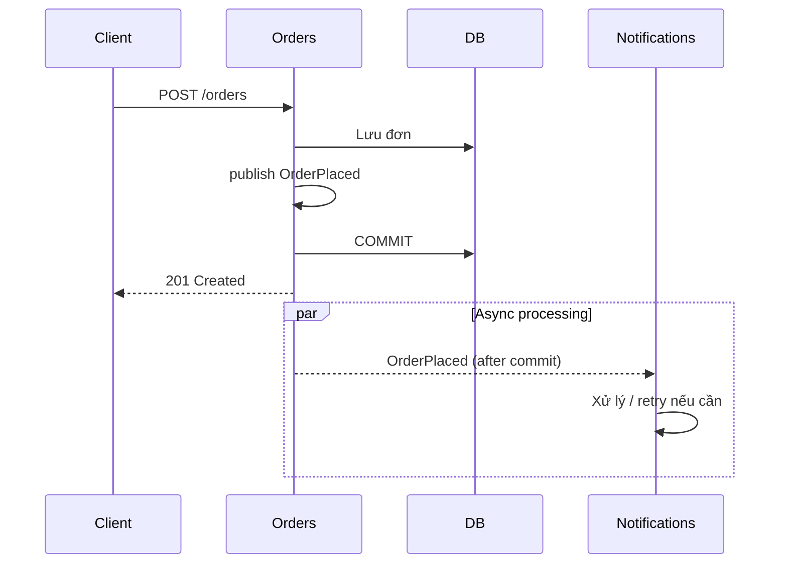

# Event phát ra sau HTTP request

## Mục tiêu học tập

Sau bài học, bạn có thể:

1. Giải thích quan hệ giữa **HTTP request**, **application service**, **Spring application event** và transaction.
2. Phân biệt **đã gọi `publishEvent(...)`**, **transaction đã commit**, **listener đã chạy** và **side effect ngoài module đã hoàn tất**.
3. Thiết kế một endpoint `POST /orders` mà event `OrderPlaced` được phát trong application service, không phụ thuộc trực tiếp vào implementation của module tiêu thụ.
4. Dùng `@ApplicationModuleTest` + `@AutoConfigureMockMvc` và tham số JUnit `PublishedEvents` để kiểm tra **loại, số lượng và payload** event sau request.
5. Kiểm chứng trường hợp request thành công, dữ liệu đầu vào không hợp lệ và transaction rollback **sau khi đã gọi** `publishEvent(...)`.
6. Dùng `@TransactionalEventListener(phase = AFTER_COMMIT)` để xác minh listener chỉ thực hiện sau transaction commit.
7. Hiểu cách kiểm thử subscriber ở module khác bằng `Scenario`, cũng như sự khác nhau giữa `@EventListener`, `@TransactionalEventListener` và `@ApplicationModuleListener`.
8. Biết khi nào cần **Event Publication Registry**, idempotency, retry, Testcontainers và event integration tests thay vì chỉ kiểm tra HTTP status.
9. Đưa kiểm thử phát event, ranh giới module, database và HTTP contract vào quality gate CI.

Bài thuộc chương **Web module testing** của lộ trình **SPRING_MODULITH_VERIFICATION_TESTING**. Lộ trình hướng đến kiểm chứng ranh giới kiến trúc Spring Modulith bằng `ApplicationModules`, quy tắc phụ thuộc, `@ApplicationModuleTest`, sự kiện, database và tích hợp. Ở đây, trọng tâm là **chứng minh một yêu cầu HTTP đã kích hoạt đúng sự kiện nghiệp vụ, với ngữ nghĩa transaction và phạm vi module rõ ràng**, thay vì chỉ kiểm tra response.

> **Phiên bản mã minh họa:** Java 17+, Spring Boot 3.4–3.5, Spring Framework 6.2, Spring Modulith 1.3–1.4, JUnit 5, Spring MVC và Spring Data JPA. Các API `PublishedEvents` và `Scenario` được đối chiếu với tài liệu Spring Modulith 1.4. Spring Boot 4 có thay đổi về một số starter/import test; hãy dùng các dependency tương ứng với bộ phiên bản thực tế.

## 1. “Event phát ra sau HTTP request” không nhất thiết nghĩa là publish sau response

Giả sử client gọi:

```http
POST /orders
Content-Type: application/json

{"sku":"BK-42"}
```

Hệ thống tạo đơn hàng, lưu database và phát `OrderPlaced`. Một sơ đồ thường gặp:



Sơ đồ mô tả **listener đồng bộ gắn với `AFTER_COMMIT`**. Nếu listener được đánh dấu `@Async` hoặc `@ApplicationModuleListener`, phần xử lý listener có thể tiếp tục **sau khi HTTP response đã được gửi**. Không coi thứ tự dòng trong sequence diagram là cam kết thời gian tuyệt đối của mọi triển khai.

Có bốn mốc không được gộp làm một:

| Mốc | Điều đã được chứng minh | Điều **chưa** chắc đúng |
| --- | --- | --- |
| Service gọi `events.publishEvent(event)` | Event được phát vào cơ chế Spring application events | Transaction sẽ commit |
| `PublishedEvents` quan sát được event | Test đã ghi nhận một lần phát event theo loại/payload | Listener `AFTER_COMMIT` đã chạy |
| Transaction commit thành công | Thay đổi DB trong transaction được commit | Listener bất đồng bộ đã xử lý xong |
| Listener hoàn thành thành công | Một phần phản ứng sau event đã chạy xong | Broker/hệ thống ngoài đã xử lý đúng nếu không có xác nhận riêng |

**Điểm quan trọng:** `ApplicationEventPublisher.publishEvent(...)` thường được gọi **bên trong transaction của use case**, không nhất thiết sau khi request kết thúc. Thành phần được trì hoãn đến **sau commit** là **listener theo phase**, không phải bản thân lệnh publish.

## 2. Vì sao sử dụng event giữa các application module?

Giả sử hệ thống có:

- `orders`: quản lý tạo đơn hàng.
- `notifications`: gửi thông báo sau khi đơn được tạo.

Thiết kế phụ thuộc trực tiếp:

```text
OrderService -> NotificationService.sendEmail(...)
```

Nếu `OrderService` cần inject `notifications.internal.EmailSender`, đó còn có thể là **vi phạm ranh giới Spring Modulith** vì một module tham chiếu implementation nội bộ của module khác. Ngay cả khi inject đúng public API, nó vẫn làm `orders` biết trực tiếp đến tác vụ gửi email.

Thiết kế event:



Ở mô hình này:

1. Module `orders` công bố sự kiện nghiệp vụ `OrderPlaced` tại API module.
2. `orders` không cần biết tên lớp gửi email hoặc analytics.
3. Module `notifications` có thể tham chiếu **event type public** của `orders`.
4. Listener quyết định cách phản ứng, transaction, retry và khả năng chịu lỗi.

**Không đồng nghĩa tất cả event đều bất đồng bộ.** Một `@EventListener` thông thường có thể chạy **đồng bộ ngay khi publish**, cùng transaction của publisher. Với tác vụ thứ cấp như email, thường nên cân nhắc `@TransactionalEventListener(AFTER_COMMIT)` hoặc `@ApplicationModuleListener`.

## 3. Cấu trúc bài thực hành

Ta chọn ứng dụng `com.acme.bookstore`. Bài test HTTP chính chỉ bootstrap **module orders**, còn module tiêu thụ `notifications` sẽ được kiểm thử riêng ở phần mở rộng.

```text
src/main/java/com/acme/bookstore/
├── BookstoreApplication.java
├── orders/
│   ├── OrderApplication.java              <- public application API
│   ├── OrderReceipt.java
│   ├── OrderPlaced.java                   <- public event contract
│   ├── OrderRejectedException.java
│   ├── internal/
│   │   ├── PurchaseOrder.java
│   │   ├── PurchaseOrderRepository.java
│   │   └── DefaultOrderApplication.java
│   └── web/
│       ├── OrderController.java
│       └── OrderErrorAdvice.java
└── notifications/
    ├── NotificationQueued.java           <- event của notifications
    └── internal/
        ├── NotificationEventHandler.java
        └── NotificationAsyncConfiguration.java

src/test/java/com/acme/bookstore/
├── ModuleArchitectureTests.java
├── orders/
│   └── OrdersHttpEventTests.java
└── notifications/
    └── NotificationsEventTests.java
```

Trong cơ chế phát hiện module mặc định, `orders` và `notifications` là **hai module ngang hàng**. Package `orders.web`, `orders.internal`, `notifications.internal` là package nội bộ của module sở hữu.

Mục tiêu test HTTP chính:

```text
MockMvc POST /orders
    -> OrderController                 (thật)
       -> DefaultOrderApplication      (thật, @Transactional)
          -> PurchaseOrderRepository   (thật, H2 test)
          -> ApplicationEventPublisher (thật)
             -> PublishedEvents        (JUnit recorder)
             -> AfterCommitProbe       (listener test-only)

notifications.internal.NotificationEventHandler
    -> KHÔNG được bootstrap trong test orders STANDALONE
```

Như vậy ta kiểm tra được **hành vi phát event của producer** mà không phụ thuộc tốc độ chạy hoặc email gateway của subscriber.

## 4. Dependency cho Spring MVC, JPA và module event tests

Ví dụ Gradle Groovy DSL với Spring Boot/Spring Modulith BOM đã được khai báo tương thích trong dự án:

```groovy
dependencies {
    implementation 'org.springframework.boot:spring-boot-starter-web'
    implementation 'org.springframework.boot:spring-boot-starter-validation'
    implementation 'org.springframework.boot:spring-boot-starter-data-jpa'
    implementation 'org.springframework.modulith:spring-modulith-starter-core'

    testImplementation 'org.springframework.boot:spring-boot-starter-test'
    testImplementation 'org.springframework.modulith:spring-modulith-starter-test'
    testRuntimeOnly 'com.h2database:h2'
}
```

`spring-modulith-starter-test` cung cấp test support như `@ApplicationModuleTest`, `PublishedEvents` và `Scenario`. H2 chỉ dùng làm database dành cho bài test; dữ liệu production cần hệ quản trị và migration phù hợp.

**Không cần Event Publication Registry để chứng minh một `ApplicationEventPublisher` đã phát event trong test.** Registry là **một tính năng riêng** giúp theo dõi và khôi phục delivery cho các listener transactional; ta sẽ bàn ở mục 19.

Ứng dụng Spring Boot ở root package:

```java
// src/main/java/com/acme/bookstore/BookstoreApplication.java
package com.acme.bookstore;

import org.springframework.boot.SpringApplication;
import org.springframework.boot.autoconfigure.SpringBootApplication;

@SpringBootApplication
public class BookstoreApplication {

    public static void main(String[] args) {
        SpringApplication.run(BookstoreApplication.class, args);
    }
}
```

## 5. Thiết kế event contract công khai

Đặt event type trực tiếp trong **base package của module `orders`**:

```java
// src/main/java/com/acme/bookstore/orders/OrderPlaced.java
package com.acme.bookstore.orders;

public record OrderPlaced(Long orderId, String sku) {
}
```

Lý do:

- `OrderPlaced` mô tả một **sự kiện đã xảy ra** trong nghiệp vụ.
- `orderId` là định danh đơn hàng để subscriber có thể tra cứu/correlation.
- `sku` là dữ liệu tối thiểu mà subscriber ví dụ cần.
- Record bất biến, dễ kiểm tra bằng `equals` và dễ serialize khi cần.
- Không chứa `PurchaseOrder` JPA entity, `EntityManager`, repository hoặc implementation `orders.internal`.

Trong Spring Modulith mặc định, các kiểu `public` trong base package là API của module. Vì vậy `notifications` có thể tham chiếu `orders.OrderPlaced` mà không cần truy cập nội bộ của `orders`.

### Không đưa cả aggregate JPA vào event

Tránh:

```java
// MINH HỌA THIẾT KẾ KHÔNG NÊN DÙNG LÀM EVENT LIÊN MODULE
// public record OrderPlaced(PurchaseOrder entity) {}
```

Event chứa entity có thể làm rò implementation/persistence context, lazy-loading state hoặc dữ liệu nhạy cảm sang module khác; sau commit, entity còn có thể ở trạng thái detached.

Khi event dùng cho tích hợp ngoài hệ thống, cần cân nhắc thêm **event ID**, **version**, **occurredAt**, **correlation ID** và chính sách tương thích schema. Bài dùng payload gọn để tập trung vào kỹ thuật kiểm thử phát event.

## 6. Application API của orders

```java
// src/main/java/com/acme/bookstore/orders/OrderReceipt.java
package com.acme.bookstore.orders;

public record OrderReceipt(Long id, String sku, String state) {
}
```

```java
// src/main/java/com/acme/bookstore/orders/OrderApplication.java
package com.acme.bookstore.orders;

public interface OrderApplication {
    OrderReceipt place(String sku);
}
```

```java
// src/main/java/com/acme/bookstore/orders/OrderRejectedException.java
package com.acme.bookstore.orders;

public class OrderRejectedException extends RuntimeException {

    public OrderRejectedException(String message) {
        super(message);
    }
}
```

Controller chỉ dùng `OrderApplication`; **không gọi `ApplicationEventPublisher` trực tiếp**. Đây là một lựa chọn kiến trúc chủ đích: việc tạo đơn **và phát `OrderPlaced`** nằm trong cùng use case, bất kể use case được gọi từ HTTP, batch hay command handler.

## 7. Entity và repository nội bộ

```java
// src/main/java/com/acme/bookstore/orders/internal/PurchaseOrder.java
package com.acme.bookstore.orders.internal;

import jakarta.persistence.Column;
import jakarta.persistence.Entity;
import jakarta.persistence.GeneratedValue;
import jakarta.persistence.GenerationType;
import jakarta.persistence.Id;
import jakarta.persistence.Table;

@Entity
@Table(name = "purchase_orders")
public class PurchaseOrder {

    @Id
    @GeneratedValue(strategy = GenerationType.IDENTITY)
    private Long id;

    @Column(nullable = false)
    private String sku;

    protected PurchaseOrder() {
    }

    PurchaseOrder(String sku) {
        this.sku = sku;
    }

    public Long getId() {
        return id;
    }

    public String getSku() {
        return sku;
    }
}
```

```java
// src/main/java/com/acme/bookstore/orders/internal/PurchaseOrderRepository.java
package com.acme.bookstore.orders.internal;

import org.springframework.data.jpa.repository.JpaRepository;

interface PurchaseOrderRepository
        extends JpaRepository<PurchaseOrder, Long> {
}
```

Entity và repository nằm trong `orders.internal`; controller và module `notifications` **không cần biết** những lớp này. Dữ liệu được lưu thật trong H2 khi test `orders`, giúp quan sát commit/rollback độc lập với việc event có được publish hay không.

## 8. Application service: ghi DB và publish event trong transaction

```java
// src/main/java/com/acme/bookstore/orders/internal/DefaultOrderApplication.java
package com.acme.bookstore.orders.internal;

import com.acme.bookstore.orders.OrderApplication;
import com.acme.bookstore.orders.OrderPlaced;
import com.acme.bookstore.orders.OrderReceipt;
import com.acme.bookstore.orders.OrderRejectedException;
import org.springframework.context.ApplicationEventPublisher;
import org.springframework.stereotype.Service;
import org.springframework.transaction.annotation.Transactional;

@Service
class DefaultOrderApplication implements OrderApplication {

    private final PurchaseOrderRepository orders;
    private final ApplicationEventPublisher events;

    DefaultOrderApplication(
            PurchaseOrderRepository orders,
            ApplicationEventPublisher events) {

        this.orders = orders;
        this.events = events;
    }

    @Override
    @Transactional
    public OrderReceipt place(String sku) {
        PurchaseOrder saved = orders.saveAndFlush(
                new PurchaseOrder(sku));

        // Phát event khi transaction của use case vẫn đang mở.
        events.publishEvent(
                new OrderPlaced(saved.getId(), saved.getSku()));

        // Nhánh lỗi CỐ Ý để kiểm tra rollback sau publish.
        if ("FAIL-42".equals(sku)) {
            throw new OrderRejectedException("DEMO_REJECTED");
        }

        return new OrderReceipt(
                saved.getId(), saved.getSku(), "PLACED");
    }
}
```

**Điều cần hiểu đúng:**

1. Method `place(...)` được gọi qua Spring-managed bean/proxy; `@Transactional` tạo transaction cho use case khi chưa có transaction phù hợp.
2. `saveAndFlush(...)` ghi SQL vào database trong transaction; **flush không đồng nghĩa commit**.
3. `events.publishEvent(...)` được gọi **trước khi proxy tiến hành commit**.
4. Khi method trả bình thường, transaction interceptor mới hoàn tất commit.
5. Khi `OrderRejectedException` thoát khỏi method, transaction **rollback mặc định** vì đó là unchecked exception.

**Nhánh `FAIL-42` là fault injection phục vụ giáo dục**, không phải một quy tắc nghiệp vụ nên đưa vào production. Mục đích là tạo tình huống **event đã được publish nhưng transaction rollback** để thấy rõ khác biệt giữa recorder `PublishedEvents` và listener `AFTER_COMMIT`.

Trong hệ thống thực, nên kiểm tra các ràng buộc nghiệp vụ trước khi publish nếu có thể, đồng thời vẫn phải thiết kế listener chịu được trường hợp transaction thất bại.

### Tại sao không phát event ở controller?

Một controller làm như sau có thể gây vấn đề:

```java
// MINH HỌA ANTI-PATTERN, không dùng làm code production:
var receipt = application.place(request.sku());
events.publishEvent(new OrderPlaced(receipt.id(), receipt.sku()));
return ResponseEntity.ok(receipt);
```

Lệnh publish nằm **sau khi service đã return**, có thể nằm **ngoài transaction**. Khi đó `@TransactionalEventListener` với `fallbackExecution = false` có thể **không chạy**, và event không còn gắn trực tiếp với transaction ghi đơn.

Giữ event publication ở use case giúp bất kỳ entry point nào gọi `OrderApplication.place(...)` cũng dùng cùng quy tắc nghiệp vụ.

## 9. HTTP controller và response

```java
// src/main/java/com/acme/bookstore/orders/web/OrderController.java
package com.acme.bookstore.orders.web;

import com.acme.bookstore.orders.OrderApplication;
import com.acme.bookstore.orders.OrderReceipt;
import jakarta.validation.Valid;
import jakarta.validation.constraints.NotBlank;
import java.net.URI;
import org.springframework.http.MediaType;
import org.springframework.http.ResponseEntity;
import org.springframework.web.bind.annotation.PostMapping;
import org.springframework.web.bind.annotation.RequestBody;
import org.springframework.web.bind.annotation.RequestMapping;
import org.springframework.web.bind.annotation.RestController;

@RestController
@RequestMapping("/orders")
public class OrderController {

    private final OrderApplication orders;

    public OrderController(OrderApplication orders) {
        this.orders = orders;
    }

    @PostMapping(
            consumes = MediaType.APPLICATION_JSON_VALUE,
            produces = MediaType.APPLICATION_JSON_VALUE
    )
    public ResponseEntity<OrderReceipt> create(
            @Valid @RequestBody NewOrder request) {

        OrderReceipt receipt = orders.place(request.sku());

        return ResponseEntity
                .created(URI.create("/orders/" + receipt.id()))
                .body(receipt);
    }

    public record NewOrder(@NotBlank String sku) {
    }
}
```

Các response dự kiến:

| Request | Logic | HTTP response | Event |
| --- | --- | --- | --- |
| `{"sku":"BK-42"}` | Tạo đơn thành công | `201 Created` | `OrderPlaced` được publish, transaction commit |
| `{"sku":""}` | Bean Validation từ chối | `400 Bad Request` | Không gọi `publishEvent` |
| `{"sku":"FAIL-42"}` | Fault injection ném exception **sau publish** | `409 Conflict` | Publish đã xảy ra, transaction rollback |
| JSON sai cú pháp | Jackson không bind được DTO | `400 Bad Request` | Không gọi `publishEvent` |

Controller không inject `ApplicationEventPublisher` và không biết module `notifications`. Đây là ranh giới cần giữ khi refactor.

### Ánh xạ lỗi demo thành HTTP 409

```java
// src/main/java/com/acme/bookstore/orders/web/OrderErrorAdvice.java
package com.acme.bookstore.orders.web;

import com.acme.bookstore.orders.OrderRejectedException;
import org.springframework.http.HttpStatus;
import org.springframework.http.ProblemDetail;
import org.springframework.web.bind.annotation.ExceptionHandler;
import org.springframework.web.bind.annotation.RestControllerAdvice;

@RestControllerAdvice
public class OrderErrorAdvice {

    @ExceptionHandler(OrderRejectedException.class)
    public ProblemDetail rejected(OrderRejectedException ex) {
        ProblemDetail detail =
                ProblemDetail.forStatus(HttpStatus.CONFLICT);
        detail.setTitle("Order rejected");
        detail.setProperty("code", "DEMO_REJECTED");
        return detail;
    }
}
```

Advice chỉ xử lý lỗi khi exception đã đi ra khỏi transactional service/proxy. Việc cuối cùng trả HTTP 409 **không biến transaction rollback thành commit**.

## 10. Hai cách xác minh event: recorder và listener

Trước khi viết test, cần xác định **cấp độ bằng chứng** muốn có:

| Cơ chế | Nó quan sát gì? | Nó không tự chứng minh điều gì? |
| --- | --- | --- |
| `PublishedEvents` | Event được publish trong quá trình test | Transaction commit, listener xử lý thành công |
| `AssertablePublishedEvents` | Như trên, với fluent AssertJ assertion | Side effect của subscriber |
| `@TransactionalEventListener(AFTER_COMMIT)` | Listener được kích hoạt khi transaction commit | Broker bên ngoài nhận được message |
| `Scenario` | Event hoặc state change được chờ sau stimulus | Mọi hệ thống downstream đều nhất quán |
| Event Publication Registry | Bản ghi delivery theo từng transactional listener, nếu đã cấu hình persistence | Exactly-once side effect ngoài hệ thống |

**Đây là trọng tâm học phần:** Một bài test chỉ assertion `events.ofType(OrderPlaced.class).hasSize(1)` đang kiểm tra **producer phát event**, chưa chứng minh bên nhận đã nhận sau commit.

Ta sẽ dùng đồng thời:

1. `PublishedEvents` để bắt **thời điểm publish**.
2. Một listener test-only `AFTER_COMMIT` để quan sát **thời điểm transaction commit**.
3. JDBC đọc bảng thật để đối chiếu **trạng thái persisted**.

## 11. Tạo test-only listener quan sát AFTER_COMMIT

Ta cần một probe chỉ tồn tại trong test, không gửi email hoặc thay đổi hành vi production:

```java
// Các khai báo dưới đây là thành phần nested của OrdersHttpEventTests.
@TestConfiguration(proxyBeanMethods = false)
static class AfterCommitProbeConfig {

    @Bean
    AfterCommitProbe afterCommitProbe() {
        return new AfterCommitProbe();
    }
}

static class AfterCommitProbe {

    private final java.util.List<OrderPlaced> seen =
            new java.util.concurrent.CopyOnWriteArrayList<>();

    @TransactionalEventListener(
            phase = TransactionPhase.AFTER_COMMIT)
    public void on(OrderPlaced event) {
        seen.add(event);
    }

    java.util.List<OrderPlaced> received() {
        return java.util.List.copyOf(seen);
    }

    void clear() {
        seen.clear();
    }
}
```

Các import liên quan:

```java
import com.acme.bookstore.orders.OrderPlaced;
import org.springframework.boot.test.context.TestConfiguration;
import org.springframework.context.annotation.Bean;
import org.springframework.transaction.event.TransactionPhase;
import org.springframework.transaction.event.TransactionalEventListener;
```

Probe có một nhiệm vụ: ghi nhận event **khi listener `AFTER_COMMIT` thực sự được chạy**. Nó không mở transaction riêng và không thực hiện I/O ngoài database; việc ghi vào danh sách chỉ phục vụ assertion.

Vì listener này **đồng bộ** (không có `@Async`), khi transaction commit thành công, callback chạy trong quá trình hoàn tất transaction, trước khi synchronous web flow kết thúc. Do vậy test có thể đọc `received()` ngay sau `MockMvc.perform(...)`.

Với listener bất đồng bộ thực, **không dùng ngay `assertThat(...).contains(...)` mà không chờ có giới hạn**; hãy dùng `Scenario` hoặc công cụ chờ theo điều kiện để tránh flaky test.

## 12. Cấu hình `@ApplicationModuleTest` và `MockMvc`

Đặt lớp test **bên dưới package `orders`** để Modulith nhận diện module mục tiêu.

```java
// src/test/java/com/acme/bookstore/orders/OrdersHttpEventTests.java
package com.acme.bookstore.orders;

import com.fasterxml.jackson.databind.ObjectMapper;
import org.junit.jupiter.api.BeforeEach;
import org.junit.jupiter.api.Test;
import org.springframework.beans.factory.annotation.Autowired;
import org.springframework.boot.test.autoconfigure.web.servlet
        .AutoConfigureMockMvc;
import org.springframework.boot.test.context.TestConfiguration;
import org.springframework.context.annotation.Bean;
import org.springframework.context.annotation.Import;
import org.springframework.jdbc.core.JdbcTemplate;
import org.springframework.modulith.test.ApplicationModuleTest;
import org.springframework.modulith.test.PublishedEvents;
import org.springframework.test.context.TestPropertySource;
import org.springframework.test.web.servlet.MockMvc;
import org.springframework.transaction.event.TransactionPhase;
import org.springframework.transaction.event.TransactionalEventListener;

@ApplicationModuleTest
@AutoConfigureMockMvc
@TestPropertySource(properties =
        "spring.jpa.hibernate.ddl-auto=create-drop")
@Import(OrdersHttpEventTests.AfterCommitProbeConfig.class)
class OrdersHttpEventTests {

    @Autowired
    MockMvc mvc;

    @Autowired
    JdbcTemplate jdbc;

    @Autowired
    ObjectMapper mapper;

    @Autowired
    AfterCommitProbe probe;

    @BeforeEach
    void resetState() {
        jdbc.update("DELETE FROM purchase_orders");
        probe.clear();
    }

    // Đặt các phương thức @Test từ mục 13-15 ở đây.

    @TestConfiguration(proxyBeanMethods = false)
    static class AfterCommitProbeConfig {

        @Bean
        AfterCommitProbe afterCommitProbe() {
            return new AfterCommitProbe();
        }
    }

    static class AfterCommitProbe {

        private final java.util.List<OrderPlaced> seen =
                new java.util.concurrent.CopyOnWriteArrayList<>();

        @TransactionalEventListener(
                phase = TransactionPhase.AFTER_COMMIT)
        public void on(OrderPlaced event) {
            seen.add(event);
        }

        java.util.List<OrderPlaced> received() {
            return java.util.List.copyOf(seen);
        }

        void clear() {
            seen.clear();
        }
    }
}
```

**Chú ý để test không kết luận sai:**

- `@ApplicationModuleTest` mặc định bootstrap **`STANDALONE`**, chỉ module `orders` cùng infrastructure cần thiết.
- `@AutoConfigureMockMvc` tạo `MockMvc` cho Spring MVC web context.
- `@Import` thêm **listener probe test-only**; nó không đưa module `notifications` vào context.
- Entity, JPA repository và `ApplicationEventPublisher` đều **chạy thật trong orders test**.
- **Không gắn `@Transactional` lên lớp test**: nếu Spring TestContext mở transaction bao quanh cả test, service có thể join transaction test; khi đó commit của use case và callback `AFTER_COMMIT` bị dời đến cuối test hoặc bị bỏ qua khi framework rollback.
- `@BeforeEach` dọn dữ liệu trên **database test riêng**, không chạy song song những test cùng chia sẻ bảng/schema.

`PublishedEvents` **không cần khai báo `@Autowired` field**. Spring Modulith test extension hỗ trợ inject nó như **tham số của JUnit test method**.

## 13. HTTP 201 phải phát đúng event với payload đúng

Các static imports cho phần test:

```java
import static org.assertj.core.api.Assertions.assertThat;
import static org.springframework.test.web.servlet.request
        .MockMvcRequestBuilders.post;
import static org.springframework.test.web.servlet.result
        .MockMvcResultMatchers.header;
import static org.springframework.test.web.servlet.result
        .MockMvcResultMatchers.jsonPath;
import static org.springframework.test.web.servlet.result
        .MockMvcResultMatchers.status;

import org.springframework.http.MediaType;
```

Phương thức sau được **thêm vào `OrdersHttpEventTests`**:

```java
@Test
void acceptedHttpRequestPublishesOrderPlaced(
        PublishedEvents events) throws Exception {

    var response = mvc.perform(post("/orders")
            .contentType(MediaType.APPLICATION_JSON)
            .content("""
                    {"sku":"BK-42"}
                    """))
            .andExpect(status().isCreated())
            .andExpect(jsonPath("$.sku").value("BK-42"))
            .andExpect(jsonPath("$.state").value("PLACED"))
            .andReturn();

    Long orderId = mapper.readTree(
            response.getResponse().getContentAsString())
            .path("id").asLong();

    // 1. Event thật đã được publish với ID của chính HTTP response.
    assertThat(events.ofType(OrderPlaced.class)
            .matching(OrderPlaced::orderId, orderId))
            .hasSize(1);

    // 2. Listener AFTER_COMMIT đồng bộ đã nhận đúng payload.
    assertThat(probe.received())
            .containsExactly(new OrderPlaced(orderId, "BK-42"));

    // 3. Dữ liệu thực sự có trong database sau request.
    Integer persisted = jdbc.queryForObject(
            "SELECT COUNT(*) FROM purchase_orders WHERE id = ?",
            Integer.class,
            orderId);

    assertThat(persisted).isEqualTo(1);
}
```

Test này bảo vệ **ba sự thật khác nhau**:

1. **Producer contract:** event `OrderPlaced` được phát đúng **một lần** cho ID trả về từ HTTP.
2. **Commit boundary:** listener `AFTER_COMMIT` nhận event khi transaction hoàn tất thành công.
3. **Persistence boundary:** row tương ứng đã tồn tại trong database sau request, không chỉ mới được `saveAndFlush(...)`.

### Vì sao không chỉ kiểm tra `eventOfTypeWasPublished`?

```java
assertThat(events.eventOfTypeWasPublished(
        OrderPlaced.class)).isTrue();
```

Assertion này hữu ích cho smoke test nhưng **không kiểm tra payload hoặc số lần phát**. Một event của đơn hàng khác hoặc một lần phát trùng vẫn có thể khiến nó xanh.

Nên ưu tiên:

```java
assertThat(events.ofType(OrderPlaced.class)
        .matching(OrderPlaced::orderId, orderId))
        .hasSize(1);
```

`matching(Function, value)` là API có trong `PublishedEvents.TypedPublishedEvents` ở Spring Modulith 1.4. Kiểm tra dựa vào **ID của chính response** tốt hơn so với hardcode một ID database có thể thay đổi giữa các lần chạy.

### Khi cần kiểm tra cả SKU

```java
assertThat(events.ofType(OrderPlaced.class)
        .matching(event -> event.orderId().equals(orderId)
                && event.sku().equals("BK-42")))
        .hasSize(1);
```

Đây là đoạn assertion bổ sung trong test trên. `matching(Predicate)` cho phép kiểm tra nhiều field; không cần tự duyệt mọi Spring infrastructure event.

## 14. HTTP 409 sau publish: ghi nhận event **không đồng nghĩa commit**

Trong service ví dụ, chuỗi `FAIL-42` tạo lỗi **sau** khi đã gọi `publishEvent(...)`.

```java
@Test
void rolledBackRequestDoesNotDeliverAfterCommit(
        PublishedEvents events) throws Exception {

    mvc.perform(post("/orders")
            .contentType(MediaType.APPLICATION_JSON)
            .content("""
                    {"sku":"FAIL-42"}
                    """))
            .andExpect(status().isConflict())
            .andExpect(jsonPath("$.code")
                    .value("DEMO_REJECTED"));

    // Lệnh publish đã chạy trước khi transaction rollback.
    assertThat(events.ofType(OrderPlaced.class)
            .matching(OrderPlaced::sku, "FAIL-42"))
            .hasSize(1);

    // Listener AFTER_COMMIT không chạy với transaction rollback.
    assertThat(probe.received()).isEmpty();

    // INSERT đã flush nhưng bị rollback cùng use case.
    Integer persisted = jdbc.queryForObject(
            "SELECT COUNT(*) FROM purchase_orders",
            Integer.class);

    assertThat(persisted).isZero();
}
```

Đây là một phản ví dụ quan trọng:

| Quan sát | Giá trị kỳ vọng khi rollback | Giải thích |
| --- | --- | --- |
| HTTP response | `409 Conflict` | Advice xử lý exception nghiệp vụ |
| `PublishedEvents` | **Có** `OrderPlaced("FAIL-42")` | Recorder thấy lần gọi publish |
| `AfterCommitProbe.received()` | **Rỗng** | Listener `AFTER_COMMIT` chỉ chạy sau commit thành công |
| Row của đơn hàng | **Không có** | JPA transaction rollback thao tác insert |

**Không viết**:

```java
// SAI với fault injection của bài học:
// assertThat(events.ofType(OrderPlaced.class)).isEmpty();
```

vì event đã được publish trong transaction trước khi rollback. Đây cũng là lý do **listener có side effect không thể đảo ngược không nên dùng `@EventListener` đồng bộ một cách thiếu cân nhắc**, nếu publisher còn có khả năng thất bại sau đó.

### Có phải mọi publish trước rollback đều được PublishedEvents bắt?

Trong cấu hình ví dụ, `PublishedEvents` gắn vào Spring application event infrastructure và quan sát lệnh publish, nên có thể ghi nhận sự kiện dù transaction rollback. Nếu production dùng event broker, outbox, custom dispatcher hoặc cơ chế externalization riêng, cần xác định điểm instrumentation tương ứng. **Không mặc định `PublishedEvents` là bản ghi durable của mọi broker message**.

## 15. HTTP 400: input bị từ chối trước khi phát event

```java
@Test
void invalidHttpRequestDoesNotPublishBusinessEvent(
        PublishedEvents events) throws Exception {

    mvc.perform(post("/orders")
            .contentType(MediaType.APPLICATION_JSON)
            .content("""
                    {"sku":""}
                    """))
            .andExpect(status().isBadRequest());

    assertThat(events.ofType(OrderPlaced.class)).isEmpty();
    assertThat(probe.received()).isEmpty();

    Integer count = jdbc.queryForObject(
            "SELECT COUNT(*) FROM purchase_orders",
            Integer.class);

    assertThat(count).isZero();
}
```

`@NotBlank` và `@Valid` chặn request trước khi gọi use case. Do đó test kiểm tra:

- Không có `OrderPlaced` nào được publish.
- Listener sau commit không nhận gì.
- Database không có order mới.

**Khác với HTTP 409 ở mục 14:** Validation 400 xảy ra **trước khi service chạy**, còn tình huống 409 cố ý xảy ra **sau khi service lưu và publish**. Hai tình huống đều không để lại row, nhưng **ý nghĩa event khác nhau**.

### Kiểm tra JSON sai cú pháp

```java
@Test
void malformedJsonCannotTriggerOrderPlaced(
        PublishedEvents events) throws Exception {

    mvc.perform(post("/orders")
            .contentType(MediaType.APPLICATION_JSON)
            .content("""
                    {"sku":
                    """))
            .andExpect(status().isBadRequest());

    assertThat(events.ofType(OrderPlaced.class)).isEmpty();
}
```

JSON không đọc được còn chưa tạo được `NewOrder`, nên use case không chạy. Nếu ứng dụng có security filter, phải chuẩn bị authenticated request và CSRF token phù hợp; nếu không, request có thể bị từ chối bởi security trước khi kiểm tra validation/JSON.

## 16. Test sử dụng `AssertablePublishedEvents`

Spring Modulith cũng cho phép inject `AssertablePublishedEvents` vào JUnit method:

```java
import static org.assertj.core.api.Assertions.assertThat;
import org.springframework.modulith.test.AssertablePublishedEvents;

@Test
void matchesPublishedEventWithFluentAssertion(
        AssertablePublishedEvents events) throws Exception {

    mvc.perform(post("/orders")
            .contentType(MediaType.APPLICATION_JSON)
            .content("""
                    {"sku":"BK-42"}
                    """))
            .andExpect(status().isCreated());

    assertThat(events)
            .contains(OrderPlaced.class)
            .matching(OrderPlaced::sku, "BK-42");
}
```

`PublishedEvents` phù hợp khi muốn dùng các assertion AssertJ thông thường trên tập sự kiện. `AssertablePublishedEvents` cung cấp API fluent để diễn đạt kỳ vọng theo loại và payload trực tiếp.

**Không dùng cả hai API như một kiểu bean production**; chúng là **hạ tầng test**, không phải event store dành cho business logic.

Trong bài học chính, ba test ở mục 13–15 sử dụng `PublishedEvents` để phân biệt rõ **publish/commit/rollback**. Test fluent trên chỉ minh họa một cách viết ngắn hơn.

## 17. Ba kiểu listener và ngữ nghĩa giao dịch

Spring Framework và Spring Modulith hỗ trợ các phong cách lắng nghe khác nhau:

| Cách khai báo | Thời điểm xử lý | Transaction | Lưu ý kiểm thử |
| --- | --- | --- | --- |
| `@EventListener` | Mặc định xử lý **khi publish** | Có thể chạy trong transaction producer nếu đồng bộ | Có thể chạy ngay cả khi producer về sau rollback |
| `@TransactionalEventListener(AFTER_COMMIT)` | Sau commit thành công | Callback xảy ra sau transaction producer; không mặc định mở transaction ghi mới | Test commit và rollback riêng |
| `@TransactionalEventListener(AFTER_ROLLBACK)` | Sau rollback | Phục vụ quan sát/cleanup có chủ đích | Không dùng làm xử lý thành công |
| `@ApplicationModuleListener` | Transactional event listener bất đồng bộ, sau commit theo mặc định | Có transaction **`REQUIRES_NEW` riêng** cho listener | Cần kiểm thử chờ kết quả và retry/idempotency |

`@ApplicationModuleListener` trong Spring Modulith tương đương về ý tưởng với việc kết hợp **`@Async`**, **`@Transactional(propagation = REQUIRES_NEW)`** và **`@TransactionalEventListener`**. Nó giảm coupling thời gian giữa producer và consumer, nhưng **không biến event delivery thành exactly-once**.

### Tại sao không ghi dữ liệu DB ngay trong `AFTER_COMMIT` mà không có transaction mới?

Trong một callback sau commit, tài nguyên transaction có thể vẫn được gắn với thread, nhưng transaction producer **đã hoàn tất commit**. Việc thực hiện thao tác ghi mới mà không tạo transaction phù hợp có thể gây hành vi khó hiểu hoặc dữ liệu không được commit như mong đợi.

Đối với listener cần ghi database riêng, hãy tạo **một transaction mới** bằng service/annotation phù hợp (`REQUIRES_NEW`) và kiểm thử trạng thái được ghi. `@ApplicationModuleListener` đã kết hợp transaction mới với async delivery cho use case tích hợp module.

### Không có active transaction

`@TransactionalEventListener` mặc định **không được kích hoạt** nếu event được publish khi không có transaction đang hoạt động, trừ khi chọn `fallbackExecution = true`. Vì vậy test gọi `events.publishEvent(...)` trực tiếp **ngoài transaction** không phải bản sao của flow `@Transactional` ở mục 8.

Khi cần test listener transaction-bound, nên dùng `Scenario` hoặc `TransactionTemplate` để tạo transaction rõ ràng.

## 18. Test module tiêu thụ event bằng `Scenario`

Đến đây, bài test `OrdersHttpEventTests` chỉ kiểm tra **module producer**. Nếu module `notifications` có listener thực, cần một bài test **độc lập** thuộc module đó.

### Hợp đồng sự kiện của notifications

```java
// src/main/java/com/acme/bookstore/notifications/NotificationQueued.java
package com.acme.bookstore.notifications;

public record NotificationQueued(Long orderId) {
}
```

### Listener thuộc module notifications

```java
// src/main/java/com/acme/bookstore/notifications/internal/
// NotificationEventHandler.java
package com.acme.bookstore.notifications.internal;

import com.acme.bookstore.notifications.NotificationQueued;
import com.acme.bookstore.orders.OrderPlaced;
import org.springframework.context.ApplicationEventPublisher;
import org.springframework.modulith.events.ApplicationModuleListener;
import org.springframework.stereotype.Component;

@Component
class NotificationEventHandler {

    private final ApplicationEventPublisher events;

    NotificationEventHandler(ApplicationEventPublisher events) {
        this.events = events;
    }

    @ApplicationModuleListener
    void on(OrderPlaced order) {
        // Demo không gửi email thật; chỉ phát tín hiệu đã xếp hàng.
        events.publishEvent(
                new NotificationQueued(order.orderId()));
    }
}
```

Để chạy `@Async` thực sự, ứng dụng cần bật async processing theo cấu hình phù hợp. Với module ví dụ:

```java
// src/main/java/com/acme/bookstore/notifications/internal/
// NotificationAsyncConfiguration.java
package com.acme.bookstore.notifications.internal;

import org.springframework.context.annotation.Configuration;
import org.springframework.scheduling.annotation.EnableAsync;

@Configuration(proxyBeanMethods = false)
@EnableAsync
class NotificationAsyncConfiguration {
}
```

`notifications` tham chiếu kiểu `OrderPlaced` thuộc API module `orders`, tạo dependency tĩnh **`notifications → orders`**. `orders` không import `notifications.internal.NotificationEventHandler`.

### Test consumer bằng `Scenario.publish(...)`

```java
// src/test/java/com/acme/bookstore/notifications/
// NotificationsEventTests.java
package com.acme.bookstore.notifications;

import static org.assertj.core.api.Assertions.assertThat;

import com.acme.bookstore.orders.OrderPlaced;
import java.time.Duration;
import org.junit.jupiter.api.Test;
import org.springframework.modulith.test.ApplicationModuleTest;
import org.springframework.modulith.test.Scenario;

@ApplicationModuleTest
class NotificationsEventTests {

    @Test
    void queuesNotificationAfterOrderPlaced(Scenario scenario) {
        scenario.publish(new OrderPlaced(41L, "BK-42"))
                .andWaitAtMost(Duration.ofSeconds(5))
                .forEventOfType(NotificationQueued.class)
                .matching(event -> event.orderId().equals(41L))
                .toArriveAndVerify(event ->
                        assertThat(event.orderId()).isEqualTo(41L));
    }
}
```

Ở đây:

1. Test được đặt trong `notifications` nên module test **bootstraps subscriber**, không phải web controller của `orders`.
2. `Scenario.publish(...)` phát `OrderPlaced` **trong transaction được Scenario quản lý**, đáp ứng điều kiện của transactional listener.
3. `@ApplicationModuleListener` xử lý event sau commit, theo cơ chế async và transaction mới.
4. Test chờ tối đa 5 giây để quan sát `NotificationQueued(41L)`; không dùng `Thread.sleep(...)` theo thời gian đoán trước.

**Điều kiện chạy:** Cần transaction manager, async infrastructure và test dependencies đúng phiên bản. Trong project demo đã có Spring Data JPA và H2; nếu tách notifications thành một project hoàn toàn không có transaction manager, phải bổ sung hạ tầng transaction phù hợp để `Scenario`/listener transactional hoạt động.

**Giới hạn:** `NotificationQueued` là tín hiệu nội bộ demo, **không chứng minh email đã rời khỏi SMTP server**. Với email/broker thật cần adapter test, fake server hoặc integration test có xác nhận từ bên nhận.

### Vì sao không dùng `Scenario.publish(...)` thay cho HTTP test?

`Scenario.publish(new OrderPlaced(...))` **bỏ qua controller và `OrderApplication.place(...)`**. Nó phù hợp để kiểm thử **subscriber phản ứng với event**, không chứng minh endpoint `POST /orders` đã phát event.

Ngược lại, `MockMvc` + `PublishedEvents` chứng minh đường HTTP → service → publisher, nhưng không mặc nhiên bootstrap subscriber ngoài module. **Hai test có mục tiêu khác nhau và nên được chạy cùng nhau trong CI.**

## 19. Phạm vi module: tại sao DIRECT_DEPENDENCIES không tự bật notifications?

Đây là lỗi suy luận phổ biến trong Spring Modulith:

```text
notifications.NotificationEventHandler
       |
       | tham chiếu kiểu OrderPlaced
       v
orders.OrderPlaced
```

Theo dependency kiểu Java, **notifications phụ thuộc orders**, chứ **orders không phụ thuộc notifications**.

Vì vậy:

| Test đang bootstrap | `STANDALONE` | `DIRECT_DEPENDENCIES` |
| --- | --- | --- |
| Test thuộc `orders` | Module orders | Orders và những module mà **orders tham chiếu trực tiếp** |
| Test thuộc `notifications` | Module notifications | Notifications và module orders nếu có dependency trực tiếp |

Chuyển test `orders` sang `DIRECT_DEPENDENCIES` **không tự bootstrap notifications** chỉ vì notifications đang lắng nghe sự kiện do orders công bố.

Nếu muốn test một kịch bản từ HTTP producer đến subscriber thật, có thể:

- Dùng bài **full-context integration test**.
- Tạo cấu hình bootstrap bao gồm các module cần kiểm chứng bằng `extraIncludes` khi phù hợp.
- Hoặc dùng test producer trong `orders` + test consumer bằng `Scenario` trong `notifications`, như bài mẫu.

Một ví dụ chỉ rõ phạm vi tích hợp:

```java
// Biến thể test tích hợp; KHÔNG thay cho test orders độc lập ở trên.
@ApplicationModuleTest(extraIncludes = "notifications")
@AutoConfigureMockMvc
class OrdersWithNotificationsIntegrationTests {
    // Đặt test dưới package com.acme.bookstore.orders.
    // Bổ sung dependencies/config của notifications khi triển khai.
}
```

**Đừng giữ nguyên kỳ vọng rằng mọi event listener ngoài module phải chạy trong test `STANDALONE`**. Nếu không có listener của notifications trong context, `PublishedEvents` có thể vẫn thấy `OrderPlaced` nhưng không thể dùng kết quả ấy để khẳng định notifications đã xử lý.

## 20. Event Publication Registry: từ test phát event đến độ tin cậy delivery

Khi hệ thống dùng listener bất đồng bộ, producer có thể commit trước khi subscriber chạy. Nếu tiến trình chết đúng thời điểm hoặc listener lỗi, việc phát event một lần vào `ApplicationEventPublisher` **không tự bảo đảm delivery có thể khôi phục**.

Spring Modulith cung cấp **Event Publication Registry** để ghi nhận publication hướng tới transactional listeners và theo dõi trạng thái hoàn tất. Ở Spring Modulith 1.4, có các starter tương ứng với persistence:

```groovy
// Chọn MỘT cơ chế persistence phù hợp khi thực sự dùng registry:
implementation 'org.springframework.modulith:spring-modulith-starter-jpa'
// hoặc:
// implementation 'org.springframework.modulith:spring-modulith-starter-jdbc'
```

Phần cấu hình này là **một bước mở rộng production/integration test**, không cần cho ba bài `PublishedEvents` HTTP ở trên. Khi kích hoạt registry:

- Cần cấu hình storage/schema/migration cho bảng/collection publication tương ứng.
- Registry thường ghi publication theo transactional event listener như một phần của transaction producer.
- Sau khi listener xử lý thành công, publication được ghi nhận hoàn tất theo chế độ cấu hình.
- Publication còn dang dở cần chính sách retry/resubmission và giám sát.
- Những side effect như email, HTTP callback hoặc payment **vẫn cần idempotency** vì retry có thể khiến handler được gọi nhiều lần.

**Không đánh đồng `PublishedEvents` với Event Publication Registry.** `PublishedEvents` là bộ ghi nhận event trong **JUnit test run**. Registry là thành phần **runtime có persistence** dành cho lifecycle delivery, phụ thuộc starter/configuration.

### Những cấp độ kiểm thử khác nhau

| Kiểm tra | Dùng gì | Bằng chứng |
| --- | --- | --- |
| Producer có gọi `publishEvent` không? | `PublishedEvents` | Có event phù hợp trong test |
| Transaction commit rồi listener có nhận không? | `@TransactionalEventListener` probe | Callback sau commit chạy |
| Consumer có sinh side effect/event khác không? | `Scenario` + module listener | Outcome đã đến trong giới hạn chờ |
| Registry có lưu publication chưa hoàn tất khi listener lỗi không? | Integration test với registry thật | Persistent publication state |
| Retry có an toàn không? | Test idempotency và replay | Không tạo side effect trùng nguy hiểm |
| Broker ngoài đã nhận message chưa? | Broker integration test/Testcontainers | Có message với payload/routing đúng |

Không dùng test `PublishedEvents` xanh để tuyên bố **at-least-once delivery** hay **exactly-once processing** khi chưa cấu hình và kiểm thử các bảo đảm đó.

## 21. HTTP 201, 202 và thời gian hoàn thành side effect

Một endpoint trả `201 Created` có thể mang ý nghĩa **tài nguyên đơn hàng đã được tạo và commit**. Điều đó **không bắt buộc** đồng nghĩa email đã gửi, analytics đã cập nhật hoặc kho đã đồng bộ.



Ở flow async, HTTP response **có thể được gửi trước khi notifications hoàn thành**. Client phải hiểu contract này:

- `201 Created`: tài nguyên đơn hàng đã được tạo theo hợp đồng endpoint.
- `202 Accepted`: thường dùng khi server mới chấp nhận xử lý bất đồng bộ và kết quả tài nguyên/chức năng chính có thể chưa hoàn tất.
- Không dùng `201` chỉ vì event đã được publish nếu việc tạo tài nguyên **chưa chắc thành công hoặc commit**.

Chọn status dựa trên **trạng thái thật của hành động chính** và tài liệu API, không dựa trên sự tồn tại của `ApplicationEventPublisher`.

### Event và idempotency của HTTP retry

Nếu client gửi lại POST do timeout, hệ thống có thể tạo **hai đơn** và phát **hai `OrderPlaced`** nếu chưa có idempotency contract. Test một request tạo đúng một event chưa kiểm tra khả năng retry.

Trong hệ thống thật, cân nhắc:

1. `Idempotency-Key` hoặc một business command ID do client cung cấp.
2. Unique constraint/trạng thái command đã xử lý trong database.
3. Event ID/correlation ID duy nhất, có lưu cùng transaction nghiệp vụ.
4. Consumer lưu dấu event đã xử lý để tránh lặp side effect khi retry/replay.

Đây là những bài test mở rộng cần có nếu hệ thống thực hỗ trợ retries hoặc xử lý bất đồng bộ qua broker.

## 22. Bẫy `@Transactional` trên test và việc chờ listener

Một sai lầm phổ biến:

```java
// KHÔNG DÙNG để chứng minh callback AFTER_COMMIT đã chạy
@ApplicationModuleTest
@Transactional
class MisleadingEventTests {
    // ...
}
```

Với `MockMvc` Servlet đồng bộ, service `@Transactional` theo propagation mặc định `REQUIRED` có thể **tham gia transaction của test**. Spring TestContext thường rollback transaction đó ở cuối test. Hệ quả:

- `PublishedEvents` có thể thấy event đã publish.
- `@TransactionalEventListener(AFTER_COMMIT)` không chạy nếu không có commit.
- Test dùng JDBC trong cùng transaction có thể thấy row chưa commit, dẫn đến suy luận sai.

**Trong bài test HTTP + commit/rollback này, chủ động không dùng `@Transactional` ở lớp test.** Khi cần điều khiển transaction của test, dùng các API `TestTransaction` có hiểu biết về commit/rollback, nhưng không trộn lẫn bằng chứng về một transaction chưa hoàn tất với trạng thái đã commit.

### Nếu đổi thành `RANDOM_PORT`

Với `@ApplicationModuleTest(webEnvironment = RANDOM_PORT)` và HTTP client thật, server xử lý request ở **thread/transaction riêng**; transaction managed của test thread không tự đi qua HTTP. Đó là lý do test rollback tự động của client **không dọn dữ liệu server đã commit**.

Nếu event listener ở server bất đồng bộ:

- HTTP 201 có thể đến trước khi listener hoàn tất.
- Dùng **điều kiện chờ có timeout** để kiểm chứng downstream result.
- Không dùng `Thread.sleep(1000)` rồi giả định mọi môi trường CI đều xử lý xong trong 1 giây.
- Đặt **correlation ID/order ID** trong assertion để tránh bắt nhầm event từ test khác.

## 23. Spring Security, validation và event không mong muốn

Khi Spring Security hiện diện, request `POST /orders` có thể bị **401/403** trước khi đi vào controller vì authentication, authorization hoặc CSRF.

Ví dụ test dưới security policy yêu cầu role `CUSTOMER` và CSRF:

```java
import static org.springframework.security.test.web.servlet.request
        .SecurityMockMvcRequestPostProcessors.csrf;
import static org.springframework.security.test.web.servlet.request
        .SecurityMockMvcRequestPostProcessors.user;

@Test
void permittedRequestPublishesEvent(
        PublishedEvents events) throws Exception {

    mvc.perform(post("/orders")
            .with(user("alice").roles("CUSTOMER"))
            .with(csrf())
            .contentType(MediaType.APPLICATION_JSON)
            .content("""
                    {"sku":"BK-42"}
                    """))
            .andExpect(status().isCreated());

    assertThat(events.ofType(OrderPlaced.class))
            .hasSize(1);
}
```

Đây là **biến thể chỉ áp dụng khi Spring Security đã được cấu hình với policy tương ứng và dependency `spring-security-test` có trong test classpath**. Nó không phải một phần bắt buộc của project mẫu không có Spring Security ở mục 4.

Đồng thời phải kiểm tra các nhánh từ chối:

| Tình huống | Response | `OrderPlaced` |
| --- | --- | --- |
| Thiếu authentication | 401 hoặc theo entry point | Không được publish |
| Thiếu authority/role | 403 | Không được publish |
| Thiếu CSRF token khi CSRF bật | 403 | Không được publish |
| Validation sai | 400 | Không được publish |
| Use case rollback sau publish (fault injection) | 409 | Recorder có thể thấy publish, listener AFTER_COMMIT không chạy |

Nếu một request không được phép vẫn tạo event và side effect, đó là **hồi quy bảo mật/nghiệp vụ nghiêm trọng**. Vì vậy test event là lớp bổ sung có ích cho security tests, không thay thế chúng.

## 24. Chẩn đoán khi event test không đạt

| Hiện tượng | Nguyên nhân có thể | Cách kiểm tra/sửa |
| --- | --- | --- |
| HTTP 201 nhưng `PublishedEvents` rỗng | Service quên publish, test dùng publisher khác, hoặc request chưa đi qua service mong đợi | Kiểm tra `ApplicationEventPublisher`, bootstrap module, log và event type |
| Có event nhưng ID/SKU sai | Mapping DTO → domain hoặc payload event sai | Assertion `matching(OrderPlaced::orderId, id)` và SKU |
| Có hai `OrderPlaced` cho một request | Publish ở cả controller/service, retry nội bộ hoặc lặp handler | Khóa số lượng event bằng `hasSize(1)`, tìm điểm publish |
| 400/403 nhưng có event | Event được phát quá sớm, bypass validation/authorization | Di chuyển publish về use case sau kiểm tra phù hợp |
| 409 sau rollback nhưng `PublishedEvents` vẫn có event | Publish đã xảy ra trước rollback | **Không coi là sai**; kiểm tra listener `AFTER_COMMIT` và DB |
| Listener `AFTER_COMMIT` không chạy khi HTTP 201 | Test `@Transactional`, service không có transaction hoặc listener không được đăng ký | Kiểm tra transaction manager, proxy, `@Import`, phase |
| Listener bị gọi trước commit | Dùng `@EventListener` thường thay vì `@TransactionalEventListener` | Đổi phase theo yêu cầu và kiểm thử rollback |
| Subscriber notifications không chạy trong test orders | `STANDALONE` loại module notifications | Test subscriber riêng bằng `Scenario` hoặc mở rộng scope có chủ đích |
| `DIRECT_DEPENDENCIES` của orders không load notifications | Dependency tĩnh là **notifications → orders** | Không nhầm chiều dependency; dùng `extraIncludes`/full-context khi cần |
| `Scenario` không kích hoạt transactional listener | Test ngoài transaction hoặc thiếu transaction manager/config | Dùng `Scenario.publish(...)` trong `@ApplicationModuleTest`, chuẩn bị hạ tầng |
| Async test lúc xanh lúc đỏ | Assertion chạy trước callback | Dùng `Scenario`/Awaitility với timeout và correlation ID |
| Có event nhưng email/broker không nhận | Test mới kiểm tra publish nội bộ | Bổ sung broker/adapter integration test và retry policy |
| Event registry không lưu publication | Chưa cài starter persistence hoặc schema/config sai | Kiểm tra event store starter, migrations, transaction |
| Listener chạy hai lần sau retry | Consumer chưa idempotent | Lưu event ID/processed marker và test replay |
| Database còn row sau 409 | Transaction boundary sai hoặc rollback rule không áp dụng | Kiểm tra service proxy, `@Transactional`, exception path |
| `verify()` thất bại | Module consumer truy cập `orders.internal` hoặc phụ thuộc vòng | Chỉ import event type ở API module, sửa dependency production |

### Quy trình điều tra sáu bước

1. **HTTP:** request đã đến controller và application service chưa, hay bị security/validation từ chối?
2. **Producer:** `publishEvent(...)` ở đâu, payload có đúng order ID/correlation ID không?
3. **Transaction:** publish diễn ra trước hay sau commit; test có `@Transactional` làm dời commit không?
4. **Listener:** dùng `@EventListener`, `AFTER_COMMIT` hay `@ApplicationModuleListener`; có ở trong bootstrap scope không?
5. **Asynchrony:** đã chờ theo điều kiện và có timeout chưa; event khác cùng loại có gây nhầm không?
6. **Persistence/architecture:** DB và event registry có được cấu hình đúng không; chạy `ApplicationModules.verify()` chưa?

## 25. Quality gate CI cho HTTP-to-event flow

Thêm kiểm chứng ranh giới tĩnh độc lập:

```java
// src/test/java/com/acme/bookstore/ModuleArchitectureTests.java
package com.acme.bookstore;

import org.junit.jupiter.api.Test;
import org.springframework.modulith.core.ApplicationModules;

class ModuleArchitectureTests {

    @Test
    void moduleDependenciesStayValid() {
        ApplicationModules.of(
                BookstoreApplication.class).verify();
    }
}
```

Một quality gate phù hợp cần các lớp sau:

| Nhóm test | Test tiêu biểu | Bằng chứng |
| --- | --- | --- |
| Module boundaries | `ApplicationModules.verify()` | Consumer chỉ phụ thuộc API module producer, không truy cập internal |
| HTTP producer | `acceptedHttpRequestPublishesOrderPlaced` | POST 201, DB commit, event payload đúng |
| Input validation | `invalidHttpRequestDoesNotPublishBusinessEvent` | Không phát event khi input sai |
| Rollback | `rolledBackRequestDoesNotDeliverAfterCommit` | Publish có thể đã xảy ra, listener AFTER_COMMIT không chạy, DB rollback |
| Consumer | `NotificationsEventTests` với `Scenario` | Subscriber phản ứng với `OrderPlaced` sau commit |
| Reliable delivery | Registry + integration tests | Publication state, retry, idempotency |
| External adapters | Testcontainers/broker/email sandbox | Message/notification thực sự được tiếp nhận |

Chạy trong CI qua Gradle:

```bash
./gradlew test
```

Hoặc Maven:

```bash
./mvnw test
```

Nếu test event registry hoặc broker nằm trong integration-test task/profile riêng, pipeline phải chạy **các task bắt buộc tương ứng**. Không coi một lần chạy unit test không có transaction và consumer thật là đủ để bảo vệ event-driven flow.

### Điều kiện ổn định khi chạy CI

- Dùng **database/schema test riêng**, không chia sẻ dữ liệu với môi trường khác.
- Không chạy song song các test cùng `DELETE FROM purchase_orders` nếu chúng dùng chung H2 datasource.
- Dùng **ID cụ thể trong matcher** để tránh đếm event khác loại hoặc khác request.
- Không dùng `Thread.sleep` để chờ listener async; dùng DSL/condition có timeout.
- Với Testcontainers, kiểm tra migration, event registry schema và vòng đời container.
- Không ẩn lỗi kiến trúc bằng cách loại `verify()` khỏi pipeline.

## 26. Bài thực hành

**Bối cảnh:** Module `orders` cung cấp `POST /orders`. Sau khi đơn được tạo, hệ thống phải công bố `OrderPlaced` để module `notifications` xử lý; tuy nhiên HTTP test không nên phụ thuộc dịch vụ email thật.

**Nhiệm vụ:**

1. Tạo `BookstoreApplication`, module `orders` và `notifications` theo cây package ở mục 3.
2. Tạo event record `orders.OrderPlaced(Long orderId, String sku)` trong API công khai, không đưa JPA entity vào payload.
3. Tạo `PurchaseOrder`, `PurchaseOrderRepository` thật và `DefaultOrderApplication.place(...)` với `@Transactional` + `saveAndFlush()`.
4. Gọi `ApplicationEventPublisher.publishEvent(new OrderPlaced(...))` bên trong transaction service.
5. Tạo `OrderController` và `OrderErrorAdvice` trả HTTP 201/400/409 theo ví dụ.
6. Tạo `OrdersHttpEventTests` với `@ApplicationModuleTest`, `@AutoConfigureMockMvc`, H2 và **không `@Transactional` ở test class**.
7. Viết test HTTP 201, lấy ID response, dùng `PublishedEvents` xác nhận **đúng một event mang ID đó**.
8. Thêm `AfterCommitProbe` test-only, kiểm tra event đến listener `AFTER_COMMIT` và row đã commit.
9. Tạo nhánh lỗi sau publish để test 409: `PublishedEvents` vẫn thấy publish nhưng listener không chạy và DB không có row.
10. Kiểm tra HTTP 400 và malformed JSON không phát bất kỳ `OrderPlaced` nào.
11. Thử thay `@TransactionalEventListener` bằng `@EventListener` trong probe ở nhánh thử nghiệm: so sánh điều gì xảy ra với tình huống rollback, rồi khôi phục.
12. Tạo module `notifications` với `@ApplicationModuleListener`, test `Scenario.publish(new OrderPlaced(...))` và chờ `NotificationQueued`.
13. Giải thích vì sao `DIRECT_DEPENDENCIES` của orders không tự bootstrap notifications. Chỉ dùng full-context/extraIncludes khi thật sự muốn integration producer–consumer.
14. Nếu hệ thống production yêu cầu retry, bật một Event Publication Registry starter phù hợp, tạo test listener lỗi rồi kiểm tra publication và resubmission.
15. Viết `ApplicationModules.of(BookstoreApplication.class).verify()` và chạy tất cả nhóm test bắt buộc trong CI.

**Tiêu chí hoàn thành:** Bạn phân biệt chính xác **publish**, **commit**, **listener delivery**; xác minh event payload qua HTTP request bằng `PublishedEvents`, hiểu tại sao recorder có thể thấy event của transaction rollback, kiểm thử subscriber riêng với `Scenario` và có quality gate bảo vệ ranh giới module cũng như hành vi event-driven.

## 27. Câu hỏi tự kiểm tra

1. `events.publishEvent(...)` trong method `@Transactional` thường diễn ra trước hay sau commit?
2. Vì sao HTTP 201 không tự chứng minh subscriber bất đồng bộ đã hoàn thành?
3. `PublishedEvents` là event store persistent của production hay công cụ quan sát trong JUnit test?
4. Trong nhánh lỗi sau publish, vì sao `PublishedEvents` có event nhưng `AFTER_COMMIT` listener không chạy?
5. `saveAndFlush()` có đủ chứng minh transaction đã commit chưa?
6. Vì sao nên đặt `OrderPlaced` ở base package hoặc named interface được công bố thay vì dùng entity trong `orders.internal`?
7. Đặt `ApplicationEventPublisher.publishEvent` trong controller sau `OrderApplication.place` có thể làm thay đổi ngữ nghĩa transaction thế nào?
8. `@EventListener` khác `@TransactionalEventListener(AFTER_COMMIT)` ở điểm nào?
9. `@ApplicationModuleListener` bổ sung điều gì so với một listener `AFTER_COMMIT` đồng bộ?
10. `Scenario.publish(...)` bảo vệ consumer; nó có đủ chứng minh controller HTTP đã phát event không?
11. Vì sao `DIRECT_DEPENDENCIES` của orders không mặc định chạy notifications?
12. Điều gì có thể xảy ra nếu gắn `@Transactional` lên lớp test dùng `MockMvc` rồi kiểm tra `AFTER_COMMIT`?
13. Event Publication Registry có tự bảo đảm exactly-once side effect ở email/broker không? Vì sao vẫn cần idempotency?
14. Khi retry POST sau timeout, cần bổ sung những kiểm thử nào để ngăn tạo đơn/event trùng?
15. Quality gate CI nên bảo vệ những tầng nào của HTTP-to-event flow?

## Tổng kết

**Event phát ra sau HTTP request** cần được kiểm chứng theo từng mốc. Với Spring Modulith, hãy đặt `ApplicationEventPublisher.publishEvent(...)` trong **application service có `@Transactional`**, để HTTP controller chỉ gọi use case và event contract nằm ở API công khai của module. Dùng **`@ApplicationModuleTest` + `MockMvc` + `PublishedEvents`** để chứng minh request đã tạo đúng event với payload/ID mong đợi. Nhưng phải nhớ rằng **`PublishedEvents` ghi nhận lần publish, không tự chứng minh commit**: transaction có thể rollback sau publish; listener **`AFTER_COMMIT`** khi đó không được kích hoạt. Kiểm tra listener và trạng thái database riêng để xác nhận commit boundary. Với consumer bất đồng bộ ở module khác, dùng **`Scenario`** và `@ApplicationModuleListener` để kiểm tra outcome, cân nhắc **Event Publication Registry**, retry và idempotency khi cần delivery đáng tin cậy. Cuối cùng, giữ **`ApplicationModules.verify()`** và các test HTTP/event/database/integration trong CI để ngăn hồi quy ở cả **ranh giới kiến trúc** lẫn **hành vi runtime**.

### Tài liệu tham khảo

- [Spring Modulith 1.4 — Working with Application Events và PublishedEvents](https://docs.spring.io/spring-modulith/reference/1.4/events.html)
- [Spring Modulith 1.4 — Integration Testing Application Modules và Scenario](https://docs.spring.io/spring-modulith/reference/1.4/testing.html)
- [Spring Modulith 1.4 — PublishedEvents API](https://docs.spring.io/spring-modulith/docs/1.4.x/api/org/springframework/modulith/test/PublishedEvents.html)
- [Spring Modulith 1.4 — TypedPublishedEvents API](https://docs.spring.io/spring-modulith/docs/1.4.x/api/org/springframework/modulith/test/PublishedEvents.TypedPublishedEvents.html)
- [Spring Modulith 1.4 — Scenario API](https://docs.spring.io/spring-modulith/docs/1.4.x/api/org/springframework/modulith/test/Scenario.html)
- [Spring Modulith — ApplicationModuleListener API](https://docs.spring.io/spring-modulith/docs/1.4.x/api/org/springframework/modulith/events/ApplicationModuleListener.html)
- [Spring Framework — Transaction-bound Events](https://docs.spring.io/spring-framework/reference/data-access/transaction/event.html)
- [Spring Framework — Declarative Transaction Management](https://docs.spring.io/spring-framework/reference/data-access/transaction/declarative/annotations.html)
- [Spring Framework — MockMvc](https://docs.spring.io/spring-framework/reference/testing/spring-mvc-test-framework.html)
