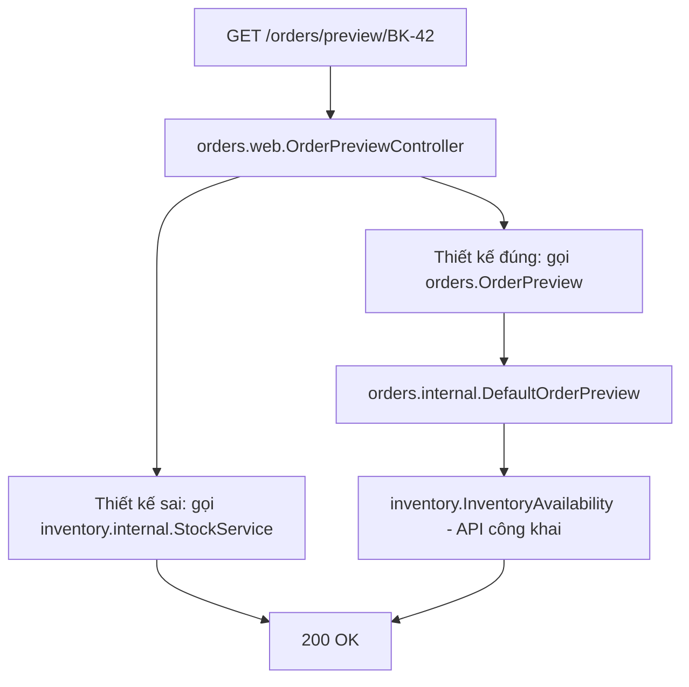
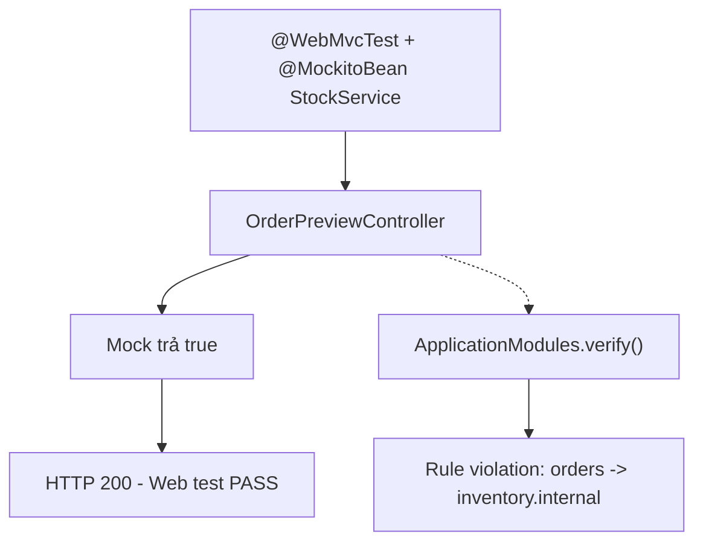
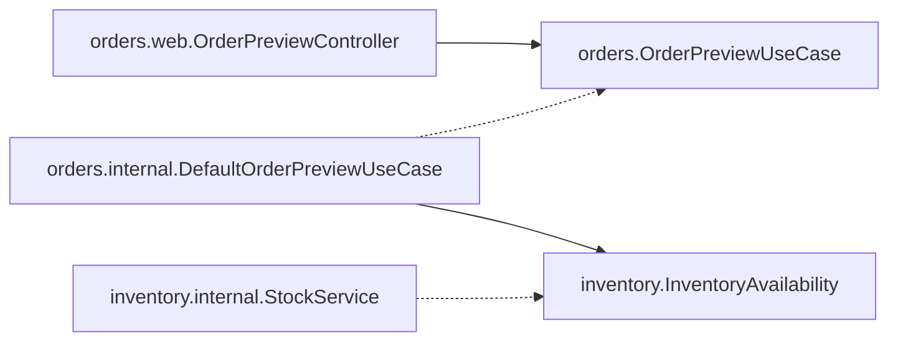
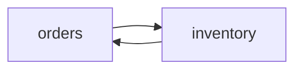

# Không dùng web test để bỏ qua module rule

## Mục tiêu học tập

Sau bài học, bạn có thể:

1. Giải thích chính xác vì sao **HTTP test xanh không chứng minh module architecture hợp lệ**.
2. Tái hiện một ca `@WebMvcTest` + `@MockitoBean` trả HTTP 200 nhưng `ApplicationModules.verify()` thất bại do truy cập `inventory.internal`.
3. Sửa nguồn phụ thuộc từ **implementation nội bộ module khác** sang **public API của module**, không sửa test để che giấu lỗi.
4. Xác định ba lớp rule cần kiểm tra: **không truy cập internal**, **chỉ phụ thuộc module được cho phép**, **không tạo dependency cycle**.
5. Sử dụng đúng `@ApplicationModuleTest(verifyAutomatically = true)`, hiểu rủi ro khi đặt `false` và không nhầm bootstrap scope với verification policy.
6. Tách **architecture gate độc lập** khỏi web slice test và module web integration test để CI không bỏ sót quy tắc.
7. Phân biệt những gì `verify()` kiểm soát với quy tắc **web → application layer** nội bộ do nhóm tự bổ sung bằng ArchUnit.
8. Viết một bài thực hành mutation có chủ đích: web test vẫn xanh, architecture gate đỏ, sau khi refactor cả hai đều xanh.

Bài thuộc chương **Web module testing**, trong lộ trình **SPRING_MODULITH_VERIFICATION_TESTING** về kiểm chứng ranh giới kiến trúc với `ApplicationModules`, kiểm thử `@ApplicationModuleTest`, sự kiện, cơ sở dữ liệu và tích hợp, kết hợp quality gate trong CI để ngăn phụ thuộc sai và hồi quy. Trọng tâm bài này là **không đánh tráo bằng chứng từ kiểm thử HTTP để hợp thức hóa phụ thuộc sai giữa các module**. Các kiến thức cơ bản về `MockMvc`, `@MockitoBean`, validation và security được dùng đúng mức cần thiết, không mở rộng sang một bài nhập môn HTTP khác.

> **Môi trường ví dụ:** Java 17+, Spring Boot 3.4–3.5, Spring Modulith 1.3–1.4, Spring MVC, JUnit 5, Mockito và ArchUnit. Các ví dụ `@WebMvcTest`/`@AutoConfigureMockMvc` dùng package Spring Boot 3.x; `@MockitoBean` thuộc Spring Framework 6.2. Với Boot 4 và Modulith 2.x, đối chiếu Javadoc của phiên bản thực tế.

## 1. Câu hỏi cốt lõi: endpoint đúng có khiến dependency đúng?

Giả sử một endpoint nhận:

```http
GET /orders/preview/BK-42
```

và trả:

```http
HTTP/1.1 200 OK
Content-Type: application/json

{"sku":"BK-42","available":true}
```

Hai implementation khác nhau đều có thể tạo **response hoàn toàn giống nhau**:



Trong nhánh sai, controller import trực tiếp một service thuộc **implementation nội bộ module inventory**. Trong nhánh đúng, controller gọi use case của `orders`; use case gọi **API công khai của inventory**.

Vì vậy:

- Assertion `status().isOk()` kiểm chứng **hành vi HTTP**.
- Assertion JSON kiểm chứng **nội dung response**.
- `ApplicationModules.verify()` kiểm chứng **ràng buộc phụ thuộc giữa application modules**.
- ArchUnit do nhóm định nghĩa có thể kiểm chứng **phân tầng web/application bên trong cùng module**.

**Một HTTP response giống nhau không làm hai đồ thị dependency trở nên tương đương.** Đây là nguyên tắc xuyên suốt bài.

## 2. Những gì web test có thể — và không thể — chứng minh

| Kiểu kiểm thử | Phạm vi điển hình | Phát hiện lỗi HTTP? | Tự bảo đảm module rule? |
| --- | --- | --- | --- |
| `MockMvcBuilders.standaloneSetup(...)` | Controller và MVC components được dựng bằng tay | Có | **Không** |
| `@WebMvcTest` | MVC slice, service thường được mock | Có | **Không tự chạy `ApplicationModules.verify()`** |
| `@SpringBootTest` + `@AutoConfigureMockMvc` | Spring application context rộng hơn | Có | **Không tự đồng nghĩa có architecture verification** |
| `@ApplicationModuleTest` + `@AutoConfigureMockMvc` | Spring context của module được chọn | Có | **Có automatic module verification mặc định trong Modulith 1.4** |
| JUnit độc lập gọi `ApplicationModules.verify()` | Mô hình module của application | Không gửi HTTP | **Có, cho các rule mà Modulith hỗ trợ** |
| ArchUnit rule do nhóm viết | Những lớp/package được import từ bytecode | Không gửi HTTP | Có, **cho chính sách bổ sung đã định nghĩa** |

**Không đánh đồng các bước kiểm tra.** `@WebMvcTest` cố ý chỉ khởi tạo lát cắt MVC; nhiều phần phụ thuộc production nằm ngoài context, nên việc nó chạy nhanh, ổn định là ưu điểm đúng mục đích chứ không phải một lỗi của Spring Boot. Nhưng nếu nhóm chỉ chạy web slice tests rồi tuyên bố ranh giới module hợp lệ, đó là **lỗ hổng trong chiến lược kiểm thử**.

Ngược lại, `@ApplicationModuleTest` của Spring Modulith **không phải** một `@WebMvcTest` có đổi tên: nó bootstrap theo ranh giới application module, và ở Spring Modulith 1.4, `verifyAutomatically` mặc định `true`. Thuộc tính này là một phần của cơ chế kiểm chứng module, không phải một matcher của `MockMvc`.

## 3. Tình huống sai có chủ đích: controller import internal module khác

Để cô lập vấn đề, dùng hai module `orders` và `inventory` cùng một endpoint **read-only**, không cần database, transaction hay sự kiện.

```text
src/main/java/com/acme/store/
├── StoreApplication.java
├── inventory/
│   ├── InventoryAvailability.java        <- API module inventory
│   └── internal/
│       └── StockService.java            <- KHÔNG phải public module API
└── orders/
    ├── OrderPreview.java                <- response/use-case model
    ├── OrderPreviewUseCase.java          <- application API
    ├── internal/
    │   └── DefaultOrderPreviewUseCase.java
    └── web/
        └── OrderPreviewController.java
```

```java
// src/main/java/com/acme/store/StoreApplication.java
package com.acme.store;

import org.springframework.boot.SpringApplication;
import org.springframework.boot.autoconfigure.SpringBootApplication;

@SpringBootApplication
public class StoreApplication {

    public static void main(String[] args) {
        SpringApplication.run(StoreApplication.class, args);
    }
}
```

API inventory:

```java
// src/main/java/com/acme/store/inventory/InventoryAvailability.java
package com.acme.store.inventory;

public interface InventoryAvailability {
    boolean available(String sku);
}
```

Implementation inventory:

```java
// src/main/java/com/acme/store/inventory/internal/StockService.java
package com.acme.store.inventory.internal;

import com.acme.store.inventory.InventoryAvailability;
import org.springframework.stereotype.Service;

@Service
public class StockService implements InventoryAvailability {

    @Override
    public boolean available(String sku) {
        return "BK-42".equals(sku);
    }
}
```

**Vì sao implementation là `public`?** Để chứng minh Java compiler không phải architecture verifier. Lớp `StockService` công khai ở cấp ngôn ngữ Java, nên package khác **có thể import**. Tuy vậy, nó nằm trong `inventory.internal`; khi module inventory được phát hiện theo quy tắc đóng mặc định, lớp này **không thuộc public API** của module inventory.

Kiểu dữ liệu phục vụ endpoint:

```java
// src/main/java/com/acme/store/orders/OrderPreview.java
package com.acme.store.orders;

public record OrderPreview(String sku, boolean available) {
}
```

### Phiên bản controller *cố ý sai*

```java
// PHIÊN BẢN SAI: chỉ dùng khi thực hành lỗi kiến trúc.
// src/main/java/com/acme/store/orders/web/OrderPreviewController.java
package com.acme.store.orders.web;

import com.acme.store.inventory.internal.StockService;
import com.acme.store.orders.OrderPreview;
import org.springframework.web.bind.annotation.GetMapping;
import org.springframework.web.bind.annotation.PathVariable;
import org.springframework.web.bind.annotation.RequestMapping;
import org.springframework.web.bind.annotation.RestController;

@RestController
@RequestMapping("/orders/preview")
public class OrderPreviewController {

    private final StockService stock;

    public OrderPreviewController(StockService stock) {
        this.stock = stock;
    }

    @GetMapping("/{sku}")
    public OrderPreview preview(@PathVariable String sku) {
        return new OrderPreview(sku, stock.available(sku));
    }
}
```

Điều gì sai?

1. Controller `orders.web` tham chiếu **`inventory.internal.StockService`**.
2. Java vẫn có thể biên dịch vì lớp `StockService` là `public`.
3. Nếu chạy ứng dụng đầy đủ, Spring có thể inject `StockService` thật và endpoint trả 200.
4. Nhưng `orders` đã **xuyên ranh giới API của inventory**. Spring Modulith phải có quyền báo vi phạm, bất kể HTTP trả gì.

Lưu ý đây là **phiên bản thay thế tạm thời** của cùng một controller. Không tạo song song hai bean `OrderPreviewController` dùng cùng route ở bước sửa lỗi sau.

## 4. Làm web test xanh dù source đang sai

Với Spring Boot 3.4+ và Spring MVC, MVC slice có thể mock ngay kiểu triển khai nội bộ mà controller phụ thuộc:

```java
// src/test/java/com/acme/store/orders/web/
// OrderPreviewControllerWebTests.java
package com.acme.store.orders.web;

import static org.mockito.BDDMockito.given;
import static org.springframework.test.web.servlet.request
        .MockMvcRequestBuilders.get;
import static org.springframework.test.web.servlet.result
        .MockMvcResultMatchers.jsonPath;
import static org.springframework.test.web.servlet.result
        .MockMvcResultMatchers.status;

import com.acme.store.inventory.internal.StockService;
import org.junit.jupiter.api.Test;
import org.springframework.beans.factory.annotation.Autowired;
import org.springframework.boot.test.autoconfigure.web.servlet.WebMvcTest;
import org.springframework.test.context.bean.override.mockito.MockitoBean;
import org.springframework.test.web.servlet.MockMvc;

@WebMvcTest(OrderPreviewController.class)
class OrderPreviewControllerWebTests {

    @Autowired
    MockMvc mvc;

    @MockitoBean
    StockService stock;

    @Test
    void returnsAvailabilityPreview() throws Exception {
        given(stock.available("BK-42")).willReturn(true);

        mvc.perform(get("/orders/preview/BK-42"))
                .andExpect(status().isOk())
                .andExpect(jsonPath("$.sku").value("BK-42"))
                .andExpect(jsonPath("$.available").value(true));
    }
}
```

**Kết quả kỳ vọng:** test HTTP **xanh**. Nó chỉ kiểm tra rằng controller:

- Có thể nhận dependency mock tên `StockService`.
- Gắn đúng mapping `GET /orders/preview/{sku}`.
- Chuyển kết quả mock thành JSON như mong đợi.

Nó **không chạy** kiểm chứng kiến trúc Spring Modulith. Mockito không biết rằng kiểu được mock nằm trong package `inventory.internal` mà `orders` không nên truy cập.



Đây chính là **false confidence** cần tránh: web test hoàn toàn chính xác trong phạm vi của nó, nhưng kết luận “kiến trúc đúng” lại không được hỗ trợ.

## 5. Architecture gate phát hiện lỗi mà web test bỏ sót

Thêm một JUnit test **độc lập**:

```java
// src/test/java/com/acme/store/ModuleArchitectureTests.java
package com.acme.store;

import org.junit.jupiter.api.Test;
import org.springframework.modulith.core.ApplicationModules;

class ModuleArchitectureTests {

    @Test
    void modulesMustRespectPublishedApis() {
        ApplicationModules.of(StoreApplication.class).verify();
    }
}
```

**Với controller sai ở mục 3**, `verify()` phải báo vi phạm vì module `orders` truy cập kiểu nội bộ của `inventory`. Kết quả mong đợi khi chạy cả hai nhóm:

| Test | Kết quả mong đợi | Vì sao |
| --- | --- | --- |
| `OrderPreviewControllerWebTests` | **PASS** | Mock cung cấp dữ liệu hợp lệ, response HTTP đúng |
| `ModuleArchitectureTests` | **FAIL** | Dependency `orders.web → inventory.internal.StockService` bị cấm |

Architecture test không cần khởi động web server, không cần `MockMvc`, không cần cấu hình mock, và không phụ thuộc database. Nó phân tích **mô hình module và những tham chiếu Java mà Modulith nhận diện**.

**Không sửa thành**:

```java
// CHỐNG CHỈ ĐỊNH: làm mất ý nghĩa quality gate
// @Disabled
// void modulesMustRespectPublishedApis() { ... }
```

hoặc xóa hẳn architecture test chỉ vì web test vẫn xanh. Nếu rule đang phản ánh một quy tắc đúng, **source phụ thuộc sai cần được sửa**, không phải trình xác minh.

### Nếu một rule không phù hợp với thiết kế thực tế?

Có những trường hợp cần **thay đổi mô hình hoặc cấu hình rule có chủ đích**, chẳng hạn:

- Tách rõ API thực của inventory và công bố tại base package.
- Công bố một **named interface** chứa kiểu API ở package con.
- Khai báo **open module** chỉ khi đội đã chấp nhận trade-off và đang chuyển đổi kiến trúc.
- Điều chỉnh danh sách `allowedDependencies` theo một quyết định đã được review.

Nhưng không coi `public` Java, HTTP 200 hoặc `@MockitoBean` là lý do hợp lệ để tự động bỏ qua module rule.

## 6. Refactor đúng: controller chỉ gọi use case của orders

Để sửa, giữ nguyên URL và JSON contract; thay **hướng dependency**.

Application API trong `orders`:

```java
// src/main/java/com/acme/store/orders/OrderPreviewUseCase.java
package com.acme.store.orders;

public interface OrderPreviewUseCase {
    OrderPreview preview(String sku);
}
```

Implementation trong cùng module `orders`:

```java
// src/main/java/com/acme/store/orders/internal/
// DefaultOrderPreviewUseCase.java
package com.acme.store.orders.internal;

import com.acme.store.inventory.InventoryAvailability;
import com.acme.store.orders.OrderPreview;
import com.acme.store.orders.OrderPreviewUseCase;
import org.springframework.stereotype.Service;

@Service
class DefaultOrderPreviewUseCase implements OrderPreviewUseCase {

    private final InventoryAvailability inventory;

    DefaultOrderPreviewUseCase(
            InventoryAvailability inventory) {
        this.inventory = inventory;
    }

    @Override
    public OrderPreview preview(String sku) {
        return new OrderPreview(
                sku, inventory.available(sku));
    }
}
```

**Controller đã sửa** — thay thế hoàn toàn phiên bản ở mục 3:

```java
// src/main/java/com/acme/store/orders/web/
// OrderPreviewController.java
package com.acme.store.orders.web;

import com.acme.store.orders.OrderPreview;
import com.acme.store.orders.OrderPreviewUseCase;
import org.springframework.web.bind.annotation.GetMapping;
import org.springframework.web.bind.annotation.PathVariable;
import org.springframework.web.bind.annotation.RequestMapping;
import org.springframework.web.bind.annotation.RestController;

@RestController
@RequestMapping("/orders/preview")
public class OrderPreviewController {

    private final OrderPreviewUseCase useCase;

    public OrderPreviewController(OrderPreviewUseCase useCase) {
        this.useCase = useCase;
    }

    @GetMapping("/{sku}")
    public OrderPreview preview(@PathVariable String sku) {
        return useCase.preview(sku);
    }
}
```

Đồ thị dependency mới:



**Đọc sơ đồ cẩn thận:**

- Dependency của controller là **`orders.OrderPreviewUseCase`**, không phải `orders.internal`.
- Implementation `DefaultOrderPreviewUseCase` **implements** interface đó.
- Service của `orders` chỉ tham chiếu **`inventory.InventoryAvailability`**, nằm trong base package được công bố.
- Implementation `inventory.internal.StockService` implements `InventoryAvailability`; caller không cần biết class này.

Đây là thay đổi ở **production code**, không phải chỉ sửa một Mockito stub. Endpoint vẫn có thể trả đúng JSON như trước, nhưng nay đồ thị dependency phù hợp với module rule.

## 7. Sửa web slice test: mock đúng cấp phụ thuộc

Sau khi refactor, test `@WebMvcTest` cũng phải thay đổi dependency được mock:

```java
// src/test/java/com/acme/store/orders/web/
// OrderPreviewControllerWebTests.java - PHIÊN BẢN ĐÃ SỬA
package com.acme.store.orders.web;

import static org.mockito.BDDMockito.given;
import static org.mockito.BDDMockito.then;
import static org.springframework.test.web.servlet.request
        .MockMvcRequestBuilders.get;
import static org.springframework.test.web.servlet.result
        .MockMvcResultMatchers.jsonPath;
import static org.springframework.test.web.servlet.result
        .MockMvcResultMatchers.status;

import com.acme.store.orders.OrderPreview;
import com.acme.store.orders.OrderPreviewUseCase;
import org.junit.jupiter.api.Test;
import org.springframework.beans.factory.annotation.Autowired;
import org.springframework.boot.test.autoconfigure.web.servlet.WebMvcTest;
import org.springframework.test.context.bean.override.mockito.MockitoBean;
import org.springframework.test.web.servlet.MockMvc;

@WebMvcTest(OrderPreviewController.class)
class OrderPreviewControllerWebTests {

    @Autowired
    MockMvc mvc;

    @MockitoBean
    OrderPreviewUseCase useCase;

    @Test
    void controllerDelegatesToOrdersApi() throws Exception {
        given(useCase.preview("BK-42"))
                .willReturn(new OrderPreview("BK-42", true));

        mvc.perform(get("/orders/preview/BK-42"))
                .andExpect(status().isOk())
                .andExpect(jsonPath("$.sku").value("BK-42"))
                .andExpect(jsonPath("$.available").value(true));

        then(useCase).should().preview("BK-42");
    }
}
```

Từ đây, web slice test xác minh đúng **MVC → public application API** của `orders`. Nó không còn biết `inventory.StockService` hay `InventoryAvailability` vì đó là chi tiết sau application boundary của controller.

**Nhưng vẫn phải giữ architecture test.** Một developer khác có thể thêm dependency sai vào `DefaultOrderPreviewUseCase`, nơi `@WebMvcTest` không khởi tạo hoặc kiểm tra. Chỉ thay kiểu mock ở controller không bảo đảm mọi code production về sau giữ đúng module rules.

## 8. Module web test không thay architecture gate độc lập

Để kiểm tra việc controller và application service của **orders** phối hợp thực sự, bổ sung `@ApplicationModuleTest`:

```java
// src/test/java/com/acme/store/orders/
// OrdersModuleWebTests.java
package com.acme.store.orders;

import static org.mockito.BDDMockito.given;
import static org.springframework.test.web.servlet.request
        .MockMvcRequestBuilders.get;
import static org.springframework.test.web.servlet.result
        .MockMvcResultMatchers.jsonPath;
import static org.springframework.test.web.servlet.result
        .MockMvcResultMatchers.status;

import com.acme.store.inventory.InventoryAvailability;
import org.junit.jupiter.api.Test;
import org.springframework.beans.factory.annotation.Autowired;
import org.springframework.boot.test.autoconfigure.web.servlet.AutoConfigureMockMvc;
import org.springframework.modulith.test.ApplicationModuleTest;
import org.springframework.test.context.bean.override.mockito.MockitoBean;
import org.springframework.test.web.servlet.MockMvc;

@ApplicationModuleTest
@AutoConfigureMockMvc
class OrdersModuleWebTests {

    @Autowired
    MockMvc mvc;

    @MockitoBean
    InventoryAvailability inventory;

    @Test
    void moduleUsesInventoryPublishedApi() throws Exception {
        given(inventory.available("BK-42")).willReturn(true);

        mvc.perform(get("/orders/preview/BK-42"))
                .andExpect(status().isOk())
                .andExpect(jsonPath("$.available").value(true));
    }
}
```

Trong test này:

1. `@ApplicationModuleTest` (mặc định `STANDALONE`) đưa các bean của **orders** vào Spring context.
2. `OrderPreviewController` và `DefaultOrderPreviewUseCase` chạy **thật**.
3. `InventoryAvailability` được `@MockitoBean` cung cấp ở **API của module ngoài**.
4. `inventory.internal.StockService` không cần xuất hiện trong context.
5. `verifyAutomatically` mặc định `true` trong Spring Modulith 1.4; do đó ranh giới module được kiểm tra tự động khi khởi tạo module test.

Nếu trả 200 thành công và `verify()` cũng xanh, ta có **hai bằng chứng độc lập**: hành vi endpoint đúng và phụ thuộc tĩnh hợp lệ.

### Vì sao vẫn có test `ModuleArchitectureTests` riêng?

Một pipeline có thể chạy **chỉ web slice tests**, tách module integration tests ra profile khác, hoặc vô tình không chọn đúng test class. Architecture test riêng:

- Chạy nhanh vì không cần tạo Spring web context.
- Có mục đích duy nhất: **bảo vệ đồ thị phụ thuộc**.
- Không bị phụ thuộc vào việc ai đó có chạy `OrdersModuleWebTests` hay không.
- Dễ đặt ở quality gate đầu tiên của CI và kiểm tra độc lập trên pull request.

**Không kết luận** rằng mặc định của `@ApplicationModuleTest` không verify; điều đó là sai với API Spring Modulith 1.4. Lý do giữ test riêng là **rõ ràng, độc lập và khó bị bỏ sót trong pipeline**, không phải vì module test hoàn toàn thiếu cơ chế kiến trúc.

## 9. Ba loại module rule mà HTTP test không bảo vệ

Ví dụ truy cập `inventory.internal` ở trên là **một** trong ba lớp vi phạm được `ApplicationModules.verify()` kiểm tra:

| Quy tắc | Tình huống vi phạm | Web test có thể vẫn xanh vì sao? |
| --- | --- | --- |
| **Không truy cập internal của module khác** | `orders → inventory.internal.StockService` | Controller/service được mock hoặc Spring đủ bean để chạy |
| **`allowedDependencies`** | `orders` chỉ cho phép phụ thuộc `inventory`, nhưng code gọi `payments.PaymentGateway` | Mock payment làm HTTP flow trả 200 |
| **Không có vòng phụ thuộc module** | `orders → inventory`, đồng thời `inventory → orders` | Mỗi endpoint vẫn có thể xử lý độc lập |

Những quy tắc này áp trên **kiểu Java và module model**, không phụ thuộc một URL có được gọi trong test hay không.

### 9.1. Truy cập internal

Sai:

```java
import com.acme.store.inventory.internal.StockService;
```

Đúng nếu module `inventory` công bố interface tại base package:

```java
import com.acme.store.inventory.InventoryAvailability;
```

Một lớp Java `public` ở `inventory.internal` vẫn bị xem là **internal module type** theo quy tắc mặc định. Ngoại lệ như **open application modules** phải là lựa chọn kiến trúc được chủ ý, không phải cách vá tuỳ tiện.

### 9.2. `allowedDependencies`

Trong `orders/package-info.java`:

```java
// src/main/java/com/acme/store/orders/package-info.java
@org.springframework.modulith.ApplicationModule(
        allowedDependencies = "inventory")
package com.acme.store.orders;
```

Với cấu hình này, `orders` được phép tham chiếu **API mặc định của module inventory**, nhưng không tự được phép tham chiếu những module khác:

```java
// Minh họa một dependency bổ sung SAI theo policy trên.
import com.acme.store.payments.PaymentGateway;
```

Ngay cả khi `PaymentGateway` nằm trong **base package public** của `payments`, dependency `orders → payments` vẫn có thể bị `verify()` từ chối vì không nằm trong danh sách `allowedDependencies`.

**Điểm cần phân biệt:** “kiểu có thể truy cập” và “module được phép phụ thuộc” là **hai điều kiện khác nhau**, cả hai phải đúng.

### 9.3. Module dependency cycle

Ban đầu có:

```text
orders.internal.DefaultOrderPreviewUseCase
           |
           v
inventory.InventoryAvailability
```

Sau đó developer thêm tham chiếu ngược:

```text
inventory.internal.SomeStockService
           |
           v
orders.OrderPreview
```

Nếu mô hình nhận diện cả hai tham chiếu, đồ thị trở thành:



Đây là **vòng phụ thuộc module** dù cả hai kiểu được tham chiếu đều có thể nằm trong public API của module còn lại. Không nhất thiết có lỗi HTTP hoặc lỗi tạo bean khi chỉ thử một endpoint.

**Cách sửa** phải xuất phát từ trách nhiệm nghiệp vụ, ví dụ di chuyển một hợp đồng dùng chung đến module độc lập có chủ đích, thay lời gọi trực tiếp bằng event theo đúng hướng phụ thuộc, hoặc thiết kế lại API. Không giải quyết bằng cách **chỉ mock một bean ở web test**.

## 10. Named interface không phải lối tắt qua module rule

Khi API hợp lệ nằm trong package con `inventory.stock`, Spring Modulith cho phép công bố nó qua **named interface**:

```java
// src/main/java/com/acme/store/inventory/stock/package-info.java
@org.springframework.modulith.NamedInterface("stock")
package com.acme.store.inventory.stock;
```

Khi đó, trong **phương án cấu trúc thay thế**, chuyển `InventoryAvailability` sang `inventory.stock` và cho `orders` phụ thuộc:

```java
// src/main/java/com/acme/store/orders/package-info.java
@org.springframework.modulith.ApplicationModule(
        allowedDependencies = "inventory :: stock")
package com.acme.store.orders;
```

**Không ghép nguyên đoạn này với code ở mục 3–8 mà chưa di chuyển interface và sửa imports.** Đây là ví dụ **thiết kế API thay thế**.

Cách khai báo chỉ cho phép `orders` dùng named interface `stock` đã được công bố; nó **không** tự cấp quyền truy cập `inventory.internal`.

Một vài quy tắc cần nhớ:

- Base package public là **API mặc định**.
- Named interface công bố **một tập kiểu ở package con** theo chủ đích.
- `allowedDependencies = "inventory :: stock"` giới hạn dependency đến named interface đó theo ví dụ.
- `inventory :: *` và `inventory :: **` mang ý nghĩa phạm vi khác; **đừng dùng wildcard để xóa lỗi mà chưa xem mức độ mở API**.

Mục tiêu của review là xác định **dependency có hợp lệ về ý nghĩa domain hay không**, sau đó mô hình hóa đúng API và rule, chứ không tìm một annotation để làm `verify()` im lặng.

## 11. `verifyAutomatically = false`: hiểu đúng tác động và rủi ro

Trong Spring Modulith 1.4, `@ApplicationModuleTest` cung cấp thuộc tính:

```java
@ApplicationModuleTest(
        verifyAutomatically = true)
```

Giá trị mặc định là **`true`**; ghi tường minh nếu nhóm muốn thể hiện hợp đồng.

Cấu hình sau là một **anti-pattern đối với quality gate**:

```java
// MINH HỌA KHÔNG NÊN ÁP DỤNG CHỈ ĐỂ WEB TEST XANH
@ApplicationModuleTest(
        verifyAutomatically = false)
@AutoConfigureMockMvc
class OrdersIgnoringRulesTests {
    // Test có thể tiếp tục kiểm tra HTTP mà bỏ tự động
    // verify module structure trong lần bootstrap này.
}
```

Với `false`, test **không còn tự động thực hiện** phần structural verification của annotation đó. Điều này không xóa các rule khỏi `ApplicationModules`; nếu CI có bài `ApplicationModules.of(...).verify()` riêng, gate ấy vẫn báo lỗi.

**Đừng quy kết sai:** Chuyển mode từ `STANDALONE` sang `DIRECT_DEPENDENCIES` hoặc `ALL_DEPENDENCIES` **không tương đương** với `verifyAutomatically = false`. Mode chỉ lựa chọn **module nào được bootstrap**; verifyAutomatically quyết định **có chạy verification tự động khi module test khởi tạo không**.

| Cấu hình | Thay đổi điều gì? | Có sửa được import internal sai? |
| --- | --- | --- |
| `mode = STANDALONE` | Chỉ bootstrap module mục tiêu | **Không** |
| `mode = DIRECT_DEPENDENCIES` | Bootstrap module mục tiêu và dependency trực tiếp | **Không** |
| `mode = ALL_DEPENDENCIES` | Bootstrap cả cây dependency | **Không** |
| `extraIncludes = "inventory"` | Thêm inventory vào context có chủ đích | **Không** |
| `@MockitoBean InventoryAvailability` | Cấp mock bean ở API boundary trong test | **Không** |
| `verifyAutomatically = false` | Tắt bước verify tự động **của module test đó** | Chỉ **che** lỗi nếu không có gate khác; không sửa code |
| Refactor sang `InventoryAvailability` | Thay dependency production để dùng API hợp lệ | **Có** |

Đôi khi cần tạm tắt verification trong một bài test phục vụ **chẩn đoán một hệ thống đang migrate**, nhưng đó phải là **ngoại lệ được ghi nhận, có thời hạn và vẫn giữ architecture test riêng ở pipeline**. Nó không phải phương pháp mặc định để sửa bài web test.

## 12. Mock và `@Import` không hợp thức hóa dependency

Một lỗi tư duy khác là: “Nếu `@MockitoBean` làm context khởi tạo thành công, dependency chắc chắn hợp lệ”.

Sai, vì Spring test context giải quyết **wiring của bean runtime**, còn Modulith rule kiểm tra **hướng tham chiếu source/bytecode**.

```java
// Trong @WebMvcTest controller PHIÊN BẢN SAI:
@MockitoBean
StockService stock;
```

Mock này giúp controller nhận một dependency đã vi phạm module boundary. Nó không biến `StockService` từ `inventory.internal` thành public API.

Tương tự:

```java
// Minh họa một cách kéo bean ngoài phạm vi vào context:
@Import(StockService.class)
```

Import vào test context có thể làm bean xuất hiện, nhưng **không thay đổi package owner** hay chính sách truy cập của Spring Modulith.

**Cách xử lý đúng khi `STANDALONE` thiếu dependency ngoài module:**

1. Xem kiểu được inject nằm ở module nào bằng `ApplicationModules`.
2. Đảm bảo kiểu đó nằm trong API công bố, không phải `internal`.
3. Đổi production code để tham chiếu interface API nếu đang sai.
4. Chỉ **sau đó** dùng `@MockitoBean` ở **cổng public API** ngoài module khi cần test cô lập.
5. Giữ một test tích hợp rộng hơn nếu phải kiểm tra implementation thực, và giữ `verify()` trong CI.

Một test dùng nhiều mock có thể phản ánh coupling cao giữa module; việc thêm mock liên tục **không thay thế** đánh giá lại kiến trúc.

## 13. `verify()` không kiểm tra mọi quy tắc trong cùng module

Tránh diễn giải quá mức theo chiều ngược lại: `ApplicationModules.verify()` xanh **không có nghĩa** mọi phân tầng bên trong module đã đúng.

Ví dụ:

```text
orders.web.OrderPreviewController
            |
            v
orders.internal.SomeOrderRepository
```

Cả hai class **đều thuộc module orders**. Một lời gọi trực tiếp tới repository nội bộ cùng module có thể **không vi phạm** các rule mặc định về **liên module**, dù nhóm muốn mọi controller phải đi qua `OrderPreviewUseCase`.

Nếu đây là chính sách của đội, bổ sung ArchUnit:

```java
// src/test/java/com/acme/store/orders/
// OrdersWebLayerRulesTests.java
package com.acme.store.orders;

import static com.tngtech.archunit.lang.syntax
        .ArchRuleDefinition.noClasses;

import com.tngtech.archunit.core.importer.ClassFileImporter;
import com.tngtech.archunit.core.importer.ImportOption;
import org.junit.jupiter.api.Test;

class OrdersWebLayerRulesTests {

    @Test
    void webMustNotDependOnInternalImplementation() {
        var classes = new ClassFileImporter()
                .withImportOption(
                        ImportOption.Predefined.DO_NOT_INCLUDE_TESTS)
                .importPackages("com.acme.store");

        noClasses()
                .that().resideInAPackage(
                        "com.acme.store.orders.web..")
                .should().dependOnClassesThat()
                .resideInAPackage(
                        "com.acme.store.orders.internal..")
                .check(classes);
    }
}
```

Quy tắc ArchUnit này **bổ sung** chứ không thay thế `ApplicationModules.verify()`. Nó kiểm tra boundary mà nhóm xác lập **bên trong module**, còn Modulith xử lý ranh giới module mà framework nhận diện.

Ví dụ dependency test cần khai báo `com.tngtech.archunit:archunit-junit5` hoặc artifact ArchUnit tương ứng được quản lý phiên bản. Không chạy bài test trên mỗi package con một cách bừa bãi nếu nhóm đã thiết kế nested application modules có ranh giới đặc thù; cần điều chỉnh policy cho đúng module model thực tế.

### Một lớp giới hạn cần nhớ

Kiểm tra tĩnh có thể không phát hiện đầy đủ phụ thuộc tạo bằng reflection, service locator, tên bean động, `Class.forName(...)` hoặc các hành vi chỉ xuất hiện ở runtime. Đồng thời, một class thuộc **open module** hoặc API được công bố hợp lệ có thể có quy tắc khác closed module mặc định.

Vì thế:

- **Không hạ thấp** architecture verification chỉ vì nó có giới hạn.
- **Không phóng đại** rằng architecture verification đã kiểm tra mọi hành vi runtime.
- Dùng HTTP/module/integration tests cho hành vi; dùng Modulith/ArchUnit cho cấu trúc; review cho các exception kiến trúc có chủ đích.

## 14. Thiết kế bộ kiểm thử chống hồi quy theo hai chiều

Một chiến lược hiệu quả có thể được diễn đạt bằng ma trận:

| | Architecture gate **PASS** | Architecture gate **FAIL** |
| --- | --- | --- |
| HTTP test **PASS** | Thỏa cả hai hợp đồng đang kiểm tra | **Phụ thuộc sai bị che bởi HTTP test** — phải sửa source |
| HTTP test **FAIL** | Đồ thị module hợp lệ nhưng hành vi web hỏng | Cả hành vi và kiến trúc đều có lỗi |

**Không chọn một trong hai:** mục tiêu là góc **trên trái**. Nếu chỉ chạy `@WebMvcTest`, cả hai trạng thái ở hàng “HTTP PASS” nhìn giống nhau, dễ tạo sự tự tin sai.

Các bài test nên tách:

```text
src/test/java/com/acme/store/
├── ModuleArchitectureTests.java        <- chạy verify()
└── orders/
    ├── OrdersWebLayerRulesTests.java    <- policy nội module của nhóm
    ├── OrdersModuleWebTests.java        <- @ApplicationModuleTest + MockMvc
    └── web/
        └── OrderPreviewControllerWebTests.java  <- @WebMvcTest
```

Mỗi nhóm có một mục tiêu:

- **Architecture:** ranh giới modules được công bố, không vòng, `allowedDependencies`.
- **Web slice:** route/status/response và lời gọi tới application use case.
- **Module web integration:** controller và service thật của module, mock API module ngoài đúng ranh giới.
- **Custom layer policy:** controller không truy cập implementation nội module nếu đó là quy tắc của đội.

Đối với ứng dụng có database/sự kiện, bổ sung integration tests đúng tài nguyên để kiểm tra commit, rollback, event publication/handling. Nhưng không lặp thêm toàn bộ ví dụ JPA/transaction trong bài này: các bài test đó **không có vai trò sửa hoặc thay thế module rule**.

## 15. Một quality gate CI không được phép “chỉ chạy web”

Ví dụ Gradle (Groovy DSL), với JUnit Platform đã được cấu hình:

```groovy
tasks.named('test', Test) {
    useJUnitPlatform()
}
```

Trong CI, chạy **toàn bộ test task bắt buộc** thay vì chỉ một filter controller:

```bash
./gradlew test
```

Để điều tra cục bộ, có thể chạy riêng architecture test:

```bash
./gradlew test --tests 'com.acme.store.ModuleArchitectureTests'
```

và riêng web test:

```bash
./gradlew test --tests 'com.acme.store.orders.web.OrderPreviewControllerWebTests'
```

**Không dùng câu lệnh chỉ lọc web tests làm quality gate duy nhất trong PR.** Một lệnh `--tests '*WebTests'` có thể không bao gồm `ModuleArchitectureTests` hay `OrdersWebLayerRulesTests`.

Nếu nhóm tách `integrationTest` khỏi `test`, pipeline phải chạy cả hai nhóm theo cách cấu hình thực tế. Nếu chỉ muốn có một gate kiến trúc chạy nhanh, có thể tạo một task/test suite riêng **nhưng phải được include ở required checks**; không chỉ viết class rồi để nó không được thực thi.

### Fail-fast không phải skip lỗi

Nếu architecture gate đỏ, pipeline cần **thất bại**, dù mọi HTTP tests xanh. Trong một số CI pipeline, nhóm có thể chạy song song:

```text
PR
├── Architecture test              -> Required
├── Web slice + module tests       -> Required
└── Database/event integration     -> Required khi thay đổi phù hợp
```

Đây là minh họa workflow, không phải cấu hình YAML cho một CI provider cụ thể. Nguyên tắc là **các required checks độc lập** và không có đường “đi tắt” chỉ dùng HTTP status.

### Tránh thay đổi verification để phục vụ riêng một nhánh

Một pull request không nên:

- Bật `verifyAutomatically = false` như lời giải lâu dài.
- Xóa architecture test vì “làm build chậm”.
- Đánh dấu architecture test `@Disabled`.
- Bỏ module khỏi detection strategy chỉ để nó không xuất hiện trong đồ thị.
- Thêm wildcard `allowedDependencies` không được review.
- Đổi module sang `OPEN` chỉ để các import `internal` tiếp tục biên dịch/chạy.

Nếu có một giai đoạn migrate, hãy tạo **debt item được theo dõi**, mô tả exception, người chịu trách nhiệm và kiểm tra còn lại; không biến skip thành mặc định vô thời hạn.

## 16. Bài thực hành mutation: HTTP xanh, architecture đỏ

Đây là bài tập trọng tâm và có thể thực hiện trên một nhánh thử nghiệm, **không cần sửa dữ liệu thật**.

### Chuẩn bị

1. Tạo `StoreApplication`, module `orders` và `inventory` theo mục 3.
2. Giữ `StockService` ở `inventory.internal` và `InventoryAvailability` ở base package `inventory`.
3. Tạo controller **phiên bản sai** ở mục 3, để controller inject `StockService` trực tiếp.
4. Tạo `OrderPreviewControllerWebTests` ở mục 4, mock `StockService`.
5. Tạo `ModuleArchitectureTests` gọi `verify()`.

**Dự kiến:**

| Bước thử | Web test | Architecture test | Cần kết luận |
| --- | --- | --- | --- |
| A. Controller dùng `StockService` nội bộ inventory | PASS | **FAIL** | HTTP đúng, ranh giới module sai |
| B. Chỉ thêm `@MockitoBean` cho internal service | PASS | **FAIL** | Mock không sửa production dependency |
| C. Chỉ đổi bootstrap `ALL_DEPENDENCIES` | Có thể PASS | **FAIL** | Mở scope không sửa rule |
| D. Tắt `verifyAutomatically` trên module test | HTTP có thể PASS | Test `verify()` riêng **FAIL** | Tắt một gate không sửa kiến trúc |
| E. Refactor sang `OrderPreviewUseCase` + `InventoryAvailability` | PASS | PASS | Hành vi và ranh giới đều đúng |

### Thử thách nâng cao — hai lỗi vẫn tạo HTTP 200

**Mutation 1: hạn chế `allowedDependencies`.** Thêm `@ApplicationModule(allowedDependencies = "inventory")` vào package `orders`, sau đó cố ý thêm một tham chiếu production tới API module `payments`. Web test vẫn có thể được mock để trả 200, nhưng architecture gate phải báo phụ thuộc không được phép.

**Mutation 2: vòng phụ thuộc.** Giữ `orders → inventory`, sau đó thêm tham chiếu `inventory → orders` qua một public type. Hai module đều có thể còn hoạt động ở những endpoint riêng lẻ; `verify()` phải phát hiện cycle.

**Mutation 3: vi phạm phân tầng cùng module.** Sau khi module rules xanh, thay controller để gọi `orders.internal` trực tiếp. Khi đó `verify()` **có thể vẫn xanh**, nhưng `OrdersWebLayerRulesTests` phải đỏ nếu đội đã đặt rule web → application API.

**Kết quả mong muốn:** Biết chọn **đúng gate** cho mỗi lớp lỗi, không phản xạ sửa test theo hướng làm chúng tạm xanh.

## 17. Chẩn đoán: khi nào lỗi thuộc HTTP, khi nào thuộc module rule?

| Triệu chứng | Chẩn đoán đúng trọng tâm | Cách xử lý |
| --- | --- | --- |
| `@WebMvcTest` xanh, `verify()` đỏ | Lỗi kiến trúc bị web slice bỏ qua | Đọc dependency violation và sửa import/owner |
| `@WebMvcTest` không start vì thiếu service | MVC slice chưa có mock/use-case collaborator | Mock **application API đúng cấp**, không mock internal để duy trì coupling |
| `@ApplicationModuleTest` lỗi khi bootstrapping trước assertion | Có thể do automatic verification hoặc bean thiếu ngoài module | Đọc **root cause**, phân biệt violation với dependency injection |
| `NoSuchBeanDefinitionException` cho public API của module ngoài | `STANDALONE` không bootstrap implementation ngoài module | `@MockitoBean` API hoặc tích hợp có chủ đích |
| HTTP 200 với mock internal nhưng `verify()` thất bại | Mock sai loại dependency | Refactor source sang public interface trước |
| `verify()` báo vòng phụ thuộc | Có tham chiếu ngược giữa module | Thiết kế lại dependency direction, không chỉ mock |
| `allowedDependencies` chặn module mới | Quy tắc cho phép đang chặt hơn thiết kế mới | Review quyết định module; chỉ mở quyền khi hợp lệ |
| `verify()` xanh nhưng web → repository cùng module | Rule mặc định không ép phân tầng nội module | Bổ sung ArchUnit theo policy đội |
| `@ApplicationModuleTest` xanh nhưng task CI chỉ chạy `@WebMvcTest` | Module verification không được chọn vào quality gate | Include architecture required check |
| Bật `verifyAutomatically = false` rồi test xanh | Một lớp verification bị vô hiệu | Khôi phục `true`, giữ independent test, sửa source |
| Refactor sang named interface nhưng vẫn báo lỗi | Package/annotation/imports hoặc `allowedDependencies` không khớp | Kiểm tra owner và syntax `module :: interface` |
| Test trên `OPEN` module không báo internal access | Mô hình được cấu hình mở internals có chủ đích | Đánh giá policy, không giả định closed-module rules vẫn áp như cũ |

### Quy trình điều tra 6 bước

1. **Nhìn tên failing test trước:** là `MockMvc`, Spring context startup hay `ModuleArchitectureTests`?
2. **Tìm root cause:** lỗi `BeanCreationException`/missing bean khác với **violation của `ApplicationModules.verify()`**.
3. **Đọc cạnh dependency:** source class thuộc module nào, target type thuộc module/package nào, có nằm trong public API hoặc named interface không?
4. **Kiểm tra policy:** module đóng/mở, `allowedDependencies`, vòng phụ thuộc và custom ArchUnit rule.
5. **Sửa production code hoặc mô hình có chủ đích:** không ưu tiên sửa mock/skip annotation để che lỗi.
6. **Chạy lại cả hai nhóm:** web behavior và architecture. Khi use case có persistence/event, chạy thêm các integration tests bắt buộc.

## 18. Câu hỏi tự kiểm tra

1. Vì sao controller import `inventory.internal.StockService` vẫn có thể trả HTTP 200 và vượt `@WebMvcTest`?
2. Java `public` khác gì public API của Spring Modulith?
3. `@MockitoBean StockService` giúp giải quyết điều gì ở test context, và không giải quyết điều gì ở kiến trúc?
4. `ApplicationModules.verify()` bảo vệ ba nhóm module rule chính nào?
5. `@ApplicationModuleTest` trong Spring Modulith 1.4 có tự verify theo mặc định không?
6. `verifyAutomatically = false` và `mode = ALL_DEPENDENCIES` tác động đến những khía cạnh khác nhau nào?
7. Vì sao giữ architecture test riêng dù `@ApplicationModuleTest` đã auto verify?
8. Nếu module `orders` được phép phụ thuộc `inventory`, nó có tự được phép import `inventory.internal` không?
9. Vì sao dependency `orders → inventory` cùng `inventory → orders` bị coi là cycle dù hai kiểu có thể đều `public`?
10. Named interface được dùng để công bố API trong package con; nó có cho phép truy cập toàn bộ `internal` không?
11. Khi `verify()` xanh nhưng controller dùng repository nội module, bạn cần lớp quy tắc bổ sung nào?
12. Một CI chỉ chạy `*WebTests` có thể bỏ sót những test quan trọng nào?

## Tổng kết

**Không dùng web test để bỏ qua module rule** nghĩa là không lấy status 200, JSON đúng hoặc Mockito stub thành công để kết luận dependency Java đã hợp lệ. `@WebMvcTest` kiểm tra đúng chức năng của nó nhưng không tự kiểm chứng ranh giới Spring Modulith; một controller gọi `inventory.internal.StockService` có thể vẫn vượt MVC slice test. Hãy sửa **production dependency** sang public API như `inventory.InventoryAvailability`, dùng `OrderPreviewUseCase` làm cổng của controller, giữ `ApplicationModules.of(...).verify()` làm **architecture gate độc lập**, và để `@ApplicationModuleTest` tiếp tục tự verify theo mặc định. Nếu nhóm yêu cầu thêm phân tầng web → application trong cùng module, dùng ArchUnit. Trong CI, chỉ coi thay đổi đạt khi **HTTP behavior và module architecture đều được bảo vệ**, đồng thời chạy những test database/sự kiện/tích hợp phù hợp với phạm vi hệ thống.

### Tài liệu tham khảo

- [Spring Modulith 1.4 — Verifying Application Module Structure](https://docs.spring.io/spring-modulith/reference/1.4/verification.html)
- [Spring Modulith 1.4 — ApplicationModuleTest API (`verifyAutomatically`)](https://docs.spring.io/spring-modulith/docs/1.4.x/api/org/springframework/modulith/test/ApplicationModuleTest.html)
- [Spring Modulith 1.4 — Integration Testing Application Modules](https://docs.spring.io/spring-modulith/reference/1.4/testing.html)
- [Spring Modulith 1.4 — Fundamentals, Named Interfaces và Allowed Dependencies](https://docs.spring.io/spring-modulith/reference/1.4/fundamentals.html)
- [Spring Boot 3.5 — `@WebMvcTest` API](https://docs.spring.io/spring-boot/3.5/api/java/org/springframework/boot/test/autoconfigure/web/servlet/WebMvcTest.html)
- [Spring Boot 3.5 — Testing Spring Boot Applications](https://docs.spring.io/spring-boot/3.5/reference/testing/spring-boot-applications.html)
- [ArchUnit — User Guide, Package Dependency Checks](https://www.archunit.org/userguide/html/000_Index.html#_package_dependency_checks)
