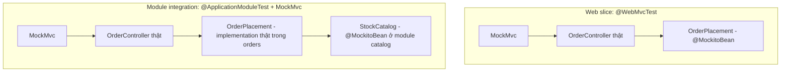
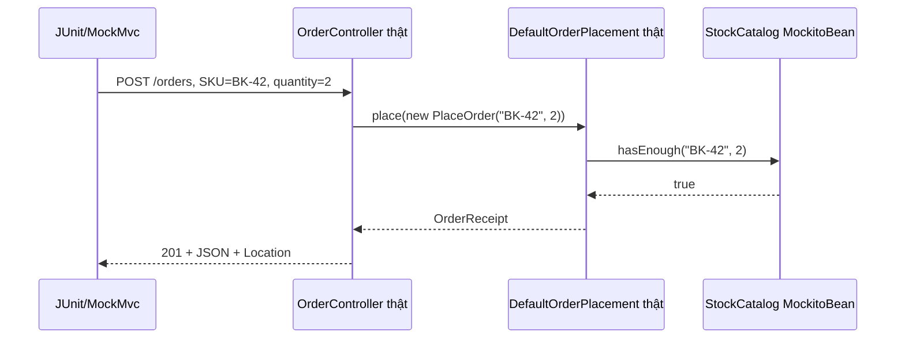
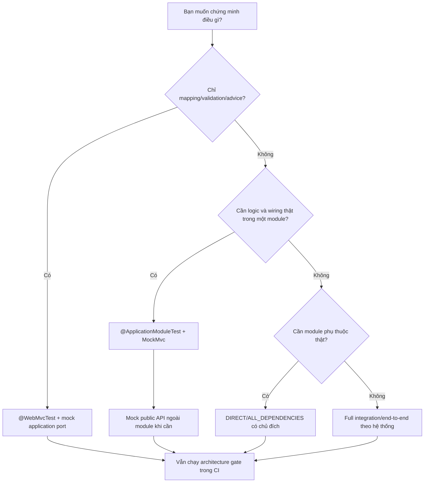

# Phân biệt web slice với module integration test

## Mục tiêu học tập

Sau bài học, bạn có thể:

1. Phân biệt chính xác **`@WebMvcTest`** và **`@ApplicationModuleTest`** theo đối tượng kiểm thử, Spring context, bean thật và bean giả lập.
2. Viết **hai bài JUnit trên cùng một HTTP endpoint**, một bài mock application use case để kiểm tra web adapter, bài còn lại chạy use case thật trong module và chỉ mock dependency thuộc module khác.
3. Giải thích vì sao hai bài test đều có thể nhận HTTP `201` nhưng cung cấp **hai mức bằng chứng khác nhau**.
4. Tạo một thay đổi lỗi cố ý ở application service để quan sát **web slice xanh, module integration đỏ**.
5. Chọn vị trí đặt `@MockitoBean` phù hợp với ranh giới kiểm thử; không mock service thật của module nếu mục tiêu là kiểm tra wiring/nghiệp vụ của module đó.
6. Hiểu `@ApplicationModuleTest` mặc định `STANDALONE`, `webEnvironment = MOCK`, `verifyAutomatically = true` và vì sao thường cần thêm `@AutoConfigureMockMvc`.
7. Chọn đúng loại test khi cần kiểm tra mapping/validation, application service, database/transaction, event, bảo mật hoặc ranh giới kiến trúc.
8. Tổ chức các bài test thành **quality gate CI** có mục tiêu rõ ràng, tránh vừa kiểm tra trùng lặp vừa bỏ sót hồi quy.

Bài thuộc chương **Web module testing** trong lộ trình **SPRING_MODULITH_VERIFICATION_TESTING**, tập trung rèn kỹ năng kiểm chứng ranh giới ứng dụng bằng `ApplicationModules`, quy tắc phụ thuộc, `@ApplicationModuleTest`, kiểm thử sự kiện, cơ sở dữ liệu và tích hợp, cùng quality gate CI. **Câu hỏi chính** là: *đến đâu thì một bài kiểm thử web chỉ là slice test, và khi nào nó thực sự kiểm tra sự phối hợp của cả application module?*

> **Phạm vi ví dụ:** Java 17+, Spring Boot 3.4–3.5, Spring Framework 6.2, Spring Modulith 1.3–1.4, Spring MVC và JUnit 5. Các import `@WebMvcTest`, `@AutoConfigureMockMvc` dùng Spring Boot 3.x; `@MockitoBean` thuộc Spring Framework 6.2. Nếu dự án đang dùng Boot 4 hoặc Modulith 2.x, cần chọn dependency và import theo phiên bản đang chạy.

## 1. Câu trả lời ngắn: khác nhau ở đâu?

**Web slice test** chỉ hỏi:

> Khi HTTP request đi vào controller, controller có đọc input, gọi **đúng hợp đồng application API** và tạo response đúng không?

**Module integration test** hỏi thêm:

> Khi HTTP request đi vào module, **controller thật cùng application service và các bean nội bộ thật** có phối hợp đúng không, trong phạm vi module được bootstrap?

Hai sơ đồ cùng phục vụ `POST /orders`:



**Khác biệt then chốt:** trong web slice, `OrderPlacement` là mock; trong module integration, `OrderPlacement` là service thật. Vì vậy một HTTP 201 trong slice **không chứng minh** đường xử lý nghiệp vụ của service đang hoạt động.

| Tiêu chí | `@WebMvcTest(OrderController.class)` | `@ApplicationModuleTest` + `@AutoConfigureMockMvc` |
| --- | --- | --- |
| Mục tiêu chính | Web adapter/MVC contract | Tích hợp **các bean của application module** qua web adapter |
| Kiểu Spring context | MVC **slice** | Spring Boot test context **giới hạn theo module** |
| Controller | Thật | Thật |
| Service nghiệp vụ thông thường | Không được scan; cung cấp mock khi cần | **Thật nếu thuộc module được bootstrap** |
| Dependency ngoài module | Thường không xuất hiện vì service đã mock | Cần mock API ngoài module hoặc mở bootstrap scope |
| `MockMvc` | **Được auto-configure** | Thường bổ sung **`@AutoConfigureMockMvc`** |
| Module verification tự động | Không phải chức năng của annotation | **Có theo mặc định**: `verifyAutomatically = true` ở Modulith 1.4 |
| Database/repository module | Thường không có | Có thể chạy thật **nếu module có JPA và test cấu hình DB** |
| Mức chi phí | Thường hẹp và nhanh hơn | Thường bootstrap nhiều bean/hạ tầng hơn |
| Không chứng minh được | Nghiệp vụ, transaction, sự kiện của service đã mock | Toàn bộ hệ thống hoặc module khác **đã bị loại khỏi scope** |

Không có câu trả lời “loại nào tốt hơn trong mọi trường hợp”. Chúng bảo vệ **hai mặt khác nhau của cùng một API**.

## 2. Dùng một endpoint xuyên suốt để so sánh

Ứng dụng `com.acme.market` có hai application module:

```text
src/main/java/com/acme/market/
├── MarketApplication.java
├── catalog/
│   ├── StockCatalog.java                 <- API công khai
│   └── internal/
│       └── DemoStockCatalog.java        <- implementation bên ngoài orders
└── orders/
    ├── OrderPlacement.java              <- public application API
    ├── PlaceOrder.java                   <- command
    ├── OrderReceipt.java                <- kết quả
    ├── StockUnavailableException.java
    ├── internal/
    │   └── DefaultOrderPlacement.java   <- service thật của orders
    └── web/
        ├── OrderController.java
        └── OrderErrorAdvice.java

src/test/java/com/acme/market/
├── ModuleArchitectureTests.java
└── orders/
    ├── OrdersWebModuleTests.java         <- module integration
    └── web/
        └── OrderControllerSliceTests.java <- MVC slice
```

Module `orders` **phụ thuộc công khai vào** `catalog.StockCatalog`; controller chỉ phụ thuộc vào `orders.OrderPlacement`. Việc đặt `OrderPlacement` trong base package `orders` giúp interface được công bố theo cơ chế API mặc định của Spring Modulith.

Lớp Spring Boot gốc:

```java
// src/main/java/com/acme/market/MarketApplication.java
package com.acme.market;

import org.springframework.boot.SpringApplication;
import org.springframework.boot.autoconfigure.SpringBootApplication;

@SpringBootApplication
public class MarketApplication {

    public static void main(String[] args) {
        SpringApplication.run(MarketApplication.class, args);
    }
}
```

Gradle Groovy DSL — giả định project đã quản lý các phiên bản Spring Boot/Spring Modulith tương thích:

```groovy
dependencies {
    implementation 'org.springframework.boot:spring-boot-starter-web'
    implementation 'org.springframework.boot:spring-boot-starter-validation'
    implementation 'org.springframework.modulith:spring-modulith-starter-core'

    testImplementation 'org.springframework.boot:spring-boot-starter-test'
    testImplementation 'org.springframework.modulith:spring-modulith-starter-test'
}
```

Ví dụ **không có database, security hoặc message broker**, để kết quả test thể hiện đúng sự khác nhau giữa *slice* và *module integration*, không bị các vấn đề hạ tầng khác che khuất. Những test JPA/event sẽ được chọn ở phần cuối khi ứng dụng thực sự có side effect.

## 3. API module catalog và hợp đồng module orders

**API module catalog:**

```java
// src/main/java/com/acme/market/catalog/StockCatalog.java
package com.acme.market.catalog;

public interface StockCatalog {
    boolean hasEnough(String sku, int quantity);
}
```

**Implementation production/demo của catalog:**

```java
// src/main/java/com/acme/market/catalog/internal/DemoStockCatalog.java
package com.acme.market.catalog.internal;

import com.acme.market.catalog.StockCatalog;
import org.springframework.stereotype.Service;

@Service
class DemoStockCatalog implements StockCatalog {

    @Override
    public boolean hasEnough(String sku, int quantity) {
        return "BK-42".equals(sku) && quantity <= 5;
    }
}
```

**Application API của orders:**

```java
// src/main/java/com/acme/market/orders/PlaceOrder.java
package com.acme.market.orders;

public record PlaceOrder(String sku, int quantity) {
}
```

```java
// src/main/java/com/acme/market/orders/OrderReceipt.java
package com.acme.market.orders;

public record OrderReceipt(
        String id, String sku, int quantity, String state) {
}
```

```java
// src/main/java/com/acme/market/orders/OrderPlacement.java
package com.acme.market.orders;

public interface OrderPlacement {
    OrderReceipt place(PlaceOrder command);
}
```

```java
// src/main/java/com/acme/market/orders/StockUnavailableException.java
package com.acme.market.orders;

public class StockUnavailableException extends RuntimeException {

    public StockUnavailableException() {
        super("Requested stock is not available");
    }
}
```

**Service thật trong module orders:**

```java
// src/main/java/com/acme/market/orders/internal/DefaultOrderPlacement.java
package com.acme.market.orders.internal;

import com.acme.market.catalog.StockCatalog;
import com.acme.market.orders.OrderPlacement;
import com.acme.market.orders.OrderReceipt;
import com.acme.market.orders.PlaceOrder;
import com.acme.market.orders.StockUnavailableException;
import java.util.Locale;
import org.springframework.stereotype.Service;

@Service
class DefaultOrderPlacement implements OrderPlacement {

    private final StockCatalog stock;

    DefaultOrderPlacement(StockCatalog stock) {
        this.stock = stock;
    }

    @Override
    public OrderReceipt place(PlaceOrder command) {
        if (!stock.hasEnough(command.sku(), command.quantity())) {
            throw new StockUnavailableException();
        }

        String id = "order-"
                + command.sku().toLowerCase(Locale.ROOT)
                + "-" + command.quantity();

        return new OrderReceipt(
                id, command.sku(), command.quantity(), "PLACED");
    }
}
```

Ở đây **quy tắc nghiệp vụ quan trọng** là: *không tạo đơn khi tồn kho không đủ*. Method `place(...)` phải hỏi `StockCatalog` và ném `StockUnavailableException` khi nhận `false`.

Chuỗi ID xác định trước phục vụ test, **không phải thuật toán định danh production**. Không có repository hay transaction trong đoạn này, nên hai bài test bên dưới **không khẳng định persistence đã commit**.

## 4. Web adapter và hợp đồng HTTP

**Controller thật:**

```java
// src/main/java/com/acme/market/orders/web/OrderController.java
package com.acme.market.orders.web;

import com.acme.market.orders.OrderPlacement;
import com.acme.market.orders.OrderReceipt;
import com.acme.market.orders.PlaceOrder;
import jakarta.validation.Valid;
import jakarta.validation.constraints.Min;
import jakarta.validation.constraints.NotBlank;
import jakarta.validation.constraints.NotNull;
import java.net.URI;
import org.springframework.http.MediaType;
import org.springframework.http.ResponseEntity;
import org.springframework.web.bind.annotation.PostMapping;
import org.springframework.web.bind.annotation.RequestBody;
import org.springframework.web.bind.annotation.RequestMapping;
import org.springframework.web.bind.annotation.RestController;

@RestController
@RequestMapping("/orders")
public class OrderController {

    private final OrderPlacement orders;

    public OrderController(OrderPlacement orders) {
        this.orders = orders;
    }

    @PostMapping(
            consumes = MediaType.APPLICATION_JSON_VALUE,
            produces = MediaType.APPLICATION_JSON_VALUE
    )
    public ResponseEntity<OrderReceipt> create(
            @Valid @RequestBody NewOrder request) {

        OrderReceipt receipt = orders.place(
                new PlaceOrder(request.sku(), request.quantity()));

        return ResponseEntity
                .created(URI.create("/orders/" + receipt.id()))
                .body(receipt);
    }

    public record NewOrder(
            @NotBlank String sku,
            @NotNull @Min(1) Integer quantity) {
    }
}
```

`NewOrder` là HTTP DTO; controller đổi nó thành `PlaceOrder` trước khi gọi application API. Dùng `Integer` và `@NotNull` để field `quantity` bị thiếu được kiểm tra rõ ràng.

**Exception advice thật:**

```java
// src/main/java/com/acme/market/orders/web/OrderErrorAdvice.java
package com.acme.market.orders.web;

import com.acme.market.orders.StockUnavailableException;
import org.springframework.http.HttpStatus;
import org.springframework.http.ProblemDetail;
import org.springframework.web.bind.annotation.ExceptionHandler;
import org.springframework.web.bind.annotation.RestControllerAdvice;

@RestControllerAdvice
public class OrderErrorAdvice {

    @ExceptionHandler(StockUnavailableException.class)
    public ProblemDetail outOfStock(
            StockUnavailableException exception) {

        ProblemDetail problem =
                ProblemDetail.forStatus(HttpStatus.CONFLICT);
        problem.setTitle("Stock unavailable");
        problem.setProperty("code", "OUT_OF_STOCK");
        return problem;
    }
}
```

Hợp đồng tối thiểu của endpoint:

| Request | Khi application xử lý | HTTP kết quả |
| --- | --- | --- |
| `{"sku":"BK-42","quantity":2}` | Có hàng | `201`, JSON receipt và `Location` |
| `{"sku":"BK-42","quantity":8}` | Không có đủ hàng | `409`, `code=OUT_OF_STOCK` |
| `{"sku":"","quantity":0}` | Không vượt qua validation | `400`, chưa gọi service |

Hai loại test tiếp theo đều có thể kiểm tra status/JSON, nhưng **cách chúng đạt được kết quả khác nhau**.

## 5. Test số 1: `@WebMvcTest` kiểm tra controller, mock OrderPlacement

Đặt test trong `com.acme.market.orders.web`:

```java
// src/test/java/com/acme/market/orders/web/OrderControllerSliceTests.java
package com.acme.market.orders.web;

import static org.mockito.BDDMockito.given;
import static org.mockito.BDDMockito.then;
import static org.springframework.test.web.servlet.request
        .MockMvcRequestBuilders.post;
import static org.springframework.test.web.servlet.result
        .MockMvcResultMatchers.content;
import static org.springframework.test.web.servlet.result
        .MockMvcResultMatchers.header;
import static org.springframework.test.web.servlet.result
        .MockMvcResultMatchers.jsonPath;
import static org.springframework.test.web.servlet.result
        .MockMvcResultMatchers.status;

import com.acme.market.orders.OrderPlacement;
import com.acme.market.orders.OrderReceipt;
import com.acme.market.orders.PlaceOrder;
import org.junit.jupiter.api.Test;
import org.springframework.beans.factory.annotation.Autowired;
import org.springframework.boot.test.autoconfigure.web.servlet.WebMvcTest;
import org.springframework.http.MediaType;
import org.springframework.test.context.bean.override.mockito.MockitoBean;
import org.springframework.test.web.servlet.MockMvc;

@WebMvcTest(OrderController.class)
class OrderControllerSliceTests {

    @Autowired
    MockMvc mvc;

    // Mock ngay cổng mà controller sử dụng.
    @MockitoBean
    OrderPlacement orders;

    @Test
    void validJsonIsMappedToApplicationCommand()
            throws Exception {

        PlaceOrder command = new PlaceOrder("BK-42", 2);
        given(orders.place(command)).willReturn(
                new OrderReceipt(
                        "order-bk-42-2", "BK-42", 2, "PLACED"));

        mvc.perform(post("/orders")
                .contentType(MediaType.APPLICATION_JSON)
                .accept(MediaType.APPLICATION_JSON)
                .content("""
                        {"sku":"BK-42","quantity":2}
                        """))
                .andExpect(status().isCreated())
                .andExpect(content().contentTypeCompatibleWith(
                        MediaType.APPLICATION_JSON))
                .andExpect(header().string(
                        "Location", "/orders/order-bk-42-2"))
                .andExpect(jsonPath("$.id")
                        .value("order-bk-42-2"))
                .andExpect(jsonPath("$.sku").value("BK-42"))
                .andExpect(jsonPath("$.quantity").value(2))
                .andExpect(jsonPath("$.state").value("PLACED"));

        then(orders).should().place(command);
    }

    @Test
    void invalidJsonFieldsNeverReachApplication()
            throws Exception {

        mvc.perform(post("/orders")
                .contentType(MediaType.APPLICATION_JSON)
                .content("""
                        {"sku":"","quantity":0}
                        """))
                .andExpect(status().isBadRequest());

        then(orders).shouldHaveNoInteractions();
    }
}
```

### Chính xác bài test này chứng minh gì?

Test thành công cho biết:

1. Spring MVC nhận `POST /orders`, bind JSON vào `NewOrder`.
2. `OrderController` tạo đúng `PlaceOrder("BK-42", 2)`.
3. Controller **gọi đúng application port** `OrderPlacement.place(...)`.
4. Controller chuyển kết quả **đã được mock định sẵn** thành response `201`, `Location` và JSON đúng.
5. Validation từ chối request sai mà **không gọi application API**.

Test **không** chứng minh:

- `DefaultOrderPlacement` có thực sự là một Spring bean hợp lệ không.
- `DefaultOrderPlacement.place(...)` có gọi `StockCatalog` không.
- Điều kiện `stock.hasEnough(...) == false` có bị xử lý đúng không.
- `catalog` là module được phép phụ thuộc, hay `orders` có import nhầm `catalog.internal` không.
- Transaction, database, event hoặc listener của service thật hoạt động như mong đợi không.

Vì `@WebMvcTest` chỉ khởi tạo MVC slice, **service thường không được đưa vào context**. `@MockitoBean OrderPlacement` cung cấp chính collaborator mà controller cần; đây là cách dùng mock **đúng với mục tiêu slice**.

### Web slice có thể test advice và response 409 không?

Có, nhưng nó chỉ kiểm tra **MVC error mapping**, không chạy nhánh nghiệp vụ gây ra lỗi:

```java
import com.acme.market.orders.StockUnavailableException;

@Test
void mapsBusinessExceptionToConflict() throws Exception {
    given(orders.place(new PlaceOrder("BK-42", 8)))
            .willThrow(new StockUnavailableException());

    mvc.perform(post("/orders")
            .contentType(MediaType.APPLICATION_JSON)
            .content("""
                    {"sku":"BK-42","quantity":8}
                    """))
            .andExpect(status().isConflict())
            .andExpect(jsonPath("$.code")
                    .value("OUT_OF_STOCK"));
}
```

Đây là **phương thức bổ sung** trong `OrderControllerSliceTests`. Nó xác nhận `OrderErrorAdvice` xử lý đúng một exception được mô phỏng. Nó **không** xác nhận rằng service thật sẽ ném exception khi tồn kho không đủ.

## 6. Test số 2: `@ApplicationModuleTest` kiểm tra controller + service thật

Đặt test trong **base package của module orders**:

```java
// src/test/java/com/acme/market/orders/OrdersWebModuleTests.java
package com.acme.market.orders;

import static org.mockito.BDDMockito.given;
import static org.mockito.BDDMockito.then;
import static org.springframework.test.web.servlet.request
        .MockMvcRequestBuilders.post;
import static org.springframework.test.web.servlet.result
        .MockMvcResultMatchers.header;
import static org.springframework.test.web.servlet.result
        .MockMvcResultMatchers.jsonPath;
import static org.springframework.test.web.servlet.result
        .MockMvcResultMatchers.status;

import com.acme.market.catalog.StockCatalog;
import org.junit.jupiter.api.Test;
import org.springframework.beans.factory.annotation.Autowired;
import org.springframework.boot.test.autoconfigure.web.servlet
        .AutoConfigureMockMvc;
import org.springframework.http.MediaType;
import org.springframework.modulith.test.ApplicationModuleTest;
import org.springframework.test.context.bean.override.mockito.MockitoBean;
import org.springframework.test.web.servlet.MockMvc;

@ApplicationModuleTest
@AutoConfigureMockMvc
class OrdersWebModuleTests {

    @Autowired
    MockMvc mvc;

    // Không mock OrderPlacement: đây là logic đang kiểm thử.
    // Chỉ mock public API của module catalog ở ngoài orders.
    @MockitoBean
    StockCatalog stock;

    @Test
    void realOrdersServiceAcceptsAvailableStock()
            throws Exception {

        given(stock.hasEnough("BK-42", 2))
                .willReturn(true);

        mvc.perform(post("/orders")
                .contentType(MediaType.APPLICATION_JSON)
                .content("""
                        {"sku":"BK-42","quantity":2}
                        """))
                .andExpect(status().isCreated())
                .andExpect(header().string(
                        "Location", "/orders/order-bk-42-2"))
                .andExpect(jsonPath("$.id")
                        .value("order-bk-42-2"))
                .andExpect(jsonPath("$.state")
                        .value("PLACED"));

        then(stock).should().hasEnough("BK-42", 2);
    }

    @Test
    void realOrdersServiceRejectsUnavailableStock()
            throws Exception {

        given(stock.hasEnough("BK-42", 8))
                .willReturn(false);

        mvc.perform(post("/orders")
                .contentType(MediaType.APPLICATION_JSON)
                .content("""
                        {"sku":"BK-42","quantity":8}
                        """))
                .andExpect(status().isConflict())
                .andExpect(jsonPath("$.code")
                        .value("OUT_OF_STOCK"));

        then(stock).should().hasEnough("BK-42", 8);
    }

    @Test
    void validationFailureDoesNotCallCatalog()
            throws Exception {

        mvc.perform(post("/orders")
                .contentType(MediaType.APPLICATION_JSON)
                .content("""
                        {"sku":"","quantity":0}
                        """))
                .andExpect(status().isBadRequest());

        then(stock).shouldHaveNoInteractions();
    }
}
```

### Điều gì được bootstrap ở đây?

Theo Spring Modulith 1.4:

- `@ApplicationModuleTest` được xây trên `@SpringBootTest` nhưng giới hạn **component scanning**, **auto-configuration packages** và **entity scanning** theo các module được chọn.
- Mặc định `mode = STANDALONE`: module **orders** chạy, module **catalog** không được bootstrap.
- Mặc định `webEnvironment = MOCK`: không khởi chạy HTTP server thật.
- Mặc định `verifyAutomatically = true`: Spring Modulith thực hiện kiểm tra cấu trúc module trong quá trình khởi tạo test.
- `@AutoConfigureMockMvc` cấp `MockMvc`, để test gọi controller qua lớp MVC như một HTTP request giả lập.
- `@MockitoBean StockCatalog` cung cấp **bean giả cho public API ngoài module**. Nó không tự bootstrap `DemoStockCatalog` của catalog.

Trong test trên, **hai bean quan trọng nhất là thật**:

1. `OrderController` — Spring MVC component thuộc `orders.web`.
2. `DefaultOrderPlacement` — service thuộc `orders.internal`, được inject qua `OrderPlacement`.

Khi request đến, flow thực tế là:



Test chứng minh **cả quá trình mapping HTTP lẫn nhánh use case**. Nếu service thật bỏ kiểm tra tồn kho hoặc gọi sai quantity, test có thể phát hiện, dù một web slice test dùng mock vẫn xanh.

### Vì sao `@MockitoBean StockCatalog` được xem là mock đúng ranh giới?

Module `orders` phụ thuộc vào **interface công khai** ở base package `catalog`. Vì `STANDALONE` chỉ bootstrap orders, không có implementation `DemoStockCatalog` trong test context. `@MockitoBean` bổ sung một bean cùng kiểu `StockCatalog` để Spring inject vào `DefaultOrderPlacement`.

Ngược lại, nếu khai báo:

```java
// CẦN TRÁNH trong bài test module đang muốn kiểm tra service thật:
@MockitoBean
OrderPlacement orders;
```

thì Spring có thể thay `OrderPlacement` thật bằng mock. Bài test trở nên gần với MVC slice hơn, dù vẫn mang annotation `@ApplicationModuleTest`. **Tên annotation không bảo đảm code nghiệp vụ đang chạy nếu chính code đó bị mock.**

## 7. Chứng minh bằng mutation: slice xanh, module test đỏ

Giả sử developer vô tình **đảo điều kiện** trong `DefaultOrderPlacement`:

```java
// MUTATION SAI: thay đoạn if trong service ở mục 3.
if (stock.hasEnough(command.sku(), command.quantity())) {
    throw new StockUnavailableException();
}
```

Bây giờ tồn kho trả `true` thì service ném lỗi; tồn kho trả `false` thì service lại tạo đơn.

Kết quả:

| Bài test | Kỳ vọng sau mutation | Giải thích |
| --- | --- | --- |
| Slice `validJsonIsMappedToApplicationCommand` | **PASS** | `OrderPlacement` đã được mock, không chạy `if` thật |
| Slice `mapsBusinessExceptionToConflict` | **PASS** | Exception do mock chủ động ném |
| Module `realOrdersServiceAcceptsAvailableStock` | **FAIL**: nhận 409 thay vì 201 | Điều kiện thật bị đảo |
| Module `realOrdersServiceRejectsUnavailableStock` | **FAIL**: nhận 201 thay vì 409 | Điều kiện thật bị đảo |

Đây là **bằng chứng thực nghiệm** phân biệt hai loại test, không chỉ là định nghĩa.

Một mutation khác là xóa `@Service` khỏi `DefaultOrderPlacement`:

- `@WebMvcTest` thường **vẫn xanh**, vì đã cung cấp `OrderPlacement` mock.
- `@ApplicationModuleTest` có thể **không tạo được context**, vì controller cần bean `OrderPlacement` thật nhưng không có implementation được scan.

**Bài học:** Slice test cô lập controller khỏi implementation có chủ đích. Cái giá của sự cô lập là nó không thấy lỗi của implementation. Module integration test lấp đúng khoảng trống đó.

## 8. Cùng một HTTP status nhưng ý nghĩa assertion khác nhau

Giả sử cả hai test đều có:

```java
.andExpect(status().isCreated())
.andExpect(jsonPath("$.state").value("PLACED"));
```

Đọc kỹ **nguồn gốc response**:

| Câu hỏi | Trong web slice | Trong module integration |
| --- | --- | --- |
| Ai tạo `OrderReceipt`? | Test tạo trước trong `given(...).willReturn(...)` | `DefaultOrderPlacement` thật tạo |
| Ai quyết định hàng có đủ không? | Test **không chạy** logic đó | Service thật dựa vào `StockCatalog` mock |
| Nếu service bị lỗi thuật toán? | Không thấy nếu API mock giữ nguyên | Có thể phát hiện qua response/interaction |
| Nếu DTO/controller sai mapping? | Có thể phát hiện | Có thể phát hiện |
| Nếu `StockCatalog` có bug thật? | Không thấy | **Cũng không thấy**, vì module ngoài đang mock |
| Nếu repository trong orders có bug? | Không thấy | Chỉ thấy khi repository **thật** được bootstrap/test |

Vì thế, không nên chỉ đếm số lượng các bài test `status().isCreated()` để đo chất lượng. Hãy hỏi **dòng code thật nào đã chạy** và **mốc quan sát nào được bảo vệ**.

### Một phép kiểm tra mạnh ở cả hai mức

Với slice:

```java
then(orders).should().place(
        new PlaceOrder("BK-42", 2));
```

đảm bảo controller gọi **đúng application API và đúng input**.

Với module test:

```java
then(stock).should().hasEnough("BK-42", 2);
```

đảm bảo service thật đã gọi **đúng public API của module catalog**.

Hai assertion này bảo vệ **hai cạnh khác nhau trong đồ thị**:

```text
Controller --[test slice]--> OrderPlacement
OrderPlacement implementation --[test module]--> StockCatalog
```

Tuy nhiên, Mockito `then(...).should()` chỉ kiểm chứng **tương tác runtime**. Nó không tự chứng minh dependency được phép theo mô hình Spring Modulith — nhiệm vụ đó thuộc architecture verification.

## 9. Hai loại test xử lý dependency ngoài module khác nhau

Lỗi thường xuất hiện khi lần đầu chuyển từ slice sang module integration:

```text
UnsatisfiedDependencyException:
DefaultOrderPlacement requires StockCatalog
```

Trong `@WebMvcTest`, `DefaultOrderPlacement` không chạy nên ta chỉ cần mock `OrderPlacement`. Trong `@ApplicationModuleTest(STANDALONE)`, `DefaultOrderPlacement` được tạo thật, nên nó cần `StockCatalog`, còn implementation thuộc `catalog` bị giới hạn ngoài context.

**Không phải cứ thiếu bean là phải đổi sang `ALL_DEPENDENCIES`.** Hãy chọn theo mục tiêu:

| Mục tiêu test | Cách làm đúng |
| --- | --- |
| Controller mapping/validation | `@WebMvcTest`, mock `OrderPlacement` |
| Use case orders + HTTP, cô lập catalog | `@ApplicationModuleTest(STANDALONE)`, mock `StockCatalog` |
| Integration thực giữa orders và catalog | `@ApplicationModuleTest(mode = DIRECT_DEPENDENCIES)`, **bỏ mock StockCatalog** |
| Kiểm tra nhiều dependency bắc cầu | `ALL_DEPENDENCIES` chỉ khi có chủ đích |
| Full HTTP server/security/network | Live server/full integration test với credentials và hạ tầng phù hợp |

**Lưu ý quan trọng:** Khi đổi sang `DIRECT_DEPENDENCIES`, nếu vẫn khai báo `@MockitoBean StockCatalog`, mock có thể **thay thế** implementation thật của catalog. Khi đó test không chứng minh tích hợp với catalog thật, dù mode đã mở rộng.

### Đừng dùng `enforceOverride = true` để sửa thiếu bean ở STANDALONE

Với Spring Framework 6.2, `@MockitoBean` mặc định có thể **tạo bean mock mới** nếu context chưa có bean đích. Nhưng:

```java
@MockitoBean(enforceOverride = true)
StockCatalog stock;
```

yêu cầu một bean có sẵn để **thay thế**. Trong `STANDALONE`, bean thuộc catalog cố ý không hiện diện, nên cấu hình này **không phù hợp** và có thể làm bootstrap thất bại.

## 10. `@ApplicationModuleTest` không đồng nghĩa toàn bộ hệ thống được tích hợp

Từ “integration” trong **module integration test** có phạm vi cụ thể: sự phối hợp **các Spring beans thuộc module được bootstrap**, chứ không mặc định là toàn bộ ứng dụng.

`@ApplicationModuleTest` có những cấu hình chính:

```java
@ApplicationModuleTest(
        mode = ApplicationModuleTest.BootstrapMode.STANDALONE,
        verifyAutomatically = true,
        webEnvironment = SpringBootTest.WebEnvironment.MOCK
)
@AutoConfigureMockMvc
class OrdersWebModuleTests {
    // ...
}
```

Các giá trị trên đều là **mặc định tương ứng** trong nhánh Spring Modulith 1.4, ngoại trừ `@AutoConfigureMockMvc` cần thêm để có `MockMvc` trong mô hình test web này.

`BootstrapMode` thay đổi **phạm vi module được đưa vào context**, còn `verifyAutomatically` kiểm soát **có tự chạy structural verification trong module test hay không**. Chúng không phải hai cách biểu đạt cùng một việc.

```java
// Biến thể để test implementation catalog thật:
@ApplicationModuleTest(
        mode = ApplicationModuleTest.BootstrapMode.DIRECT_DEPENDENCIES)
@AutoConfigureMockMvc
class OrdersWithCatalogIntegrationTests {
    // KHÔNG dùng @MockitoBean StockCatalog nếu muốn chạy
    // implementation thật của module catalog.
}
```

Ở ví dụ này, module orders có một dependency trực tiếp là catalog; `DIRECT_DEPENDENCIES` mở rộng bootstrap để có thể tạo `DemoStockCatalog`. Đoạn trên là **cấu hình mẫu**, cần thêm các test method và các dependency dữ liệu nếu triển khai thực tế.

### Đừng nhầm với `@SpringBootTest`

`@SpringBootTest` dùng để kiểm tra một Spring Boot application context theo cấu hình được chọn; mặc định có thể kéo nhiều module vào hơn. `@ApplicationModuleTest` cũng dùng cơ chế Spring Boot test nhưng **giới hạn bằng cấu trúc Spring Modulith**.

Nói “module integration test là full application integration test” là **sai về phạm vi**. Nói “module integration test chỉ là unit test” cũng **sai**, vì Spring tạo context và wiring nhiều bean thật.

## 11. Điểm dễ nhầm: tự động verify và kiến trúc

`@ApplicationModuleTest` ở Spring Modulith 1.4 mặc định:

```java
verifyAutomatically = true
```

Điều đó giúp phát hiện những vi phạm cấu trúc được Spring Modulith hỗ trợ khi module test bootstrap. Tuy nhiên **không nên bỏ hẳn architecture quality gate độc lập**, bởi CI có thể chỉ chạy `@WebMvcTest` hoặc lọc test theo tên.

```java
// src/test/java/com/acme/market/ModuleArchitectureTests.java
package com.acme.market;

import org.junit.jupiter.api.Test;
import org.springframework.modulith.core.ApplicationModules;

class ModuleArchitectureTests {

    @Test
    void allModuleBoundariesAreValid() {
        ApplicationModules.of(MarketApplication.class).verify();
    }
}
```

Test này bảo vệ dependency graph (ví dụ **không truy cập implementation nội bộ module khác**, **không có vòng phụ thuộc**, và tuân thủ `allowedDependencies` nếu đã khai báo), bất kể endpoint cụ thể nào được gọi.

**Không dùng `@WebMvcTest` hoặc kết quả HTTP 200 để kết luận** `orders` đang chỉ phụ thuộc API công khai của `catalog`. Slice test không chạy `verify()`.

### Ngược lại, `verify()` cũng chưa bảo vệ mọi layer rule

Nếu controller ở `orders.web` gọi thẳng một repository trong `orders.internal`, hai class **vẫn thuộc cùng module orders**. Một test `ApplicationModules.verify()` có thể hợp lệ về **quy tắc liên module**, nhưng nhóm lại muốn mọi controller đi qua application port.

Khi có policy đó, dùng một **ArchUnit rule riêng** cho `orders.web → orders.internal`; không gán trách nhiệm ấy cho `@WebMvcTest` hoặc mặc định `verify()`.

## 12. Lỗi thực hành phổ biến và cách nhận diện

| Triệu chứng | Phân loại | Cách xử lý |
| --- | --- | --- |
| `@WebMvcTest` báo thiếu `OrderPlacement` | MVC slice không scan service | Thêm `@MockitoBean OrderPlacement` |
| `@ApplicationModuleTest` báo thiếu `StockCatalog` | Dependency ngoài module trong STANDALONE | Thêm `@MockitoBean StockCatalog` |
| Module test chạy nhưng service thật không được kiểm tra | Đã mock `OrderPlacement` | Bỏ mock service nội bộ; giữ mock API ngoài |
| Slice test xanh nhưng nghiệp vụ hết hàng sai | Service thật không được chạy | Thêm module integration test cho nhánh `false` |
| Context module chạy nhưng controller không có `MockMvc` | Chưa cấu hình MVC test client | Dùng `@AutoConfigureMockMvc` |
| HTTP test trả 401/403 thay vì 201 | Security filters chặn trước controller | Dùng principal/role/CSRF đúng policy; không tắt filters tùy tiện |
| `verify()` đỏ trong khi HTTP xanh | Dependency/module rule vi phạm | Sửa production import/API/allowed dependencies |
| Test `DIRECT_DEPENDENCIES` nhưng catalog vẫn là mock | Chưa bỏ `@MockitoBean StockCatalog` | Bỏ mock khi muốn chạy catalog thật |
| `@WebMvcTest` không dùng `@ControllerAdvice` mong đợi | Advice không có trong slice hoặc bị điều kiện lọc | Kiểm tra slice scan/`@Import` có chủ đích |
| Module test không thấy repository/entity | JPA setup/scan module hoặc datasource thiếu | Cấu hình DB và entity đúng phạm vi |
| Test `@Transactional` đọc thấy row nhưng không biết commit chưa | Test transaction có thể bao quanh `MockMvc` | Test commit/rollback ngoài test transaction |
| Test event `PublishedEvents` có event nhưng listener khác module không chạy | Listener nằm ngoài STANDALONE | Viết consumer module test với `Scenario` |

### Diagnostic sequence ngắn

1. **Xác định câu hỏi:** đang kiểm tra HTTP mapping hay wiring/use case thật?
2. **Xem loại annotation:** `@WebMvcTest` hay `@ApplicationModuleTest`?
3. **Xem bean bị mock:** `OrderPlacement` (trong module) hay `StockCatalog` (ngoài module)?
4. **Xem module bootstrapped:** `STANDALONE` hay mở rộng dependency?
5. **Xem assertion:** nó đo response do mock dựng sẵn hay kết quả nhánh service thật?
6. **Xem architecture gate:** `ApplicationModules.verify()` có nằm trong required CI checks không?

## 13. Khi có database, transaction và event thì chọn gì?

**Module integration test không mặc định đồng nghĩa database integration test.** Bài mẫu ở trên không có repository; do đó chỉ chứng minh controller và service phối hợp.

Trong ứng dụng thật:

| Hợp đồng cần bảo vệ | Chọn test | Chú ý |
| --- | --- | --- |
| URL, request DTO, validation, response JSON, advice | `@WebMvcTest` | Mock `OrderPlacement` |
| Service nghiệp vụ, wiring nội module qua HTTP | `@ApplicationModuleTest` + MockMvc | Giữ service thật; mock API ngoài |
| Persist/rollback trong orders | Module test có JPA/repository **thật** và test DB | Đọc DB sau request, tránh kết luận từ `saveAndFlush` |
| Event do orders publish khi xử lý HTTP | Module test + `PublishedEvents` | Kiểm tra payload; publish chưa chắc commit |
| Listener của module notifications | Test module notifications + `Scenario` | Bootstrap đúng subscriber, chờ event/outcome |
| API của catalog cũng cần tích hợp thật | `DIRECT_DEPENDENCIES` hoặc integration test | Bỏ mock StockCatalog nếu mục tiêu là bean thật |
| HTTP server/filter network thực | `RANDOM_PORT` hoặc full integration test | HTTP client và server ở thread/transaction riêng |

Ví dụ khi implementation **đã phát event thật**:

```java
// Minh họa một assertion bổ sung, không áp dụng nguyên xi
// cho DefaultOrderPlacement demo vốn chưa publish event.
@Test
void emitsOrderPlaced(PublishedEvents events) throws Exception {
    mvc.perform(post("/orders")
            .contentType(MediaType.APPLICATION_JSON)
            .content("""
                    {"sku":"BK-42","quantity":2}
                    """))
            .andExpect(status().isCreated());

    assertThat(events.ofType(OrderPlaced.class))
            .hasSize(1);
}
```

Đoạn này yêu cầu module production **thực sự có `OrderPlaced` và `ApplicationEventPublisher`**, và test được khai báo dưới `@ApplicationModuleTest` có `PublishedEvents` resolver. Nó chỉ minh họa **khả năng mở rộng kiểm thử module**, không phải một bài test có thể sao chép vào bản mẫu không phát event ở phần 3.

Với security, cả `@WebMvcTest` và module web test đều có thể chạy filters nếu có Spring Security; tuy nhiên **policy thực tế có nằm trong context test hay không** mới quyết định giá trị của assertion. Không mặc định tắt `addFilters` để có status 201.

## 14. Chiến lược chọn test theo mức cô lập

Một quyết định thực dụng:



Từ góc nhìn chi phí/độ tin cậy:

- **Nhiều slice tests hẹp** rất phù hợp để khóa các biến thể request, JSON, validation và lỗi MVC.
- **Ít module integration tests nhưng chọn đúng luồng nghiệp vụ** giúp bảo vệ việc wiring và hành vi thực của application service.
- **Integration rộng** nên nhắm vào những ranh giới có thật cần kiểm tra: database engine, broker, HTTP client, module phụ thuộc hoặc authentication provider.
- **Architecture test độc lập** vẫn cần chạy, vì test HTTP không tự thay thế kiểm chứng dependency graph.

Không nên tăng số lượng `@ApplicationModuleTest` chỉ để mọi test đều mang tên “integration”; nếu một bài chỉ cần kiểm tra field JSON, MVC slice thường có ý nghĩa và chi phí tốt hơn.

## 15. Chất lượng CI: chạy cả hai, nhưng không lặp không cần thiết

Trong dự án đã cấu hình JUnit 5, chạy toàn bộ test bằng Gradle:

```bash
./gradlew test
```

Hoặc Maven Wrapper:

```bash
./mvnw test
```

Ví dụ một quality gate tách trách nhiệm:

| Gate | Lớp test | Điều kiện PASS |
| --- | --- | --- |
| **Architecture** | `ModuleArchitectureTests` | `ApplicationModules.verify()` không báo violation |
| **MVC contract** | `OrderControllerSliceTests` | Mapping, validation, JSON và delegation đúng |
| **Module behavior** | `OrdersWebModuleTests` | Service thật xử lý cả `stock=true` và `stock=false` đúng |
| **Database/event integration** | Test riêng khi feature tồn tại | Commit/rollback/event delivery phù hợp hợp đồng |

Hai lưu ý quan trọng:

1. Nếu CI lọc chỉ `*SliceTests`, nó có thể **bỏ qua** `OrdersWebModuleTests` và architecture test. Chạy các nhóm bắt buộc như **required checks**, không chỉ dựa vào số test xanh.
2. Nếu integration tests/Testcontainers được tổ chức thành một task/profile riêng, lệnh `test` mặc định **không chắc** chạy toàn bộ. Cần cấu hình required pipeline theo cách tổ chức của dự án.

**Mẫu phân bổ hữu ích:** Kiểm tra nhiều chi tiết HTTP bằng slice; chọn vài use case đại diện bằng module integration (thành công, nhánh lỗi nghiệp vụ, input sai); đặt architecture verification ở một test độc lập. Không cần sao chép toàn bộ ma trận JSON validation sang cả hai lớp trừ khi chính sự phối hợp service là điều đang kiểm tra.

## 16. Bài thực hành: chứng minh một sự khác biệt có thể quan sát

**Bối cảnh:** Module `orders` có `POST /orders`; service phải hỏi module `catalog` trước khi đặt hàng. Nhóm hiện có MVC slice test xanh nhưng muốn biết **đã thực sự kiểm tra logic đặt hàng chưa**.

**Các bước:**

1. Tạo cấu trúc `com.acme.market`, module `orders` và `catalog` ở mục 2–4.
2. Chạy `OrderControllerSliceTests` với `@WebMvcTest(OrderController.class)` và `@MockitoBean OrderPlacement`; ghi nhận status 201 và lời gọi `place(PlaceOrder("BK-42", 2))`.
3. Chạy `OrdersWebModuleTests` với `@ApplicationModuleTest` + `@AutoConfigureMockMvc`, `@MockitoBean StockCatalog`; xác minh HTTP 201 khi catalog trả `true`, 409 khi catalog trả `false`.
4. Quan sát **bean bị mock** ở hai lớp: slice mock `OrderPlacement`, module test mock `StockCatalog`. Giải thích tại sao.
5. Trong một nhánh thử nghiệm, đảo điều kiện `if` trong `DefaultOrderPlacement` như mục 7. Chạy lại và ghi nhận: **slice xanh nhưng module integration đỏ**. Khôi phục code đúng.
6. Thử bỏ `@Service` trên `DefaultOrderPlacement`; quan sát module test lỗi context nhưng slice vẫn có thể chạy. Khôi phục annotation.
7. Trong module test, thử nhầm `@MockitoBean OrderPlacement` thay vì `StockCatalog`. Giải thích vì sao cách này làm mất bằng chứng service thật hoạt động; sau đó khôi phục.
8. Bổ sung `ModuleArchitectureTests` gọi `ApplicationModules.of(MarketApplication.class).verify()`; không dùng HTTP tests để bỏ qua rule này.
9. Nếu cần tích hợp catalog thật, tạo **lớp test riêng** dùng `DIRECT_DEPENDENCIES` và **bỏ `@MockitoBean StockCatalog`**. Kiểm tra kết quả với `DemoStockCatalog`.
10. Gắn các nhóm vào CI. Nếu dự án thực có persistence, bổ sung một module/database test đo trạng thái **sau request**, thay vì suy từ HTTP 201.

**Tiêu chí hoàn thành:** Bạn phân biệt được bằng cách **chỉ ra class nào thực sự chạy**, không chỉ bằng tên annotation. Có cả slice test và module test trên cùng endpoint, có một mutation làm chúng đưa ra kết quả khác nhau, và có architecture gate không bị loại khỏi CI.

## 17. Câu hỏi tự kiểm tra

1. Trong `@WebMvcTest(OrderController.class)`, vì sao thường cần `@MockitoBean OrderPlacement`?
2. Trong `@ApplicationModuleTest(STANDALONE)`, vì sao lại cần `@MockitoBean StockCatalog` mà **không** nên mock `OrderPlacement`?
3. Cùng một assertion `status().isCreated()` mang ý nghĩa khác nhau như thế nào ở hai bài test?
4. Khi service bị đảo điều kiện kiểm tra tồn kho, vì sao MVC slice vẫn có thể xanh?
5. `@ApplicationModuleTest` có tự tạo `MockMvc` giống `@WebMvcTest` không?
6. Mặc định `mode`, `webEnvironment` và `verifyAutomatically` của `@ApplicationModuleTest` ở Spring Modulith 1.4 là gì?
7. `@ApplicationModuleTest` có đồng nghĩa với test toàn bộ application và mọi module khác không?
8. Nếu chuyển sang `DIRECT_DEPENDENCIES` mà vẫn giữ `@MockitoBean StockCatalog`, đã kiểm tra catalog thật chưa?
9. Vì sao HTTP tests không thể thay thế `ApplicationModules.verify()`?
10. Nếu controller trong cùng module gọi trực tiếp `orders.internal`, lớp rule nào của nhóm có thể cần bổ sung?
11. Khi test có database thật, phải làm gì để chứng minh dữ liệu commit thay vì chỉ nhận HTTP 201?
12. Vì sao pipeline chỉ chạy `*SliceTests` có thể tạo cảm giác an toàn sai?

## Tổng kết

**Web slice** và **module integration test** khác nhau chủ yếu ở **ranh giới bean thật được thực thi**. Với `@WebMvcTest`, Spring chỉ bootstrap MVC slice; `OrderController` là thật nhưng `OrderPlacement` được mock để kiểm tra mapping, validation, response và delegation. Với `@ApplicationModuleTest(STANDALONE)` kết hợp `@AutoConfigureMockMvc`, controller và `DefaultOrderPlacement` cùng chạy thật trong module `orders`, còn `StockCatalog` ở module `catalog` được mock tại **public API boundary**. Do đó module test có thể phát hiện lỗi nghiệp vụ và wiring mà slice test cố tình bỏ qua. Tuy vậy, nó **không mặc định chạy toàn bộ hệ thống**, và mọi mock ngoài module vẫn phải được kiểm thử qua integration test phù hợp khi cần. Trong CI, giữ **cả MVC contract tests, module behavior tests và `ApplicationModules.verify()`**, cùng test database/sự kiện khi use case có side effect thật.

### Tài liệu tham khảo

- [Spring Boot 3.5 — Testing Spring Boot Applications / Auto-configured Spring MVC Tests](https://docs.spring.io/spring-boot/3.5/reference/testing/spring-boot-applications.html)
- [Spring Boot 3.5 — `@WebMvcTest` API](https://docs.spring.io/spring-boot/3.5/api/java/org/springframework/boot/test/autoconfigure/web/servlet/WebMvcTest.html)
- [Spring Modulith 1.4 — Integration Testing Application Modules](https://docs.spring.io/spring-modulith/reference/1.4/testing.html)
- [Spring Modulith 1.4 — `@ApplicationModuleTest` API](https://docs.spring.io/spring-modulith/docs/1.4.0/api/org/springframework/modulith/test/ApplicationModuleTest.html)
- [Spring Modulith 1.4 — Verifying Application Module Structure](https://docs.spring.io/spring-modulith/reference/1.4/verification.html)
- [Spring Framework — MockMvc](https://docs.spring.io/spring-framework/reference/testing/spring-mvc-test-framework.html)
- [Spring Framework 6.2 — `@MockitoBean` và `@MockitoSpyBean`](https://docs.spring.io/spring-framework/reference/6.2/testing/annotations/integration-spring/annotation-mockitobean.html)
