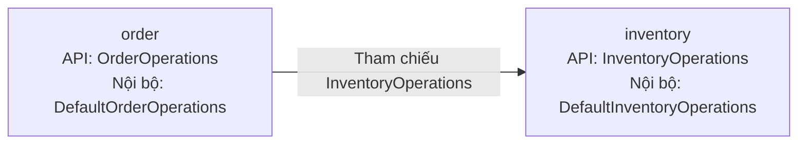
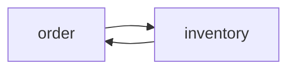

# ApplicationModules biểu diễn cấu trúc module như thế nào?

Trong Spring Boot, nhiều lớp có thể nằm chung một ứng dụng và cùng chạy trong một `ApplicationContext`. Tuy nhiên, không phải lớp nào cũng nên được phép phụ thuộc vào lớp nào. Spring Modulith cung cấp `ApplicationModules` để **đọc cấu trúc mã nguồn, xây dựng mô hình các application module và những ranh giới mà chúng phải tuân thủ**. Mô hình này là điểm khởi đầu cho việc kiểm chứng kiến trúc bằng `verify()`.

Bài học thuộc chương **Mô hình module** của chủ đề **SPRING_MODULITH_VERIFICATION_TESTING**. Mục tiêu xuyên suốt là hiểu mô hình `ApplicationModules` trước khi dùng nó kiểm tra quan hệ phụ thuộc giữa module, viết kiểm thử và đưa các quy tắc kiến trúc vào quality gate của CI.

## 1. Phân biệt ứng dụng, application module và ApplicationModules

Spring Modulith tổ chức một ứng dụng Spring Boot thành những đơn vị chức năng logic. Chẳng hạn, ứng dụng bán hàng có module `order` phụ trách đơn hàng và module `inventory` phụ trách tồn kho.

| Khái niệm | Ý nghĩa | Trong ví dụ |
| --- | --- | --- |
| Ứng dụng Spring Boot | Điểm bắt đầu để tìm phạm vi mã nguồn và cấu trúc module | `ShopApplication` thuộc package `com.acme.shop` |
| *Application module* | Một đơn vị nghiệp vụ có API cung cấp, phần cài đặt nội bộ và các phụ thuộc cần dùng | `order`, `inventory` |
| `ApplicationModule` | Đối tượng mô tả **một** module được phát hiện | Module `order` với package gốc, các kiểu, các interface và quan hệ phụ thuộc |
| `ApplicationModules` | Đối tượng chứa và cho phép truy vấn **tập hợp** `ApplicationModule` của ứng dụng | Mô hình gồm `order` và `inventory` |

Điểm quan trọng: module ở đây là **ranh giới kiến trúc logic**, không bắt buộc trùng với module của Maven, Gradle hay Java Platform Module System (JPMS). `ApplicationModules` là mô hình phân tích được từ mã nguồn/bytecode, **không phải** một `ApplicationContext` được khởi động để chạy nghiệp vụ.

Mỗi application module có ba góc nhìn:

- **Provided interface (API cung cấp):** những kiểu, Spring bean hoặc sự kiện mà module chủ động công khai để module khác sử dụng.
- **Internal implementation (cài đặt nội bộ):** những kiểu phục vụ riêng cho module, không được module khác truy cập trực tiếp trong mô hình module đóng mặc định.
- **Required interface (API cần dùng):** các phụ thuộc ra ngoài của module, ví dụ module `order` tham chiếu đến API của `inventory`.

`ApplicationModules` kết hợp những thông tin này thành bức tranh tổng thể: **module nào tồn tại, đâu là phần được phép sử dụng, và module nào đang phụ thuộc vào module nào**.

## 2. ApplicationModules phát hiện ranh giới module từ package

Với cách phát hiện mặc định, mỗi **sub-package trực tiếp** dưới package chứa lớp Spring Boot chính được coi là một application module.

Giả sử mã nguồn được bố trí như sau:

```text
src/main/java/
└── com/acme/shop/
    ├── ShopApplication.java
    ├── order/
    │   ├── package-info.java
    │   ├── OrderOperations.java
    │   └── internal/
    │       └── DefaultOrderOperations.java
    └── inventory/
        ├── InventoryOperations.java
        └── internal/
            ├── DefaultInventoryOperations.java
            └── InventoryRepository.java
```

Khi phân tích lớp `com.acme.shop.ShopApplication`, Spring Modulith mặc định suy ra:

1. `com.acme.shop.order` là module có tên logic `order`.
2. `com.acme.shop.inventory` là module có tên logic `inventory`.
3. `order.internal` và `inventory.internal` là **các package nội bộ của module cha**, không tự động trở thành hai module ngang hàng.
4. Những kiểu `public` trong package gốc của từng module có thể thuộc API được công khai; các kiểu trong package con mặc định là nội bộ.

Ví dụ về lớp ứng dụng:

```java
package com.acme.shop;

import org.springframework.boot.autoconfigure.SpringBootApplication;

@SpringBootApplication
public class ShopApplication {
}
```

Tạo mô hình bằng API của `spring-modulith-core`:

```java
package com.acme.shop;

import org.springframework.modulith.core.ApplicationModules;

public class InspectModules {

    public static void main(String[] args) {
        ApplicationModules modules =
                ApplicationModules.of(ShopApplication.class);

        modules.forEach(System.out::println);
    }
}
```

Lời gọi `ApplicationModules.of(ShopApplication.class)` tạo mô hình **trong bộ nhớ** dựa trên package của lớp được truyền vào và cấu hình Spring Modulith liên quan (nếu có). Khi in các `ApplicationModule`, người phát triển có thể nhìn thấy tên logic, package gốc, những Spring bean được nhận diện và cách công khai/nội bộ của chúng. Phân tích này không đòi hỏi gọi `SpringApplication.run(...)`.

> **Phạm vi áp dụng:** quy tắc “sub-package trực tiếp” là **mặc định**. Dự án có thể đổi cách phát hiện bằng `spring.modulith.detection-strategy=explicitly-annotated`, tùy biến `ApplicationModuleDetectionStrategy` hoặc khai báo thêm package gốc. Vì vậy cần đối chiếu cấu hình thực tế khi một package không xuất hiện như dự kiến.

## 3. Mô hình hoá API và phần cài đặt nội bộ

Trong ví dụ này, `inventory` công khai hợp đồng kiểm tra tồn kho:

```java
// com/acme/shop/inventory/InventoryOperations.java
package com.acme.shop.inventory;

public interface InventoryOperations {
    boolean isAvailable(String sku);
}
```

Phần hiện thực nằm ở package con `inventory.internal`:

```java
// com/acme/shop/inventory/internal/DefaultInventoryOperations.java
package com.acme.shop.inventory.internal;

import com.acme.shop.inventory.InventoryOperations;
import org.springframework.stereotype.Service;

@Service
class DefaultInventoryOperations implements InventoryOperations {

    @Override
    public boolean isAvailable(String sku) {
        // Minh họa; ứng dụng thực tế sẽ truy vấn dữ liệu tồn kho.
        return true;
    }
}
```

Module `order` có hợp đồng công khai tương tự:

```java
// com/acme/shop/order/OrderOperations.java
package com.acme.shop.order;

public interface OrderOperations {
    void placeOrder(String sku);
}
```

Phần hiện thực của `order` gọi qua **API được công khai** của `inventory`:

```java
// com/acme/shop/order/internal/DefaultOrderOperations.java
package com.acme.shop.order.internal;

import com.acme.shop.inventory.InventoryOperations;
import com.acme.shop.order.OrderOperations;
import org.springframework.stereotype.Service;

@Service
class DefaultOrderOperations implements OrderOperations {

    private final InventoryOperations inventory;

    DefaultOrderOperations(InventoryOperations inventory) {
        this.inventory = inventory;
    }

    @Override
    public void placeOrder(String sku) {
        if (!inventory.isAvailable(sku)) {
            throw new IllegalStateException("Hết hàng: " + sku);
        }
        // Xử lý tạo đơn hàng được lược giản để tập trung vào ranh giới module.
    }
}
```

Với cách tổ chức này:

| Thành phần | Module sở hữu | Phân loại mặc định | Có thể được module khác tham chiếu? |
| --- | --- | --- | --- |
| `inventory.InventoryOperations` | `inventory` | API ở package gốc, kiểu `public` | Có, nếu quan hệ phụ thuộc được cho phép |
| `inventory.internal.DefaultInventoryOperations` | `inventory` | Cài đặt nội bộ | Không |
| `inventory.internal.InventoryRepository` | `inventory` | Cài đặt nội bộ | Không |
| `order.OrderOperations` | `order` | API ở package gốc, kiểu `public` | Có, nếu quan hệ phụ thuộc được cho phép |
| `order.internal.DefaultOrderOperations` | `order` | Cài đặt nội bộ | Không |

Spring Modulith cho phép một lớp nội bộ của **chính module đó** sử dụng API hoặc cài đặt nội bộ khác trong cùng module. Quy tắc hạn chế được áp dụng cho **tham chiếu vượt ranh giới module**. Nếu một lớp nội bộ được khai báo `public` để thuận tiện sử dụng giữa các package bên trong cùng module, điều đó **không tự động** biến lớp đó thành API hợp lệ cho module khác.

## 4. Biểu diễn cấu trúc như đồ thị phụ thuộc

Khi lớp `DefaultOrderOperations` có constructor nhận `InventoryOperations`, mô hình nhận diện quan hệ phụ thuộc ở cấp module:



Mũi tên **`order → inventory`** có nghĩa là mã nguồn của `order` đang tham chiếu đến kiểu thuộc `inventory`. Nó **không** có nghĩa `order` sở hữu `inventory`, và cũng **không** phải luồng gọi runtime bắt buộc cho mọi request.

Một cách đọc mô hình hữu ích:

- **Nút:** một `ApplicationModule` đã được phát hiện, cùng package gốc, API và kiểu nội bộ.
- **Cạnh hướng:** tham chiếu từ kiểu của module nguồn đến kiểu thuộc module đích, được quy về quan hệ giữa hai module.
- **Quy tắc cạnh hợp lệ:** đích phải là API được công khai và phải nằm trong tập phụ thuộc được cho phép nếu module nguồn có khai báo `allowedDependencies`.
- **Quy tắc toàn đồ thị:** quan hệ phụ thuộc giữa các application module không được tạo chu trình.

Vì `ApplicationModules` dựa trên phân tích mã, mô hình có thể phát hiện lỗi ngay trong một bài kiểm thử kiến trúc, trước khi người dùng đi qua luồng nghiệp vụ gây ra lỗi. Ngược lại, những quan hệ chỉ phát sinh động qua reflection hoặc cấu hình runtime không nhất thiết được biểu diễn đầy đủ bởi phân tích phụ thuộc tĩnh.

## 5. Khai báo những phụ thuộc nào được phép

Theo mặc định, một module có thể tham chiếu API công khai của module khác miễn không vi phạm các quy tắc cấu trúc. Để siết ranh giới, hãy khai báo `@ApplicationModule(allowedDependencies = ...)` trong `package-info.java` của **module đi gọi**.

Ví dụ, `order` chỉ được phụ thuộc vào `inventory`:

```java
// com/acme/shop/order/package-info.java
@org.springframework.modulith.ApplicationModule(
    allowedDependencies = "inventory"
)
package com.acme.shop.order;
```

Khi đó:

- `order.internal.DefaultOrderOperations` tham chiếu `inventory.InventoryOperations` là **hợp lệ**, vì `inventory` được cho phép và kiểu đích nằm trong API công khai.
- `order` tham chiếu trực tiếp `inventory.internal.InventoryRepository` là **không hợp lệ**, dù `order` có liệt kê `inventory` trong `allowedDependencies`.
- `order` tham chiếu API của một module `payment` mới là **không hợp lệ** nếu chưa bổ sung `payment` vào danh sách được phép.

`allowedDependencies` mô tả **các module (hoặc named interface) mà một module được quyền dùng**, không biến mọi kiểu nằm trong module đích thành public API. Hai phép kiểm tra “được phép phụ thuộc module nào?” và “được phép dùng kiểu nào của module đó?” bổ sung cho nhau.

### Khi cần công khai API nằm trong package con: Named Interface

Đôi khi module `inventory` muốn công khai nhóm sự kiện tại package `inventory.events`, mặc dù đây là package con. Trong trường hợp đó, sử dụng `@NamedInterface`:

```java
// com/acme/shop/inventory/events/package-info.java
@org.springframework.modulith.NamedInterface("events")
package com.acme.shop.inventory.events;
```

Giả sử package này chứa kiểu `public record StockChanged(String sku)`. Module `order` có thể được cho phép sử dụng **cả API ở package gốc và named interface `events`** như sau:

```java
// com/acme/shop/order/package-info.java
@org.springframework.modulith.ApplicationModule(
    allowedDependencies = {"inventory", "inventory :: events"}
)
package com.acme.shop.order;
```

Chuỗi `inventory :: events` chỉ named interface `events` của module `inventory`. Nó không mặc nhiên cho phép dùng API ở package gốc; nếu cần cả hai thì khai báo cả `inventory` như ví dụ. Không đánh dấu `internal` thành named interface chỉ để che một vi phạm: hãy xác định đó có thực sự là hợp đồng cần công khai lâu dài hay không.

### Hai biến thể mô hình cần biết

- **Nested application module:** có thể khai báo một package con thành module lồng nhau bằng `@ApplicationModule` để quản lý ranh giới bên trong module lớn. Package con thông thường vẫn chỉ là package nội bộ.
- **Open application module:** `@ApplicationModule(type = Type.OPEN)` nới quy tắc che giấu kiểu nội bộ, hữu ích khi chuyển đổi mã nguồn cũ; sự nới lỏng này cần được cân nhắc vì làm yếu tính đóng gói.

Đối với ứng dụng mới, nên bắt đầu từ module đóng mặc định, công khai API tối thiểu và dùng named interface khi có lý do rõ ràng.

## 6. Truy vấn mô hình ApplicationModules

Ngoài việc in mô hình, ta có thể truy vấn nó để kiểm tra cấu trúc được phát hiện:

```java
package com.acme.shop;

import org.junit.jupiter.api.Test;
import org.springframework.modulith.core.ApplicationModules;

import static org.junit.jupiter.api.Assertions.assertTrue;

class ModuleDiscoveryTest {

    @Test
    void discoversBusinessModules() {
        ApplicationModules modules = ApplicationModules.of(ShopApplication.class);

        assertTrue(modules.getModuleByName("order").isPresent());
        assertTrue(modules.getModuleByName("inventory").isPresent());

        modules.forEach(System.out::println);
    }
}
```

Các thao tác thường dùng:

| API | Vai trò |
| --- | --- |
| `ApplicationModules.of(ShopApplication.class)` | Xây dựng mô hình từ điểm gốc ứng dụng |
| `modules.forEach(...)` hoặc `modules.stream()` | Duyệt tập các `ApplicationModule` |
| `modules.getModuleByName("order")` | Tìm module theo tên logic; kết quả là `Optional<ApplicationModule>` |
| `modules.getModuleByType(InventoryOperations.class)` | Tìm module sở hữu một kiểu Java cụ thể |
| `modules.verify()` | Áp dụng các quy tắc kiến trúc và ném ngoại lệ nếu phát hiện vi phạm |
| `modules.detectViolations()` | Lấy tập vi phạm để xử lý/chẩn đoán theo nhu cầu |

Lưu ý: bài kiểm tra phát hiện module chỉ xác nhận mô hình có các nút mong đợi. Muốn bảo vệ **ranh giới phụ thuộc**, cần gọi `verify()`.

## 7. Từ mô hình đến phép kiểm chứng kiến trúc

Spring Modulith sử dụng ArchUnit để kiểm tra những quan hệ giữa các kiểu trong mô hình. Với cấu hình mặc định, `verify()` quan tâm tới ba nhóm quy tắc cốt lõi:

1. **Không có phụ thuộc vòng giữa application module.** Ví dụ `order → inventory → order` tạo chu trình và phải được loại bỏ.
2. **Không truy cập kiểu nội bộ từ module khác.** Ví dụ `order` không thể phụ thuộc trực tiếp vào `inventory.internal.InventoryRepository`, kể cả khi kiểu Java đó được khai báo `public`.
3. **Tôn trọng `allowedDependencies` nếu được khai báo.** Ví dụ `order` chỉ cho phép `inventory` thì tham chiếu sang `payment` là vi phạm.

Các quy tắc bổ sung có thể phụ thuộc vào thư viện có mặt trên classpath, ví dụ tích hợp quy tắc kiến trúc của jMolecules.

Đặt bài kiểm thử sau trong `src/test/java/com/acme/shop/ModuleArchitectureTest.java`:

```java
package com.acme.shop;

import org.junit.jupiter.api.Test;
import org.springframework.modulith.core.ApplicationModules;

class ModuleArchitectureTest {

    @Test
    void verifiesModuleBoundaries() {
        ApplicationModules.of(ShopApplication.class).verify();
    }
}
```

Đây là kiểm thử cấu trúc, không cần khởi động toàn bộ ứng dụng bằng `@SpringBootTest`. Nếu các tham chiếu vượt ranh giới trái quy tắc, `verify()` làm test thất bại và thông báo module, kiểu/quan hệ gây vi phạm để người phát triển tìm nguyên nhân.

### Tình huống lỗi 1: xuyên thủng lớp nội bộ

Ví dụ **cố tình sai**, viết ở package của `order`:

```java
package com.acme.shop.order.internal;

import com.acme.shop.inventory.internal.InventoryRepository;

// Giả sử InventoryRepository được khai báo public nên Java vẫn biên dịch.
class DirectInventoryAccess {
    private final InventoryRepository repository;

    DirectInventoryAccess(InventoryRepository repository) {
        this.repository = repository;
    }
}
```

Vì `InventoryRepository` thuộc `inventory.internal`, `verify()` phát hiện `order` đang tham chiếu kiểu **không được công khai** của `inventory`. Cách sửa đúng là để `inventory` cung cấp một thao tác qua `InventoryOperations` hoặc hợp đồng API phù hợp, rồi cho `order` sử dụng hợp đồng đó.

### Tình huống lỗi 2: sinh chu trình phụ thuộc

Giả sử `order` gọi `inventory.InventoryOperations`; sau đó một lớp trong `inventory` lại inject `order.OrderOperations`:



Ngay cả khi cả hai chiều đều gọi qua kiểu thuộc API package, đồ thị module vẫn có chu trình. Khi đó cần xem lại chiều phụ thuộc nghiệp vụ: có thể chuyển trách nhiệm điều phối về `order`, phát sự kiện cho phía còn lại quan sát, hoặc thiết kế lại hợp đồng ở module phù hợp. Không nên “chữa” bằng cách mở toàn bộ module.

### Phân biệt các phép kiểm thử

| Loại | Câu hỏi chính | Ví dụ công cụ |
| --- | --- | --- |
| Kiểm chứng kiến trúc | “Package, API và chiều phụ thuộc có đúng thiết kế?” | `ApplicationModules.of(...).verify()` |
| Kiểm thử tích hợp theo module | “Một module hoạt động đúng khi chạy trong Spring context với các phụ thuộc được lựa chọn?” | `@ApplicationModuleTest` |
| Kiểm thử sự kiện, DB, hệ thống | “Event được xử lý, dữ liệu được ghi và các luồng nghiệp vụ chạy đúng?” | JUnit, Spring Test, công cụ kiểm thử tích hợp |

`verify()` là **hàng rào cho cấu trúc**; nó không thay thế kiểm thử logic nghiệp vụ, tính nhất quán dữ liệu hoặc việc xử lý sự kiện bất đồng bộ. Tuy nhiên, khi tích hợp bài kiểm thử cấu trúc vào lệnh chạy test của CI, mọi thay đổi tạo phụ thuộc sai sẽ làm quality gate thất bại trước khi hợp nhất mã.

## 8. Thực hành ngắn: tự đọc một mô hình module

Cho cấu trúc sau:

```text
com.acme.shop
├── ShopApplication.java
├── catalog
│   ├── ProductQuery.java
│   └── internal/ProductJpaRepository.java
├── checkout
│   ├── CheckoutFacade.java
│   └── internal/CheckoutService.java
└── shipping
    ├── ShippingGateway.java
    └── internal/ShippingAdapter.java
```

Giả sử `CheckoutService` phụ thuộc vào `ProductQuery` và `ShippingGateway`, còn các module khác không tham chiếu ngược sang `checkout`.

**Yêu cầu tự kiểm tra:**

1. `ApplicationModules` phát hiện bao nhiêu application module theo mặc định?
2. Những kiểu nào là API công khai ở package gốc? `ProductJpaRepository` có được `checkout` gọi trực tiếp không?
3. Đồ thị phụ thuộc phải có những cạnh nào? Có chu trình không?
4. Nếu khai báo `@ApplicationModule(allowedDependencies = "catalog")` cho `checkout`, quan hệ nào trở thành vi phạm?

**Đáp án gợi ý:**

1. Ba module: `catalog`, `checkout` và `shipping`.
2. Các kiểu `public` tại package gốc như `ProductQuery`, `CheckoutFacade`, `ShippingGateway` có thể là API; `ProductJpaRepository` thuộc `catalog.internal` và không được gọi trực tiếp từ `checkout`.
3. Hai cạnh là `checkout → catalog` và `checkout → shipping`; theo giả thiết không có chu trình.
4. Cạnh `checkout → shipping` vi phạm vì `shipping` không nằm trong `allowedDependencies`, dù `ShippingGateway` là kiểu API công khai.

## 9. Checklist khi đọc và bảo vệ mô hình

- Lớp gốc được truyền vào `ApplicationModules.of(...)` có nằm đúng package bao trùm các module nghiệp vụ không?
- Mỗi module có một nhiệm vụ rõ ràng? Những lớp nên công khai đã đặt tại API package hoặc named interface được thiết kế chủ đích?
- Có lớp nào ở module khác đang import kiểu thuộc `.internal` không?
- Các cạnh phụ thuộc có đi đúng chiều và không tạo vòng không?
- `allowedDependencies` có mô tả các quan hệ được phép theo thiết kế không?
- Bài kiểm thử `verify()` có chạy trong CI và làm pipeline thất bại khi phát sinh vi phạm không?

**Ghi nhớ:** `ApplicationModules` là **bản đồ kiến trúc có thể kiểm chứng**. Nó chuyển cấu trúc package và quan hệ tham chiếu giữa các kiểu thành một tập `ApplicationModule` cùng đồ thị phụ thuộc; `verify()` dùng bản đồ đó để bảo vệ ranh giới trước các thay đổi mã nguồn.

## Tài liệu tham khảo

- [Spring Modulith — Fundamentals: Application Modules](https://docs.spring.io/spring-modulith/reference/fundamentals.html)
- [Spring Modulith — Verifying Application Module Structure](https://docs.spring.io/spring-modulith/reference/verification.html)
- [Java API: `ApplicationModules`](https://docs.spring.io/spring-modulith/docs/current/api/org/springframework/modulith/core/ApplicationModules.html)
