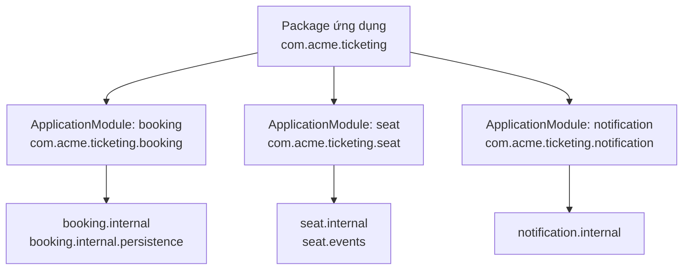
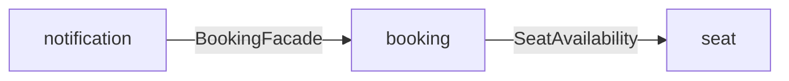

# ApplicationModule đại diện cho một vùng package ra sao?

Trong một ứng dụng Spring Boot, **package** thường được dùng để nhóm mã nguồn, nhưng tên package tự nó chưa diễn đạt đầy đủ đâu là ranh giới nghiệp vụ. Spring Modulith xây dựng mô hình **application module** dựa trên cấu trúc package, rồi biểu diễn từng module bằng một đối tượng `ApplicationModule`. Đối tượng này giúp trả lời ba câu hỏi quan trọng: **module nằm ở đâu, sở hữu những lớp nào, và phần nào được phép sử dụng từ bên ngoài?**

Bài học thuộc chương **Mô hình module** của **SPRING_MODULITH_VERIFICATION_TESTING**. Việc đọc đúng một `ApplicationModule` là nền tảng để kiểm chứng ranh giới kiến trúc bằng `ApplicationModules.verify()`, hiểu phạm vi của `@ApplicationModuleTest`, và đưa kiểm tra phụ thuộc sai vào quality gate CI. Các bài thực hành kiểm thử sự kiện, cơ sở dữ liệu và tích hợp sẽ dựa trên mô hình module đã được nhận diện chính xác.

## 1. Phân biệt package Java và ApplicationModule

Một Java package là không gian tên: nó tổ chức mã và chi phối khả năng truy cập `public`, `protected`, package-private và `private` theo quy tắc Java. Một **application module** là ranh giới kiến trúc mà Spring Modulith suy ra hoặc được cấu hình để nhận diện.

| Đối tượng | Đại diện cho | Ví dụ |
| --- | --- | --- |
| Java package | Một không gian tên, có thể chứa lớp hoặc package con | `com.acme.ticketing.booking.internal` |
| Vùng package của module | Package gốc của một chức năng cùng các package con thuộc phạm vi của nó | `com.acme.ticketing.booking` và các package con |
| `ApplicationModule` | Mô hình **một** module: danh tính, package gốc, các kiểu, API và phụ thuộc | Module `booking` |
| `ApplicationModules` | Tập hợp nhiều đối tượng `ApplicationModule` của ứng dụng | `booking`, `seat`, `notification` |

Do đó, **không nên hiểu một `ApplicationModule` là một Java package đơn lẻ**. Mô hình thường bao quát **cả một cây package** bắt đầu tại package gốc của module. Các package con thông thường góp phần tạo nên cùng một đơn vị nghiệp vụ.

Mô hình này độc lập với việc dự án có tách thành nhiều Maven/Gradle module hay không. Một ứng dụng Spring Boot đơn khối vẫn có thể chứa nhiều application module có ranh giới rõ ràng.

## 2. Ví dụ: ba vùng package trong ứng dụng đặt vé

Giả sử một ứng dụng đặt vé có lớp Spring Boot chính tại `com.acme.ticketing`:

```text
src/main/java/
└── com/acme/ticketing/
    ├── TicketingApplication.java
    ├── booking/
    │   ├── BookingFacade.java
    │   ├── BookingId.java
    │   └── internal/
    │       ├── DefaultBookingFacade.java
    │       ├── Booking.java
    │       └── persistence/
    │           └── BookingRepository.java
    ├── seat/
    │   ├── SeatAvailability.java
    │   ├── SeatId.java
    │   ├── events/
    │   │   └── SeatReserved.java
    │   └── internal/
    │       └── SeatReservationService.java
    └── notification/
        ├── NotificationOperations.java
        └── internal/
            └── EmailNotificationSender.java
```

Lớp gốc:

```java
package com.acme.ticketing;

import org.springframework.boot.autoconfigure.SpringBootApplication;

@SpringBootApplication
public class TicketingApplication {
}
```

Theo chiến lược phát hiện module mặc định, **mỗi sub-package trực tiếp** dưới package ứng dụng là một application module:

| Package | Là module độc lập theo mặc định? | Giải thích |
| --- | --- | --- |
| `com.acme.ticketing.booking` | Có: `booking` | Sub-package trực tiếp của package ứng dụng |
| `com.acme.ticketing.seat` | Có: `seat` | Sub-package trực tiếp |
| `com.acme.ticketing.notification` | Có: `notification` | Sub-package trực tiếp |
| `com.acme.ticketing.booking.internal` | Không | Thuộc vùng package của `booking` |
| `com.acme.ticketing.booking.internal.persistence` | Không | Vẫn thuộc `booking` dù sâu thêm một cấp |
| `com.acme.ticketing.seat.events` | Không | Thuộc `seat`; có thể được khai báo là một *named interface* |

Như vậy, mô hình mặc định có **ba** đối tượng `ApplicationModule`, không phải một module cho mỗi dòng trong cây thư mục.



Các mũi tên từ một module đến package con trong hình biểu thị **quan hệ bao chứa**, không phải phụ thuộc giữa các module. Phụ thuộc được xem xét riêng khi một kiểu thuộc module này tham chiếu kiểu thuộc module khác.

### Quy tắc xác định phạm vi sở hữu

Với cấu hình mặc định, mọi kiểu thuộc `com.acme.ticketing.booking` **hoặc một package con của nó** được xem là nằm trong vùng mã nguồn do module `booking` quản lý:

```text
com.acme.ticketing.booking.BookingFacade             -> booking
com.acme.ticketing.booking.BookingId                 -> booking
com.acme.ticketing.booking.internal.Booking          -> booking
com.acme.ticketing.booking.internal.persistence.*    -> booking

com.acme.ticketing.seat.SeatAvailability             -> seat
com.acme.ticketing.seat.internal.SeatReservationService -> seat
```

Việc nhận diện dựa trên **package của kiểu Java**, không căn cứ vào tiền tố tên lớp hoặc Spring stereotype. Một `record`, entity JPA, interface hoặc lớp tiện ích thuộc một vùng package vẫn là thành phần của vùng đó, kể cả khi bản thân nó không được đăng ký làm Spring bean.

Từ “sở hữu” trong ngữ cảnh này là **sở hữu về kiến trúc**, không phải quyền sở hữu file ở hệ điều hành. Spring Modulith phân tích mô hình và phát hiện vi phạm, chứ không tự di chuyển source file sang package khác.

## 3. Một module có package gốc và các package nội bộ

Với module `booking`, package `com.acme.ticketing.booking` đóng vai trò **base package**. Vùng này có thể chia thành:

1. **Base package:** nơi đặt các kiểu dự kiến công khai để module khác gọi.
2. **Các package con:** nơi tổ chức việc triển khai nội bộ như domain, application service, repository, adapter.
3. **Named interface (nếu khai báo):** phần API được công khai có chủ đích từ một hoặc nhiều package con.

Ví dụ module `booking` có API công khai:

```java
// com/acme/ticketing/booking/BookingFacade.java
package com.acme.ticketing.booking;

public interface BookingFacade {
    BookingId createBooking(String customerId, String seatCode);
}
```

Và giá trị kết quả cũng nằm ở API:

```java
// com/acme/ticketing/booking/BookingId.java
package com.acme.ticketing.booking;

import java.util.UUID;

public record BookingId(UUID value) {
}
```

Cài đặt nghiệp vụ có thể nằm trong `booking.internal`:

```java
// com/acme/ticketing/booking/internal/DefaultBookingFacade.java
package com.acme.ticketing.booking.internal;

import com.acme.ticketing.booking.BookingFacade;
import com.acme.ticketing.booking.BookingId;
import com.acme.ticketing.seat.SeatAvailability;
import org.springframework.stereotype.Service;
import java.util.UUID;

@Service
class DefaultBookingFacade implements BookingFacade {

    private final SeatAvailability seats;

    DefaultBookingFacade(SeatAvailability seats) {
        this.seats = seats;
    }

    @Override
    public BookingId createBooking(String customerId, String seatCode) {
        if (!seats.isAvailable(seatCode)) {
            throw new IllegalStateException("Ghế không khả dụng");
        }

        // Demo mô hình module; việc lưu booking và giữ ghế chưa được triển khai.
        return new BookingId(UUID.randomUUID());
    }
}
```

Interface mà `booking` cần dùng thuộc package gốc của module `seat`:

```java
// com/acme/ticketing/seat/SeatAvailability.java
package com.acme.ticketing.seat;

public interface SeatAvailability {
    boolean isAvailable(String seatCode);
}
```

Trong ví dụ này, `DefaultBookingFacade` thuộc **module `booking`** nhưng sử dụng `SeatAvailability` thuộc **module `seat`**. Mô hình ghi nhận một phụ thuộc từ `booking` đến `seat`.

### Public trong Java chưa chắc là API của module

Đây là điểm dễ nhầm nhất:

| Vị trí kiểu Java | Kiểu được khai báo `public`? | Có phải API công khai theo mặc định của module? |
| --- | --- | --- |
| `booking.BookingFacade` | Có | Có |
| `booking.BookingId` | Có | Có |
| `booking.internal.Booking` | Có hoặc không | Không |
| `booking.internal.persistence.BookingRepository` | Có hoặc không | Không |
| `seat.events.SeatReserved` | Có | Chưa, nếu chưa khai báo named interface |

**Java access modifier** quyết định chương trình có biên dịch được phép truy cập hay không. **Spring Modulith** đặt thêm quy tắc ranh giới ở cấp application module: một kiểu dù `public` nhưng ở package nội bộ vẫn không được module khác phụ thuộc trực tiếp trong mô hình module đóng mặc định.

Chẳng hạn, đổi `BookingRepository` thành `public` để module `notification` import trực tiếp có thể giúp Java biên dịch, nhưng sẽ bị phát hiện là xâm phạm nội bộ của `booking` khi xác minh kiến trúc.

## 4. Một ApplicationModule lưu những thông tin gì?

`ApplicationModule` là **đối tượng mô tả kiến trúc** do Spring Modulith tạo ra từ mã nguồn. Không cần thêm `@ApplicationModule` lên từng class nghiệp vụ để class đó “gia nhập” module.

Về mặt khái niệm, mô hình của `booking` chứa các nhóm thông tin sau:

| Nhóm thông tin | Ví dụ với `booking` | Giá trị khi kiểm chứng |
| --- | --- | --- |
| Danh tính module | `booking`, tên hiển thị tùy chọn | Định danh module trong báo cáo và quy tắc phụ thuộc |
| Base package | `com.acme.ticketing.booking` | Xác định vùng sở hữu |
| Các kiểu trong module | `BookingFacade`, `BookingId`, `DefaultBookingFacade`, `BookingRepository` | Phân biệt mã nội bộ và mã của module khác |
| API được công khai | Các kiểu `public` ở base package và named interface hợp lệ | Kiểm tra tham chiếu xuyên module |
| Các package con | `internal`, `internal.persistence` | Phân vùng cài đặt bên trong |
| Phụ thuộc ra ngoài | `booking → seat` | Kiểm tra chu trình, ranh giới và danh sách được phép |
| Metadata khai báo | Display name, `allowedDependencies`, loại module | Áp dụng các quy tắc thiết kế bổ sung |

Một `ApplicationModule` không phải Spring bean và không phải runtime container dành riêng cho module. Nó cũng không tương đương với package `@Configuration`. Spring Modulith sử dụng mô hình này để phân tích kiến trúc trước hoặc cùng quá trình chạy kiểm thử phù hợp.

### Đọc một module từ tập ApplicationModules

Đưa `spring-modulith-core` vào dự án thông qua cơ chế quản lý dependency của Spring Modulith tương ứng với phiên bản Spring Boot. Sau đó có thể tạo và truy vấn mô hình:

```java
package com.acme.ticketing;

import org.springframework.modulith.core.ApplicationModule;
import org.springframework.modulith.core.ApplicationModules;

public class InspectBookingModule {

    public static void main(String[] args) {
        ApplicationModules modules =
                ApplicationModules.of(TicketingApplication.class);

        ApplicationModule booking = modules.getModuleByName("booking")
                .orElseThrow(() -> new IllegalStateException(
                        "Không phát hiện application module booking"
                ));

        System.out.println(booking);
        modules.forEach(System.out::println);
    }
}
```

`ApplicationModules.of(TicketingApplication.class)` lấy package của lớp ứng dụng làm điểm xuất phát theo cách phát hiện mặc định. `getModuleByName("booking")` tìm một **module logic**, còn `forEach(...)` cho phép khảo sát toàn bộ mô hình. Không cần gọi `SpringApplication.run(...)` chỉ để dựng và kiểm tra mô hình module.

Nếu kết quả không có `booking` như mong đợi, hãy kiểm tra package thật của `TicketingApplication`, vị trí đặt code và chiến lược phát hiện module trước khi tìm lỗi ở Spring bean scanning.

## 5. Khai báo metadata cho vùng package bằng package-info.java

Đối với module được phát hiện theo mặc định, file `package-info.java` và annotation `@ApplicationModule` **không bắt buộc** để module tồn tại. Khi cần mô tả rõ ý nghĩa hoặc hạn chế phụ thuộc, có thể dùng chúng:

```java
// com/acme/ticketing/booking/package-info.java
@org.springframework.modulith.ApplicationModule(
        displayName = "Quản lý đặt vé",
        allowedDependencies = "seat"
)
package com.acme.ticketing.booking;
```

Khai báo này gắn metadata ở **base package của module `booking`**:

- `displayName` đặt tên hiển thị dễ đọc trong tài liệu/đầu ra; danh tính logic mặc định vẫn là `booking`.
- `allowedDependencies = "seat"` cho phép `booking` phụ thuộc vào API công khai của `seat`; nếu `booking` tham chiếu một module khác không được liệt kê, kiểm chứng sẽ phát hiện.
- Danh sách được phép **không** tự công khai các kiểu thuộc `seat.internal`.

Nếu `booking` cần sử dụng thêm API của `notification`, thiết kế phải được xem xét rồi mới khai báo thêm dependency hợp lệ. Không nên mở quyền tùy tiện chỉ để làm qua bài kiểm tra.

### Khi package con là API: Named Interface

Giả sử `seat` có sự kiện miền `SeatReserved` đặt tại `com.acme.ticketing.seat.events`:

```java
// com/acme/ticketing/seat/events/SeatReserved.java
package com.acme.ticketing.seat.events;

public record SeatReserved(String seatCode, String bookingId) {
}
```

Vì `events` là package con, kiểu `SeatReserved` **chưa mặc nhiên** là API mà module khác được phụ thuộc. Để chủ động công khai giao diện này, thêm:

```java
// com/acme/ticketing/seat/events/package-info.java
@org.springframework.modulith.NamedInterface("events")
package com.acme.ticketing.seat.events;
```

Khi đó `seat :: events` là tên tham chiếu đến named interface `events` của module `seat`. Module `booking` có thể khai báo rõ cả API package gốc lẫn giao diện sự kiện:

```java
// com/acme/ticketing/booking/package-info.java
@org.springframework.modulith.ApplicationModule(
        displayName = "Quản lý đặt vé",
        allowedDependencies = {"seat", "seat :: events"}
)
package com.acme.ticketing.booking;
```

Điểm cần nhớ: **named interface vẫn thuộc application module `seat`**. Nó chỉ đánh dấu **một phần API được công khai của module đó**, không biến `seat.events` thành application module độc lập.

### Package tên `api` không có phép màu

Nếu dự án tổ chức:

```text
com.acme.ticketing.booking
├── api/BookingFacade.java
└── internal/DefaultBookingFacade.java
```

thì chỉ riêng cái tên `api` **không** khiến `booking.api` trở thành API công khai theo quy tắc mặc định. Cần đặt hợp đồng công khai ở package gốc `booking`, hoặc khai báo `booking.api` bằng `@NamedInterface`.

Sự phân biệt này giúp mô hình không phụ thuộc vào việc người phát triển tự đặt tên thư mục, và tránh công khai nhầm các lớp triển khai.

## 6. Vùng package quyết định cạnh phụ thuộc như thế nào?

Giả sử có các tham chiếu sau:

```text
booking.internal.DefaultBookingFacade
    -> booking.BookingFacade
    -> booking.BookingId
    -> seat.SeatAvailability

notification.internal.EmailNotificationSender
    -> booking.BookingFacade
```

Để hiểu đồ thị, hãy gán **mỗi kiểu về module sở hữu nó trước**, rồi bỏ qua những cạnh chỉ nối các kiểu trong cùng module:

| Tham chiếu | Module nguồn | Module đích | Kết quả trong đồ thị module |
| --- | --- | --- | --- |
| `DefaultBookingFacade → BookingFacade` | `booking` | `booking` | Nội bộ; không tạo cạnh liên module |
| `DefaultBookingFacade → BookingId` | `booking` | `booking` | Nội bộ; không tạo cạnh liên module |
| `DefaultBookingFacade → SeatAvailability` | `booking` | `seat` | `booking → seat` |
| `EmailNotificationSender → BookingFacade` | `notification` | `booking` | `notification → booking` |



Phép gán về vùng package giải thích vì sao một lớp nằm sâu trong `booking.internal.persistence` vẫn được xem là “bên trong `booking`”. Độ sâu package không thay đổi quyền sở hữu module, miễn không có cấu hình phát hiện khác hoặc ranh giới module lồng nhau được khai báo.

### Ví dụ vi phạm: dùng lớp nội bộ của module khác

Đoạn sau minh họa một lỗi kiến trúc, giả sử `SeatReservationService` được khai báo `public` để Java cho phép import:

```java
package com.acme.ticketing.booking.internal;

import com.acme.ticketing.seat.internal.SeatReservationService;

// VÍ DỤ CỐ TÌNH SAI VỀ KIẾN TRÚC
class DirectSeatReservation {
    private final SeatReservationService reservationService;

    DirectSeatReservation(SeatReservationService reservationService) {
        this.reservationService = reservationService;
    }
}
```

Kiểu đích thuộc **vùng package nội bộ của `seat`**. Cho dù Java có thể biên dịch, quy tắc ranh giới module mặc định không cho `booking` dùng nó trực tiếp. Giải pháp là đưa thao tác cần sử dụng vào API hợp lệ của `seat` hoặc một named interface có chủ đích.

## 7. Khi nào quy tắc “một sub-package là một module” thay đổi?

Spring Modulith hỗ trợ các biến thể phát hiện và mô hình hóa. Cần phân biệt **cơ chế mặc định** với cách đã tùy biến trong một dự án thực tế:

| Tình huống | Hệ quả khi đọc vùng package |
| --- | --- |
| Phát hiện mặc định | Các sub-package trực tiếp dưới package ứng dụng thường là những module ngang hàng |
| Chiến lược `explicitly-annotated` | Chỉ những package phù hợp quy tắc khai báo tường minh mới được phát hiện làm module; không nên giả định mọi sub-package đều xuất hiện |
| Chiến lược phát hiện tùy biến | Ranh giới có thể khác cấu trúc mặc định, cần xem cấu hình đã được ứng dụng chọn |
| Nested application module | Một vùng package con có thể trở thành ranh giới module lồng nhau nếu được cấu hình thích hợp; không phải mọi package con đều tự động là module |
| Named interface | Công khai một phần API trong package con nhưng vẫn thuộc cùng module |
| Open application module | Nới các ràng buộc đóng gói nội bộ theo chủ đích; cần cân nhắc tác động tới việc bảo vệ ranh giới |

Vì thế, khi khảo sát một codebase chưa quen, **đừng suy luận chỉ từ cây thư mục**. Hãy dựng `ApplicationModules` thật sự và xem những `ApplicationModule` nào được phát hiện.

## 8. Kiểm chứng mô hình bằng JUnit

Kiểm thử đầu tiên có thể xác minh những module chủ chốt được nhận diện:

```java
package com.acme.ticketing;

import org.junit.jupiter.api.Test;
import org.springframework.modulith.core.ApplicationModules;

import static org.junit.jupiter.api.Assertions.assertTrue;

class ModuleModelTest {

    @Test
    void recognizesExpectedPackageRegions() {
        ApplicationModules modules =
                ApplicationModules.of(TicketingApplication.class);

        assertTrue(modules.getModuleByName("booking").isPresent());
        assertTrue(modules.getModuleByName("seat").isPresent());
        assertTrue(modules.getModuleByName("notification").isPresent());
    }

    @Test
    void respectsArchitecturalBoundaries() {
        ApplicationModules.of(TicketingApplication.class).verify();
    }
}
```

Hai phép kiểm tra giải quyết hai câu hỏi khác nhau:

- `getModuleByName(...)`: mô hình đã phát hiện **đúng các vùng package** dự kiến hay chưa?
- `verify()`: phụ thuộc giữa những vùng đã phát hiện có tuân thủ quy tắc kiến trúc không?

Theo cấu hình kiểm chứng mặc định của Spring Modulith, `verify()` kiểm tra những nhóm vi phạm như phụ thuộc vòng giữa module, truy cập kiểu nội bộ và giới hạn `allowedDependencies`. Nó tạo lỗi cho bài kiểm thử khi phát hiện vi phạm. Bài kiểm thử này chủ yếu dựa trên cấu trúc mã, **không cần** khởi động đầy đủ Spring Boot context như `@SpringBootTest`.

### Liên hệ với @ApplicationModuleTest

`@ApplicationModuleTest` kiểm thử một module trong Spring Test context theo phạm vi module và cấu hình bootstrap được chọn. Việc test xác định **module nào là mục tiêu** dựa trên mô hình module của Spring Modulith; vì vậy nhận diện sai vùng package sẽ dẫn đến việc hiểu sai phạm vi kiểm thử.

Để tránh nhầm lẫn:

- `ApplicationModule` là **mô hình** một vùng mã nguồn;
- `@ApplicationModuleTest` là **cơ chế kiểm thử tích hợp** cho module;
- `verify()` là **phép kiểm chứng kiến trúc**, không thay thế kiểm tra hành vi sự kiện, transaction hay truy cập cơ sở dữ liệu.

Trong CI, cần đưa ít nhất bài kiểm thử `verify()` vào tập test bắt buộc trước khi hợp nhất mã. Các kiểm thử tích hợp và sự kiện bổ sung xác nhận module hoạt động đúng, còn mô hình package và quy tắc phụ thuộc giúp ngăn lớp từ module khác vô tình đi xuyên vào phần nội bộ.

## 9. Chẩn đoán khi ApplicationModule không giống cây package mong đợi

| Biểu hiện | Nguyên nhân thường gặp | Hướng kiểm tra |
| --- | --- | --- |
| Không tìm thấy module `booking` | Lớp gốc nằm ở package không bao trùm `booking`, hoặc chiến lược phát hiện khác mặc định | Kiểm tra package của lớp gốc và cấu hình phát hiện module |
| `booking.internal` không hiện thành module riêng | Đây là package con nội bộ theo mặc định | Không cần sửa nếu đó là chủ ý thiết kế |
| Class `public` trong `booking.internal` bị báo vi phạm | `public` của Java không có nghĩa là public API của Spring Modulith | Đổi cách gọi sang API của `booking`; không mở toàn bộ nội bộ |
| `booking.api` chưa được xem là API công khai | Tên package `api` chưa tạo named interface | Đặt kiểu công khai ở base package hoặc khai báo `@NamedInterface` |
| Phát sinh thêm module `common` ngoài dự kiến | `common` được đặt thành một sub-package trực tiếp trong vùng phát hiện mặc định | Quyết định đây có thực sự là module riêng, hoặc tổ chức lại package theo trách nhiệm |
| `verify()` báo chu trình | Hai hoặc nhiều vùng module tham chiếu nhau thành vòng | Xem chiều phụ thuộc, thay đổi hợp đồng hoặc tách trách nhiệm |

Một sai lầm phổ biến là chuyển mọi thứ về package `common` hoặc mở hàng loạt named interface để hết lỗi. Cách đó có thể che khuất ranh giới nghiệp vụ và làm cho sơ đồ module mất giá trị. Hãy quyết định API dựa trên **hợp đồng nghiệp vụ cần chia sẻ**, rồi mới cập nhật cấu trúc package.

## 10. Bài thực hành: xác định vùng package và API

Cho cấu trúc:

```text
com.acme.store
├── StoreApplication.java
├── catalog
│   ├── ProductLookup.java
│   ├── api
│   │   └── ProductView.java
│   └── internal
│       └── ProductJpaRepository.java
├── checkout
│   ├── CheckoutFacade.java
│   └── internal
│       └── CheckoutService.java
└── pricing
    ├── PriceQuote.java
    └── internal
        └── PriceCalculator.java
```

Giả thiết sử dụng cách phát hiện module mặc định, các kiểu trên đều khai báo `public`; chưa có named interface và chưa có cấu hình đặc biệt.

**Câu hỏi**

1. `ApplicationModules.of(StoreApplication.class)` phát hiện bao nhiêu module, và tên logic của chúng là gì?
2. `ProductJpaRepository` thuộc module nào? Tại sao `checkout` không được phụ thuộc trực tiếp vào nó?
3. `catalog.api.ProductView` đã là API công khai của `catalog` chưa, dù tên package là `api`?
4. `CheckoutService` tham chiếu `catalog.ProductLookup`. Cạnh nào xuất hiện trên đồ thị module?
5. Nếu muốn `checkout` sử dụng `catalog.api.ProductView`, hãy nêu hai cách tổ chức API phù hợp.

**Đáp án và giải thích**

1. Có ba module: `catalog`, `checkout` và `pricing`. Đây là ba sub-package trực tiếp dưới `com.acme.store`.
2. `ProductJpaRepository` thuộc vùng của `catalog`, nhưng ở package `catalog.internal`; tham chiếu từ `checkout` là truy cập nội bộ xuyên module.
3. Chưa. Package con `catalog.api` mặc định vẫn thuộc vùng nội bộ của `catalog`, dù kiểu bên trong là `public`.
4. Cạnh `checkout → catalog`, vì `CheckoutService` thuộc `checkout` còn `ProductLookup` thuộc `catalog`.
5. Chuyển `ProductView` về base package `catalog` **hoặc** khai báo `catalog.api` là named interface và cấu hình các phụ thuộc được phép nếu dự án giới hạn bằng `allowedDependencies`.

**Thử mở rộng:** chuyển `PriceCalculator` vào `pricing.domain.internal` rồi dựng lại mô hình. Trong cách phát hiện mặc định, số lượng module **không thay đổi**, vì kiểu đó vẫn nằm trong cây package thuộc `pricing`.

## 11. Tự đánh giá trước khi viết bài test kiến trúc

Kiểm tra lần lượt các điều sau:

1. Biết package gốc của ứng dụng và chiến lược nhận diện application module đang được dùng.
2. Xác định được base package và toàn bộ package con do mỗi `ApplicationModule` quản lý.
3. Phân biệt kiểu `public` theo Java với kiểu nằm trong API công khai của một application module.
4. Phân biệt một package con nội bộ, một named interface và một nested application module.
5. Hiểu cách Spring Modulith gom tham chiếu kiểu thành quan hệ phụ thuộc giữa hai module.
6. Có kiểm thử `ApplicationModules.of(...).verify()` trong CI, đồng thời có kế hoạch kiểm thử hành vi module với `@ApplicationModuleTest`.

**Ghi nhớ:** `ApplicationModule` đại diện cho **một vùng package thuộc về một trách nhiệm nghiệp vụ**. Package gốc định danh vùng; các package con thường là nội bộ; API được công khai có thể đến từ base package và named interface được khai báo. Phải xác định đúng vùng này trước khi đánh giá phụ thuộc giữa các module hay quyết định phạm vi kiểm thử tích hợp.

## Tài liệu tham khảo

- [Spring Modulith Reference — Application Modules](https://docs.spring.io/spring-modulith/reference/fundamentals.html)
- [Spring Modulith Reference — Verifying Application Module Structure](https://docs.spring.io/spring-modulith/reference/verification.html)
- [Spring Modulith Reference — Testing Application Modules](https://docs.spring.io/spring-modulith/reference/testing.html)
- [Spring Modulith API — ApplicationModule](https://docs.spring.io/spring-modulith/docs/current/api/org/springframework/modulith/core/ApplicationModule.html)
