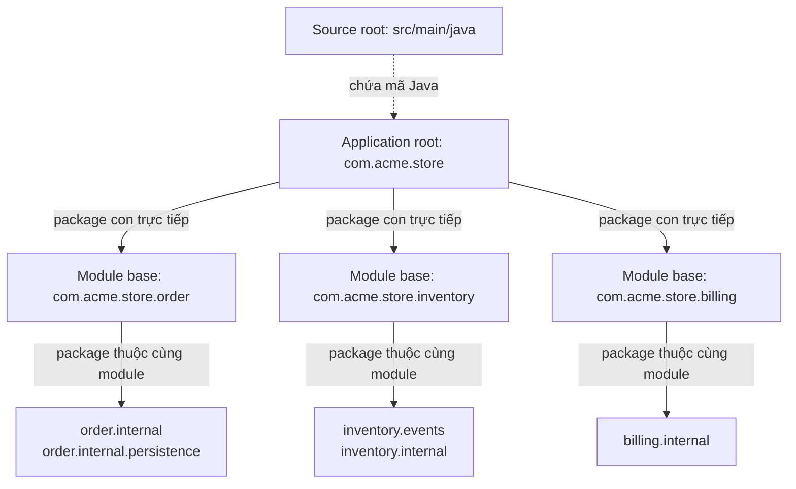
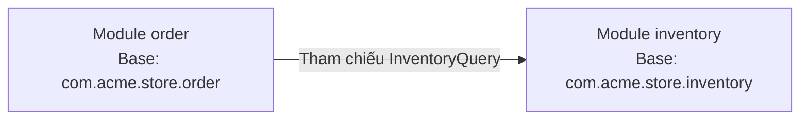

# JavaPackage và cách suy ra gốc module

Khi kiểm chứng kiến trúc của ứng dụng Spring Modulith, ta cần xác định chính xác **module bắt đầu ở package nào**, những lớp nào thuộc module đó và những package con có được coi là module riêng hay không. Spring Modulith sử dụng `JavaPackage` trong quá trình phân tích mã để mô hình hóa cấu trúc package, sau đó xác định các **base package** của application module.

Bài học thuộc chương **Mô hình module** của **SPRING_MODULITH_VERIFICATION_TESTING**. Hiểu cách suy ra gốc module giúp dùng `ApplicationModules.verify()` đúng phạm vi, lý giải việc `@ApplicationModuleTest` khởi tạo một nhóm thành phần nhất định, và thiết kế quality gate CI phát hiện phụ thuộc sai trước khi phát sinh hồi quy trong kiểm thử sự kiện, cơ sở dữ liệu hoặc tích hợp.

## 1. JavaPackage là gì?

`org.springframework.modulith.core.JavaPackage` là **lớp biểu diễn một Java package trong mô hình phân tích mã của Spring Modulith**. Nó cung cấp thông tin về tên package, các package con và các kiểu Java nằm trong phạm vi được biểu diễn. Spring Modulith xây dựng mô hình này với sự hỗ trợ của **ArchUnit** để suy ra các ranh giới và quan hệ phụ thuộc.

Không nên nhầm `JavaPackage` với hai khái niệm quen thuộc khác:

| Khái niệm | Vai trò | Điểm khác biệt |
| --- | --- | --- |
| Tên package trong mã Java | Khai báo không gian tên bằng `package com.acme.store.order;` | Là chuỗi định danh của kiểu Java |
| `java.lang.Package` | Metadata của package mà JVM cung cấp tại runtime | Không phải mô hình cây package phục vụ kiểm chứng kiến trúc |
| `org.springframework.modulith.core.JavaPackage` | Mô hình package, các kiểu và package con do Spring Modulith phân tích | Dùng để chọn gốc module và khảo sát phạm vi mã nguồn |
| `ApplicationModule` | Một module nghiệp vụ, với định danh, API, phần nội bộ và phụ thuộc | Sử dụng một `JavaPackage` làm base package của module |
| `ApplicationModules` | Tập các `ApplicationModule` cùng những package gốc đã phân tích | Cung cấp API truy vấn và `verify()` |

**Một `JavaPackage` không tự động bằng một `ApplicationModule`.** Cùng là đối tượng `JavaPackage`, package `com.acme.store` có thể là **gốc ứng dụng**, `com.acme.store.order` là **gốc module**, còn `com.acme.store.order.internal` là **package nội bộ của module**.

### “Gốc” là gốc nào?

Trong tài liệu và source code thường gặp ít nhất ba cách dùng chữ *root*:

1. **Source root:** thư mục của công cụ build, ví dụ `src/main/java`. Đây là vị trí file, **không** phải tên Java package.
2. **Application root package:** package của lớp ứng dụng Spring Boot dùng làm điểm bắt đầu phát hiện module, ví dụ `com.acme.store`.
3. **Module base package (gốc module):** package được chọn làm ranh giới đầu của một application module, ví dụ `com.acme.store.order`.

Trong phạm vi bài này, **“suy ra gốc module”** nghĩa là tìm các **module base package** từ một hoặc nhiều **application root package**.

## 2. Ví dụ đầy đủ: từ lớp ứng dụng đến ba module

Giả sử ứng dụng thương mại điện tử được tổ chức như sau:

```text
src/main/java/
└── com/acme/store/
    ├── StoreApplication.java
    ├── order/
    │   ├── OrderOperations.java
    │   ├── OrderId.java
    │   └── internal/
    │       ├── DefaultOrderOperations.java
    │       └── persistence/
    │           └── OrderRepository.java
    ├── inventory/
    │   ├── InventoryQuery.java
    │   ├── events/
    │   │   └── StockChanged.java
    │   └── internal/
    │       └── DefaultInventoryQuery.java
    └── billing/
        ├── BillingOperations.java
        └── internal/
            └── InvoiceService.java
```

Lớp ứng dụng nằm trong package `com.acme.store`:

```java
package com.acme.store;

import org.springframework.boot.autoconfigure.SpringBootApplication;

@SpringBootApplication
public class StoreApplication {
}
```

Tạo mô hình:

```java
package com.acme.store;

import org.springframework.modulith.core.ApplicationModules;

public class InspectModuleModel {

    public static void main(String[] args) {
        ApplicationModules modules =
                ApplicationModules.of(StoreApplication.class);

        modules.forEach(System.out::println);
    }
}
```

Với **chiến lược phát hiện mặc định**, Spring Modulith:

1. Xác định package của `StoreApplication` là `com.acme.store`.
2. Xem các **package con trực tiếp** của `com.acme.store` là ứng viên gốc module.
3. Tạo ba application module logic `order`, `inventory` và `billing`, tương ứng với ba gốc `com.acme.store.order`, `com.acme.store.inventory` và `com.acme.store.billing`.
4. Xem các package sâu hơn như `order.internal.persistence` hoặc `inventory.events` là phần của module cha theo mặc định.



**Lưu ý:** các mũi tên trong sơ đồ thể hiện quan hệ **vị trí package**, không biểu thị chiều phụ thuộc giữa các module. Đồ thị phụ thuộc kiến trúc chỉ hình thành khi kiểu thuộc module này tham chiếu kiểu thuộc module khác.

## 3. Quy tắc suy ra gốc module mặc định

Đặt:

- `R` là application root package: `com.acme.store`.
- `D(R)` là tập package con **trực tiếp** của `R`.
- `B` là tập module base package được chọn.

Với cấu hình mặc định:

```text
R = com.acme.store

D(R) = {
  com.acme.store.order,
  com.acme.store.inventory,
  com.acme.store.billing
}

B = D(R)
```

Ta không lấy mọi package con ở **mọi độ sâu** làm module độc lập. Ví dụ:

```text
com.acme.store.order                  -> base package của order
com.acme.store.order.internal         -> thuộc module order
com.acme.store.order.internal.persistence -> vẫn thuộc module order
```

Trường hợp không có cấu hình đặc biệt, việc một kiểu thuộc module nào được xác định theo ranh giới package:

```text
com.acme.store.order.OrderOperations
    -> order

com.acme.store.order.internal.OrderEntity
    -> order

com.acme.store.inventory.InventoryQuery
    -> inventory
```

Về nguyên tắc, phải so khớp **các đoạn tên package** (ngăn bởi dấu chấm), tránh suy luận bằng chuỗi tiền tố tùy tiện. Ví dụ `com.acme.store.ordering` **không** là package con của `com.acme.store.order` chỉ vì cả hai bắt đầu bằng các chữ “order”.

### Không nhầm “package được phát hiện” với “package được Spring scan”

`@SpringBootApplication` thường kéo theo cơ chế component scan. Tuy vậy, **Spring component scan** và **Spring Modulith module discovery** là hai cơ chế phục vụ hai mục đích khác nhau:

- Component scan quyết định những bean nào được tìm để đăng ký trong Spring context.
- Module discovery xác định những **vùng mã nguồn** nào trở thành application module phục vụ kiểm chứng cấu trúc.

Một `record`, entity JPA, class tiện ích hoặc interface có thể thuộc một module dù **không phải** Spring bean. Ngược lại, việc chỉnh `scanBasePackages` để tìm thêm Spring bean **không mặc nhiên đổi** application root package hoặc module base package dùng bởi `ApplicationModules.of(StoreApplication.class)`.

## 4. Những API JavaPackage cần biết

Các API dưới đây thuộc `org.springframework.modulith.core.JavaPackage`. Một số hàm trả đối tượng hoặc tập hợp liên quan đến kiểu của **ArchUnit** (`JavaClass`), không phải chỉ đơn giản trả `java.lang.Class<?>` của reflection.

| Phương thức | Tác dụng | Ví dụ kết quả |
| --- | --- | --- |
| `getName()` | Tên package đầy đủ | `com.acme.store.order` |
| `getLocalName()` | Đoạn cuối của tên package | `order` |
| `getDirectSubPackages()` | Tập package con trực tiếp | `order.internal` từ `order` |
| `getTrailingName(child)` | Phần tên tương đối của package con | `internal.persistence` so với `order` |
| `getClasses()` | Những kiểu Java nằm trong phạm vi `JavaPackage` được biểu diễn | Có thể gồm các kiểu ở package con tùy cách tạo phạm vi |
| `stream()` | Duyệt các `JavaClass` trong phạm vi của đối tượng | Xem danh sách kiểu đã phân tích |
| `getExposedClasses()` | Các kiểu Java `public` thuộc phạm vi đối tượng đang xét | Không tự quyết định quy tắc API ở cấp application module |
| `toSingle()` | Thu hẹp đối tượng về riêng base package, không kèm các package con | Hữu ích khi cần xét riêng kiểu ở gốc |

**Cảnh báo về `getExposedClasses()`:** “exposed” trong ngữ cảnh `JavaPackage` là lọc các kiểu `public` theo phạm vi package được biểu diễn. Điều đó **không tương đương** việc lớp ấy được phép gọi từ mọi application module. Quy tắc API module còn phụ thuộc **base package**, **named interface** và kiểu module (đóng/mở).

Đồng thời, cần phân biệt:

- `JavaPackage.getDirectSubPackages()`: tìm cấu trúc package.
- `ApplicationModule.getBasePackage()`: xem package được **chọn làm gốc của một module cụ thể**.
- `ApplicationModules.getRootPackages()`: xem **các gốc ứng dụng** được dùng khi phát hiện tập module.

## 5. Đọc gốc ứng dụng và gốc module bằng mã Java

Spring Modulith từ dòng **1.4 trở lên** cung cấp `ApplicationModules.getRootPackages()`. Ví dụ sau minh họa việc tra cứu gốc ứng dụng và gốc module sau khi mô hình đã được tạo:

```java
package com.acme.store;

import org.junit.jupiter.api.Test;
import org.springframework.modulith.core.ApplicationModule;
import org.springframework.modulith.core.ApplicationModules;
import org.springframework.modulith.core.JavaPackage;

import java.util.Set;
import java.util.stream.Collectors;

import static org.junit.jupiter.api.Assertions.*;

class PackageModelTest {

    @Test
    void derivesModuleBasePackagesFromApplicationRoot() {
        ApplicationModules modules =
                ApplicationModules.of(StoreApplication.class);

        // Xác định gốc ứng dụng mà Spring Modulith đang phân tích.
        JavaPackage root = modules.getRootPackages().stream()
                .filter(pkg -> pkg.getName().equals("com.acme.store"))
                .findFirst()
                .orElseThrow();

        Set<String> directChildren = root.getDirectSubPackages().stream()
                .map(JavaPackage::getLocalName)
                .collect(Collectors.toSet());

        assertTrue(directChildren.containsAll(
                Set.of("order", "inventory", "billing")));

        // Xác định package thực sự được chọn làm gốc module order.
        ApplicationModule order =
                modules.getModuleByName("order").orElseThrow();

        assertEquals("com.acme.store.order",
                order.getBasePackage().getName());
        assertEquals("order",
                order.getBasePackage().getLocalName());
    }

    @Test
    void mapsNestedPackagesBackToOwningModule() {
        ApplicationModules modules =
                ApplicationModules.of(StoreApplication.class);

        ApplicationModule owner = modules
                .getModuleForPackage("com.acme.store.order.internal.persistence")
                .orElseThrow();

        assertEquals("com.acme.store.order",
                owner.getBasePackage().getName());
    }
}
```

Các assertion này là **ví dụ dựa trên cấu trúc package đã nêu**; chúng không chạy được khi chưa tạo các lớp tương ứng trong dự án. Mục tiêu là xác nhận **mô hình nhận diện đúng vùng package**, chứ chưa khẳng định mọi chiều phụ thuộc giữa các module đều hợp lệ.

Nếu dùng phiên bản Spring Modulith cũ hơn chưa có `getRootPackages()`, có thể vẫn khảo sát các module đã phát hiện bằng `ApplicationModules.of(...).forEach(...)` và lấy gốc của từng module qua `getBasePackage()`. Nên dùng bộ API phù hợp với phiên bản đang được quản lý trong dự án.

### Những phương thức truy vấn hữu ích của ApplicationModules

| Phương thức | Trả lời câu hỏi |
| --- | --- |
| `ApplicationModules.of(StoreApplication.class)` | “Từ lớp ứng dụng này, những module nào được nhận diện?” |
| `ApplicationModules.of("com.acme.store")` | “Nếu chỉ định tên package gốc, mô hình gồm những module nào?” |
| `getRootPackages()` | “Các gốc ứng dụng nào đang được phân tích?” |
| `getModuleByName("order")` | “Có module tên logic `order` không?” |
| `getModuleForPackage("com.acme.store.order.internal")` | “Package này thuộc module nào?” |
| `getModuleByType(SomeType.class)` | “Kiểu Java này thuộc module nào?” |
| `getBasePackage()` trên `ApplicationModule` | “Ranh giới package bắt đầu của module này nằm ở đâu?” |

Trong ứng dụng có cấu hình thêm package gốc, **`getRootPackages()` có thể trả nhiều package**. Vì vậy không nên mặc định dùng `getRootPackages().get(0)` rồi suy luận đó luôn là gốc duy nhất.

## 6. Gốc module quyết định API và phần nội bộ

Với module `order`:

```text
com.acme.store.order
├── OrderOperations.java                   (public, ở base package)
├── OrderId.java                           (public, ở base package)
└── internal
    ├── DefaultOrderOperations.java        (cài đặt nội bộ)
    └── persistence
        └── OrderRepository.java           (cài đặt nội bộ)
```

Theo mô hình module **đóng** mặc định:

1. Các kiểu `public` ở **base package** là thành phần API được công khai mặc định.
2. Các kiểu ở **package con** là nội bộ theo mặc định, kể cả khi Java yêu cầu khai báo `public` để những package khác **trong cùng module** sử dụng.
3. Module khác chỉ được tham chiếu API hợp lệ của `order`, trừ trường hợp cấu hình mở/khai báo API bổ sung.

Ví dụ `billing` gọi `order.OrderOperations` là tham chiếu đến API ở base package. Nhưng `billing` gọi `order.internal.persistence.OrderRepository` là phụ thuộc xuyên ranh giới vào thành phần nội bộ, có thể bị `verify()` phát hiện nếu Java vẫn cho biên dịch.

**Package con có tên `api` chưa tự động là API.** Nếu hợp đồng của module đặt tại `order.api`, cần cấu hình named interface hoặc đặt các kiểu công khai ngay ở `order`. Chỉ thay đổi tên package không đủ để thay đổi quy tắc công khai của Spring Modulith.

### Named interface không đổi gốc module

Chẳng hạn, muốn chia sẻ sự kiện `StockChanged` của module `inventory`:

```java
// com/acme/store/inventory/events/package-info.java
@org.springframework.modulith.NamedInterface("events")
package com.acme.store.inventory.events;
```

Vùng `inventory.events` lúc này được xuất bản thành **named interface** của module `inventory`; nó **không** tự trở thành một module thứ tư. Gốc module `inventory` vẫn là `com.acme.store.inventory`. Module khác chỉ được phép phụ thuộc vào phần API này nếu các ràng buộc phụ thuộc hiện có cho phép, chẳng hạn tham chiếu named interface `inventory :: events` trong `allowedDependencies`.

## 7. Khi nào cách suy ra gốc module thay đổi?

Quy tắc “sub-package trực tiếp của gốc ứng dụng là một module” chỉ là **chiến lược mặc định**. Có những cách tùy chỉnh hợp lệ:

| Cách cấu hình | Ảnh hưởng tới cách xác định module base package |
| --- | --- |
| Mặc định | Chọn các package con trực tiếp của gốc ứng dụng |
| `spring.modulith.detection-strategy=explicitly-annotated` | Chọn các package được khai báo tường minh là module theo chiến lược này |
| `ApplicationModuleDetectionStrategy` tự viết | Chọn module base package theo quy tắc riêng của dự án |
| `@Modulithic(additionalPackages = ...)` | Bổ sung **application root package** khác để chạy phát hiện module |
| Nested application module (Spring Modulith 1.3+) | Cho phép khai báo một package con thành module lồng nhau |
| `@NamedInterface` | Công khai một phần API trong module, **không** tạo base package của module mới |
| Open application module | Nới quy tắc đóng gói nội bộ, **không** tự đổi base package |

### Chọn module gốc bằng chiến lược tùy biến

Trong một dự án, package `shared` ở sát `order`, `inventory` và `billing` có thể chỉ là vùng tiện ích được sử dụng rộng rãi. Nếu cần chiến lược phát hiện riêng, Spring Modulith cung cấp interface `ApplicationModuleDetectionStrategy` nhận đầu vào là `JavaPackage` của gốc ứng dụng:

```java
package com.acme.store;

import org.springframework.modulith.core.ApplicationModuleDetectionStrategy;
import org.springframework.modulith.core.JavaPackage;
import java.util.stream.Stream;

public class BusinessModuleDetection
        implements ApplicationModuleDetectionStrategy {

    @Override
    public Stream<JavaPackage> getModuleBasePackages(JavaPackage rootPackage) {
        return rootPackage.getDirectSubPackages().stream()
                .filter(pkg -> !pkg.getLocalName().equals("shared"));
    }
}
```

Và cấu hình để Spring Modulith sử dụng:

```properties
spring.modulith.detection-strategy=com.acme.store.BusinessModuleDetection
```

Khi Spring Modulith gọi `getModuleBasePackages(rootPackage)`, kết quả là các `JavaPackage` **được chọn làm gốc module**. Mã ví dụ bỏ qua `shared`; quyết định này có tác động kiến trúc: các kiểu trong `shared` có thể nằm ngoài phạm vi kiểm tra ranh giới giữa những application module đã phát hiện. Do đó, phải thiết kế và kiểm tra chiến lược phát hiện cẩn thận.

Nếu dự án chỉ cần cách phát hiện mặc định, **không cần tạo chiến lược riêng**. Cấu hình tùy biến được đưa ra để làm rõ mối liên hệ giữa `JavaPackage` và bước chọn module base package.

### Trường hợp package có annotation @ApplicationModule

Khi dùng chiến lược `explicitly-annotated`, package cần được khai báo rõ:

```java
// com/acme/store/order/package-info.java
@org.springframework.modulith.ApplicationModule
package com.acme.store.order;
```

Đây là một ví dụ cơ bản về metadata ở package gốc. Cần lưu ý:

- Trong cách phát hiện **mặc định**, không bắt buộc phải có `@ApplicationModule` cho từng package con trực tiếp.
- Khi chuyển sang cách phát hiện **tường minh**, các module không được đánh dấu phù hợp có thể không được phát hiện như trước.
- Khi có **nested module**, không thể suy ra quyền sở hữu của một kiểu chỉ bằng cách “lấy module ngoài cùng” trong cây package; nên dùng API truy vấn chính mô hình đã dựng.

### Khi bổ sung application root package

Giả sử một ứng dụng có hai vùng mã nguồn lớn:

```text
com.acme.store
├── StoreApplication
├── order
└── inventory

com.acme.backoffice
├── reporting
└── auditing
```

Nếu chỉ dựng mô hình từ `com.acme.store` theo mặc định, `com.acme.backoffice` không nằm dưới gốc này. Có thể khai báo thêm gốc ứng dụng qua `@Modulithic(additionalPackages = "com.acme.backoffice")` trên lớp ứng dụng phù hợp. Sau đó cơ chế phát hiện cũng được áp dụng cho các package được cấu hình bổ sung; `getRootPackages()` giúp quan sát những gốc thực tế.

**Thêm application root khác với khai báo thêm một module riêng lẻ**: gốc bổ sung là **điểm xuất phát để phát hiện**, còn từng module được chọn bằng chiến lược phát hiện áp dụng cho điểm xuất phát ấy.

## 8. Liên hệ với kiểm chứng ranh giới và @ApplicationModuleTest

Khi đã biết các base package, Spring Modulith có thể xác định một kiểu thuộc module nào, rồi suy ra các cạnh phụ thuộc liên module.

Ví dụ `DefaultOrderOperations` nằm trong `order.internal` và tham chiếu `InventoryQuery` thuộc `inventory`:

```java
// com/acme/store/order/internal/DefaultOrderOperations.java
package com.acme.store.order.internal;

import com.acme.store.inventory.InventoryQuery;
import org.springframework.stereotype.Service;

@Service
class DefaultOrderOperations {

    private final InventoryQuery inventory;

    DefaultOrderOperations(InventoryQuery inventory) {
        this.inventory = inventory;
    }
}
```

Để ví dụ biên dịch, giả sử `InventoryQuery` là một `public interface` được khai báo tại `com.acme.store.inventory`. Spring Modulith có thể suy ra cạnh:



Nếu một lớp ở `order` tham chiếu `inventory.internal.DefaultInventoryQuery`, mô hình thấy module đích vẫn là `inventory`, nhưng kiểu đích nằm trong **package nội bộ**. Với mô hình đóng mặc định, đây là vi phạm ranh giới. Nếu `inventory` lại tham chiếu `order`, mô hình có thể phát hiện thêm **phụ thuộc vòng**.

Kiểm thử kiến trúc:

```java
package com.acme.store;

import org.junit.jupiter.api.Test;
import org.springframework.modulith.core.ApplicationModules;

class ArchitectureTest {

    @Test
    void enforcesModuleBoundaries() {
        ApplicationModules.of(StoreApplication.class).verify();
    }
}
```

Phép kiểm tra này làm nhiệm vụ bảo vệ **cấu trúc package và quan hệ phụ thuộc**. Nó không cần khởi động toàn bộ Spring context, và không tự chứng minh logic nghiệp vụ, transaction, event listener hay repository đều hoạt động đúng.

Với `@ApplicationModuleTest`, Spring Modulith sử dụng mô hình module để xác định phạm vi ứng dụng cần nạp cho bài kiểm thử tích hợp theo module. Khi gốc module bị phát hiện sai, phạm vi bootstrap và các phụ thuộc được xem là của module cũng có thể lệch khỏi mong đợi. Vì thế nên kiểm tra cây package và mô hình từ sớm trước khi viết kiểm thử sự kiện/cơ sở dữ liệu. Đưa `verify()` vào tập test CI giúp các thay đổi làm hỏng ranh giới kiến trúc khiến pipeline thất bại.

## 9. Các tình huống lỗi thường gặp

| Triệu chứng | Vì sao xảy ra? | Cách kiểm tra/sửa |
| --- | --- | --- |
| Không thấy `order` trong mô hình | Lớp gốc được truyền vào `of(...)` có package không bao trùm `order`, hoặc chiến lược phát hiện không chọn package này | In mô hình, xem `getRootPackages()` và `getModuleByName("order")` |
| `order.internal` bị hiểu nhầm là module mới | Suy luận mọi cấp package đều là module, trái mặc định | Xem `getBasePackage()` của module sở hữu; phân biệt package con và base package |
| `com.acme.store.common` đột ngột xuất hiện như module | `common` là sub-package trực tiếp nên được phát hiện theo mặc định | Xem lại trách nhiệm của `common` và thiết kế package, thay vì tùy tiện tắt kiểm chứng |
| Một package được Spring scan nhưng không thành application module | Component scan và module discovery khác mục đích | Kiểm tra gốc ứng dụng và chiến lược phát hiện |
| `getExposedClasses()` có kiểu `public` nhưng `verify()` vẫn báo truy cập nội bộ | `public` của Java không bảo đảm thuộc API của application module | Đưa API vào base package hoặc khai báo named interface phù hợp |
| Gốc module phát hiện đúng nhưng CI vẫn lỗi | Có phụ thuộc vòng, truy cập internal hoặc vượt `allowedDependencies` | Đọc thông báo từ `verify()`, sửa chiều phụ thuộc hay hợp đồng public |
| Package sâu thuộc module khác so với dự đoán | Có nested module hoặc chiến lược phát hiện tùy biến | Truy vấn `getModuleForPackage(...)` trên mô hình thực tế |

Đặc biệt, việc đặt lớp khởi động quá sâu (ví dụ `com.acme.store.bootstrap.StoreApplication`) sẽ khiến package gốc theo mặc định là `com.acme.store.bootstrap`. Các package ngang hàng `com.acme.store.order` và `com.acme.store.inventory` khi đó **không còn nằm dưới gốc này**. Cách giải quyết thường là đặt lớp ứng dụng trong package chung phù hợp hoặc chủ động cấu hình những gốc cần phân tích.

## 10. Bài thực hành: tự suy ra gốc module

Cho cấu trúc Java sau và giả sử ứng dụng dùng cách phát hiện module mặc định:

```text
com.acme.travel
├── TravelApplication.java
├── booking
│   ├── BookingService.java
│   ├── api
│   │   └── BookingView.java
│   └── internal
│       └── BookingRepository.java
├── payment
│   ├── PaymentOperations.java
│   └── internal
│       └── StripePaymentAdapter.java
└── notification
    ├── NotificationOperations.java
    └── email
        └── SmtpSender.java
```

**Yêu cầu:**

1. Xác định `R` là application root package, sau đó liệt kê tập `D(R)` và các module base package được suy ra.
2. `BookingRepository` và `BookingView` thuộc module nào? `BookingView` tự động là API công khai chỉ vì nằm trong package `api` không?
3. Nếu `booking.internal.BookingRepository` là `public` và `payment.internal.StripePaymentAdapter` tham chiếu nó, `verify()` sẽ nhìn thấy vi phạm gì?
4. Nếu thêm package `com.acme.travel.reporting.internal` với lớp nghiệp vụ mà không có package `reporting` chứa lớp riêng, liệu package `reporting` có còn là ứng viên gốc module theo cấu trúc package không?
5. Muốn kiểm tra bằng code một package `com.acme.travel.notification.email` thuộc module nào, nên dùng API gì?

**Đáp án gợi ý:**

1. `R = com.acme.travel`; ba phần tử trực tiếp của `D(R)` là `booking`, `payment`, `notification`, do đó có ba gốc module tương ứng.
2. Cả hai nằm trong module `booking`. `BookingView` ở package con `booking.api` nên mặc định **chưa được công khai cho module khác** nếu chưa khai báo named interface.
3. Đó là phụ thuộc từ `payment` vào kiểu **nội bộ** của `booking`, dù kiểu Java được khai báo `public`. Sửa bằng API của module `booking`.
4. Có. `reporting` là nhánh package trực tiếp dưới `R`; mô hình package có thể nhận diện package cha qua sự hiện diện của các kiểu ở package con. Khi có code thực tế và không có ràng buộc phát hiện đặc biệt, `reporting` là một base package ứng viên.
5. Sử dụng `modules.getModuleForPackage("com.acme.travel.notification.email")`, rồi đọc `getBasePackage().getName()` của module trả về. Trong cấu hình này kết quả là `com.acme.travel.notification`.

**Bài thử mở rộng:** chuyển lớp `TravelApplication` sang `com.acme.travel.bootstrap` mà không cấu hình thêm gốc module. Hãy dự đoán kết quả phát hiện trước khi chạy test, sau đó sửa package chứa lớp ứng dụng hoặc cấu hình gốc phát hiện cho phù hợp.

## 11. Checklist trước khi bật quality gate

- Biết **application root package** thực tế của `ApplicationModules.of(...)`.
- Phân biệt rõ **source root**, **application root** và **module base package**.
- Nhìn vào cây package có thể suy ra ứng viên base package theo cách phát hiện mặc định.
- Truy vấn được module sở hữu một package bằng `getModuleForPackage(...)` và xác minh gốc module bằng `getBasePackage()`.
- Không nhầm `public` của Java hoặc tên package `api` với API được công khai của module.
- Đã xét đến `@Modulithic(additionalPackages)`, phát hiện tường minh, chiến lược tùy biến và nested module nếu dự án sử dụng.
- Có bài kiểm thử `ApplicationModules.of(...).verify()` trong tập test CI và bổ sung kiểm thử `@ApplicationModuleTest` cho hành vi tích hợp khi cần.

**Ghi nhớ:** `JavaPackage` là **đơn vị mô hình hóa cấu trúc package**. Spring Modulith dùng các gốc ứng dụng và chiến lược phát hiện để chọn một số `JavaPackage` thành **base package của application module**. Gốc module quyết định vùng sở hữu mã nguồn, từ đó mới có thể kiểm chứng đúng API công khai, truy cập nội bộ và quan hệ phụ thuộc giữa các module.

## Tài liệu tham khảo

- [Spring Modulith Reference — Fundamentals: Application Modules](https://docs.spring.io/spring-modulith/reference/fundamentals.html)
- [Spring Modulith API — JavaPackage](https://docs.spring.io/spring-modulith/docs/current/api/org/springframework/modulith/core/JavaPackage.html)
- [Spring Modulith API — ApplicationModules](https://docs.spring.io/spring-modulith/docs/current/api/org/springframework/modulith/core/ApplicationModules.html)
- [Spring Modulith API — ApplicationModule](https://docs.spring.io/spring-modulith/docs/current/api/org/springframework/modulith/core/ApplicationModule.html)
- [Spring Modulith Reference — Verifying Application Module Structure](https://docs.spring.io/spring-modulith/reference/verification.html)
- [Spring Modulith Reference — Testing Application Modules](https://docs.spring.io/spring-modulith/reference/testing.html)
