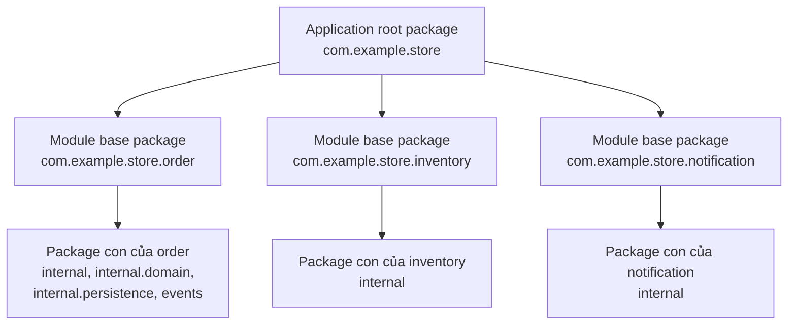
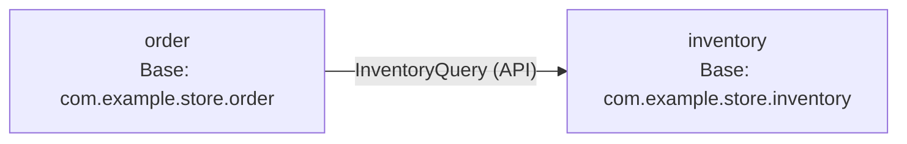
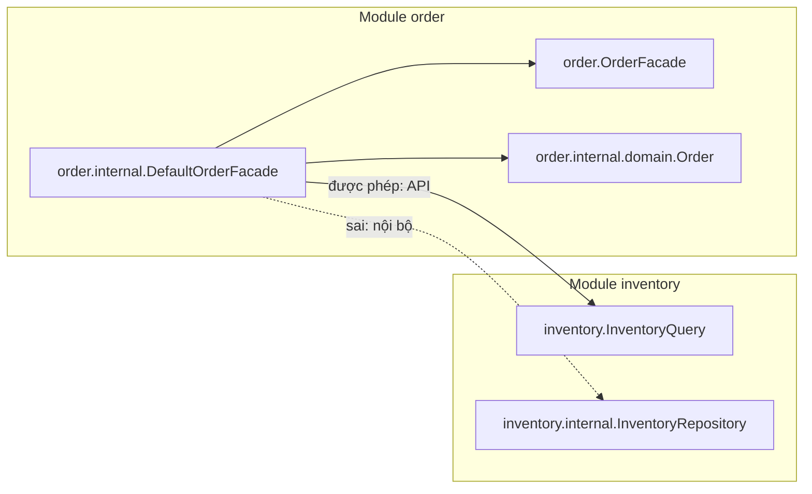

# Module base package và package con

Một ứng dụng Spring Boot thường có hàng chục package: `order`, `order.internal`, `order.internal.persistence`, `inventory`, `inventory.events`... Nếu chỉ nhìn tên package, ta dễ nhầm mỗi package là một module độc lập, hoặc tưởng rằng mọi lớp `public` đều được module khác sử dụng. **Spring Modulith dùng _module base package_ làm điểm bắt đầu của ranh giới module; các package con thông thường thuộc cùng module và được xem là nội bộ.**

Bài học thuộc chương **Mô hình module** trong **SPRING_MODULITH_VERIFICATION_TESTING**. Nắm vững quan hệ giữa base package và package con giúp kiểm chứng kiến trúc với `ApplicationModules`, thiết kế các phụ thuộc được phép, chọn đúng phạm vi `@ApplicationModuleTest` và bảo vệ mã nguồn bằng quality gate trong CI. Những phần kiểm thử sự kiện, cơ sở dữ liệu và tích hợp sau đó đều cần biết thành phần nào thuộc module nào.

## 1. Mục tiêu học tập

Sau bài này, bạn có thể:

1. Phân biệt package gốc của ứng dụng, **base package** của một module và **package con** của module.
2. Giải thích vì sao `order.internal.persistence` vẫn thuộc module `order` theo cấu hình mặc định.
3. Xác định API được công khai mặc định và phần nội bộ của một application module.
4. Sử dụng `@NamedInterface` khi thực sự muốn công khai một API trong package con.
5. Dùng `ApplicationModules.of(...).verify()` phát hiện các tham chiếu vượt ranh giới.
6. Tổ chức package giúp kiểm thử module, sự kiện và truy cập dữ liệu không kéo theo phụ thuộc sai.

## 2. Ba cấp package cần phân biệt

Giả sử ứng dụng đặt hàng có lớp Spring Boot chính tại `com.example.store`:

```text
src/main/java/
└── com/example/store/
    ├── StoreApplication.java
    ├── order/
    │   ├── OrderFacade.java
    │   ├── OrderId.java
    │   ├── internal/
    │   │   ├── DefaultOrderFacade.java
    │   │   ├── domain/
    │   │   │   └── Order.java
    │   │   └── persistence/
    │   │       └── OrderRepository.java
    │   └── events/
    │       └── OrderPlaced.java
    ├── inventory/
    │   ├── InventoryQuery.java
    │   └── internal/
    │       ├── DefaultInventoryQuery.java
    │       └── InventoryRepository.java
    └── notification/
        ├── NotificationOperations.java
        └── internal/
            └── EmailNotificationSender.java
```

Với cách phát hiện module **mặc định**, sơ đồ cấp bậc là:



| Cấp | Ví dụ | Ý nghĩa |
| --- | --- | --- |
| Package gốc ứng dụng (*application root*) | `com.example.store` | Điểm xuất phát khi Spring Modulith tìm các module |
| Base package của module | `com.example.store.order` | Ranh giới bắt đầu và tên mặc định của module `order` |
| Package con của module | `com.example.store.order.internal` | Vẫn thuộc `order`; thông thường là phần nội bộ |
| Package con nhiều cấp | `com.example.store.order.internal.persistence` | Vẫn thuộc `order`, không tự thành module mới |
| Module ngang hàng | `com.example.store.inventory` | Module độc lập với `order` |

**Mấu chốt:** Spring Modulith mặc định chọn **các sub-package trực tiếp** dưới package chứa lớp ứng dụng làm application module. Vì thế `order`, `inventory` và `notification` là ba module ngang hàng, trong khi `order.internal` và `order.events` không tự biến thành module ngang hàng.

### Cần phân biệt source root và package root

`src/main/java` là thư mục mã nguồn do Maven/Gradle cấu hình; nó **không** phải Java package. `com.example.store` là tên package khai báo trong source:

```java
package com.example.store;

import org.springframework.boot.autoconfigure.SpringBootApplication;

@SpringBootApplication
public class StoreApplication {
}
```

Nếu đặt lớp `StoreApplication` trong `com.example.store.bootstrap` thì khi dùng `ApplicationModules.of(StoreApplication.class)`, điểm khởi đầu mặc định sẽ nằm ở `bootstrap`. Các package ngang hàng như `com.example.store.order` không nằm dưới gốc này. Vị trí của lớp ứng dụng có thể ảnh hưởng trực tiếp đến kết quả phát hiện module.

## 3. Base package xác định vùng mã nguồn do module sở hữu

Một `ApplicationModule` không chỉ đại diện cho một package duy nhất; nó quản lý **vùng package** bắt đầu từ base package. Với `order`, vùng đó bao gồm:

```text
com.example.store.order.OrderFacade                    -> order
com.example.store.order.OrderId                        -> order
com.example.store.order.internal.DefaultOrderFacade    -> order
com.example.store.order.internal.domain.Order          -> order
com.example.store.order.internal.persistence.OrderRepository -> order
com.example.store.order.events.OrderPlaced             -> order

com.example.store.inventory.InventoryQuery             -> inventory
```

Việc một lớp có `@Service`, `@Entity`, `@Repository` hoặc không có annotation **không quyết định** nó thuộc module nào. Package chứa kiểu Java mới là thông tin chính để ánh xạ kiểu đó vào vùng module theo chiến lược phát hiện đã chọn.

Điều này cũng có nghĩa:

- `order.internal.domain.Order` vẫn thuộc `order`, kể cả khi không phải Spring bean.
- `order.internal.persistence.OrderRepository` vẫn thuộc `order`, dù được Spring Data tạo triển khai lúc chạy.
- `order.events.OrderPlaced` vẫn thuộc `order`, dù được publish cho các listener ở module khác.
- `inventory.internal.DefaultInventoryQuery` thuộc `inventory`, vì nó nằm dưới base package của `inventory`.

> **Chú ý về tên package:** `com.example.store.ordering` không phải package con của `com.example.store.order`. Việc xác định quan hệ cha/con dựa vào các đoạn tên package được phân tách bằng dấu chấm, không phải so khớp một tiền tố chuỗi bất kỳ.

### Mô hình hóa từ ApplicationModules

Một bài kiểm thử nhỏ có thể xác nhận những base package được nhận diện:

```java
package com.example.store;

import org.junit.jupiter.api.Test;
import org.springframework.modulith.core.ApplicationModule;
import org.springframework.modulith.core.ApplicationModules;

import static org.junit.jupiter.api.Assertions.assertEquals;
import static org.junit.jupiter.api.Assertions.assertTrue;

class ModulePackageModelTest {

    @Test
    void findsModulesAndTheirBasePackages() {
        ApplicationModules modules =
                ApplicationModules.of(StoreApplication.class);

        ApplicationModule order = modules.getModuleByName("order")
                .orElseThrow();

        assertEquals("com.example.store.order",
                order.getBasePackage().getName());
        assertTrue(modules.getModuleByName("inventory").isPresent());
        assertTrue(modules.getModuleByName("notification").isPresent());
    }

    @Test
    void mapsChildPackageToOwningModule() {
        ApplicationModules modules =
                ApplicationModules.of(StoreApplication.class);

        ApplicationModule owner = modules.getModuleForPackage(
                "com.example.store.order.internal.persistence"
        ).orElseThrow();

        assertEquals("com.example.store.order",
                owner.getBasePackage().getName());
    }
}
```

`getBasePackage()` trả về biểu diễn `JavaPackage` làm gốc của module; `getModuleForPackage(...)` giúp tra module sở hữu một package cụ thể. Các assertion giả định dự án có cấu trúc package như sơ đồ ở trên.

## 4. Base package là vị trí công khai API mặc định

Với application module **đóng** theo mặc định, Spring Modulith phân biệt:

1. **API công khai mặc định:** những kiểu Java `public` trong **base package**.
2. **Phần nội bộ:** những kiểu nằm trong **package con**, trừ các nhóm được chủ động khai báo là *named interface*.
3. **API được công khai bổ sung:** những kiểu `public` trong package con được đánh dấu bằng `@NamedInterface` phù hợp.

Ví dụ, module `inventory` công khai một hợp đồng truy vấn:

```java
// com/example/store/inventory/InventoryQuery.java
package com.example.store.inventory;

public interface InventoryQuery {
    boolean isAvailable(String sku);
}
```

Phần cài đặt của cùng module đặt trong package con:

```java
// com/example/store/inventory/internal/DefaultInventoryQuery.java
package com.example.store.inventory.internal;

import com.example.store.inventory.InventoryQuery;
import org.springframework.stereotype.Service;

@Service
class DefaultInventoryQuery implements InventoryQuery {

    @Override
    public boolean isAvailable(String sku) {
        // Ví dụ đơn giản; bản thực tế sẽ đọc dữ liệu tồn kho.
        return true;
    }
}
```

Module `order` gọi đến **hợp đồng** `InventoryQuery`:

```java
// com/example/store/order/internal/DefaultOrderFacade.java
package com.example.store.order.internal;

import com.example.store.inventory.InventoryQuery;
import org.springframework.stereotype.Service;

@Service
class DefaultOrderFacade {

    private final InventoryQuery inventory;

    DefaultOrderFacade(InventoryQuery inventory) {
        this.inventory = inventory;
    }

    void checkBeforeOrdering(String sku) {
        if (!inventory.isAvailable(sku)) {
            throw new IllegalStateException("Sản phẩm hết hàng");
        }
    }
}
```

Sơ đồ phụ thuộc ở cấp module:



Lớp `DefaultOrderFacade` thuộc `order.internal` nhưng quan hệ ra bên ngoài của nó tạo **cạnh `order → inventory`**. Khi phân tích, Spring Modulith có thể nhận diện tham chiếu này như một phụ thuộc giữa hai module.

### Package con không công khai chỉ nhờ từ khóa public

Xét một lớp khác:

```java
// com/example/store/inventory/internal/InventoryRepository.java
package com.example.store.inventory.internal;

public interface InventoryRepository {
    int countAvailable(String sku);
}
```

Trong Java, từ khóa `public` có thể cho phép module `order` import `InventoryRepository`. Nhưng trong mô hình Spring Modulith đóng mặc định, `inventory.internal` **không thuộc API công khai** của `inventory`. Nếu `order` phụ thuộc trực tiếp vào `InventoryRepository`, `ApplicationModules.verify()` có thể báo vi phạm truy cập kiểu nội bộ.

| Kiểu Java | Vị trí | Java `public` | API của module theo mặc định? |
| --- | --- | --- | --- |
| `inventory.InventoryQuery` | Base package | Có | Có |
| `inventory.internal.InventoryRepository` | Package con | Có | Không |
| `inventory.internal.DefaultInventoryQuery` | Package con | Không | Không |
| `order.OrderId` | Base package | Có | Có |
| `order.events.OrderPlaced` | Package con | Có | Không, cho tới khi được công khai bằng named interface |

**Quy tắc thực hành:** đặt interface hoặc DTO cần dùng xuyên module trong base package, còn domain model, repository, adapter, transaction service và các chi tiết hạ tầng trong package con. Mục tiêu là để các module khác phụ thuộc vào **hợp đồng ổn định**, thay vì cài đặt có thể thay đổi.

### Java package-private không giống Spring Modulith internal

Từ khóa truy cập Java vẫn có hiệu lực bình thường: một lớp *package-private* ở `order` chỉ được truy cập bởi lớp khác cũng ở đúng package `order`, **không** tự truy cập được từ `order.internal`. Các package con của Java là **những package khác nhau** về khả năng truy cập.

Trong khi đó, “internal” của Spring Modulith là **quy tắc ranh giới giữa application module**. Hai lớp ở các package con khác nhau của cùng module có thể gọi nhau nếu Java cho phép; chúng không bị coi là phụ thuộc xuyên module chỉ vì nằm ở hai package khác nhau.

## 5. Tên package con không tự quyết định quyền công khai

Cách tổ chức sau rất phổ biến:

```text
com.example.store.order/
├── api/
│   └── OrderOverview.java
├── domain/
│   └── Order.java
├── application/
│   └── OrderService.java
└── infrastructure/
    └── OrderJpaRepository.java
```

Theo Spring Modulith mặc định, **cả bốn package con này đều nằm trong vùng nội bộ của `order`**. Package tên `api` không có ý nghĩa đặc biệt nếu chưa cấu hình nó thành một giao diện công khai.

Có hai cách phổ biến để công khai `OrderOverview`:

- **Cách A:** chuyển kiểu `public OrderOverview` lên base package `com.example.store.order`.
- **Cách B:** giữ nó trong `com.example.store.order.api` và khai báo *named interface* cho package này.

Lựa chọn phụ thuộc độ lớn của API và cách nhóm các hợp đồng nghiệp vụ. Với API nhỏ, đặt ngay ở base package thường dễ hiểu. Với nhiều nhóm API khác nhau, named interface giúp quản lý chi tiết hơn.

## 6. Công khai một package con bằng @NamedInterface

Giả sử module `order` muốn công khai sự kiện `OrderPlaced` để module `notification` hoặc `billing` xử lý. Ta giữ sự kiện tại package `order.events`:

```java
// com/example/store/order/events/OrderPlaced.java
package com.example.store.order.events;

import java.util.UUID;

public record OrderPlaced(UUID orderId, String customerId) {
}
```

Khai báo package này là named interface:

```java
// com/example/store/order/events/package-info.java
@org.springframework.modulith.NamedInterface("events")
package com.example.store.order.events;
```

Từ thời điểm đó, `order :: events` là **giao diện được đặt tên** thuộc module `order`. Nó không tạo một module mới tên `events`; module sở hữu `OrderPlaced` vẫn là `order`.

Nếu `notification` chỉ cần sự kiện từ `order`, có thể cho phép đúng named interface này:

```java
// com/example/store/notification/package-info.java
@org.springframework.modulith.ApplicationModule(
    allowedDependencies = "order :: events"
)
package com.example.store.notification;
```

Nếu `notification` còn cần API ở base package `order`, khai báo cả hai:

```java
// com/example/store/notification/package-info.java
@org.springframework.modulith.ApplicationModule(
    allowedDependencies = {"order", "order :: events"}
)
package com.example.store.notification;
```

Hai đoạn `package-info.java` của `notification` trên minh họa **hai phương án thay thế nhau**; trong dự án chỉ giữ một phiên bản theo nhu cầu thực tế.

| Khai báo được cho phép | Có thể tham chiếu |
| --- | --- |
| `"order"` | API mặc định nằm ở base package `order` |
| `"order :: events"` | API thuộc named interface `events` của `order` |
| `{"order", "order :: events"}` | Cả hai nhóm API nói trên |

Lưu ý hai điều kiện là **độc lập**: module nguồn phải được cho phép phụ thuộc vào API đích theo `allowedDependencies` (nếu khai báo), và kiểu đích phải nằm trong phần API công khai hợp lệ. Chỉ thêm `order` vào `allowedDependencies` không tự mở quyền truy cập `order.internal`.

### Khi sự kiện được publish nhưng kiểu chưa công khai

Spring có thể publish một đối tượng sự kiện ở runtime, nhưng nếu một listener của module khác **khai báo tham số kiểu sự kiện** như `OrderPlaced`, mã nguồn của listener tạo ra phụ thuộc tĩnh tới kiểu đó. Khi kiểu đặt tại `order.events`, muốn tham chiếu hợp lệ theo quy tắc ranh giới mặc định cần công khai package bằng named interface.

Ví dụ listener ở module `notification`:

```java
// com/example/store/notification/internal/OrderNotificationListener.java
package com.example.store.notification.internal;

import com.example.store.order.events.OrderPlaced;
import org.springframework.context.event.EventListener;
import org.springframework.stereotype.Component;

@Component
class OrderNotificationListener {

    @EventListener
    void handle(OrderPlaced event) {
        // Gửi thông báo là một ví dụ; xử lý lỗi, retry và giao dịch nằm
        // trong phạm vi kiểm thử sự kiện/tích hợp riêng.
    }
}
```

**Named interface giải quyết quyền phụ thuộc kiểu**; nó không bảo đảm event listener đã được đăng ký, sự kiện được phát đúng thời điểm hoặc transaction thành công. Các đặc tính runtime đó cần bài kiểm thử riêng.

## 7. @ApplicationModule và allowedDependencies ràng buộc từ phía module gọi

Nếu module `order` chỉ được gọi API của `inventory`, khai báo:

```java
// com/example/store/order/package-info.java
@org.springframework.modulith.ApplicationModule(
    displayName = "Quản lý đơn hàng",
    allowedDependencies = "inventory"
)
package com.example.store.order;
```

Khai báo đặt tại **base package của `order`**, thể hiện quy tắc về **các phụ thuộc đi ra từ module `order`**.

| Tham chiếu từ `order` | Hợp lệ? | Giải thích |
| --- | --- | --- |
| `inventory.InventoryQuery` | Có | Module `inventory` được cho phép; kiểu nằm ở API base package |
| `inventory.internal.InventoryRepository` | Không | Truy cập kiểu nội bộ dù module đích có tên trong danh sách |
| `notification.NotificationOperations` | Không | Module `notification` không được phép trong `allowedDependencies` |
| `order.internal.domain.Order` | Có nếu Java cho phép | Tương tác nội bộ cùng module, không phải cạnh vượt ranh giới |

Khai báo `@ApplicationModule` không bắt buộc để các package con trực tiếp được nhận diện là module theo chiến lược mặc định. Nó được dùng khi muốn mô tả hoặc giới hạn module rõ hơn.

## 8. Kiểm chứng ranh giới package bằng ApplicationModules.verify()

Với module đóng mặc định, phép kiểm chứng cấu trúc quan trọng là:

```java
package com.example.store;

import org.junit.jupiter.api.Test;
import org.springframework.modulith.core.ApplicationModules;

class ArchitectureVerificationTest {

    @Test
    void verifiesModuleStructure() {
        ApplicationModules.of(StoreApplication.class).verify();
    }
}
```

`verify()` phân tích những quan hệ giữa kiểu Java và đối chiếu với mô hình module. Các nhóm vấn đề cần chú ý gồm:

1. **Truy cập kiểu nội bộ từ module khác:** `order` import `inventory.internal.InventoryRepository`.
2. **Không tuân thủ danh sách phụ thuộc được phép:** `order` gọi `notification.NotificationOperations` nhưng `allowedDependencies` chỉ cho phép `inventory`.
3. **Phụ thuộc vòng giữa các module:** `order → inventory → order` khiến không thể duy trì chiều phụ thuộc rõ ràng.

Ví dụ cố tình vi phạm thứ nhất, giả sử `InventoryRepository` được khai báo `public` nên mã vẫn có thể biên dịch:

```java
// com/example/store/order/internal/BadOrderService.java
package com.example.store.order.internal;

import com.example.store.inventory.internal.InventoryRepository;

// Minh họa SAI ranh giới: order truy cập thẳng repository nội bộ inventory.
class BadOrderService {
    private final InventoryRepository inventoryRepository;

    BadOrderService(InventoryRepository inventoryRepository) {
        this.inventoryRepository = inventoryRepository;
    }
}
```

**Hướng sửa:** thay tham chiếu vào repository nội bộ bằng một phương thức thuộc hợp đồng `inventory.InventoryQuery` hoặc API có chủ đích của module `inventory`. Việc đưa `InventoryRepository` sang base package chỉ để làm test xanh sẽ làm lộ chi tiết hạ tầng và giảm tính đóng gói.

### Phụ thuộc nội bộ và phụ thuộc giữa module là hai loại khác nhau



Các cạnh bên trong module `order` không gây vi phạm *cross-module* chỉ vì đi qua một package con. Cạnh từ `order` tới `inventory` mới cần kiểm tra phần API được công khai và `allowedDependencies`.

> `verify()` là **kiểm chứng kiến trúc từ mã**. Nó không thay thế các bài kiểm thử xác nhận kết quả xử lý nghiệp vụ, transaction, database migration hay event delivery. Phụ thuộc chỉ xuất hiện động qua reflection cũng không nhất thiết được mô hình phân tích tĩnh nhìn thấy đầy đủ.

## 9. Tổ chức package để @ApplicationModuleTest và kiểm thử tích hợp dễ bảo trì

Ranh giới package ảnh hưởng trực tiếp tới những gì được xem là một module khi viết kiểm thử tích hợp. Ví dụ với `order`:

```text
src/main/java/com/example/store/order/
├── OrderFacade.java                       # Hợp đồng công khai
├── OrderId.java                           # Giá trị trả về công khai
└── internal/
    ├── DefaultOrderFacade.java            # Spring service nội bộ
    ├── domain/Order.java                   # Miền nghiệp vụ
    └── persistence/OrderRepository.java   # Repository nội bộ

src/test/java/com/example/store/order/
└── OrderModuleIntegrationTest.java
```

Bài kiểm thử tích hợp module có thể bắt đầu ở package thuộc `order`:

```java
package com.example.store.order;

import org.junit.jupiter.api.Test;
import org.springframework.modulith.test.ApplicationModuleTest;

@ApplicationModuleTest
class OrderModuleIntegrationTest {

    @Test
    void startsOrderModuleContext() {
        // Thêm assertion nghiệp vụ khi có dữ liệu và bean cần thiết.
    }
}
```

`@ApplicationModuleTest` dựa trên mô hình module để xác định phần ứng dụng cần bootstrap. Tùy cách bootstrap, nếu `order` cần các bean của `inventory`, test có thể cần mock các cổng phụ thuộc hoặc cấu hình nạp thêm các module phụ thuộc được phép. Dù chọn cách nào, việc đặt API tại base package và giấu repository ở package con giúp phạm vi kiểm thử và trách nhiệm rõ ràng.

### Liên hệ kiểm thử database

Khi repository của `order` nằm tại `order.internal.persistence`, nó vẫn là một phần của module `order`. Kiểm thử database của module có thể làm việc qua `OrderFacade` để kiểm tra thay đổi trạng thái dữ liệu, trong khi module `inventory` không được truy cập trực tiếp repository này.

**Tránh lỗi thiết kế:** “Muốn kiểm thử tích hợp cho tiện nên cho module khác gọi thẳng JPA repository.” Cách đó tạo coupling vượt ranh giới; ưu tiên kiểm thử qua API của module sở hữu dữ liệu và dùng test fixture phù hợp.

### Liên hệ kiểm thử sự kiện

Sự kiện `order.events.OrderPlaced` vẫn được sở hữu bởi `order`, mặc dù listener thuộc `notification`. Kiểm thử sự kiện cần xác nhận event được phát và xử lý đúng; việc khai báo `@NamedInterface("events")` giúp mã listener có phụ thuộc kiến trúc hợp lệ đến kiểu sự kiện.

Không nên nhầm hai câu hỏi:

| Câu hỏi | Công cụ/đặc tính cần kiểm tra |
| --- | --- |
| “Listener có được phép tham chiếu kiểu `OrderPlaced`?” | `ApplicationModules.verify()` và named interface |
| “Listener có thật sự nhận event, xử lý transaction/retry đúng?” | `@ApplicationModuleTest`, Spring Test và các phép kiểm tra event/integration phù hợp |

### Đưa kiểm chứng vào CI

Tạo bài kiểm thử `ArchitectureVerificationTest` trong tập test chuẩn của dự án. Khi pipeline chạy `mvn test` hoặc `./gradlew test` tùy build tool, bài kiểm thử sẽ gọi `verify()` và báo thất bại khi có phụ thuộc sai. Nếu CI tách unit test khỏi integration test, cần bảo đảm bài kiểm thử kiến trúc nằm trong nhóm **bắt buộc trước khi merge**.

Có thể thêm bước xuất tài liệu cấu trúc module trong pipeline, nhưng tài liệu là để quan sát; **chính phép kiểm chứng chạy trong CI** mới là hàng rào ngăn thay đổi sai ranh giới.

## 10. Các trường hợp đặc biệt làm thay đổi cách hiểu package con

Quy tắc nêu trên áp dụng cho **module đóng với chiến lược phát hiện mặc định**. Spring Modulith có những cơ chế đặc biệt:

| Cơ chế | Điều gì thay đổi? | Điều gì cần nhớ? |
| --- | --- | --- |
| `@NamedInterface` | Một hoặc nhiều package con được công khai như API được đặt tên | Vẫn thuộc module cha, không tự tạo module mới |
| Module mở (`Type.OPEN`) | Nới quy tắc giới hạn truy cập phần nội bộ của module | Phù hợp một số giai đoạn chuyển đổi, nhưng giảm mức đóng gói |
| Nested application module | Một vùng package con được khai báo thành module lồng nhau | Không tự động phát sinh từ mọi package con |
| Chiến lược phát hiện tường minh | Module base package được lựa chọn theo các khai báo phù hợp | Không thể suy toàn bộ module chỉ từ package con trực tiếp |
| `ApplicationModuleDetectionStrategy` tùy biến | Dự án chủ động chọn các JavaPackage làm base package | Cần truy vấn mô hình thực tế để xác định module sở hữu |
| Nhiều gốc ứng dụng | Có thể phát hiện module dưới các package gốc bổ sung | Cần xem cấu hình điểm xuất phát, không giả định một gốc duy nhất |

Ví dụ một module mở có thể khai báo ở base package:

```java
// com/example/store/order/package-info.java
@org.springframework.modulith.ApplicationModule(
    type = org.springframework.modulith.ApplicationModule.Type.OPEN
)
package com.example.store.order;
```

Việc mở module cần là **quyết định kiến trúc có chủ đích**. Không nên dùng nó chỉ để giải quyết nhanh một lỗi truy cập nội bộ trong `verify()`: làm vậy khiến hợp đồng giữa các module kém rõ ràng và mở rộng phạm vi thay đổi dễ gây hồi quy.

### Khi package con trở thành nested module

Ở dự án có cấu hình nested application module, `order.fulfillment` có thể được xem là module lồng nhau với ranh giới riêng, tùy phiên bản Spring Modulith và cách khai báo. Khi đó một kiểu ở `order.fulfillment.internal` không nên được suy đoán bằng quy tắc “luôn thuộc module ngoài cùng `order`”.

**Cách xác thực đáng tin cậy:** dựng `ApplicationModules` trong mã và tra cứu module sở hữu package hoặc kiểu. Mô hình đã được cấu hình của dự án là cơ sở để phân tích phụ thuộc, thay vì dựa hoàn toàn vào sơ đồ folder.

## 11. Tình huống thực hành

Cho ứng dụng:

```text
com.acme.travel
├── TravelApplication.java
├── booking/
│   ├── BookingOperations.java
│   ├── api/
│   │   └── BookingSummary.java
│   └── internal/
│       ├── BookingService.java
│       └── persistence/
│           └── BookingRepository.java
├── payment/
│   ├── PaymentGateway.java
│   └── internal/
│       └── PaymentGatewayAdapter.java
└── email/
    ├── EmailOperations.java
    └── internal/
        └── SmtpSender.java
```

Giả sử sử dụng phát hiện mặc định, các kiểu có tên trong sơ đồ là `public`, module đóng và chưa có named interface.

**Câu hỏi**

1. Có bao nhiêu application module? Base package của từng module là gì?
2. `booking.internal.persistence.BookingRepository` thuộc module nào? `payment` có được import trực tiếp nó không?
3. `booking.api.BookingSummary` đã công khai với module `email` chưa? Nêu hai cách hợp lệ để công khai.
4. `booking.internal.BookingService` gọi `payment.PaymentGateway`. Cạnh phụ thuộc giữa các module có hướng nào?
5. Nếu `booking` chỉ khai báo `allowedDependencies = "payment"`, liệu nó có được gọi `email.EmailOperations` không?
6. Nếu muốn một listener trong `email` nhận sự kiện `BookingConfirmed` từ `booking.events`, cần tổ chức API package như thế nào?

**Đáp án gợi ý**

1. Ba module: `booking` ở `com.acme.travel.booking`; `payment` ở `com.acme.travel.payment`; `email` ở `com.acme.travel.email`.
2. `BookingRepository` thuộc `booking`. `payment` không được truy cập nó từ bên ngoài vì đó là kiểu nội bộ, bất kể Java cho phép import.
3. Chưa. Có thể đưa `BookingSummary` lên base package `booking`, hoặc đánh dấu `booking.api` là named interface và khai báo phụ thuộc tới named interface đó khi có giới hạn `allowedDependencies`.
4. `booking → payment`, vì nguồn tham chiếu thuộc `booking` và kiểu đích thuộc `payment`.
5. Không. Quy tắc đã giới hạn các module đích được phép từ `booking`, trong khi `email` chưa nằm trong danh sách.
6. Tạo `booking.events.BookingConfirmed` là kiểu `public` và đánh dấu `booking.events` bằng `@NamedInterface("events")`; nếu `email` khai báo giới hạn phụ thuộc, cho phép `booking :: events`.

**Thử mở rộng:** Di chuyển `PaymentGatewayAdapter` từ `payment.internal` sang `payment.internal.adapters.stripe`. Số application module theo mặc định có thay đổi không? **Không**: đây vẫn là một package con thuộc base package `payment`.

## 12. Checklist khi review thay đổi package

- Xác định package chứa lớp ứng dụng và những base package được phát hiện thực sự.
- Đảm bảo mỗi base package tương ứng với một trách nhiệm nghiệp vụ rõ ràng.
- Đặt hợp đồng dự kiến dùng xuyên module tại base package hoặc named interface có chủ đích.
- Giữ các loại domain model nội bộ, JPA repository, adapter và implementation trong những package con phù hợp.
- Không cho rằng mọi lớp `public`, package tên `api` hoặc `events` đều tự động là public API của module.
- Kiểm tra chiều phụ thuộc giữa các module và `allowedDependencies` khi thay đổi code.
- Chạy `ApplicationModules.of(...).verify()` trong CI để phát hiện truy cập internal, phụ thuộc vòng hoặc phụ thuộc ngoài danh sách.
- Dùng `@ApplicationModuleTest` và kiểm thử database/sự kiện bổ sung để xác nhận hành vi runtime của module.

**Ghi nhớ:** **Base package xác lập ranh giới sở hữu của application module; package con thông thường là nơi cài đặt nội bộ.** Các kiểu `public` trong base package tạo nên API mặc định, còn API đặt trong package con cần được công khai có chủ đích bằng named interface. Khi giữ đúng cấu trúc này, `ApplicationModules.verify()` có thể bảo vệ các ranh giới ngay từ lúc phát triển và trong CI.

## Tài liệu tham khảo

- [Spring Modulith Reference — Fundamentals: Application Modules](https://docs.spring.io/spring-modulith/reference/fundamentals.html)
- [Spring Modulith Reference — Verifying Application Module Structure](https://docs.spring.io/spring-modulith/reference/verification.html)
- [Spring Modulith Reference — Testing Application Modules](https://docs.spring.io/spring-modulith/reference/testing.html)
- [Spring Modulith API — ApplicationModule](https://docs.spring.io/spring-modulith/docs/current/api/org/springframework/modulith/core/ApplicationModule.html)
- [Spring Modulith API — ApplicationModules](https://docs.spring.io/spring-modulith/docs/current/api/org/springframework/modulith/core/ApplicationModules.html)
