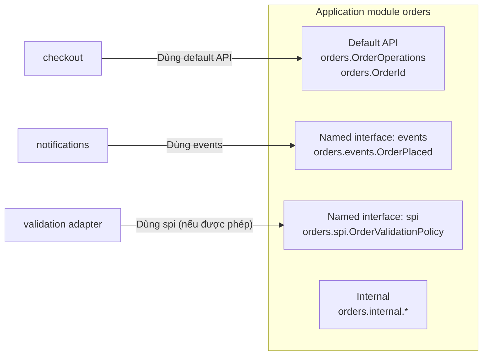
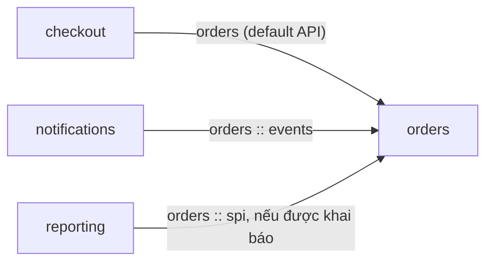

# Named interface và public API của module

Trong ứng dụng Spring Modulith, **một kiểu `public` của Java chưa chắc là public API của application module**. Điều này đặc biệt quan trọng khi các hợp đồng nghiệp vụ, DTO hoặc sự kiện được đặt trong package con như `orders.events`, `catalog.api`, `payments.spi`. Nếu những package đó vẫn là nội bộ mà module khác import trực tiếp, kiểm chứng kiến trúc có thể thất bại dù mã Java biên dịch bình thường.

**Named interface** cho phép module **công khai có chủ đích một nhóm kiểu ở package con**, đồng thời tiếp tục giữ các package triển khai khác ở trạng thái nội bộ. Cơ chế này giúp module chỉ chia sẻ những hợp đồng cần thiết, xây dựng quan hệ phụ thuộc dễ kiểm soát và dùng `ApplicationModules.verify()` như một quality gate trong CI.

Bài học thuộc chương **Mô hình module** của **SPRING_MODULITH_VERIFICATION_TESTING**. Việc phân định chính xác API mặc định, named interface và phần nội bộ là cơ sở cho kiểm thử kiến trúc, `@ApplicationModuleTest`, kiểm thử sự kiện, cơ sở dữ liệu và tích hợp mà không làm rò rỉ các lớp triển khai giữa các module.

## 1. Mục tiêu học tập

Sau bài này, bạn có thể:

1. Phân biệt `public` theo ngôn ngữ Java với **public API của application module**.
2. Giải thích API mặc định tại **base package** và vì sao package con được xem là nội bộ.
3. Khai báo `@NamedInterface` trong `package-info.java` để công khai một hợp đồng tại package con.
4. Dùng cú pháp `<module> :: <interface>` trong `@ApplicationModule(allowedDependencies = ...)` để hạn chế quyền phụ thuộc của module gọi.
5. Thiết kế hợp đồng sự kiện và giao diện đồng bộ mà không công khai JPA repository hay triển khai nội bộ.
6. Đặt bài kiểm thử `ApplicationModules.of(...).verify()` trong CI, kết hợp kiểm thử hành vi với `@ApplicationModuleTest`.

## 2. Public trong Java khác public API trong Spring Modulith

Giả sử có các lớp:

```text
com.acme.shop
├── ShopApplication.java
├── orders
│   ├── OrderOperations.java
│   ├── OrderId.java
│   ├── events
│   │   └── OrderPlaced.java
│   ├── api
│   │   └── OrderSummary.java
│   └── internal
│       ├── DefaultOrderOperations.java
│       └── OrderRepository.java
└── notifications
    ├── NotificationOperations.java
    └── internal
        └── OrderNotificationListener.java
```

Với cách phát hiện module mặc định, `orders` và `notifications` là hai application module vì chúng là các package con trực tiếp dưới package ứng dụng `com.acme.shop`. Các package `orders.events`, `orders.api` và `orders.internal` vẫn thuộc **cùng module `orders`**.

Nếu chưa có named interface và module đang ở chế độ đóng mặc định:

| Kiểu Java | Package | Java cho import từ package khác khi `public`? | Public API của `orders` mặc định? |
| --- | --- | --- | --- |
| `OrderOperations` | `com.acme.shop.orders` | Có | **Có** |
| `OrderId` | `com.acme.shop.orders` | Có | **Có** |
| `OrderPlaced` | `com.acme.shop.orders.events` | Có | **Chưa** |
| `OrderSummary` | `com.acme.shop.orders.api` | Có | **Chưa** |
| `OrderRepository` | `com.acme.shop.orders.internal` | Có | **Không** |

Sở dĩ có sự khác biệt vì hai bộ quy tắc giải quyết hai vấn đề khác nhau:

- **Java access modifier**: `public` cho biết kiểu có thể được tham chiếu qua cơ chế kiểm tra quyền truy cập của Java.
- **Spring Modulith module boundary**: xác định kiểu đó có thuộc **hợp đồng mà module cho phép module khác phụ thuộc** hay không.

Không tồn tại từ khóa Java riêng mang tên “module internal” cho Spring Modulith. Với mô hình module đóng, ranh giới này được **kiểm tra ở cấp kiến trúc**, ví dụ bằng `ApplicationModules.verify()`. Vì thế mã tham chiếu lớp nội bộ đôi khi vẫn compile được nhưng không vượt qua bài kiểm thử kiến trúc.

### Quy tắc mặc định: base package cung cấp API

Ví dụ, hợp đồng dùng xuyên module có thể đặt ngay trong package gốc `orders`:

```java
// com/acme/shop/orders/OrderOperations.java
package com.acme.shop.orders;

public interface OrderOperations {
    OrderId placeOrder(String customerId, String sku);
}
```

```java
// com/acme/shop/orders/OrderId.java
package com.acme.shop.orders;

import java.util.UUID;

public record OrderId(UUID value) {
}
```

Hai kiểu `public` này thuộc API mặc định. Trong khi đó, lớp xử lý dữ liệu ở `orders.internal` vẫn là chi tiết cài đặt, dù có thể cần `public` vì các quy tắc truy cập giữa những Java package nội bộ khác nhau.

**Lưu ý:** Java package `orders` và `orders.internal` là hai package khác nhau. Kiểu không có modifier `public` ở `orders` không được truy cập tùy ý từ `orders.internal` theo luật Java, dù cả hai đều thuộc application module `orders`.

## 3. Named interface giải quyết vấn đề gì?

Đôi khi đưa **mọi** hợp đồng vào base package sẽ khiến package này rất đông kiểu: dịch vụ đồng bộ, sự kiện, điểm mở rộng, DTO cho báo cáo... Ta có thể tổ chức API theo nhóm:

```text
com.acme.shop.orders
├── OrderOperations.java                  # Public API mặc định
├── OrderId.java                          # Public API mặc định
├── events
│   ├── package-info.java                 # @NamedInterface("events")
│   └── OrderPlaced.java                  # API sự kiện
├── spi
│   ├── package-info.java                 # @NamedInterface("spi")
│   └── OrderValidationPolicy.java        # Điểm mở rộng có chủ đích
└── internal
    ├── DefaultOrderOperations.java       # Triển khai nội bộ
    └── OrderRepository.java              # Dữ liệu nội bộ
```

Đối với Spring Modulith, module `orders` có thể cung cấp:

- **API mặc định** ở base package `orders`.
- **Named interface `events`** ở package `orders.events`, công khai kiểu sự kiện hợp lệ.
- **Named interface `spi`** ở package `orders.spi`, công khai hợp đồng mở rộng.
- **Phần nội bộ** tại `orders.internal`, không mở cho module khác.



Các vùng `events` và `spi` là **những giao diện do module `orders` cung cấp**, không phải hai application module mới. Quyền sở hữu kiểu sự kiện hoặc SPI vẫn nằm ở `orders`, và trong đồ thị phụ thuộc một module sử dụng chúng vẫn có cạnh hướng đến `orders`.

### Tại sao tên package `api` hoặc `events` chưa đủ?

Spring Modulith không suy ra quyền công khai chỉ từ tên `api`, `events`, `dto` hoặc `spi`. Đây là những tên package thông thường. Để công khai nhóm kiểu ở package con, cần **khai báo rõ** named interface bằng annotation mà Spring Modulith nhận biết.

Điều này giảm việc vô tình biến một nhóm lớp triển khai thành API chỉ vì người phát triển đã đặt tên thư mục theo thói quen.

## 4. Khai báo @NamedInterface trong package-info.java

`@NamedInterface` được dùng ở **package cần công khai**. Ví dụ đặt file `package-info.java` trong đúng package `com.acme.shop.orders.events`:

```java
// com/acme/shop/orders/events/package-info.java
@org.springframework.modulith.NamedInterface("events")
package com.acme.shop.orders.events;
```

Sau đó đặt kiểu sự kiện `public` vào package đó:

```java
// com/acme/shop/orders/events/OrderPlaced.java
package com.acme.shop.orders.events;

import com.acme.shop.orders.OrderId;
import java.time.Instant;

public record OrderPlaced(
        OrderId orderId,
        String customerId,
        Instant occurredAt
) {
}
```

Hai điều kiện cần kiểm tra:

1. **Annotation đúng vị trí:** file `package-info.java` thực sự khai báo `package com.acme.shop.orders.events;` và có `@NamedInterface("events")`.
2. **Kiểu đủ quyền truy cập:** `OrderPlaced` được khai báo `public`. Khai báo named interface không tự động biến kiểu package-private thành `public` của Java.

Khi phát hiện module, Spring Modulith có thể xem `orders.events` là named interface `events` của module `orders`.

### Công khai SPI riêng

Giả sử có một điểm mở rộng cho chính sách xét điều kiện đặt hàng:

```java
// com/acme/shop/orders/spi/package-info.java
@org.springframework.modulith.NamedInterface("spi")
package com.acme.shop.orders.spi;
```

```java
// com/acme/shop/orders/spi/OrderValidationPolicy.java
package com.acme.shop.orders.spi;

public interface OrderValidationPolicy {
    boolean canPlaceOrder(String customerId, String sku);
}
```

Với cấu trúc này, `events` và `spi` có tên phân biệt để người quản lý kiến trúc kiểm soát **module tiêu thụ được dùng nhóm API nào**.

**Không nên** đặt `OrderRepository`, JPA entity hoặc một triển khai phụ thuộc hạ tầng vào `spi` chỉ để tránh lỗi kiểm chứng. Chỉ công khai hợp đồng thực sự cần dùng ngoài module; giữ lại chi tiết hạ tầng trong `internal`.

## 5. allowedDependencies nằm ở phía module sử dụng

Giả sử module `notifications` cần nghe `OrderPlaced` để gửi email. Nó **không cần** biết `orders.internal.DefaultOrderOperations` hay `orders.internal.OrderRepository`.

Khai báo quyền phụ thuộc của `notifications` trong **base package của module sử dụng**:

```java
// com/acme/shop/notifications/package-info.java
@org.springframework.modulith.ApplicationModule(
        allowedDependencies = "orders :: events"
)
package com.acme.shop.notifications;
```

Chuỗi `orders :: events` gồm:

- `orders`: tên logic của **module cung cấp**.
- `::`: ký pháp chọn **named interface**.
- `events`: tên của named interface đã khai báo ở `orders.events`.

Khai báo này thể hiện rằng module `notifications` chỉ có nhu cầu phụ thuộc vào nhóm API được đặt tên `events` của `orders`. Nó **không** tạo module `orders.events` mới, không cấp quyền Java và cũng không bảo đảm Spring event listener chạy thành công.

### Ví dụ listener dùng sự kiện

```java
// com/acme/shop/notifications/internal/OrderNotificationListener.java
package com.acme.shop.notifications.internal;

import com.acme.shop.orders.events.OrderPlaced;
import org.springframework.context.event.EventListener;
import org.springframework.stereotype.Component;

@Component
class OrderNotificationListener {

    @EventListener
    void on(OrderPlaced event) {
        // Minh họa: chuyển yêu cầu gửi email đến dịch vụ thuộc notifications.
        System.out.println("Gửi thông báo cho " + event.customerId());
    }
}
```

Với named interface `events` được khai báo và `notifications` chỉ phụ thuộc nhóm này, việc listener tham chiếu kiểu `OrderPlaced` phù hợp với hợp đồng kiến trúc. Tuy nhiên, **mã biên dịch và kiểm chứng kiến trúc đạt** không đồng nghĩa event đã được publish, listener đã chạy đúng transaction hoặc cơ chế retry hoạt động; các thuộc tính đó cần kiểm thử tích hợp riêng.

## 6. Phân biệt default API và named interface khi giới hạn phụ thuộc

Trong một module có nhiều nhóm API, danh sách `allowedDependencies` cho biết **phạm vi mà module nguồn được phép sử dụng**.

Giả sử module `checkout` cần gọi dịch vụ đồng bộ trong base package `orders`, còn module `notifications` chỉ cần sự kiện:

```java
// com/acme/shop/checkout/package-info.java
@org.springframework.modulith.ApplicationModule(
        allowedDependencies = "orders"
)
package com.acme.shop.checkout;
```

```java
// com/acme/shop/notifications/package-info.java
@org.springframework.modulith.ApplicationModule(
        allowedDependencies = "orders :: events"
)
package com.acme.shop.notifications;
```

Khi một module thực sự cần cả API mặc định và sự kiện, khai báo cả hai giao diện:

```java
// Phương án THAY THẾ cho package-info.java của notifications.
@org.springframework.modulith.ApplicationModule(
        allowedDependencies = {"orders", "orders :: events"}
)
package com.acme.shop.notifications;
```

> Hai phiên bản `package-info.java` của `notifications` ở trên là **các phương án thay thế**, không phải hai file cùng tồn tại trong một project. Chọn theo hợp đồng mà `notifications` thực sự tiêu thụ.

| `allowedDependencies` trên module sử dụng | Mục đích khai báo | Ví dụ hợp lệ theo thiết kế |
| --- | --- | --- |
| `"orders"` | Cho phép API mặc định của `orders` | `orders.OrderOperations`, `orders.OrderId` |
| `"orders :: events"` | Cho phép named interface `events` | `orders.events.OrderPlaced` |
| `"orders :: spi"` | Cho phép named interface `spi` | `orders.spi.OrderValidationPolicy` |
| `{"orders", "orders :: events"}` | Cần cả API mặc định lẫn sự kiện | `OrderOperations` và `OrderPlaced` |

Với module tiêu thụ **không khai báo** `allowedDependencies`, Spring Modulith không có danh sách giới hạn tường minh từ annotation này; các quy tắc chung như **truy cập public API** và **không phụ thuộc vòng** vẫn cần được kiểm chứng.

**Hai kiểm tra độc lập:** một tham chiếu xuyên module phải đến **API hợp lệ** của module đích, đồng thời phải nằm trong **phụ thuộc được phép** nếu module nguồn có quy tắc giới hạn. Việc đưa `orders` vào `allowedDependencies` không biến `orders.internal.OrderRepository` thành hợp đồng công khai.

## 7. Named interface được cung cấp và phụ thuộc được yêu cầu

Có thể hiểu các quan hệ dưới góc nhìn *provided* và *required interface*:

| Vai trò | Thành phần | Ý nghĩa |
| --- | --- | --- |
| **Provided interface** | `orders.OrderOperations` | API mặc định mà `orders` cung cấp |
| **Provided interface** | `orders :: events` | API sự kiện do `orders` chủ động công khai |
| **Provided interface** | `orders :: spi` | API mở rộng có chủ đích |
| **Required interface** | `notifications → orders :: events` | `notifications` cần kiểu sự kiện của `orders` |
| **Required interface** | `checkout → orders` | `checkout` cần gọi hợp đồng mặc định của `orders` |
| **Internal implementation** | `orders.internal.OrderRepository` | Chi tiết triển khai, không phải hợp đồng cung cấp |

Một chiều tham chiếu kiểu hợp lệ cũng tạo **cạnh phụ thuộc module**. Chẳng hạn, listener từ `notifications` import `OrderPlaced` khiến đồ thị module có cạnh `notifications → orders`. Named interface giúp làm rõ **phần API nào được sử dụng trong cạnh đó**, không xóa cạnh phụ thuộc.



Vì thế, named interface **không tự khắc phục phụ thuộc vòng**. Nếu `orders` cũng tham chiếu ngược một API của `notifications`, mô hình vẫn có thể xuất hiện chu trình `notifications → orders → notifications`. Cần thiết kế lại chiều phụ thuộc hoặc hợp đồng giữa các module.

## 8. Ví dụ end-to-end: publish sự kiện và bảo vệ API

Ta bổ sung cách `orders` phát sự kiện. Lớp triển khai nội bộ được phép tham chiếu `OrderOperations` và `OrderPlaced` vì cả hai đều thuộc **cùng module `orders`**.

```java
// com/acme/shop/orders/internal/DefaultOrderOperations.java
package com.acme.shop.orders.internal;

import com.acme.shop.orders.OrderId;
import com.acme.shop.orders.OrderOperations;
import com.acme.shop.orders.events.OrderPlaced;
import org.springframework.context.ApplicationEventPublisher;
import org.springframework.stereotype.Service;

import java.time.Instant;
import java.util.UUID;

@Service
class DefaultOrderOperations implements OrderOperations {

    private final ApplicationEventPublisher events;

    DefaultOrderOperations(ApplicationEventPublisher events) {
        this.events = events;
    }

    @Override
    public OrderId placeOrder(String customerId, String sku) {
        // Lược giản để minh họa mô hình; hệ thống thật cần kiểm tra tồn kho,
        // lưu đơn, ràng buộc giao dịch và xử lý lỗi.
        OrderId id = new OrderId(UUID.randomUUID());
        events.publishEvent(new OrderPlaced(id, customerId, Instant.now()));
        return id;
    }
}
```

Đọc ví dụ theo từng tầng:

1. `DefaultOrderOperations` thuộc `orders.internal` nên là **triển khai nội bộ** của `orders`.
2. `OrderOperations` và `OrderId` nằm tại base package `orders`, là **API mặc định**.
3. `OrderPlaced` thuộc `orders.events`, được công khai thông qua named interface `events`.
4. `OrderNotificationListener` thuộc `notifications.internal` và tham chiếu `OrderPlaced`, tạo cạnh phụ thuộc từ `notifications` đến API `orders :: events`.
5. `@EventListener` cung cấp cơ chế nhận event của Spring. Việc event có được phát, listener có được gọi, tính nhất quán dữ liệu và retry là các mối quan tâm của **kiểm thử runtime**.

### Thiết kế payload sự kiện ổn định

Không nên khai báo sự kiện public như sau:

```java
// Ví dụ thiết kế KHÔNG NÊN DÙNG:
// public record OrderPlaced(OrderJpaEntity orderEntity) { }
```

Nếu `OrderJpaEntity` thuộc `orders.internal.persistence`, một module nhận sự kiện phải biết kiểu nội bộ của `orders`. Khi đó named interface ở package `events` có thể vô tình mang theo phụ thuộc đến mô hình persistence. Tốt hơn, truyền định danh hoặc dữ liệu bất biến tối thiểu như `OrderId`, `customerId`, `occurredAt`.

Hợp đồng public nên dễ sử dụng mà **không cần import các kiểu thuộc `internal`**. Điều này giúp tách vòng đời thay đổi của API sự kiện khỏi chi tiết JPA, transaction và lưu trữ.

## 9. Kiểm tra API và named interface bằng ApplicationModules.verify()

Việc cấu hình annotation có giá trị thực tế khi kiểm thử kiến trúc chạy thường xuyên. Thêm bài test sau vào `src/test/java/com/acme/shop/ModuleArchitectureTest.java`:

```java
package com.acme.shop;

import org.junit.jupiter.api.Test;
import org.springframework.modulith.core.ApplicationModules;

import static org.junit.jupiter.api.Assertions.assertTrue;

class ModuleArchitectureTest {

    @Test
    void moduleModelContainsExpectedModules() {
        ApplicationModules modules =
                ApplicationModules.of(ShopApplication.class);

        assertTrue(modules.getModuleByName("orders").isPresent());
        assertTrue(modules.getModuleByName("notifications").isPresent());
    }

    @Test
    void preventsInvalidModuleDependencies() {
        ApplicationModules.of(ShopApplication.class).verify();
    }
}
```

`ApplicationModules.of(...)` dựng mô hình trong bộ nhớ từ mã nguồn và cấu hình mô hình module. `verify()` dùng mô hình đó để kiểm tra các quy tắc kiến trúc, bao gồm:

- **Không truy cập kiểu nội bộ của module khác**.
- **Tôn trọng danh sách `allowedDependencies`** khi được khai báo.
- **Không tạo chu trình phụ thuộc giữa application module**.

Đây là bài test cấu trúc dựa trên phân tích mã; không yêu cầu khởi động ứng dụng Spring Boot đầy đủ bằng `@SpringBootTest`.

### Tình huống lỗi A: package con chưa có @NamedInterface

`OrderPlaced` là `public record` trong `orders.events` nhưng thiếu `package-info.java` có `@NamedInterface("events")`. Listener của `notifications` import kiểu này và `verify()` có thể xem là **tham chiếu sang nội bộ module `orders`**.

**Cách xử lý:** nếu `OrderPlaced` thực sự là hợp đồng event cần chia sẻ, khai báo named interface `events`. Nếu không cần chia sẻ, giữ nó nội bộ và bỏ tham chiếu từ module khác.

### Tình huống lỗi B: module được phép, kiểu đích vẫn là nội bộ

Giả sử `orders.internal.OrderRepository` được khai báo `public`. Đoạn sau cố ý vi phạm ranh giới:

```java
// com/acme/shop/notifications/internal/BadNotificationService.java
package com.acme.shop.notifications.internal;

import com.acme.shop.orders.internal.OrderRepository;

// VÍ DỤ SAI: module notifications dùng repository nội bộ của orders.
class BadNotificationService {

    private final OrderRepository orders;

    BadNotificationService(OrderRepository orders) {
        this.orders = orders;
    }
}
```

Ngay cả nếu `notifications` được cho phép phụ thuộc vào `orders`, nó **không được** dùng kiểu thuộc `orders.internal` của module đóng theo mặc định. Nên bổ sung API ở `orders` nếu nghiệp vụ thật sự cần một thao tác truy vấn.

### Tình huống lỗi C: khai báo sai phía hoặc sai tên interface

Hai nhầm lẫn thường gặp:

- Đặt `allowedDependencies = "orders :: events"` trên **module `orders`**, trong khi bên sử dụng là `notifications`. Quy tắc phải mô tả **phụ thuộc đi ra từ module sử dụng**.
- Trong `orders.events/package-info.java` khai báo `@NamedInterface("domain-events")` nhưng module sử dụng viết `orders :: events`. Tên named interface trong cấu hình phải khớp tên được công bố.

Khi cấu hình không hợp lệ hoặc tham chiếu nằm ngoài quyền được cấp, `verify()` là nơi phát hiện sớm trước khi mã được hợp nhất.

### Tình huống lỗi D: named interface gây phụ thuộc ngược

Giả sử `orders.events.OrderPlaced` dùng một DTO thuộc `notifications` làm field. Khi đó `orders` cũng tham chiếu `notifications`, trong khi listener của `notifications` đã tham chiếu `orders`; đồ thị có nguy cơ thành vòng.

**Cách sửa:** giữ kiểu sự kiện độc lập với module tiêu thụ và có cấu trúc phù hợp với domain phát sự kiện. Không làm “sự kiện thuộc module nhận” chỉ để tránh phải public API ở module phát.

## 10. Named interface khác @ApplicationModuleTest và event testing thế nào?

| Công cụ/khái niệm | Trả lời câu hỏi | Không tự bảo đảm |
| --- | --- | --- |
| `@NamedInterface` | “Package con này có được cung cấp như một nhóm API của module không?” | Quy tắc runtime và quyền truy cập bảo mật |
| `allowedDependencies` | “Module nguồn được phụ thuộc vào những module/interface nào?” | API đích được triển khai đúng nghiệp vụ |
| `ApplicationModules.verify()` | “Mã nguồn có tuân thủ ranh giới, danh sách phụ thuộc và quy tắc vòng không?” | Event được phát, listener thực sự chạy, DB cập nhật đúng |
| `@ApplicationModuleTest` | “Một module có hoạt động đúng khi khởi chạy trong Spring Test context được giới hạn không?” | Toàn bộ kiến trúc dự án đều hợp lệ nếu không gọi kiểm chứng riêng |
| Kiểm thử sự kiện/DB/tích hợp | “Sự kiện, transaction, dữ liệu, retry và hành vi thực tế có đúng không?” | Tự bảo vệ tất cả ranh giới kiểu Java nếu không có phép kiểm chứng cấu trúc |

Ví dụ test module cho `notifications` có thể bắt đầu từ package của module đó:

```java
package com.acme.shop.notifications;

import org.junit.jupiter.api.Test;
import org.springframework.modulith.test.ApplicationModuleTest;

@ApplicationModuleTest
class NotificationsModuleTest {

    @Test
    void moduleContextStarts() {
        // Thêm kiểm chứng listener, mock hoặc scenario khi có môi trường phù hợp.
    }
}
```

Kiểm thử hành vi có thể cần thêm mock phụ thuộc, test fixture, database test container hoặc cấu hình bootstrap theo nhu cầu. Trong phạm vi bài này, điểm chính là **hợp đồng được module khác tham chiếu phải được công khai có chủ đích trước khi kiểm thử tích hợp đi sâu vào runtime**.

Với pipeline CI, thêm `ModuleArchitectureTest` vào tập test bắt buộc (ví dụ Maven `mvn test` hoặc Gradle `./gradlew test`) để thay đổi tạo phụ thuộc sai làm quality gate thất bại. Có thể chạy thêm `@ApplicationModuleTest` và integration test trong một stage khác, nhưng chúng phục vụ nhóm rủi ro khác nhau.

## 11. Nguyên tắc thiết kế public API cho module

| Nguyên tắc | Lý do | Ví dụ |
| --- | --- | --- |
| Giữ API nhỏ và ổn định | Giảm ảnh hưởng khi thay đổi cài đặt nội bộ | Công khai `OrderOperations`, không công khai `DefaultOrderOperations` |
| Phân nhóm API có chủ đích | Dễ hiểu chức năng của từng phần hợp đồng | `orders :: events`, `orders :: spi` |
| Dùng kiểu dữ liệu độc lập với persistence | Tránh lộ entity, JPA proxy và schema nội bộ | Event chứa `OrderId`, không chứa `OrderJpaEntity` |
| Đặt `allowedDependencies` ở module tiêu thụ | Làm rõ chiều phụ thuộc kiến trúc | `notifications → orders :: events` |
| Giữ package `internal` thật sự nội bộ | Dễ refactor và kiểm thử qua hợp đồng | Không cho `notifications` import repository của `orders` |
| Kiểm chứng trong CI | Phát hiện sớm thay đổi tạo coupling | `ApplicationModules.of(...).verify()` |

### Khi nào không cần named interface?

Nếu module chỉ có một hoặc hai kiểu API đơn giản, đặt chúng trong base package có thể đủ và dễ hiểu hơn. Named interface có giá trị nhất khi cần chia **nhiều nhóm hợp đồng** với các quyền phụ thuộc khác nhau, hoặc khi muốn xuất bản một package con chuyên biệt mà vẫn giữ các package con còn lại là nội bộ.

### Khi nào cần xem xét module OPEN?

Spring Modulith có hỗ trợ module mở, cho phép nới lỏng một số quy tắc che giấu thành phần nội bộ. Đây là lựa chọn chuyển tiếp trong vài tình huống đặc biệt, nhưng sẽ làm yếu khả năng cô lập thay đổi. Nếu vấn đề chỉ là cần công khai một nhóm sự kiện hoặc SPI, named interface **thường là lựa chọn chính xác hơn** so với mở toàn bộ module.

## 12. Thực hành: chọn đúng hợp đồng được công khai

Cho cấu trúc:

```text
com.example.booking
├── BookingApplication.java
├── reservations
│   ├── ReservationOperations.java
│   ├── ReservationId.java
│   ├── events
│   │   ├── package-info.java  (@NamedInterface("events"))
│   │   └── ReservationConfirmed.java
│   ├── api
│   │   └── ReservationSummary.java
│   └── internal
│       ├── ReservationRepository.java
│       └── ReservationService.java
├── payments
│   ├── PaymentOperations.java
│   └── internal
│       └── ReservationPaymentListener.java
└── analytics
    └── internal
        └── ReservationAnalyticsListener.java
```

Giả sử dùng phát hiện module mặc định, module đóng, các kiểu được nhắc đến là `public` và **chỉ package `reservations.events` có named interface**.

**Câu hỏi**

1. `ReservationOperations`, `ReservationConfirmed` và `ReservationSummary` lần lượt thuộc nhóm API nào?
2. Nếu `payments` chỉ cần lắng nghe `ReservationConfirmed`, nên khai báo `allowedDependencies` ra sao?
3. Nếu `analytics` cần cả `ReservationOperations` và `ReservationConfirmed`, danh sách được phép nên viết thế nào?
4. `analytics` import trực tiếp `reservations.internal.ReservationRepository`; vì sao sai dù repository là `public`?
5. Có nên đánh dấu cả package `reservations.internal` bằng `@NamedInterface("internal")` để làm kiểm chứng xanh không?
6. Listener bên `payments` đã compile, `verify()` đạt. Điều đó chứng minh event được xử lý đúng chưa?

**Đáp án gợi ý**

1. `ReservationOperations` là API mặc định của `reservations`; `ReservationConfirmed` là named interface `reservations :: events`; `ReservationSummary` trong `reservations.api` **chưa công khai** vì chưa có named interface.
2. Trên `payments/package-info.java` khai báo `@ApplicationModule(allowedDependencies = "reservations :: events")`.
3. Trên `analytics/package-info.java` khai báo `@ApplicationModule(allowedDependencies = {"reservations", "reservations :: events"})`.
4. `ReservationRepository` là kiểu nội bộ của module `reservations`; `public` theo Java không tự biến nó thành public API của module.
5. Không. Repository là chi tiết lưu trữ; việc public hóa toàn bộ nội bộ để qua test sẽ tạo phụ thuộc chặt giữa các module. Nên mở đúng hợp đồng truy vấn, command hoặc event cần thiết.
6. Chưa. Cần test event publish, listener invocation, transaction và tương tác DB bằng `@ApplicationModuleTest` hoặc kiểm thử tích hợp phù hợp.

**Bài mở rộng:** Tạo `reservations.api/package-info.java` với `@NamedInterface("read-model")`, sau đó thử khai báo `analytics` được phép phụ thuộc vào `reservations :: read-model`. Hãy giải thích vì sao `ReservationSummary` lúc này là một API được công khai, nhưng `ReservationRepository` vẫn phải là nội bộ.

## 13. Checklist trước khi bảo vệ kiến trúc trong CI

- Xác định đúng **module base package**, các package con và những kiểu Java được module sở hữu.
- Đặt kiểu `public` cần chia sẻ trong base package hoặc package con có `@NamedInterface`.
- Kiểm tra tên named interface **khớp tuyệt đối** với giá trị dùng trong `allowedDependencies`.
- Khai báo giới hạn phụ thuộc ở **module sử dụng** và chỉ cho phép các nhóm API thực sự cần thiết.
- Không công khai DTO chứa kiểu nội bộ hoặc JPA entity khiến consumer phải phụ thuộc ngược.
- Không tạo vòng phụ thuộc chỉ vì các module dùng API sự kiện của nhau.
- Chạy `ApplicationModules.of(...).verify()` trong CI và coi vi phạm là lỗi của thay đổi mã.
- Dùng `@ApplicationModuleTest` cùng kiểm thử event, DB, transaction và integration để xác nhận **hành vi**, bên cạnh kiểm chứng **cấu trúc**.

**Ghi nhớ:** **Public API mặc định** là những kiểu `public` ở base package. **Named interface** công khai có chủ đích một nhóm kiểu trong package con, cho phép module khác phụ thuộc theo hợp đồng được nêu rõ bằng `<module> :: <interface>`. Kết hợp named interface, `allowedDependencies` và `verify()` tạo ra ranh giới kiến trúc có thể kiểm chứng mà không phải phơi bày toàn bộ triển khai nội bộ.

## Tài liệu tham khảo

- [Spring Modulith Reference — Application Modules and Named Interfaces](https://docs.spring.io/spring-modulith/reference/fundamentals.html)
- [Spring Modulith Reference — Verifying Application Module Structure](https://docs.spring.io/spring-modulith/reference/verification.html)
- [Spring Modulith Reference — Testing Application Modules](https://docs.spring.io/spring-modulith/reference/testing.html)
- [Spring Modulith API — NamedInterface](https://docs.spring.io/spring-modulith/docs/current/api/org/springframework/modulith/NamedInterface.html)
- [Spring Modulith API — ApplicationModule](https://docs.spring.io/spring-modulith/docs/current/api/org/springframework/modulith/ApplicationModule.html)
- [Spring Modulith API — ApplicationModules](https://docs.spring.io/spring-modulith/docs/current/api/org/springframework/modulith/core/ApplicationModules.html)
