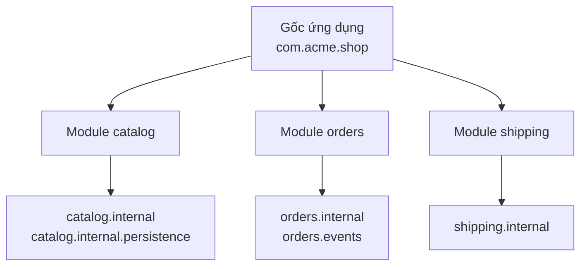
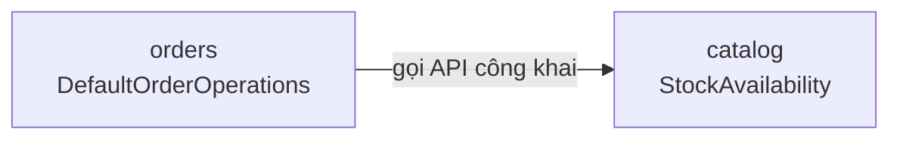
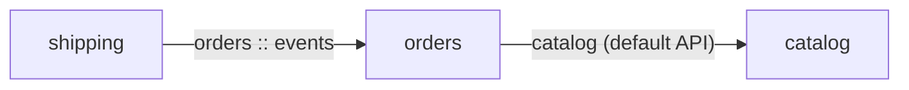

# Package nội bộ và package được phép truy cập

Khi phát triển một ứng dụng Spring Boot theo kiến trúc module, các lớp thường nằm trong cùng một tiến trình, cùng một project và vẫn có thể `import` lẫn nhau theo quy tắc `public` của Java. Tuy nhiên, **biên dịch thành công chưa chứng minh một phụ thuộc là hợp lệ về kiến trúc**. Nếu module `orders` truy cập trực tiếp repository của `catalog`, thay đổi cấu trúc lưu trữ của `catalog` có thể làm `orders` hỏng theo, dù hai module vốn có trách nhiệm khác nhau.

Spring Modulith giải quyết vấn đề này bằng cách phân biệt **API được phép sử dụng từ ngoài module** và **phần triển khai nội bộ**. Nó còn cho phép mỗi module khai báo rõ **những module hoặc named interface mà nó được quyền phụ thuộc**. Các quy tắc này được kiểm chứng bằng `ApplicationModules.verify()`.

Bài thuộc chương **Mô hình module** của **SPRING_MODULITH_VERIFICATION_TESTING**. Hiểu ranh giới truy cập là nền tảng để thực hành `@ApplicationModuleTest`, kiểm thử sự kiện và cơ sở dữ liệu, đồng thời thiết lập quality gate trong CI nhằm ngăn phụ thuộc sai và hồi quy.

## 1. Mục tiêu học tập

Sau bài này, bạn có thể:

1. Xác định lớp nào thuộc module nào, lớp nào là API và lớp nào là nội bộ.
2. Phân biệt quyền truy cập theo Java với quyền truy cập do ranh giới Spring Modulith quy định.
3. Giải thích vì sao package con được coi là nội bộ theo mặc định, kể cả khi lớp trong đó khai báo `public`.
4. Khai báo `@NamedInterface` khi muốn công khai có chủ đích một phần package con.
5. Dùng `@ApplicationModule(allowedDependencies = ...)` giới hạn các module mà một module được phép phụ thuộc.
6. Kiểm chứng truy cập hợp lệ, phụ thuộc ngoài danh sách và chu trình bằng một bài test kiến trúc trong CI.
7. Giữ cho kiểm thử sự kiện, database và tích hợp đi qua hợp đồng module thay vì truy cập thẳng chi tiết triển khai.

## 2. Ví dụ xuyên suốt: catalog, orders và shipping

Giả sử ứng dụng bán hàng đặt lớp Spring Boot chính ở `com.acme.shop`, dưới đó có ba module nghiệp vụ:

```text
src/main/java/
└── com/acme/shop/
    ├── ShopApplication.java
    ├── catalog/
    │   ├── StockAvailability.java
    │   ├── ProductView.java
    │   └── internal/
    │       ├── DefaultStockAvailability.java
    │       └── persistence/
    │           ├── StockEntity.java
    │           └── StockRepository.java
    ├── orders/
    │   ├── OrderId.java
    │   ├── OrderOperations.java
    │   ├── events/
    │   │   ├── package-info.java
    │   │   └── OrderSubmitted.java
    │   └── internal/
    │       ├── DefaultOrderOperations.java
    │       └── OrderRepository.java
    └── shipping/
        ├── ShippingOperations.java
        └── internal/
            └── OrderSubmittedListener.java
```

```java
package com.acme.shop;

import org.springframework.boot.autoconfigure.SpringBootApplication;

@SpringBootApplication
public class ShopApplication {
}
```

Với **chiến lược phát hiện mặc định** của Spring Modulith:

- `com.acme.shop.catalog` là base package của module `catalog`.
- `com.acme.shop.orders` là base package của module `orders`.
- `com.acme.shop.shipping` là base package của module `shipping`.
- Các package sâu hơn như `catalog.internal.persistence` hay `orders.events` **vẫn thuộc module cha**, không tự động trở thành module khác.



Các mũi tên trên **chỉ thể hiện cấu trúc package**, chưa phải quan hệ phụ thuộc giữa các module.

### Phạm vi sở hữu: bên trong và bên ngoài module

| Kiểu | Module sở hữu | Vị trí | Vai trò thường gặp |
| --- | --- | --- | --- |
| `catalog.StockAvailability` | `catalog` | Base package | Hợp đồng API |
| `catalog.ProductView` | `catalog` | Base package | DTO công khai |
| `catalog.internal.DefaultStockAvailability` | `catalog` | Package con | Triển khai |
| `catalog.internal.persistence.StockRepository` | `catalog` | Package con nhiều cấp | Repository nội bộ |
| `orders.OrderOperations` | `orders` | Base package | Hợp đồng API |
| `orders.events.OrderSubmitted` | `orders` | Package con | Sự kiện, có thể công khai bằng named interface |
| `shipping.internal.OrderSubmittedListener` | `shipping` | Package con | Event listener nội bộ |

“Nội bộ” trong mô hình không có nghĩa lớp đó không thể `public`. Nó có nghĩa **các module khác không được phép phụ thuộc trực tiếp vào kiểu này** theo quy tắc module đóng mặc định.

## 3. Hai tầng kiểm soát quyền truy cập

Có hai lớp quy tắc cần kiểm tra:

| Tầng | Được áp dụng bởi | Câu hỏi |
| --- | --- | --- |
| **Ngôn ngữ Java** | Compiler và cơ chế truy cập Java | “Một kiểu/phương thức có thể được tham chiếu từ package này không?” |
| **Kiến trúc Spring Modulith** | Mô hình `ApplicationModules` và phép kiểm chứng | “Một module có được phép phụ thuộc vào kiểu thuộc module khác không?” |

Ví dụ:

```java
// com/acme/shop/catalog/internal/persistence/StockRepository.java
package com.acme.shop.catalog.internal.persistence;

public interface StockRepository {
    long countAvailable(String sku);
}
```

Một lớp thuộc `orders` có thể `import` interface này theo **luật Java**, vì `StockRepository` được khai báo `public`. Nhưng vì interface nằm trong `catalog.internal.persistence`, nó là **nội bộ của module `catalog`**. Spring Modulith coi tham chiếu trực tiếp từ `orders` sang kiểu này là vi phạm ranh giới của module đóng.

Ngược lại, một lớp không có modifier `public` trong `catalog.internal` sẽ không thể được một lớp thuộc `catalog.internal.persistence` truy cập chỉ vì hai lớp cùng một application module. Đó là **hai Java package khác nhau**; quy tắc truy cập package-private của Java vẫn áp dụng.

### Tên package `internal` có bắt buộc không?

**Không.** Các tên `internal`, `domain`, `application`, `persistence`, `adapter` chỉ là quy ước tổ chức thường gặp. Trong mô hình đóng mặc định, **mọi package con** của module đều được xem là nội bộ nếu không có khai báo công khai phù hợp. Ví dụ `catalog.jpa` hay `catalog.services` vẫn là package nội bộ.

Tương tự, đặt tên một package con là `catalog.api` **không tự động biến nó thành public API** của module.

## 4. API công khai mặc định: các kiểu public tại base package

Trong một application module đóng theo cách phát hiện thông thường, các kiểu `public` ở **base package** tạo nên API công khai mặc định. Đây là vị trí phù hợp cho hợp đồng ổn định dùng xuyên module:

```java
// com/acme/shop/catalog/StockAvailability.java
package com.acme.shop.catalog;

public interface StockAvailability {
    boolean canReserve(String sku, int quantity);
}
```

Module `catalog` có thể tự triển khai hợp đồng này trong package con:

```java
// com/acme/shop/catalog/internal/DefaultStockAvailability.java
package com.acme.shop.catalog.internal;

import com.acme.shop.catalog.StockAvailability;
import org.springframework.stereotype.Service;

@Service
class DefaultStockAvailability implements StockAvailability {

    @Override
    public boolean canReserve(String sku, int quantity) {
        // Ví dụ rút gọn; hệ thống thật cần đọc dữ liệu tồn kho nhất quán.
        return quantity > 0;
    }
}
```

Một module khác chỉ cần biết `StockAvailability`, không cần import `DefaultStockAvailability` hoặc `StockRepository`. Quy tắc này giúp thay đổi công nghệ truy vấn/lưu trữ bên trong `catalog` mà ít ảnh hưởng đến module tiêu thụ.

### Nên đưa kiểu nào vào public API?

| Loại kiểu | Thường đặt ở đâu? | Vì sao? |
| --- | --- | --- |
| Interface nghiệp vụ dùng xuyên module | Base package | Hợp đồng thay đổi có kiểm soát |
| DTO/record kết quả công khai | Base package hoặc named interface | Không làm lộ entity nội bộ |
| Event cần module khác lắng nghe | Base package hoặc named interface `events` | Consumer được tham chiếu kiểu sự kiện hợp lệ |
| Spring service triển khai | Package con như `internal` | Module khác chỉ phụ thuộc vào hợp đồng |
| JPA entity, repository, adapter | Package con | Chi tiết triển khai có thể thay đổi |
| Helper, mapper, quy tắc chỉ dùng nội bộ | Package con | Không tạo API thừa |

Đây là **quy tắc thiết kế**, không phải yêu cầu mọi interface hoặc record đều phải public. Những kiểu chỉ dùng trong module nên được giữ nội bộ để giảm bề mặt phụ thuộc.

## 5. Ví dụ phụ thuộc hợp lệ qua API

Module `orders` có một API đặt hàng:

```java
// com/acme/shop/orders/OrderId.java
package com.acme.shop.orders;

import java.util.UUID;

public record OrderId(UUID value) {
}
```

```java
// com/acme/shop/orders/OrderOperations.java
package com.acme.shop.orders;

public interface OrderOperations {
    OrderId submit(String sku, int quantity);
}
```

Phần triển khai nội bộ của `orders` sử dụng API được công khai bởi `catalog`:

```java
// com/acme/shop/orders/internal/DefaultOrderOperations.java
package com.acme.shop.orders.internal;

import com.acme.shop.catalog.StockAvailability;
import com.acme.shop.orders.OrderId;
import com.acme.shop.orders.OrderOperations;
import org.springframework.stereotype.Service;
import java.util.UUID;

@Service
class DefaultOrderOperations implements OrderOperations {

    private final StockAvailability stock;

    DefaultOrderOperations(StockAvailability stock) {
        this.stock = stock;
    }

    @Override
    public OrderId submit(String sku, int quantity) {
        if (!stock.canReserve(sku, quantity)) {
            throw new IllegalStateException("Không đủ tồn kho");
        }

        // Minh họa ranh giới module: chưa lưu đơn hoặc trừ tồn kho.
        return new OrderId(UUID.randomUUID());
    }
}
```

Spring Modulith suy ra cạnh phụ thuộc giữa hai module:



Đây là một phụ thuộc có hướng **`orders → catalog`**. Bên trong module `orders`, `DefaultOrderOperations` có thể tham chiếu các lớp nội bộ của `orders` mà không tạo cạnh xuyên module; mọi tham chiếu sang `catalog` mới cần xét ranh giới của `catalog`.

## 6. Ví dụ vi phạm: truy cập package nội bộ của module khác

Đoạn sau là **ví dụ cố tình sai về kiến trúc**, giả sử `StockRepository` là `public` nên Java cho phép import:

```java
// com/acme/shop/orders/internal/BadOrderService.java
package com.acme.shop.orders.internal;

import com.acme.shop.catalog.internal.persistence.StockRepository;

class BadOrderService {

    private final StockRepository stockRepository;

    BadOrderService(StockRepository stockRepository) {
        this.stockRepository = stockRepository;
    }
}
```

Vì `StockRepository` thuộc `catalog.internal.persistence`, phép kiểm chứng `ApplicationModules.verify()` phát hiện `orders` đang phụ thuộc vào phần **không được công khai** của `catalog`.

**Cách sửa hợp lý:** giữ `StockRepository` ở module `catalog` và đưa thao tác cần dùng vào `StockAvailability` hoặc một hợp đồng API chuyên biệt. Module `orders` dùng hợp đồng đó; phần lưu trữ tiếp tục thuộc trách nhiệm `catalog`.

Nếu đơn giản chuyển `StockRepository` ra base package để qua test, ta có thể vô tình biến chi tiết persistence thành API lâu dài, làm tăng coupling và phạm vi hồi quy.

## 7. Package được phép truy cập: công khai một phần package con

Có lúc một module cần chia API thành những nhóm rõ ràng. Chẳng hạn module `orders` muốn public các sự kiện ở `orders.events` nhưng vẫn giữ `orders.internal` là nội bộ. Khi đó dùng **named interface**.

```java
// com/acme/shop/orders/events/package-info.java
@org.springframework.modulith.NamedInterface("events")
package com.acme.shop.orders.events;
```

Đặt sự kiện `public` trong package đó:

```java
// com/acme/shop/orders/events/OrderSubmitted.java
package com.acme.shop.orders.events;

import java.util.UUID;

public record OrderSubmitted(UUID orderId, String sku) {
}
```

`@NamedInterface("events")` khai báo **một nhóm API công khai được đặt tên** của module `orders`. Package `orders.events` **vẫn thuộc `orders`**; nó không trở thành một application module độc lập.

Sau này `orders` có thể publish sự kiện qua `ApplicationEventPublisher`; module `shipping` lắng nghe qua kiểu `OrderSubmitted`. Để mô tả quyền tiêu thụ API chính xác, module `shipping` có thể khai báo:

```java
// com/acme/shop/shipping/package-info.java
@org.springframework.modulith.ApplicationModule(
        allowedDependencies = "orders :: events"
)
package com.acme.shop.shipping;
```

Và listener:

```java
// com/acme/shop/shipping/internal/OrderSubmittedListener.java
package com.acme.shop.shipping.internal;

import com.acme.shop.orders.events.OrderSubmitted;
import org.springframework.context.event.EventListener;
import org.springframework.stereotype.Component;

@Component
class OrderSubmittedListener {

    @EventListener
    void on(OrderSubmitted event) {
        // Ví dụ minh họa; logic giao hàng sẽ được triển khai riêng.
        System.out.println("Chuẩn bị giao đơn " + event.orderId());
    }
}
```

Lúc này, `shipping` được phép tham chiếu **named interface `events`** của `orders`, nhưng không vì thế mà được import `orders.internal.OrderRepository`.

### Một package con tên `api` vẫn có thể là nội bộ

```text
com.acme.shop.catalog
├── StockAvailability.java         # API mặc định
├── api
│   └── CatalogPriceView.java       # Chưa tự public API của module
└── internal
    └── StockRepository.java        # Nội bộ
```

Muốn công khai `catalog.api` dưới tên `read-model`, khai báo:

```java
// com/acme/shop/catalog/api/package-info.java
@org.springframework.modulith.NamedInterface("read-model")
package com.acme.shop.catalog.api;
```

Khi đó module khác có thể tham chiếu nhóm API này nếu các quy tắc phụ thuộc cho phép, ví dụ chuỗi `catalog :: read-model` trong `allowedDependencies`. Tên được sử dụng là **`read-model`**, không mặc nhiên bằng tên package `api`.

## 8. allowedDependencies: module nguồn được phụ thuộc vào đâu?

`@NamedInterface` trả lời câu hỏi: “**Module đích công khai phần API nào?**”. `allowedDependencies` trả lời câu hỏi khác: “**Module nguồn được phép phụ thuộc vào module hoặc named interface nào?**”.

Ví dụ, trên base package của module `orders`:

```java
// com/acme/shop/orders/package-info.java
@org.springframework.modulith.ApplicationModule(
        allowedDependencies = "catalog"
)
package com.acme.shop.orders;
```

Điều này thể hiện:

- `orders` được phụ thuộc vào **API mặc định** của module `catalog`.
- Nếu `orders` còn tham chiếu API của `shipping`, quan hệ đó vi phạm danh sách được phép.
- `orders` **không** được import các kiểu thuộc `catalog.internal` chỉ vì đã được phép phụ thuộc `catalog`.
- Các tham chiếu nội bộ giữa các kiểu cùng module `orders` không phải là phụ thuộc ra ngoài cần liệt kê.

Với module `shipping` ở phần trước, `allowedDependencies = "orders :: events"` cho phép named interface `events`. Nếu `shipping` cần cả API mặc định `orders` và nhóm sự kiện, nó có thể khai báo:

```java
// Phương án thay thế cho package-info.java của shipping.
@org.springframework.modulith.ApplicationModule(
        allowedDependencies = {"orders", "orders :: events"}
)
package com.acme.shop.shipping;
```

Hai ví dụ `shipping/package-info.java` là **hai phương án loại trừ nhau**. Trong một dự án, hãy giữ một khai báo thể hiện đúng nhu cầu.

### Ma trận quyết định truy cập

Giả sử cấu trúc và annotation giống các ví dụ trên:

| Module nguồn | Kiểu được tham chiếu | Kết quả về kiến trúc | Vì sao? |
| --- | --- | --- | --- |
| `orders` | `catalog.StockAvailability` | **Hợp lệ** | Kiểu ở API mặc định, `catalog` được phép |
| `orders` | `catalog.internal.persistence.StockRepository` | **Vi phạm** | Kiểu nội bộ của `catalog` |
| `orders` | `shipping.ShippingOperations` | **Vi phạm** | `shipping` không có trong `allowedDependencies` của `orders` |
| `shipping` | `orders.events.OrderSubmitted` | **Hợp lệ** | Kiểu thuộc `orders :: events` đã công khai và được phép |
| `shipping` | `orders.OrderOperations` | **Vi phạm** nếu chỉ cho `orders :: events` | Không có quyền dùng API mặc định `orders` |
| `shipping` | `orders.internal.OrderRepository` | **Vi phạm** | Kiểu nội bộ; thêm quyền tới module không mở quyền nội bộ |
| `orders` | `orders.internal.OrderRepository` | **Có thể hợp lệ** | Cùng module; còn tùy quyền truy cập Java |

**Quan trọng:** quy tắc giới hạn được đặt ở **module đi gọi**. Nếu muốn `shipping` chỉ dùng sự kiện của `orders`, hãy khai báo trên package của `shipping`, không đặt giới hạn ấy lên `orders` rồi kỳ vọng nó kiểm soát mọi consumer.

### Nếu không khai báo allowedDependencies thì sao?

Mô hình mặc định không có danh sách module đích hạn chế tường minh từ annotation này. Tuy nhiên, điều đó **không có nghĩa** được tự do import mọi class: ranh giới API/nội bộ và quy tắc không có chu trình giữa các module vẫn được kiểm chứng.

Với các dự án muốn ranh giới chặt chẽ, nên khai báo `allowedDependencies` có chủ đích cho những module quan trọng thay vì để phát sinh phụ thuộc mới không được thảo luận.

## 9. Đồ thị phụ thuộc hợp lệ và phụ thuộc vòng

Ví dụ đang xây dựng có hai quan hệ:

1. `orders → catalog` do dịch vụ đặt hàng dùng API tồn kho.
2. `shipping → orders` do listener dùng named interface sự kiện.



Đồ thị này **không có chu trình**. Nếu `catalog` lại import một API của `shipping`, chu trình `shipping → orders → catalog → shipping` xuất hiện. Việc mọi cạnh đều đi qua kiểu public API **không làm chu trình trở nên hợp lệ** theo quy tắc kiểm chứng mô hình mặc định.

Đặc biệt, named interface **không loại bỏ cạnh phụ thuộc module**. Nó chỉ xác định **vùng API hợp lệ cho cạnh đã tồn tại**. Cần thiết kế chiều phụ thuộc rõ ràng và tránh để module cung cấp dịch vụ biết quá nhiều về module tiêu thụ.

## 10. Kiểm chứng các quy tắc bằng ApplicationModules.verify()

Đặt bài kiểm thử trong `src/test/java/com/acme/shop/ModuleArchitectureTest.java`:

```java
package com.acme.shop;

import org.junit.jupiter.api.Test;
import org.springframework.modulith.core.ApplicationModules;

import static org.junit.jupiter.api.Assertions.assertTrue;

class ModuleArchitectureTest {

    @Test
    void discoversExpectedModules() {
        ApplicationModules modules =
                ApplicationModules.of(ShopApplication.class);

        assertTrue(modules.getModuleByName("catalog").isPresent());
        assertTrue(modules.getModuleByName("orders").isPresent());
        assertTrue(modules.getModuleByName("shipping").isPresent());
    }

    @Test
    void respectsModuleBoundaries() {
        ApplicationModules.of(ShopApplication.class).verify();
    }
}
```

`ApplicationModules.of(ShopApplication.class)` dựng mô hình module từ lớp ứng dụng và những quy tắc phát hiện đang áp dụng. `verify()` kiểm tra cấu trúc, điển hình gồm:

1. **Không phụ thuộc vòng giữa application module.**
2. **Không tham chiếu thành phần nội bộ của module khác** khi dùng mô hình module đóng mặc định.
3. **Không phụ thuộc ra ngoài danh sách `allowedDependencies`** nếu module nguồn có khai báo.

Khi có vi phạm, `verify()` làm bài kiểm thử thất bại, đồng thời cung cấp thông tin để truy tìm những kiểu và quan hệ vi phạm. Đây là kiểm thử **phân tích cấu trúc mã**, không cần khởi động toàn bộ Spring context như `@SpringBootTest`.

### Một kịch bản thực hành nhỏ

1. Chạy test kiến trúc khi `orders` chỉ inject `catalog.StockAvailability`: thiết kế hợp lệ nếu các quy tắc khác đều thỏa.
2. Thay tham chiếu ấy bằng `catalog.internal.persistence.StockRepository`, giả sử kiểu Java được khai báo `public`: test phải báo phụ thuộc nội bộ sai.
3. Đổi lại về `StockAvailability` rồi thêm tham chiếu từ `orders` sang `shipping.ShippingOperations`: test báo phụ thuộc ngoài `allowedDependencies`.
4. Bỏ tham chiếu sai, rồi thêm một lớp của `catalog` dùng API của `shipping`: kiểm tra đồ thị để nhận diện nguy cơ phụ thuộc vòng.
5. Chạy lại test kiến trúc sau mỗi thay đổi để thấy từng quy tắc bảo vệ một nhóm lỗi khác nhau.

Nếu một đoạn ví dụ không biên dịch vì modifier Java, hãy xử lý lỗi Java trước. `verify()` chỉ có thể phân tích những lớp đã được biên dịch/nạp vào phạm vi phân tích theo cấu hình.

## 11. Giải pháp đúng khi gặp truy cập nội bộ sai

| Triệu chứng | Cách xử lý nên ưu tiên | Vì sao? |
| --- | --- | --- |
| Module khác cần đọc dữ liệu của `catalog` | Thêm một query vào interface `catalog.StockAvailability` hoặc API truy vấn phù hợp | Bảo vệ repository, entity và schema nội bộ |
| Một consumer cần kiểu sự kiện ở `orders.events` | Đánh dấu package bằng `@NamedInterface("events")` | Công khai đúng nhóm hợp đồng |
| Consumer cần một nhóm DTO ở `catalog.api` | Khai báo named interface thích hợp hoặc đưa DTO lên base package | Không lộ cả package triển khai |
| `orders` gọi module chưa có trong `allowedDependencies` | Xem lại hướng phụ thuộc rồi chỉnh thiết kế hoặc danh sách được phép | Tránh hợp thức hóa coupling ngoài ý muốn |
| Hai module phụ thuộc qua lại | Tái phân bổ trách nhiệm, dùng hợp đồng hoặc sự kiện theo hướng phù hợp | Khôi phục đồ thị có chiều rõ ràng |
| Một API public chứa kiểu entity nội bộ trong chữ ký | Thay bằng DTO/record hoặc ID công khai | Consumer không phải biết kiểu persistence |

Không nên sửa lỗi bằng cách chuyển mọi class từ `internal` lên base package, hoặc gắn `@NamedInterface` lên toàn bộ package nội bộ. Những thay đổi đó có thể khiến test xanh nhưng làm ranh giới kiến trúc mất ý nghĩa.

### Open application module là gì?

Spring Modulith cho phép chủ động khai báo **module mở** để nới quy tắc đóng gói nội bộ:

```java
// com/acme/shop/catalog/package-info.java
@org.springframework.modulith.ApplicationModule(
    type = org.springframework.modulith.ApplicationModule.Type.OPEN
)
package com.acme.shop.catalog;
```

Module mở có thể hữu ích khi chuyển dần một codebase cũ sang kiến trúc module, nhưng nó **làm giảm mức bảo vệ các kiểu nội bộ**. Trong ví dụ học tập này, nếu `orders` cần một chức năng của `catalog`, giải pháp mặc định nên là **thiết kế lại API**, không mở toàn bộ module để tránh báo lỗi.

> Những quy tắc mô tả ở trên dựa trên **module đóng với chiến lược phát hiện mặc định**. Nếu dự án dùng nested module, chiến lược phát hiện tường minh hoặc tùy biến, phải khảo sát mô hình `ApplicationModules` thực tế thay vì chỉ suy từ tên thư mục.

## 12. Từ ranh giới truy cập đến @ApplicationModuleTest

`ApplicationModules.verify()` trả lời “**mã nguồn có tuân thủ kiến trúc không?**”. `@ApplicationModuleTest` trả lời câu hỏi khác: “**module này có hoạt động đúng trong Spring Test context phù hợp không?**”.

Ví dụ test tích hợp đặt trong package module `orders`:

```java
package com.acme.shop.orders;

import org.junit.jupiter.api.Test;
import org.springframework.modulith.test.ApplicationModuleTest;

@ApplicationModuleTest
class OrdersModuleIntegrationTest {

    @Test
    void loadsOrdersModule() {
        // Bổ sung assertion và dữ liệu kiểm thử khi các bean được triển khai.
    }
}
```

Test tích hợp cho `orders` có thể cần mock API tồn kho `StockAvailability` hoặc cấu hình bootstrap thêm module phụ thuộc để cung cấp bean thật. Phạm vi nạp context phụ thuộc cách thiết lập `@ApplicationModuleTest`; bài test kiến trúc và bài test tích hợp phục vụ **hai mục đích bổ sung cho nhau**.

### Liên hệ kiểm thử cơ sở dữ liệu

Repository của `orders` nên thuộc package nội bộ `orders.internal` và được kiểm thử qua API `orders.OrderOperations`. Module `shipping` không nên dùng trực tiếp `orders.internal.OrderRepository` chỉ để truy vấn trạng thái đơn hàng. Nếu `shipping` thật sự cần thông tin, hãy cung cấp hợp đồng công khai hoặc sự kiện chứa dữ liệu thích hợp.

### Liên hệ kiểm thử sự kiện

`orders.events.OrderSubmitted` có thể là hợp đồng public để `shipping` lắng nghe. `verify()` xác nhận quyền tham chiếu **kiểu sự kiện** hợp lệ; còn kiểm thử sự kiện phải xác nhận quá trình publish, listener được gọi, transaction và xử lý lỗi đúng mong đợi. Khai báo named interface **không tự kích hoạt** cơ chế giao sự kiện.

| Câu hỏi | Cách kiểm tra phù hợp |
| --- | --- |
| `shipping` có được import `orders.events.OrderSubmitted`? | `@NamedInterface`, `allowedDependencies` và `verify()` |
| Listener có nhận sự kiện khi order được tạo? | Spring Test / `@ApplicationModuleTest` với xác nhận sự kiện hoặc side effect |
| Dữ liệu đặt hàng được lưu nhất quán? | Kiểm thử repository, transaction và tích hợp database |
| Một thay đổi tạo phụ thuộc sai có bị ngăn trước khi merge? | Chạy `verify()` trong quality gate CI |

## 13. Đưa kiểm chứng vào quality gate của CI

Không nhất thiết xây dựng một công cụ riêng. Chỉ cần đưa bài kiểm thử `ModuleArchitectureTest` vào tập test bắt buộc của dự án:

```text
Developer thay đổi code
       |
       v
Biên dịch và chạy test
       |
       +--> ModuleArchitectureTest (verify)
       |           |
       |           +--> PASS: đúng ranh giới kiến trúc
       |           |
       |           +--> FAIL: nội bộ / allowedDependencies / chu trình
       |
       +--> ApplicationModuleTest / integration tests
       |
       v
Cho phép merge khi các kiểm tra bắt buộc đều PASS
```

Ví dụ lệnh test phụ thuộc công cụ build đã chọn:

```bash
# Với Maven Wrapper:
./mvnw test

# Hoặc với Gradle Wrapper:
./gradlew test
```

Ở môi trường Windows, có thể dùng wrapper tương ứng `mvnw.cmd` hoặc `gradlew.bat`. Lệnh chạy từ thư mục dự án phù hợp và phải được cấu hình để bao gồm các bài kiểm thử kiến trúc.

**Đừng chỉ chạy `verify()` thủ công một lần.** Việc đặt bài test trong CI mới giúp thay đổi mã về sau không âm thầm làm rò rỉ lớp nội bộ hoặc tạo chiều phụ thuộc mới.

## 14. Bài thực hành: phân loại truy cập hợp lệ và vi phạm

Xét ứng dụng:

```text
com.example.ticket
├── TicketApplication.java
├── booking/
│   ├── BookingOperations.java
│   ├── BookingId.java
│   ├── events/
│   │   ├── package-info.java  (@NamedInterface("events"))
│   │   └── BookingConfirmed.java
│   └── internal/
│       ├── BookingService.java
│       └── BookingRepository.java
├── payment/
│   ├── PaymentOperations.java
│   └── internal/
│       └── PaymentAdapter.java
└── notification/
    ├── NotificationOperations.java
    └── internal/
        └── BookingConfirmedListener.java
```

Giả sử:

```java
// com/example/ticket/booking/package-info.java
@org.springframework.modulith.ApplicationModule(
        allowedDependencies = "payment"
)
package com.example.ticket.booking;
```

```java
// com/example/ticket/notification/package-info.java
@org.springframework.modulith.ApplicationModule(
        allowedDependencies = "booking :: events"
)
package com.example.ticket.notification;
```

Các module là **module đóng mặc định** và mọi kiểu cần thiết trong ví dụ được khai báo `public`, trừ khi ghi rõ khác.

**Yêu cầu:**

1. `booking.internal.BookingService` tham chiếu `payment.PaymentOperations`: hợp lệ không?
2. `booking.internal.BookingService` tham chiếu `payment.internal.PaymentAdapter`: hợp lệ không?
3. `notification.internal.BookingConfirmedListener` tham chiếu `booking.events.BookingConfirmed`: hợp lệ không?
4. `notification.internal.BookingConfirmedListener` tham chiếu `booking.BookingOperations`: hợp lệ không, nếu chỉ được phép `booking :: events`?
5. `payment.internal.PaymentAdapter` tham chiếu `booking.internal.BookingRepository`: hợp lệ không nếu `payment` không khai báo `allowedDependencies`?
6. Nếu có thêm phụ thuộc `payment → booking` qua public API, kết hợp `booking → payment` dẫn tới vấn đề gì?
7. Những tình huống nào bắt buộc cần kiểm thử hành vi bên cạnh `verify()`?

**Đáp án và lý do:**

1. **Hợp lệ**, nếu không có quy tắc khác vi phạm: `payment` được liệt kê và `PaymentOperations` nằm trong API mặc định.
2. **Vi phạm**: `PaymentAdapter` ở package con nội bộ của `payment`; quyền phụ thuộc module không mở quyền dùng kiểu nội bộ.
3. **Hợp lệ**, vì `BookingConfirmed` được công khai qua `booking :: events` và `notification` được cho phép sử dụng nhóm này.
4. **Vi phạm**: `BookingOperations` thuộc API mặc định của `booking`, trong khi `notification` chỉ có quyền tới named interface `events`.
5. **Vi phạm**: không có `allowedDependencies` không có nghĩa được truy cập repository nội bộ của module khác.
6. **Phụ thuộc vòng** giữa `booking` và `payment`; cần sửa chiều phụ thuộc hoặc thiết kế hợp đồng.
7. Publish sự kiện, callback/listener, transaction, retry, truy vấn/ghi database và các kết quả nghiệp vụ cần kiểm thử runtime bằng `@ApplicationModuleTest` hoặc kiểm thử tích hợp tương ứng.

### Thử mở rộng

Thêm package `booking.api` chứa kiểu `BookingSummary` và để `notification` tham chiếu kiểu đó. Hãy thực hiện lần lượt hai thay đổi:

1. Chưa khai báo named interface: dự đoán lỗi truy cập nội bộ.
2. Khai báo `@NamedInterface("read-model")` cho `booking.api` và bổ sung `"booking :: read-model"` vào `allowedDependencies` của `notification`: dự đoán kết quả kiểm chứng và lý giải vì sao `booking.internal.BookingRepository` vẫn không được công khai.

## 15. Checklist khi review ranh giới truy cập

- [ ] Xác định đúng module sở hữu mỗi kiểu theo base package và những package con.
- [ ] Phân biệt `public` của Java với public API của application module.
- [ ] Không cho module khác import trực tiếp service, repository, entity hoặc adapter nội bộ.
- [ ] Chỉ công khai nhóm API thật sự cần qua base package hoặc `@NamedInterface`.
- [ ] Khai báo `allowedDependencies` ở **module sử dụng** khi cần ràng buộc chiều phụ thuộc.
- [ ] Kiểm tra kiểu đích vừa thuộc API công khai, vừa nằm trong danh sách phụ thuộc được phép.
- [ ] Không tạo vòng phụ thuộc khi bổ sung giao diện đồng bộ hoặc event listener.
- [ ] Đặt `ApplicationModules.of(...).verify()` vào tập test bắt buộc của CI.
- [ ] Bổ sung `@ApplicationModuleTest` và kiểm thử DB/sự kiện để xác nhận hành vi runtime.

**Ghi nhớ:** Một package con **nội bộ** vẫn thuộc application module, nhưng module khác **không được tùy ý truy cập** chỉ vì lớp bên trong khai báo `public`. Base package cung cấp API mặc định; named interface chủ động công khai một phần package con; `allowedDependencies` hạn chế các API mà module nguồn được quyền sử dụng. Kết hợp các quy tắc đó với `ApplicationModules.verify()` giúp biến ranh giới module thành **quy tắc có thể kiểm tra tự động**.

## Tài liệu tham khảo

- [Spring Modulith — Fundamentals: Application Modules](https://docs.spring.io/spring-modulith/reference/fundamentals.html)
- [Spring Modulith — Verifying Application Module Structure](https://docs.spring.io/spring-modulith/reference/verification.html)
- [Spring Modulith — Testing Application Modules](https://docs.spring.io/spring-modulith/reference/testing.html)
- [Spring Modulith API — ApplicationModule](https://docs.spring.io/spring-modulith/docs/current/api/org/springframework/modulith/core/ApplicationModule.html)
- [Spring Modulith API — ApplicationModules](https://docs.spring.io/spring-modulith/docs/current/api/org/springframework/modulith/core/ApplicationModules.html)
- [Spring Modulith API — NamedInterface](https://docs.spring.io/spring-modulith/docs/current/api/org/springframework/modulith/NamedInterface.html)
