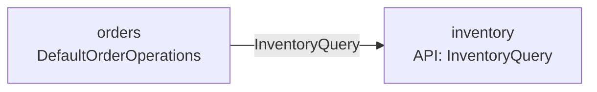
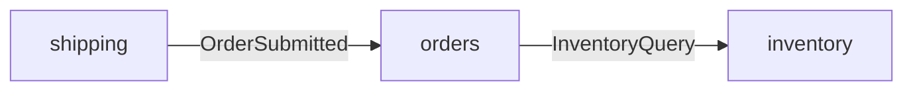
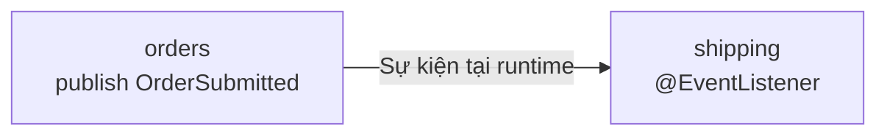
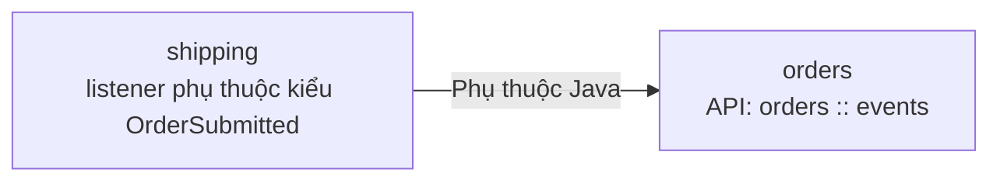
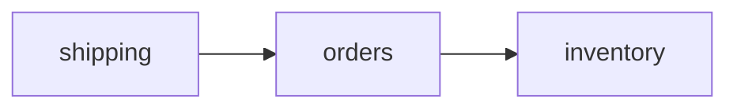
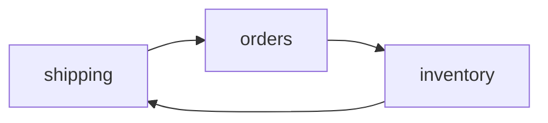
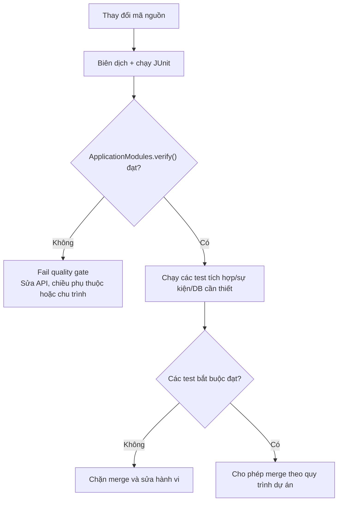

# Module dependency và hướng phụ thuộc

Trong ứng dụng Spring Boot dạng modular monolith, nhiều module cùng chạy trong một tiến trình. Điều đó **không có nghĩa mọi module đều nên import hoặc gọi trực tiếp mọi lớp của nhau**. Khi module đặt hàng cần biết tình trạng tồn kho, chẳng hạn, thiết kế cần trả lời: module nào phụ thuộc vào module nào, phụ thuộc đó đi theo chiều nào, và có khiến hai module phụ thuộc vòng hay không?

Spring Modulith xây dựng mô hình `ApplicationModules` từ cấu trúc package và các quan hệ tham chiếu giữa kiểu Java. Mô hình này cho phép quan sát các **module dependency** dưới dạng đồ thị có hướng và dùng `verify()` kiểm tra ranh giới kiến trúc.

Bài học thuộc chương **Mô hình module** của **SPRING_MODULITH_VERIFICATION_TESTING**. Hiểu đúng chiều phụ thuộc giúp giới hạn `allowedDependencies`, đặt API ở đúng module, viết `@ApplicationModuleTest`, kiểm thử sự kiện và dữ liệu đúng trách nhiệm, đồng thời tạo quality gate CI ngăn phụ thuộc sai và hồi quy.

## 1. Kết quả cần đạt

Sau bài học, bạn có thể:

1. Giải thích cạnh `A → B` trên đồ thị module và suy ra nó từ một tham chiếu Java cụ thể.
2. Phân biệt quan hệ phụ thuộc kiến trúc với luồng thực thi request, sự kiện hoặc dữ liệu ở runtime.
3. Nhận diện phụ thuộc trực tiếp, gián tiếp và chu trình qua hai hay nhiều module.
4. Phân biệt một tham chiếu đến **API công khai** với tham chiếu vào **package nội bộ** của module khác.
5. Dùng `@ApplicationModule(allowedDependencies = ...)` và named interface để giới hạn phụ thuộc hợp lệ.
6. Viết bài kiểm thử `ApplicationModules.of(...).verify()` làm hàng rào kiến trúc trong CI.
7. Phân tích tác động của đồ thị phụ thuộc tới kiểm thử tích hợp theo module.

## 2. Một dependency giữa module nghĩa là gì?

Giả sử Spring Modulith phát hiện ba application module: `orders`, `inventory` và `shipping`.

**Định nghĩa thực hành:** có cạnh **`A → B`** khi mã thuộc module `A` tham chiếu một kiểu Java thuộc module `B` theo quan hệ mà cơ chế phân tích cấu trúc nhận diện.

| Thành phần | Ý nghĩa của `orders → inventory` |
| --- | --- |
| Module nguồn (*source*) | `orders`, nơi có kiểu đang khai báo tham chiếu |
| Module đích (*target*) | `inventory`, nơi sở hữu kiểu được tham chiếu |
| Chiều mũi tên | Từ **bên cần dùng** sang **bên cung cấp kiểu/hợp đồng** |
| Nguyên nhân có thể thấy trong mã | Một lớp `orders` inject `inventory.InventoryQuery` |
| Điều mũi tên **không** khẳng định | `inventory` phải chạy trước, một request luôn gọi sang `inventory` hoặc `inventory` biết về `orders` |

Quy tắc đọc quan trọng:

> **`A → B` nghĩa là A phụ thuộc vào B. Muốn thay đổi hợp đồng của B, cần cân nhắc các consumer như A.** Mũi tên không biểu thị quyền sở hữu của A đối với B.

Đồ thị phụ thuộc module có hướng (*directed graph*). Hai module cùng chạy trong Spring context không tự tạo cạnh; chính các tham chiếu giữa kiểu Java liên quan mới hình thành quan hệ.

### Module khác Java package và Maven/Gradle module

`ApplicationModules` mô hình hóa **application module** do Spring Modulith phát hiện, thường từ những package con trực tiếp dưới package ứng dụng. Một module có thể chứa nhiều package Java và không cần là một project Gradle hoặc Maven riêng.

Vì thế, import từ `orders.internal` sang `orders.OrderOperations` thường là quan hệ **nội bộ cùng application module**. Nhưng import từ `orders.internal` sang `inventory.InventoryQuery` là quan hệ **xuyên ranh giới application module**.

## 3. Dựng đồ thị từ một cấu trúc package thực tế

Giả sử ứng dụng quản lý đơn hàng có cấu trúc:

```text
src/main/java/
└── com/acme/shop/
    ├── ShopApplication.java
    ├── orders/
    │   ├── OrderOperations.java
    │   ├── OrderId.java
    │   ├── events/
    │   │   ├── package-info.java
    │   │   └── OrderSubmitted.java
    │   └── internal/
    │       ├── DefaultOrderOperations.java
    │       └── OrderRepository.java
    ├── inventory/
    │   ├── InventoryQuery.java
    │   └── internal/
    │       └── DefaultInventoryQuery.java
    └── shipping/
        ├── ShippingOperations.java
        └── internal/
            └── OrderSubmittedListener.java
```

Lớp khởi động:

```java
package com.acme.shop;

import org.springframework.boot.autoconfigure.SpringBootApplication;

@SpringBootApplication
public class ShopApplication {
}
```

Theo chiến lược phát hiện mặc định, ba sub-package trực tiếp `orders`, `inventory` và `shipping` tạo nên ba application module. Những package `orders.internal`, `orders.events`, `inventory.internal`, `shipping.internal` mặc định thuộc module cha tương ứng.

### Bước 1: xác định module sở hữu từng kiểu

| Kiểu | Package | Module sở hữu |
| --- | --- | --- |
| `DefaultOrderOperations` | `com.acme.shop.orders.internal` | `orders` |
| `OrderOperations` | `com.acme.shop.orders` | `orders` |
| `InventoryQuery` | `com.acme.shop.inventory` | `inventory` |
| `OrderSubmitted` | `com.acme.shop.orders.events` | `orders` |
| `OrderSubmittedListener` | `com.acme.shop.shipping.internal` | `shipping` |

### Bước 2: tìm tham chiếu giữa các kiểu

Module `inventory` cung cấp một hợp đồng kiểm tra tồn kho:

```java
// com/acme/shop/inventory/InventoryQuery.java
package com.acme.shop.inventory;

public interface InventoryQuery {
    boolean isAvailable(String sku, int quantity);
}
```

Module `orders` cung cấp hợp đồng đặt hàng và kiểu định danh công khai:

```java
// com/acme/shop/orders/OrderOperations.java
package com.acme.shop.orders;

public interface OrderOperations {
    OrderId submit(String sku, int quantity);
}
```

```java
// com/acme/shop/orders/OrderId.java
package com.acme.shop.orders;

import java.util.UUID;

public record OrderId(UUID value) {
}
```

Phần triển khai của `orders` sử dụng kiểu `InventoryQuery`:

```java
// com/acme/shop/orders/internal/DefaultOrderOperations.java
package com.acme.shop.orders.internal;

import com.acme.shop.inventory.InventoryQuery;
import com.acme.shop.orders.OrderId;
import com.acme.shop.orders.OrderOperations;
import org.springframework.stereotype.Service;

import java.util.UUID;

@Service
class DefaultOrderOperations implements OrderOperations {

    private final InventoryQuery inventory;

    DefaultOrderOperations(InventoryQuery inventory) {
        this.inventory = inventory;
    }

    @Override
    public OrderId submit(String sku, int quantity) {
        if (!inventory.isAvailable(sku, quantity)) {
            throw new IllegalStateException("Không đủ tồn kho");
        }

        // Minh họa chiều phụ thuộc, chưa bao gồm lưu đơn và giao dịch.
        return new OrderId(UUID.randomUUID());
    }
}
```

Constructor của `DefaultOrderOperations` tham chiếu một interface **thuộc module `inventory`**. Kết quả là cạnh:



Chiều ở đây là **`orders → inventory`**. Đừng đảo lại thành `inventory → orders` chỉ vì trong nghiệp vụ tồn kho “phục vụ đơn hàng”; bên khai báo phụ thuộc Java mới là nguồn.

### Bước 3: tổng hợp ở cấp module

Giả sử module `shipping` lắng nghe sự kiện đặt hàng do `orders` công khai. `OrderSubmittedListener` chứa tham số `OrderSubmitted`, tạo thêm cạnh `shipping → orders`.



Đồ thị có ba đỉnh, hai cạnh và **không có chu trình**. Mỗi cạnh là một quan hệ phụ thuộc được tổng hợp từ các tham chiếu kiểu cụ thể; dù `shipping` có nhiều listener dùng các kiểu thuộc `orders`, ở mức khái niệm vẫn có quan hệ `shipping → orders`.

## 4. Những tham chiếu nào có thể tạo dependency?

Không phải chỉ `@Autowired` hay constructor injection mới tạo quan hệ phụ thuộc. Với phân tích kiến trúc dựa trên mã/bytecode (Spring Modulith sử dụng ArchUnit), các quan hệ kiểu Java tĩnh có thể được xét từ nhiều vị trí.

| Dạng tham chiếu trong module nguồn | Ví dụ | Chiều module suy ra |
| --- | --- | --- |
| Kiểu của field hoặc tham số constructor | `private final InventoryQuery inventory;` | `orders → inventory` |
| Kiểu tham số hoặc trả về của method | `InventorySnapshot getSnapshot();` | Module khai báo method → module sở hữu `InventorySnapshot` |
| Kế thừa hoặc triển khai interface | `class X implements ExternalContract` | Module chứa `X` → module chứa `ExternalContract` |
| Tạo đối tượng hoặc gọi phương thức kiểu khác | `new ExternalDto(...)` | Module nơi mã gọi → module sở hữu kiểu đó |
| Annotation hoặc khai báo kiểu liên quan | Tham chiếu tới kiểu ở module khác trong metadata Java | Có thể tạo quan hệ tĩnh được phân tích, tùy dạng tham chiếu |
| Tham chiếu giữa các kiểu cùng module | `orders.internal.Service → orders.OrderId` | **Không** sinh cạnh xuyên module |

Điểm cần kiểm tra là **kiểu đích thuộc về module nào**, sau đó mới xác định quan hệ có đi qua ranh giới hay không. Tên biến, tên method hoặc ý định nghiệp vụ không tự quyết định chiều cạnh.

Phân tích tĩnh có giới hạn. Ví dụ một lớp được tra bằng chuỗi tên, reflection hoặc cấu hình runtime có thể không hiện ra như một cạnh kiểu Java thông thường. Vì thế `verify()` rất mạnh trong việc bảo vệ các phụ thuộc mã được nhận diện, nhưng không thay thế kiểm thử tích hợp để quan sát hành vi thực tế.

## 5. Phân biệt dependency graph và runtime call flow

Đây là hai sơ đồ có ý nghĩa khác nhau:

| Góc nhìn | Câu hỏi | Ví dụ |
| --- | --- | --- |
| **Dependency graph** | “Mã của module nào phải biết kiểu của module nào?” | `orders → inventory` vì inject `InventoryQuery` |
| **Call flow** | “Khi một thao tác chạy, thành phần nào thực sự gọi thành phần nào?” | Khi submit đơn, `DefaultOrderOperations` có thể gọi `InventoryQuery.isAvailable(...)` |
| **Event flow** | “Ai phát sự kiện và ai nhận được nó?” | `orders` phát `OrderSubmitted`; `shipping` xử lý |
| **Data flow** | “Dữ liệu được chuyển qua những bước nào?” | Dữ liệu đơn hàng → event payload → logic giao vận |

Hai góc nhìn có thể trùng chiều ở cuộc gọi đồng bộ, nhưng với sự kiện thì thường khác.

### Event flow: publisher và consumer

Module `orders` định nghĩa sự kiện:

```java
// com/acme/shop/orders/events/OrderSubmitted.java
package com.acme.shop.orders.events;

import java.util.UUID;

public record OrderSubmitted(UUID orderId, String sku) {
}
```

Khai báo package sự kiện là API được công khai:

```java
// com/acme/shop/orders/events/package-info.java
@org.springframework.modulith.NamedInterface("events")
package com.acme.shop.orders.events;
```

Trong mã thuộc `orders`, ta có thể phát sự kiện bằng `ApplicationEventPublisher`. Ví dụ rút gọn:

```java
// Một method nội bộ trong module orders.
import com.acme.shop.orders.events.OrderSubmitted;
import org.springframework.context.ApplicationEventPublisher;

void publishOrderSubmitted(
        ApplicationEventPublisher publisher,
        java.util.UUID orderId,
        String sku
) {
    publisher.publishEvent(new OrderSubmitted(orderId, sku));
}
```

Module `shipping` khai báo listener:

```java
// com/acme/shop/shipping/internal/OrderSubmittedListener.java
package com.acme.shop.shipping.internal;

import com.acme.shop.orders.events.OrderSubmitted;
import org.springframework.context.event.EventListener;
import org.springframework.stereotype.Component;

@Component
class OrderSubmittedListener {

    @EventListener
    void on(OrderSubmitted event) {
        // Minh họa phản ứng trước sự kiện; logic giao vận nằm ở shipping.
        System.out.println("Chuẩn bị giao đơn " + event.orderId());
    }
}
```

Ở runtime, sự kiện đi từ `orders` tới consumer `shipping`:



Nhưng trong **đồ thị phụ thuộc mã**, listener ở `shipping` **import kiểu sự kiện do `orders` sở hữu**:



**Cùng một use case có thể có hai mũi tên ngược hướng**, vì một sơ đồ mô tả *phát và nhận sự kiện*, còn sơ đồ kia mô tả *tham chiếu kiểu Java*. Việc `orders` gọi `publishEvent(...)` không buộc `orders` phải import `OrderSubmittedListener` hoặc biết module `shipping` tồn tại.

Thiết kế sự kiện như vậy giúp module phát sự kiện không phụ thuộc vào module xử lý. Tuy nhiên, nếu `orders` còn import `ShippingOperations` thì nó lại tạo thêm cạnh `orders → shipping`, và khi ghép với `shipping → orders` có thể hình thành chu trình.

> **Bài học về hướng:** đừng đảo cạnh trên dependency graph theo chiều data flow hoặc event flow. Hãy lần ngược về **kiểu Java được khai báo tham chiếu trong mã nguồn**.

## 6. Trực tiếp, gián tiếp và phụ thuộc vòng

Với đồ thị:



- **Phụ thuộc trực tiếp:** `shipping → orders`, `orders → inventory`.
- **Khả năng bị ảnh hưởng gián tiếp:** thay đổi public API của `inventory` có thể ảnh hưởng `orders`, rồi dẫn đến tác động nghiệp vụ tới `shipping`; tuy nhiên **không tự kết luận** `shipping` đang có một import trực tiếp từ `inventory`.
- **Đường đi phụ thuộc:** `shipping → orders → inventory` là một đường trong đồ thị.

Khi thêm cạnh `inventory → shipping`, ta có:



Đây là **chu trình ba module**. Cũng có thể có chu trình trực tiếp hai module, chẳng hạn `orders → inventory → orders`.

Tại sao chu trình là vấn đề?

1. Thay đổi một API dễ lan ngược vào module ban đầu, làm giảm khả năng chỉnh sửa độc lập.
2. Trách nhiệm nghiệp vụ trở nên khó xác định: module “phụ thuộc” đồng thời là module “được phụ thuộc”.
3. Khó xây dựng kiểm thử cô lập khi một module cần nạp hoặc mock chuỗi phụ thuộc quay lại chính nó.
4. Các ranh giới được công bố mất tác dụng phân lớp, dù các Java class vẫn có thể biên dịch.

Một quy tắc cốt lõi của `ApplicationModules.verify()` là **không để các application module tạo phụ thuộc vòng**. Việc một cạnh trỏ vào public API hợp lệ không khiến cả chu trình tự động hợp lệ.

## 7. Hướng phụ thuộc đúng được thiết kế như thế nào?

Không có quy tắc tuyệt đối “module nào luôn phải đứng trước module nào” cho mọi miền nghiệp vụ. Tuy nhiên, có những cách ra quyết định giúp giữ đồ thị rõ ràng.

### 7.1. Module điều phối phụ thuộc vào hợp đồng của module cung cấp

Nếu `orders` điều phối việc tạo đơn và cần truy vấn tồn kho, chiều hợp lý có thể là **`orders → inventory`** qua `InventoryQuery`. `inventory` không cần import `OrderOperations` chỉ vì xử lý dữ liệu phục vụ nghiệp vụ đặt hàng.

### 7.2. Tách hợp đồng ổn định khỏi chi tiết triển khai

Một module khác không nên tham chiếu `inventory.internal.InventoryRepository`. Hãy để module sở hữu dữ liệu cung cấp một API phù hợp, ví dụ `inventory.InventoryQuery`, rồi đặt chi tiết JPA, query và storage ở package nội bộ.

### 7.3. Dùng sự kiện để tránh module phát biết trực tiếp consumer

Nếu `shipping` chỉ cần phản ứng khi đơn được xác nhận, `orders` có thể publish `OrderSubmitted` và giữ kiểu sự kiện trong API. Listener ở `shipping` sẽ phụ thuộc vào hợp đồng sự kiện của `orders`. Cách này tránh việc `orders` gọi ngược dịch vụ giao vận chỉ để báo tin, nhưng **không** có nghĩa mọi cách dùng event đều tự loại bỏ chu trình.

### 7.4. Không dùng “shared” làm lối thoát mặc định

Đưa các class quan trọng vào một module `shared` hoặc `common` chỉ để làm hết lỗi vòng có thể khiến API thiếu chủ sở hữu rõ ràng. Nên xác định module nào thực sự sở hữu hợp đồng, hoặc tách trách nhiệm nghiệp vụ một cách có chủ đích.

### 7.5. Đánh giá ảnh hưởng trước khi đảo chiều

| Tình huống | Hướng nên xem xét | Nguy cơ nếu làm ngược |
| --- | --- | --- |
| `orders` hỏi tồn kho | `orders → inventory` | `inventory` phụ thuộc ngược `orders` dễ tạo vòng |
| `shipping` nhận event đặt hàng | `shipping → orders :: events` trong mã | Cho `orders` import listener của `shipping` làm publisher biết consumer |
| Module cần đọc dữ liệu từ module khác | Consumer → API query của module sở hữu | Consumer import trực tiếp repository hoặc entity nội bộ |
| Một module gọi callback thuộc module khác | Kiểm tra vị trí đặt contract và chiều dependency | Callback đôi khi vô tình tạo cạnh ngược thứ hai |
| Nhiều module cần cùng một kiểu dữ liệu | Đặt hợp đồng ở module sở hữu miền hoặc module hợp đồng có chủ đích | Chia sẻ entity persistence làm rò rỉ cài đặt |

## 8. allowedDependencies kiểm soát **cạnh đi ra** của module

`ApplicationModules` có thể phát hiện quan hệ đã tồn tại trong mã. Khi muốn quy định **cạnh nào được phép có**, khai báo `allowedDependencies` tại **base package của module nguồn**:

```java
// com/acme/shop/orders/package-info.java
@org.springframework.modulith.ApplicationModule(
    allowedDependencies = "inventory"
)
package com.acme.shop.orders;
```

Nghĩa là module `orders` được phép phụ thuộc vào **API mặc định** của module `inventory`. Quy tắc **không** được đặt trên `inventory` để mô tả quyền đi ra của `orders`.

Với module `shipping` chỉ cần event từ `orders`:

```java
// com/acme/shop/shipping/package-info.java
@org.springframework.modulith.ApplicationModule(
    allowedDependencies = "orders :: events"
)
package com.acme.shop.shipping;
```

Trong đó `orders :: events` tham chiếu tới **named interface `events`** của `orders`, đã công bố bằng `@NamedInterface("events")`.

### Ma trận quyền phụ thuộc

| Module nguồn | Kiểu đích | Hợp lệ trong cấu hình ví dụ? | Lý do |
| --- | --- | --- | --- |
| `orders` | `inventory.InventoryQuery` | Có | `inventory` được cho phép, kiểu ở API mặc định |
| `orders` | `inventory.internal.DefaultInventoryQuery` | Không | Kiểu nội bộ của `inventory` |
| `orders` | `shipping.ShippingOperations` | Không | `shipping` nằm ngoài `allowedDependencies` của `orders` |
| `shipping` | `orders.events.OrderSubmitted` | Có | Kiểu thuộc `orders :: events` và được cho phép |
| `shipping` | `orders.OrderOperations` | Không | Chỉ cho phép `orders :: events`, chưa cho API mặc định `orders` |
| `shipping` | `orders.internal.OrderRepository` | Không | Kiểu thuộc phần nội bộ của `orders` |
| `orders` | `orders.internal.OrderRepository` | Có nếu Java cho phép | Cùng module, không phải cạnh vượt ranh giới |

**Hai bộ điều kiện phải đồng thời đúng:** module nguồn được phép phụ thuộc tới **interface đích**, và kiểu đích phải thuộc **API được công khai** của module đó. Việc cho phép tên module không tự mở quyền truy cập mọi class `public` nằm trong package con của module.

Nếu module nguồn không khai báo `allowedDependencies`, danh sách hạn chế tường minh này không áp dụng; các quy tắc về API nội bộ và phụ thuộc vòng vẫn có ý nghĩa.

### Phân biệt allowedDependencies với module discovery

`allowedDependencies` **không tạo** cạnh phụ thuộc và cũng không tạo module mới. Một khai báo `allowedDependencies = "inventory"` chỉ mô tả quyền; cạnh `orders → inventory` vẫn cần phát sinh từ một tham chiếu Java cụ thể.

Đồng thời, việc có quyền phụ thuộc `inventory` không tự khiến các Spring bean của `inventory` được bootstrap trong mọi kiểu kiểm thử. Phạm vi Spring Test context được điều khiển riêng bởi cấu hình kiểm thử.

## 9. Kiểm tra hướng phụ thuộc bằng JUnit

Để kiểm chứng kiến trúc, bắt đầu bằng một bài test độc lập với Spring context đầy đủ:

```java
package com.acme.shop;

import org.junit.jupiter.api.Test;
import org.springframework.modulith.core.ApplicationModules;

import static org.junit.jupiter.api.Assertions.assertTrue;

class ModuleArchitectureTest {

    private final ApplicationModules modules =
            ApplicationModules.of(ShopApplication.class);

    @Test
    void discoversExpectedModules() {
        assertTrue(modules.getModuleByName("orders").isPresent());
        assertTrue(modules.getModuleByName("inventory").isPresent());
        assertTrue(modules.getModuleByName("shipping").isPresent());
    }

    @Test
    void enforcesAllowedDependencyDirections() {
        modules.verify();
    }
}
```

`verify()` kiểm tra những quy tắc cấu trúc cốt lõi của Spring Modulith, gồm:

1. **Phụ thuộc vòng** giữa application module.
2. **Truy cập vào kiểu nội bộ** của một application module từ module khác trong mô hình đóng mặc định.
3. **Quan hệ không có trong `allowedDependencies`**, nếu module nguồn có khai báo giới hạn này.

Kiểm tra này dựa trên phân tích cấu trúc mã; không phải chạy luồng tạo đơn thật và không cần khởi động toàn bộ Spring Boot context chỉ để xác minh dependency graph.

### Cách tạo lỗi có chủ đích để hiểu kết quả

**Tình huống A — hướng phụ thuộc ngoài danh sách:** thêm field hoặc constructor parameter `ShippingOperations` vào một lớp trong `orders`, trong khi `orders` chỉ cho phép `inventory`. Quan hệ mới `orders → shipping` vi phạm `allowedDependencies`.

**Tình huống B — phụ thuộc vào nội bộ:** cho `DefaultOrderOperations` import một kiểu `public` thuộc `inventory.internal`. Java có thể biên dịch, nhưng `verify()` sẽ coi đó là vi phạm API ranh giới.

**Tình huống C — vòng phụ thuộc:** bỏ giới hạn danh sách chỉ để kiểm tra một ví dụ, rồi cho `inventory` dùng API của `shipping`. Khi kết hợp với `shipping → orders → inventory`, ta có chu trình; `verify()` sẽ phản ánh sự vi phạm vòng trong đồ thị.

Sau mỗi tình huống, hãy **khôi phục thiết kế hợp lệ**: xóa tham chiếu sai, đặt API phù hợp, hoặc tổ chức lại trách nhiệm thay vì mở toàn bộ module. Không nên bổ sung `allowedDependencies` một cách máy móc khi thấy một cạnh mới; trước hết phải xác nhận chiều cạnh đó thực sự được thiết kế.

## 10. Quan hệ với @ApplicationModuleTest và kiểm thử runtime

Mô hình dependency cho biết một module có các phụ thuộc **trực tiếp hoặc gián tiếp** nào; điều này hữu ích khi chọn phạm vi bootstrap cho kiểm thử tích hợp module.

```java
package com.acme.shop.orders;

import org.junit.jupiter.api.Test;
import org.springframework.modulith.test.ApplicationModuleTest;

@ApplicationModuleTest
class OrdersModuleIntegrationTest {

    @Test
    void moduleContextLoads() {
        // Khi có fixture và bean hoàn chỉnh, thêm kiểm tra nghiệp vụ.
    }
}
```

Với `orders → inventory`, test module `orders` có thể cần cung cấp giả lập `InventoryQuery` hoặc mở rộng phạm vi bootstrap để có bean thật từ module phụ thuộc, tùy cấu hình `@ApplicationModuleTest`. **Cạnh dependency kiến trúc không bảo đảm Spring tự nạp mọi module phụ thuộc trong mọi chế độ test.**

| Loại kiểm tra | Câu hỏi nó giải quyết |
| --- | --- |
| `ApplicationModules.verify()` | “Các phụ thuộc trong mã đi đúng chiều, qua API hợp lệ và không tạo vòng?” |
| `@ApplicationModuleTest` | “Module mục tiêu hoạt động đúng trong Spring Test context đã cấu hình?” |
| Kiểm thử sự kiện | “Sự kiện thật sự được phát, listener nhận và xử lý đúng?” |
| Kiểm thử database | “Transaction, repository và dữ liệu của module sở hữu được cập nhật đúng?” |
| Kiểm thử tích hợp/liên module | “Một chuỗi nghiệp vụ qua nhiều module chạy đúng theo hợp đồng?” |

Ví dụ, `verify()` có thể xác nhận `shipping` được phép tham chiếu `orders :: events`. Nhưng chỉ kiểm thử runtime mới xác nhận event `OrderSubmitted` được publish trong tình huống đúng, listener thực sự được gọi, transaction và retry có hành vi mong đợi.

Một kiến trúc có cạnh đúng chiều **vẫn có thể có bug nghiệp vụ**. Ngược lại, một integration test thành công **không chứng minh mọi import giữa các module đều tuân thủ thiết kế**.

## 11. Đưa kiểm chứng dependency graph vào quality gate CI

Bài `ModuleArchitectureTest` nên thuộc tập test bắt buộc trước khi hợp nhất mã. Dòng xử lý có thể như sau:



Ví dụ lệnh chạy theo build tool của dự án:

```bash
# Dự án Maven:
./mvnw test

# Hoặc dự án Gradle:
./gradlew test
```

Trên Windows dùng wrapper `mvnw.cmd` hoặc `gradlew.bat` tương ứng. Các lệnh này là **ví dụ triển khai CI**, chưa được thực thi trong phạm vi bài viết.

Nếu dự án tách test thành nhiều nhóm, cần đảm bảo `ModuleArchitectureTest` thật sự được runner CI thu thập và một test `verify()` thất bại phải làm job thất bại. Nếu chỉ in sơ đồ module mà không bắt lỗi, quality gate chưa bảo vệ được chiều phụ thuộc.

## 12. Chẩn đoán hướng phụ thuộc sai

| Hiện tượng | Nguyên nhân có thể xảy ra | Cách xử lý |
| --- | --- | --- |
| Thấy cạnh `inventory → orders` ngoài dự kiến | Một class trong `inventory` import kiểu của `orders` | Tìm kiểu nguồn, xác nhận xem `inventory` có thực sự cần biết `orders` không |
| `verify()` báo truy cập internal | Đích là kiểu trong package con chưa công khai | Chuyển consumer sang API của module đích hoặc công khai đúng named interface |
| `verify()` báo ngoài `allowedDependencies` | Module nguồn tham chiếu module/interface không được liệt kê | Xem lại quyết định thiết kế trước khi thêm quyền |
| `verify()` báo chu trình | Có đường đi A → … → A trong đồ thị | Xác định cạnh ngược không cần thiết, tách orchestration hoặc dùng event đúng chiều |
| Một sự kiện đi `orders → shipping` nhưng đồ thị lại có `shipping → orders` | Đang nhầm event flow với dependency kiểu | Xem listener đang import event type từ module nào |
| `@ApplicationModuleTest` không có bean của module phụ thuộc | Chế độ bootstrap hoặc test fixture chưa cung cấp dependency cần dùng | Điều chỉnh phạm vi test hoặc mock API cần thiết |
| Không phát hiện module dự kiến | Gốc ứng dụng hoặc chiến lược phát hiện không bao trùm package đó | Kiểm tra `ApplicationModules.of(...)`, package và cấu hình discovery |

### Một quy trình đọc lỗi nhất quán

Khi nhận thông báo vi phạm kiến trúc, hãy lần lượt:

1. Xác định **kiểu nguồn**, đường dẫn package và module sở hữu kiểu nguồn.
2. Xác định **kiểu đích**, module sở hữu và API/interface chứa kiểu đích.
3. Vẽ cạnh **nguồn → đích** đúng chiều.
4. Kiểm tra module nguồn có `allowedDependencies` hay không và đã cho phép đúng API chưa.
5. Kiểm tra kiểu đích có công khai theo quy tắc module hay thuộc package nội bộ.
6. Xem cạnh mới có tạo đường đi quay về module nguồn không.
7. Sửa thiết kế rồi chạy lại `verify()` và các kiểm thử hành vi liên quan.

Quy trình này giúp tránh phản ứng nhanh bằng cách thêm quyền vô hạn hoặc công khai toàn bộ repository, vốn làm yếu ranh giới ban đầu.

## 13. Bài thực hành: đọc đồ thị, tìm chiều sai

Giả sử một ứng dụng thanh toán có bốn module:

```text
com.acme.payments
├── PaymentsApplication.java
├── checkout/
│   ├── CheckoutOperations.java
│   └── internal/CheckoutService.java
├── pricing/
│   ├── PriceQuote.java
│   └── internal/PricingCalculator.java
├── ledger/
│   ├── LedgerOperations.java
│   ├── events/
│   │   ├── package-info.java  (@NamedInterface("events"))
│   │   └── EntryRecorded.java
│   └── internal/LedgerRepository.java
└── reporting/
    └── internal/EntryRecordedListener.java
```

Các tham chiếu tĩnh được khai báo:

- `checkout.internal.CheckoutService` inject `pricing.PriceQuote` và `ledger.LedgerOperations`.
- `reporting.internal.EntryRecordedListener` có method nhận `ledger.events.EntryRecorded`.
- `pricing.internal.PricingCalculator` chỉ dùng kiểu bên trong module `pricing`.
- `ledger` chưa tham chiếu kiểu nào thuộc các module khác.

Giả sử cấu hình:

```java
// com/acme/payments/checkout/package-info.java
@org.springframework.modulith.ApplicationModule(
        allowedDependencies = {"pricing", "ledger"}
)
package com.acme.payments.checkout;
```

```java
// com/acme/payments/reporting/package-info.java
@org.springframework.modulith.ApplicationModule(
        allowedDependencies = "ledger :: events"
)
package com.acme.payments.reporting;
```

**Câu hỏi:**

1. Liệt kê các cạnh dependency trực tiếp được suy ra. Hãy ghi đúng hướng `A → B`.
2. Có chu trình phụ thuộc nào trong cấu hình ban đầu không?
3. `reporting` import `ledger.internal.LedgerRepository` (giả sử Java cho phép) thì vi phạm quy tắc gì?
4. Nếu `ledger` bắt đầu inject `checkout.CheckoutOperations`, đồ thị xuất hiện vấn đề nào?
5. Nếu `reporting` chỉ có `ledger :: events` mà lại gọi `ledger.LedgerOperations`, điều gì xảy ra?
6. Event `EntryRecorded` được publish từ `ledger` sang `reporting` ở runtime. Dependency graph có vì thế đảo thành `ledger → reporting` không?
7. Nêu một bài kiểm thử tự động tối thiểu giúp ngăn tất cả các lỗi cấu trúc trên trong CI.

**Đáp án gợi ý:**

1. `checkout → pricing`, `checkout → ledger` và `reporting → ledger`.
2. Không. Các cạnh đã nêu không tạo đường quay lại một module nguồn.
3. Truy cập **kiểu nội bộ của module `ledger`**; việc `reporting` có quyền vào `ledger :: events` không cho phép dùng repository.
4. Có chu trình **`checkout → ledger → checkout`**. Ngay cả khi `checkout.CheckoutOperations` là API công khai, chu trình giữa hai module vẫn là vi phạm cấu trúc.
5. `reporting` phụ thuộc vào API mặc định `ledger` ngoài phạm vi `allowedDependencies` đang khai báo; phải xem lại hợp đồng, không tự thêm quyền chỉ để làm test xanh.
6. **Không.** Luồng sự kiện có thể đi từ publisher đến consumer ở runtime, nhưng listener vẫn tham chiếu kiểu `EntryRecorded` do `ledger` sở hữu; cạnh tĩnh là `reporting → ledger`.
7. Một JUnit test gọi `ApplicationModules.of(PaymentsApplication.class).verify()` và được chạy trong tập test bắt buộc của CI.

### Thử nâng cao

Hãy thêm module `audit` chỉ lắng nghe `ledger :: events`, rồi vẽ đồ thị mới. Nó sẽ có cạnh **`audit → ledger`**; nếu không có tham chiếu ngược hoặc chu trình khác, số consumer tăng lên không làm phát sinh vòng phụ thuộc.

Tiếp theo, cố tình đặt `EntryRecorded` có field kiểu `reporting.internal.ReportRow`. Hãy suy ra vì sao bản thân hợp đồng sự kiện ở `ledger` lúc này có thể kéo vào phụ thuộc `ledger → reporting`, dù `ledger` chưa từng inject listener của `reporting`. Cách sửa tốt hơn là giữ payload sự kiện bằng kiểu giá trị độc lập với consumer.

## 14. Checklist khi review phụ thuộc module

- [ ] Xác định được **module sở hữu kiểu nguồn và kiểu đích**, sau đó mới vẽ cạnh.
- [ ] Đọc `A → B` nhất quán là **A phụ thuộc vào B**.
- [ ] Phân biệt dependency graph tĩnh với call flow, event flow và data flow ở runtime.
- [ ] Không nhầm tham chiếu giữa package con **cùng module** với phụ thuộc xuyên module.
- [ ] Các cạnh xuyên module chỉ đi tới API công khai hoặc named interface hợp lệ.
- [ ] `allowedDependencies` của module nguồn phù hợp với các cạnh thực sự cần dùng.
- [ ] Đồ thị không tạo chu trình trực tiếp hoặc gián tiếp.
- [ ] Consumer không import trực tiếp repository, entity hay service nội bộ của module khác.
- [ ] Bài JUnit gọi `ApplicationModules.of(...).verify()` chạy trong quality gate CI.
- [ ] Kiểm thử `@ApplicationModuleTest`, sự kiện, database và tích hợp bổ sung xác nhận hành vi runtime.

**Ghi nhớ:** module dependency là **quan hệ có hướng từ module chứa tham chiếu tới module sở hữu kiểu được tham chiếu**. Quyết định kiến trúc phải kiểm tra cả **chiều cạnh**, **API đích được công khai**, **giới hạn `allowedDependencies`** và **chu trình trong đồ thị**. Khi chạy `verify()` trong CI, các quy tắc này trở thành hàng rào tự động chống phụ thuộc sai và hồi quy cấu trúc.

## Tài liệu tham khảo

- [Spring Modulith Reference — Application Modules](https://docs.spring.io/spring-modulith/reference/fundamentals.html)
- [Spring Modulith Reference — Verifying Application Module Structure](https://docs.spring.io/spring-modulith/reference/verification.html)
- [Spring Modulith Reference — Testing Application Modules](https://docs.spring.io/spring-modulith/reference/testing.html)
- [Spring Modulith API — ApplicationModules](https://docs.spring.io/spring-modulith/docs/current/api/org/springframework/modulith/core/ApplicationModules.html)
- [Spring Modulith API — ApplicationModule](https://docs.spring.io/spring-modulith/docs/current/api/org/springframework/modulith/core/ApplicationModule.html)
