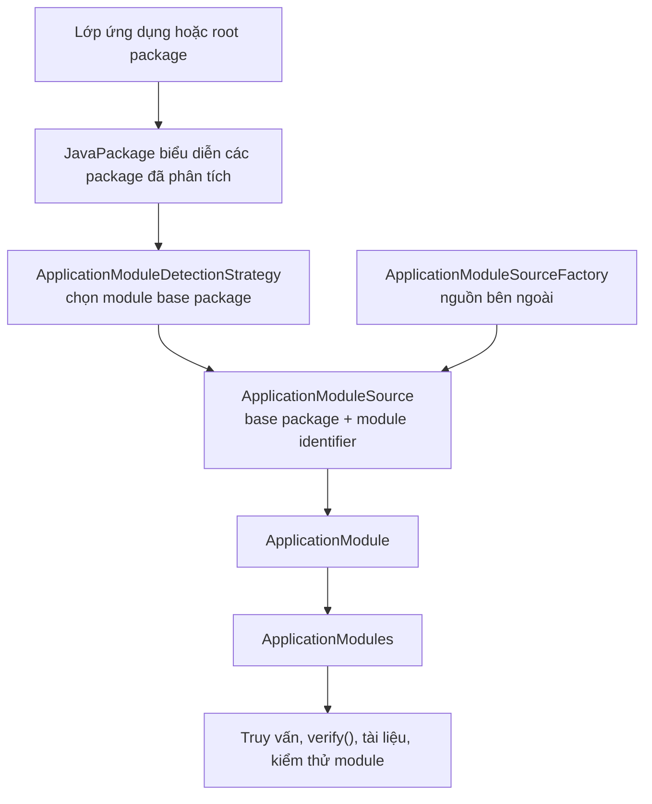
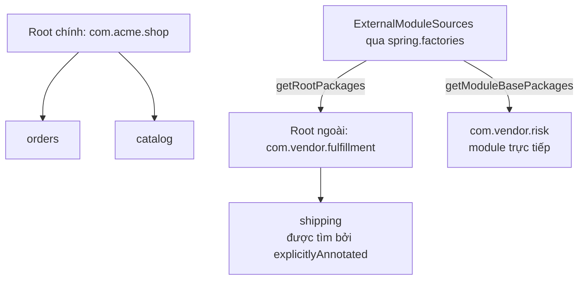
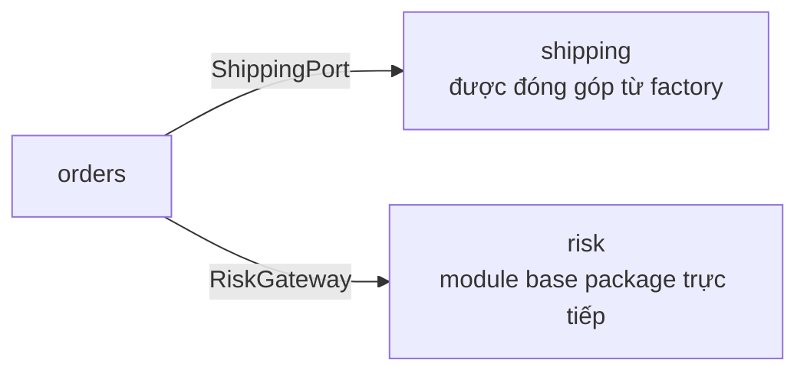

# ApplicationModuleSource xác định nguồn cấu trúc

Khi gọi `ApplicationModules.of(ShopApplication.class)`, Spring Modulith cần trả lời một câu hỏi trước khi kiểm tra phụ thuộc: **những vùng package nào thực sự được chọn để tạo application module?** Trong cách tổ chức mặc định, câu trả lời khá đơn giản: các package con trực tiếp của package ứng dụng. Nhưng một hệ thống lớn có thể có package nằm ngoài cây đó, module được đánh dấu tường minh hoặc nhiều đơn vị build cùng đóng góp vào ứng dụng.

`ApplicationModuleSource` là mắt xích biểu diễn **nguồn tạo nên một `ApplicationModule`**: nó kết hợp một `JavaPackage` được chọn làm gốc module với cách định danh module tương ứng. Cơ chế liên quan, `ApplicationModuleSourceFactory`, cho phép đưa thêm các nguồn module từ những package bên ngoài phạm vi mặc định. Nhờ đó, mô hình dùng cho `ApplicationModules.verify()` có thể phản ánh đúng các ranh giới mà đội phát triển muốn bảo vệ.

Bài thuộc chương **Mô hình module** của **SPRING_MODULITH_VERIFICATION_TESTING**. Việc xác định đúng nguồn cấu trúc phải diễn ra trước khi áp dụng quy tắc phụ thuộc, `@ApplicationModuleTest`, kiểm thử sự kiện, cơ sở dữ liệu và tích hợp. Nếu một module nằm ngoài mô hình phân tích, quality gate CI có thể bỏ sót các quan hệ cần kiểm chứng.

## 1. Mục tiêu

Sau bài này, bạn có thể:

1. Nói rõ `ApplicationModuleSource` khác `JavaPackage`, `ApplicationModuleDetectionStrategy` và `ApplicationModule` ở điểm nào.
2. Diễn giải quá trình từ **application root package** đến **module base package**, `ApplicationModuleSource` và tập `ApplicationModules`.
3. Phân biệt **gốc cần quét** (`getRootPackages()`) với **gốc module được đóng góp trực tiếp** (`getModuleBasePackages()`).
4. Viết `ApplicationModuleSourceFactory` và đăng ký bằng `META-INF/spring.factories` cho package nằm ngoài gốc ứng dụng.
5. Hiểu vai trò của **module identifier** và các trường hợp tên module bị trùng khi có nhiều root package.
6. Xác minh những module mong đợi đã được phát hiện, rồi chạy `verify()` trong CI.
7. Nhận ra giới hạn giữa phát hiện module để kiểm chứng kiến trúc và nạp Spring bean lúc runtime.

## 2. Phân biệt năm khái niệm dễ nhầm

| Khái niệm | Trách nhiệm | Ví dụ |
| --- | --- | --- |
| **Application root package** | Điểm bắt đầu quét để tìm module | `com.acme.shop` |
| `JavaPackage` | Mô hình một Java package và các kiểu liên quan được phân tích | `com.acme.shop.orders` |
| `ApplicationModuleDetectionStrategy` | Chọn những `JavaPackage` nào trở thành module base package | Chọn các package con trực tiếp |
| `ApplicationModuleSource` | Mang thông tin nguồn của một module: base package và định danh của module | Nguồn cho `orders` từ `com.acme.shop.orders` |
| `ApplicationModule` | Mô hình module đã được tạo để khảo sát API, nội bộ, bean và phụ thuộc | Module `orders` |
| `ApplicationModules` | Tập hợp các module được nhận diện, hỗ trợ truy vấn và kiểm chứng | `orders`, `catalog`, `shipping` |

**Một `ApplicationModuleSource` không phải source file `.java`, không phải Spring bean và không phải đối tượng `ApplicationContext`.** Từ *source* ở đây chỉ **nguồn dữ liệu kiến trúc** để tạo module: package được chọn và cách đặt tên cho module.

`ApplicationModuleSource` được giới thiệu từ **Spring Modulith 1.3**. Các API liên quan đến named interface, nested module và đóng góp từ package ngoài có thể khác giữa các nhánh phiên bản; cần đối chiếu tài liệu API của phiên bản dự án đang sử dụng.

### Luồng từ mã nguồn đến mô hình module



Sơ đồ là mô hình khái niệm, không phải toàn bộ thứ tự hàm nội bộ của framework. Điều cần hiểu là **phát hiện nguồn module diễn ra trước khi có thể kiểm chứng những cạnh phụ thuộc giữa các module**.

## 3. Trường hợp mặc định: một package gốc của ứng dụng

Giả sử cấu trúc:

```text
src/main/java/
└── com/acme/shop/
    ├── ShopApplication.java
    ├── orders/
    │   ├── OrderOperations.java
    │   └── internal/DefaultOrderOperations.java
    └── catalog/
        ├── CatalogQuery.java
        └── internal/DefaultCatalogQuery.java
```

Lớp ứng dụng:

```java
package com.acme.shop;

import org.springframework.boot.autoconfigure.SpringBootApplication;

@SpringBootApplication
public class ShopApplication {
}
```

Đọc mô hình:

```java
package com.acme.shop;

import org.springframework.modulith.core.ApplicationModules;

public class InspectModules {

    public static void main(String[] args) {
        ApplicationModules modules =
                ApplicationModules.of(ShopApplication.class);

        modules.forEach(System.out::println);
    }
}
```

Với cách phát hiện module mặc định:

1. Spring Modulith bắt đầu tại `com.acme.shop`, package chứa `ShopApplication`.
2. Chiến lược mặc định chọn **các package con trực tiếp** `com.acme.shop.orders` và `com.acme.shop.catalog`.
3. Mỗi package được chọn trở thành nguồn để tạo một application module với định danh phù hợp.
4. Mô hình cuối cùng có hai module logic `orders` và `catalog`.

| Package | Vai trò trong quá trình phát hiện |
| --- | --- |
| `com.acme.shop` | Gốc ứng dụng, nơi quá trình phát hiện bắt đầu |
| `com.acme.shop.orders` | Module base package được chọn |
| `com.acme.shop.catalog` | Module base package được chọn |
| `com.acme.shop.orders.internal` | Package con nội bộ của `orders`, không tự thành module riêng |
| `com.acme.shop.catalog.internal` | Package con nội bộ của `catalog`, không tự thành module riêng |

Nếu một kiểu trong `orders` tham chiếu `catalog.CatalogQuery`, mô hình có thể ghi nhận phụ thuộc `orders → catalog`. Nhưng nếu `orders` tham chiếu `catalog.internal.DefaultCatalogQuery`, phép kiểm chứng ranh giới trong module đóng mặc định sẽ phát hiện vi phạm.

**Điểm cốt lõi:** `ApplicationModuleSource` giúp xác định **nút nào tồn tại trong đồ thị module và tên của nút đó**. Các cạnh phụ thuộc được phân tích từ quan hệ giữa những kiểu Java thuộc các module đã được phát hiện.

## 4. ApplicationModuleSource chứa thông tin gì?

Theo Java API, lớp `org.springframework.modulith.core.ApplicationModuleSource` mô tả nguồn của một `ApplicationModule`, về bản chất gồm:

- **Module base package** dưới dạng `JavaPackage`: nơi module bắt đầu và vùng mã nguồn mà nó đại diện.
- **Module identifier** dưới dạng `ApplicationModuleIdentifier`: tên logic dùng để tham chiếu module trong mô hình.
- **Cách suy ra named interface** từ thông tin module và chiến lược phát hiện tương ứng, ở những phiên bản hỗ trợ API đó.

Ví dụ quét từ package `com.acme` và chọn package `com.acme.foo.bar`: định danh module có thể là phần tên tương đối `foo.bar`. Tên logic là **kết quả của quy tắc định danh**, không nhất thiết luôn chỉ bằng segment cuối cùng của Java package.

| Thông tin | Ví dụ | Tác động |
| --- | --- | --- |
| Base package | `com.acme.foo.bar` | Những kiểu nào được xem là của module |
| Identifier | `foo.bar` | Tên tham chiếu module trong truy vấn và quy tắc phụ thuộc |
| Named interfaces | `events`, `spi` nếu được cấu hình | Phần API nào có thể được module khác sử dụng |

### Không dùng ApplicationModuleSource như API thao tác nghiệp vụ

Trong API Spring Modulith, phương thức tĩnh `ApplicationModuleSource.from(JavaPackage, ApplicationModuleDetectionStrategy, boolean)` dùng để tạo **luồng nguồn module** theo chiến lược phát hiện. Một số phương thức nội bộ của lớp, chẳng hạn `getModuleBasePackage()` và `getIdentifier()`, có mức truy cập **package-private** theo JavaDoc hiện hành, không dành cho mã ứng dụng ngoài package của framework gọi trực tiếp.

Để **đọc kết quả đã phát hiện** trong code ứng dụng hoặc JUnit, nên sử dụng API công khai của `ApplicationModules` và `ApplicationModule`, ví dụ `getModuleByName(...)`, `getModuleForPackage(...)` và `getBasePackage()`.

## 5. Chiến lược phát hiện quyết định những nguồn nào được tạo

`ApplicationModuleDetectionStrategy` nhận vào `JavaPackage` đại diện cho gốc cần phân tích và chọn các package sẽ là **module base package**.

| Chiến lược | Kết quả khái quát |
| --- | --- |
| Mặc định (direct subpackages) | Mỗi package con trực tiếp dưới gốc là một module |
| `explicitly-annotated` | Chọn những package được đánh dấu tường minh phù hợp bằng `@ApplicationModule` hoặc jMolecules `@Module` |
| Tùy biến `ApplicationModuleDetectionStrategy` | Chọn base package theo quy ước riêng của hệ thống |

Muốn chỉ phát hiện package được khai báo tường minh, có thể cấu hình:

```properties
spring.modulith.detection-strategy=explicitly-annotated
```

Và đánh dấu package cần trở thành module:

```java
// com/acme/shop/orders/package-info.java
@org.springframework.modulith.ApplicationModule
package com.acme.shop.orders;
```

Một chiến lược tùy biến có thể khai báo:

```java
package com.acme.architecture;

import org.springframework.modulith.core.ApplicationModuleDetectionStrategy;
import org.springframework.modulith.core.JavaPackage;
import java.util.stream.Stream;

public class BusinessPackageDetection
        implements ApplicationModuleDetectionStrategy {

    @Override
    public Stream<JavaPackage> getModuleBasePackages(JavaPackage rootPackage) {
        return rootPackage.getDirectSubPackages().stream()
                .filter(pkg -> !pkg.getLocalName().equals("generated"));
    }
}
```

Cấu hình:

```properties
spring.modulith.detection-strategy=com.acme.architecture.BusinessPackageDetection
```

Ví dụ này chọn các package con trực tiếp nhưng bỏ qua `generated`. Cần cân nhắc kỹ, vì các kiểu nằm ngoài mô hình module có thể không được kiểm tra cùng các quy tắc ranh giới giữa những module đã phát hiện.

**Phân biệt vai trò:** chiến lược phát hiện quyết định *chọn package nào*, còn `ApplicationModuleSource` mang *package đã chọn và cách định danh* để tạo `ApplicationModule`.

## 6. Vì sao cần đóng góp nguồn từ package bên ngoài?

Giả sử ứng dụng chứa:

```text
com.acme.shop
├── ShopApplication.java
├── orders
└── catalog

com.vendor.fulfillment
└── shipping
    ├── package-info.java
    └── ShippingPort.java

com.vendor.risk
└── RiskGateway.java

com.acme.architecture
└── ExternalModuleSources.java
```

Theo cách phát hiện mặc định từ `com.acme.shop`, chỉ hai module `orders` và `catalog` được nhận diện. Hai package `com.vendor.fulfillment.shipping` và `com.vendor.risk` **không nằm dưới gốc này**.

Tuy nhiên, giả sử đội phát triển vẫn xem `shipping` và `risk` là các application module của cùng hệ thống và muốn:

- Phân tích phụ thuộc từ `orders` đến API của `shipping` hoặc `risk`.
- Áp dụng quy tắc cấm import các lớp `internal` của hai module bên ngoài.
- Kiểm tra phụ thuộc vòng khi một module ngoài tham chiếu ngược module bên trong.
- Đưa mọi module liên quan vào tài liệu kiến trúc và các bài test.

Từ Spring Modulith **1.3**, có thể sử dụng **`ApplicationModuleSourceFactory`** để đóng góp nguồn module từ package khác hoặc từ đơn vị build khác mà không cần đặt toàn bộ code dưới cùng một gốc package.

## 7. Hai cách đóng góp module bằng ApplicationModuleSourceFactory

`ApplicationModuleSourceFactory` là **SPI** (*service provider interface*) của Spring Modulith. Nó có hai hướng khai báo:

| API trên factory | Thông tin trả về | Cách Spring Modulith dùng |
| --- | --- | --- |
| `getRootPackages()` | Danh sách **package gốc cần quét** | Áp dụng `ApplicationModuleDetectionStrategy` để tìm các module bên dưới |
| `getModuleBasePackages()` | Danh sách **base package của module được chỉ định trực tiếp** | Tạo nguồn module từ chính mỗi package được liệt kê |
| `getApplicationModuleDetectionStrategy()` | Chiến lược tùy chọn cho các root package do factory cung cấp | Nếu trả `null`, dùng chiến lược mặc định |

Hai danh sách có vai trò khác nhau:

```text
getRootPackages() -> com.vendor.fulfillment
    |
    +-- áp dụng chiến lược phát hiện
            |
            +-- com.vendor.fulfillment.shipping  -> module shipping

getModuleBasePackages() -> com.vendor.risk  -> module risk
```

**`getRootPackages()` không khai báo rằng package gốc đó chính là một module**: nó là điểm bắt đầu quét. **`getModuleBasePackages()` không quét tự động mọi package con thành module**: nó chỉ đóng góp những base package được liệt kê như nguồn module trực tiếp.

### 7.1. Ví dụ factory hoàn chỉnh

Trong ví dụ trên, ta muốn phát hiện module `shipping` theo annotation, đồng thời chỉ định trực tiếp module `risk`. File ở package hỗ trợ nằm **ngoài** `com.acme.shop` để tránh vô tình bị chiến lược mặc định xem là module nghiệp vụ:

```java
// com/acme/architecture/ExternalModuleSources.java
package com.acme.architecture;

import org.springframework.modulith.core.ApplicationModuleDetectionStrategy;
import org.springframework.modulith.core.ApplicationModuleSourceFactory;
import java.util.List;

public final class ExternalModuleSources
        implements ApplicationModuleSourceFactory {

    @Override
    public List<String> getRootPackages() {
        // Quét để tìm các module được khai báo tường minh.
        return List.of("com.vendor.fulfillment");
    }

    @Override
    public ApplicationModuleDetectionStrategy
            getApplicationModuleDetectionStrategy() {
        return ApplicationModuleDetectionStrategy.explicitlyAnnotated();
    }

    @Override
    public List<String> getModuleBasePackages() {
        // Đóng góp một base package trực tiếp làm module.
        return List.of("com.vendor.risk");
    }
}
```

Để `shipping` được chiến lược tường minh chọn, khai báo annotation tại package của nó:

```java
// com/vendor/fulfillment/shipping/package-info.java
@org.springframework.modulith.ApplicationModule
package com.vendor.fulfillment.shipping;
```

Hợp đồng công khai thuộc base package `shipping`:

```java
// com/vendor/fulfillment/shipping/ShippingPort.java
package com.vendor.fulfillment.shipping;

public interface ShippingPort {
    void schedule(String orderId);
}
```

`risk` được khai báo trực tiếp bởi `getModuleBasePackages()` nên trong trường hợp này **không cần `@ApplicationModule` chỉ để được phát hiện**:

```java
// com/vendor/risk/RiskGateway.java
package com.vendor.risk;

public interface RiskGateway {
    boolean allow(String orderId);
}
```

Hai cơ chế có thể cùng tồn tại trong một factory. Nếu chỉ cần một trong hai, không cần override phương thức còn lại vì interface đã cung cấp giá trị mặc định là danh sách rỗng.

### 7.2. Đăng ký factory qua META-INF/spring.factories

Chỉ khai báo class Java chưa đủ; Spring Modulith cần tìm thấy SPI implementation khi phân tích module. Thêm file resources:

```text
src/main/resources/
└── META-INF/
    └── spring.factories
```

Nội dung:

```properties
org.springframework.modulith.core.ApplicationModuleSourceFactory=com.acme.architecture.ExternalModuleSources
```

Lưu ý:

- Key phải đúng **`org.springframework.modulith.core.ApplicationModuleSourceFactory`**.
- Giá trị là tên class đầy đủ của factory; class phải có mặt trên **classpath** và có thể được khởi tạo.
- Nếu chỉ cần factory trong bài kiểm thử/tài liệu, có thể đặt implementation và `spring.factories` trong test source/resources. Nếu các thành phần Spring Modulith ở runtime cũng cần thấy nguồn module, cần đưa chúng vào classpath runtime phù hợp.
- Khi có nhiều factory từ nhiều build unit, kiểm tra trùng package và trùng định danh module.

### 7.3. Điều gì xảy ra sau khi đăng ký?

Mô hình tổng quát sau đăng ký:



Sau khi nhập các nguồn từ root chính và factory, `ApplicationModules` có thể chứa cả `orders`, `catalog`, `shipping` và `risk`. Đây là **tập node kiến trúc**; chỉ khi các kiểu Java tham chiếu nhau mới xuất hiện cạnh dependency giữa các node đó.

## 8. Định danh module khi có nhiều root package

Khi chọn base package, Spring Modulith cần tạo một **module identifier** để người phát triển có thể truy vấn module và khai báo `allowedDependencies`. Theo cách định danh tương đối, nếu bắt đầu từ gốc `com.acme` và chọn `com.acme.foo.bar` thì tên có thể là `foo.bar`.

Nếu có nhiều root package khác nhau:

```text
com.acme.shop.orders
com.vendor.fulfillment.orders
```

việc mặc định chọn tên ngắn `orders` ở cả hai nơi có thể gây xung đột định danh. Spring Modulith hỗ trợ chế độ dùng **tên module đầy đủ theo package**, ví dụ:

```java
package com.acme.shop;

import org.springframework.boot.autoconfigure.SpringBootApplication;
import org.springframework.modulith.Modulithic;

@SpringBootApplication
@Modulithic(useFullyQualifiedModuleNames = true)
public class ShopApplication {
}
```

Khi bật chế độ này, định danh mặc định có thể là tên Java package đầy đủ; các chuỗi dùng ở `getModuleByName(...)`, `allowedDependencies` và tài liệu kiến trúc cần thống nhất với định danh thực tế.

**Không tự đoán tên module từ segment cuối** khi đã dùng nhiều gốc hoặc có tên tường minh. Hãy in mô hình với `modules.forEach(System.out::println)` rồi đọc logical name của từng module.

### Phân biệt với @Modulithic(additionalPackages)

Ngoài factory, Spring Modulith có thể được cấu hình thêm **root package đã biết trước**:

```java
@org.springframework.modulith.Modulithic(
    additionalPackages = "com.vendor.fulfillment"
)
@org.springframework.boot.autoconfigure.SpringBootApplication
public class ShopApplication {
}
```

`additionalPackages` là lựa chọn gọn khi chính ứng dụng biết sẵn package cần quét. `ApplicationModuleSourceFactory` hữu ích khi một **build unit/plugin riêng muốn tự đóng góp nguồn module** hoặc cần chỉ định trực tiếp các base package và chiến lược phát hiện của nó.

Hai đoạn annotation `ShopApplication` trên minh họa **hai phương án cấu hình khác nhau**; khi áp dụng thật, cần lựa chọn hoặc kết hợp theo nhu cầu và tránh đóng góp trùng module.

## 9. Kiểm tra source đã được nhận diện trong ApplicationModules

Việc đăng ký `spring.factories` chỉ là cấu hình. Cần viết test xác minh **kết quả phát hiện**:

```java
package com.acme.shop;

import org.junit.jupiter.api.Test;
import org.springframework.modulith.core.ApplicationModules;

import static org.junit.jupiter.api.Assertions.assertTrue;

class ModuleDiscoveryTest {

    @Test
    void includesModulesFromDefaultAndExternalSources() {
        ApplicationModules modules =
                ApplicationModules.of(ShopApplication.class);

        assertTrue(modules.getModuleByName("orders").isPresent());
        assertTrue(modules.getModuleByName("catalog").isPresent());

        assertTrue(modules.getModuleForPackage(
                "com.vendor.fulfillment.shipping").isPresent());
        assertTrue(modules.getModuleForPackage(
                "com.vendor.risk").isPresent());
    }

    @Test
    void verifiesBoundariesOfDiscoveredModules() {
        ApplicationModules.of(ShopApplication.class).verify();
    }
}
```

Ví dụ giả định **không bật** `useFullyQualifiedModuleNames = true`, class của các package có mặt trên classpath và factory đã được đăng ký. Kiểm tra package cho các module bổ sung giúp tránh phụ thuộc vào tên logic nếu quy tắc đặt tên về sau thay đổi.

Nên in mô hình trong giai đoạn tìm hiểu:

```java
ApplicationModules modules =
        ApplicationModules.of(ShopApplication.class);

modules.forEach(System.out::println);
```

Các dấu hiệu cần kiểm tra:

1. Có đủ module mong đợi không?
2. Base package mỗi module có đúng vùng code mà đội phát triển quản lý không?
3. Tên logic có trùng, bị rút ngắn hoặc đã đổi sang tên đầy đủ không?
4. Các package con như `shipping.internal` có được giữ là nội bộ không?
5. Những phụ thuộc xuyên module có đi qua API hợp lệ và không tạo chu trình không?

**Chỉ khi nguồn module được nhận diện đúng, `verify()` mới có mô hình phù hợp để bảo vệ các quan hệ liên quan.**

## 10. ApplicationModuleSource liên quan gì đến verify()?

`ApplicationModuleSource` xác định những module sẽ có trong mô hình. `verify()` kiểm tra **các quan hệ giữa những module đã nhận diện**, thường bao gồm:

- Không có phụ thuộc vòng giữa application module.
- Không tham chiếu kiểu nội bộ của một module khác trong mô hình module đóng mặc định.
- Tuân thủ `@ApplicationModule(allowedDependencies = ...)` nếu module nguồn khai báo giới hạn.

Ví dụ `orders` phụ thuộc vào API `com.vendor.fulfillment.shipping.ShippingPort`. Nếu source của `shipping` được đóng góp đúng, Spring Modulith có thể suy ra cạnh `orders → shipping` và áp dụng ranh giới API.



Nếu `shipping` không xuất hiện như một application module, những quy tắc đặc thù của **ranh giới giữa module `orders` và `shipping`** không thể được áp dụng như khi cả hai module đều được mô hình hóa đầy đủ. Điều này không có nghĩa `verify()` hoàn toàn ngừng kiểm tra mã, mà nghĩa là **phạm vi mô hình hóa không đầy đủ sẽ tạo lỗ hổng trong yêu cầu kiểm chứng**.

### Nên giới hạn dependency từ module nguồn

Nếu `orders` thực sự cần API của `shipping`, có thể mô tả quan hệ trong `orders/package-info.java` sau khi đã xác nhận tên module:

```java
// com/acme/shop/orders/package-info.java
@org.springframework.modulith.ApplicationModule(
    allowedDependencies = {"catalog", "shipping", "risk"}
)
package com.acme.shop.orders;
```

Ví dụ chỉ hợp lệ về tên khi các module bên ngoài được nhận diện với các identifier ngắn `shipping` và `risk`. Khi tên đầy đủ được bật hoặc identifier khác với dự đoán, điều chỉnh các giá trị cho đúng mô hình.

**`allowedDependencies` không tự tạo module bên ngoài và không làm xuất hiện cạnh phụ thuộc.** Nó chỉ đặt giới hạn cho những cạnh hình thành từ tham chiếu Java đã được nhận diện.

## 11. Liên hệ với @ApplicationModuleTest và kiểm thử tích hợp

`@ApplicationModuleTest` sử dụng mô hình module để chọn phạm vi Spring Test context, tùy chế độ bootstrap được cấu hình. Vì vậy nếu một application module bị bỏ sót trong nguồn cấu trúc, cách xác định những thành phần nằm trong module và các phụ thuộc của nó có thể không phản ánh đúng thiết kế.

Ví dụ kiểm thử ở module `orders`:

```java
package com.acme.shop.orders;

import org.junit.jupiter.api.Test;
import org.springframework.modulith.test.ApplicationModuleTest;

@ApplicationModuleTest
class OrdersModuleTest {

    @Test
    void moduleContextStarts() {
        // Thêm kiểm chứng nghiệp vụ, dữ liệu hoặc event theo yêu cầu thực tế.
    }
}
```

Cần phân biệt ba vấn đề:

| Vấn đề | Cơ chế chính |
| --- | --- |
| Những package/module nào **tồn tại trong mô hình**? | Phát hiện source, `ApplicationModuleSourceFactory`, `ApplicationModules` |
| Mã nguồn có **đúng ranh giới kiến trúc**? | `ApplicationModules.verify()` |
| Spring context có **nạp đúng bean** và chạy đúng nghiệp vụ? | `@ApplicationModuleTest` và kiểm thử tích hợp |

Đặc biệt, **đóng góp một package vào `ApplicationModules` không đồng nghĩa Spring Boot sẽ tự component-scan các bean trong package ngoài**. Nếu `com.vendor.fulfillment.shipping` nằm ngoài phạm vi scan mặc định của `@SpringBootApplication`, kiểm thử runtime có thể cần cấu hình scan/import bean riêng.

Tương tự, việc source module được phát hiện không chứng minh event listener sẽ nhận sự kiện, transaction sẽ commit hay JPA repository sẽ làm việc đúng với database. Các tình huống đó phải có kiểm thử sự kiện, dữ liệu và integration test tương ứng.

## 12. Khi nào nên dùng cơ chế nào?

| Trường hợp | Cơ chế thường phù hợp | Lý do |
| --- | --- | --- |
| Module nằm dưới cùng root ứng dụng và theo quy ước trực tiếp | Cách phát hiện mặc định | Ít cấu hình, dễ đọc |
| Chỉ muốn công nhận package có annotation | `explicitly-annotated` | Chọn module có chủ đích |
| Muốn chọn module theo quy ước package đặc biệt | `ApplicationModuleDetectionStrategy` | Tùy biến cách chọn base package |
| Có thêm vài root package cố định và ứng dụng biết sẵn | `@Modulithic(additionalPackages = ...)` | Cấu hình gọn ngay từ ứng dụng |
| Build unit hoặc plugin tự cung cấp root/package ở ngoài | `ApplicationModuleSourceFactory` | Đóng góp source độc lập với lớp ứng dụng chính |
| Muốn cho module khác dùng API trong package con | `@NamedInterface` | Công khai hợp đồng, không thêm module mới |
| Muốn chỉ ra module được phép dùng API nào | `allowedDependencies` | Ràng buộc cạnh đi ra của module |

Không nên dùng `ApplicationModuleSourceFactory` chỉ để công khai `orders.events` như một API. Nếu `orders.events` là package con của module `orders` và chỉ chứa sự kiện cần chia sẻ, **named interface** mới là cơ chế phù hợp; việc tạo thêm source module cho nó sẽ thay đổi cấu trúc kiến trúc theo ý nghĩa khác.

## 13. Lỗi thường gặp khi đóng góp nguồn module

| Triệu chứng | Nguyên nhân có thể xảy ra | Cách xử lý |
| --- | --- | --- |
| Module ngoài không xuất hiện trong `ApplicationModules` | Factory chưa đăng ký đúng trong `spring.factories` hoặc không nằm trên classpath | Kiểm tra đường dẫn resources, key SPI và tên class |
| `getRootPackages()` không tạo module mong đợi | Chiến lược đang chọn sai package hoặc thiếu annotation cần thiết | Kiểm tra `getApplicationModuleDetectionStrategy()` và `package-info.java` |
| Đã liệt kê `getModuleBasePackages()` nhưng muốn quét tự động package con | Nhầm danh sách module base trực tiếp với root để quét | Dùng `getRootPackages()` cùng detection strategy nếu cần quét |
| Hai module có cùng logical name | Nhiều root package chứa package/module tên giống nhau | Xem identifier, cân nhắc `useFullyQualifiedModuleNames` |
| `verify()` không báo lỗi giữa hai vùng dự kiến | Một vùng chưa được mô hình thành module hoặc bị cấu hình loại khỏi phạm vi | Xác nhận node bằng `getModuleForPackage(...)` trước khi kiểm chứng |
| Test module thiếu Spring bean ngoài root | Module source ảnh hưởng mô hình, không tự mở rộng component scan | Bổ sung cấu hình scan/import hoặc test fixture phù hợp |
| Sau khi thêm source, test kiến trúc phát hiện nhiều lỗi mới | Các quan hệ vốn có nay được nhận diện là quan hệ xuyên module | Sửa API, package nội bộ, chiều phụ thuộc hoặc `allowedDependencies` |

### Quy trình chẩn đoán có hệ thống

1. In tập `ApplicationModules` và kiểm tra những module nào tồn tại.
2. Kiểm tra **root package**, **detection strategy** và **module base package** trong cấu hình mong đợi.
3. Nếu dùng factory, xác nhận `META-INF/spring.factories` đã được đóng gói đúng trên classpath.
4. Kiểm tra logical name của module và khả năng trùng identifier.
5. Gọi `getModuleForPackage(...)` cho package cần bảo vệ.
6. Chạy `verify()` và xác định lỗi ở quyền truy cập, danh sách phụ thuộc hay chu trình.
7. Chạy thêm các bài `@ApplicationModuleTest`, kiểm thử sự kiện và DB để xác nhận hành vi thực tế.

Thứ tự này giúp phân biệt **lỗi phát hiện nguồn** với **lỗi kiến trúc của mô hình đã phát hiện**. Nếu nguồn còn thiếu, sửa `allowedDependencies` thường không phải cách giải quyết đúng.

## 14. Bài thực hành: dự đoán các ApplicationModuleSource

Cho cấu trúc:

```text
com.example.market
├── MarketApplication.java
├── checkout
│   └── CheckoutOperations.java
└── catalog
    └── CatalogQuery.java

com.example.plugins
├── analytics
│   ├── package-info.java  (@ApplicationModule)
│   └── AnalyticsOperations.java
└── reports
    └── ReportService.java

com.example.legacy
└── LegacyGateway.java
```

Và factory:

```java
package com.example.architecture;

import java.util.List;
import org.springframework.modulith.core.ApplicationModuleDetectionStrategy;
import org.springframework.modulith.core.ApplicationModuleSourceFactory;

public final class MarketModuleSources
        implements ApplicationModuleSourceFactory {

    @Override
    public List<String> getRootPackages() {
        return List.of("com.example.plugins");
    }

    @Override
    public ApplicationModuleDetectionStrategy getApplicationModuleDetectionStrategy() {
        return ApplicationModuleDetectionStrategy.explicitlyAnnotated();
    }

    @Override
    public List<String> getModuleBasePackages() {
        return List.of("com.example.legacy");
    }
}
```

Giả sử factory đã đăng ký đúng trong `META-INF/spring.factories`, các kiểu trên đều hiện diện trên classpath, dự án dùng phát hiện mặc định cho root ứng dụng chính và không bật tên module đầy đủ.

**Câu hỏi:**

1. Root ứng dụng chính là package nào? Hai module mặc định là gì?
2. `getRootPackages()` trả package nào, và chiến lược nào được áp dụng ở đó?
3. Trong `com.example.plugins`, vì sao `analytics` được phát hiện nhưng `reports` không được chọn?
4. `getModuleBasePackages()` đóng góp module nào trực tiếp?
5. Có bao nhiêu module tất cả trong mô hình mong đợi?
6. Nếu xóa `spring.factories` nhưng giữ class factory, kết quả sẽ thay đổi ra sao?
7. Nếu `checkout` import `com.example.legacy.internal.LegacyRepository` và lớp ấy được khai báo `public`, `verify()` cần kiểm tra quy tắc nào?
8. Nếu Spring Test không nạp được bean thuộc `com.example.plugins.analytics`, liệu việc đóng góp module source có đủ để xử lý không?

**Đáp án và giải thích:**

1. Root chính là `com.example.market`; hai module mặc định `checkout` và `catalog`.
2. Factory trả `com.example.plugins`, được quét bằng `ApplicationModuleDetectionStrategy.explicitlyAnnotated()`.
3. `analytics` có `@ApplicationModule` trong `package-info.java`. `reports` không có khai báo tường minh nên không được chiến lược đó chọn.
4. `com.example.legacy` được chọn trực tiếp làm base package, không cần được suy ra từ root `plugins`.
5. Bốn module: `checkout`, `catalog`, `analytics` và `legacy`, nếu không có cấu hình hay nguồn khác.
6. Khi factory không được phát hiện, các đóng góp ngoài root chính sẽ không được thêm qua factory ấy. Theo giả thiết, chỉ còn `checkout` và `catalog`.
7. `checkout` đang truy cập kiểu **nội bộ của module `legacy`** trong mô hình đóng; `public` theo Java không tự làm kiểu đó thành public API của module.
8. Chưa đủ. Module source phục vụ mô hình kiến trúc; Spring Test context có thể cần cấu hình bean scanning/import riêng để nạp thành phần nằm ngoài package chính.

**Thử nâng cao:** thêm một module `com.example.plugins.checkout` có `@ApplicationModule`. Hãy kiểm tra tên logic có xung đột với `com.example.market.checkout` hay không, rồi thử cơ chế `@Modulithic(useFullyQualifiedModuleNames = true)` và điều chỉnh phép kiểm tra định danh trong JUnit.

## 15. Checklist khi đưa nguồn module vào CI

- [ ] Package gốc của ứng dụng được xác định đúng.
- [ ] Chiến lược phát hiện chọn đúng các module base package.
- [ ] Với package ngoài root, đã chọn `additionalPackages` hoặc đăng ký `ApplicationModuleSourceFactory` phù hợp.
- [ ] Đã phân biệt `getRootPackages()` với `getModuleBasePackages()`.
- [ ] `spring.factories`, class factory và các kiểu ngoài root có trên classpath cần thiết.
- [ ] Không có xung đột module identifier; tên module được dùng nhất quán trong `allowedDependencies`.
- [ ] Bài JUnit xác nhận các module quan trọng tồn tại bằng `getModuleByName(...)` hoặc `getModuleForPackage(...)`.
- [ ] `ApplicationModules.of(...).verify()` chạy trong quality gate CI.
- [ ] Với module ngoài root, kiểm thử Spring context kiểm tra việc nạp bean độc lập với kiểm chứng cấu trúc.
- [ ] Kiểm thử sự kiện, database và tích hợp vẫn kiểm tra hành vi nghiệp vụ, transaction và khả năng phối hợp giữa module.

**Ghi nhớ:** `ApplicationModuleSource` biểu diễn **package nguồn và định danh dùng để tạo một application module**. `ApplicationModuleDetectionStrategy` lựa chọn những package làm nguồn; `ApplicationModuleSourceFactory` cho phép đóng góp thêm từ các root hoặc base package bên ngoài. Chỉ khi toàn bộ module liên quan đã xuất hiện trong `ApplicationModules`, `verify()` mới có cơ sở kiểm chứng đầy đủ ranh giới và chiều phụ thuộc theo thiết kế của hệ thống.

## Tài liệu tham khảo

- [Spring Modulith Reference — Fundamentals: Application Modules và nguồn bổ sung](https://docs.spring.io/spring-modulith/reference/fundamentals.html)
- [Spring Modulith API — ApplicationModuleSource](https://docs.spring.io/spring-modulith/docs/current/api/org/springframework/modulith/core/ApplicationModuleSource.html)
- [Spring Modulith API — ApplicationModuleSourceFactory](https://docs.spring.io/spring-modulith/docs/current/api/org/springframework/modulith/core/ApplicationModuleSourceFactory.html)
- [Spring Modulith API — ApplicationModuleDetectionStrategy](https://docs.spring.io/spring-modulith/docs/current/api/org/springframework/modulith/core/ApplicationModuleDetectionStrategy.html)
- [Spring Modulith Reference — Verifying Application Module Structure](https://docs.spring.io/spring-modulith/reference/verification.html)
- [Spring Modulith Reference — Testing Application Modules](https://docs.spring.io/spring-modulith/reference/testing.html)
