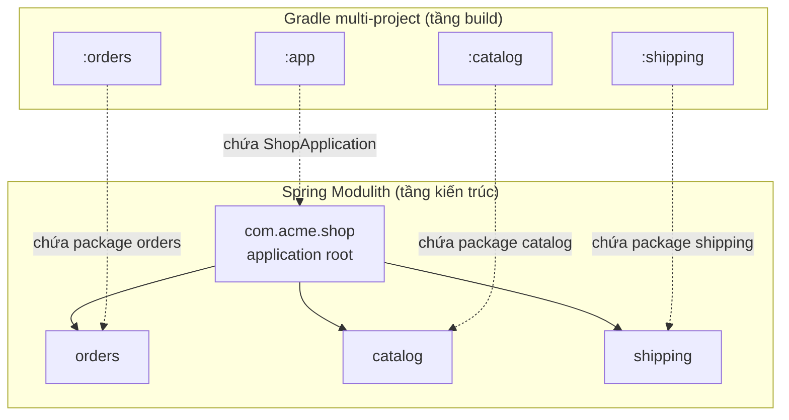
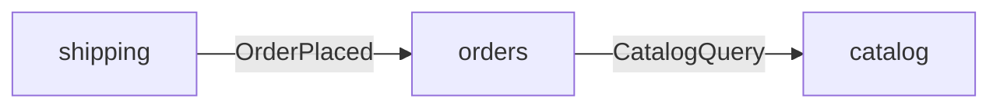
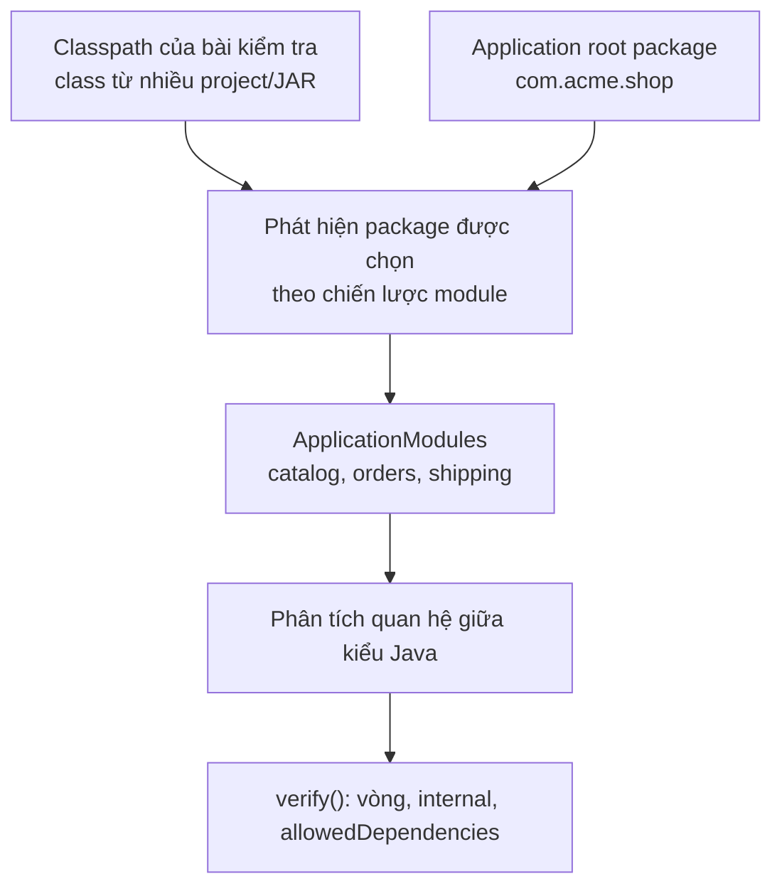
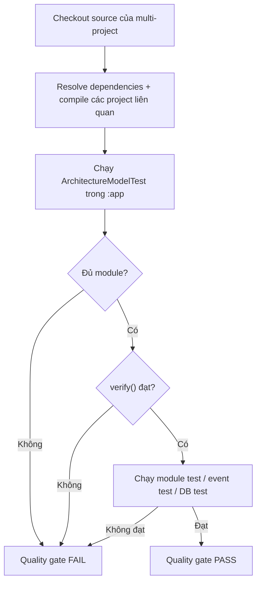

# Quét package trong một project nhiều module

Một ứng dụng Spring Boot lớn thường được chia thành nhiều **Gradle subproject** hoặc **Maven module** để quản lý mã nguồn, dependency và build. Ví dụ, phần đặt hàng nằm trong project `orders`, dữ liệu sản phẩm trong `catalog`, phần giao vận trong `shipping`, còn lớp khởi động Spring Boot nằm trong `app`. Khi chuyển sang Spring Modulith, một câu hỏi quan trọng xuất hiện: **`ApplicationModules` có tự nhận diện được các application module nằm ở nhiều project build khác nhau hay không?**

Câu trả lời phụ thuộc vào **package gốc, chiến lược phát hiện module và những class có mặt trên classpath phân tích**. Ranh giới của một Maven/Gradle module không tự biến thành ranh giới của Spring Modulith. Ngược lại, nhiều application module vẫn có thể nằm trong cùng một Maven/Gradle module nếu các package được tổ chức phù hợp.

Bài này thuộc chương **Mô hình module** của **SPRING_MODULITH_VERIFICATION_TESTING**. Mục đích là thiết lập đúng phạm vi phân tích trước khi dùng `ApplicationModules.verify()` kiểm tra phụ thuộc; sau đó kết hợp `@ApplicationModuleTest`, kiểm thử sự kiện, cơ sở dữ liệu và tích hợp với quality gate trong CI.

## 1. Mục tiêu học tập

Sau bài này, bạn có thể:

1. Phân biệt **build module** (Maven/Gradle), **Java package** và **application module** (Spring Modulith).
2. Suy ra các module được phát hiện từ package của lớp ứng dụng, kể cả khi source nằm ở nhiều Gradle/Maven project.
3. Giải thích vì sao class có trên classpath vẫn có thể nằm **ngoài application root package** và chưa được nhận diện thành module.
4. Sử dụng `@Modulithic(additionalPackages = ...)` khi cần phân tích một vùng package bổ sung.
5. Biết khi nào cân nhắc `ApplicationModuleSourceFactory` hoặc chiến lược phát hiện tường minh.
6. Viết kiểm thử xác nhận module được nhận diện và kiểm chứng phụ thuộc kiến trúc bằng `verify()`.
7. Phân biệt **module discovery** với **component scan**, **JPA entity scan** và phạm vi của `@ApplicationModuleTest`.
8. Đặt các phép kiểm tra trên vào CI để tránh bỏ sót module hoặc phát sinh phụ thuộc ngoài thiết kế.

## 2. Ba lớp tổ chức không nên đánh đồng

| Lớp tổ chức | Do công cụ nào quyết định? | Chức năng | Ví dụ |
| --- | --- | --- | --- |
| **Build module** | Maven reactor hoặc Gradle multi-project | Biên dịch, đóng gói, quản lý dependency giữa project | `:app`, `:orders`, `:catalog` |
| **Java package** | Khai báo `package ...;` trong source | Đặt tên, nhóm kiểu, áp dụng quyền truy cập Java | `com.acme.shop.orders.internal` |
| **Application module** | Spring Modulith và chiến lược phát hiện | Định nghĩa ranh giới kiến trúc, API công khai, package nội bộ, phụ thuộc | `orders`, `catalog`, `shipping` |

Một số trường hợp hợp lệ:

- **Một build module, nhiều application module:** một project `app` duy nhất chứa các package `orders`, `catalog` và `shipping`.
- **Nhiều build module, nhiều application module:** ba Gradle subproject khác nhau chứa các package Java thuộc ba application module khác nhau.
- **Một build module chứa nhiều application module lẫn helper:** một subproject `business` chứa hai package `orders` và `catalog`; `business` không tự xuất hiện như một application module.
- **Một application module trải qua nhiều artifact:** về mặt package có thể tổ chức nhiều class đóng góp cho cùng một vùng module, nhưng phải quản lý classpath, duplicate class và hướng dependency build cẩn thận.

**Quy tắc thực hành:** muốn biết Spring Modulith nhận diện module gì, hãy xem **package Java thực tế và kết quả `ApplicationModules`**, không suy ra hoàn toàn từ tên artifact `orders.jar` hay Gradle project `:orders`.

## 3. Ví dụ nhiều Gradle subproject nhưng cùng một package gốc

Giả sử repository có cấu trúc:

```text
shop/
├── settings.gradle.kts
├── build.gradle.kts
├── app/
│   └── src/main/java/com/acme/shop/
│       └── ShopApplication.java
├── catalog/
│   └── src/main/java/com/acme/shop/catalog/
│       ├── CatalogQuery.java
│       └── internal/DefaultCatalogQuery.java
├── orders/
│   └── src/main/java/com/acme/shop/orders/
│       ├── OrderOperations.java
│       ├── events/
│       │   ├── package-info.java
│       │   └── OrderPlaced.java
│       └── internal/DefaultOrderOperations.java
└── shipping/
    └── src/main/java/com/acme/shop/shipping/
        ├── ShippingOperations.java
        └── internal/OrderPlacedListener.java
```

File `settings.gradle.kts` của ví dụ:

```kotlin
rootProject.name = "shop"

include(":app", ":catalog", ":orders", ":shipping")
```

Lớp khởi động trong build module `app`:

```java
package com.acme.shop;

import org.springframework.boot.autoconfigure.SpringBootApplication;

@SpringBootApplication
public class ShopApplication {
}
```

Điểm đáng chú ý: mặc dù `ShopApplication` nằm trong **thư mục build project `app`**, Java package của lớp đó là `com.acme.shop`. Vì vậy khi dùng:

```java
ApplicationModules modules =
        ApplicationModules.of(ShopApplication.class);
```

Spring Modulith có thể nhận diện các application module nằm dưới package `com.acme.shop`, miễn những class liên quan được đưa vào **classpath** của quá trình phân tích và được chiến lược phát hiện chọn.

Với cấu hình mặc định, ba package con trực tiếp sau là ứng viên base package:

| Package | Gradle subproject chứa source | Application module |
| --- | --- | --- |
| `com.acme.shop.catalog` | `:catalog` | `catalog` |
| `com.acme.shop.orders` | `:orders` | `orders` |
| `com.acme.shop.shipping` | `:shipping` | `shipping` |
| `com.acme.shop.orders.internal` | `:orders` | Vẫn thuộc `orders` |
| `com.acme.shop.orders.events` | `:orders` | Vẫn thuộc `orders` |

Spring Modulith không yêu cầu mỗi application module phải nằm trong một Gradle subproject riêng. Cơ chế phát hiện mặc định quan tâm đến **sub-package trực tiếp dưới application root**, bất kể các file `.class` xuất phát từ thư mục source hoặc JAR nào trên classpath.

### Hai tầng cấu trúc của cùng một ứng dụng



Các đường nét đứt biểu thị **vị trí mã nguồn trong build project**. Chúng không phải quan hệ phụ thuộc runtime hay cạnh dependency giữa application module.

## 4. Dependency Gradle/Maven và dependency Spring Modulith

Để biên dịch được ví dụ, project `app` có thể khai báo dependency tới các project nghiệp vụ:

```kotlin
// app/build.gradle.kts (trích phần dependencies)
dependencies {
    implementation(project(":catalog"))
    implementation(project(":orders"))
    implementation(project(":shipping"))
}
```

Nếu `orders` gọi một interface công khai của `catalog`:

```kotlin
// orders/build.gradle.kts (trích phần dependencies)
dependencies {
    implementation(project(":catalog"))
}
```

Nếu `shipping` lắng nghe event do `orders` công khai:

```kotlin
// shipping/build.gradle.kts (trích phần dependencies)
dependencies {
    implementation(project(":orders"))
}
```

Các đoạn `build.gradle.kts` chỉ minh họa **quan hệ giữa project**; để thực hiện build cần cấu hình plugin Java/Spring, repositories, phiên bản dependency và những thư viện cần thiết theo dự án.

Ở tầng ứng dụng Spring Modulith, hai cạnh từ mã nghiệp vụ có thể là:



Giải thích:

- `app` cần các JAR/class của `orders`, `catalog` và `shipping` để khởi chạy và kiểm thử, nhưng **dependency build từ `:app` tới các project đó không tự đồng nghĩa có ba cạnh application-module từ một module tên `app`**.
- `orders → catalog` chỉ xuất hiện khi mã trong module `orders` thực sự tham chiếu kiểu thuộc module `catalog`.
- `shipping → orders` chỉ xuất hiện khi mã `shipping` tham chiếu kiểu `OrderPlaced` hoặc một API khác của `orders`.
- Một Gradle project có thể khai báo dependency vào JAR mà không dùng kiểu nào trong module tương ứng; việc có JAR trên classpath **chưa đủ** để suy ra cạnh phụ thuộc kiến trúc cụ thể.

**Cần đặc biệt lưu ý về chu trình:** Gradle/Maven đã có thể không cho build các project có dependency vòng. Tuy nhiên, một vòng giữa **application module** có thể phát sinh khi nhiều module logic nằm trong cùng một build project, nên `ApplicationModules.verify()` vẫn rất cần thiết.

## 5. Spring Modulith quét class như thế nào?

Có hai điều kiện quan trọng để một vùng mã nguồn được mô hình hóa:

1. **Class có thể được phân tích:** mã tương ứng đã được biên dịch và có mặt trên classpath mà bài test hoặc công cụ dựng mô hình đang sử dụng.
2. **Package được đưa vào phạm vi phát hiện:** package của class nằm dưới application root phù hợp, hoặc được bổ sung bằng cấu hình nguồn module; sau đó chiến lược phát hiện phải chọn base package thích hợp.

Ta có thể diễn giải quá trình ở mức khái niệm:



**Classpath là điều kiện cần, không phải điều kiện đủ.** Một class `com.vendor.payment.Gateway` có thể đã nằm trên classpath của `app` nhưng vẫn không xuất hiện như một application module nếu gốc phân tích chỉ là `com.acme.shop`.

Tương tự, việc có thư mục `catalog/src/main/java/com/acme/shop/catalog` trong repository chưa đảm bảo bài test ở `app` nhìn thấy class đó. Nếu `app` chưa khai báo dependency đến `:catalog` hoặc test task không đưa compiled output của `catalog` vào classpath, phạm vi phân tích sẽ không đầy đủ.

### Không nhầm classpath quét kiến trúc với Spring component scan

| Cơ chế | Dùng để làm gì? | Được quyết định bởi |
| --- | --- | --- |
| **Spring Modulith module discovery** | Nhận diện các application module và ranh giới kiến trúc | Gốc package, detection strategy, classpath, nguồn module bổ sung |
| **Spring component scan** | Tìm bean để khởi tạo trong `ApplicationContext` | `@ComponentScan` và các cấu hình Spring tương ứng |
| **Spring Data repository scan** | Tạo repository bean trong Spring Data | Cấu hình repository scanning và phạm vi ứng dụng |
| **JPA entity scan** | Xác định entity được quản lý | Cấu hình JPA/entity scanning |
| **Gradle/Maven dependency resolution** | Chọn artifact và compiled classes đưa vào classpath | Build files và cấu hình dependency |

Việc cấu hình `@ComponentScan(basePackages = ...)` để Spring nạp bean từ package bên ngoài **không tự khai báo một application module mới cho Spring Modulith**. Ngược lại, khai báo thêm package cho Spring Modulith **không tự động sửa cấu hình bean scan, JPA entity scan hoặc repository scan**.

## 6. Ví dụ mã Java tạo phụ thuộc liên module

Trong project `catalog`:

```java
// catalog/src/main/java/com/acme/shop/catalog/CatalogQuery.java
package com.acme.shop.catalog;

public interface CatalogQuery {
    boolean available(String sku, int quantity);
}
```

Trong project `orders`:

```java
// orders/src/main/java/com/acme/shop/orders/OrderOperations.java
package com.acme.shop.orders;

public interface OrderOperations {
    void place(String sku, int quantity);
}
```

```java
// orders/src/main/java/com/acme/shop/orders/internal/DefaultOrderOperations.java
package com.acme.shop.orders.internal;

import com.acme.shop.catalog.CatalogQuery;
import com.acme.shop.orders.OrderOperations;
import org.springframework.stereotype.Service;

@Service
class DefaultOrderOperations implements OrderOperations {

    private final CatalogQuery catalog;

    DefaultOrderOperations(CatalogQuery catalog) {
        this.catalog = catalog;
    }

    @Override
    public void place(String sku, int quantity) {
        if (!catalog.available(sku, quantity)) {
            throw new IllegalStateException("Không đủ hàng");
        }
        // Bỏ qua logic lưu đơn để tập trung vào ranh giới.
    }
}
```

Trong project `shipping`, giả sử lớp listener tham chiếu event công khai của `orders`:

```java
// orders/src/main/java/com/acme/shop/orders/events/package-info.java
@org.springframework.modulith.NamedInterface("events")
package com.acme.shop.orders.events;
```

```java
// orders/src/main/java/com/acme/shop/orders/events/OrderPlaced.java
package com.acme.shop.orders.events;

public record OrderPlaced(String orderId) {
}
```

```java
// shipping/src/main/java/com/acme/shop/shipping/internal/OrderPlacedListener.java
package com.acme.shop.shipping.internal;

import com.acme.shop.orders.events.OrderPlaced;
import org.springframework.context.event.EventListener;
import org.springframework.stereotype.Component;

@Component
class OrderPlacedListener {

    @EventListener
    void handle(OrderPlaced event) {
        // Ví dụ: xử lý lịch giao hàng khi đơn được tạo.
    }
}
```

Đồ thị module được suy ra từ những tham chiếu này **không phụ thuộc vào tên thư mục subproject**:

- Kiểu `DefaultOrderOperations` thuộc package `com.acme.shop.orders.internal`, do đó thuộc module `orders`.
- Kiểu `CatalogQuery` thuộc module `catalog`; tham chiếu từ `orders` tạo cạnh `orders → catalog`.
- Kiểu `OrderPlacedListener` thuộc module `shipping`; tham số `OrderPlaced` do `orders` sở hữu tạo cạnh `shipping → orders`.
- Sự kiện chạy từ publisher `orders` đến listener `shipping` ở runtime, nhưng trong mã, listener ở `shipping` phụ thuộc kiểu sự kiện của `orders`.

## 7. Khi package của một subproject nằm ngoài application root

Đổi cấu trúc một chút:

```text
shop/
├── app/src/main/java/com/acme/shop/ShopApplication.java
├── orders/src/main/java/com/acme/shop/orders/...
└── external-shipping/
    └── src/main/java/com/vendor/fulfillment/
        └── shipping/
            ├── ShippingPort.java
            └── internal/ShippingAdapter.java
```

Giả sử `app` đã khai báo:

```kotlin
dependencies {
    implementation(project(":orders"))
    implementation(project(":external-shipping"))
}
```

Điều này đưa class của `external-shipping` lên classpath. Tuy nhiên, Java package `com.vendor.fulfillment.shipping` nằm **ngoài** gốc `com.acme.shop`. Với cấu hình phát hiện mặc định chỉ từ `ShopApplication`, nó **không tự trở thành application module**.

Nếu muốn Spring Modulith kiểm chứng ranh giới của vùng bên ngoài, có thể khai báo thêm application root:

```java
package com.acme.shop;

import org.springframework.boot.autoconfigure.SpringBootApplication;
import org.springframework.modulith.Modulithic;

@SpringBootApplication
@Modulithic(additionalPackages = "com.vendor.fulfillment")
public class ShopApplication {
}
```

Ở đây, `com.vendor.fulfillment` là **gốc phát hiện bổ sung**; với chiến lược mặc định, package con trực tiếp `com.vendor.fulfillment.shipping` có thể trở thành application module `shipping`.

**Không nên nhầm:** khai báo thêm gốc `com.vendor.fulfillment` khác với chỉ định `com.vendor.fulfillment.shipping` trực tiếp là base package của một module. Nếu cấu hình nhầm gốc, chiến lược mặc định có thể tìm các package con **dưới** `shipping` thay vì coi `shipping` là module mong muốn.

### Nhiều gốc không nhất thiết có tên module duy nhất

Giả sử ứng dụng đã có:

```text
com.acme.shop.shipping
com.vendor.fulfillment.shipping
```

Nếu cả hai được chọn làm module và đều mang định danh rút gọn `shipping`, có nguy cơ xung đột tên. Cần xem chính xác identifier được Spring Modulith suy ra và cấu hình tên phù hợp. Trong mô hình có nhiều gốc, Spring Modulith hỗ trợ lựa chọn sử dụng tên module đầy đủ:

```java
@org.springframework.modulith.Modulithic(
        additionalPackages = "com.vendor.fulfillment",
        useFullyQualifiedModuleNames = true
)
@org.springframework.boot.autoconfigure.SpringBootApplication
public class ShopApplication {
}
```

Đoạn trên là **phương án cấu hình thay thế** cho `ShopApplication`; không tạo hai lớp ứng dụng cùng tên. Khi dùng tên đầy đủ, các chuỗi module trong `getModuleByName(...)` và `allowedDependencies` phải tương thích với identifier thực tế.

## 8. Khi nào cần ApplicationModuleSourceFactory?

`@Modulithic(additionalPackages = ...)` phù hợp khi lớp ứng dụng chính biết trước các gốc cần phát hiện. Trong một hệ thống nhiều artifact, đôi khi chính một build unit hoặc plugin muốn **đóng góp package của nó** vào mô hình mà không buộc `app` phải sửa annotation mỗi khi có plugin mới.

Spring Modulith hỗ trợ `ApplicationModuleSourceFactory` để đóng góp:

- Các **root package bổ sung** cần áp dụng chiến lược phát hiện.
- Các **module base package cụ thể** đã được chọn trực tiếp.
- Chiến lược phát hiện riêng cho những root được factory cung cấp, khi cần.

Factory được công bố thông qua cơ chế `META-INF/spring.factories` với key `org.springframework.modulith.core.ApplicationModuleSourceFactory`. Cơ chế này hữu ích với nhiều build unit tự đóng góp nguồn cấu trúc.

### So sánh ba lựa chọn

| Nhu cầu | Cơ chế phù hợp | Điều cần chú ý |
| --- | --- | --- |
| Tất cả code nằm dưới `com.acme.shop` | Phát hiện mặc định từ `ShopApplication` | Đảm bảo các subproject có trên classpath |
| Code bên ngoài root, ứng dụng biết rõ gốc | `@Modulithic(additionalPackages = ...)` | Cấp **gốc để quét** |
| Artifact/plugin tự đóng góp gốc hoặc base package | `ApplicationModuleSourceFactory` | Factory và resources phải nằm trên classpath |
| Chỉ phát hiện các package được đánh dấu | `spring.modulith.detection-strategy=explicitly-annotated` | Cần annotation `@ApplicationModule` phù hợp |
| Package con chỉ cần được công khai như API | `@NamedInterface` | Không tạo application module mới |

**Không dùng `ApplicationModuleSourceFactory` chỉ để xuất bản kiểu event trong `orders.events`.** Đó là một phần API của module `orders`; named interface phù hợp hơn.

## 9. Cẩn trọng khi chọn chiến lược phát hiện trong multi-project

Một repository nhiều project có thể chứa nhiều package kỹ thuật dưới cùng root:

```text
com.acme.shop
├── ShopApplication
├── orders
├── catalog
├── shipping
├── generated
└── bootstrap
```

Với chiến lược mặc định, các sub-package trực tiếp có class phù hợp có thể trở thành ứng viên module, kể cả `generated` hoặc `bootstrap` nếu chúng được đặt dưới gốc như vậy. Điều này có thể khác ý định “chỉ ba module nghiệp vụ”.

Có thể cân nhắc:

1. **Sắp xếp lại package** để lớp bootstrap, generated code hoặc cấu hình chung nằm đúng vai trò và phạm vi.
2. Dùng chiến lược **phát hiện tường minh** nếu đội phát triển muốn tự đánh dấu các application module.
3. Tùy biến `ApplicationModuleDetectionStrategy` khi có quy tắc phát hiện phức tạp và được kiểm soát rõ.

Ví dụ khai báo tường minh ở base package của module:

```java
// orders/src/main/java/com/acme/shop/orders/package-info.java
@org.springframework.modulith.ApplicationModule
package com.acme.shop.orders;
```

Kết hợp cấu hình:

```properties
spring.modulith.detection-strategy=explicitly-annotated
```

Khi thay đổi chiến lược, hãy **chạy lại bài kiểm tra phát hiện module**. Nếu một module không còn được nhận diện, quy tắc ranh giới dự kiến áp dụng cho nó có thể bị bỏ qua.

### Một subproject có thể chứa hai application module

Ví dụ:

```text
business/src/main/java/com/acme/shop/
├── orders/...
└── invoicing/...
```

Hai package `orders` và `invoicing` vẫn có thể là **hai application module** khác nhau dù cùng một Gradle project `:business`. Vì vậy phải kiểm tra logic ở **cấp package**, không suy luận “một Gradle project = một Spring Modulith module”.

## 10. Xác minh kết quả quét package bằng JUnit

Trong ví dụ ba Gradle subproject cùng thuộc gốc `com.acme.shop`, tạo một bài kiểm thử trong project `app`:

```text
app/src/test/java/com/acme/shop/ArchitectureModelTest.java
```

```java
package com.acme.shop;

import org.junit.jupiter.api.Test;
import org.springframework.modulith.core.ApplicationModules;

import static org.junit.jupiter.api.Assertions.assertTrue;

class ArchitectureModelTest {

    private final ApplicationModules modules =
            ApplicationModules.of(ShopApplication.class);

    @Test
    void discoversModulesAcrossBuildProjects() {
        assertTrue(modules.getModuleByName("catalog").isPresent());
        assertTrue(modules.getModuleByName("orders").isPresent());
        assertTrue(modules.getModuleByName("shipping").isPresent());
    }

    @Test
    void recognizesOwningModuleOfNestedPackage() {
        assertTrue(modules.getModuleForPackage(
                "com.acme.shop.orders.internal").isPresent());
    }

    @Test
    void rejectsInvalidCrossModuleDependencies() {
        modules.verify();
    }
}
```

Ở đây, bài `discoversModulesAcrossBuildProjects()` bảo vệ **tính đầy đủ của mô hình**, còn `rejectsInvalidCrossModuleDependencies()` bảo vệ **chất lượng quan hệ giữa những module đã phát hiện**.

Nếu chỉ chạy `verify()` mà quên assertion về tập module mong đợi, một thay đổi cấu hình làm module biến mất khỏi phạm vi có thể khiến kiểm chứng không bao phủ đủ hệ thống. Vì vậy việc khẳng định module tồn tại là một bổ sung hữu ích cho quality gate.

### Kiểm tra module ngoài gốc

Nếu đã thêm `com.vendor.fulfillment` vào gốc phát hiện, nên kiểm tra bằng package thay vì đoán logical name:

```java
@Test
void includesExternalShippingModule() {
    ApplicationModules modules =
            ApplicationModules.of(ShopApplication.class);

    assertTrue(modules.getModuleForPackage(
            "com.vendor.fulfillment.shipping").isPresent());
}
```

Đoạn test này minh họa **một method bổ sung** trong class test thích hợp, không phải một file Java đầy đủ đứng độc lập. Nó chỉ đạt nếu source của package ngoài nằm trên classpath và gốc bổ sung được cấu hình chính xác.

## 11. Từ phát hiện module đến bảo vệ hướng phụ thuộc

Giả sử `orders` được phép phụ thuộc vào API mặc định của `catalog`, còn `shipping` chỉ được tham chiếu named interface sự kiện của `orders`. Có thể khai báo:

```java
// orders/src/main/java/com/acme/shop/orders/package-info.java
@org.springframework.modulith.ApplicationModule(
        allowedDependencies = "catalog"
)
package com.acme.shop.orders;
```

```java
// shipping/src/main/java/com/acme/shop/shipping/package-info.java
@org.springframework.modulith.ApplicationModule(
        allowedDependencies = "orders :: events"
)
package com.acme.shop.shipping;
```

`ApplicationModules.verify()` sẽ dùng mô hình để kiểm tra những nhóm quy tắc cấu trúc, gồm:

| Loại vi phạm | Ví dụ trong multi-project | Lý do |
| --- | --- | --- |
| Truy cập package nội bộ | `orders` import `catalog.internal.DefaultCatalogQuery` | Kiểu đích thuộc phần nội bộ của `catalog` |
| Phụ thuộc ngoài `allowedDependencies` | `orders` import `shipping.ShippingOperations` | `orders` chỉ được phép phụ thuộc `catalog` |
| Dùng sai named interface | `shipping` import `orders.OrderOperations` dù chỉ có quyền `orders :: events` | Module nguồn không được phép dùng API mặc định `orders` |
| Chu trình giữa application module | `orders → catalog → orders` | Phụ thuộc vòng theo mô hình kiến trúc |

**Một build module compile được không bảo đảm các import hợp lệ về kiến trúc.** Trong một số trường hợp, chính Gradle/Maven sẽ chặn sớm vòng dependency giữa các project. Trong các trường hợp khác, `verify()` vẫn phát hiện vi phạm ở cấp package/module mà build tool không phân biệt.

### Phát hiện phụ thuộc từ đâu?

Spring Modulith dùng phân tích cấu trúc dựa trên kiểu Java, chẳng hạn một constructor trong `orders` nhận `CatalogQuery` thuộc `catalog`. Nó không tự tạo cạnh `orders → catalog` chỉ vì `orders/build.gradle.kts` có dependency vào `:catalog`. Dependency build làm kiểu có sẵn cho compiler; **tham chiếu thật trong mã** mới là dữ liệu để phân tích chiều phụ thuộc module.

Ngược lại, một phụ thuộc chỉ xuất hiện động qua reflection, tên class bằng chuỗi hoặc cấu hình runtime có thể không được phản ánh đầy đủ qua quan hệ kiểu tĩnh. Vì thế vẫn cần integration test để xác nhận luồng chạy thật.

## 12. Vai trò của @ApplicationModuleTest trong project nhiều module

Kiểm thử kiến trúc và kiểm thử tích hợp theo module xử lý hai vấn đề khác nhau.

```java
package com.acme.shop.orders;

import org.junit.jupiter.api.Test;
import org.springframework.modulith.test.ApplicationModuleTest;

@ApplicationModuleTest
class OrdersModuleIntegrationTest {

    @Test
    void loadsOrdersModuleContext() {
        // Bổ sung test case nghiệp vụ khi có bean, fixture và dữ liệu.
    }
}
```

Trong multi-project, có thể để test tích hợp của `orders` trong một source set đủ thông tin bootstrap ứng dụng, ví dụ `app/src/test/java/com/acme/shop/orders`, hoặc tổ chức test fixture riêng theo quy ước build. **Vị trí source set của test và package Java của test là hai yếu tố khác nhau.**

`@ApplicationModuleTest` sử dụng mô hình module để xác định phạm vi module cần khởi động. Nếu `orders` phụ thuộc vào `catalog.CatalogQuery`, tùy bootstrap mode và cách tạo bean, test có thể cần mock hợp đồng đó hoặc nạp thêm module phụ thuộc. Phát hiện được cả hai module trong `ApplicationModules` **không bảo đảm mọi bean phụ thuộc tự có mặt trong một test context giới hạn**.

### Kiểm thử sự kiện và cơ sở dữ liệu

| Mối quan tâm | Cần kiểm tra gì? | Liên quan tới quét package ra sao? |
| --- | --- | --- |
| **Kiến trúc sự kiện** | Listener chỉ tham chiếu event thuộc public API/named interface | Consumer và publisher phải được nhận diện đúng module |
| **Hành vi sự kiện** | Event được phát, listener được gọi, lỗi/retry đúng | Spring context phải nạp listener và publisher, độc lập với module discovery |
| **Dữ liệu** | Transaction, repository, entity mapping và truy vấn đúng | Có thể cần cấu hình JPA/repository scan ngoài mặc định |
| **Kiểm thử tích hợp** | Các module phối hợp đúng nghiệp vụ | Classpath và test bootstrap phải chứa các phần cần thiết |

Ví dụ, thêm `com.vendor.fulfillment.shipping` vào danh sách root của Spring Modulith sẽ giúp **phân tích ranh giới kiến trúc** cho module ngoài. Nhưng nếu Spring Boot không component-scan những bean ở package đó, `@ApplicationModuleTest` hoặc test tích hợp vẫn có thể thiếu bean. Khi ấy phải điều chỉnh cấu hình Spring context/scan theo nhu cầu runtime.

## 13. Quality gate CI trong multi-project build

Một CI job nên kiểm tra ít nhất hai điều:

1. **Tập application module mong đợi được phát hiện đầy đủ** từ các Gradle/Maven project có liên quan.
2. **Mọi phụ thuộc được mô hình hóa tuân thủ quy tắc kiến trúc** qua `verify()`.

Ví dụ luồng CI:



Lệnh Gradle minh họa từ thư mục root:

```bash
# Chạy test của ứng dụng - nơi đặt ArchitectureModelTest:
./gradlew :app:test

# Hoặc chạy test của tất cả subproject khi CI yêu cầu:
./gradlew test
```

Với Maven multi-module, nguyên tắc tương đương: test phải chạy ở module có `ShopApplication` và có dependency/classpath đầy đủ, hoặc chạy toàn reactor với các module cần thiết. Cụ thể lệnh Maven tùy cách tổ chức aggregator và test lifecycle.

> **Ghi chú:** các lệnh trên là ví dụ dành cho project đã cấu hình build. Trong bước biên soạn bài học này không chạy Gradle, Maven hay integration test.

Nếu `app` không có compiled class của `:shipping` trên test classpath, một bài test kiến trúc có thể không nhận diện `shipping`. Việc có assertion `getModuleByName("shipping")` sẽ làm CI phát hiện sớm trường hợp này.

## 14. Những lỗi thường gặp

| Triệu chứng | Nguyên nhân có thể | Hướng xử lý |
| --- | --- | --- |
| Có `:catalog` trong repository nhưng `ApplicationModules` không thấy `catalog` | Project `app` chưa có compiled output/JAR của `catalog` trên classpath, hoặc package nằm ngoài gốc | Kiểm tra dependency build và Java package |
| Module ở package `com.vendor.shipping` không xuất hiện | Ngoài `com.acme.shop` | Khai báo root bổ sung hoặc `ApplicationModuleSourceFactory` |
| Package `bootstrap` xuất hiện thành module ngoài mong đợi | `bootstrap` là package con trực tiếp trong vùng mặc định | Tổ chức lại package hoặc chọn chiến lược tường minh |
| `@ComponentScan` đã thấy bean nhưng Modulith chưa thấy module | Component scan và module discovery độc lập | Kiểm tra application root và source module |
| Modulith nhận diện module ngoài nhưng runtime không có bean | Root kiến trúc đã mở, Spring bean scan chưa được cấu hình tương ứng | Cấu hình Spring context/import và kiểm thử bootstrap |
| Hai module có identifier giống nhau từ hai root | Tên rút gọn trùng | Xác định identifier thực, cân nhắc tên đầy đủ |
| `:app:test` vẫn PASS dù thiếu một project nghiệp vụ | Test chỉ gọi `verify()` mà không kiểm tra tập module mong đợi | Thêm assertion xác nhận module bắt buộc |
| Lỗi vòng dependency giữa Gradle project | Các project build tham chiếu nhau theo vòng | Sửa build graph; đồng thời đánh giá lại graph ứng dụng |
| Lỗi truy cập internal dù build thành công | Compiler Java cho phép kiểu `public`, Spring Modulith không coi đó là API | Dùng interface/named interface công khai hợp lệ |

### Quy trình chẩn đoán ngắn

1. Xác nhận **package thật** của lớp `ShopApplication`.
2. Xem class các subproject cần phân tích đã nằm trên **test classpath** của `app` chưa.
3. Dựng `ApplicationModules.of(ShopApplication.class)` và in các module được nhận diện.
4. Kiểm tra package ngoài gốc, chiến lược phát hiện và các module identifier.
5. Dùng `getModuleByName(...)` hoặc `getModuleForPackage(...)` để xác nhận từng module bắt buộc.
6. Chạy `verify()`; nếu thất bại thì kiểm tra kiểu nguồn, kiểu đích và chiều phụ thuộc.
7. Chạy kiểm thử Spring context, event và database để bảo đảm behavior runtime đúng.

## 15. Bài thực hành: dự đoán module nào được quét

Cho multi-project build:

```text
market/
├── settings.gradle.kts
├── application/
│   └── src/main/java/com/example/market/MarketApplication.java
├── checkout/
│   └── src/main/java/com/example/market/checkout/
│       ├── CheckoutOperations.java
│       └── internal/CheckoutService.java
├── pricing/
│   └── src/main/java/com/example/market/pricing/
│       ├── PriceQuote.java
│       └── internal/PriceCalculator.java
├── reporting/
│   └── src/main/java/com/example/reports/
│       └── analytics/AnalyticsOperations.java
└── logistics/
    └── src/main/java/com/vendor/logistics/
        └── delivery/DeliveryGateway.java
```

Giả thiết:

- `MarketApplication` khai báo `package com.example.market;` và có `@SpringBootApplication`.
- Project `:application` có dependency đến cả bốn project nghiệp vụ; các class đều có mặt trên classpath test.
- Dùng chiến lược phát hiện mặc định, chưa có `@Modulithic(additionalPackages = ...)` và chưa có factory.
- `CheckoutService` tham chiếu `pricing.PriceQuote`.

**Câu hỏi:**

1. Ban đầu `ApplicationModules.of(MarketApplication.class)` dự kiến phát hiện những application module nào? Vì sao?
2. Vì sao package của project `:reporting` và `:logistics` chưa tự xuất hiện, dù chúng có trên classpath?
3. Dependency build từ `:application` đến `:checkout` có nghĩa application module tên `application` phụ thuộc `checkout` không?
4. Hãy khai báo gốc bổ sung để phát hiện `com.example.reports.analytics` và `com.vendor.logistics.delivery`.
5. Với cách phát hiện mặc định tại gốc bổ sung, nên đưa **package gốc nào** vào `additionalPackages`?
6. Nếu `CheckoutService` tham chiếu `pricing.PriceQuote`, cạnh dependency logic có chiều nào?
7. Nếu `pricing.internal.PriceCalculator` được khai báo `public` và `checkout` import trực tiếp, `verify()` cần phát hiện lỗi gì?
8. Vì sao nên có cả kiểm thử xác nhận tập module và kiểm thử `verify()` trong CI?

**Đáp án gợi ý:**

1. `checkout` và `pricing`, vì chúng là hai package con trực tiếp nằm dưới gốc `com.example.market` và có class được phân tích.
2. `com.example.reports` và `com.vendor.logistics` không nằm dưới gốc `com.example.market`; classpath không tự đổi gốc phát hiện.
3. Không. `:application → :checkout` là dependency build; Spring Modulith phân tích phụ thuộc giữa những **kiểu Java thuộc các application module đã chọn**.
4. Có thể sử dụng `@Modulithic(additionalPackages = {"com.example.reports", "com.vendor.logistics"})` trên `MarketApplication`; những gốc này cung cấp package con trực tiếp `analytics` và `delivery`.
5. Chính `com.example.reports` và `com.vendor.logistics` là gốc cần quét trong ví dụ; nếu đưa thẳng `com.example.reports.analytics` với chiến lược mặc định, framework có thể tìm các sub-package bên dưới `analytics` thay vì chọn `analytics` làm module.
6. `checkout → pricing`, vì `CheckoutService` thuộc `checkout` và kiểu `PriceQuote` thuộc `pricing`.
7. Vi phạm **truy cập kiểu nội bộ** của module `pricing`; `public` của Java không tự công khai API Spring Modulith.
8. Test phát hiện module ngăn **mất phạm vi phân tích**; `verify()` ngăn **phụ thuộc sai trong phạm vi đã phát hiện**. Hai bài test bảo vệ hai rủi ro khác nhau.

**Bài nâng cao:** thêm một package `com.example.market.reporting` vào project `:reporting`. Hãy dự đoán nó có được phát hiện theo mặc định không và điều đó ảnh hưởng thế nào nếu đồng thời cũng có module `com.example.reports.analytics`. Kiểm tra nguy cơ trùng identifier hoặc trách nhiệm nghiệp vụ giữa hai module.

## 16. Checklist trước khi tích hợp vào CI

- [ ] Package của lớp khởi động Spring Boot nằm ở vị trí mong đợi.
- [ ] Các project chứa application module được biên dịch và có trên classpath của bài kiểm chứng.
- [ ] Phân biệt ranh giới **Gradle/Maven project** với **application module** dựa trên package.
- [ ] Package ngoài application root được khai báo bằng cơ chế phù hợp.
- [ ] Module identifier và danh sách `allowedDependencies` dùng đúng tên trong mô hình thực tế.
- [ ] Bài JUnit xác nhận mọi module bắt buộc được nhận diện.
- [ ] Bài JUnit gọi `ApplicationModules.of(...).verify()` chạy trong CI.
- [ ] Không có import trực tiếp vào kiểu `internal` từ module khác hoặc chu trình không mong muốn.
- [ ] Test `@ApplicationModuleTest` được bootstrap với bean/mock phụ thuộc đúng phạm vi.
- [ ] Các bài kiểm thử event, repository, transaction và tích hợp vẫn kiểm tra hành vi runtime.

**Ghi nhớ:** Trong một project nhiều Maven/Gradle module, Spring Modulith nhận diện cấu trúc thông qua **Java package, classpath và nguồn phát hiện module**, không dựa trực tiếp vào tên build artifact. Những package ngoài gốc ứng dụng cần được khai báo bổ sung nếu muốn kiểm chứng ranh giới của chúng. Kết hợp **kiểm thử tập module được phát hiện** và **`ApplicationModules.verify()`** là cách thiết lập quality gate vững chắc để ngăn cả thiếu phạm vi phân tích lẫn phụ thuộc kiến trúc sai.

## Tài liệu tham khảo

- [Spring Modulith — Fundamentals: Application Modules](https://docs.spring.io/spring-modulith/reference/fundamentals.html)
- [Spring Modulith — Verifying Application Module Structure](https://docs.spring.io/spring-modulith/reference/verification.html)
- [Spring Modulith — Testing Application Modules](https://docs.spring.io/spring-modulith/reference/testing.html)
- [Spring Modulith API — ApplicationModules](https://docs.spring.io/spring-modulith/docs/current/api/org/springframework/modulith/core/ApplicationModules.html)
- [Spring Modulith API — ApplicationModuleSourceFactory](https://docs.spring.io/spring-modulith/docs/current/api/org/springframework/modulith/core/ApplicationModuleSourceFactory.html)
- [Gradle — Multi-Project Builds](https://docs.gradle.org/current/userguide/multi_project_builds.html)
