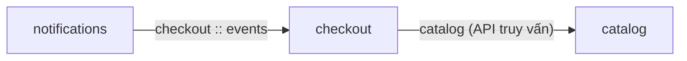
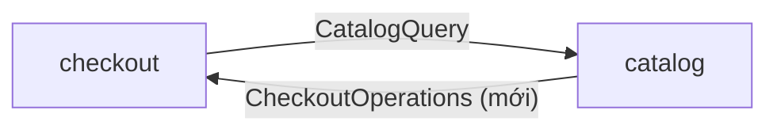
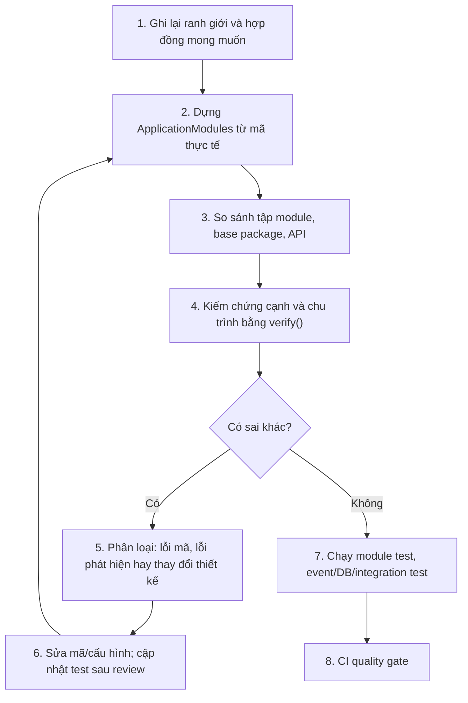
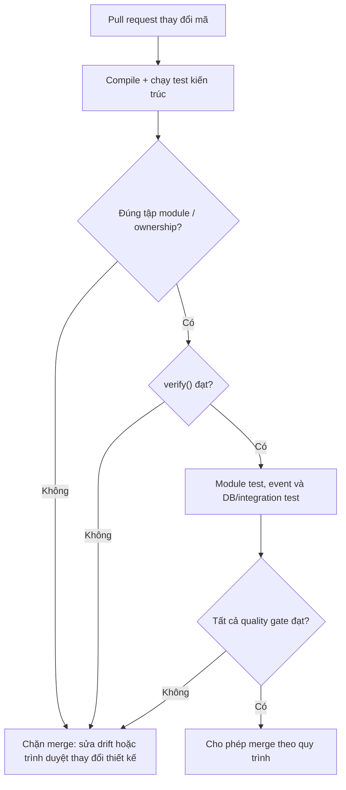

# Mô hình suy ra từ code khác với mô hình mong muốn

Một nhóm phát triển có thể thống nhất sơ đồ kiến trúc rất rõ: `checkout` phụ thuộc vào `catalog`, `notifications` chỉ lắng nghe sự kiện từ `checkout`, còn `catalog` không được biết gì về quy trình đặt hàng. Nhưng sau vài đợt thay đổi, mã nguồn có thể chứa thêm một lần `import` repository nội bộ, một vòng phụ thuộc hoặc một package bị đặt sai vị trí. **Kiến trúc dự định** và **kiến trúc đang hiện diện trong code** khi ấy không còn trùng nhau.

Spring Modulith giúp giải quyết khoảng cách đó bằng cách dựng `ApplicationModules` **từ mã và cấu hình phát hiện module thực tế**, rồi kiểm chứng các quy tắc đã được khai báo. Tuy nhiên, `verify()` **không thể đọc ý định chỉ nằm trong tài liệu hoặc trong đầu người thiết kế**. Nếu muốn giữ một kiến trúc có chủ đích, ta phải biến những quyết định đó thành cấu trúc package, ràng buộc phụ thuộc và các bài kiểm thử có thể chạy tự động.

Bài học thuộc chương **Mô hình module** trong **SPRING_MODULITH_VERIFICATION_TESTING**. Nội dung tập trung vào việc nhận diện sai lệch giữa mô hình **as-is** (được suy ra) và **to-be** (mong muốn), dùng `ApplicationModules` và `verify()` để ngăn phụ thuộc không phù hợp, đồng thời kết hợp `@ApplicationModuleTest`, kiểm thử sự kiện, cơ sở dữ liệu, tích hợp và quality gate CI để giảm hồi quy.

## 1. Mục tiêu học tập

Sau bài này, bạn có thể:

1. Phân biệt **mô hình thực tế suy ra từ code** và **mô hình đích do nhóm phát triển lựa chọn**.
2. Giải thích vì sao `ApplicationModules.of(...)` phản ánh cấu trúc được phát hiện, chứ không tự xác định ranh giới nghiệp vụ tối ưu.
3. Phân loại sai lệch: **thiếu/thừa module**, sai base package, API bị công khai quá rộng, phụ thuộc sai chiều, truy cập nội bộ hoặc tạo chu trình.
4. Biến kiến trúc mong muốn thành những kiểm tra cụ thể: định danh module, vùng package, named interface, `allowedDependencies` và `verify()`.
5. Nhận ra trường hợp **`verify()` đạt nhưng mô hình vẫn khác kỳ vọng**, chẳng hạn module bị loại khỏi phạm vi phát hiện.
6. Tổ chức kiểm thử kiến trúc cùng `@ApplicationModuleTest`, event, DB và integration test trong CI mà không nhầm các loại bảo đảm.
7. Biết cách đánh giá một thay đổi kiến trúc trước khi cập nhật baseline hoặc nới quyền phụ thuộc.

## 2. Hai mô hình: as-is và to-be

| Góc nhìn | Mô hình **as-is**: đang được suy ra | Mô hình **to-be**: nhóm muốn duy trì |
| --- | --- | --- |
| Nguồn thông tin | Package Java, các kiểu đã biên dịch, annotation, cấu hình discovery và quan hệ giữa kiểu | Quyết định thiết kế, trách nhiệm nghiệp vụ, hợp đồng module, quy tắc phụ thuộc |
| Câu hỏi | “Trong code hiện có, Spring Modulith nhận diện những module và cạnh nào?” | “Hệ thống **nên** có những module và chiều phụ thuộc nào?” |
| Ai tạo ra? | `ApplicationModules.of(...)` và cơ chế phân tích mã | Nhóm kiến trúc/phát triển, được chuyển thành ràng buộc có thể kiểm tra |
| Ví dụ | `catalog → checkout` xuất hiện vì một lớp `catalog` import `CheckoutOperations` | `checkout → catalog` được phép; `catalog` phải độc lập với `checkout` |
| Rủi ro | Có thể bao gồm cả cấu trúc vô tình, chưa được đồng thuận | Nếu chỉ nằm trên sơ đồ, không đủ để ngăn drift trong mã |
| Cách nối hai bên | Đọc mô hình và so sánh với những invariant đã định | Áp đặt invariant qua package, `@ApplicationModule`, `@NamedInterface`, test kiến trúc và CI |

**As-is không đồng nghĩa “đúng”. To-be không đồng nghĩa “đã được triển khai”.** Chúng chỉ trở nên phù hợp khi các ranh giới và quan hệ hiện có thỏa mãn những điều nhóm phát triển muốn bảo vệ.

### Vì sao một module “được phát hiện” chưa chắc là module “nên có”?

Spring Modulith mặc định xem các package con trực tiếp của package ứng dụng là ứng viên application module. Nếu một nhóm đặt cả `checkout`, `catalog` và `util` bên dưới package ứng dụng, mô hình có thể nhận diện cả `util` như một module ngang hàng dù nhóm thực sự chỉ muốn hai module nghiệp vụ.

Ngược lại, nếu `ShopApplication` bị chuyển xuống `com.example.shop.bootstrap`, các package ngang hàng `com.example.shop.checkout` và `com.example.shop.catalog` có thể không còn nằm trong vùng phát hiện mặc định. Lúc này `verify()` vẫn có thể chạy trên **một tập module không đầy đủ**.

Do đó, **đừng xem một lời gọi `verify()` không báo lỗi là bằng chứng duy nhất rằng mô hình đã đúng với thiết kế**. Hãy kiểm tra cả **những module đã được phát hiện**.

## 3. Tình huống xuyên suốt: cửa hàng trực tuyến

Giả sử thiết kế đã được nhóm thống nhất:

- `catalog` sở hữu sản phẩm và tồn kho; cung cấp hợp đồng truy vấn `CatalogQuery`.
- `checkout` điều phối việc đặt hàng; chỉ phụ thuộc vào API của `catalog`.
- `notifications` gửi thông báo sau khi `checkout` phát sự kiện; chỉ tham chiếu **named interface `events`** của `checkout`.
- Các repository và entity JPA của mỗi module là **nội bộ**, không được module khác dùng trực tiếp.

Kiến trúc **mong muốn**:



Đồ thị này có chiều phụ thuộc rõ ràng và không có chu trình.

Một cấu trúc package phù hợp:

```text
src/main/java/
└── com/example/shop/
    ├── ShopApplication.java
    ├── catalog/
    │   ├── CatalogQuery.java
    │   └── internal/
    │       ├── DefaultCatalogQuery.java
    │       └── persistence/
    │           ├── ProductEntity.java
    │           └── ProductRepository.java
    ├── checkout/
    │   ├── CheckoutOperations.java
    │   ├── CheckoutId.java
    │   ├── events/
    │   │   ├── package-info.java
    │   │   └── CheckoutCompleted.java
    │   └── internal/
    │       ├── DefaultCheckoutOperations.java
    │       └── CheckoutRepository.java
    └── notifications/
        ├── NotificationOperations.java
        └── internal/
            └── CheckoutCompletedListener.java
```

Lớp ứng dụng nằm tại gốc chung:

```java
package com.example.shop;

import org.springframework.boot.autoconfigure.SpringBootApplication;

@SpringBootApplication
public class ShopApplication {
}
```

Theo chiến lược phát hiện mặc định, `ApplicationModules.of(ShopApplication.class)` chọn ba package con trực tiếp `catalog`, `checkout` và `notifications` thành ba application module.

## 4. Từ Java import đến một cạnh không mong muốn

Đầu tiên, module `catalog` cung cấp API công khai:

```java
// com/example/shop/catalog/CatalogQuery.java
package com.example.shop.catalog;

public interface CatalogQuery {
    boolean canOrder(String sku, int quantity);
}
```

Module `checkout` cung cấp hợp đồng của chính nó:

```java
// com/example/shop/checkout/CheckoutId.java
package com.example.shop.checkout;

import java.util.UUID;

public record CheckoutId(UUID value) {
}
```

```java
// com/example/shop/checkout/CheckoutOperations.java
package com.example.shop.checkout;

public interface CheckoutOperations {
    CheckoutId submit(String sku, int quantity);
}
```

Phần triển khai của `checkout` gọi API `catalog`:

```java
// com/example/shop/checkout/internal/DefaultCheckoutOperations.java
package com.example.shop.checkout.internal;

import com.example.shop.catalog.CatalogQuery;
import com.example.shop.checkout.CheckoutId;
import com.example.shop.checkout.CheckoutOperations;
import org.springframework.stereotype.Service;

import java.util.UUID;

@Service
class DefaultCheckoutOperations implements CheckoutOperations {

    private final CatalogQuery catalog;

    DefaultCheckoutOperations(CatalogQuery catalog) {
        this.catalog = catalog;
    }

    @Override
    public CheckoutId submit(String sku, int quantity) {
        if (!catalog.canOrder(sku, quantity)) {
            throw new IllegalStateException("Không đủ sản phẩm");
        }

        // Minh họa quan hệ module; chưa triển khai lưu đơn/giao dịch.
        return new CheckoutId(UUID.randomUUID());
    }
}
```

Phụ thuộc thực tế **`checkout → catalog`** lúc này đúng mong muốn.

### Một thay đổi nhỏ khiến as-is khác to-be

Một lập trình viên muốn “xác định số đơn vừa đặt để dự báo tồn kho”, rồi cho lớp trong `catalog` tham chiếu `CheckoutOperations`:

```java
// com/example/shop/catalog/internal/BadStockForecast.java
package com.example.shop.catalog.internal;

import com.example.shop.checkout.CheckoutOperations;

// CỐ TÌNH MINH HỌA SAI CHIỀU PHỤ THUỘC.
class BadStockForecast {

    private final CheckoutOperations checkouts;

    BadStockForecast(CheckoutOperations checkouts) {
        this.checkouts = checkouts;
    }
}
```

Kiểu `CheckoutOperations` thuộc base package `checkout`, nên Java có thể biên dịch và kiểu đích là API công khai. Tuy vậy, module `catalog` giờ có thêm cạnh **`catalog → checkout`**, trong khi `checkout` đã phụ thuộc `catalog`.



**Kết quả:** as-is tạo chu trình hai module. Việc cạnh mới đi qua API công khai không giải quyết được vấn đề vì **hướng phụ thuộc và chu trình** vẫn sai với to-be. `ApplicationModules.verify()` có thể phát hiện chu trình này.

**Hướng sửa:** chuyển trách nhiệm dự báo hoặc orchestration đến module phù hợp; cung cấp hợp đồng truy vấn do đúng module sở hữu nếu cần; tránh cho `catalog` biết toàn bộ quy trình `checkout` chỉ để lấy dữ liệu.

## 5. Tình huống sai khác khác: Java public nhưng Modulith internal

Một sai lệch khác xuất hiện khi `checkout` gọi thẳng JPA repository của `catalog`.

Giả sử package nội bộ có interface được khai báo `public`:

```java
// com/example/shop/catalog/internal/persistence/ProductRepository.java
package com.example.shop.catalog.internal.persistence;

public interface ProductRepository {
    long countInStock(String sku);
}
```

Và một lớp `checkout` import:

```java
// com/example/shop/checkout/internal/BadCheckoutService.java
package com.example.shop.checkout.internal;

import com.example.shop.catalog.internal.persistence.ProductRepository;

// CỐ TÌNH VI PHẠM RANH GIỚI MODULE.
class BadCheckoutService {
    private final ProductRepository products;

    BadCheckoutService(ProductRepository products) {
        this.products = products;
    }
}
```

Java cho phép import kiểu `public` này, nhưng `ProductRepository` nằm trong package con nội bộ của module `catalog`. Với application module **đóng** mặc định, đây không phải public API được module khác sử dụng.

| Câu hỏi | Kết quả |
| --- | --- |
| Mã Java có thể biên dịch? | Có, giả sử class và dependency có sẵn |
| `checkout` có quyền phụ thuộc vào API `catalog`? | Có thể có, tùy `allowedDependencies` |
| `ProductRepository` có là API của `catalog`? | **Không** theo mặc định |
| `verify()` nên phát hiện gì? | Truy cập nội bộ xuyên module |
| Sửa bằng cách nào? | Giữ repository ở `catalog.internal`, đưa nghiệp vụ truy vấn cần thiết vào `catalog.CatalogQuery` |

**Không nên chuyển toàn bộ repository lên base package chỉ để làm bài test xanh.** Việc đó thay đổi **mô hình mong muốn** theo chiều làm lộ cài đặt thay vì sửa **mã thực tế** cho đúng thiết kế.

## 6. Sai khác có thể nằm ở *tập module*, không chỉ ở các cạnh

Có những trường hợp **không cần import sai nào** nhưng as-is vẫn không giống to-be.

### 6.1. Module bị bỏ sót do đặt lớp khởi động sai package

```text
com.example.shop
├── bootstrap/
│   └── ShopApplication.java  (package com.example.shop.bootstrap)
├── catalog/
├── checkout/
└── notifications/
```

Nếu gọi `ApplicationModules.of(ShopApplication.class)`, gốc mặc định là `com.example.shop.bootstrap`. Ba package ngang hàng không nằm dưới gốc đó và có nguy cơ không được nhận diện thành application module.

Một bài test chỉ gọi `modules.verify()` có thể không báo lỗi về các cạnh mong muốn, vì nó đang kiểm chứng **mô hình bị thiếu node**. Giải pháp thường là đặt lớp ứng dụng tại package chung thích hợp hoặc cấu hình root package rõ ràng, rồi kiểm tra tập module được phát hiện.

### 6.2. Module thừa do package kỹ thuật đặt ngang hàng

```text
com.example.shop
├── ShopApplication.java
├── catalog/
├── checkout/
├── notifications/
└── common/
    ├── Strings.java
    └── ClockProvider.java
```

Trong chiến lược mặc định, `common` cũng có thể trở thành một application module. Nếu thiết kế to-be chỉ có ba module nghiệp vụ, mô hình as-is đã **thừa một node**. Điều này không nhất thiết tạo vi phạm `verify()` nếu `common` không gây vòng và các tham chiếu vẫn hợp lệ.

Nên xem lại trách nhiệm của `common`, cách bố trí package hoặc chiến lược phát hiện. Không nên mặc định cho rằng mọi package kỹ thuật cần là application module nghiệp vụ độc lập.

### 6.3. Module ngoài root chưa được đưa vào mô hình

Một build nhiều project có thể có `com.vendor.shipping` trên classpath nhưng gốc `ShopApplication` là `com.example.shop`. Nếu đội phát triển coi `shipping` là một application module, cần đưa đúng package vào nguồn phát hiện bằng `@Modulithic(additionalPackages = ...)` hoặc `ApplicationModuleSourceFactory` tùy tổ chức.

**Classpath có class không có nghĩa package đó đã được chọn làm module.** Cần xác minh bằng `getModuleByName(...)` hoặc `getModuleForPackage(...)` sau khi dựng `ApplicationModules`.

### 6.4. Package con trở thành API ngoài ý muốn

Package `checkout.events` hoặc `catalog.api` không tự là API công khai chỉ do tên. Khi ai đó thêm `@NamedInterface` vào một package con có nhiều kiểu, phạm vi công khai của module có thể rộng hơn thiết kế. Ngược lại, nếu thiếu named interface, consumer hợp lệ theo thiết kế có thể bị `verify()` từ chối.

Đây là sự khác biệt về **bề mặt hợp đồng**, không phải số lượng module.

## 7. Phân loại drift theo những chiều độc lập

| Loại sai khác | Ví dụ as-is | Kiểm tra nên có | Hướng điều chỉnh |
| --- | --- | --- | --- |
| **Thiếu module** | `notifications` không xuất hiện | Assertion về tên module/package | Sửa root hoặc chiến lược phát hiện |
| **Thừa module** | `common` được coi là module | So sánh chính xác tập identifier | Xem lại package/discovery |
| **Sai module sở hữu kiểu** | `CheckoutRepository` bị chuyển qua `catalog.internal` | `getModuleByType(...)` hoặc `getModuleForPackage(...)` | Chuyển đúng kiểu về vùng trách nhiệm |
| **API quá hẹp** | Sự kiện cần chia sẻ nằm ở package con chưa công khai | `verify()` với consumer thực tế | Khai báo named interface có chủ đích |
| **API quá rộng** | Entity/JPA repository được đặt tại base package hoặc mở cả module | Review API/named interface; thêm policy riêng khi cần | Thu hẹp hợp đồng và phân vùng lại |
| **Cạnh sai chiều** | `catalog → checkout` | `allowedDependencies`, `verify()` và review graph | Sửa vị trí orchestration/hợp đồng |
| **Truy cập internal** | `checkout → catalog.internal.ProductRepository` | `verify()` | Dùng API truy vấn của `catalog` |
| **Chu trình** | `checkout → catalog → checkout` | `verify()` | Loại cạnh ngược, tách trách nhiệm |
| **Thiếu một cạnh cần thiết về hành vi** | Listener không còn nhận event nhưng mô hình vẫn hợp lệ | Kiểm thử event/tích hợp | Sửa logic publish/subscribe hoặc fixture |

Hai loại cuối rất quan trọng để phân biệt: `verify()` có thể phát hiện **những cạnh vi phạm** trong mô hình, nhưng không tự bảo đảm rằng một luồng nghiệp vụ **phải tồn tại hoặc phải chạy thành công**.

## 8. Biến mô hình mong muốn thành quy tắc có thể kiểm tra

Hãy mô tả thiết kế dưới dạng bốn nhóm điều kiện:

1. **Tập module mong đợi:** `catalog`, `checkout`, `notifications`, không tự phát sinh module kỹ thuật không chủ đích.
2. **Sở hữu package/kiểu:** `catalog.internal.persistence` thuộc `catalog`; `checkout.events` thuộc `checkout`.
3. **API được công khai:** API mặc định ở base package; `checkout.events` được công khai riêng với tên `events`; repository và entity tiếp tục nội bộ.
4. **Hướng phụ thuộc được phép:** `checkout` chỉ cần `catalog`; `notifications` chỉ cần `checkout :: events`; không được có vòng.

Ở mức khái niệm, đặt:

```text
V_actual  = tập application module được phát hiện
E_actual  = tập cạnh phụ thuộc suy ra từ các kiểu Java
V_expect  = tập module mà nhóm thiết kế chấp nhận
E_allow   = tập cạnh/interface mà nhóm cho phép

Mục tiêu:
  V_actual == V_expect       (nếu dự án muốn đóng băng chính xác tập module)
  E_actual nằm trong E_allow
  E_actual không tạo chu trình
  Các kiểu đích xuyên module đều thuộc API hợp lệ
```

Trong một số dự án, `E_allow` là **danh sách tối đa** (*allowlist*), không phải danh sách các cạnh bắt buộc. Nếu `checkout` hiện không còn dùng `catalog`, phép kiểm chứng không nhất thiết phải báo lỗi chỉ vì `allowedDependencies` vẫn cho phép `catalog`. Muốn bắt buộc một quan hệ hay một hành vi tồn tại, cần **assertion riêng hoặc kiểm thử nghiệp vụ**.

### To-be có thể thay đổi có chủ đích

Mô hình mong muốn không bất biến vĩnh viễn. Khi tách module mới, đổi hợp đồng hoặc chuyển từ gọi đồng bộ sang sự kiện, nhóm phát triển có thể **duyệt thay đổi kiến trúc** rồi cập nhật ràng buộc. Điều quan trọng là phải biết thay đổi đó là **quyết định thiết kế** hay chỉ là **sửa test để hợp thức hóa một import mới**.

## 9. Ràng buộc chiều phụ thuộc bằng @ApplicationModule

Trong ví dụ to-be, `checkout` chỉ được sử dụng API mặc định của `catalog`:

```java
// com/example/shop/checkout/package-info.java
@org.springframework.modulith.ApplicationModule(
        allowedDependencies = "catalog"
)
package com.example.shop.checkout;
```

`notifications` chỉ dùng sự kiện của `checkout`:

```java
// com/example/shop/notifications/package-info.java
@org.springframework.modulith.ApplicationModule(
        allowedDependencies = "checkout :: events"
)
package com.example.shop.notifications;
```

Còn `catalog` không nên có dependency ra ngoài đến những module nghiệp vụ khác trong ví dụ. Một tùy chọn là khai báo rõ không cho phụ thuộc module nào:

```java
// com/example/shop/catalog/package-info.java
@org.springframework.modulith.ApplicationModule(
        allowedDependencies = {}
)
package com.example.shop.catalog;
```

Điều này minh họa **danh sách rỗng được khai báo tường minh**. Theo JavaDoc Spring Modulith hiện hành, `allowedDependencies = {}` **không cho phép phụ thuộc tới các application module khác**, khác với việc để nguyên giá trị mặc định của annotation (không giới hạn tường minh). Những **shared modules** do ứng dụng cấu hình vẫn là trường hợp cần xét riêng. Nếu to-be yêu cầu `catalog` hoàn toàn không có dependency ra ngoài, có thể bổ sung assertion trực tiếp trên đồ thị thực tế để bảo vệ invariant nghiêm ngặt hơn.

### Vì sao allowedDependencies không đồng nghĩa mọi import đều hợp lệ?

Ngay cả khi `checkout` được phép phụ thuộc vào module `catalog`, nó vẫn **không được** truy cập `catalog.internal.persistence.ProductRepository` trong mô hình đóng mặc định. Hai câu hỏi cần trả lời độc lập:

- **Module nguồn được phép dùng module/interface nào?** — do `allowedDependencies` quy định khi khai báo.
- **Kiểu đích có thuộc API được công khai của module đó không?** — do base package, named interface và kiểu module xác định.

Nếu module không khai báo `allowedDependencies`, quy tắc giới hạn tường minh này không áp dụng; điều đó không làm vô hiệu quy tắc về internal API hoặc phụ thuộc vòng.

## 10. Khai báo named interface đúng với hợp đồng mong muốn

Event `CheckoutCompleted` được module `checkout` công khai, nhưng không nằm trực tiếp ở base package:

```java
// com/example/shop/checkout/events/CheckoutCompleted.java
package com.example.shop.checkout.events;

import java.util.UUID;

public record CheckoutCompleted(UUID checkoutId, String customerId) {
}
```

Khai báo package con làm named interface:

```java
// com/example/shop/checkout/events/package-info.java
@org.springframework.modulith.NamedInterface("events")
package com.example.shop.checkout.events;
```

Module `notifications` có thể nghe sự kiện:

```java
// com/example/shop/notifications/internal/CheckoutCompletedListener.java
package com.example.shop.notifications.internal;

import com.example.shop.checkout.events.CheckoutCompleted;
import org.springframework.context.event.EventListener;
import org.springframework.stereotype.Component;

@Component
class CheckoutCompletedListener {

    @EventListener
    void on(CheckoutCompleted event) {
        // Minh họa: gửi thông báo; chưa triển khai tương tác email.
    }
}
```

Ở mức phụ thuộc **tĩnh**, module `notifications` tham chiếu kiểu event thuộc `checkout`, nên cạnh là **`notifications → checkout`**. Ở runtime, sự kiện có thể được phát từ `checkout` đến listener của `notifications` theo hướng ngược lại. Không được nhầm **event flow** với **dependency graph** khi so sánh as-is và to-be.

Named interface bảo đảm kiểu sự kiện **được công khai cho tham chiếu kiến trúc**, chứ không bảo đảm event đã được publish, listener nhận được, transaction commit thành công hoặc retry hoạt động. Đó là nhiệm vụ của các bài kiểm thử sự kiện/tích hợp.

## 11. Bài kiểm thử đầu tiên: chặn mô hình bị thiếu hoặc thừa module

Một lỗi khó thấy là **`verify()` chạy trên sai phạm vi**. Do đó, cần một bài kiểm thử xác nhận tập module **đúng như to-be**, không chỉ hỏi “một module nào đó có tồn tại không?”.

```java
package com.example.shop;

import org.junit.jupiter.api.Test;
import org.springframework.modulith.core.ApplicationModules;

import java.util.Set;
import java.util.stream.Collectors;

import static org.junit.jupiter.api.Assertions.assertEquals;
import static org.junit.jupiter.api.Assertions.assertTrue;

class ModuleModelContractTest {

    private final ApplicationModules modules =
            ApplicationModules.of(ShopApplication.class);

    @Test
    void discoversExactlyTheIntendedModules() {
        Set<String> actual = modules.stream()
                .map(module -> module.getIdentifier().toString())
                .collect(Collectors.toSet());

        assertEquals(Set.of("catalog", "checkout", "notifications"), actual);
    }

    @Test
    void mapsPackageToItsIntendedOwner() {
        var catalog = modules.getModuleForPackage(
                "com.example.shop.catalog.internal.persistence"
        ).orElseThrow();

        assertEquals("catalog", catalog.getIdentifier().toString());
        assertEquals("com.example.shop.catalog",
                catalog.getBasePackage().getName());

        assertTrue(modules.getModuleByName("checkout").isPresent());
    }

    @Test
    void catalogHasNoOutboundModuleDependencies() {
        var catalog = modules.getModuleByName("catalog").orElseThrow();

        assertTrue(catalog.getDirectDependencies(modules).isEmpty());
    }

    @Test
    void enforcesModuleBoundaries() {
        modules.verify();
    }
}
```

**Bốn phép kiểm tra bảo vệ bốn điều khác nhau:**

1. `discoversExactlyTheIntendedModules()` phát hiện cả **module bị thiếu** lẫn **module thừa**. Nếu một module mới được thêm có chủ đích, nhóm phải cập nhật danh sách kỳ vọng sau khi review.
2. `mapsPackageToItsIntendedOwner()` xác nhận package nội bộ thuộc module đúng. Khi cấu hình phát hiện thay đổi hoặc module lồng nhau được đưa vào, assertion có thể cảnh báo thay đổi phạm vi sở hữu.
3. `catalogHasNoOutboundModuleDependencies()` xác nhận **thực tế không có cạnh đi ra** từ `catalog`, kể cả khi một cấu hình chia sẻ module được thêm vào sau này.
4. `enforcesModuleBoundaries()` kiểm tra các quy tắc phụ thuộc của mô hình đã phát hiện.

Các API `stream()`, `getIdentifier()`, `getModuleForPackage(...)`, `getBasePackage()` và `verify()` có trong các bản Spring Modulith hiện đại; cần đối chiếu phiên bản sử dụng của dự án nếu API khác. Đoạn mã trên giả định các lớp nghiệp vụ tương ứng đã tồn tại và classpath chứa chúng.

### Khi nào không nên assert chính xác mọi module?

Một nền tảng plugin có thể cho phép thêm module động qua `ApplicationModuleSourceFactory`. Khi đó, so sánh tập tên bằng nhau tuyệt đối có thể quá cứng. Có thể thay bằng:

- **Tập module bắt buộc phải tồn tại**, ví dụ `catalog`, `checkout`, `notifications`.
- **Quy tắc đặt tên và root package** cho module do plugin đóng góp.
- **Kiểm chứng kiến trúc** áp dụng cho tất cả module hiện được phát hiện.

Tuy nhiên, việc nới bài test phải là quyết định thiết kế; nếu nhóm thực sự muốn tập module cố định, assertion tập tên bằng nhau là một quality gate hữu ích.

## 12. Bài kiểm thử thứ hai: kiểm chứng phụ thuộc thực tế

`ApplicationModules.verify()` là kiểm chứng kiến trúc của Spring Modulith. Nó xem xét những nhóm quy tắc quan trọng:

| Quy tắc | Phạm vi bảo vệ | Ví dụ sai |
| --- | --- | --- |
| Không có **chu trình giữa application module** | Đồ thị phụ thuộc phải không vòng | `checkout → catalog → checkout` |
| Không truy cập **kiểu nội bộ** của module khác | Cạnh xuyên module phải tới API hợp lệ | `checkout` import `catalog.internal.ProductRepository` |
| Tuân thủ **`allowedDependencies`** khi được khai báo | Module nguồn chỉ dùng những module/interface được phép | `checkout` import `notifications.NotificationOperations` |

Ví dụ bài test tách biệt, nếu nhóm muốn CI hiển thị rõ nguyên nhân lỗi:

```java
package com.example.shop;

import org.junit.jupiter.api.Test;
import org.springframework.modulith.core.ApplicationModules;

class ArchitectureVerificationTest {

    @Test
    void architectureMatchesDeclaredConstraints() {
        ApplicationModules.of(ShopApplication.class).verify();
    }
}
```

`verify()` có thể ném lỗi khi tìm thấy vi phạm. Nếu cần thu thập và phân tích danh sách trước khi quyết định fail, API hiện đại còn hỗ trợ `detectViolations()`:

```java
ApplicationModules modules =
        ApplicationModules.of(ShopApplication.class);

modules.detectViolations().throwIfPresent();
```

Không nên mặc định lọc bỏ mọi vi phạm để pipeline xanh. Việc tạm bỏ qua một lỗi legacy cần có lý do, phạm vi rõ và kế hoạch khắc phục. Bất kỳ bộ lọc nào cũng phải tránh che giấu một lỗi kiến trúc mới.

### Lỗ hổng quan trọng: verify() không biết những cạnh *bắt buộc*

Nếu `notifications` không còn khai báo listener và không tham chiếu `CheckoutCompleted`, cạnh `notifications → checkout` có thể biến mất. Điều đó **không nhất thiết làm `verify()` thất bại**, vì việc giảm dependency thường không vi phạm quy tắc kiến trúc.

Nhưng nếu nghiệp vụ yêu cầu gửi thông báo mỗi khi checkout hoàn tất, đây là **hồi quy hành vi**. Cần một bài event/integration test xác nhận:

- `checkout` thật sự publish `CheckoutCompleted` trong điều kiện thích hợp;
- listener của `notifications` được gọi;
- các side effect (ví dụ yêu cầu gửi email) đúng mong đợi;
- transaction, lỗi xử lý và retry được kiểm tra nếu hệ thống có yêu cầu.

Như vậy, “đồ thị không có cạnh sai” và “hành vi có đủ liên kết cần thiết” là **hai khẳng định khác nhau**.

## 13. Xác nhận trực quan mô hình đang được suy ra

Khi mới tham gia dự án, cách đầu tiên là **in mô hình**, rồi đối chiếu với sơ đồ kiến trúc mà nhóm đang sử dụng.

```java
ApplicationModules modules =
        ApplicationModules.of(ShopApplication.class);

modules.forEach(System.out::println);

// Khảo sát phụ thuộc trực tiếp của module checkout khi cần chẩn đoán.
var checkout = modules.getModuleByName("checkout").orElseThrow();
System.out.println(checkout.getDirectDependencies(modules));
```

Theo API Spring Modulith, `getDirectDependencies(...)` giúp xem các phụ thuộc trực tiếp mà mô hình đã phát hiện. Không nên biến chuỗi `toString()` của đầu ra này thành một bản snapshot brittle chỉ để so sánh ký tự; khi cần kiểm chứng ổn định, ưu tiên những assertion trên identifier, package và quy tắc kiến trúc.

### Quy trình đối chiếu as-is / to-be



**Không sửa thiết kế trên giấy cho khớp code một cách tự động.** Mục đích của bước phân loại là xác định cái nào sai: cấu trúc mã mới, cấu hình phát hiện, hay chính mô hình mục tiêu cần được điều chỉnh có chủ đích.

## 14. Khi nào thay đổi mô hình mong muốn là hợp lý?

Một refactor chính đáng có thể làm xuất hiện một module mới, thay đổi tên interface hoặc đổi chiều phụ thuộc. Ví dụ, nhóm quyết định tách chức năng tính giá thành module `pricing` riêng để tránh dùng chung logic qua `catalog.internal`.

Thay đổi có thể tiến hành theo trình tự:

1. **Đề xuất thiết kế:** bổ sung `pricing` trong sơ đồ to-be, xác định trách nhiệm và API.
2. **Chọn package:** tạo `com.example.shop.pricing` làm base package, giữ implementation trong `pricing.internal`.
3. **Quy định phụ thuộc:** `checkout` được phép phụ thuộc `catalog` và `pricing` nếu thực sự cần.
4. **Di chuyển mã:** chuyển phần tính giá và các test về module sở hữu mới.
5. **Cập nhật assertions:** thêm `pricing` vào danh sách module mong đợi đã được review.
6. **Chạy `verify()`:** không được xuất hiện internal access hay vòng phụ thuộc.
7. **Chạy kiểm thử hành vi:** xác nhận kết quả giá, transaction và luồng checkout đúng.

Khi có thỏa thuận và bằng chứng kiểm thử, **thay đổi to-be là tiến hóa kiến trúc**. Ngược lại, chỉ thêm `pricing` vào `allowedDependencies` vì một import mới xuất hiện mà không đánh giá thiết kế là **hợp thức hóa drift**.

### Mở module có thể che khuất chênh lệch

Spring Modulith hỗ trợ **open application module**, có thể cho phép truy cập nhiều kiểu nội bộ hơn. Tính năng này hữu ích cho một số tình huống chuyển đổi codebase cũ, nhưng nếu to-be đặt mục tiêu module đóng, việc đổi sang open chỉ để tránh lỗi `verify()` đã làm suy yếu chính mục tiêu cần bảo vệ.

Không dùng `@NamedInterface` trên toàn bộ package nội bộ hoặc chuyển mọi repository sang base package để giải quyết nhanh lỗi kiểm chứng. Hãy công khai **hợp đồng thực sự cần**, không phải toàn bộ lớp triển khai.

## 15. @ApplicationModuleTest giúp lấp khoảng cách nào?

`ApplicationModules` và `verify()` tập trung vào **mô hình cấu trúc**. `@ApplicationModuleTest` kiểm thử **một module trong Spring Test context** và có thể xác nhận các hành vi tích hợp ở phạm vi phù hợp.

Ví dụ bài kiểm thử cho module `checkout`:

```java
package com.example.shop.checkout;

import org.junit.jupiter.api.Test;
import org.springframework.modulith.test.ApplicationModuleTest;

@ApplicationModuleTest
class CheckoutModuleIntegrationTest {

    @Test
    void moduleContextStarts() {
        // Thêm assert kết quả nghiệp vụ khi các bean và fixture đã hoàn chỉnh.
    }
}
```

Nếu `checkout` dùng `CatalogQuery` thuộc module `catalog`, test giới hạn module có thể cần mock hợp đồng đó hoặc mở rộng phạm vi bootstrap theo chế độ của `@ApplicationModuleTest`. Mô hình phát hiện đúng dependency không có nghĩa mọi bean bên ngoài sẽ tự được nạp trong mọi cấu hình test.

| Bảo đảm cần có | Bài kiểm tra phù hợp |
| --- | --- |
| Có đủ module và package đúng như thiết kế | Assertion trên `ApplicationModules` |
| Không có cạnh sai, internal access hoặc vòng | `ApplicationModules.verify()` |
| Một module bootstrap với bean cần thiết | `@ApplicationModuleTest` |
| Có event được publish và listener phản ứng đúng | Kiểm thử event/module integration |
| Transaction và repository cập nhật đúng dữ liệu | Kiểm thử database/transaction |
| Toàn bộ use case chạy qua các module đúng kết quả | Integration/end-to-end test phù hợp |

Một kiến trúc hoàn toàn hợp lệ về package vẫn có thể bị lỗi database hoặc phát sự kiện không đúng thời điểm. Ngược lại, một luồng end-to-end chạy được không chứng minh mọi `import` đang tôn trọng public API của module.

## 16. Thiết kế quality gate CI chống architecture drift

Chỉ chạy `verify()` là khởi đầu tốt, nhưng với mục tiêu **không lệch khỏi kiến trúc đã thống nhất**, nên có ít nhất hai nhóm kiểm tra cấu trúc:

1. **Model contract test:** xác nhận module mong đợi, package sở hữu và các invariant quan trọng.
2. **Dependency verification test:** gọi `verify()` để kiểm tra nội bộ, `allowedDependencies` và chu trình.

Sau đó bổ sung **module integration tests**, event tests và database tests tùy độ rủi ro.



Ví dụ lệnh cho dự án đã cấu hình build:

```bash
# Maven Wrapper:
./mvnw test

# Hoặc Gradle Wrapper:
./gradlew test
```

Với Windows có thể dùng `mvnw.cmd` hoặc `gradlew.bat`. Trong dự án chia nhiều test suite, cần chắc chắn những bài test kiến trúc nằm trong nhóm **bắt buộc trước khi merge** và không bị bỏ qua do cấu hình CI.

### Tránh hai cách tạo cảm giác an toàn giả

- **Cập nhật danh sách kỳ vọng tự động từ code trong mỗi lần test.** Nếu expected model được tạo lại từ actual model ngay khi chạy, phép so sánh sẽ không phát hiện drift.
- **Bỏ hết lỗi `verify()` vì dự án còn legacy.** Nếu cần chấp nhận tạm một số vi phạm, hãy khoanh vùng, ghi lý do, giới hạn thời gian và không cho phép lỗi mới tăng thêm.

Đặc biệt khi chuyển sang phát hiện module tường minh, cần đảm bảo module chưa được đánh dấu không **vô tình biến mất khỏi phạm vi**. Một mô hình “nhỏ đi” không nhất thiết là mô hình “sạch hơn”.

## 17. Bài thực hành: ba trường hợp drift khác nhau

Cho ứng dụng:

```text
com.acme.travel
├── TravelApplication.java
├── booking/
│   ├── BookingOperations.java
│   ├── events/
│   │   ├── package-info.java  (@NamedInterface("events"))
│   │   └── BookingConfirmed.java
│   └── internal/
│       ├── BookingService.java
│       └── BookingRepository.java
├── payment/
│   ├── PaymentOperations.java
│   └── internal/PaymentAdapter.java
├── notification/
│   └── internal/BookingConfirmedListener.java
└── common/
    └── StringUtils.java
```

Thiết kế **to-be**:

- Chỉ có ba module nghiệp vụ: `booking`, `payment`, `notification`.
- `booking` phụ thuộc API mặc định của `payment`.
- `notification` chỉ phụ thuộc `booking :: events`.
- `payment` không được phụ thuộc ngược `booking`.
- Repository và adapter của từng module phải nội bộ.

### Câu hỏi

1. Với chiến lược phát hiện mặc định, tập module **as-is** có thể khác to-be ở điểm nào dù không có import sai?
2. Nếu `payment.internal.PaymentAdapter` import `booking.BookingOperations`, cạnh nào mới xuất hiện? Nó tạo nguy cơ gì khi `booking` đã phụ thuộc `payment`?
3. Nếu `notification` tham chiếu `booking.internal.BookingRepository` và repository được khai báo `public`, Java có thể biên dịch không? `verify()` cần báo loại vi phạm nào?
4. Nếu bỏ annotation `@NamedInterface("events")`, listener tham chiếu `BookingConfirmed` bị ảnh hưởng ra sao?
5. Nếu chuyển lớp `TravelApplication` vào `com.acme.travel.bootstrap`, tại sao test chỉ gọi `verify()` có thể không đủ để bảo vệ to-be?
6. Nếu listener `BookingConfirmedListener` bị xóa nhưng `verify()` vẫn đạt, loại kiểm thử nào cần phát hiện yêu cầu gửi thông báo đã bị hỏng?
7. Hãy phác thảo hai test kiến trúc độc lập giúp bảo vệ (a) tập module và (b) luật phụ thuộc.

### Đáp án gợi ý

1. `common` là sub-package trực tiếp dưới gốc ứng dụng, nên có thể được suy ra là một application module thứ tư. Cần review trách nhiệm package hoặc chiến lược phát hiện.
2. Thêm `payment → booking`, trong khi đã có `booking → payment`. Hai cạnh này tạo **chu trình** không phù hợp thiết kế.
3. Java có thể cho phép vì kiểu `public`, nhưng Spring Modulith trong mô hình đóng mặc định xem đó là **truy cập kiểu nội bộ xuyên module**.
4. `BookingConfirmed` thuộc package con `booking.events`, không còn được công khai theo named interface; listener từ `notification` tham chiếu nó có thể vi phạm ranh giới.
5. Gốc phát hiện chuyển thành `com.acme.travel.bootstrap`; các package ngang hàng có thể bị bỏ sót. Nếu chỉ gọi `verify()`, test chưa bảo đảm tập module mong đợi thực sự tồn tại.
6. **Kiểm thử sự kiện/tích hợp** xác nhận phát và xử lý sự kiện, side effect gửi thông báo và các điều kiện transaction cần thiết.
7. Test thứ nhất so sánh identifier phát hiện được với tập đã duyệt, chẳng hạn `{"booking", "payment", "notification"}` sau khi điều chỉnh package `common` phù hợp; test thứ hai gọi `ApplicationModules.of(TravelApplication.class).verify()` với các annotation giới hạn dependency đúng thiết kế.

### Bài thử mở rộng

Nhóm quyết định tách thêm module `fraud` để thẩm định giao dịch. Hãy mô tả **những việc cần thay đổi có chủ đích**: base package mới, API của `fraud`, chiều phụ thuộc từ `booking` hoặc `payment` đến `fraud`, cập nhật `allowedDependencies`, cập nhật tập identifier trong test, và chạy lại kiểm thử giao dịch.

**Câu hỏi phản biện:** “Bài test `verify()` đạt, vậy architecture drift chắc chắn không tồn tại” — kết luận này sai ở điểm nào? Hãy chỉ ra ít nhất hai sai khác nằm ngoài điều mà riêng `verify()` có thể chứng minh.

## 18. Checklist review trước khi chấp nhận thay đổi kiến trúc

- [ ] Đã ghi rõ **to-be** gồm module, trách nhiệm và hợp đồng nào.
- [ ] Đã dựng **as-is** từ classpath, gốc ứng dụng và chiến lược phát hiện đúng.
- [ ] Tập module được phát hiện đầy đủ; không có module ngoài ý muốn hoặc bị bỏ sót.
- [ ] Base package và package con phản ánh đúng **module sở hữu**.
- [ ] Public API chỉ gồm hợp đồng cần thiết; repository/entity/adapter vẫn nội bộ.
- [ ] Named interface được khai báo đúng package và đúng tên mà consumer sử dụng.
- [ ] Mọi cạnh xuyên module đi đúng chiều và tuân thủ `allowedDependencies`.
- [ ] Không có phụ thuộc vòng trực tiếp hoặc gián tiếp.
- [ ] Bài test `ApplicationModules.of(...).verify()` chạy trong CI.
- [ ] Bài test kiểm chứng tập module/ownership không tự cập nhật expected từ actual.
- [ ] `@ApplicationModuleTest` và kiểm thử sự kiện, database, tích hợp bảo vệ các hành vi bắt buộc.
- [ ] Thay đổi to-be được review trước khi chỉnh baseline hoặc mở thêm quyền phụ thuộc.

**Ghi nhớ:** **Spring Modulith mô tả kiến trúc hiện diện trong code, không tự phán đoán kiến trúc nghiệp vụ mà nhóm mong muốn.** Hãy chuyển to-be thành ranh giới package, public API, named interface, `allowedDependencies` và các assertion về tập module. Kết hợp chúng với `verify()` và kiểm thử runtime trong CI để phát hiện cả **vi phạm cấu trúc** lẫn **hồi quy hành vi**.

## Tài liệu tham khảo

- [Spring Modulith — Fundamentals: Application Modules, Named Interfaces và Allowed Dependencies](https://docs.spring.io/spring-modulith/reference/fundamentals.html)
- [Spring Modulith — Verifying Application Module Structure](https://docs.spring.io/spring-modulith/reference/verification.html)
- [Spring Modulith — Testing Application Modules](https://docs.spring.io/spring-modulith/reference/testing.html)
- [Spring Modulith API — ApplicationModules](https://docs.spring.io/spring-modulith/docs/current/api/org/springframework/modulith/core/ApplicationModules.html)
- [Spring Modulith API — ApplicationModule](https://docs.spring.io/spring-modulith/docs/current/api/org/springframework/modulith/core/ApplicationModule.html)
