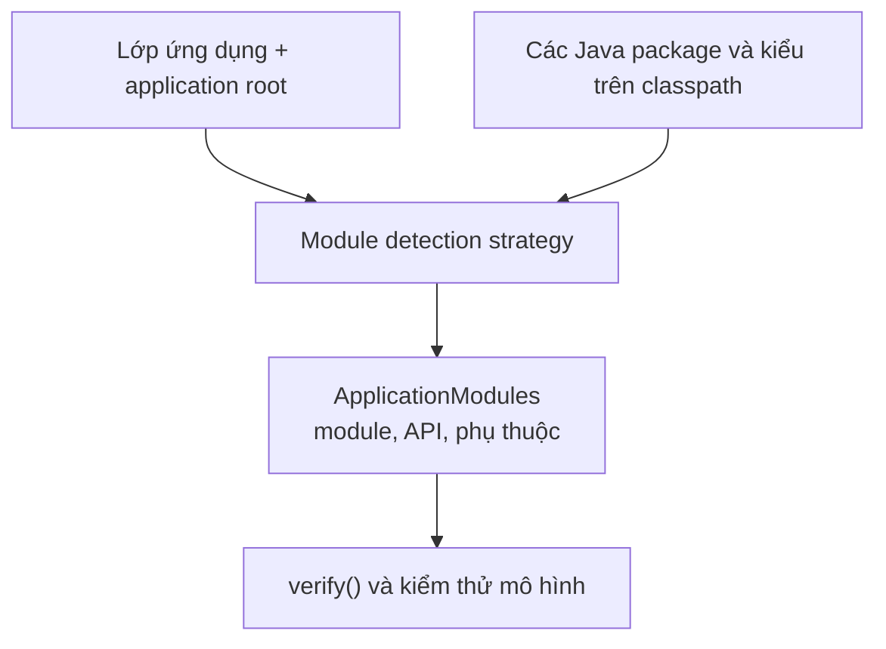
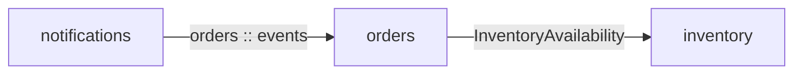
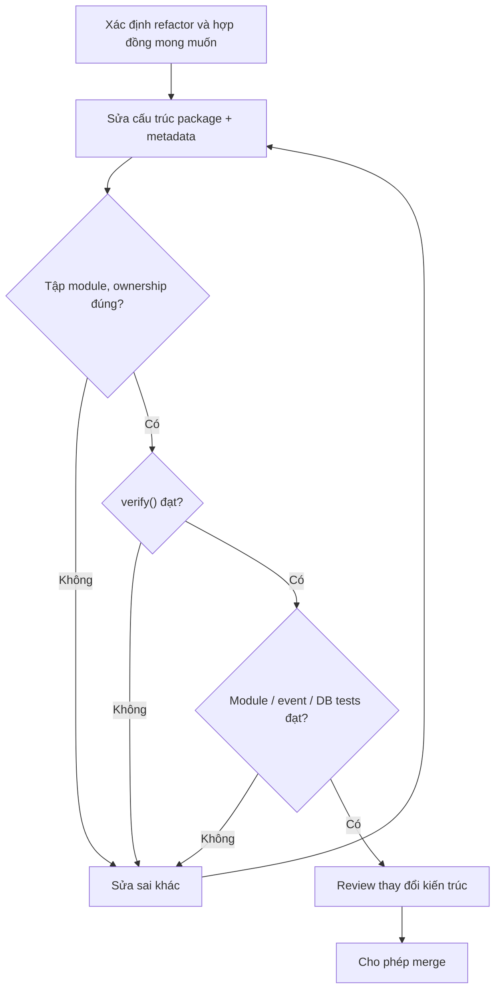

# Giữ mô hình module đồng bộ với tổ chức package

Khi nhóm phát triển đổi tên package, chuyển một service sang module khác hoặc thêm một package kỹ thuật dưới gốc ứng dụng, cấu trúc mã nguồn đã thay đổi. **Mô hình application module của Spring Modulith cũng có thể thay đổi theo**, dù không ai chủ động sửa sơ đồ kiến trúc. Nếu chỉ kiểm tra ứng dụng biên dịch và chạy được, một số thay đổi đó dễ đi qua code review mà không được nhận diện.

Spring Modulith dùng `ApplicationModules` để **suy ra mô hình module từ code, cấu trúc Java package và cấu hình phát hiện**. Để giữ mô hình luôn phản ánh đúng ý định thiết kế, cần có một vòng kiểm soát: xác định module nào phải tồn tại, kiểu nào thuộc module nào, API nào được công khai, những phụ thuộc nào được phép; sau đó kiểm tra tự động mỗi khi package thay đổi.

Bài học thuộc chương **Mô hình module** của **SPRING_MODULITH_VERIFICATION_TESTING**. Nội dung tập trung vào đồng bộ cấu trúc package với `ApplicationModules` và dùng `ApplicationModules.verify()` làm quality gate; những kiểm thử `@ApplicationModuleTest`, sự kiện, cơ sở dữ liệu và tích hợp bổ sung để ngăn hồi quy hành vi sau refactor.

## 1. Mục tiêu học tập

Sau bài này, bạn có thể:

1. Giải thích quan hệ giữa **application root package**, **module base package**, các **package con** và mô hình `ApplicationModules`.
2. Dự đoán tác động của việc **thêm, đổi tên, chuyển hoặc tách package** tới tập module, API và đồ thị phụ thuộc.
3. Phân biệt **thay đổi cấu trúc có chủ đích** với **architecture drift** do refactor vô tình.
4. Viết JUnit test kiểm tra **tập module mong đợi**, base package và module sở hữu những kiểu quan trọng.
5. Áp dụng `@NamedInterface` và `allowedDependencies` để giữ public API và chiều phụ thuộc ổn định.
6. Sử dụng `verify()` để phát hiện phụ thuộc vòng, truy cập kiểu nội bộ và phụ thuộc ngoài danh sách được phép.
7. Tổ chức quy trình refactor package, review thay đổi kiến trúc và quality gate CI.
8. Biết trường hợp nào bắt buộc kiểm thử database/event/integration vì `verify()` không thể kiểm tra hành vi runtime.

## 2. Mô hình module được suy ra từ những gì?

Giả sử lớp khởi động Spring Boot nằm ở `com.acme.market`:

```java
package com.acme.market;

import org.springframework.boot.autoconfigure.SpringBootApplication;

@SpringBootApplication
public class MarketApplication {
}
```

Để dựng mô hình, có thể dùng một lớp khảo sát độc lập:

```java
package com.acme.market;

import com.acme.market.MarketApplication;
import org.springframework.modulith.core.ApplicationModules;

public class ModuleModelInspect {

    public static void main(String[] args) {
        ApplicationModules modules =
                ApplicationModules.of(MarketApplication.class);

        modules.forEach(System.out::println);
    }
}
```

Theo **chiến lược phát hiện mặc định**, Spring Modulith tìm các package con trực tiếp của package chứa `MarketApplication` để nhận diện các application module. Kết quả dựa trên mã Java đã được đưa vào classpath phân tích, **không** dựa trực tiếp vào tên project Maven/Gradle hay danh sách Spring bean được quét.

| Thành phần | Ví dụ | Vai trò |
| --- | --- | --- |
| Application root package | `com.acme.market` | Điểm bắt đầu phát hiện module |
| Module base package | `com.acme.market.orders` | Đánh dấu vùng mã thuộc module `orders` |
| Package con | `com.acme.market.orders.internal` | Thông thường vẫn thuộc `orders` và là nội bộ |
| Module identifier | `orders` | Tên logic để truy vấn module và khai báo phụ thuộc |
| Named interface | `orders :: events` | Một phần API được công khai từ package con |
| Module dependency | `orders → inventory` | Một kiểu của `orders` tham chiếu kiểu do `inventory` sở hữu |



**Mô hình là kết quả của cấu trúc thực tế, không phải một sơ đồ được Spring Modulith tự suy ra theo ý định nghiệp vụ.** Nếu tên package hoặc cấu hình discovery đổi, mô hình mới có thể khác mô hình đã được nhóm chấp thuận trước đó.

## 3. Ví dụ xuyên suốt: ba module cần được bảo vệ

Nhóm phát triển thống nhất kiến trúc cho hệ thống bán hàng:

- `inventory` sở hữu thông tin tồn kho và cung cấp API `InventoryAvailability`.
- `orders` sở hữu đơn hàng và sử dụng API tồn kho khi tạo đơn.
- `notifications` lắng nghe sự kiện công khai do `orders` phát, không truy cập repository của `orders`.

Cấu trúc package mong muốn:

```text
src/main/java/
└── com/acme/market/
    ├── MarketApplication.java
    ├── inventory/
    │   ├── InventoryAvailability.java
    │   └── internal/
    │       ├── DefaultInventoryAvailability.java
    │       └── persistence/
    │           └── InventoryRepository.java
    ├── orders/
    │   ├── OrderOperations.java
    │   ├── OrderId.java
    │   ├── events/
    │   │   ├── package-info.java
    │   │   └── OrderPlaced.java
    │   └── internal/
    │       ├── DefaultOrderOperations.java
    │       └── persistence/
    │           └── OrderRepository.java
    └── notifications/
        ├── NotificationOperations.java
        └── internal/
            └── OrderPlacedListener.java
```

Đồ thị phụ thuộc mã mong muốn:



Chiều phụ thuộc được đọc từ **module chứa kiểu đang tham chiếu** sang **module sở hữu kiểu được tham chiếu**. Luồng sự kiện ở runtime có thể chạy từ `orders` sang `notifications`, nhưng listener ở `notifications` import kiểu `OrderPlaced` của `orders` nên đồ thị phụ thuộc mã có cạnh `notifications → orders`.

### Bảng hợp đồng kiến trúc

| Module | Base package | API được dùng xuyên module | Phần nội bộ không được tham chiếu từ module khác | Phụ thuộc được phép |
| --- | --- | --- | --- | --- |
| `inventory` | `com.acme.market.inventory` | `InventoryAvailability` | `internal`, `internal.persistence` | Không cần module nghiệp vụ khác theo ví dụ |
| `orders` | `com.acme.market.orders` | `OrderOperations`, `OrderId` và `orders :: events` | `internal`, `internal.persistence` | `inventory` |
| `notifications` | `com.acme.market.notifications` | `NotificationOperations` | `internal` | `orders :: events` |

Đây là **mô hình mong muốn (to-be)**. Để giữ nó đồng bộ với mô hình thực tế (as-is), những thông tin trong bảng cần được thể hiện bằng package, annotation và kiểm thử; để bảng trong tài liệu thôi chưa đủ.

## 4. Tham chiếu Java quyết định quan hệ giữa module

Trong base package `inventory`, cung cấp interface công khai:

```java
// com/acme/market/inventory/InventoryAvailability.java
package com.acme.market.inventory;

public interface InventoryAvailability {
    boolean available(String sku, int quantity);
}
```

Trong base package `orders`, khai báo hợp đồng:

```java
// com/acme/market/orders/OrderId.java
package com.acme.market.orders;

import java.util.UUID;

public record OrderId(UUID value) {
}
```

```java
// com/acme/market/orders/OrderOperations.java
package com.acme.market.orders;

public interface OrderOperations {
    OrderId place(String sku, int quantity);
}
```

Phần cài đặt của `orders` sử dụng interface `InventoryAvailability`:

```java
// com/acme/market/orders/internal/DefaultOrderOperations.java
package com.acme.market.orders.internal;

import com.acme.market.inventory.InventoryAvailability;
import com.acme.market.orders.OrderId;
import com.acme.market.orders.OrderOperations;
import org.springframework.stereotype.Service;

import java.util.UUID;

@Service
class DefaultOrderOperations implements OrderOperations {

    private final InventoryAvailability inventory;

    DefaultOrderOperations(InventoryAvailability inventory) {
        this.inventory = inventory;
    }

    @Override
    public OrderId place(String sku, int quantity) {
        if (!inventory.available(sku, quantity)) {
            throw new IllegalStateException("Không đủ tồn kho");
        }

        // Rút gọn: chưa lưu database hoặc publish sự kiện.
        return new OrderId(UUID.randomUUID());
    }
}
```

Phép phân tích kiến trúc nhận diện `DefaultOrderOperations` thuộc module `orders` và `InventoryAvailability` thuộc `inventory`. Cạnh phát sinh là **`orders → inventory`**. Nó không phụ thuộc vào cách tên phương thức hay tên thư mục project build được đặt.

Điều gì xảy ra nếu `InventoryAvailability` bị chuyển từ `com.acme.market.inventory` sang `com.acme.market.orders.internal`? Khi đó kiểu này **đổi module sở hữu**, và quan hệ trước đây có thể trở thành một tham chiếu nội bộ của `orders`. Không chỉ tên package thay đổi: **trách nhiệm và đồ thị phụ thuộc kiến trúc cũng thay đổi**.

## 5. Những thay đổi package nào gây architecture drift?

### Tình huống A — Đổi tên base package làm đổi tên module

Giả sử đội phát triển đổi:

```text
com.acme.market.orders
    ↓
com.acme.market.checkout
```

Với chiến lược mặc định, `orders` không còn là module hiện diện, thay vào đó có thể xuất hiện `checkout`. Những thay đổi cần kiểm tra:

1. `getModuleByName("orders")` không còn kết quả mong đợi.
2. `allowedDependencies = "orders :: events"` ở module `notifications` trở thành một tham chiếu tên module không còn đúng.
3. Các package import trong listener, DTO và hợp đồng phải được cập nhật.
4. Tên module trong tài liệu, dashboard hoặc kiểm thử kiến trúc cần được review.
5. Bản thân nghiệp vụ có thể không đổi, nhưng **identity của module** đã thay đổi.

**Không nên** chỉ thay `import` cho project biên dịch rồi bỏ qua danh sách phụ thuộc và bài kiểm thử mô hình. Nếu đổi tên là chủ đích, hãy thay đồng bộ mọi khai báo phụ thuộc và baseline đã được duyệt.

### Tình huống B — Chuyển package con lên base package làm lộ public API

Ban đầu:

```text
com.acme.market.orders.internal.persistence.OrderRepository
```

Sau refactor:

```text
com.acme.market.orders.OrderRepository
```

Nếu `OrderRepository` là kiểu `public`, việc chuyển nó lên base package làm nó trở thành **API công khai mặc định** của module `orders`. Module sở hữu vẫn là `orders`, số lượng module không đổi và đồ thị phụ thuộc hiện tại có thể chưa có cạnh sai.

**Hệ quả:** `ApplicationModules.verify()` có thể vẫn đạt, mặc dù tổ chức package đã làm rộng bề mặt API ngoài mong muốn. Đây là lý do cần **review vị trí của các kiểu nhạy cảm** (repository, entity, adapter) và các assertion bổ sung nếu chính sách package phải được đóng băng.

### Tình huống C — Chuyển API từ base package xuống package con

Ban đầu:

```text
com.acme.market.inventory.InventoryAvailability
```

Sau refactor:

```text
com.acme.market.inventory.api.InventoryAvailability
```

Theo module đóng mặc định, `inventory.api` là **package con nội bộ**, dù tên chứa chữ `api` và interface vẫn được khai báo `public`. Nếu `orders` tiếp tục import interface sau khi di chuyển, `verify()` có thể báo truy cập vào nội bộ.

Hai hướng sửa hợp lý:

- Giữ hợp đồng dùng xuyên module tại base package `inventory`.
- Hoặc công khai `inventory.api` thành **named interface** rồi cho phép đúng nhóm API này tại module tiêu thụ.

**Đổi tên package thành `api` không tự tạo public API cho Spring Modulith.**

### Tình huống D — Thêm một package ngang hàng vô tình thành module

Giả sử thêm:

```text
com.acme.market.common.Strings
com.acme.market.common.ClockProvider
```

Vì `common` là package con trực tiếp dưới `com.acme.market`, chiến lược mặc định có thể phát hiện **module `common` thứ tư**. Không nhất thiết `verify()` báo lỗi nếu nó không gây chu trình hay truy cập sai.

Nhóm cần quyết định `common` có trách nhiệm kiến trúc độc lập hay chỉ là chi tiết kỹ thuật. Nếu không phải module dự kiến, hãy tổ chức package hoặc chọn chiến lược phát hiện thích hợp, thay vì ngầm chấp nhận thêm node mới.

### Tình huống E — Di chuyển lớp khởi động làm thay đổi application root

Ban đầu:

```text
com.acme.market.MarketApplication
```

Sau refactor:

```text
com.acme.market.bootstrap.MarketApplication
```

Nếu vẫn gọi `ApplicationModules.of(MarketApplication.class)`, gốc mặc định bây giờ là `com.acme.market.bootstrap`. Các package `com.acme.market.orders`, `inventory` và `notifications` nằm **ngang hàng**, không còn dưới gốc được phân tích.

Hệ quả nguy hiểm: mô hình có thể thiếu các module quan trọng nhưng `verify()` không phát hiện vi phạm vì không còn đủ node để kiểm tra. Phải có **kiểm thử xác nhận tập module mong đợi** để ngăn tình huống này.

### Tình huống F — Đổi chiến lược phát hiện mà thiếu annotation

Giả sử dự án chuyển sang:

```properties
spring.modulith.detection-strategy=explicitly-annotated
```

Các package không được khai báo tường minh bằng `@ApplicationModule` hoặc annotation phù hợp có thể không còn được phát hiện. Nếu nhóm chưa thêm metadata tại đúng các base package, mô hình mới sẽ **thiếu module**, dù source Java vẫn nằm nguyên vị trí.

Ví dụ metadata tại package gốc:

```java
// com/acme/market/orders/package-info.java
@org.springframework.modulith.ApplicationModule
package com.acme.market.orders;
```

Khi đổi chiến lược, hãy kiểm tra tập node **trước và sau**, không chỉ gọi `verify()` trên kết quả mới.

## 6. Có một thay đổi không tạo module mới: di chuyển bên trong package con

Không phải mọi refactor package đều đổi ranh giới application module:

```text
com.acme.market.orders.internal.OrderRepository
    ↓
com.acme.market.orders.internal.persistence.OrderRepository
```

Với cấu hình module đóng mặc định, cả hai đường dẫn đều thuộc **module `orders`** và đều nằm trong phần nội bộ. Nếu chỉ thay đổi vị trí chi tiết persistence của module `orders`:

- Tập application module có thể không đổi.
- API công khai mặc định của `orders` không đổi.
- Những tham chiếu giữa các lớp **cùng module** vẫn là nội bộ.
- Mã Java trong những package liên quan vẫn cần cập nhật `import`.
- Các kiểm thử repository, database, transaction và mapping vẫn cần chạy.

**Tuy nhiên**, nếu dự án dùng nested module hoặc chiến lược phát hiện tùy biến, kết quả có thể khác. Hãy truy vấn mô hình thật, không luôn mặc định mọi package con ở mọi độ sâu chỉ thuộc module ngoài cùng.

## 7. Giữ public API đồng bộ với package structure

Trong Spring Modulith với application module đóng:

1. Kiểu `public` thuộc **base package** là phần API công khai mặc định.
2. Kiểu ở **package con** được coi là nội bộ theo mặc định, ngay cả khi Java cho phép import.
3. Nếu muốn xuất bản một nhóm API trong package con, dùng `@NamedInterface` hoặc cấu hình named interface tương ứng.

Ví dụ `orders` công khai sự kiện:

```java
// com/acme/market/orders/events/OrderPlaced.java
package com.acme.market.orders.events;

import com.acme.market.orders.OrderId;

public record OrderPlaced(OrderId orderId, String customerId) {
}
```

Khai báo named interface ở chính package sự kiện:

```java
// com/acme/market/orders/events/package-info.java
@org.springframework.modulith.NamedInterface("events")
package com.acme.market.orders.events;
```

Và giới hạn module `notifications`:

```java
// com/acme/market/notifications/package-info.java
@org.springframework.modulith.ApplicationModule(
    allowedDependencies = "orders :: events"
)
package com.acme.market.notifications;
```

Đây là một **hợp đồng phụ thuộc theo tên module và tên interface**. Nếu refactor:

```text
com.acme.market.orders.events
    ↓
com.acme.market.orders.integration.events
```

cần kiểm tra lại `package-info.java` trong package mới, annotation `@NamedInterface("events")`, sự kiện được export, import của các consumer và chuỗi `orders :: events`. Việc di chuyển file `package-info.java` nhưng giữ dòng `package` cũ là lỗi package declaration, không chỉ lỗi kiến trúc.

**Named interface không tạo application module mới.** `orders.integration.events` vẫn thuộc `orders` khi không có phát hiện nested module đặc biệt.

### Không mở toàn bộ module để tránh cập nhật API

Spring Modulith hỗ trợ *open module*, nhưng việc chuyển sang mở chỉ vì một refactor đã làm sai internal access có thể làm suy yếu ranh giới. Ưu tiên chuyển đúng kiểu cần public về base package hoặc định nghĩa named interface cho **nhóm hợp đồng cần chia sẻ**, giữ entity, repository và implementation ở nội bộ.

## 8. Giữ allowedDependencies đồng bộ với tên và hướng module

Module `orders` trong ví dụ chỉ được phép gọi API mặc định của `inventory`:

```java
// com/acme/market/orders/package-info.java
@org.springframework.modulith.ApplicationModule(
    allowedDependencies = "inventory"
)
package com.acme.market.orders;
```

Với module `notifications`, `allowedDependencies = "orders :: events"` chỉ cho phép nhóm API sự kiện đã đặt tên. Hai ràng buộc cùng với `verify()` giúp phát hiện:

| Tham chiếu | Dự kiến | Nếu mã bị refactor sai |
| --- | --- | --- |
| `orders → inventory.InventoryAvailability` | Hợp lệ | Nếu kiểu chuyển xuống `inventory.internal` thì thành truy cập nội bộ |
| `notifications → orders.events.OrderPlaced` | Hợp lệ | Nếu thiếu `@NamedInterface("events")` thì thành truy cập nội bộ |
| `orders → notifications.NotificationOperations` | Không thuộc thiết kế | `allowedDependencies` của `orders` không cho phép |
| `notifications → orders.internal.OrderRepository` | Không thuộc thiết kế | Kiểu đích nội bộ dù `orders` là module được nhắc trong cấu hình |
| `inventory → orders.OrderOperations` | Không cần trong thiết kế | Có nguy cơ tạo chu trình với `orders → inventory` |

**`allowedDependencies` đặt trên module nguồn** và giới hạn những **phụ thuộc đi ra** của module đó. Nó không chuyển kiểu Java sang module khác, không tạo quan hệ phụ thuộc mới và không tự mở quyền truy cập phần nội bộ của module đích.

### Cạnh dependency khác với đường dữ liệu runtime

Sự kiện có thể được phát từ `orders` sang `notifications`, nhưng listener ở `notifications` khai báo tham số `OrderPlaced` thuộc `orders`. Do đó cạnh **phụ thuộc mã** là `notifications → orders`. Đừng đổi `allowedDependencies` theo chiều dữ liệu chạy ở runtime mà quên xem module nào import kiểu nào.

## 9. Ba loại kiểm thử cần kết hợp

`ApplicationModules.verify()` kiểm tra cấu trúc theo các quy tắc framework biết. Để giữ **mô hình đồng bộ với package như mong muốn**, cần kết hợp nó với kiểm thử hợp đồng mô hình và kiểm thử runtime.

| Nhóm kiểm thử | Câu hỏi chính | Ví dụ |
| --- | --- | --- |
| **Discovery/ownership test** | “Đúng module nào được phát hiện và class quan trọng thuộc module nào?” | `orders`, `inventory`, `notifications` tồn tại và đúng base package |
| **Architectural verification** | “Không có internal access, dependency ngoài danh sách hoặc chu trình?” | `ApplicationModules.verify()` |
| **Runtime behavior test** | “Service, event listener, database và transaction chạy đúng sau refactor?” | `@ApplicationModuleTest` và integration tests |

Một hệ thống có thể **PASS `verify()` nhưng FAIL discovery contract** nếu một module bị bỏ khỏi phạm vi phân tích. Ngược lại, mô hình có thể chứa đúng ba module nhưng **FAIL `verify()`** do một import sai. Cả hai bài kiểm tra đều cần thiết.

## 10. JUnit: xác nhận tập module mong muốn

Giữ một bài kiểm thử kiến trúc trong package chứa lớp ứng dụng:

```java
// src/test/java/com/acme/market/ModuleModelContractTest.java
package com.acme.market;

import com.acme.market.inventory.InventoryAvailability;
import com.acme.market.orders.OrderOperations;
import org.junit.jupiter.api.Test;
import org.springframework.modulith.core.ApplicationModule;
import org.springframework.modulith.core.ApplicationModules;

import java.util.Set;
import java.util.stream.Collectors;

import static org.junit.jupiter.api.Assertions.assertEquals;
import static org.junit.jupiter.api.Assertions.assertTrue;

class ModuleModelContractTest {

    private final ApplicationModules modules =
            ApplicationModules.of(MarketApplication.class);

    @Test
    void discoversExactlyExpectedModules() {
        Set<String> actual = modules.stream()
                .map(module -> module.getIdentifier().toString())
                .collect(Collectors.toSet());

        assertEquals(Set.of("inventory", "orders", "notifications"),
                actual);
    }

    @Test
    void keepsCriticalTypesInTheirOwningModules() {
        ApplicationModule orders = modules.getModuleByType(
                OrderOperations.class).orElseThrow();

        ApplicationModule inventory = modules.getModuleByType(
                InventoryAvailability.class).orElseThrow();

        assertEquals("orders",
                orders.getIdentifier().toString());
        assertEquals("com.acme.market.orders",
                orders.getBasePackage().getName());

        assertEquals("inventory",
                inventory.getIdentifier().toString());
        assertEquals("com.acme.market.inventory",
                inventory.getBasePackage().getName());
    }

    @Test
    void mapsNestedPackagesToTheIntendedOwner() {
        ApplicationModule owner = modules.getModuleForPackage(
                "com.acme.market.orders.internal.persistence"
        ).orElseThrow();

        assertEquals("orders",
                owner.getIdentifier().toString());
    }

    @Test
    void verifiesModuleBoundaries() {
        modules.verify();
    }
}
```

### Vì sao kiểm thử này hữu ích?

1. `discoversExactlyExpectedModules()` báo lỗi nếu xuất hiện `common` ngoài kế hoạch hoặc `orders` biến mất sau khi đổi tên gốc.
2. `keepsCriticalTypesInTheirOwningModules()` báo lỗi nếu một interface quan trọng bị chuyển sang một module khác.
3. `mapsNestedPackagesToTheIntendedOwner()` xác nhận cách mô hình ánh xạ tên package con về module sở hữu.
4. `verifiesModuleBoundaries()` bảo vệ các quy tắc về quan hệ phụ thuộc.

**Giới hạn quan trọng:** `getModuleForPackage("...")` trả lời package đó sẽ được ánh xạ vào module nào theo mô hình; nó **không nhất thiết chứng minh có class thực sự nằm trong package được nêu**. Muốn kiểm tra một kiểu cụ thể vẫn tồn tại và nằm đúng chỗ, dùng `getModuleByType(SomeClass.class)` hoặc kiểm tra package của một kiểu đã biết.

Nếu tập module có plugin động, assertion so sánh **bằng nhau tuyệt đối** có thể quá nghiêm ngặt. Khi đó nên kiểm tra tập module bắt buộc và quy tắc đối với module do plugin cung cấp, nhưng **không** tạo danh sách mong đợi tự động từ chính kết quả `ApplicationModules` trong cùng lần chạy.

## 11. JUnit: bảo vệ một quy tắc package không nằm trong verify()

Phép `verify()` không tự cấm một kiểu `public` bị chuyển từ package nội bộ ra base package nếu không có phụ thuộc vi phạm. Nếu tổ chức package quy định **repository phải nằm trong vùng persistence nội bộ**, có thể thêm kiểm tra riêng:

```java
package com.acme.market;

import org.junit.jupiter.api.Test;

import static org.junit.jupiter.api.Assertions.assertEquals;

class PackagePolicyTest {

    @Test
    void orderRepositoryStaysInternal() throws ClassNotFoundException {
        // Dùng tên đầy đủ vì repository có thể là kiểu package-private.
        Class<?> repository = Class.forName(
                "com.acme.market.orders.internal.persistence.OrderRepository");

        assertEquals("com.acme.market.orders.internal.persistence",
                repository.getPackageName());
    }
}
```

Ví dụ giả định có kiểu `OrderRepository` thực sự trong project như cấu trúc đã trình bày. Nếu kiểu bị chuyển sang package khác, `Class.forName(...)` không còn tìm thấy tên cũ và test thất bại. Đây là một *package policy guard*, không phải quy tắc tích hợp sẵn của Spring Modulith. Với dự án có nhiều entity/repository, có thể tạo quy tắc ArchUnit riêng để không phải liệt kê từng kiểu.

**Không nên viết test dựa vào một class không tồn tại hoặc một tên package chỉ được phỏng đoán.** Nếu package `persistence` không có class nào, việc so sánh `getModuleForPackage(...)` không thay thế cho kiểm tra hiện diện của kiểu.

## 12. Quy trình refactor package an toàn

Mỗi khi đổi tên, di chuyển hoặc tách package ảnh hưởng đến application module, áp dụng quy trình có thứ tự:

1. **Ghi rõ mục đích:** chỉ dọn cấu trúc nội bộ, hay đổi ranh giới nghiệp vụ?
2. **Chụp mô hình hiện tại:** ghi nhận tên module, base package, named interface, chiều phụ thuộc và các lỗi tồn tại nếu có.
3. **Phác thảo cấu trúc mới:** module nào giữ nguyên identity, module nào được đổi/tách/gộp?
4. **Di chuyển code và package declaration:** cập nhật `package ...;`, import, annotation và bean configuration liên quan.
5. **Đồng bộ metadata:** rà lại `package-info.java`, `@ApplicationModule`, `@NamedInterface` và `allowedDependencies`.
6. **Đồng bộ phạm vi phát hiện:** kiểm tra vị trí application root, `additionalPackages`, `ApplicationModuleDetectionStrategy` và classpath.
7. **Chạy discovery/ownership tests:** kiểm tra tập module và module sở hữu kiểu trước khi chỉ xét dependency.
8. **Chạy `verify()`:** xử lý internal access, chu trình và dependency ngoài danh sách.
9. **Chạy test runtime:** `@ApplicationModuleTest`, event, repository, transaction, integration hoặc end-to-end tùy phạm vi.
10. **Review kiến trúc:** cập nhật sơ đồ/baseline chỉ khi thay đổi đó là quyết định được chấp thuận.



### Cách quyết định có phải cập nhật test mong đợi không

| Thay đổi | Nên giữ invariant cũ? | Khi nào cập nhật baseline? |
| --- | --- | --- |
| Chuyển repository từ `internal` sang `internal.persistence` | Có, vì vẫn thuộc module và vẫn nội bộ | Chỉ khi có policy cụ thể cho đường dẫn persistence |
| Đổi module `orders` thành `checkout` | Không nếu rename được duyệt | Khi tên và trách nhiệm mới được chấp thuận |
| Thêm `common` ngang hàng | Nên cảnh báo trước | Khi `common` thực sự được thiết kế là module |
| Công khai `orders.events` bằng named interface | Cần review API mới | Khi có consumer/hợp đồng rõ ràng |
| Đổi `allowedDependencies` để cho thêm một module đích | Không cập nhật mù quáng | Chỉ sau khi kiểm tra chiều phụ thuộc và rủi ro vòng |
| Di chuyển `MarketApplication` xuống `bootstrap` | Thường giữ yêu cầu phát hiện ba module | Chỉ đổi cấu hình root sau khi xác nhận phạm vi |

**Không lấy mô hình đang được suy ra làm “expected” ngay trong bài test.** Nếu expected và actual đều xây dựng từ cùng code, mọi thay đổi sẽ tự động được chấp thuận và test không còn phát hiện drift.

## 13. Package và Spring component scanning là hai chuyện khác nhau

Khi di chuyển package, một bài test kiến trúc thành công không bảo đảm Spring vẫn nạp đủ bean:

| Cơ chế | Kiểm tra gì? | Refactor package có thể ảnh hưởng ra sao? |
| --- | --- | --- |
| `ApplicationModules.of(...)` | Vùng package, module và quan hệ kiểu | Module bị mất/thêm hoặc thay đổi owner |
| `@SpringBootApplication` / component scan | Những Spring bean được phát hiện | Service/handler nằm ngoài vùng quét |
| Spring Data repository scanning | Những repository được đăng ký | Repository đổi package, không còn được scan |
| JPA entity scanning | Những entity được quản lý | Entity chuyển package, thiếu metadata JPA |
| `@ApplicationModuleTest` | Context tích hợp giới hạn theo module | Bean hoặc dependency không còn trong phạm vi bootstrap |

Ví dụ, sau khi chuyển `orders.internal.persistence.OrderRepository` sang package khác, `verify()` vẫn có thể đạt vì repository vẫn thuộc module `orders`. Nhưng Spring Data/JPA có thể cần cấu hình quét tương ứng, các query, schema và transaction vẫn có thể hồi quy.

**Phát hiện application module không đồng nghĩa Spring tự đăng ký mọi bean của module đó.** Ngược lại, một bean được Spring scan thành công không chứng minh code của nó tuân thủ ranh giới Spring Modulith.

## 14. @ApplicationModuleTest và sự kiện sau khi refactor package

Một bài kiểm thử module đặt trong package `orders`:

```java
// src/test/java/com/acme/market/orders/OrdersModuleTest.java
package com.acme.market.orders;

import org.junit.jupiter.api.Test;
import org.springframework.modulith.test.ApplicationModuleTest;

@ApplicationModuleTest
class OrdersModuleTest {

    @Test
    void moduleContextStarts() {
        // Thêm assertion nghiệp vụ khi đã cấu hình bean và test fixture.
    }
}
```

Khi refactor `orders` thành `checkout`, nếu test vẫn nằm trong package `orders` cũ, nó có thể không còn xác định đúng module cần kiểm thử. Vì vậy **di chuyển test package** và cập nhật fixture là một phần bắt buộc của refactor có thay đổi identity module.

### Liên hệ kiểm thử sự kiện

Module `notifications` có listener:

```java
// com/acme/market/notifications/internal/OrderPlacedListener.java
package com.acme.market.notifications.internal;

import com.acme.market.orders.events.OrderPlaced;
import org.springframework.context.event.EventListener;
import org.springframework.stereotype.Component;

@Component
class OrderPlacedListener {

    @EventListener
    void handle(OrderPlaced event) {
        // Minh họa phản ứng với sự kiện.
    }
}
```

Sau khi di chuyển `OrderPlaced`, phải kiểm tra cả **tham chiếu kiểu** (kiến trúc), **bean listener** (component scan), **thời điểm phát sự kiện**, **transaction**, và **kết quả nghiệp vụ**. `verify()` có thể phát hiện truy cập vào package con không còn công khai, nhưng nó không chứng minh listener thật sự được gọi.

### Liên hệ kiểm thử database

Sau khi di chuyển repository/entity giữa các package con, cần kiểm tra:

- Repository và entity vẫn được Spring Data/JPA nhận diện.
- Transaction vẫn bao phủ các thay đổi dữ liệu cần thiết.
- Repository không bị module khác import trực tiếp sau refactor.
- Test fixture và migration/schema tương ứng vẫn hoạt động.

Một **package refactor** có thể không thay đổi thuật toán nghiệp vụ nhưng vẫn làm **mapping, wiring, event delivery hoặc test bootstrap** sai. Vì thế không thể thay module/integration tests bằng riêng `verify()`.

## 15. CI quality gate: phát hiện cả lỗi cấu trúc lẫn phạm vi

Đề xuất ít nhất ba nhóm check trong pipeline:

| Quality gate | Ví dụ bài test | Ngăn vấn đề |
| --- | --- | --- |
| **Module model contract** | `ModuleModelContractTest` | Module bị mất/thừa, class đổi chủ sở hữu ngoài kế hoạch |
| **Architecture verification** | `ApplicationModules.of(...).verify()` | Truy cập nội bộ, dependency sai hoặc vòng |
| **Runtime behavior** | `@ApplicationModuleTest` + database/event integration | Spring context, transaction, repository, listener bị hỏng |

Ví dụ CI với Gradle, khi các bài test thuộc task `test`:

```yaml
name: module-boundaries

on:
  pull_request:

jobs:
  verify:
    runs-on: ubuntu-latest
    steps:
      - uses: actions/checkout@v4
      - uses: actions/setup-java@v4
        with:
          distribution: temurin
          java-version: '21'
      - name: Run checks
        run: ./gradlew test
```

Đoạn CI chỉ là **mẫu minh họa**: cần phù hợp với phiên bản Java, Gradle/Maven, network/secret và chính sách CI của dự án. Nếu integration tests sử dụng database container hoặc chạy trong task riêng, pipeline phải bao gồm những task đó. Tính năng `verify()` phải nằm trong nhóm **bắt buộc trước khi merge**, không chỉ chạy khi một người chủ động nhớ thực thi.

### Cần kiểm tra thêm khi dùng nhiều Maven/Gradle project

Spring Modulith phân tích các class trên **classpath** của bài kiểm tra. Nếu một subproject chứa package nghiệp vụ nhưng không có mặt trên classpath test, những module ở đó có thể bị bỏ sót. Bài kiểm thử tập module mong đợi sẽ báo lỗi, nhưng nên kiểm tra nguyên nhân ở **build dependency** trước khi thay đổi annotation.

Với package ngoài gốc ứng dụng, cân nhắc `@Modulithic(additionalPackages = ...)` hoặc `ApplicationModuleSourceFactory` nếu thực sự muốn đưa chúng thành application module. Không chỉ thêm `@ComponentScan` rồi giả định nguồn phân tích kiến trúc đã đổi theo.

## 16. Chẩn đoán nhanh khi mô hình không đồng bộ

| Triệu chứng | Nguyên nhân thường gặp | Bước xử lý |
| --- | --- | --- |
| `getModuleByName("orders")` không trả module | Đã đổi tên base package, đổi root hoặc strategy | In mô hình, kiểm tra package của lớp ứng dụng và tên module thực tế |
| Xuất hiện module `common` ngoài mong đợi | Package con trực tiếp mới được thêm | Review trách nhiệm, cấu trúc hoặc chiến lược phát hiện |
| `verify()` báo internal access sau khi chuyển API vào `api` | Package con mặc định không public API | Dùng base package hoặc `@NamedInterface` đúng chủ đích |
| `verify()` báo dependency tới tên module cũ | Đã rename module nhưng `allowedDependencies` chưa cập nhật | Chỉnh tên, review lại chiều và interface được phép |
| `verify()` đạt dù repository đã chuyển lên base package | API bị mở rộng nhưng chưa có cạnh sai | Review package policy hoặc thêm kiểm thử riêng |
| `@ApplicationModuleTest` khởi động sai module | Package của test hoặc base package đã đổi | Cập nhật package test và phạm vi bootstrap |
| Spring context thiếu bean sau refactor | Component/repository/entity scan không bao trùm | Kiểm tra Spring configuration, scan và test fixture |
| Event listener không còn nhận event | Kiểu sự kiện, package, wiring hoặc thời điểm publish thay đổi | Kiểm thử event và transaction |
| CI xanh dù module biến mất | Chỉ có `verify()`, không assert module discovery | Thêm tập module/owner contract test |

### Quy trình điều tra lỗi

1. Đọc **package declaration** thực tế của class được di chuyển.
2. Xác định **application root** và cách phát hiện module đang cấu hình.
3. Dựng `ApplicationModules` rồi kiểm tra module identifier và base package.
4. Tra module sở hữu những kiểu quan trọng bằng `getModuleByType(...)`.
5. Kiểm tra các `package-info.java`, named interface và `allowedDependencies`.
6. Chạy `verify()`, đọc kiểu nguồn/đích gây vi phạm nếu có.
7. Chạy kiểm thử bootstrap, sự kiện, database, transaction hoặc tích hợp liên quan.
8. Chỉ cập nhật mô hình mong muốn/baseline sau khi thay đổi kiến trúc đã được review.

## 17. Bài thực hành: một refactor, nhiều dạng sai lệch

Giả sử hệ thống đặt vé có cấu trúc:

```text
com.example.ticket
├── TicketApplication.java
├── booking/
│   ├── BookingOperations.java
│   ├── BookingId.java
│   ├── events/
│   │   ├── package-info.java  (@NamedInterface("events"))
│   │   └── BookingConfirmed.java
│   └── internal/
│       ├── BookingService.java
│       └── persistence/BookingRepository.java
├── payment/
│   ├── PaymentOperations.java
│   └── internal/PaymentAdapter.java
└── notification/
    └── internal/BookingConfirmedListener.java
```

Thiết kế mong muốn:

- Ba module `booking`, `payment`, `notification`.
- `booking` phụ thuộc API mặc định của `payment`.
- `notification` chỉ phụ thuộc `booking :: events`.
- `BookingRepository` và `PaymentAdapter` là nội bộ.

### Các thay đổi được đề xuất

**Thay đổi 1:** chuyển `booking.internal.persistence.BookingRepository` thành `booking.BookingRepository`.

**Thay đổi 2:** chuyển `booking.events.BookingConfirmed` sang `booking.integration.events.BookingConfirmed` nhưng bỏ sót `package-info.java`.

**Thay đổi 3:** đổi tên `com.example.ticket.booking` thành `com.example.ticket.reservations` và chỉ sửa Java import.

**Thay đổi 4:** thêm `com.example.ticket.common` để chứa class tiện ích dùng chung.

**Thay đổi 5:** chuyển `TicketApplication` vào `com.example.ticket.bootstrap` mà không cấu hình lại module discovery.

**Thay đổi 6:** chuyển `payment.internal.PaymentAdapter` thành `payment.internal.adapters.StripePaymentAdapter`, vẫn thuộc `payment`.

### Câu hỏi

1. Trong thay đổi 1, liệu `verify()` bắt buộc báo lỗi không? Rủi ro thật sự là gì?
2. Với thay đổi 2, listener ở `notification` gặp rủi ro kiến trúc nào?
3. Thay đổi 3 ảnh hưởng ra sao tới module identifier và `allowedDependencies`?
4. Thay đổi 4 có thể thêm bao nhiêu module vào mô hình mặc định?
5. Vì sao thay đổi 5 đặc biệt nguy hiểm nếu pipeline chỉ chạy `verify()`?
6. Thay đổi 6 có làm xuất hiện module mới không? Cần chạy loại kiểm thử nào?
7. Đề xuất ba bài test CI để ngăn các thay đổi làm mô hình và hành vi lệch ngoài kế hoạch.

### Đáp án và giải thích

1. **Không bắt buộc.** `BookingRepository` ở base package và là `public` có thể trở thành API mặc định, dù chưa có ai phụ thuộc vào nó. Cần review public API/package policy ngoài `verify()`.
2. Kiểu sự kiện chuyển xuống package con sâu hơn nhưng không được khai báo named interface hợp lệ. Consumer có thể vi phạm quyền truy cập nội bộ của module `booking`.
3. Module `booking` có thể biến mất và `reservations` xuất hiện; chuỗi `booking :: events` trong `allowedDependencies` của `notification` cần được review và đổi tên phù hợp.
4. **Một module `common` mới**, nếu package con trực tiếp có các class để phân tích và không có chiến lược đặc biệt.
5. Vì gốc phát hiện mặc định chuyển thành `com.example.ticket.bootstrap`, ba module nghiệp vụ có nguy cơ bị bỏ sót; `verify()` không thay thế kiểm tra tập module mong đợi.
6. **Không**, với phát hiện mặc định vì class vẫn nằm dưới base package `payment`. Vẫn cần kiểm tra wiring, adapter, transaction và database/integration test thích hợp.
7. **Discovery/owner contract test**, **`ApplicationModules.verify()`**, và **`@ApplicationModuleTest` + kiểm thử sự kiện/DB liên quan**. Nếu chính sách cấm repository ở base package là bất biến quan trọng, bổ sung package policy test.

### Bài mở rộng

Bạn nhận một pull request chuyển `notification` thành `notifications` và thêm module mới `audit`. Hãy mô tả một kế hoạch review ngắn: tập identifier kỳ vọng thay đổi thế nào, package của test phải cập nhật ra sao, `allowedDependencies` nào phải sửa, và những sự kiện/transaction nào cần kiểm thử lại.

## 18. Checklist giữ mô hình và package nhất quán

- [ ] Vị trí `@SpringBootApplication` cho ra application root mong muốn.
- [ ] Các module base package được phát hiện đúng theo chiến lược đang sử dụng.
- [ ] Module không bị thêm/thất lạc ngoài kế hoạch khi thêm, di chuyển hoặc đổi tên package.
- [ ] Các lớp nghiệp vụ và kiểu API quan trọng thuộc đúng module sở hữu.
- [ ] Các package con giữ đúng mức nội bộ; entity/repository/adapter không vô tình thành public API.
- [ ] Named interface được khai báo đúng ở package con cần công khai.
- [ ] `allowedDependencies` khớp module identifier và các hợp đồng cần dùng sau refactor.
- [ ] Dependency graph không có import vào internal hoặc chu trình ngoài thiết kế.
- [ ] Có bài test kiểm tra **tập module**, **ownership**, **verify()** và package policy quan trọng nếu cần.
- [ ] `@ApplicationModuleTest` cùng test event/database/integration được cập nhật và chạy sau refactor.
- [ ] Các kiểm tra nằm trong quality gate bắt buộc của CI.
- [ ] Sơ đồ kiến trúc hoặc baseline chỉ được cập nhật khi thay đổi được review có chủ đích.

**Ghi nhớ:** **Tổ chức package là một phần của hợp đồng kiến trúc Spring Modulith.** Đổi package có thể đổi module sở hữu kiểu, mở hoặc đóng API, làm đổi tên module và chiều phụ thuộc. Để giữ mô hình luôn đồng bộ, hãy kiểm tra **đúng tập module và đúng ownership** trước, dùng `verify()` bảo vệ các quy tắc cấu trúc, rồi chạy kiểm thử runtime để xác nhận ứng dụng vẫn hoạt động đúng.

## Tài liệu tham khảo

- [Spring Modulith Reference — Fundamentals: Application Modules](https://docs.spring.io/spring-modulith/reference/fundamentals.html)
- [Spring Modulith Reference — Verifying Application Module Structure](https://docs.spring.io/spring-modulith/reference/verification.html)
- [Spring Modulith Reference — Testing Application Modules](https://docs.spring.io/spring-modulith/reference/testing.html)
- [Spring Modulith API — ApplicationModules](https://docs.spring.io/spring-modulith/docs/current/api/org/springframework/modulith/core/ApplicationModules.html)
- [Spring Modulith API — ApplicationModule](https://docs.spring.io/spring-modulith/docs/current/api/org/springframework/modulith/core/ApplicationModule.html)
