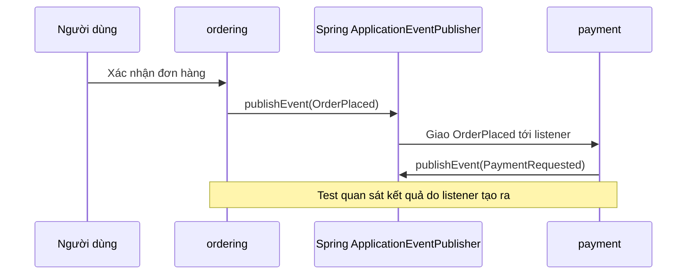
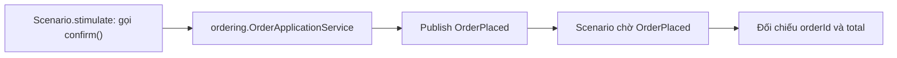
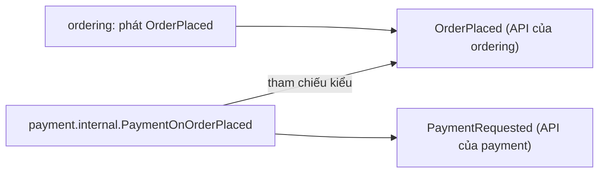
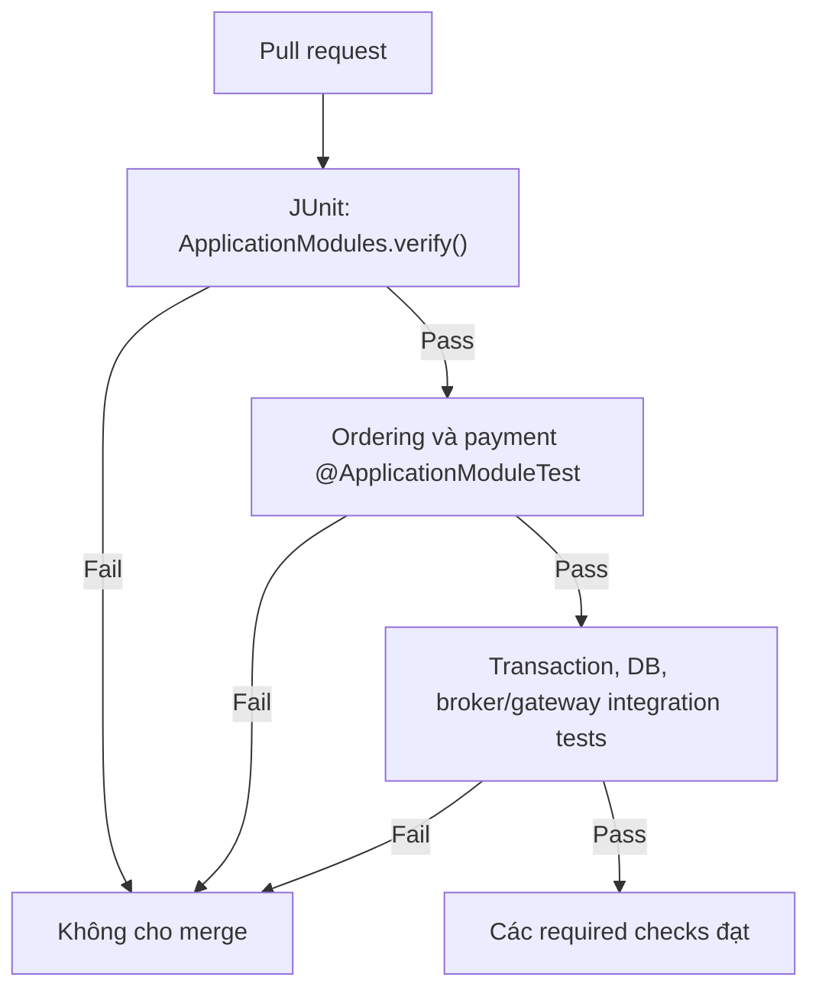

# Kích hoạt hành vi bằng application event trong Spring Modulith

## 1. Tại sao nên bắt đầu một bài test bằng sự kiện?

Trong ứng dụng Spring Modulith, module `ordering` có thể phát sự kiện `OrderPlaced` khi đơn hàng được xác nhận; module `payment` nhận sự kiện đó rồi khởi tạo yêu cầu thanh toán. Hai module không nhất thiết gọi trực tiếp vào implementation của nhau. **Application event** trở thành một tín hiệu nghiệp vụ để kích hoạt hành vi phía module nhận.

Khi kiểm thử luồng này, câu hỏi quan trọng không chỉ là “sự kiện đã được phát chưa?” mà còn là **“khi nhận đúng sự kiện, module tiêu thụ có thực hiện phản ứng mong đợi không?”**. Một bài test messaging có thể chủ động phát `OrderPlaced`, sau đó chờ và kiểm tra `PaymentRequested` hoặc một trạng thái nghiệp vụ do listener tạo ra.

Bài học thuộc chương **Messaging testing** của học phần `SPRING_MODULITH_VERIFICATION_TESTING`. Trong phạm vi học phần, `ApplicationModules.verify()` bảo vệ kiến trúc tĩnh; `@ApplicationModuleTest` và công cụ `Scenario` giúp kiểm thử hành vi module; kiểm thử sự kiện, cơ sở dữ liệu, tích hợp và quality gate CI bổ sung các bảo đảm mà kiểm tra phụ thuộc tĩnh không thể cung cấp.

**Mục tiêu sau bài:**

- Hiểu publisher, application event và listener tương tác ra sao trong Spring.
- Biết khi nào dùng `ApplicationEventPublisher.publishEvent(...)`, khi nào dùng `Scenario.publish(...)` hoặc `Scenario.stimulate(...)` trong bài test.
- Viết `@ApplicationModuleTest` để **kích hoạt listener bằng event** và **kiểm tra kết quả phát sinh từ listener**.
- Phân biệt event nội bộ Spring với message được chuyển qua Kafka/RabbitMQ hoặc dịch vụ bên ngoài.
- Nhận ra các rủi ro về transaction, xử lý bất đồng bộ, event trùng lặp và kiểm thử chỉ “thấy sự kiện do chính test phát”.
- Kết hợp event test với `ApplicationModules.verify()`, database/integration test và CI.

## 2. Mô hình publish – subscribe giữa các module

Xét ứng dụng bán hàng:

```text
com.acme.shop
├── ShopApplication.java
├── ordering
│   ├── OrderApplicationService.java
│   └── OrderPlaced.java
└── payment
    ├── PaymentRequested.java
    └── internal
        └── PaymentOnOrderPlaced.java
```

Giả sử `ordering` chịu trách nhiệm xác nhận đơn và công bố sự kiện. `payment` chịu trách nhiệm tiếp nhận sự kiện và chuẩn bị yêu cầu thanh toán.



Sơ đồ mô tả một **luồng sự kiện trong application context của Spring**, không mặc định có message broker, hàng đợi bền vững hoặc chạy bất đồng bộ.

| Vai trò | Thành phần ví dụ | Trách nhiệm |
| --- | --- | --- |
| Publisher | `OrderApplicationService` | Thực hiện hành vi của `ordering` và phát `OrderPlaced`. |
| Event | `OrderPlaced` | Truyền sự kiện nghiệp vụ đã xảy ra, ở dạng hợp đồng công khai. |
| Listener | `PaymentOnOrderPlaced` | Nhận event và kích hoạt logic của `payment`. |
| Kết quả quan sát được | `PaymentRequested` | Cho phép test biết listener đã tạo tác động dự kiến. |
| Test harness | `@ApplicationModuleTest`, `Scenario` | Thiết lập phạm vi module, kích hoạt hành vi, chờ và xác nhận kết quả. |

Không nên coi event là một lời gọi service thông thường: publisher thường không cần biết module tiêu thụ nào sẽ nhận. Tuy vậy, module **listener** tham chiếu kiểu event của module phát vẫn có **phụ thuộc kiểu Java** đến API công khai của module đó.

## 3. Định nghĩa event như hợp đồng nghiệp vụ

Đặt sự kiện `OrderPlaced` trong package gốc của `ordering` để module khác có thể tham chiếu qua API mặc định:

```java
// src/main/java/com/acme/shop/ordering/OrderPlaced.java
package com.acme.shop.ordering;

import java.math.BigDecimal;
import java.util.UUID;

public record OrderPlaced(UUID orderId, BigDecimal total) {
}
```

Ở module `payment`, định nghĩa sự kiện kết quả:

```java
// src/main/java/com/acme/shop/payment/PaymentRequested.java
package com.acme.shop.payment;

import java.math.BigDecimal;
import java.util.UUID;

public record PaymentRequested(UUID orderId, BigDecimal amount) {
}
```

Các `record` trên là những **hợp đồng ví dụ**; hệ thống thật cần quy tắc kiểm tra dữ liệu, kiểu định danh, đơn vị tiền tệ, versioning và chính sách bảo mật phù hợp.

Một số nguyên tắc thiết kế event:

- **Đặt tên theo ý nghĩa nghiệp vụ:** `OrderPlaced` thể hiện điều đã xảy ra; `PaymentRequested` thể hiện yêu cầu xử lý tiếp.
- **Tránh lộ implementation detail:** không truyền `OrderJpaEntity` hoặc `OrderRepository` từ package nội bộ cho các module khác.
- **Ưu tiên dữ liệu bất biến và tối thiểu:** ID, số tiền hoặc thuộc tính cần thiết; tránh đưa toàn bộ object graph của JPA vào payload.
- **Cân nhắc thay đổi hợp đồng:** nếu nhiều listener đang phụ thuộc một kiểu event, sửa field hoặc ngữ nghĩa của nó có thể ảnh hưởng nhiều module.

Những nguyên tắc này giúp Spring Modulith kiểm chứng ranh giới qua API công khai, đồng thời giảm coupling khi test hoặc triển khai các listener.

## 4. Publisher phát event từ hành vi nghiệp vụ

`ordering` có thể sử dụng `ApplicationEventPublisher` của Spring Framework:

```java
// src/main/java/com/acme/shop/ordering/OrderApplicationService.java
package com.acme.shop.ordering;

import java.math.BigDecimal;
import java.util.UUID;
import org.springframework.context.ApplicationEventPublisher;
import org.springframework.stereotype.Service;

@Service
public class OrderApplicationService {

    private final ApplicationEventPublisher events;

    public OrderApplicationService(ApplicationEventPublisher events) {
        this.events = events;
    }

    public void confirm(UUID orderId, BigDecimal total) {
        // Trong ứng dụng thật: kiểm tra, lưu đơn và áp dụng quy tắc nghiệp vụ.
        events.publishEvent(new OrderPlaced(orderId, total));
    }
}
```

Ở đây `publishEvent(...)` phát đối tượng event vào cơ chế Spring application events. Publisher **không gọi trực tiếp** `PaymentOnOrderPlaced` và không cần import một class thuộc module `payment`.

**Lưu ý về phạm vi ví dụ:** `confirm(...)` cố ý lược bỏ logic database, trạng thái đơn và transaction. Nếu nghiệp vụ quy định chỉ phát sự kiện sau khi lưu đơn thành công, hãy đặt việc publish tại đúng điểm của transaction và kiểm thử cả trường hợp rollback.

Trong thiết kế module, một hệ quả hữu ích là `ordering` có thể không có cạnh phụ thuộc tĩnh `ordering → payment`. `payment` dùng kiểu `OrderPlaced` của `ordering`, nên cạnh phụ thuộc (nếu được bộ phân tích nhận diện) là `payment → ordering`.

## 5. Listener tiếp nhận và kích hoạt phản ứng

Trong module `payment`, một listener nhận `OrderPlaced` rồi phát `PaymentRequested` để đại diện cho bước kế tiếp:

```java
// src/main/java/com/acme/shop/payment/internal/PaymentOnOrderPlaced.java
package com.acme.shop.payment.internal;

import com.acme.shop.ordering.OrderPlaced;
import com.acme.shop.payment.PaymentRequested;
import org.springframework.context.ApplicationEventPublisher;
import org.springframework.context.event.EventListener;
import org.springframework.stereotype.Component;

@Component
class PaymentOnOrderPlaced {

    private final ApplicationEventPublisher events;

    PaymentOnOrderPlaced(ApplicationEventPublisher events) {
        this.events = events;
    }

    @EventListener
    void on(OrderPlaced event) {
        events.publishEvent(
                new PaymentRequested(event.orderId(), event.total())
        );
    }
}
```

Trong ví dụ, `@EventListener` đăng ký method làm listener trong Spring context. Khi `OrderPlaced` được publish và listener hoạt động, nó tạo **một event khác**, nhờ đó bài test có thể xác nhận phản ứng của `payment` mà không cần truy cập class implementation nội bộ.

Đây là mô hình minh họa một bước điều phối, **chưa phải một cổng thanh toán hoàn chỉnh**. Trong hệ thống thật, listener thường gọi một service do `payment` sở hữu để lưu yêu cầu thanh toán hoặc tương tác với payment gateway. Bài test nên kiểm tra tác động nghiệp vụ mà module hứa cung cấp, không chỉ việc một method Java được gọi.

### Cơ chế đồng bộ mặc định và trường hợp đặc biệt

Với `@EventListener` thông thường, listener thường được gọi **đồng bộ** trong thread publish event, trừ khi ứng dụng thay đổi cơ chế multicaster hoặc cấu hình bất đồng bộ. Không nên mặc định sự kiện Spring đồng nghĩa với queue, asynchronous processing, retry hay delivery bền vững.

Nếu listener dùng `@Async` hoặc `@TransactionalEventListener`, điều kiện kích hoạt và thời điểm quan sát kết quả sẽ khác. Những điểm đó cần được kiểm thử theo đúng cấu hình thực tế ở các phần sau.

## 6. Kích hoạt bằng `Scenario.publish(...)` trong `@ApplicationModuleTest`

Đây là cách phù hợp khi muốn kiểm thử **module nhận sự kiện** mà không cần dựng toàn bộ quy trình của module phát.

Đặt test trong package `com.acme.shop.payment` để phạm vi bootstrap hướng tới application module `payment`:

```java
// src/test/java/com/acme/shop/payment/PaymentMessagingTests.java
package com.acme.shop.payment;

import com.acme.shop.ordering.OrderPlaced;
import java.math.BigDecimal;
import java.util.UUID;
import org.junit.jupiter.api.Test;
import org.springframework.modulith.test.ApplicationModuleTest;
import org.springframework.modulith.test.Scenario;

@ApplicationModuleTest
class PaymentMessagingTests {

    @Test
    void orderPlacedTriggersPaymentRequest(Scenario scenario) {
        UUID orderId = UUID.randomUUID();
        BigDecimal amount = new BigDecimal("125000");

        scenario.publish(new OrderPlaced(orderId, amount))
                .andWaitForEventOfType(PaymentRequested.class)
                .matching(event ->
                        event.orderId().equals(orderId)
                                && event.amount().compareTo(amount) == 0)
                .toArrive();
    }
}
```

Luồng của bài test:

1. `@ApplicationModuleTest` khởi tạo ngữ cảnh kiểm thử cho module `payment` theo phạm vi bootstrap của Spring Modulith.
2. `Scenario` được hỗ trợ trong bài test để điều khiển stimulus và theo dõi kết quả.
3. `scenario.publish(new OrderPlaced(...))` **đưa event đầu vào** vào Spring application event mechanism.
4. `PaymentOnOrderPlaced` nhận event và phát `PaymentRequested`.
5. `andWaitForEventOfType(PaymentRequested.class)` chờ **event đầu ra của listener**.
6. `matching(...)` lọc theo `orderId` và `amount` để tránh chấp nhận một event không liên quan.
7. `toArrive()` hoàn tất việc xác nhận kết quả; nếu điều kiện không được thỏa trong giới hạn chờ, bài test thất bại.

Bài test không cần import `PaymentOnOrderPlaced` vì listener là implementation nội bộ; nó tương tác qua **hợp đồng sự kiện công khai**.

**Lưu ý phiên bản:** các API `Scenario` và cấu hình kiểm thử phải khớp phiên bản Spring Modulith của project. Ví dụ trên minh họa dạng sử dụng phổ biến; cần bảo đảm dependency `spring-modulith-starter-test` và test runtime được thiết lập phù hợp.

### Vì sao kiểm tra event khác với event tự phát?

Một phép kiểm tra yếu:

```java
scenario.publish(new OrderPlaced(orderId, amount))
        .andWaitForEventOfType(OrderPlaced.class)
        .toArrive();
```

Điều này có nguy cơ chỉ xác nhận **event do chính bài test vừa phát** xuất hiện, không chứng minh listener của `payment` đã thực hiện gì. Để kiểm tra hành vi nhận event, nên quan sát **`PaymentRequested`** hoặc trạng thái nghiệp vụ do listener tạo ra.

Nếu listener chỉ ghi database mà không phát event đầu ra, hãy quan sát trạng thái đã thay đổi bằng test thích hợp; không tạo một event thứ hai giả chỉ để tiện assert.

## 7. Kích hoạt hành vi thực bằng `Scenario.stimulate(...)`

Có hai kiểu bài test cần phân biệt:

- **Test consumer:** tự publish `OrderPlaced` để kiểm tra `payment` có phản ứng đúng không.
- **Test publisher:** gọi **hành vi thật** của `ordering` rồi kiểm tra rằng chính hành vi đó đã phát `OrderPlaced`.

Với `OrderApplicationService` ở trên, có thể kiểm thử phía phát event:

```java
// src/test/java/com/acme/shop/ordering/OrderingMessagingTests.java
package com.acme.shop.ordering;

import java.math.BigDecimal;
import java.util.UUID;
import org.junit.jupiter.api.Test;
import org.springframework.beans.factory.annotation.Autowired;
import org.springframework.modulith.test.ApplicationModuleTest;
import org.springframework.modulith.test.Scenario;

@ApplicationModuleTest
class OrderingMessagingTests {

    @Autowired
    OrderApplicationService orders;

    @Test
    void confirmPublishesOrderPlaced(Scenario scenario) {
        UUID orderId = UUID.randomUUID();
        BigDecimal total = new BigDecimal("125000");

        scenario.stimulate(() -> orders.confirm(orderId, total))
                .andWaitForEventOfType(OrderPlaced.class)
                .matching(event ->
                        event.orderId().equals(orderId)
                                && event.total().compareTo(total) == 0)
                .toArrive();
    }
}
```

Ở đây stimulus là lệnh `orders.confirm(...)`, **không phải** một `scenario.publish(new OrderPlaced(...))` do bài test tạo sẵn. Do đó, test xác nhận `OrderApplicationService` đã thực sự phát event phù hợp với hành vi nghiệp vụ được gọi.



Nếu `confirm(...)` trong ứng dụng thật có repository và transaction, phải thiết lập dữ liệu đầu vào và kiểm tra điều kiện publish phù hợp, chẳng hạn **không phát event khi xác nhận đơn thất bại**.

## 8. Chọn điều gì làm assertion để tránh test xanh giả

Một event test đáng tin phải kiểm tra **đúng kết quả do hành vi được kích hoạt tạo ra**. Các cấp độ quan sát:

| Tình huống | Stimulus | Kết quả nên assert | Điều không nên chỉ assert |
| --- | --- | --- | --- |
| Module `ordering` xác nhận đơn | Gọi `orders.confirm(...)` | `OrderPlaced` đúng ID, dữ liệu và điều kiện phát | Chỉ xác nhận service không ném lỗi |
| Module `payment` nhận event | Publish `OrderPlaced` | `PaymentRequested` hoặc yêu cầu thanh toán được lưu | Chỉ nhận lại `OrderPlaced` do test publish |
| Listener cập nhật DB | Publish event nghiệp vụ | Trạng thái bản ghi thay đổi như kỳ vọng | Chỉ verify một method mock được gọi nếu cần chứng minh tính bền vững |
| Listener gọi API ngoài | Publish event | Hợp đồng request, số lần gọi, xử lý lỗi/timeout | Chỉ xác nhận event đầu vào đã đến |
| Listener bất đồng bộ | Publish event | Kết quả cuối cùng trong thời hạn hợp lý | `Thread.sleep(...)` rồi giả định luôn đủ thời gian |

Cần phân biệt ba cấp độ bảo đảm:

1. **Event đã được publish**.
2. **Listener đã chạy và tạo phản ứng**.
3. **Tác động nghiệp vụ đã hoàn tất, được lưu bền vững hoặc gửi ra hệ thống ngoài**.

Một assertion ở cấp độ 1 không thể thay thế hai cấp độ còn lại. Phạm vi test cần được thiết kế rõ ràng để tránh biến một event do chính test phát thành bằng chứng về nghiệp vụ.

### Quan sát trạng thái thay vì event đầu ra

Một số listener không phát `PaymentRequested` mà chỉ gọi service lưu vào database. Khi đó, test có thể xác nhận repository truy vấn thấy một `PaymentRequest` tương ứng, hoặc xác nhận một kết quả từ API đọc công khai của `payment`.

Cần tổ chức fixture dữ liệu, transaction và phạm vi Spring context phù hợp; nếu thao tác bất đồng bộ, sử dụng cơ chế chờ có điều kiện (polling với timeout) thay vì `Thread.sleep` tùy tiện.

`Scenario` hỗ trợ các kiểu kiểm thử đợi sự kiện/trạng thái theo API phiên bản tương ứng. Khi cần kiểm tra hiệu ứng thật trong database, dùng test module hoặc integration test để kiểm tra chính trạng thái đó; đừng mặc định “event đến” đồng nghĩa “transaction đã commit”.

## 9. Transaction và thời điểm listener được kích hoạt

### 9.1. `@EventListener` và `@TransactionalEventListener` khác nhau

Ví dụ ở trên dùng `@EventListener` thông thường. Một listener chỉ nên xử lý **sau khi giao dịch lưu đơn thành công** có thể được định nghĩa theo cách khác:

```java
import org.springframework.transaction.event.TransactionPhase;
import org.springframework.transaction.event.TransactionalEventListener;

@TransactionalEventListener(phase = TransactionPhase.AFTER_COMMIT)
void on(OrderPlaced event) {
    // Xử lý sau khi transaction phát sự kiện được commit thành công.
}
```

Đây là **đoạn minh họa annotation trên method listener**; trong ứng dụng thật method phải thuộc một Spring-managed component với các dependency và giao dịch được cấu hình phù hợp.

`@TransactionalEventListener` với pha `AFTER_COMMIT` được kích hoạt khi giao dịch liên quan hoàn tất commit. **Nếu không có transaction phù hợp**, listener mặc định có thể không được gọi (trừ khi cấu hình `fallbackExecution` khác). Nếu test dùng transaction luôn bị rollback, pha sau commit có thể cũng không diễn ra như mong đợi.

Do đó, khi thử listener sau commit:

- Tạo tình huống phát event trong **transaction thật sự được commit**.
- Bảo đảm dữ liệu đầu vào/đầu ra không bị che bởi transaction của chính bài test.
- Sử dụng khả năng điều khiển transaction của test framework hoặc `Scenario` phù hợp phiên bản.
- Kiểm tra cả trường hợp **rollback không được dẫn tới tác động sau commit** nếu đó là quy tắc nghiệp vụ.

Không nên kết luận “listener sai” chỉ vì test publish event ngoài transaction mà listener được khai báo `@TransactionalEventListener(AFTER_COMMIT)` không chạy.

### 9.2. Sự kiện không đồng nghĩa với bảo đảm giao hàng

Với application event trong một Spring process, việc gọi `publishEvent` **không tự bảo đảm** có retry, dead-letter queue, exactly-once delivery hay lưu trữ event bền vững. Những đặc tính đó đòi hỏi cơ chế khác và cấu hình thích hợp.

Spring Modulith có các khả năng hỗ trợ xử lý publication và listener theo mô hình module. Tuy nhiên, test phải kiểm tra chính **hành vi đã cấu hình và bảo đảm mà sản phẩm yêu cầu**, không suy ra từ tên annotation.

## 10. Bất đồng bộ và chờ có điều kiện

Khi listener chạy bất đồng bộ, publish event có thể trả về **trước khi** hành vi consumer hoàn thành. Một bài test viết theo kiểu gọi publisher rồi đọc dữ liệu ngay lập tức dễ trở thành test không ổn định.

Ví dụ không nên dùng:

```java
scenario.publish(new OrderPlaced(orderId, amount));
Thread.sleep(200); // Không bảo đảm listener đã hoàn tất
// Assert trạng thái ngay sau một thời gian chờ đoán trước.
```

Nhược điểm: máy CI chậm có thể cần nhiều thời gian hơn máy local; ngược lại, đợi cố định làm test chậm không cần thiết.

Ưu tiên `Scenario` và các phương thức đợi điều kiện:

```java
scenario.publish(new OrderPlaced(orderId, amount))
        .andWaitForEventOfType(PaymentRequested.class)
        .matching(event -> event.orderId().equals(orderId))
        .toArrive();
```

Cách này **đợi event thỏa điều kiện**, thay vì đoán một độ trễ. Cần đặt timeout phù hợp với môi trường và dạng xử lý; đừng chỉ tăng timeout để che một listener không được đăng ký hoặc một transaction không commit.

Nếu kết quả cần xác nhận là **record đã commit**, ưu tiên đợi trạng thái được ghi nhận và kiểm tra từ transaction đọc độc lập khi cần. Một event có thể được phát trước khi dữ liệu có thể quan sát ở transaction khác.

## 11. Phân biệt Spring application event và messaging qua broker

Tên chương là **Messaging testing**, nhưng cần phân biệt **application event bên trong ứng dụng** với **message gửi tới broker**.

| Khía cạnh | Spring application event | Kafka/RabbitMQ hoặc broker khác |
| --- | --- | --- |
| Kênh cơ bản | Cơ chế `ApplicationEventPublisher` trong Spring context | Hạ tầng messaging bên ngoài/process khác |
| Publisher biết consumer cụ thể? | Thường không cần | Thường không cần biết service tiêu thụ cụ thể |
| Có yêu cầu serializer/network? | Không mặc định | Có, tùy broker và định dạng payload |
| Giao hàng bền vững? | Không tự bảo đảm | Phụ thuộc broker, producer, consumer, cấu hình |
| Test phạm vi nhỏ | `@ApplicationModuleTest` + `Scenario` | Mock/contract test hoặc broker test thật |
| Test end-to-end | Test listener, transaction và state | Test publish/consume, schema, offset/ack, retry, DLQ |

Một bài test `Scenario.publish(new OrderPlaced(...))` kiểm tra hành vi **khi event vào Spring application context**. Nó **không chứng minh** producer Kafka đã serialize đúng, broker nhận message, consumer group xử lý offset hoặc DLQ hoạt động.

Nếu hệ thống chuyển application event ra broker qua adapter, cần kiểm tra **ranh giới adapter** và thực hiện integration test với broker phù hợp. `Testcontainers` có thể hỗ trợ khi phải khởi tạo hạ tầng thật trong test; đây là bổ sung, không phải chức năng của `ApplicationModules.verify()`.

## 12. Kết hợp `ApplicationModules.verify()` với event test

Một kiến trúc có thể có các phụ thuộc kiểu:



Đối với `ApplicationModules.verify()`:

- Listener `payment` tham chiếu kiểu `ordering.OrderPlaced`, nên có thể tạo cạnh phụ thuộc tĩnh **`payment → ordering`**.
- `ordering` không cần import implementation của `payment` để phát event.
- Kiểu event cần nằm trong API đã xuất bản theo cấu trúc module (hoặc một named interface được công bố có chủ đích).
- Nếu có khai báo `allowedDependencies`, hướng `payment → ordering` phải được cho phép.
- Không được tạo một vòng phụ thuộc ngược từ `ordering` sang `payment` nếu luật kiến trúc không cho phép.

Ví dụ JUnit test kiến trúc:

```java
// src/test/java/com/acme/shop/ModuleArchitectureTests.java
package com.acme.shop;

import org.junit.jupiter.api.Test;
import org.springframework.modulith.core.ApplicationModules;

class ModuleArchitectureTests {

    @Test
    void moduleBoundariesStayValid() {
        ApplicationModules.of(ShopApplication.class).verify();
    }
}
```

**Phân chia trách nhiệm giữa các test:**

- `verify()` kiểm tra **module có phụ thuộc đúng hướng và đúng API không**.
- `@ApplicationModuleTest` với `Scenario` kiểm tra **event có kích hoạt hành vi đúng trong module không**.
- Database/integration test kiểm tra **dữ liệu, transaction và hạ tầng thật**.

Một project có thể **đạt `verify()` nhưng event listener không chạy**, hoặc event test đạt trong môi trường nhỏ nhưng hệ thống ngoài thất bại. Cần giữ cả các loại test.

## 13. Chiến lược kiểm thử theo từng lớp và CI

Với luồng `OrderPlaced → PaymentRequested`, ma trận kiểm thử phù hợp:

| Mục tiêu | Loại test | Assertion quan trọng |
| --- | --- | --- |
| Bảo vệ dependency giữa module | `ApplicationModules.verify()` | Không vòng, không truy cập API nội bộ, đúng `allowedDependencies`. |
| Chứng minh publisher phát event | `@ApplicationModuleTest` cho `ordering` | Gọi `confirm(...)` tạo đúng `OrderPlaced`. |
| Chứng minh consumer phản ứng | `@ApplicationModuleTest` cho `payment` với `Scenario.publish` | Có `PaymentRequested` hoặc trạng thái thanh toán phù hợp. |
| Đảm bảo listener chạy sau commit | Test transaction/event | Commit kích hoạt listener, rollback không gây tác động sai. |
| Đảm bảo lưu yêu cầu thanh toán | Database integration test | Record đúng ID, số tiền, trạng thái và transaction. |
| Tích hợp broker/payment gateway | Contract/integration test | Message, request, retry, idempotency, lỗi ngoài được xử lý đúng. |
| Ngăn hồi quy qua pull request | CI required checks | Những bài test bắt buộc thực sự chạy và đạt. |

Có thể chạy các bài kiểm thử thông qua công cụ build:

```bash
# Maven Wrapper
./mvnw test

# Gradle Wrapper
./gradlew test
```

Để CI thật sự chặn merge khi event test hoặc architecture test thất bại, cần cấu hình các job phù hợp làm **required checks** cho nhánh bảo vệ. Một workflow có tồn tại nhưng không chạy bài test, bị skip hoặc chỉ log ngoại lệ không được coi là quality gate đáng tin cậy.



Khi thay đổi event contract hoặc ranh giới module, nên chạy cả test phía **publisher** lẫn **consumer**, không chỉ bài test của lớp vừa sửa.

## 14. Những lỗi thường gặp khi kích hoạt bằng application event

| Hiện tượng | Nguyên nhân có thể | Cách tiếp cận |
| --- | --- | --- |
| Test publish `OrderPlaced` nhưng listener không chạy | Listener không phải bean, không được bootstrap trong module test, annotation sai | Kiểm tra phạm vi `@ApplicationModuleTest` và Spring context. |
| `Scenario` chỉ thấy `OrderPlaced` | Test đang quan sát event do chính mình publish | Assert `PaymentRequested` hoặc trạng thái do listener tạo. |
| `@TransactionalEventListener` không chạy | Không có transaction commit hoặc test rollback | Tạo stimulus có transaction phù hợp và kiểm chứng AFTER_COMMIT. |
| Test lúc xanh lúc đỏ | Listener bất đồng bộ, assertion kiểm tra quá sớm | Chờ event/state theo điều kiện, tránh `Thread.sleep` cố định. |
| Event đúng nhưng DB chưa có record | Listener chưa commit, transaction riêng hoặc logic lưu lỗi | Kiểm tra transaction/state bằng integration test. |
| Có nhiều event và test bắt nhầm | Không lọc correlation/order ID | Dùng `matching(...)` và kiểm tra payload liên quan. |
| Listener bị kích hoạt hai lần | Redelivery, publication trùng, consumer không idempotent | Test duplicate event và thiết kế idempotency theo yêu cầu. |
| Module test đạt nhưng Kafka consumer không nhận | Mới test Spring application event, chưa test broker | Bổ sung integration/contract test cho adapter/broker. |
| Architecture test đạt nhưng hành vi sai | `verify()` chỉ kiểm tra dependency tĩnh | Duy trì `Scenario`, module, event, DB và integration tests. |

### Một thao tác chẩn đoán hữu ích

Khi test `orderPlacedTriggersPaymentRequest` không thấy `PaymentRequested`, hãy kiểm tra theo thứ tự:

1. Class `PaymentOnOrderPlaced` có được Spring tạo bean trong module test không?
2. `OrderPlaced` được publish qua cùng application context mà listener đang nghe không?
3. Listener dùng `@EventListener` hay `@TransactionalEventListener`? Có cần transaction commit không?
4. Nếu dùng `@Async`, test đã chờ kết quả đúng cách chưa?
5. Listener có ném ngoại lệ, bị rollback hoặc không phát event đầu ra không?
6. Predicate `matching(...)` có dùng đúng ID và payload mong đợi không?

Chỉ tăng thời gian chờ không giải quyết được lỗi listener không được đăng ký hoặc cấu hình giao dịch sai.

## 15. Bài tập tự kiểm tra

**Bài 1.** Test thực hiện `scenario.publish(new OrderPlaced(id, amount))` rồi chờ chính `OrderPlaced`. Test đã chứng minh listener thanh toán xử lý đúng chưa?

**Đáp án:** Chưa. Test có thể chỉ quan sát event do chính mình phát. Cần chờ `PaymentRequested`, kiểm tra trạng thái thanh toán hoặc hiệu ứng khác được listener tạo ra.

**Bài 2.** Muốn kiểm thử `OrderApplicationService.confirm(...)` thật sự phát `OrderPlaced`, nên chọn `publish` hay `stimulate`?

**Đáp án:** Dùng `Scenario.stimulate(() -> orders.confirm(...))` để gọi hành vi thật, rồi chờ và kiểm tra `OrderPlaced`. `publish` phù hợp hơn khi muốn đưa sự kiện trực tiếp vào module consumer.

**Bài 3.** `payment` có listener `on(OrderPlaced event)`, còn `ordering` không tham chiếu class nào trong `payment`. Cạnh phụ thuộc tĩnh hướng nào?

**Đáp án:** `payment → ordering` do listener tham chiếu kiểu `ordering.OrderPlaced`. Đường publish sự kiện lúc chạy không đồng nghĩa publisher phụ thuộc vào implementation của consumer.

**Bài 4.** Listener chuyển sang `@TransactionalEventListener(AFTER_COMMIT)`, nhưng test chỉ publish event ngoài transaction và không quan sát thấy gì. Có thể kết luận listener hỏng chưa?

**Đáp án:** Chưa. Theo cấu hình mặc định, listener sau commit cần transaction phù hợp được commit. Phải thiết lập test transaction đúng cách trước khi đánh giá hành vi.

**Bài 5.** Một bài `@ApplicationModuleTest` với `Scenario` đã đạt. Có thể khẳng định Kafka broker, serializer và DLQ đang chạy đúng không?

**Đáp án:** Không. Bài test application event trong Spring context không tự kiểm chứng đường gửi/nhận qua broker thật. Cần test adapter, broker và contract tương ứng.

**Bài 6.** Khi event consumer xử lý bất đồng bộ, vì sao không nên dùng `Thread.sleep(100)` rồi assert?

**Đáp án:** Thời gian thực thi thay đổi theo máy, scheduling và tải CI. Nên đợi điều kiện nghiệp vụ hoặc event phù hợp với timeout rõ ràng.

**Bài 7.** `verify()` đạt nhưng listener không được inject trong Spring context. Loại test nào giúp phát hiện?

**Đáp án:** `@ApplicationModuleTest` hoặc Spring context integration test kiểm tra bean wiring và hành vi listener. `verify()` không tự khởi động context để xác nhận bean tồn tại.

## 16. Checklist áp dụng vào dự án

Khi thiết kế một bài test “kích hoạt hành vi bằng application event”, hãy xác nhận:

- **Đầu vào:** event là hợp đồng nghiệp vụ công khai, đúng ID/payload và phù hợp ranh giới module.
- **Stimulus:** sử dụng `Scenario.publish` để kiểm thử consumer hoặc `Scenario.stimulate` để kiểm thử producer qua hành vi thật.
- **Đầu ra:** assert event **do listener tạo ra**, trạng thái nghiệp vụ hoặc tác động có ý nghĩa; không chỉ assert sự kiện do test tự publish.
- **Ngữ cảnh:** `@ApplicationModuleTest` bootstrap đúng module, listener và dependency cần thiết được tạo bean.
- **Thời điểm:** biết rõ listener đồng bộ, bất đồng bộ hay sau commit; chờ theo điều kiện phù hợp.
- **Độ tin cậy:** kiểm tra lỗi, duplicate event, idempotency và transaction khi nghiệp vụ yêu cầu.
- **Phạm vi:** phân biệt Spring application event trong process với message broker ngoài process.
- **Kiến trúc:** duy trì `ApplicationModules.verify()` để chặn sai hướng phụ thuộc, vòng module và truy cập API nội bộ.
- **CI:** chạy architecture test, module/event test và các integration test cần thiết dưới required checks.

**Ghi nhớ:** Kích hoạt hành vi bằng application event trong Spring Modulith là **phát một stimulus có chủ đích và kiểm chứng phản ứng quan sát được của module nhận**. `Scenario.publish(...)` giúp cô lập consumer; `Scenario.stimulate(...)` giúp xác minh event được tạo bởi nghiệp vụ thật. Kết hợp `@ApplicationModuleTest` với `ApplicationModules.verify()`, test transaction, database và tích hợp broker/gateway để bảo vệ cả ranh giới kiến trúc lẫn hành vi messaging trong CI.
