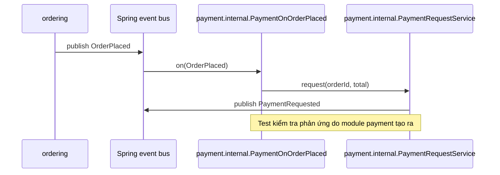
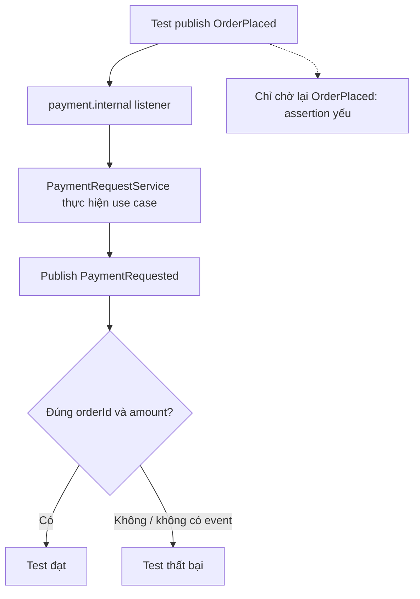
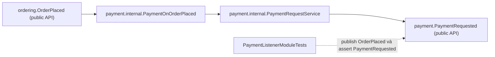
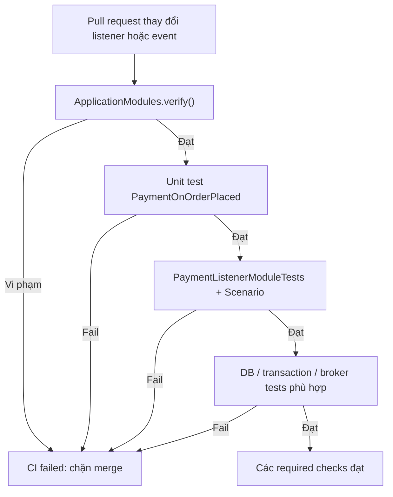

# Kiểm tra listener nội bộ module trong Spring Modulith

## 1. Tại sao listener nội bộ cần được kiểm thử riêng?

Trong Spring Modulith, một application module thường **công bố hợp đồng** ở package gốc hoặc named interface, còn thành phần triển khai nằm ở package con. Listener sự kiện là một ví dụ điển hình: module `payment` có thể đặt `PaymentOnOrderPlaced` tại `payment.internal` để nhận `OrderPlaced` do module `ordering` phát, rồi tạo yêu cầu thanh toán.

Một listener như vậy dễ bị bỏ sót trong các bài kiểm tra thông thường. Mã biên dịch được, `ApplicationModules.verify()` không phát hiện phụ thuộc sai, nhưng listener có thể **không được đăng ký thành bean**, nhận sai event, bỏ qua dữ liệu cần thiết, tạo kết quả sai hoặc không chạy vì điều kiện transaction chưa thỏa.

Vì vậy, “kiểm tra listener nội bộ module” phải trả lời ít nhất ba câu hỏi:

1. **Kích hoạt được không?** Khi ứng dụng phát đúng loại event, Spring có chuyển event tới listener của module không?
2. **Xử lý đúng không?** Listener có chuyển event thành hành vi nghiệp vụ, kết quả hoặc trạng thái đúng không?
3. **Tương tác đúng không?** Hành vi ấy có tuân thủ transaction, timing, idempotency và hợp đồng tích hợp khi chạy thực tế không?

Bài này thuộc chương **Messaging testing** của học phần `SPRING_MODULITH_VERIFICATION_TESTING`. Mục tiêu của học phần là bảo vệ ranh giới kiến trúc qua `ApplicationModules.verify()` và các luật phụ thuộc, đồng thời thực hành `@ApplicationModuleTest`, kiểm thử sự kiện, cơ sở dữ liệu, tích hợp và quality gate CI để ngăn phụ thuộc sai cũng như hồi quy.

**Sau bài học, bạn có thể:**

- Phân biệt **lớp listener nội bộ** với **kiểu event công khai** và hiểu hướng phụ thuộc giữa hai module.
- Viết unit test kiểm tra điều kiện rẽ nhánh của listener mà không cần khởi động Spring.
- Viết `@ApplicationModuleTest` kích hoạt listener bằng `Scenario.publish(...)` và chờ kết quả có ý nghĩa.
- Kiểm tra listener **đã được Spring đăng ký**, thay vì chỉ chứng minh một method Java có thể được gọi trực tiếp.
- Nhận diện sự khác biệt giữa `@EventListener` và `@TransactionalEventListener`, xử lý đồng bộ/bất đồng bộ và giới hạn của module test.
- Kết hợp architecture test, module test, database/integration test và CI theo mức rủi ro.

## 2. Ví dụ: module `payment` lắng nghe sự kiện của `ordering`

Xét một ứng dụng Spring Boot tại package `com.example.shop`:

```text
com.example.shop
├── ShopApplication.java
├── ordering
│   ├── OrderPlaced.java
│   └── OrderApplicationService.java
└── payment
    ├── PaymentRequested.java
    └── internal
        ├── PaymentOnOrderPlaced.java
        └── PaymentRequestService.java
```

Trong cấu hình module mặc định:

- `ordering` và `payment` là hai application module.
- `ordering.OrderPlaced` nằm trong **API mặc định** của `ordering`.
- `payment.PaymentRequested` nằm trong **API mặc định** của `payment`.
- `payment.internal.PaymentOnOrderPlaced` và `PaymentRequestService` là **chi tiết triển khai** của `payment`.



**Điểm quan trọng:** `ordering` không cần import `PaymentOnOrderPlaced` để listener hoạt động. Ngược lại, listener `payment` tham chiếu `ordering.OrderPlaced`, nên có thể tạo cạnh phụ thuộc tĩnh **`payment → ordering`**. Cạnh này phải tuân thủ API được xuất bản, `allowedDependencies` nếu có và luật không có chu kỳ.

Đặt listener ở package `internal` **không ngăn Spring khám phá bean** nếu class thuộc vùng component scan phù hợp. “Nội bộ” ở đây là ranh giới **API application module**, không có nghĩa lớp không được Spring sử dụng.

## 3. Xây dựng hợp đồng event công khai

Đầu tiên, định nghĩa event đầu vào ở module `ordering`:

```java
// src/main/java/com/example/shop/ordering/OrderPlaced.java
package com.example.shop.ordering;

import java.math.BigDecimal;
import java.util.UUID;

public record OrderPlaced(UUID orderId, BigDecimal total) {
}
```

Event kết quả ở module `payment`:

```java
// src/main/java/com/example/shop/payment/PaymentRequested.java
package com.example.shop.payment;

import java.math.BigDecimal;
import java.util.UUID;

public record PaymentRequested(UUID orderId, BigDecimal amount) {
}
```

Đây là hai **hợp đồng nghiệp vụ tối giản**. Các hệ thống thực tế có thể cần mã tiền tệ, tenant ID, correlation ID, phiên bản event và quy tắc kiểm tra dữ liệu. Không nên truyền một `OrderJpaEntity` hoặc repository của `ordering.internal` làm payload sang module khác.

Với `record`, thông tin của event bất biến ở cấp field tham chiếu; đây là lựa chọn dễ so sánh trong test. Tuy nhiên, chỉ dùng `record` không tự chứng minh toàn bộ object graph là bất biến hoặc bảo đảm khả năng tuần tự hóa qua broker.

## 4. Cài đặt listener và service bên trong module

Ta dùng **hai lớp nội bộ** để thấy rõ trách nhiệm nhận sự kiện và xử lý:

```java
// src/main/java/com/example/shop/payment/internal/PaymentOnOrderPlaced.java
package com.example.shop.payment.internal;

import com.example.shop.ordering.OrderPlaced;
import org.springframework.context.event.EventListener;
import org.springframework.stereotype.Component;

@Component
class PaymentOnOrderPlaced {

    private final PaymentRequestService requests;

    PaymentOnOrderPlaced(PaymentRequestService requests) {
        this.requests = requests;
    }

    @EventListener
    void on(OrderPlaced event) {
        // Quy tắc minh họa: chỉ yêu cầu thanh toán cho tổng tiền dương.
        if (event.total() == null || event.total().signum() <= 0) {
            return;
        }

        requests.request(event.orderId(), event.total());
    }
}
```

Service nội bộ phụ trách phát kết quả:

```java
// src/main/java/com/example/shop/payment/internal/PaymentRequestService.java
package com.example.shop.payment.internal;

import com.example.shop.payment.PaymentRequested;
import java.math.BigDecimal;
import java.util.UUID;
import org.springframework.context.ApplicationEventPublisher;
import org.springframework.stereotype.Service;

@Service
class PaymentRequestService {

    private final ApplicationEventPublisher events;

    PaymentRequestService(ApplicationEventPublisher events) {
        this.events = events;
    }

    void request(UUID orderId, BigDecimal amount) {
        events.publishEvent(new PaymentRequested(orderId, amount));
    }
}
```

Thiết kế ví dụ cố ý nhỏ để tập trung vào **listener có nhận và xử lý đúng event không**. `PaymentRequested` chỉ biểu diễn yêu cầu đã được tạo trong luồng sự kiện; nó **không có nghĩa tiền đã được thu**, dữ liệu đã được commit hoặc payment gateway đã chấp nhận giao dịch.

Một triển khai thanh toán thực tế thường có thêm repository, transaction, idempotency và tích hợp cổng thanh toán. Những điều đó cần bài test bổ sung, không thể suy ra từ ví dụ này.

### Vì sao tách listener khỏi service?

- Listener chịu trách nhiệm nhận `OrderPlaced` và chuyển thông tin sang use case phù hợp.
- `PaymentRequestService` chịu trách nhiệm bước nghiệp vụ của `payment`; ví dụ này chỉ publish event, nhưng có thể bổ sung kiểm tra/lưu yêu cầu theo thiết kế.
- Unit test có thể kiểm tra **điều kiện và lời gọi** ở listener rất nhanh.
- Module test có thể kiểm tra **Spring wiring và đường event thực sự** mà không truy cập các lớp implementation.

Không nhất thiết mọi ứng dụng đều phải có đúng hai lớp. Điều quan trọng là test bám vào **hành vi và hợp đồng**, thay vì tạo API công khai chỉ để mở quyền truy cập listener.

## 5. Mức thứ nhất: unit test trực tiếp listener nội bộ

Khi cần kiểm tra logic nhỏ như “bỏ qua event có số tiền không dương”, không cần dựng Spring context. Đặt unit test vào **cùng package** `payment.internal` để truy cập lớp và constructor package-private:

```java
// src/test/java/com/example/shop/payment/internal/PaymentOnOrderPlacedUnitTests.java
package com.example.shop.payment.internal;

import static org.mockito.Mockito.verify;
import static org.mockito.Mockito.verifyNoInteractions;

import com.example.shop.ordering.OrderPlaced;
import java.math.BigDecimal;
import java.util.UUID;
import org.junit.jupiter.api.Test;
import org.junit.jupiter.api.extension.ExtendWith;
import org.mockito.Mock;
import org.mockito.junit.jupiter.MockitoExtension;

@ExtendWith(MockitoExtension.class)
class PaymentOnOrderPlacedUnitTests {

    @Mock
    PaymentRequestService requests;

    @Test
    void delegatesEventWithPositiveTotal() {
        UUID orderId = UUID.randomUUID();
        BigDecimal amount = new BigDecimal("125000");
        var listener = new PaymentOnOrderPlaced(requests);

        listener.on(new OrderPlaced(orderId, amount));

        verify(requests).request(orderId, amount);
    }

    @Test
    void ignoresEventWithNonPositiveTotal() {
        var listener = new PaymentOnOrderPlaced(requests);

        listener.on(new OrderPlaced(UUID.randomUUID(), BigDecimal.ZERO));

        verifyNoInteractions(requests);
    }
}
```

Bài test này cung cấp phản hồi nhanh cho **các nhánh xử lý của method**. Nó chứng minh khi gọi `on(...)` trực tiếp, listener có chuyển dữ liệu đúng đến collaborator và bỏ qua trường hợp không hợp lệ.

Tuy nhiên, unit test **không chứng minh**:

- Spring đã tạo bean `PaymentOnOrderPlaced`.
- Annotation `@EventListener` được đăng ký và nhận event đúng.
- Bean `PaymentRequestService` có mặt trong Spring context.
- Hệ thống phát ra `PaymentRequested` hoặc lưu dữ liệu đúng.
- Transaction, async hoặc broker hoạt động theo cấu hình thực tế.

Vì vậy, nếu chỉ có unit test, listener vẫn có thể “xanh” mặc dù sự kiện từ ứng dụng không bao giờ tới nó.

## 6. Mức thứ hai: kiểm thử module bằng `@ApplicationModuleTest` và `Scenario`

Để kiểm tra listener **trong Spring context**, hãy đặt test ở package gốc của module `payment`:

```java
// src/test/java/com/example/shop/payment/PaymentListenerModuleTests.java
package com.example.shop.payment;

import com.example.shop.ordering.OrderPlaced;
import java.math.BigDecimal;
import java.util.UUID;
import org.junit.jupiter.api.Test;
import org.springframework.modulith.test.ApplicationModuleTest;
import org.springframework.modulith.test.Scenario;

@ApplicationModuleTest
class PaymentListenerModuleTests {

    @Test
    void consumesOrderPlacedAndRequestsPayment(Scenario scenario) {
        UUID orderId = UUID.randomUUID();
        BigDecimal total = new BigDecimal("125000");

        scenario.publish(new OrderPlaced(orderId, total))
                .andWaitForEventOfType(PaymentRequested.class)
                .matching(event ->
                        event.orderId().equals(orderId)
                                && event.amount().compareTo(total) == 0)
                .toArrive();
    }
}
```

Đây là một **module-level test theo góc nhìn bên ngoài**:

1. `@ApplicationModuleTest` khởi tạo Spring context theo phạm vi application module `payment`.
2. `Scenario.publish(...)` cung cấp **stimulus** là `OrderPlaced` vào event mechanism của Spring.
3. `PaymentOnOrderPlaced`, nếu được Spring đăng ký, nhận event và gọi `PaymentRequestService`.
4. `PaymentRequestService` phát `PaymentRequested`.
5. `andWaitForEventOfType(PaymentRequested.class)` chờ **phản ứng của listener**, không chỉ event đầu vào.
6. `matching(...)` đối chiếu order ID và số tiền; `toArrive()` hoàn tất assertion sự kiện phù hợp phải xuất hiện.

Nếu listener bị bỏ annotation `@Component`, thiếu `@EventListener` hoặc không có trong phạm vi bootstrap, bài test **không thể chỉ gọi method trực tiếp để vượt qua lỗi wiring**. Thay vào đó, việc không thấy `PaymentRequested` là dấu hiệu test phải điều tra.

**Lưu ý phụ thuộc:** cần cấu hình JUnit Jupiter, Spring Modulith test support và dependency management tương thích với phiên bản Spring Boot. Các method của `Scenario` và khả năng tùy chỉnh timeout cần đối chiếu với phiên bản thực tế khi triển khai dự án.

### Tại sao test đặt ở package `payment`?

Spring Modulith sử dụng vị trí package của lớp test để xác định module cần bootstrap trong những cấu hình `@ApplicationModuleTest` phổ biến. Đặt test tại `com.example.shop.payment` giúp thể hiện ý định: **kiểm tra module payment**.

Class listener vẫn nằm trong `payment.internal`. Test **không cần import** `PaymentOnOrderPlaced`; test chỉ sử dụng event contract công khai. Đó là cách giữ ranh giới thiết kế mà vẫn kiểm chứng implementation.

### Khi nào một module test có thể phải bổ sung dependency?

Nếu listener gọi service/repository thuộc module khác, cấu hình bootstrap mặc định có thể không tạo các bean cần thiết. Khi đó hãy rà soát xem module `payment` có phụ thuộc sai không; nếu dependency là hợp lệ, chọn bootstrap mode, test double hoặc cấu hình test tương ứng với thiết kế.

Không nên chuyển listener từ package nội bộ lên API công khai chỉ để test inject được.

## 7. Đọc đúng mức độ bảo đảm của bài test `Scenario`

Một bài test kiểu này **không đủ** để xác nhận listener:

```java
scenario.publish(new OrderPlaced(orderId, total))
        .andWaitForEventOfType(OrderPlaced.class)
        .toArrive();
```

Vì `OrderPlaced` là **sự kiện do chính test publish**, bài test có thể chỉ xác nhận event đầu vào được quan sát, không chứng minh `PaymentOnOrderPlaced` chạy hoặc tạo yêu cầu thanh toán.

Thay vào đó, quan sát:

- **Event đầu ra khác:** `PaymentRequested` có đúng `orderId` và `amount` không?
- **Trạng thái nghiệp vụ:** payment request mới có được lưu, trạng thái đúng không?
- **Tương tác có ý nghĩa:** adapter thanh toán nhận request đúng chưa, xử lý lỗi thế nào?
- **Điều kiện lọc:** event của đơn khác không khiến test qua nhầm?



Với kịch bản xử lý đồng bộ và dữ liệu tốt, sự kiện kết quả thường đến nhanh. Với xử lý bất đồng bộ, đợi điều kiện bằng `Scenario` giúp test ổn định hơn việc tự chọn một khoảng `Thread.sleep(...)` cố định.

## 8. Trường hợp listener không phát event đầu ra

Không phải mọi listener đều công bố `PaymentRequested`. Có listener chỉ cập nhật trạng thái database hoặc gọi một service nội bộ. Khi đó, **không nên phát thêm một event chỉ để viết test dễ hơn**.

Ví dụ thay đổi mục tiêu của `PaymentRequestService`:

```text
OrderPlaced
    |
    v
PaymentOnOrderPlaced
    |
    v
PaymentRequestService
    |
    v
Persist PaymentRequest(orderId, amount, status=PENDING)
```

Một bài test phù hợp sẽ:

1. Publish `OrderPlaced` có `orderId` xác định.
2. Chờ đến khi hành vi listener hoàn tất nếu cần.
3. Đọc dữ liệu thông qua API truy vấn thích hợp hoặc repository trong phạm vi module test.
4. Khẳng định **có đúng bản ghi** cùng `orderId`, tổng tiền và trạng thái `PENDING`.
5. Kiểm tra trường hợp lỗi hoặc event trùng lặp theo quy tắc nghiệp vụ.

Nếu dùng Spring Data JPA, nên có **database integration test** để xác nhận mapping, transaction và commit. Chỉ kiểm tra `verify(requestRepository).save(...)` trong unit test không chứng minh bản ghi tồn tại sau commit.

### Kiểm tra trạng thái với transaction độc lập

Khi listener chạy sau commit hoặc bất đồng bộ, test không nên đọc dữ liệu trong một transaction có thể nhìn thấy thay đổi chưa commit hoặc bị rollback. Hãy chọn cách setup/verify phù hợp với transaction thực tế và khả năng kiểm tra trạng thái của phiên bản Spring Modulith đang dùng.

Việc quan sát sự kiện không đồng nghĩa dữ liệu đã được ghi bền vững; test cần xác định **điểm hoàn tất nghiệp vụ** đúng với hợp đồng.

## 9. Negative test: sự kiện không hợp lệ và listener không nên hành động

Với quy tắc ở `PaymentOnOrderPlaced`, event có tổng tiền bằng không hoặc âm cần được bỏ qua. Unit test ở mục 5 kiểm tra một trường hợp âm nhanh và trực tiếp.

Bảng trường hợp nên xem xét thêm:

| Tình huống | Kết quả mong muốn | Lớp test phù hợp |
| --- | --- | --- |
| `OrderPlaced` có tổng tiền dương | Yêu cầu thanh toán được tạo | Unit + module test |
| Tổng tiền bằng 0 | Không gọi use case tạo thanh toán theo quy tắc ví dụ | Unit test listener, module test nếu cần |
| Tổng tiền âm | Không tạo yêu cầu thanh toán | Unit/module test |
| Tổng tiền `null` | Không gọi use case; ứng dụng thực tế có thể cần validation hợp đồng | Unit test/validation test |
| Hai event cùng `orderId` | Xử lý theo chính sách idempotency; không tự tạo hai khoản thu | Integration test và test trạng thái |
| Lỗi trong service thanh toán | Báo lỗi/retry/compensation phù hợp thiết kế | Module/integration test |
| Event của đơn khác xuất hiện trong context | Assertion chỉ chấp nhận `orderId` đang kiểm tra | `Scenario.matching(...)` |

**Không nên dùng việc “đợi mà không thấy event trong vài mili giây” làm bằng chứng tuyệt đối cho ca âm.** Trong hệ thống async, không thấy phản ứng trong khoảng ngắn có thể do scheduling chậm chứ không phải listener đã quyết định bỏ qua.

Đối với một nhánh thuần như `total.signum() <= 0`, unit test kiểm tra `verifyNoInteractions(requests)` thường rõ ràng và ít flaky hơn. Với yêu cầu “không có tác dụng phụ cuối cùng”, hãy xác nhận trạng thái sau một ranh giới xử lý/transaction được thiết kế rõ.

## 10. `@EventListener` khác `@TransactionalEventListener` ra sao khi kiểm thử?

Listener trong ví dụ dùng `@EventListener`. Theo cơ chế thông dụng, event được chuyển tới listener trong thread publish một cách đồng bộ, trừ khi multicaster hoặc listener được cấu hình khác.

Khi nghiệp vụ chỉ cho phép xử lý sau một giao dịch commit, listener có thể dùng `@TransactionalEventListener`:

```java
import org.springframework.transaction.event.TransactionPhase;
import org.springframework.transaction.event.TransactionalEventListener;

@TransactionalEventListener(phase = TransactionPhase.AFTER_COMMIT)
void on(OrderPlaced event) {
    // Chỉ xử lý sau khi transaction phát event được commit.
}
```

Đây là **đoạn minh họa thay thế annotation trên method listener**, không phải một listener thứ hai cần đăng ký đồng thời.

Các điểm cần hiểu:

- `@EventListener` thông thường nhận event theo cấu hình multicaster/async của Spring.
- `@TransactionalEventListener(AFTER_COMMIT)` gắn việc chạy listener với **pha sau commit** của một transaction liên quan.
- Nếu không có transaction phù hợp, listener transactional có thể **không được kích hoạt** theo cấu hình mặc định, trừ khi dùng tùy chọn fallback phù hợp.
- Một bài test được bọc trong transaction luôn rollback có thể không kích hoạt pha AFTER_COMMIT như tình huống sản xuất.
- Event publication không tự bảo đảm broker delivery, retry hay exactly-once processing.

Để kiểm tra listener sau commit, hãy chuẩn bị **stimulus được thực thi trong transaction thực sự commit** và xác nhận listener xử lý sau ranh giới đó. Đồng thời có thể kiểm tra rollback **không dẫn tới xử lý sau commit** theo quy tắc nghiệp vụ. Cần setup transaction manager và môi trường test đúng với dự án; không áp công thức `Scenario.publish(...)` ngoài transaction rồi kết luận listener hỏng khi không thấy event.

## 11. Xử lý bất đồng bộ và tránh flaky test

Trong module test, listener async có thể bắt đầu xử lý sau khi lệnh `publishEvent` trả về. Nếu test đọc trạng thái ngay lập tức, kết quả có thể **lúc xanh lúc đỏ** tùy máy.

Ví dụ dễ gây flaky:

```java
events.publishEvent(new OrderPlaced(orderId, total));
Thread.sleep(100); // Không đảm bảo listener async đã hoàn tất.
// Kiểm tra trạng thái ngay sau một thời gian chờ đoán trước.
```

Hướng đáng tin hơn:

- Dùng `Scenario` đợi **event kết quả thỏa predicate** khi listener phát output event.
- Nếu tác động nằm ở database, đợi **trạng thái cuối cùng** bằng polling có timeout phù hợp.
- Dùng correlation key như `orderId` để tránh trộn kết quả giữa các event.
- Giữ thời hạn chờ hợp lý và cung cấp thông báo rõ khi test timeout.
- Đối với ca âm, chọn assertion đồng bộ/đơn vị hoặc xác nhận sau ranh giới hoàn tất nghiệp vụ, không chỉ đợi một khoảng ngắn.

Một test trễ không nên được “sửa” chỉ bằng cách tăng timeout liên tục. Trước tiên kiểm tra listener có là bean, event đi qua đúng context, transaction có commit và collaborator có lỗi không.

## 12. Listener nội bộ và ranh giới kiến trúc

**Kiểm thử listener nội bộ không có nghĩa mở class nội bộ thành public API.** Kiến trúc tốt giữ nội bộ ở đúng nơi sở hữu, còn liên module giao tiếp qua event hoặc hợp đồng công khai.



Trong Java, listener nhận kiểu `ordering.OrderPlaced`, nên có phụ thuộc kiểu **`payment → ordering`**. Dù giao tiếp nghiệp vụ theo sự kiện, `ApplicationModules.verify()` vẫn có thể kiểm tra:

- `ordering.OrderPlaced` thuộc API được công khai của module `ordering` không?
- `payment` có được phép phụ thuộc `ordering` theo `allowedDependencies`, nếu nhóm đã khai báo không?
- Có cạnh ngược `ordering → payment` tạo chu kỳ không?
- Có code ở `payment` dùng repository/entity trong package nội bộ của module `ordering` không?

Ví dụ bài kiểm tra kiến trúc riêng:

```java
// src/test/java/com/example/shop/ModuleArchitectureTests.java
package com.example.shop;

import org.junit.jupiter.api.Test;
import org.springframework.modulith.core.ApplicationModules;

class ModuleArchitectureTests {

    @Test
    void verifiesModuleArchitecture() {
        ApplicationModules.of(ShopApplication.class).verify();
    }
}
```

**`verify()` xanh không chứng minh listener hoạt động.** Nó không bắt buộc khởi động Spring context hay chuyển `OrderPlaced` tới listener. Vì vậy cần cả architecture test lẫn `@ApplicationModuleTest`.

Ngược lại, một module test có listener xử lý đúng vẫn có thể che giấu việc module tham chiếu repository nội bộ của module khác; đó là nhiệm vụ của `verify()`.

## 13. Spring application event không đồng nghĩa message broker

Module nội bộ có thể nhận event qua `ApplicationEventPublisher` và `@EventListener` mà không dùng Kafka hoặc RabbitMQ.

| Tiêu chí | Spring application event trong process | Message qua broker |
| --- | --- | --- |
| Vùng hoạt động | Spring application context/process | Giữa các process/service hoặc qua hạ tầng ngoài |
| Cơ chế publish | `ApplicationEventPublisher.publishEvent(...)` | Producer client/adapter của broker |
| Cơ chế nhận | `@EventListener`, `@TransactionalEventListener` | Consumer/listener container của broker |
| Serialization/network | Không mặc định cần | Thường có, theo broker và schema |
| Test module | `@ApplicationModuleTest` với `Scenario.publish(...)` | Không đủ để kiểm tra network/ack/offset |
| Test tích hợp | Có thể kiểm chứng context/transaction | Cần contract/integration test với broker khi cần |

Do đó, một bài `PaymentListenerModuleTests` đạt chỉ chứng minh **luồng application event đã được test**. Nó chưa xác nhận Kafka producer gửi đúng topic, serializer tương thích, consumer group commit offset hoặc DLQ hoạt động.

Nếu ứng dụng có adapter chuyển application event thành broker message, phải kiểm thử riêng **đường adapter và broker**. `Testcontainers` hoặc môi trường test tương ứng có thể giúp kiểm chứng thành phần ngoài process.

## 14. Ma trận test cho listener nội bộ

Khi thiết kế chiến lược kiểm thử, có thể phân chia rõ mức độ và mục đích:

| Loại test | Cách kích hoạt | Assertion | Phát hiện được gì? |
| --- | --- | --- | --- |
| Unit test listener | Gọi `new PaymentOnOrderPlaced(mock)` rồi `on(event)` | Collaborator được gọi hoặc không gọi | Nhánh điều kiện và mapping dữ liệu đơn giản |
| `@ApplicationModuleTest` | `Scenario.publish(OrderPlaced)` | `PaymentRequested` đúng nội dung | Spring listener được đăng ký và phản ứng qua event |
| Test publisher của `ordering` | Gọi hành vi thật bằng `Scenario.stimulate(...)` | `OrderPlaced` thật sự được phát | Use case nguồn phát event đúng |
| Database integration | Publish event với hạ tầng DB | Record/trạng thái được commit | Persistence, mapping, transaction |
| Transaction/event test | Commit/rollback stimulus | Listener sau commit chạy hoặc không chạy đúng | Transaction phase và hiệu ứng |
| Broker/HTTP integration | Publish/consume qua adapter thật | Contract, ack, retry, dữ liệu | Tích hợp hạ tầng ngoài |
| Architecture test | `ApplicationModules.verify()` | Không ném vi phạm | API module, hướng phụ thuộc, chu kỳ |
| CI quality gate | Chạy tự động các nhóm test phù hợp | Required checks đạt | Ngăn thay đổi vi phạm/hồi quy trước merge |

Điểm cốt lõi là **không thay thế loại test này bằng loại test khác**. Unit test nhanh chưa chứng minh Spring đăng ký listener. `@ApplicationModuleTest` chưa chứng minh transaction hoặc broker thật. `verify()` chưa chứng minh listener có phản ứng đúng.

## 15. Chạy test trong build và CI

Bài test kiến trúc và module test có thể chạy qua test task thông thường, khi dự án đã cấu hình dependency Spring Modulith và JUnit tương thích.

```bash
# Maven Wrapper: chạy toàn bộ unit/module tests ở pha test
./mvnw test

# Maven Wrapper: chạy riêng bài test module listener khi cần debug
./mvnw -Dtest=PaymentListenerModuleTests test

# Gradle Wrapper: toàn bộ test
./gradlew test

# Gradle Wrapper: chạy riêng test module listener
./gradlew test --tests "com.example.shop.payment.PaymentListenerModuleTests"
```

Trên CI, cần bảo đảm:

1. `ModuleArchitectureTests` và `PaymentListenerModuleTests` thực sự **được test runner khám phá và chạy**, không bị skip.
2. Các trường hợp bất đồng bộ/transaction có **fixture và điều kiện chờ đáng tin**, tránh flaky.
3. Lỗi trong `verify()`, timeout của `Scenario` hoặc assertion sai đều **làm job thất bại**.
4. Các job test quan trọng được cấu hình thành **required checks** trước khi merge.
5. Sau khi đổi event contract, chạy lại cả test phía `ordering` (publisher) và `payment` (consumer), cùng database/integration test liên quan.



Nếu test bị đánh dấu `@Disabled`, Maven chạy với `-DskipTests`, Gradle loại task `test` hoặc CI nuốt mã lỗi, trạng thái pipeline xanh không chứng minh listener được kiểm tra. Cần xem báo cáo JUnit và cấu hình bảo vệ nhánh.

## 16. Hướng chẩn đoán khi listener test thất bại

Giả sử `PaymentListenerModuleTests` không quan sát được `PaymentRequested`. Hãy kiểm tra lần lượt:

1. **Bean registration:** `PaymentOnOrderPlaced` có `@Component` và nằm trong vùng component scan/module bootstrap không?
2. **Signature listener:** method được chú thích `@EventListener` đúng loại `OrderPlaced` không?
3. **Spring context:** test có bootstrap đúng module `payment`, tránh thiếu bean `PaymentRequestService` không?
4. **Payload:** `orderId` và `total` có đúng không, có bị điều kiện `total <= 0` lọc bỏ không?
5. **Business collaborator:** `PaymentRequestService` có ném exception trước khi publish `PaymentRequested` không?
6. **Transaction:** listener có thực ra dùng `@TransactionalEventListener(AFTER_COMMIT)` nhưng không có transaction commit không?
7. **Async:** listener có chạy ngoài thread test và chưa hoàn thành trong timeout không?
8. **Assertion:** `matching(...)` có nhầm ID hoặc so sánh `BigDecimal.equals` khiến khác scale không?
9. **Không đúng cấp test:** có đang kiểm tra event do chính test publish, hoặc kỳ vọng broker hoạt động trong test chỉ có application event không?

Đối với `BigDecimal`, `equals` còn xét scale (`1.0` khác `1.00`), trong khi `compareTo(...) == 0` có thể phù hợp hơn nếu nghiệp vụ chỉ quan tâm giá trị số. Phải chọn phép so sánh theo **ngữ nghĩa hợp đồng tiền tệ** của hệ thống.

**Đừng sửa lỗi bằng cách đưa listener ra package công khai** hoặc tăng timeout mà không biết nguyên nhân. Cần truy vết đúng lớp kiểm thử: unit logic, Spring wiring, transaction, database hay external messaging.

## 17. Bài tập thực hành và câu hỏi tự kiểm tra

**Câu 1.** Một test gọi `new PaymentOnOrderPlaced(requests).on(event)` và xác nhận `requests.request(...)` được gọi. Có thể kết luận `@EventListener` đã được Spring đăng ký đúng chưa?

**Đáp án:** Chưa. Đó là unit test logic; cần `@ApplicationModuleTest` hoặc Spring context test để xác nhận bean registration và event dispatch.

**Câu 2.** Vì sao test `scenario.publish(new OrderPlaced(...)).andWaitForEventOfType(OrderPlaced.class)` chưa đủ để kiểm chứng listener thanh toán?

**Đáp án:** Nó có thể quan sát lại **chính event đầu vào** mà test publish. Cần assert event đầu ra `PaymentRequested` hoặc trạng thái do listener tạo ra.

**Câu 3.** Nên đặt `PaymentListenerModuleTests` ở package nào để kiểm thử module `payment` theo cách thông dụng?

**Đáp án:** Ở `com.example.shop.payment` (hoặc vị trí test được Spring Modulith xác định thuộc module `payment`). Listener vẫn có thể là package-private trong `payment.internal`.

**Câu 4.** `PaymentOnOrderPlaced` bỏ qua event với tổng tiền không dương. Cần loại test nào cho nhánh này?

**Đáp án:** Unit test với mock `PaymentRequestService` và `verifyNoInteractions(...)` là lựa chọn nhanh, rõ. Nếu quy tắc ảnh hưởng trạng thái bền vững, bổ sung module/integration test thích hợp.

**Câu 5.** Listener dùng `@TransactionalEventListener(AFTER_COMMIT)`. Test publish event ngoài transaction nhưng không có phản ứng. Có kết luận listener bị lỗi được không?

**Đáp án:** Chưa. Phải tạo stimulus trong transaction được commit, kiểm tra điều kiện pha transaction và cấu hình listener.

**Câu 6.** Listener có output `PaymentRequested` nhưng database không lưu payment request. `Scenario` thành công có chứng minh persistence đúng không?

**Đáp án:** Không. Cần database integration test xác nhận trạng thái đã commit và mapping/transaction đúng.

**Câu 7.** `verify()` đạt nhưng `PaymentListenerModuleTests` thất bại do thiếu bean. Hai test đang kiểm tra điều gì khác nhau?

**Đáp án:** `verify()` kiểm tra phụ thuộc tĩnh giữa module; `@ApplicationModuleTest` kiểm tra việc bootstrap Spring context, listener và hành vi runtime.

**Câu 8.** Nếu module `payment` nghe `ordering.OrderPlaced`, hướng phụ thuộc tĩnh nào có thể được phân tích?

**Đáp án:** `payment → ordering` vì listener tham chiếu kiểu event của `ordering`. Hướng publish khi chạy không bắt buộc tạo cạnh ngược từ `ordering` tới class nội bộ của `payment`.

**Câu 9.** Khi bắt đầu dùng Kafka để gửi event giữa các service, bài `@ApplicationModuleTest` của listener Spring có thay thế toàn bộ broker test không?

**Đáp án:** Không. Cần kiểm thử adapter Kafka, serializer, consumer, offset/ack, retry hoặc DLQ theo yêu cầu.

## 18. Checklist trước khi đưa listener vào nhánh chính

Trước khi chấp nhận thay đổi một listener nội bộ, hãy kiểm tra:

- **Ranh giới:** event đầu vào thuộc API được công bố của module nguồn; listener/processor vẫn ở package nội bộ của module sở hữu.
- **Unit test:** có ca hợp lệ, không hợp lệ và kiểm tra mapping sang collaborator.
- **Module test:** `@ApplicationModuleTest` bootstrap đúng module; `Scenario.publish(...)` kích hoạt listener qua Spring thay vì gọi method thủ công.
- **Assertion:** kiểm tra **event kết quả hoặc trạng thái do listener tạo**, có correlation key và nội dung cụ thể.
- **Transaction:** biết listener chạy đồng bộ, async hay sau commit; setup test đúng thời điểm và không che lỗi rollback.
- **Dữ liệu:** nếu listener ghi database, có integration test với trạng thái và commit thật.
- **External messaging:** nếu có broker/gateway, có contract và integration test riêng.
- **Kiến trúc:** `ApplicationModules.verify()` bảo vệ hướng phụ thuộc, API nội bộ và chu kỳ.
- **CI:** unit/module/architecture/integration tests phù hợp được chạy tự động và là required checks khi cần.

**Ghi nhớ:** Kiểm tra listener nội bộ module không đòi hỏi phải biến listener thành API công khai. Hãy dùng **unit test ở cùng package** cho logic nhỏ, và **`@ApplicationModuleTest` kết hợp `Scenario.publish(...)`** để xác nhận Spring thật sự chuyển event tới listener và tạo ra phản ứng có thể quan sát. Bổ sung test transaction, dữ liệu và broker khi có yêu cầu, đồng thời duy trì `ApplicationModules.verify()` và quality gate CI để ngăn lỗi kiến trúc lẫn hồi quy hành vi.
