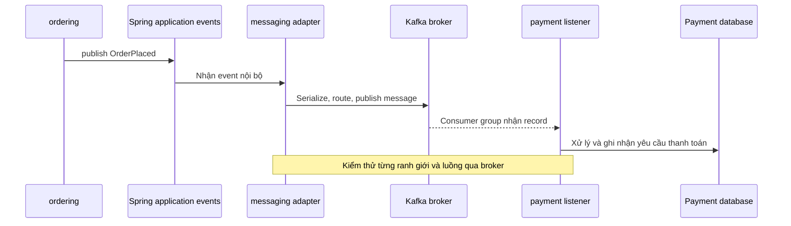
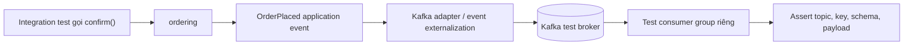
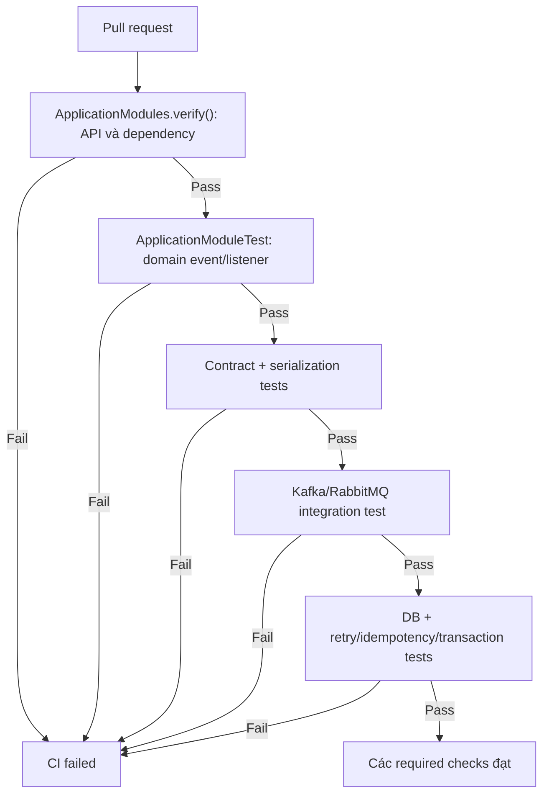

# Kiểm tra event qua message broker trong Spring Modulith

## 1. Vì sao kiểm thử application event chưa đủ để bảo đảm messaging qua broker?

Trong một ứng dụng Spring Modulith, module `ordering` có thể phát `OrderPlaced` bằng `ApplicationEventPublisher`. Module tích hợp `messaging` tiếp nhận sự kiện và gửi một message lên Kafka; một consumer ở `payment` đọc message rồi tạo yêu cầu thanh toán.

Bài kiểm thử `@ApplicationModuleTest` với `Scenario.publish(new OrderPlaced(...))` có thể chứng minh listener **trong Spring application context** phản ứng đúng. Nhưng chỉ thế chưa chứng minh:

- Message đã được serialize thành định dạng mà consumer đọc được.
- Producer gửi tới **đúng topic**, đúng key, headers hoặc routing destination.
- Broker đã nhận bản ghi, và consumer group thật sự xử lý nó.
- Consumer có thể retry/recover khi tạm mất kết nối, gặp lỗi deserialization hoặc lỗi nghiệp vụ.
- Message bị gửi/nhận trùng sẽ không tạo tác dụng phụ nguy hiểm.
- Transaction của cơ sở dữ liệu và việc gửi qua broker đạt các bảo đảm mà thiết kế yêu cầu.

Đó là lý do cần **kiểm tra event qua message broker** như một lớp kiểm thử riêng, có điểm quan sát ở cả hai phía ranh giới hạ tầng.

Bài thuộc chương **Messaging testing** của học phần `SPRING_MODULITH_VERIFICATION_TESTING`: rèn kỹ năng kiểm chứng ranh giới kiến trúc bằng `ApplicationModules.verify()`, kiểm thử hành vi module với `@ApplicationModuleTest` và event, kết hợp database/integration test cùng quality gate CI để ngăn phụ thuộc sai và hồi quy.

Sau bài học, bạn có thể:

1. Phân biệt **Spring application event** với **message được gửi qua broker**.
2. Tách hợp đồng sự kiện nghiệp vụ, hợp đồng message vận chuyển và cấu hình routing.
3. Kiểm thử producer, serializer, broker và consumer ở các mức độ phù hợp.
4. Xây dựng integration test Kafka với Testcontainers và assertion bất đồng bộ đáng tin cậy.
5. Kiểm tra transaction, retry, idempotency, ordering và các trường hợp lỗi.
6. Đặt những bài test này bên cạnh `ApplicationModules.verify()` và `@ApplicationModuleTest` trong CI.

## 2. Đường đi của một event từ module ra broker

Ví dụ gồm ba application module:

```text
com.example.shop
├── ShopApplication.java
├── ordering
│   ├── OrderApplicationService.java
│   └── OrderPlaced.java
├── messaging
│   ├── OrderPlacedMessage.java
│   └── internal
│       └── OrderEventsKafkaAdapter.java
└── payment
    └── internal
        ├── PaymentKafkaListener.java
        └── PaymentRequestService.java
```

Với cách nhận diện module mặc định, `ordering`, `messaging` và `payment` là các application module. `OrderPlaced` và `OrderPlacedMessage` là các hợp đồng nằm ở package gốc tương ứng; các adapter và listener cụ thể được giữ trong package `internal`.



**Phân biệt:** đường `ordering → Spring event → adapter` diễn ra trong tiến trình ứng dụng. Đường `adapter → broker → consumer` yêu cầu cơ chế vận chuyển, serializer, network và cấu hình tiêu thụ. Trong ứng dụng monolith, việc đi vòng qua broker để hai module nội bộ nói chuyện thường không cần thiết; mô hình này phù hợp khi tích hợp với dịch vụ ngoài hoặc một ranh giới triển khai thực sự.

| Lớp | Loại hợp đồng | Câu hỏi kiểm thử |
| --- | --- | --- |
| Domain event | `OrderPlaced` | Nghiệp vụ đặt hàng có phát đúng sự kiện không? |
| Outbound adapter | `OrderEventsKafkaAdapter` | Có chọn đúng topic/key và chuyển payload đúng không? |
| Transport message | `OrderPlacedMessage` | Schema, JSON, kiểu dữ liệu và version có tương thích không? |
| Broker | Topic, partition, acknowledgment | Bản ghi có được broker chấp nhận và có thể tiêu thụ không? |
| Consumer adapter | `PaymentKafkaListener` | Có deserialize và gọi đúng use case không? |
| Domain effect | Payment request được xử lý | Có đúng dữ liệu, không trùng, có xử lý lỗi hợp lệ không? |

## 3. Thiết kế domain event và transport message riêng biệt

Domain event do `ordering` sở hữu:

```java
// src/main/java/com/example/shop/ordering/OrderPlaced.java
package com.example.shop.ordering;

import java.math.BigDecimal;
import java.util.UUID;

public record OrderPlaced(
        UUID eventId,
        UUID orderId,
        BigDecimal total
) {
}
```

Message trên Kafka do vùng tích hợp công bố:

```java
// src/main/java/com/example/shop/messaging/OrderPlacedMessage.java
package com.example.shop.messaging;

import java.math.BigDecimal;
import java.util.UUID;

public record OrderPlacedMessage(
        UUID eventId,
        UUID orderId,
        BigDecimal amount
) {
}
```

Việc tách hai kiểu không phải bắt buộc trong mọi ứng dụng, nhưng có nhiều lợi ích: message có thể giữ **schema ổn định** cho consumer ngoài ứng dụng trong khi mô hình domain thay đổi; tầng tích hợp là nơi áp dụng phiên bản, routing, headers và quy tắc bảo mật.

Dùng `eventId` giúp consumer nhận diện việc xử lý lặp lại cùng **một sự kiện**. Dùng `orderId` làm Kafka key có thể giúp các message cùng đơn đi vào cùng partition **khi cùng topic và partitioning strategy**, nhưng **không tự bảo đảm** một hệ thống tổng thể sẽ xử lý đúng thứ tự trong mọi hoàn cảnh hoặc trên nhiều topic.

Các trường nên được xác định trong hợp đồng:

| Trường | Mục đích | Điều cần test |
| --- | --- | --- |
| `eventId` | Định danh event để deduplicate/trace | Giá trị được giữ nguyên khi retry hoặc phát lại cùng event. |
| `orderId` | Định danh nghiệp vụ và có thể làm message key | Payload và key không mâu thuẫn. |
| `amount` | Giá trị xử lý thanh toán | Đúng đơn vị, độ chính xác và ràng buộc hợp lệ. |
| Schema version/header | Tiến hóa hợp đồng | Consumer tương thích các phiên bản đang hỗ trợ. |
| Topic/routing target | Xác định kênh tiêu thụ | Không gửi nhầm môi trường hoặc topic. |

Trong hệ thống thanh toán thực tế, cần cân nhắc đơn vị tiền tệ, tenant/correlation ID và tránh truyền dữ liệu cá nhân nhạy cảm không cần thiết.

## 4. Ví dụ producer: từ application event tới Kafka

Giả sử publisher trong `ordering` phát domain event sau khi xác nhận đơn:

```java
// src/main/java/com/example/shop/ordering/OrderApplicationService.java
package com.example.shop.ordering;

import java.math.BigDecimal;
import java.util.UUID;
import org.springframework.context.ApplicationEventPublisher;
import org.springframework.stereotype.Service;

@Service
public class OrderApplicationService {

    private final ApplicationEventPublisher events;

    public OrderApplicationService(ApplicationEventPublisher events) {
        this.events = events;
    }

    public void confirm(UUID orderId, BigDecimal amount) {
        // Ví dụ lược bỏ nghiệp vụ lưu đơn, validation và transaction.
        events.publishEvent(new OrderPlaced(UUID.randomUUID(), orderId, amount));
    }
}
```

Adapter thuộc `messaging.internal` chuyển đổi event:

```java
// src/main/java/com/example/shop/messaging/internal/OrderEventsKafkaAdapter.java
package com.example.shop.messaging.internal;

import com.example.shop.messaging.OrderPlacedMessage;
import com.example.shop.ordering.OrderPlaced;
import org.springframework.context.event.EventListener;
import org.springframework.kafka.core.KafkaTemplate;
import org.springframework.stereotype.Component;

@Component
class OrderEventsKafkaAdapter {

    static final String TOPIC = "orders.placed.v1";

    private final KafkaTemplate<String, OrderPlacedMessage> kafka;

    OrderEventsKafkaAdapter(KafkaTemplate<String, OrderPlacedMessage> kafka) {
        this.kafka = kafka;
    }

    @EventListener
    void on(OrderPlaced event) {
        var payload = new OrderPlacedMessage(
                event.eventId(), event.orderId(), event.total()
        );
        kafka.send(TOPIC, event.orderId().toString(), payload);
    }
}
```

Ở đây `KafkaTemplate.send(...)` là thao tác bất đồng bộ ở tầng producer. **Việc method `on(...)` trả về không chứng minh broker đã nhận message.** Nếu cần phản hồi kết quả gửi, phải xử lý kết quả bất đồng bộ và lỗi theo chính sách của hệ thống.

`@EventListener` được dùng để minh họa tầng adapter. Khi có transaction database, cách publish này có thể diễn ra trước commit và không tự giải quyết rủi ro mất message hay gửi message dù DB rollback. Phần transaction/outbox sẽ bàn ở mục 12.

### Spring Modulith event externalization

Spring Modulith cũng cung cấp cơ chế **externalization** sự kiện qua các transport được hỗ trợ khi ứng dụng khai báo các starter và cấu hình phù hợp. Đây là lựa chọn thay cho việc tự viết `OrderEventsKafkaAdapter`: có thể cấu hình event nào được externalize, routing/serialization theo API của phiên bản đang dùng.

Hai hướng là **các lựa chọn thiết kế**, không nên vô tình cấu hình cả auto-externalization lẫn adapter thủ công cho cùng event, vì có nguy cơ **gửi trùng**. Dù dùng cách nào, integration test vẫn phải kiểm tra message **thực sự đi qua broker**, không chỉ kiểm tra event xuất hiện trong Spring context.

## 5. Ví dụ consumer: nhận message và gọi use case nội bộ

Một listener Kafka trong module `payment`:

```java
// src/main/java/com/example/shop/payment/internal/PaymentKafkaListener.java
package com.example.shop.payment.internal;

import com.example.shop.messaging.OrderPlacedMessage;
import org.springframework.kafka.annotation.KafkaListener;
import org.springframework.stereotype.Component;

@Component
class PaymentKafkaListener {

    private final PaymentRequestService payments;

    PaymentKafkaListener(PaymentRequestService payments) {
        this.payments = payments;
    }

    @KafkaListener(
        topics = "orders.placed.v1",
        groupId = "shop-payment"
    )
    void on(OrderPlacedMessage message) {
        payments.requestPayment(
                message.eventId(), message.orderId(), message.amount()
        );
    }
}
```

Use case nội bộ được giữ trong `payment.internal`:

```java
// src/main/java/com/example/shop/payment/internal/PaymentRequestService.java
package com.example.shop.payment.internal;

import java.math.BigDecimal;
import java.util.UUID;
import org.springframework.stereotype.Service;

@Service
class PaymentRequestService {

    void requestPayment(UUID eventId, UUID orderId, BigDecimal amount) {
        // Ví dụ: validate, kiểm tra eventId đã xử lý,
        // lưu PaymentRequest và điều phối payment gateway.
    }
}
```

Đoạn `PaymentRequestService` là **khung minh họa**, chưa phải triển khai persistence hoặc idempotency hoàn chỉnh. Listener nhận kiểu `messaging.OrderPlacedMessage` nên có quan hệ phụ thuộc tĩnh **`payment → messaging`**. Adapter producer nhận `ordering.OrderPlaced` nên có quan hệ **`messaging → ordering`**.

```mermaid
flowchart LR
    O["ordering.OrderPlaced"] <--|"tham chiếu API"| A["messaging.internal.OrderEventsKafkaAdapter"]
    M["messaging.OrderPlacedMessage"] <--|"tham chiếu API"| C["payment.internal.PaymentKafkaListener"]
    A --> K[("Kafka topic")]
    K --> C
```

Không nên hiểu mũi tên vận chuyển qua Kafka là cạnh dependency kiểu Java giữa `ordering` và `payment`. `ApplicationModules.verify()` kiểm tra các quan hệ tĩnh thấy được từ kiểu; **topic string và trao đổi qua broker không tự tạo cạnh kiểu Java trực tiếp**.

## 6. Cấu hình serializer/deserializer để message thật đọc được

Khi chạy thử với Spring Kafka và JSON, producer/consumer cần cấu hình thống nhất. Ví dụ cấu hình **minh họa** trong `application-test.yml`:

```yaml
spring:
  kafka:
    producer:
      key-serializer: org.apache.kafka.common.serialization.StringSerializer
      value-serializer: org.springframework.kafka.support.serializer.JsonSerializer
    consumer:
      key-deserializer: org.apache.kafka.common.serialization.StringDeserializer
      value-deserializer: org.springframework.kafka.support.serializer.JsonDeserializer
      auto-offset-reset: earliest
      properties:
        spring.json.value.default.type: com.example.shop.messaging.OrderPlacedMessage
        spring.json.trusted.packages: com.example.shop.messaging
app:
  messaging:
    topic: orders.placed.v1
```

Trong producer/consumer mẫu, topic đang được ghi trực tiếp để mã dễ đọc; dự án thực tế nên sử dụng một nguồn cấu hình thống nhất cho topic, consumer group và schema. Nếu dùng type headers do `JsonSerializer` thêm mặc định, phải kiểm tra cả cách consumer sử dụng headers; nếu trao đổi với ứng dụng không dùng Spring, thường cần quy ước JSON/schema độc lập với tên class Java.

**Không dùng `spring.json.trusted.packages: "*"` một cách tùy tiện** trong môi trường có dữ liệu không đáng tin cậy. Chỉ cho phép các package cần thiết và có chính sách validation ở biên consumer.

Cần lưu ý:

- Producer test chỉ xác nhận gọi `kafka.send` **chưa chứng minh** cấu hình serializer chạy đúng.
- Deserialization test có thể thất bại nếu kiểu dữ liệu, headers hoặc schema không tương thích.
- Nếu đổi từ JSON sang Avro/Protobuf, cần kiểm thử schema registry và quy tắc tương thích tương ứng.
- Nếu Kafka payload chứa `BigDecimal`, phải có một quy ước encoding nhất quán để tránh làm tròn hoặc thay đổi ý nghĩa số tiền.

## 7. Ba lớp kiểm thử: unit, contract và integration

Một chiến lược cân bằng không cần bật broker thật ở mọi unit test.

| Lớp kiểm thử | Hạ tầng | Điều chứng minh | Chưa chứng minh |
| --- | --- | --- | --- |
| Unit test adapter | Mock `KafkaTemplate` | Routing key, topic và mapping object đúng theo code. | Serializer, network, broker acknowledgment. |
| Unit test consumer | Gọi listener với message hợp lệ và mock service | Mapping message vào use case và nhánh điều kiện đúng. | Kafka container/consumer group hoạt động. |
| Contract/serialization test | ObjectMapper/serializer/schema tool | Payload và version có thể encode/decode theo hợp đồng. | Bản ghi thực sự đi qua broker. |
| Broker integration test | Kafka/Testcontainers hoặc broker test thật | Publish/consume, deserialization, listener registration và kết quả quan sát được. | Toàn bộ SLA sản xuất, lỗi mạng phức tạp. |
| End-to-end integration test | Broker + DB + adapter/gateway phù hợp | Tác động nghiệp vụ qua đường đi thực. | Mọi fault case nếu chưa thiết kế kiểm thử. |
| Architecture test | `ApplicationModules.verify()` | Ranh giới API, hướng phụ thuộc tĩnh và chu kỳ module. | Delivery, retry, JSON, database và broker. |

`@ApplicationModuleTest` và `Scenario` vẫn rất hữu ích ở tầng **application event trong Spring**. Tuy nhiên, `Scenario.publish(new OrderPlaced(...))` không thay thế bài kiểm tra Kafka producer, serialization hoặc consumer group nếu hệ thống vận hành qua broker.

## 8. Unit test producer: kiểm tra topic, key và mapping

Đặt test vào `com.example.shop.messaging.internal` để tiếp cận adapter package-private. Có thể dùng Mockito để kiểm tra lời gọi `KafkaTemplate` mà không cần broker:

```java
// src/test/java/com/example/shop/messaging/internal/OrderEventsKafkaAdapterTests.java
package com.example.shop.messaging.internal;

import static org.mockito.ArgumentMatchers.eq;
import static org.mockito.ArgumentMatchers.argThat;
import static org.mockito.Mockito.verify;

import com.example.shop.messaging.OrderPlacedMessage;
import com.example.shop.ordering.OrderPlaced;
import java.math.BigDecimal;
import java.util.UUID;
import org.junit.jupiter.api.Test;
import org.springframework.kafka.core.KafkaTemplate;

import static org.mockito.Mockito.mock;

class OrderEventsKafkaAdapterTests {

    @Test
    void routesOrderEventToExpectedTopicAndKey() {
        @SuppressWarnings("unchecked")
        KafkaTemplate<String, OrderPlacedMessage> kafka =
                mock(KafkaTemplate.class);

        var adapter = new OrderEventsKafkaAdapter(kafka);
        UUID eventId = UUID.randomUUID();
        UUID orderId = UUID.randomUUID();
        BigDecimal total = new BigDecimal("125000");

        adapter.on(new OrderPlaced(eventId, orderId, total));

        verify(kafka).send(
                eq("orders.placed.v1"),
                eq(orderId.toString()),
                argThat(message ->
                        message.eventId().equals(eventId)
                                && message.orderId().equals(orderId)
                                && message.amount().compareTo(total) == 0)
        );
    }
}
```

Bài test này bảo vệ **mapping và routing logic** của adapter. Nó gọi trực tiếp `on(...)` nên **không chứng minh `@EventListener` đã được Spring đăng ký**, không kiểm tra serializer và không xác nhận broker đã nhận message.

Nếu ứng dụng thực tế cần message headers, trace ID, version hoặc tenant ID, nên bổ sung assertion tương ứng. Đối với producer API bất đồng bộ, cũng cần unit test cách xử lý **send failure** nếu adapter có logic xử lý callback/kết quả.

## 9. Contract test: đừng chỉ so sánh object Java

Một message có thể đúng khi so sánh record Java nhưng sai khi serialize sang JSON mà consumer ngoài hệ thống mong đợi. Vì vậy cần xác nhận **hợp đồng trên dây** (*wire contract*).

Ví dụ test JSON với Jackson:

```java
package com.example.shop.messaging;

import static org.assertj.core.api.Assertions.assertThat;

import com.fasterxml.jackson.databind.ObjectMapper;
import java.math.BigDecimal;
import java.util.UUID;
import org.junit.jupiter.api.Test;

class OrderPlacedMessageJsonTests {

    private final ObjectMapper json = new ObjectMapper();

    @Test
    void roundTripsMessage() throws Exception {
        var source = new OrderPlacedMessage(
                UUID.randomUUID(),
                UUID.randomUUID(),
                new BigDecimal("125000.00")
        );

        byte[] bytes = json.writeValueAsBytes(source);
        OrderPlacedMessage restored =
                json.readValue(bytes, OrderPlacedMessage.class);

        assertThat(restored.eventId()).isEqualTo(source.eventId());
        assertThat(restored.orderId()).isEqualTo(source.orderId());
        assertThat(restored.amount().compareTo(source.amount())).isZero();
    }
}
```

Bài test round-trip giúp phát hiện một số lỗi serialize/deserialize. Nhưng **producer và consumer cùng dùng một cấu hình lỗi có thể vẫn round-trip thành công**. Với hệ thống có consumer ngoài ứng dụng, cần thêm:

- Fixture JSON/Avro/Protobuf **đúng theo hợp đồng đã công bố**, không chỉ tạo fixture từ code hiện tại.
- Kiểm tra tên field, kiểu dữ liệu, enum, format thời gian, giá trị null và version.
- Kiểm tra tương thích giữa **producer phiên bản mới** với **consumer phiên bản đang vận hành**.
- Kiểm tra không làm lộ thông tin nhạy cảm hoặc serialize entity JPA ngoài ý muốn.

**Kết quả:** contract test bảo vệ định dạng message, nhưng không thay broker integration test.

## 10. Integration test Kafka với Testcontainers

Khi cần chứng minh **Kafka consumer thật nhận và xử lý bản ghi**, dùng một broker cô lập qua Testcontainers. Ví dụ sau kiểm tra tuyến **broker → Spring Kafka listener → use case**; test publish trực tiếp một message để cô lập phía consumer.

Để ví dụ hoạt động, dự án cần các dependency test thích hợp (được quản lý phiên bản tương thích): `spring-boot-starter-test`, `spring-kafka`, Testcontainers Kafka/JUnit Jupiter, Awaitility và hỗ trợ Mockito bean của Spring Test. Đồng thời môi trường chạy test phải có Docker engine được phép sử dụng.

### Khởi tạo Kafka container trong test

```java
// src/test/java/com/example/shop/payment/internal/PaymentKafkaIntegrationTests.java
package com.example.shop.payment.internal;

import static org.mockito.Mockito.verify;
import static org.awaitility.Awaitility.await;

import com.example.shop.messaging.OrderPlacedMessage;
import java.math.BigDecimal;
import java.time.Duration;
import java.util.UUID;
import java.util.concurrent.TimeUnit;
import org.junit.jupiter.api.Test;
import org.springframework.beans.factory.annotation.Autowired;
import org.springframework.boot.test.context.SpringBootTest;
import org.springframework.kafka.core.KafkaTemplate;
import org.springframework.test.context.DynamicPropertyRegistry;
import org.springframework.test.context.DynamicPropertySource;
import org.springframework.test.context.bean.override.mockito.MockitoBean;
import org.testcontainers.junit.jupiter.Container;
import org.testcontainers.junit.jupiter.Testcontainers;
import org.testcontainers.kafka.KafkaContainer;
import org.testcontainers.utility.DockerImageName;

@SpringBootTest
@Testcontainers
class PaymentKafkaIntegrationTests {

    @Container
    static final KafkaContainer KAFKA = new KafkaContainer(
            DockerImageName.parse("apache/kafka:3.8.0")
    );

    @DynamicPropertySource
    static void kafkaProperties(DynamicPropertyRegistry registry) {
        registry.add("spring.kafka.bootstrap-servers",
                KAFKA::getBootstrapServers);
    }

    @Autowired
    KafkaTemplate<String, OrderPlacedMessage> kafka;

    @MockitoBean
    PaymentRequestService payments;

    @Test
    void brokerRecordReachesPaymentUseCase() throws Exception {
        UUID eventId = UUID.randomUUID();
        UUID orderId = UUID.randomUUID();
        BigDecimal amount = new BigDecimal("125000");
        var message = new OrderPlacedMessage(eventId, orderId, amount);

        kafka.send("orders.placed.v1", orderId.toString(), message)
                .get(10, TimeUnit.SECONDS);

        await().atMost(Duration.ofSeconds(15))
                .untilAsserted(() ->
                        verify(payments).requestPayment(
                                eventId, orderId, amount
                        ));
    }
}
```

**Phạm vi ví dụ:** đoạn test dùng `@MockitoBean` của Spring Test (phù hợp với các phiên bản Spring Framework hiện đại) để cô lập `PaymentRequestService`. Với project dùng phiên bản cũ hơn, cơ chế thay bean trong test có thể khác; cần dùng annotation/config tương thích với dependency đang sử dụng. Cú pháp `KafkaContainer` và image cũng phụ thuộc phiên bản Testcontainers; cần đồng bộ theo BOM và môi trường project.

Test giả định topic `orders.placed.v1` đã được tạo bằng cấu hình ứng dụng, `NewTopic` bean hoặc provisioning test phù hợp. Không nên dựa mù quáng vào broker tự tạo topic; một môi trường khác có thể tắt auto-create.

### Test này thực sự chứng minh điều gì?

- Test container khởi động một broker Kafka.
- `KafkaTemplate` gửi message đã serialize, `get(...)` chờ kết quả producer (hoặc ném lỗi khi không gửi được).
- Spring Kafka listener của ứng dụng subscribe topic và consumer group thật.
- JSON được deserialize về `OrderPlacedMessage` theo cấu hình.
- Listener gọi `PaymentRequestService` với nội dung đúng; Awaitility chờ vì consumer hoạt động bất đồng bộ.

**Điều test chưa chứng minh:** implementation thật của `PaymentRequestService` ghi database đúng, transaction commit hay payment gateway xử lý chính xác. Vì use case đã được thay bằng mock, phải có database/service integration test bổ sung cho những hành vi ấy.

### Tránh cross-test interference

Để bài test ổn định, nên tách topic hoặc consumer group cho từng test suite, dùng `eventId`/`orderId` mới và dọn dữ liệu phù hợp. Nếu hai test cùng chạy trên một topic và cùng group, message có thể được một consumer khác nhận, làm test flakey. Với broker dùng chung cho nhiều suite, chiến lược topic/group cô lập là rất quan trọng.

## 11. Kiểm thử producer đi qua broker, không chỉ gọi `send(...)`

Bài integration test ở mục 10 bắt đầu **sau producer**: nó tự publish message tới Kafka và kiểm tra consumer. Để kiểm tra cả `ordering → event → Kafka`, cần một bài test riêng:

1. Khởi động Spring context có `OrderApplicationService`, `OrderEventsKafkaAdapter` và Kafka test broker.
2. Chuẩn bị một **consumer test độc lập** với group riêng và subscribe tới topic trước khi kích hoạt publisher.
3. Gọi `OrderApplicationService.confirm(orderId, amount)`, không gọi trực tiếp `kafka.send(...)`.
4. Poll broker, lấy `ConsumerRecord` và kiểm tra topic, key, headers và JSON/payload.
5. Xác nhận chỉ những event nghiệp vụ đủ điều kiện được externalize.



Tại sao dùng **consumer test riêng**? Nếu test chỉ `verify(kafkaTemplate).send(...)`, nó vẫn không xác nhận serializer/network. Consumer test dùng group riêng có thể quan sát bản ghi qua chính broker, thay vì chia sẻ offset với consumer nghiệp vụ đang được kiểm thử.

Với cách này, cần chú ý thời điểm subscribe/assignment, offset và việc consumer có thể bỏ lỡ message gửi trước khi sẵn sàng. Một chiến lược thường dùng là chờ partition assignment hoặc chọn `auto.offset.reset=earliest` với group mới, rồi poll theo timeout có giới hạn.

## 12. Transaction, event publication và độ tin cậy khi gửi ra ngoài

Đây là khác biệt lớn giữa **Spring application event nội bộ** và **message externalization có độ tin cậy**.

Giả sử ứng dụng lưu đơn hàng trong một transaction và publish event. Một listener `@EventListener` gọi Kafka ngay **trước khi DB commit**; nếu transaction rollback, message đã gửi có thể báo “đơn hàng được đặt” dù dữ liệu không tồn tại.

Một hướng là chỉ gửi sau commit:

```java
import org.springframework.transaction.event.TransactionPhase;
import org.springframework.transaction.event.TransactionalEventListener;

@TransactionalEventListener(phase = TransactionPhase.AFTER_COMMIT)
void on(OrderPlaced event) {
    // Sau khi DB transaction commit mới khởi động gửi message.
}
```

Đoạn trên chỉ minh họa annotation trên method của Spring-managed component. Với `@TransactionalEventListener(AFTER_COMMIT)`, nếu không có transaction đang hoạt động phù hợp, listener có thể không chạy theo mặc định. Bài test phải tạo được **commit thật**, không nhầm với transaction bị rollback sau test.

**Quan trọng:** gửi **sau commit** tránh một số trường hợp “gửi trước rồi DB rollback”, nhưng **không tạo atomic commit giữa database và Kafka**. Nếu tiến trình crash sau khi DB commit nhưng trước khi message gửi thành công, message vẫn có thể mất.

Các giải pháp tăng độ tin cậy có thể gồm:

- **Transactional outbox:** ghi ý định phát message cùng transaction với dữ liệu nghiệp vụ, một thành phần riêng đưa outbox sang broker.
- **Spring Modulith event publication registry/externalization** khi đã cấu hình phù hợp, theo dõi publication và hỗ trợ khôi phục theo cơ chế, phiên bản và transport đang dùng.
- **Idempotent consumer:** chấp nhận một event có thể được gửi/nhận lại mà không nhân đôi tác dụng nghiệp vụ.
- **Retry/error handling và quan sát:** phân biệt lỗi tạm thời với message không xử lý được.

Không được suy ra **exactly-once end-to-end** chỉ vì Kafka producer trả kết quả thành công, broker có transaction hoặc Spring Modulith có publication registry. Các ranh giới DB, broker và consumer phải được phân tích riêng.

### Những ca transaction cần kiểm tra

| Ca | Kỳ vọng cần xác định rõ |
| --- | --- |
| Đơn hàng commit thành công | Message cuối cùng được externalize theo cơ chế đã chọn. |
| Đơn hàng rollback | Không externalize event trái nghĩa nghiệp vụ, nếu đó là chính sách. |
| Broker không sẵn sàng ngay lúc publish | Có lỗi quan sát được, retry/recovery theo thiết kế. |
| Process crash giữa commit và publish | Publication có cơ chế phục hồi hoặc được đánh dấu để xử lý lại. |
| Consumer xử lý xong nhưng chưa acknowledge rồi restart | Event có thể được giao lại; business effect phải an toàn. |

Các ca này cần fault-injection hoặc integration test có điều khiển, không chỉ một unit test adapter.

## 13. Retry, duplicate message, idempotency và DLQ

Broker messaging thường được thiết kế hướng tới **at-least-once** ở một số cấu hình/đường xử lý, nghĩa là consumer có thể thấy một record lặp lại khi retry, rebalancing hoặc crash. Vì vậy, với thanh toán, **tránh thực hiện giao dịch hai lần** là yêu cầu quan trọng.

Chiến lược consumer mẫu:

1. Đọc `eventId` và kiểm tra xem event đã được xử lý chưa.
2. Nếu đã xử lý, kết thúc an toàn theo chính sách.
3. Nếu chưa, ghi nhận và thực hiện tác động trong một transaction/đơn vị công việc phù hợp.
4. Sử dụng ràng buộc **unique key trên `eventId`** hoặc cơ chế tương đương để chống race condition.
5. Xử lý lỗi tạm thời bằng retry/backoff, lỗi không thể phục hồi bằng DLQ hoặc kênh xử lý riêng khi thiết kế yêu cầu.

Không nên chỉ dùng `ConcurrentHashMap` trong bộ nhớ process làm bảo đảm idempotency sản xuất: restart, nhiều instance hoặc mất dữ liệu có thể khiến event được xử lý lại.

### Test duplicate event

Một bài test có thể gửi cùng `OrderPlacedMessage` **hai lần** qua Kafka, chờ consumer hoàn tất và kiểm tra:

- Chỉ **một payment request** được lưu hoặc chỉ một giao dịch ngoại được khởi tạo.
- Hệ thống vẫn chấp nhận redelivery mà không hỏng trạng thái.
- Log/metrics cho biết đã nhận duplicate nếu điều đó phục vụ vận hành.

Nếu `PaymentRequestService` đang bị mock như ở mục 10, hai lời gọi listener tới mock **không đủ để chứng minh idempotency**. Cần chạy implementation thật với persistence và kiểm tra trạng thái sau cùng.

### Test retry và dead-letter queue

| Tình huống | Loại kiểm tra | Assertion |
| --- | --- | --- |
| Broker tạm ngắt kết nối lúc producer gửi | Integration/fault test | Producer/recovery phản hồi hoặc retry đúng. |
| Consumer xử lý lỗi tạm thời | Listener integration | Retry/backoff theo cấu hình, không commit sai trạng thái. |
| Message không deserialize được | Deserialization/error handler test | Không làm consumer chết vĩnh viễn; có xử lý lỗi theo chính sách. |
| Message sai schema không thể xử lý | DLQ integration | Có bản ghi ở dead-letter topic/queue đúng metadata nếu đã cấu hình. |
| Cùng `eventId` đến nhiều lần | DB + broker integration | Tác động nghiệp vụ không bị nhân đôi. |

**Không giả định mặc định có DLQ, retry hay exactly-once.** Spring Kafka và các transport cung cấp cơ chế cấu hình, nhưng hành vi thực tế phải được kiểm tra theo chính sách ứng dụng.

## 14. Ordering, partition key và consumer group

Với Kafka, các message trong **cùng partition** có thứ tự offset; nhưng application có nhiều partition, nhiều consumer hoặc nhiều nguồn event thì không có một thứ tự toàn cục đơn giản.

Chọn `orderId` làm key có thể giúp các message cùng đơn được gửi tới cùng partition theo chiến lược partitioning nhất quán. Tuy nhiên, không được suy ra:

- Message ở **hai topic khác nhau** có thứ tự xử lý được bảo đảm.
- Việc retry sau lỗi không bao giờ làm hiệu ứng nghiệp vụ bị đảo thứ tự.
- Hai event có key khác nhau phải xử lý theo thứ tự.
- Consumer group lúc nào cũng chỉ có một consumer xử lý toàn bộ topic.

Bài test ordering cần nêu rõ phạm vi:

- Chọn cùng `orderId`, gửi `OrderPlaced` rồi `OrderCancelled` trên một topic nếu contract yêu cầu.
- Chờ consumer xử lý đủ hai event và kiểm tra trạng thái cuối.
- Chạy trong điều kiện có nhiều partition nếu kiến trúc thật sử dụng nhiều partition.
- Bổ sung version/sequence hoặc business invariant khi ứng dụng không thể chỉ dựa vào thứ tự broker.

Với RabbitMQ, các khái niệm exchange, routing key, queue, competing consumers, acknowledgment và ordering có cơ chế khác; không áp dụng nguyên xi mọi quy tắc Kafka.

## 15. Khi dùng RabbitMQ hoặc broker khác

Nếu hệ thống dùng Spring AMQP/RabbitMQ, chiến lược kiểm thử vẫn gồm **publisher → broker → consumer → business effect**, nhưng công cụ và điểm xác nhận khác:

| Khía cạnh | Kafka | RabbitMQ |
| --- | --- | --- |
| Địa chỉ gửi | Topic, partition, key | Exchange, routing key, queue binding |
| Delivery progress | Consumer offset/group | Message ack/nack, queue state |
| Lỗi không xử lý được | Retry topic/DLT theo cấu hình | Retry/dead-letter exchange/queue theo cấu hình |
| Test hạ tầng | Kafka Testcontainers hoặc embedded broker khi thích hợp | RabbitMQ Testcontainers hoặc broker test riêng |
| Dấu hiệu đã nhận | Producer send result và consumer poll | Publisher confirm/return tùy cấu hình; consumer ack/effect |
| Điều cần bảo vệ | Schema, partition key, offsets, duplication | Routing, binding, ack/nack, requeue, redelivery |

Ví dụ, RabbitMQ test không nên chỉ xác nhận `RabbitTemplate.convertAndSend(...)` được gọi. Phải kiểm tra message **đi vào đúng exchange/routing key và tới queue**, listener nhận đúng payload, cũng như dead-letter routing nếu có. Tương tự Kafka, **broker nhận message** chưa chứng minh **use case xử lý xong**.

## 16. Test tầng application module và test tầng broker bổ sung cho nhau

Một cấu hình kiểm thử đầy đủ cho cùng luồng đơn hàng/thanh toán:



| Test | Câu hỏi bảo vệ |
| --- | --- |
| `ApplicationModules.verify()` | `messaging` có chỉ tham chiếu API của `ordering` và `payment` có tuân thủ hướng dependency không? |
| `@ApplicationModuleTest` cho `ordering` | Xác nhận đơn có thực sự phát `OrderPlaced` đúng điều kiện? |
| `@ApplicationModuleTest` cho adapter/module phù hợp | Event nội bộ có kích hoạt externalization logic được cấu hình không? |
| Contract test | Message object có giữ đúng schema, trường và encoding cho consumer không? |
| Producer broker integration | Broker thực sự nhận đúng record sau stimulus nghiệp vụ không? |
| Consumer broker integration | Kafka listener thật có deserialize và gọi use case đúng không? |
| Database/end-to-end integration | Payment request có commit, duplicate an toàn và lỗi/recovery phù hợp không? |

**Không thay `ApplicationModules.verify()` bằng broker test:** một hệ thống có thể publish/consume thành công nhưng vẫn truy cập API nội bộ trái thiết kế. **Cũng không thay broker test bằng `verify()`:** một graph module hợp lệ không bảo đảm topic, serializer, retry hay database đúng.

## 17. CI: chạy broker test thật mà không làm pipeline thiếu tin cậy

Broker integration test thường chậm hơn unit/architecture test và cần Docker hoặc một broker test được quản lý. Để có phản hồi sớm và quality gate đáng tin:

1. Chạy unit test và `ApplicationModules.verify()` ở bước đầu.
2. Chạy contract/serialization test trước broker integration test.
3. Chạy Testcontainers broker trên runner có Docker; chuẩn bị đúng dependency và image.
4. Dùng topic/consumer group cô lập, ID ngẫu nhiên và timeout theo điều kiện để hạn chế flaky test.
5. Thu thập log broker, consumer, report JUnit khi có lỗi.
6. Cấu hình job kiến trúc, module, broker và database quan trọng thành **required checks** theo chính sách branch protection/ruleset.

Ví dụ các lệnh build thông dụng:

```bash
# Maven Wrapper
./mvnw test

# Chạy riêng một bài tích hợp với broker để debug
./mvnw -Dtest=PaymentKafkaIntegrationTests test

# Gradle Wrapper
./gradlew test

# Chạy riêng test theo tên lớp
./gradlew test --tests "com.example.shop.payment.internal.PaymentKafkaIntegrationTests"
```

Không dùng `@Disabled`, `-DskipTests`, `-x test` hoặc `continue-on-error: true` cho job bắt buộc mà không có một cơ chế thay thế rõ ràng. Nếu môi trường local chưa có Docker, có thể chạy unit/contract test trước; **CI vẫn cần có một môi trường có khả năng chạy broker integration test** nếu đó là gate được yêu cầu.

### Tránh tăng timeout vô điều kiện

Khi test thỉnh thoảng thất bại, hãy kiểm tra:

- Broker/consumer group đã sẵn sàng và partition đã được assign chưa?
- Event có bị consumer khác trong cùng group xử lý không?
- Message có bị lỗi deserialization hoặc routing sai không?
- Assertion đang kiểm tra message cùng `eventId`/`orderId` không?
- Listener có gặp transaction/DB lock hoặc retry không?

Chỉ tăng timeout có thể làm bài test chậm mà không sửa nguyên nhân. Ưu tiên **đợi trạng thái có điều kiện**, cấu hình cô lập và log chẩn đoán.

## 18. Quy trình chẩn đoán khi gửi event nhưng consumer không nhận

Một checklist có thứ tự:

| Bước | Câu hỏi |
| --- | --- |
| 1. Domain publisher | `OrderPlaced` đã được phát do hành vi nghiệp vụ thật chưa? |
| 2. Externalization | Adapter hoặc cấu hình Spring Modulith có chọn event này để gửi ra ngoài không? |
| 3. Producer | `KafkaTemplate` có gửi đúng topic/key không, send result có lỗi không? |
| 4. Serializer | Payload và headers/type info có đúng hợp đồng không? |
| 5. Broker | Topic/queue có tồn tại, broker có thể truy cập từ test runner không? |
| 6. Consumer | Group, subscription, partition assignment hoặc queue binding có đúng không? |
| 7. Deserializer | Consumer có đọc đúng schema và trusted type không? |
| 8. Listener | Listener đã đăng ký bean, có exception hoặc bị chặn bởi transaction không? |
| 9. Domain effect | `PaymentRequestService` có chạy, trạng thái DB đã commit chưa? |
| 10. Retry/recovery | Có redelivery, DLQ, duplicate hoặc record bị xử lý lại không? |

Khi chỉ có test `Scenario.publish(...)` thành công nhưng Kafka integration test không thấy record, ưu tiên kiểm tra **externalization adapter, serializer và broker**. Khi broker có record nhưng domain state không thay đổi, kiểm tra **consumer, deserialization, listener và persistence**.

Không nên “sửa” bằng cách đưa các repository nội bộ lên public API để test được; lỗi transport phải được xử lý ở đúng tầng.

## 19. Bài tập thực hành và câu hỏi tự kiểm tra

**Bài 1.** `ApplicationModules.verify()` đạt, nhưng `payment` không nhận được `OrderPlacedMessage` từ Kafka. Kiểm chứng kiến trúc có đủ để kết luận messaging đúng không?

**Đáp án:** Không. `verify()` kiểm tra phụ thuộc kiểu tĩnh và ranh giới module, không thực thi Kafka network/serializer/consumer. Cần broker integration test và contract test.

**Bài 2.** Test Mockito xác nhận `kafka.send("orders.placed.v1", key, message)` được gọi. Có chứng minh broker chấp nhận message không?

**Đáp án:** Không. Nó chỉ kiểm tra mapping và lời gọi adapter. Cần test broker với producer send result và consumer quan sát record.

**Bài 3.** Vì sao trong Kafka integration test thường cần `Awaitility` hoặc cơ chế chờ có điều kiện?

**Đáp án:** Consumer xử lý bất đồng bộ. Việc producer gửi xong không đồng nghĩa listener đã hoàn tất. Chờ theo điều kiện tránh timing race và `Thread.sleep` cố định.

**Bài 4.** Một message có `eventId` được gửi hai lần. Consumer thanh toán nên có bảo vệ gì?

**Đáp án:** Cơ chế idempotency bền vững theo `eventId`/nghiệp vụ, ví dụ unique constraint và transaction phù hợp. Cần test duplicate với implementation thật và trạng thái DB.

**Bài 5.** Chỉ thay `@EventListener` bằng `@TransactionalEventListener(AFTER_COMMIT)` đã bảo đảm không mất message khi process crash chưa?

**Đáp án:** Chưa. Crash sau DB commit nhưng trước publish vẫn có thể làm mất message. Cần outbox/publication registry/recovery theo thiết kế và test fault case.

**Bài 6.** Khi dùng `@ApplicationModuleTest` và `Scenario.publish(new OrderPlaced(...))`, có chắc đã kiểm tra Kafka serializer, topic và consumer group không?

**Đáp án:** Không. `Scenario` kiểm thử interaction trong Spring application context. Broker phải được kiểm thử bằng tầng integration phù hợp.

**Bài 7.** `PaymentKafkaIntegrationTests` dùng `@MockitoBean PaymentRequestService`. Có khẳng định database đã lưu PaymentRequest đúng không?

**Đáp án:** Không. Mock xác nhận lời gọi từ listener, không kiểm tra persistence. Cần database integration/end-to-end test với service thật.

**Bài 8.** Nếu consumer có group ID giống nhau ở hai test chạy song song, hiện tượng nào có thể xảy ra?

**Đáp án:** Các consumer cùng group có thể chia partition, khiến message rơi vào consumer của test khác. Cần cô lập group/topic hoặc thiết kế test không cạnh tranh.

**Bài 9.** Kafka bảo đảm thứ tự message toàn cục trên mọi topic và partition không?

**Đáp án:** Không. Thứ tự offset có ý nghĩa trong từng partition. Phải thiết kế key/partition và logic nghiệp vụ phù hợp, đồng thời test các giả định ordering cụ thể.

**Bài 10.** Testcontainers Kafka luôn chạy trên mọi CI runner không?

**Đáp án:** Không. Test cần Docker runtime, image và cấu hình network phù hợp; CI phải được chuẩn bị. Không được âm thầm skip một required check nếu test qua broker là điều kiện chất lượng.

## 20. Checklist trước khi chấp nhận một luồng event qua broker

- **Ranh giới module:** `OrderPlaced`, `OrderPlacedMessage` là contract được công bố; adapter và listener cụ thể nằm trong module sở hữu.
- **Tín hiệu nghiệp vụ:** publisher chỉ externalize event đúng thời điểm theo giao dịch.
- **Định tuyến:** topic/exchange, key/routing key, headers, version và môi trường phù hợp.
- **Serializer:** JSON/Avro/Protobuf được kiểm thử theo hợp đồng của các consumer thực tế.
- **Producer:** có test mapping và broker integration test chứng minh record thực sự được ghi nhận.
- **Consumer:** có test với broker thật chứng minh deserialization và listener hoạt động.
- **Tác động:** có integration test xác nhận DB/business effect, không chỉ mock method.
- **Lỗi:** có chiến lược retry, DLQ, duplicate/idempotency, ordering và xử lý crash.
- **Transaction:** biết rõ tính nhất quán mong muốn giữa DB và broker; không suy diễn exactly-once.
- **Kiến trúc:** chạy `ApplicationModules.verify()` để chặn chu kỳ, truy cập API nội bộ và sai `allowedDependencies`.
- **Module test:** dùng `@ApplicationModuleTest` và `Scenario` cho hành vi phát/nhận sự kiện trong Spring context.
- **CI:** unit, contract, module, broker/database integration test quan trọng thực sự chạy và là required checks.

**Ghi nhớ:** Kiểm tra event qua message broker trong Spring Modulith phải xác nhận **event nghiệp vụ được externalize đúng cách, payload đi qua broker thật và consumer tạo kết quả mong muốn**. Unit test và `Scenario` giúp cô lập phần Spring, nhưng không thay thế kiểm thử serializer, topic, consumer group, transaction, retry và idempotency. Kết hợp broker integration test với `ApplicationModules.verify()`, `@ApplicationModuleTest`, database test và quality gate CI để bảo vệ cả kiến trúc lẫn luồng messaging khi hệ thống phát triển.
