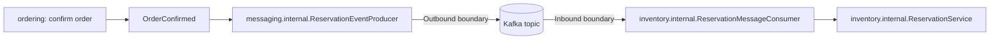
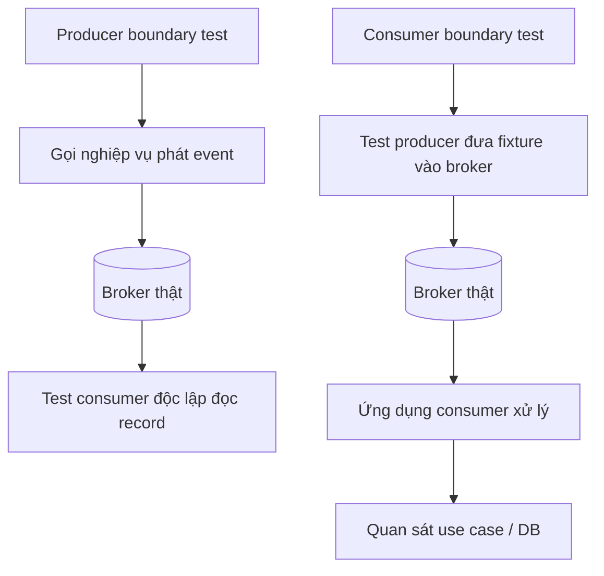
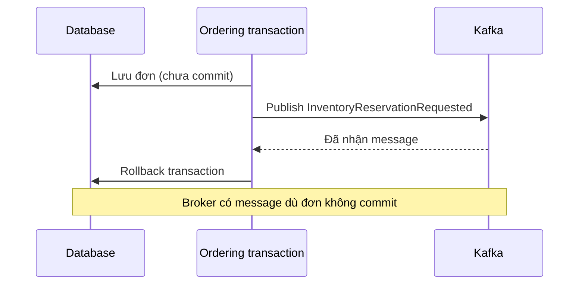
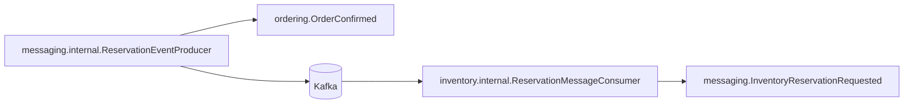
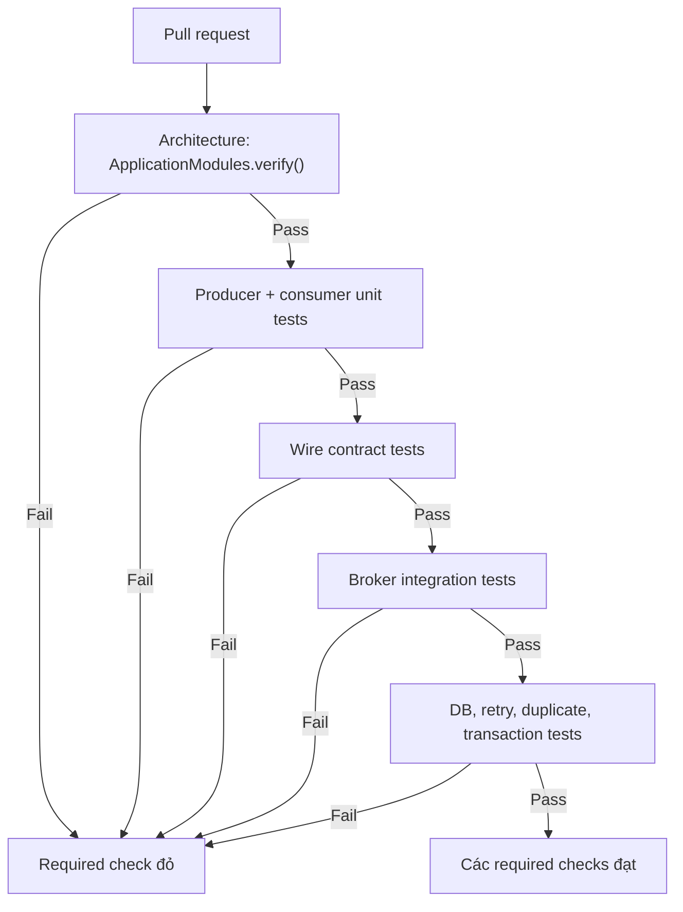

# Test consumer và producer theo boundary trong Spring Modulith

## 1. Kiểm thử theo boundary nghĩa là gì?

Trong chương **Messaging testing** của học phần `SPRING_MODULITH_VERIFICATION_TESTING`, một luồng sự kiện có thể đi từ nghiệp vụ đặt hàng đến broker rồi được module tồn kho xử lý. Nếu chỉ có một bài end-to-end kiểm tra “đặt hàng xong thì tồn kho giảm”, khi test thất bại sẽ khó biết sai ở publisher, serializer, routing, listener, transaction hay database.

**Test producer và consumer theo boundary** nghĩa là đặt những bài kiểm thử tại **điểm giao tiếp có hợp đồng rõ ràng**:

- **Outbound boundary (producer):** từ application/domain event hoặc use case sang message được gửi đi. Kiểm tra **đúng message, đúng destination, key và metadata**, sau đó kiểm tra adapter với broker khi cần.
- **Inbound boundary (consumer):** từ bản ghi nhận được ở broker sang lời gọi use case bên trong module. Kiểm tra **đọc đúng payload, validate đúng, gọi đúng nghiệp vụ và xử lý lỗi theo chính sách**.
- **Contract boundary:** bảo đảm hai bên thống nhất định dạng, phiên bản, kiểu dữ liệu và ngữ nghĩa message.
- **Infrastructure boundary:** broker, serializer, consumer group và acknowledgement hoạt động đúng với cấu hình thật.

`ApplicationModules.verify()` bảo vệ **đồ thị phụ thuộc tĩnh và API module**, còn `@ApplicationModuleTest`, unit test, contract test và integration test bảo vệ **hành vi khi message đi qua từng ranh giới**. Một loại test không tự thay thế loại còn lại.

Sau bài này, bạn có thể đọc một sơ đồ message flow và chỉ ra nơi đặt test; viết unit test cho hai adapter; phân biệt việc mock Kafka với kiểm thử Kafka thật; kiểm chứng contract, duplicate, retry và transaction; tổ chức quality gate CI để ngăn lỗi tích hợp và hồi quy.

## 2. Một luồng nghiệp vụ xuyên qua hai ranh giới

Giả sử ứng dụng bán hàng có ba application module:

```text
com.example.shop
├── ShopApplication.java
├── ordering
│   ├── OrderConfirmed.java
│   └── OrderApplicationService.java
├── messaging
│   ├── InventoryReservationRequested.java
│   └── internal
│       └── ReservationEventProducer.java
└── inventory
    └── internal
        ├── ReservationMessageConsumer.java
        └── ReservationService.java
```

Theo chiến lược nhận diện module mặc định, `ordering`, `messaging` và `inventory` là ba application module. `OrderConfirmed` và `InventoryReservationRequested` nằm trong package gốc của module tương ứng, còn các adapter được giữ nội bộ.

Luồng dự kiến:



Ở đây:

1. `ordering` hoàn thành hành vi xác nhận đơn và phát `OrderConfirmed` trong Spring.
2. Producer adapter thuộc `messaging` chuyển domain event thành **transport message**.
3. Kafka nhận message vào topic `inventory.reservations.v1`.
4. Consumer adapter thuộc `inventory` đọc message và chuyển vào use case `ReservationService`.
5. Use case thực hiện logic đặt giữ tồn kho; việc ghi dữ liệu, transaction và chống trùng là trách nhiệm riêng của phần nghiệp vụ.

**Ranh giới outbound** không kết thúc ở việc một phương thức Java được gọi nếu hệ thống cần bảo đảm broker nhận record. **Ranh giới inbound** không kết thúc ở việc Kafka chuyển được message nếu nghiệp vụ chưa xử lý xong. Vì vậy cần các mức test khác nhau.

## 3. Phân biệt domain event, wire message và kết quả nghiệp vụ

Domain event của module `ordering`:

```java
// ordering/OrderConfirmed.java
package com.example.shop.ordering;

import java.util.UUID;

public record OrderConfirmed(
        UUID eventId,
        UUID orderId,
        String sku,
        int quantity
) {
}
```

Message dành cho transport:

```java
// messaging/InventoryReservationRequested.java
package com.example.shop.messaging;

import java.util.UUID;

public record InventoryReservationRequested(
        UUID eventId,
        UUID orderId,
        String sku,
        int quantity
) {
}
```

Hai kiểu giống field trong ví dụ để dễ theo dõi, nhưng **không nhất thiết phải cùng kiểu Java**. Domain event có thể đổi theo mô hình nghiệp vụ, trong khi wire contract phải phù hợp với consumer đang vận hành và quy tắc tiến hóa schema.

| Thông tin | Vai trò producer | Vai trò consumer |
| --- | --- | --- |
| `eventId` | Sinh một lần cho một event nghiệp vụ, giữ nguyên khi retry cùng event | Nhận diện redelivery/duplicate và phục vụ idempotency |
| `orderId` | Định danh nghiệp vụ, có thể dùng làm Kafka key | Liên kết yêu cầu giữ hàng với đơn |
| `sku` | Mã sản phẩm được yêu cầu giữ | Kiểm tra sản phẩm và tồn kho |
| `quantity` | Số lượng nguyên dương theo contract | Validate trước khi gọi use case |
| Topic/version | Chọn kênh và phiên bản hợp đồng | Subscribe và giải mã đúng kênh |
| Headers/correlation | Gắn trace, tenant hoặc schema version nếu thiết kế cần | Truy vết và phân luồng theo metadata |

**Boundary contract** bao gồm cả **dữ liệu, cách mã hóa, topic, key, headers và ngữ nghĩa xử lý lỗi**, không chỉ danh sách field.

Trong ví dụ, chỉ `eventId` được dùng để nhận diện cùng một event. Một lần đặt hàng mới cho cùng `orderId` có thể là sự kiện khác; không được tùy tiện dùng mỗi `orderId` để deduplicate mọi luồng nếu nghiệp vụ không cho phép.

## 4. Outbound adapter: chỉ chịu trách nhiệm chuyển và gửi message

Ví dụ adapter nằm trong module `messaging`:

```java
// messaging/internal/ReservationEventProducer.java
package com.example.shop.messaging.internal;

import com.example.shop.messaging.InventoryReservationRequested;
import com.example.shop.ordering.OrderConfirmed;
import org.springframework.context.event.EventListener;
import org.springframework.kafka.core.KafkaTemplate;
import org.springframework.stereotype.Component;

@Component
class ReservationEventProducer {

    static final String TOPIC = "inventory.reservations.v1";

    private final KafkaTemplate<String, InventoryReservationRequested> kafka;

    ReservationEventProducer(
            KafkaTemplate<String, InventoryReservationRequested> kafka) {
        this.kafka = kafka;
    }

    @EventListener
    void on(OrderConfirmed event) {
        var message = new InventoryReservationRequested(
                event.eventId(),
                event.orderId(),
                event.sku(),
                event.quantity()
        );

        kafka.send(TOPIC, event.orderId().toString(), message);
    }
}
```

Adapter nhận `OrderConfirmed` và gửi `InventoryReservationRequested` qua `KafkaTemplate`. Phần ví dụ tập trung vào **mapping và routing**; chưa xử lý kết quả bất đồng bộ trả về từ `send(...)` hoặc độ tin cậy khi database commit. Một adapter production cần chính sách rõ ràng cho send failure, retry, observability và transactional publication.

Producer không gọi `inventory.internal.ReservationService`, nhờ đó không tạo phụ thuộc kiểu trực tiếp `messaging → inventory` chỉ vì nghiệp vụ tồn kho tiêu thụ message.

### Boundary này cần kiểm chứng những gì?

1. Có nhận được **đúng domain event** và tạo **đúng transport message** không?
2. Message có giữ nguyên `eventId`, `orderId`, `sku` và `quantity` không?
3. Topic, Kafka key, headers và schema version có đúng không?
4. Nếu Kafka gửi thất bại, hệ thống **quan sát, xử lý hoặc lưu lại** lỗi theo chính sách nào?
5. Có gửi **một message** hay vô tình gửi trùng do hai cơ chế externalization cùng hoạt động?

Trả lời câu 1–3 phần lớn bằng unit/contract test; câu 4–5 cần test error path và integration theo cơ chế thật.

## 5. Unit test outbound boundary bằng Mockito

Đặt test trong cùng package `messaging.internal` để dùng được class package-private:

```java
// src/test/java/com/example/shop/messaging/internal/ReservationEventProducerTests.java
package com.example.shop.messaging.internal;

import static org.mockito.ArgumentMatchers.argThat;
import static org.mockito.ArgumentMatchers.eq;
import static org.mockito.Mockito.mock;
import static org.mockito.Mockito.times;
import static org.mockito.Mockito.verify;

import com.example.shop.messaging.InventoryReservationRequested;
import com.example.shop.ordering.OrderConfirmed;
import java.util.UUID;
import org.junit.jupiter.api.Test;
import org.springframework.kafka.core.KafkaTemplate;

class ReservationEventProducerTests {

    @Test
    void mapsEventAndRoutesByOrderId() {
        @SuppressWarnings("unchecked")
        KafkaTemplate<String, InventoryReservationRequested> kafka =
                mock(KafkaTemplate.class);

        var producer = new ReservationEventProducer(kafka);
        UUID eventId = UUID.randomUUID();
        UUID orderId = UUID.randomUUID();

        producer.on(new OrderConfirmed(eventId, orderId, "SKU-01", 3));

        verify(kafka, times(1)).send(
                eq("inventory.reservations.v1"),
                eq(orderId.toString()),
                argThat(message ->
                        message.eventId().equals(eventId)
                                && message.orderId().equals(orderId)
                                && message.sku().equals("SKU-01")
                                && message.quantity() == 3)
        );
    }
}
```

**Test đã chứng minh:** mapping của adapter, topic, key và việc gọi một lần `KafkaTemplate.send` với object đúng.

**Test chưa chứng minh:** Spring có đăng ký `@EventListener` không, Kafka serializer có encode đúng không, broker có nhận record không, consumer có xử lý đúng không. Vì `KafkaTemplate` là mock, không có network hay broker thật.

Ngoài test thành công, cần test điều kiện lỗi nếu adapter có xử lý kết quả `send(...)`. Chẳng hạn, khi `CompletableFuture` trả lỗi, adapter phải log, ghi trạng thái publication, retry hay ném lỗi theo chính sách. Không nên giả định bỏ qua kết quả `send` là bảo đảm gửi thành công.

## 6. Kiểm tra event có thực sự đi tới outbound adapter

Unit test gọi thẳng `producer.on(...)` bỏ qua cơ chế Spring event dispatch. Khi cần xác nhận annotation và bean wiring, kiểm thử theo phạm vi application module.

Ví dụ một test cho `messaging`, dùng mock transport:

```java
// src/test/java/com/example/shop/messaging/OutboundModuleTests.java
package com.example.shop.messaging;

import static org.mockito.ArgumentMatchers.any;
import static org.mockito.ArgumentMatchers.eq;
import static org.mockito.Mockito.timeout;
import static org.mockito.Mockito.verify;

import com.example.shop.ordering.OrderConfirmed;
import java.util.UUID;
import org.junit.jupiter.api.Test;
import org.springframework.modulith.test.ApplicationModuleTest;
import org.springframework.modulith.test.Scenario;
import org.springframework.kafka.core.KafkaTemplate;
import org.springframework.test.context.bean.override.mockito.MockitoBean;

@ApplicationModuleTest
class OutboundModuleTests {

    @MockitoBean
    KafkaTemplate<String, InventoryReservationRequested> kafka;

    @Test
    void springEventTriggersOutboundAdapter(Scenario scenario) {
        UUID eventId = UUID.randomUUID();
        UUID orderId = UUID.randomUUID();

        scenario.publish(
                new OrderConfirmed(eventId, orderId, "SKU-01", 3)
        );

        verify(kafka, timeout(2000)).send(
                eq("inventory.reservations.v1"),
                eq(orderId.toString()),
                any(InventoryReservationRequested.class)
        );
    }
}
```

Trong cấu hình mặc định, `@EventListener` thường chạy đồng bộ; `timeout(...)` giúp assertion chịu được chuyển đổi bất đồng bộ, **không** thay thế kiểm tra payload của unit test. Nếu event chỉ được xử lý sau transaction commit, phải tạo tình huống transaction phù hợp; bài `Scenario.publish(...)` không tự bảo đảm một commit.

**Lưu ý phiên bản:** `@MockitoBean` thuộc Spring Test hiện đại (Spring Framework 6.2+); dự án ở thế hệ trước có thể cần cơ chế mock bean khác. `Scenario` và `@ApplicationModuleTest` yêu cầu dependency Spring Modulith test thích hợp. Mục tiêu là giữ adapter package-private trong `messaging.internal` nhưng kiểm tra được việc Spring dispatch event tới nó.

Bài test này **không** kiểm tra Kafka thật. Nếu luồng sử dụng Spring Modulith event externalization thay cho listener `@EventListener` thủ công, cần viết module test cho cơ chế routing được cấu hình, tránh bật hai đường externalize cho cùng event rồi gửi trùng.

## 7. Inbound adapter: chỉ chuyển message vào use case

Consumer Kafka thuộc module `inventory`:

```java
// inventory/internal/ReservationMessageConsumer.java
package com.example.shop.inventory.internal;

import com.example.shop.messaging.InventoryReservationRequested;
import org.springframework.kafka.annotation.KafkaListener;
import org.springframework.stereotype.Component;

@Component
class ReservationMessageConsumer {

    private final ReservationService reservations;

    ReservationMessageConsumer(ReservationService reservations) {
        this.reservations = reservations;
    }

    @KafkaListener(
        topics = "inventory.reservations.v1",
        groupId = "inventory-reservation"
    )
    void on(InventoryReservationRequested message) {
        if (message.eventId() == null
                || message.orderId() == null
                || message.sku() == null
                || message.sku().isBlank()
                || message.quantity() <= 0) {
            throw new IllegalArgumentException("Invalid reservation request");
        }

        reservations.reserve(
                message.eventId(),
                message.orderId(),
                message.sku(),
                message.quantity()
        );
    }
}
```

Service nghiệp vụ bên trong module:

```java
// inventory/internal/ReservationService.java
package com.example.shop.inventory.internal;

import java.util.UUID;
import org.springframework.stereotype.Service;

@Service
class ReservationService {

    void reserve(UUID eventId, UUID orderId, String sku, int quantity) {
        // Trong ứng dụng thật: kiểm tra idempotency, điều kiện tồn kho,
        // cập nhật dữ liệu và transaction; ví dụ lược bỏ implementation.
    }
}
```

**Inbound boundary** không nên chứa toàn bộ logic kinh doanh và persistence. Nó chịu trách nhiệm nhận dữ liệu, validation đầu vào ở ranh giới, mapping thành lời gọi use case và để chính sách error handler quyết định retry/DLT khi gặp lỗi.

Ở đây consumer dùng `InventoryReservationRequested` từ API của `messaging` nên có cạnh phụ thuộc tĩnh **`inventory → messaging`**. Hướng này phải được phép nếu `inventory` khai báo `allowedDependencies`. Một message tới từ Kafka không tự chứng minh message đó đáng tin hoặc đúng contract; validation còn phụ thuộc chính sách schema và bảo mật.

## 8. Unit test inbound boundary: mapping và đầu vào sai

Đặt test trong `inventory.internal`, dùng Mockito để cô lập nghiệp vụ:

```java
// src/test/java/com/example/shop/inventory/internal/ReservationMessageConsumerTests.java
package com.example.shop.inventory.internal;

import static org.junit.jupiter.api.Assertions.assertThrows;
import static org.mockito.Mockito.mock;
import static org.mockito.Mockito.verify;
import static org.mockito.Mockito.verifyNoInteractions;

import com.example.shop.messaging.InventoryReservationRequested;
import java.util.UUID;
import org.junit.jupiter.api.Test;

class ReservationMessageConsumerTests {

    @Test
    void delegatesValidMessageToReservationUseCase() {
        ReservationService service = mock(ReservationService.class);
        var consumer = new ReservationMessageConsumer(service);
        UUID eventId = UUID.randomUUID();
        UUID orderId = UUID.randomUUID();

        consumer.on(new InventoryReservationRequested(
                eventId, orderId, "SKU-01", 3
        ));

        verify(service).reserve(eventId, orderId, "SKU-01", 3);
    }

    @Test
    void rejectsInvalidQuantityWithoutCallingUseCase() {
        ReservationService service = mock(ReservationService.class);
        var consumer = new ReservationMessageConsumer(service);

        assertThrows(IllegalArgumentException.class, () ->
                consumer.on(new InventoryReservationRequested(
                        UUID.randomUUID(), UUID.randomUUID(), "SKU-01", 0
                )));

        verifyNoInteractions(service);
    }
}
```

Hai test này xác nhận **quyết định tại inbound adapter**. Khi validation thất bại, listener ném lỗi; **Kafka error handler/retry/DLT** xử lý lỗi ấy như thế nào còn tùy cấu hình container và phải được kiểm chứng bằng test riêng.

Không nên kết luận đã kiểm tra tính chính xác của việc giữ hàng vì `ReservationService` đang bị mock. Unit test chỉ xác nhận lời gọi use case và nhánh validation, không có database hay stock concurrency.

### Vì sao không mock cả message broker trong mọi test?

Mock là lựa chọn tốt khi kiểm tra **hàm chuyển đổi/điều phối**; nó giúp xác định lỗi sớm và dễ chẩn đoán. Nhưng một consumer unit test **không khởi động `@KafkaListener`** và **không deserialize message**. Cần một test ngoài mức unit để xác nhận adapter thật được broker gọi.

## 9. Contract test ở giữa: schema không phụ thuộc một phía

Nếu producer và consumer cùng dùng `InventoryReservationRequested`, một bài round-trip JSON có thể được viết như sau:

```java
package com.example.shop.messaging;

import static org.assertj.core.api.Assertions.assertThat;

import com.fasterxml.jackson.databind.ObjectMapper;
import java.util.UUID;
import org.junit.jupiter.api.Test;

class InventoryReservationContractTests {

    private final ObjectMapper mapper = new ObjectMapper();

    @Test
    void canEncodeAndDecodeWireMessage() throws Exception {
        var original = new InventoryReservationRequested(
                UUID.randomUUID(), UUID.randomUUID(), "SKU-01", 3
        );

        byte[] json = mapper.writeValueAsBytes(original);
        var decoded = mapper.readValue(
                json, InventoryReservationRequested.class
        );

        assertThat(decoded).isEqualTo(original);
    }
}
```

Đây là bước cơ bản để thấy object có thể mã hóa và giải mã với cấu hình test. Tuy nhiên **round-trip bằng cùng mapper có thể che giấu lỗi tương thích**: cả hai phía dùng cùng một cách encode sai vẫn qua test.

Để kiểm tra contract thực chất:

- Có **fixture JSON/Avro/Protobuf độc lập** phù hợp hợp đồng đã công bố; test cả đọc fixture cũ và xuất payload hiện tại.
- Kiểm tra tên trường, kiểu số, format ID, trường bắt buộc, default và giá trị ngoài miền hợp lệ.
- Bảo đảm schema version và chính sách tiến hóa (thêm trường optional, đổi tên, xóa trường) tương thích với consumer đang chạy.
- Kiểm tra headers/correlation ID, key, content type và routing khi chúng là một phần hợp đồng.
- Nếu có schema registry, xác nhận chính sách tương thích với phiên bản triển khai.
- Không serialize entity JPA hoặc thông tin nhạy cảm chỉ để giảm công chuyển DTO.

Một cách nhìn khác: **producer chịu trách nhiệm tạo message tuân thủ contract**, còn **consumer chịu trách nhiệm chấp nhận contract mà nó cam kết hỗ trợ**. Cả hai test phải kiểm tra cùng một quy ước được quản lý, không chỉ đúng với class Java hiện tại.

## 10. Mức broker: cần chứng minh gì ở mỗi boundary?

Khi tích hợp Kafka hoặc RabbitMQ thật (ví dụ thông qua Testcontainers), nên tách hai bài kiểm thử, thay vì chỉ có một kịch bản “mọi thứ chạy qua lại”.

| Bài test | Điểm kích hoạt | Quan sát | Điều được chứng minh |
| --- | --- | --- | --- |
| **Producer → broker** | Gọi hành vi/domain event thật | Một test consumer/group độc lập đọc bản ghi từ topic | Spring wiring, mapping, serialization, topic/key và broker accept |
| **Broker → consumer** | Test producer gửi fixture message trực tiếp vào broker | Consumer listener gọi use case hoặc tạo trạng thái nghiệp vụ | Subscription, deserialization, listener wiring và inbound mapping |
| **End-to-end** | Gọi nghiệp vụ nguồn | Database/business outcome cuối | Luồng kết nối nhiều boundary, nhưng lỗi có thể khó khoanh vùng |
| **Contract** | Fixture/schema | Payload encode/decode | Tương thích hợp đồng độc lập với network |



Ở mức broker, cần kiểm tra **topic/queue đã có**, consumer sẵn sàng, group không tranh nhau record, serializer khớp, và điều kiện chờ rõ ràng. `Thread.sleep(100)` là cách chờ không đáng tin trong CI.

## 11. Ví dụ integration test cho inbound adapter với Kafka Testcontainers

Ví dụ dưới đây khởi động Kafka thật, gửi **fixture message** trực tiếp đến topic rồi kiểm tra listener nhận và gọi use case. Cố ý mock `ReservationService` để test tập trung vào inbound boundary, không kiểm thử database.

```java
// src/test/java/com/example/shop/inventory/internal/ReservationConsumerKafkaIT.java
package com.example.shop.inventory.internal;

import static org.mockito.Mockito.timeout;
import static org.mockito.Mockito.verify;

import com.example.shop.messaging.InventoryReservationRequested;
import java.util.UUID;
import java.util.concurrent.TimeUnit;
import org.junit.jupiter.api.Test;
import org.springframework.beans.factory.annotation.Autowired;
import org.springframework.boot.test.context.SpringBootTest;
import org.springframework.kafka.core.KafkaTemplate;
import org.springframework.kafka.config.TopicBuilder;
import org.apache.kafka.clients.admin.NewTopic;
import org.springframework.context.annotation.Bean;
import org.springframework.boot.test.context.TestConfiguration;
import org.springframework.test.context.DynamicPropertyRegistry;
import org.springframework.test.context.DynamicPropertySource;
import org.springframework.test.context.bean.override.mockito.MockitoBean;
import org.testcontainers.junit.jupiter.Container;
import org.testcontainers.junit.jupiter.Testcontainers;
import org.testcontainers.kafka.KafkaContainer;
import org.testcontainers.utility.DockerImageName;

@SpringBootTest
@Testcontainers
class ReservationConsumerKafkaIT {

    @Container
    static final KafkaContainer KAFKA = new KafkaContainer(
            DockerImageName.parse("apache/kafka:3.8.0")
    );

    @DynamicPropertySource
    static void broker(DynamicPropertyRegistry properties) {
        properties.add("spring.kafka.bootstrap-servers",
                KAFKA::getBootstrapServers);
    }

    @TestConfiguration
    static class TopicConfig {
        @Bean
        NewTopic reservationTopic() {
            return TopicBuilder.name("inventory.reservations.v1")
                    .partitions(1).replicas(1).build();
        }
    }

    @Autowired
    KafkaTemplate<String, InventoryReservationRequested> kafka;

    @MockitoBean
    ReservationService reservations;

    @Test
    void brokerMessageReachesInventoryBoundary() throws Exception {
        UUID eventId = UUID.randomUUID();
        UUID orderId = UUID.randomUUID();
        var message = new InventoryReservationRequested(
                eventId, orderId, "SKU-01", 3
        );

        kafka.send("inventory.reservations.v1",
                orderId.toString(), message).get(10, TimeUnit.SECONDS);

        verify(reservations, timeout(15000))
                .reserve(eventId, orderId, "SKU-01", 3);
    }
}
```

**Điều kiện cấu hình:** cần Spring Kafka producer/consumer với serializer/deserializer thích hợp (ví dụ JSON), JUnit Jupiter, Testcontainers Kafka/JUnit, Spring Test hỗ trợ `@MockitoBean` và Docker engine khả dụng. Class `TopicConfig` ở trên tạo topic cho ví dụ, nhưng cấu hình thực tế phải bảo đảm broker/listener không chạy trước khi topic sẵn sàng. Test dùng image và API phù hợp với một số phiên bản Testcontainers hiện đại; đồng bộ dependency và phiên bản image theo BOM/dự án.

Có thể sử dụng `spring.kafka.consumer.properties.spring.json.value.default.type` hoặc cấu hình `JsonDeserializer` khác để consumer biết kiểu `InventoryReservationRequested`, đồng thời thiết lập trusted packages theo phạm vi cần thiết. Test này **không tự cung cấp** mọi cấu hình JSON cần thiết.

**Phạm vi xác nhận:** broker nhận được message, Spring Kafka consumer deserialize và gọi listener, listener chuyển tham số đúng vào `ReservationService`. Vì service là mock, **không** khẳng định tồn kho được lưu/commit hay xử lý trùng an toàn.

### Đặt tên test và công cụ build

Tên `*IT` thường được dùng cho integration test và có thể **không được Maven Surefire khám phá theo mẫu mặc định**. Nếu đặt tên như ví dụ, cần cấu hình Failsafe hoặc test runner tương ứng để bảo đảm CI thực sự chạy. Một lựa chọn khác là đặt tên `ReservationConsumerKafkaTests` và chạy trong tác vụ test được cấu hình phù hợp. Đừng lấy chữ “mvn verify” làm bằng chứng test đã chạy khi Failsafe chưa được khai báo.

## 12. Ví dụ integration test cho outbound adapter: quan sát broker từ phía ngoài

Muốn kiểm chứng producer boundary, bài test **không nên tự gọi `KafkaTemplate.send(...)`**, vì việc đó bỏ qua adapter cần thử. Thay vào đó:

1. Khởi động `ReservationEventProducer` và Kafka test broker.
2. Tạo một **consumer chỉ dùng cho test**, thuộc **group riêng** với consumer nghiệp vụ.
3. Chờ consumer được assign partition hoặc cấu hình offset phù hợp.
4. Publish `OrderConfirmed` vào Spring context qua stimulus thật; tốt nhất gọi hành vi `ordering` đã xác nhận đơn.
5. Test consumer `poll(...)` record từ topic `inventory.reservations.v1`.
6. Kiểm tra key `orderId`, `eventId`, `sku`, `quantity` và headers/serialization.

Ví dụ pseudocode Java để diễn tả điểm quan sát:

```java
// Pseudocode: pollConsumer là helper test đã subscribe và sẵn sàng.
UUID eventId = UUID.randomUUID();
UUID orderId = UUID.randomUUID();

springEvents.publishEvent(
        new OrderConfirmed(eventId, orderId, "SKU-01", 3)
);

var record = pollConsumer.pollUntil(record ->
        record.value().eventId().equals(eventId));

assertThat(record.topic())
        .isEqualTo("inventory.reservations.v1");
assertThat(record.key()).isEqualTo(orderId.toString());
assertThat(record.value().sku()).isEqualTo("SKU-01");
assertThat(record.value().quantity()).isEqualTo(3);
```

Đây là **pseudocode minh họa**, không phải một phương thức `pollUntil` có sẵn trong API Kafka. Cần viết helper bằng `KafkaConsumer.poll(Duration)` hoặc sử dụng tiện ích test hỗ trợ chờ/đọc record, với timeout, điều kiện match và cấu hình partition assignment phù hợp.

Điểm mạnh: test quan sát **bản ghi đi qua broker** từ bên ngoài producer, nên có thể phát hiện sai topic, key, serializer và configuration. Điểm giới hạn: nó chưa chứng minh consumer nghiệp vụ đã xử lý bản ghi hoặc database cập nhật đúng.

**Không dùng cùng consumer group của service production cho test observer**, vì Kafka phân chia partition giữa các member cùng group. Test observer có thể vô tình lấy record của consumer nghiệp vụ và gây test flaky.

## 13. Ai chịu trách nhiệm với ACK, lỗi và retry?

Producer/consumer boundary cần có **hợp đồng lỗi**, không chỉ hợp đồng dữ liệu.

**Ở producer:**

- `KafkaTemplate.send(...)` hoàn tất bằng kết quả hoặc lỗi bất đồng bộ; method Java gọi nó xong chưa phải broker đã nhận.
- Phải quyết định lỗi gửi được báo, retry, lưu publication hay chuyển sang kênh recovery như thế nào.
- Với event xuất phát trong DB transaction, cần chính sách nhất quán giữa commit nghiệp vụ và externalization.

**Ở consumer:**

- Khi listener ném lỗi, container/error handler quyết định retry, seek, recover, gửi DLT và acknowledgement theo cấu hình.
- Một message không thể deserialize thường lỗi **trước khi** method `@KafkaListener` được gọi.
- Khi use case thất bại một phần, cần xác định có được commit offset/ack hay không.
- Một record có thể được giao lại; idempotency là trách nhiệm nghiệp vụ quan trọng.

| Điểm lỗi | Test nhỏ | Test tích hợp |
| --- | --- | --- |
| Mapping producer sai | Unit test `ReservationEventProducer` | Test record thực trên broker |
| Serializer lỗi | Contract test fixture | Producer/consumer broker integration |
| Broker không sẵn sàng | Test xử lý send-future failure | Fault test/recovery |
| Message không hợp lệ | Unit test `ReservationMessageConsumer` | Error handler / DLT integration |
| Use case lỗi tạm thời | Unit test service/error policy | Retry/backoff và ack behavior |
| Duplicate message | Unit test idempotency rules | DB + broker test bảo đảm tác động một lần |

**Không suy ra exactly-once end-to-end** từ việc Kafka gửi thành công hoặc từ một unit test `verify(..., times(1))`. Consumer thực tế phải có cơ chế chống trùng khi nghiệp vụ yêu cầu.

## 14. Ranh giới transaction và trường hợp gửi trước commit

Giả sử `ordering` lưu đơn trong một transaction rồi phát `OrderConfirmed`. Nếu adapter dùng `@EventListener` đồng bộ và gửi Kafka ngay, có thể xảy ra:



Có thể dùng `@TransactionalEventListener(phase = AFTER_COMMIT)` để chỉ kích hoạt gửi sau commit của transaction liên quan. Nhưng điều đó **không bảo đảm atomicity giữa DB và broker**: process vẫn có thể crash sau DB commit, trước khi message gửi thành công.

Tùy yêu cầu về độ tin cậy, cân nhắc transactional outbox, cơ chế event publication registry và externalization của Spring Modulith theo phiên bản/cấu hình đang dùng, hoặc các cách phục hồi khác. Đây là những **lựa chọn thiết kế**, không phải bảo đảm có sẵn chỉ nhờ annotation.

Những ca phải test theo boundary:

1. **Commit thành công:** outbound publication cuối cùng có mặt ở broker.
2. **Rollback:** không externalize event trái nghĩa nghiệp vụ, nếu đó là chính sách.
3. **Broker lỗi sau commit:** có dấu vết lỗi và phục hồi theo cơ chế chọn.
4. **Consumer redelivery:** không tạo hai reservation cho cùng `eventId` nếu nghiệp vụ yêu cầu idempotency.
5. **Database consumer lỗi:** chính sách retry/ack không đánh dấu hoàn tất sai.

`@ApplicationModuleTest` có thể giúp kiểm tra event nội bộ, nhưng các ca DB + broker + crash/recovery cần bài integration/fault test với điều kiện phù hợp.

## 15. Idempotency và thử nghiệm duplicate tại consumer boundary

Một chiến lược phổ biến là lưu dấu vết **`eventId` đã xử lý** cùng với tác động nghiệp vụ trong transaction. Với ví dụ giữ tồn kho:

```text
BEGIN TRANSACTION
  INSERT processed_event(event_id) -- UNIQUE(event_id)
  CREATE/UPDATE reservation(order_id, sku, quantity)
COMMIT
```

Đây là **mô hình ý tưởng**, không phải SQL áp dụng nguyên xi cho mọi database. Cần xử lý va chạm unique constraint, cạnh tranh giữa nhiều consumer instance và quy tắc rollback sao cho không đánh dấu event “đã xử lý” khi tác động nghiệp vụ thất bại.

Một bài test duplicate đáng tin phải:

- Gửi cùng một message với **cùng `eventId`** hai lần qua consumer path.
- Chạy implementation `ReservationService` thật và database phù hợp, **không mock service**.
- Chờ hai lần giao/đường xử lý hoàn tất theo cơ chế có thể quan sát được.
- Khẳng định **chỉ một reservation/tác động hữu hiệu** được ghi nhận.
- Kiểm tra không có lỗi dữ liệu hoặc mất khả năng xử lý message kế tiếp.

Nếu chỉ kiểm tra `verify(service, times(2)).reserve(...)` trong integration test sử dụng mock, bạn mới biết listener đã nhận hai lần, **không chứng minh đã chống trùng**.

## 16. Ranh giới message và ranh giới application module không trùng nhau hoàn toàn

Ở ví dụ hiện tại, các cạnh kiểu Java gồm:



Theo cách nhận diện module mặc định:

- `messaging → ordering` vì adapter producer tham chiếu `OrderConfirmed`.
- `inventory → messaging` vì consumer tham chiếu `InventoryReservationRequested`.
- **Đường qua Kafka** không tự là cạnh dependency Java trực tiếp `ordering → inventory`.

JUnit test kiến trúc:

```java
// src/test/java/com/example/shop/ModuleArchitectureTests.java
package com.example.shop;

import org.junit.jupiter.api.Test;
import org.springframework.modulith.core.ApplicationModules;

class ModuleArchitectureTests {

    @Test
    void moduleBoundariesAreValid() {
        ApplicationModules.of(ShopApplication.class).verify();
    }
}
```

`ApplicationModules.verify()` phát hiện các vi phạm tĩnh nhận diện được: vòng module, truy cập API chưa xuất bản và phụ thuộc ngoài `allowedDependencies`. Nó **không chứng minh** broker nhận record, consumer group chạy hoặc idempotency đúng.

Có thể dùng `@ApplicationModuleTest` và `Scenario` để kích hoạt **domain event** rồi xác nhận adapter listener được gọi ở phạm vi một module. Còn việc Kafka đã nhận và consumer đã xử lý message cần test broker/integration như các mục trên.

**Đừng đưa Kafka listener/repository nội bộ lên package gốc chỉ để test được.** Test có thể nằm cùng package nội bộ (unit) hoặc kiểm tra thông qua **message contract / tác động công khai** (module/integration).

## 17. Ma trận chọn test theo loại thay đổi

| Thay đổi | Producer boundary | Consumer boundary | Contract/broker | Kiến trúc |
| --- | --- | --- | --- | --- |
| Đổi topic hoặc key | Unit producer và broker producer test | Test subscription nếu cần | Kiểm tra topic/key thực | `verify()` không tự biết tên topic đúng |
| Thêm field message | Mapping producer | Parse/validate consumer | Fixture/schema compatibility | Kiểm tra kiểu/quan hệ module nếu có |
| Đổi validation quantity | Unit producer nếu có rule | Unit negative cases | Invalid-message/DLT test nếu cần | Không thay thế test nghiệp vụ |
| Đổi cơ chế retry | Producer failure policy | Consumer error handler | Fault/broker test | Không bảo đảm retry |
| Thêm idempotency | Gửi lại cùng `eventId` | Domain state test | DB + broker duplicate test | Không đánh giá duplicate runtime |
| Tách package hoặc module | Test adapter không đổi hành vi | Test listener | Regression tests | `ApplicationModules.verify()` rất quan trọng |
| Chuyển từ `@EventListener` sang sau commit | Test stimulus/commit | Không nhất thiết đổi | Transaction + broker test | Luật phụ thuộc vẫn cần |

Ma trận giúp tránh hai cực đoan: dùng Kafka thật cho mọi assertion nhỏ hoặc chỉ dùng mock trong khi luồng sống dựa hoàn toàn vào serialization và consumer group.

## 18. Đưa boundary tests vào quality gate CI

Một quy trình CI hữu ích có thể tách nhanh/chậm:



Lệnh chạy phụ thuộc project; ví dụ:

```bash
# Maven unit và module tests
./mvnw test

# Gradle unit và module tests
./gradlew test

# Nếu dự án đã cấu hình lifecycle verification tích hợp:
./mvnw verify
./gradlew check
```

**Không mặc định** mọi lớp có hậu tố `*IT` được chạy bởi `mvn test`, hoặc mọi integration test tự thuộc `gradlew check`. Cần cấu hình Maven Failsafe/Gradle integrationTest task hay test runner tương đương và kiểm tra report thực tế.

Đối với broker test, runner cần Docker/Testcontainers hoặc broker test được quản lý; dùng topic/group riêng và chờ theo điều kiện. Không để `@Disabled`, `-DskipTests`, `-x test` hay `continue-on-error: true` vô hiệu hóa những quality gate quan trọng.

Cấu hình branch protection/ruleset để các job bắt buộc **thực sự chặn merge khi thất bại**. Việc có workflow mà không yêu cầu check đạt chưa ngăn hồi quy.

## 19. Checklist chẩn đoán theo từng nửa luồng

Khi sự kiện không dẫn đến reservation, chia vấn đề thành hai nửa trước khi xem end-to-end:

### Producer → broker

- `OrderConfirmed` có được phát từ **hành vi nghiệp vụ thật** không?
- Adapter có là Spring bean và nhận event đúng timing/transaction không?
- Mapping có giữ nguyên `eventId`, `orderId`, `sku`, `quantity` không?
- Có gửi đúng topic/key và message type/headers không?
- Serializer có lỗi, send future có thất bại hoặc broker chưa sẵn sàng không?
- Test observer có dùng group riêng và đã subscribe/assign trước khi poll không?

### Broker → consumer

- Topic/queue có tồn tại, consumer subscribe đúng và được assign partition không?
- Consumer group có đang cạnh tranh record với một test khác không?
- Deserializer/schema/trusted package có khớp với message không?
- `@KafkaListener` có được Spring tạo và đăng ký không?
- Validation có loại message; error handler có retry/DLT không?
- Use case có được gọi đúng tham số và transaction có commit không?
- Có redelivery, duplicate, idempotency hoặc race condition khi nhiều consumer không?

### Khi nào cần quay lại toàn luồng?

Khi hai boundary test độc lập đều đạt nhưng end-to-end vẫn lỗi, kiểm tra **kết nối giữa các hợp đồng**, transaction, race giữa các tiến trình, config môi trường và quy trình khởi tạo topic/consumer. Test riêng từng nửa giúp thu hẹp nguyên nhân, nhưng **không tự bảo đảm các nửa ghép lại luôn đúng**.

## 20. Bài tập tự kiểm tra

**Câu 1.** Một test Mockito thấy `KafkaTemplate.send(...)` được gọi đúng. Đã chứng minh Kafka broker nhận record chưa?

**Đáp án:** Chưa. Đây là outbound adapter unit test. Cần broker integration test với consumer observer độc lập để xác nhận record thực qua network và serializer.

**Câu 2.** Một consumer unit test gọi trực tiếp `ReservationMessageConsumer.on(...)` và xác nhận `ReservationService.reserve(...)`. Đã kiểm tra `@KafkaListener` chưa?

**Đáp án:** Chưa. Nó mới kiểm tra mapping/validation của method. Cần broker integration test để thấy listener container subscribe, deserialize và dispatch.

**Câu 3.** Producer và consumer dùng cùng class record Java nên JSON round-trip thành công. Đã đủ cho schema compatibility với một consumer version cũ chưa?

**Đáp án:** Chưa. Cần fixture/schema độc lập và kiểm tra khả năng tương thích các phiên bản đang hỗ trợ, không chỉ round-trip hiện tại.

**Câu 4.** Test Kafka nhận message rồi `verify(mockService).reserve(...)`. Có chứng minh giữ hàng đã commit trong database không?

**Đáp án:** Không. Mock use case giúp cô lập inbound boundary, không kiểm tra persistence; cần database integration test với service thật.

**Câu 5.** Một message có `eventId` bị redeliver, hệ thống tạo hai reservation. Cần sửa và test ở đâu?

**Đáp án:** Cần thiết kế idempotency bền vững tại use case/database và kiểm tra duplicate bằng test consumer + database, tốt hơn nữa qua broker integration.

**Câu 6.** Adapter publish Kafka từ `@EventListener` trước khi transaction tạo đơn commit. Rủi ro?

**Đáp án:** Message có thể đi ra dù transaction rollback. Chuyển xử lý sau commit giảm rủi ro ấy nhưng không tự giải quyết crash giữa DB và broker; cân nhắc outbox/publication registry và fault tests.

**Câu 7.** Test outbound dùng cùng Kafka consumer group với ứng dụng nghiệp vụ. Vì sao có thể flaky?

**Đáp án:** Các member trong cùng group có thể chia partition; record rơi vào một consumer khác thay vì test observer. Dùng group riêng và kiểm soát partition assignment.

**Câu 8.** `ApplicationModules.verify()` đạt. Có thể bỏ test producer và consumer boundary không?

**Đáp án:** Không. `verify()` kiểm chứng dependency tĩnh, không test serializer, routing, listener registration, retry hoặc business effects.

**Câu 9.** Bài `ReservationConsumerKafkaIT` có được `mvn test` chạy mặc định không?

**Đáp án:** Không được giả định. Tên `*IT` thường được tách sang Maven Failsafe; cần kiểm tra cấu hình test runner, báo cáo và CI.

## 21. Tổng kết và checklist trước khi merge

Một bộ test **theo boundary** đáng tin nên có:

- **Producer unit test:** xác minh mapping, topic, key, headers và lỗi send theo chính sách.
- **Producer Spring/module test:** xác nhận domain event thật kích hoạt adapter và không externalize trùng.
- **Wire contract test:** fixture/schema độc lập bảo vệ tương thích giữa các phiên bản.
- **Producer broker integration:** dùng test consumer riêng quan sát record thực.
- **Consumer unit test:** validation, mapping và nhánh lỗi trước khi gọi use case.
- **Consumer broker integration:** xác nhận subscription, deserialization, listener dispatch và correlation.
- **Domain/database integration:** xác nhận reservation, transaction, duplicate/idempotency và concurrency.
- **Fault tests:** retry, DLT, broker unavailable và transaction edge cases khi cần.
- **Architecture test:** `ApplicationModules.verify()` bảo vệ API module, `allowedDependencies` và chu kỳ tĩnh.
- **CI required checks:** tất cả nhóm test quan trọng thực sự chạy và làm pipeline thất bại khi có lỗi.

**Ghi nhớ:** Test producer và consumer theo boundary là **tách điểm phát, hợp đồng truyền tải và điểm nhận để mỗi bài test có trách nhiệm quan sát rõ ràng**. Outbound unit test không thay broker test; inbound mock test không thay persistence; kiểm chứng tĩnh không thay messaging runtime. Kết hợp `@ApplicationModuleTest`, `ApplicationModules.verify()`, contract test, broker/database integration và CI để phát hiện sai lệch sớm mà vẫn truy vết được nguyên nhân khi luồng event thất bại.
