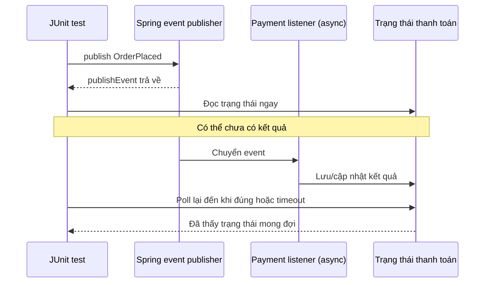
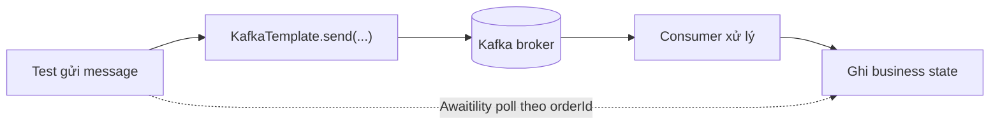
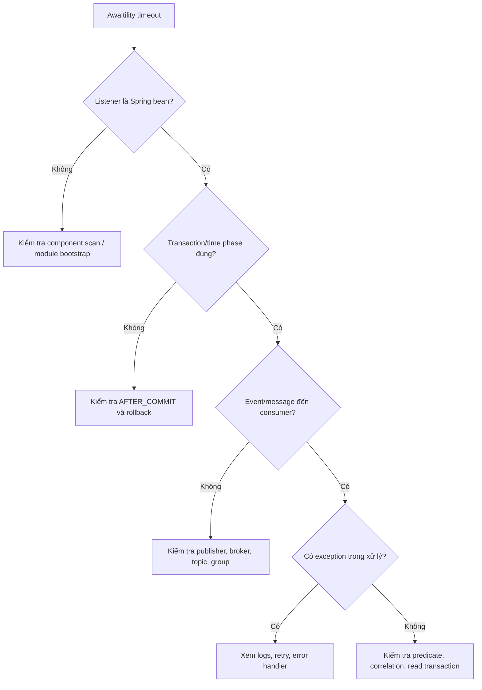
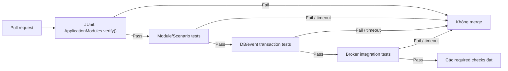

# Awaitility hoặc cơ chế chờ điều kiện khi kiểm thử messaging trong Spring Modulith

## 1. Vì sao bài test bất đồng bộ cần một cơ chế chờ đúng?

Trong ứng dụng Spring Modulith, module `ordering` có thể phát một sự kiện `OrderPlaced`. Module `payment` xử lý sự kiện để tạo yêu cầu thanh toán. Nếu listener làm việc bất đồng bộ, được gọi sau transaction commit, hoặc nhận message từ Kafka/RabbitMQ, **kết quả nghiệp vụ có thể xuất hiện sau thời điểm phương thức publish trả về**.

Một bài test kiểm tra ngay lập tức rất dễ thất bại dù hệ thống hoạt động đúng:

```java
events.publishEvent(new OrderPlaced(orderId, amount));

// Nguy cơ race condition: listener có thể chưa xử lý xong.
assertThat(paymentStatus.hasRequest(orderId)).isTrue();
```

Một cách chữa tạm thời nhưng thiếu tin cậy là đặt `Thread.sleep(500)` trước assertion. Trên máy developer, listener có thể hoàn thành trong 50 ms; trên máy CI đang tải cao, 500 ms có thể chưa đủ. Kết quả là bài test vừa **chậm** vừa **flaky**.

Cách tốt hơn là **chờ đến khi một điều kiện xác định được thỏa**, nhưng không chờ vô thời hạn. Thư viện **Awaitility** cung cấp cú pháp polling với deadline; Spring Modulith cũng có **`Scenario`** để kích hoạt stimulus và chờ sự kiện/trạng thái theo kịch bản.

Bài nằm trong chương **Messaging testing** của học phần `SPRING_MODULITH_VERIFICATION_TESTING`. Mục tiêu của học phần là kiểm chứng ranh giới kiến trúc qua `ApplicationModules.verify()`, luyện `@ApplicationModuleTest`, kiểm thử event, database và tích hợp, rồi đặt các bài kiểm tra vào quality gate CI để ngăn phụ thuộc sai và hồi quy hành vi.

**Sau bài này, bạn sẽ:**

1. Phân biệt **sleep cố định** với **chờ điều kiện có deadline**.
2. Dùng `Awaitility.await().until(...)` và `untilAsserted(...)` trong JUnit.
3. Chọn `Scenario.publish(...)` hoặc `Scenario.stimulate(...)` khi kiểm thử event của Spring Modulith.
4. Chọn trạng thái, event hoặc tác động nghiệp vụ **thật sự cần quan sát**, tránh test tự xác nhận stimulus của chính mình.
5. Thiết kế timeout/polling hợp lý và chẩn đoán khi test hết thời gian chờ.
6. Xử lý đúng các đặc thù `@Async`, `@TransactionalEventListener` và message broker.
7. Kết hợp test async với `ApplicationModules.verify()`, test database/integration và CI.

## 2. Bản chất race condition trong một bài messaging test

Xét một luồng bất đồng bộ:



Điểm cần phân biệt: **`publishEvent(...)` trả về** không mặc nhiên đồng nghĩa với **toàn bộ listener đã hoàn tất**. Với `@EventListener` đồng bộ thông thường, listener có thể được chạy ngay trong luồng publish. Nhưng khi có `@Async`, multicaster bất đồng bộ, listener sau commit hoặc adapter broker, thứ tự thời điểm quan sát thay đổi.

Một bài kiểm thử cần nói rõ:

- **Stimulus:** hành động nào bắt đầu luồng? Ví dụ publish `OrderPlaced` hoặc gọi use case xác nhận đơn.
- **Kết quả quan sát:** điều gì chứng minh consumer hoàn thành? Ví dụ bản ghi `PaymentRequest` tồn tại với trạng thái `PENDING`.
- **Thời hạn chờ:** tối đa bao lâu trước khi coi test thất bại?
- **Tần suất quan sát:** có cần polling sau 50 ms, 100 ms hay khoảng khác?
- **Điều kiện dừng:** khi kết quả chính xác xuất hiện, kết thúc ngay; không ngủ thêm vô ích.

Không phải tất cả sự kiện đều cần chờ. Nếu xử lý chắc chắn đồng bộ và test cần kiểm tra giá trị ngay, assertion trực tiếp đơn giản hơn. **Chờ điều kiện giải quyết sự bất định về thời điểm**, không phải thay thế mọi assertion của JUnit.

## 3. So sánh `Thread.sleep`, Awaitility và `Scenario`

| Cách tiếp cận | Cơ chế | Khi phù hợp | Hạn chế |
| --- | --- | --- | --- |
| `Thread.sleep(500)` | Chờ cố định 500 ms, không xét trạng thái | Hiếm khi cần mô phỏng độ trễ có chủ đích | Có thể quá ngắn hoặc quá dài; không khẳng định điều kiện |
| `Awaitility.await().until(...)` | Poll một biểu thức `boolean` đến khi đúng hoặc hết hạn | Chờ cờ trạng thái, số bản ghi, API truy vấn, kết quả broker | Phải chọn điều kiện quan sát đúng và thread-safe |
| `Awaitility.await().untilAsserted(...)` | Lặp lại các assertion đến khi tất cả đạt | AssertJ/JUnit trên trạng thái nhiều thuộc tính | Assertion/exception phải phù hợp, tránh che lỗi thật |
| `Scenario.publish(...)` | Publish event vào Spring context rồi chờ phản ứng | Test phía consumer trong `@ApplicationModuleTest` | Không tự kiểm thử Kafka/RabbitMQ thật |
| `Scenario.stimulate(...)` | Gọi một hành vi thật rồi theo dõi kết quả | Test publisher hoặc use case phát event | Cần Spring context/module bootstrap phù hợp |
| Latch/future | Đồng bộ qua tín hiệu completion trong test | Kiểm thử component cấp thấp, cần một lần báo hoàn thành | Dễ làm test phụ thuộc chi tiết triển khai |

**Awaitility** là cơ chế chờ điều kiện tổng quát. **Scenario** là công cụ hướng kịch bản thuộc Spring Modulith; khi test sự kiện trong module, nó thường diễn đạt ý định rõ hơn. Hai lựa chọn không xung đột: sử dụng công cụ gần nhất với **loại kết quả muốn quan sát**.

## 4. Thêm Awaitility vào bài test

Một dự án Spring Boot dùng JUnit Jupiter có thể khai báo Awaitility ở test scope.

**Maven (`pom.xml`):**

```xml
<dependency>
    <groupId>org.awaitility</groupId>
    <artifactId>awaitility</artifactId>
    <scope>test</scope>
</dependency>
```

**Gradle Kotlin DSL (`build.gradle.kts`):**

```kotlin
dependencies {
    testImplementation("org.awaitility:awaitility")
}
```

Các ví dụ giả định dự án đã cấu hình **dependency management/BOM** cung cấp phiên bản phù hợp. Nếu build không quản lý phiên bản Awaitility, cần khai báo một phiên bản tương thích với Java, JUnit và thư viện hiện có. `spring-boot-starter-test` trong nhiều phiên bản Spring Boot đã đem theo Awaitility, nhưng **nên kiểm tra dependency graph thực tế**, không mặc định mọi project đều có.

Import thường dùng:

```java
import static org.awaitility.Awaitility.await;
import static org.assertj.core.api.Assertions.assertThat;
import java.time.Duration;
```

Awaitility không cần annotation Spring riêng. Nó có thể được dùng trong unit test, `@ApplicationModuleTest`, `@SpringBootTest` hoặc integration test với message broker.

## 5. `until(...)`: chờ một điều kiện boolean

Ví dụ có một API đọc trạng thái:

```java
// com/example/shop/payment/PaymentStatusQuery.java
package com.example.shop.payment;

import java.util.UUID;

public interface PaymentStatusQuery {
    boolean hasRequest(UUID orderId);
}
```

Bài test cần chờ khi listener đã tạo yêu cầu thanh toán:

```java
UUID orderId = UUID.randomUUID();

events.publishEvent(new OrderPlaced(orderId, amount));

await()
        .atMost(Duration.ofSeconds(5))
        .pollInterval(Duration.ofMillis(50))
        .until(() -> paymentStatus.hasRequest(orderId));
```

Ý nghĩa:

1. `atMost(5 seconds)` đặt **deadline**, tránh chờ mãi.
2. `pollInterval(50 ms)` chọn khoảng giữa các lần kiểm tra.
3. `until(...)` tính lại điều kiện vào những lần poll tiếp theo.
4. Khi điều kiện trả `true`, lời gọi hoàn thành sớm.
5. Nếu hết thời hạn mà điều kiện chưa đạt, Awaitility báo lỗi timeout để JUnit thất bại.

Đây là **đoạn test body**, giả định `events` và `paymentStatus` đã được inject và `amount` đã chuẩn bị. Ở phần sau ta viết một bài `@ApplicationModuleTest` đầy đủ hơn.

Không cần tự viết vòng lặp vô hạn bằng `while (!condition)`; điều đó có thể tiêu hao CPU hoặc khiến CI treo khi listener không hoạt động.

## 6. `untilAsserted(...)`: chờ toàn bộ assertion cùng đúng

Trong nhiều trường hợp, kiểm tra mỗi `hasRequest(orderId)` quá yếu. Ta còn muốn xác nhận `amount`, `status` và correlation key.

Với một API đọc trạng thái trả về `Optional<PaymentView>`, có thể viết:

```java
await()
        .atMost(Duration.ofSeconds(5))
        .pollInterval(Duration.ofMillis(100))
        .untilAsserted(() -> {
            var payment = payments.findByOrderId(orderId)
                    .orElseThrow();

            assertThat(payment.status()).isEqualTo("PENDING");
            assertThat(payment.amount()).isEqualByComparingTo("125000");
            assertThat(payment.orderId()).isEqualTo(orderId);
        });
```

Đây là **ví dụ thích nghi theo domain**: `payments.findByOrderId` và `PaymentView` là những API minh họa, cần được cung cấp bởi ứng dụng của bạn. Awaitility lặp lại khối assertion đến khi thành công hoặc timeout.

`untilAsserted(...)` có ích khi trạng thái thay đổi từng bước: lúc đầu chưa có record, sau đó có record nhưng status chưa đúng, cuối cùng đạt tất cả điều kiện.

Tuy nhiên, đừng để một predicate khó đọc hoặc một khối assertion có tác dụng phụ làm thay đổi hệ thống. **Các lần poll chỉ nên quan sát trạng thái**, không được vô tình tạo thêm thanh toán, gửi lại message hoặc sửa dữ liệu.

### `until` hay `untilAsserted`?

- Dùng **`until`** khi điều kiện là biểu thức `boolean` dễ đọc: `repository.countByOrderId(orderId) == 1`.
- Dùng **`untilAsserted`** khi cần nhiều assertion giàu thông báo lỗi: số lượng, trạng thái, số tiền, ID.
- Tránh biến chờ điều kiện thành một bài test “đợi bất kỳ thứ gì xảy ra”; phải xác định **điều kiện chính xác**.

Nếu trạng thái là tập hợp nhiều record, nhớ lọc theo `orderId`/`eventId` của bài test để không vô tình khớp dữ liệu của test khác.

## 7. Ví dụ Spring Modulith: một listener xử lý bất đồng bộ

Ta xây dựng một ví dụ đơn giản để thấy Awaitility hoạt động cùng `@ApplicationModuleTest`.

Sơ đồ package:

```text
com.acme.shop
├── ShopApplication.java
├── ordering
│   └── OrderPlaced.java
└── payment
    ├── PaymentStatusQuery.java
    └── internal
        ├── PaymentRequests.java
        ├── PaymentOnOrderPlaced.java
        └── AsyncEventsConfiguration.java
```

Event công khai của module `ordering`:

```java
// com/acme/shop/ordering/OrderPlaced.java
package com.acme.shop.ordering;

import java.math.BigDecimal;
import java.util.UUID;

public record OrderPlaced(UUID orderId, BigDecimal amount) {
}
```

API đọc công khai do `payment` sở hữu:

```java
// com/acme/shop/payment/PaymentStatusQuery.java
package com.acme.shop.payment;

import java.util.UUID;

public interface PaymentStatusQuery {
    boolean hasRequest(UUID orderId);
}
```

Một implementation **chỉ dành cho minh họa điều kiện chờ**, dùng cấu trúc dữ liệu thread-safe:

```java
// com/acme/shop/payment/internal/PaymentRequests.java
package com.acme.shop.payment.internal;

import com.acme.shop.payment.PaymentStatusQuery;
import java.util.Set;
import java.util.UUID;
import java.util.concurrent.ConcurrentHashMap;
import org.springframework.stereotype.Component;

@Component
class PaymentRequests implements PaymentStatusQuery {

    private final Set<UUID> requested = ConcurrentHashMap.newKeySet();

    void record(UUID orderId) {
        requested.add(orderId);
    }

    @Override
    public boolean hasRequest(UUID orderId) {
        return requested.contains(orderId);
    }
}
```

`ConcurrentHashMap.newKeySet()` giúp truy cập trạng thái an toàn khi thread listener và thread test khác nhau. Trong hệ thống thật, dữ liệu thanh toán không nên chỉ được lưu trong bộ nhớ process; thay bằng repository/database và test transaction thích hợp.

Listener bất đồng bộ của `payment`:

```java
// com/acme/shop/payment/internal/PaymentOnOrderPlaced.java
package com.acme.shop.payment.internal;

import com.acme.shop.ordering.OrderPlaced;
import org.springframework.context.event.EventListener;
import org.springframework.scheduling.annotation.Async;
import org.springframework.stereotype.Component;

@Component
class PaymentOnOrderPlaced {

    private final PaymentRequests requests;

    PaymentOnOrderPlaced(PaymentRequests requests) {
        this.requests = requests;
    }

    @Async
    @EventListener
    public void on(OrderPlaced event) {
        if (event.orderId() == null
                || event.amount() == null
                || event.amount().signum() <= 0) {
            return;
        }

        requests.record(event.orderId());
    }
}
```

Để `@Async` có hiệu lực, cần bật hỗ trợ async trong Spring context:

```java
// com/acme/shop/payment/internal/AsyncEventsConfiguration.java
package com.acme.shop.payment.internal;

import org.springframework.context.annotation.Configuration;
import org.springframework.scheduling.annotation.EnableAsync;

@Configuration
@EnableAsync
class AsyncEventsConfiguration {
}
```

**Điều kiện quan trọng:** `@Async` chỉ hoạt động khi cơ chế proxy/task executor phù hợp đã được Spring cấu hình; đừng suy ra chỉ thêm annotation là mọi môi trường đã chạy bất đồng bộ. Bài `@ApplicationModuleTest` sẽ giúp phát hiện lỗi wiring hoặc cấu hình async, nhưng nếu chỉ quan sát kết quả cuối thì không tự chứng minh listener chạy trên một thread cụ thể.

Ví dụ trên cố ý không thêm `Thread.sleep` vào listener. Một bài test bất đồng bộ tốt nên ổn định dù listener xử lý nhanh, chứ không cần thêm độ trễ giả để chứng minh Awaitility có khả năng poll.

## 8. Bài `@ApplicationModuleTest` dùng Awaitility để đợi trạng thái

Đặt bài test tại package gốc của module `payment`:

```java
// src/test/java/com/acme/shop/payment/PaymentAsyncEventTests.java
package com.acme.shop.payment;

import static org.assertj.core.api.Assertions.assertThat;
import static org.awaitility.Awaitility.await;

import com.acme.shop.ordering.OrderPlaced;
import java.math.BigDecimal;
import java.time.Duration;
import java.util.UUID;
import org.junit.jupiter.api.Test;
import org.springframework.beans.factory.annotation.Autowired;
import org.springframework.context.ApplicationEventPublisher;
import org.springframework.modulith.test.ApplicationModuleTest;

@ApplicationModuleTest
class PaymentAsyncEventTests {

    @Autowired
    ApplicationEventPublisher events;

    @Autowired
    PaymentStatusQuery paymentStatus;

    @Test
    void orderPlacedEventuallyCreatesPaymentRequest() {
        UUID orderId = UUID.randomUUID();
        BigDecimal amount = new BigDecimal("125000");

        assertThat(paymentStatus.hasRequest(orderId)).isFalse();

        events.publishEvent(new OrderPlaced(orderId, amount));

        await()
                .atMost(Duration.ofSeconds(5))
                .pollInterval(Duration.ofMillis(50))
                .untilAsserted(() ->
                        assertThat(paymentStatus.hasRequest(orderId)).isTrue());
    }
}
```

Bài test kiểm chứng một luồng end-to-end nhỏ **bên trong Spring context của module payment**:

- Listener được tạo như bean, vì test không gọi thủ công `new PaymentOnOrderPlaced(...)`.
- Event thực sự được publish qua `ApplicationEventPublisher`.
- Kết quả quan sát được là trạng thái do listener tạo ra, không phải event đầu vào mà test tự phát.
- Test không phụ thuộc một khoảng ngủ cố định; nếu listener xử lý sớm, phép chờ kết thúc sớm.
- Nếu bean listener thiếu hoặc không được kích hoạt, điều kiện không đạt và test timeout.

**Giới hạn:** trạng thái đang dùng bộ nhớ, chưa chứng minh persistence, rollback hoặc broker. Khi dùng database, thay `PaymentStatusQuery` bằng API truy vấn phù hợp và bổ sung integration test.

### Vì sao không kiểm tra thread ID để khẳng định async?

Trong một số test, mục tiêu là **hành vi sau khi event được xử lý**, không phải test implementation của `@Async`. Việc hardcode “thread ID phải khác” có thể gây coupling với cách cấu hình task executor. Nếu yêu cầu thực sự là listener **không chặn publisher**, hãy viết một bài test riêng đo hoặc điều phối bằng tín hiệu đồng bộ có kiểm soát, tránh kiểm tra timing mong manh.

## 9. `Scenario` của Spring Modulith: chờ event đầu ra

Nếu listener **phát một event kết quả** như `PaymentRequested`, `Scenario` có thể diễn đạt test rõ hơn việc tự thiết lập Awaitility.

Giả sử module `payment` công bố:

```java
// com/acme/shop/payment/PaymentRequested.java
package com.acme.shop.payment;

import java.util.UUID;

public record PaymentRequested(UUID orderId) {
}
```

Khi listener được thiết kế phát `PaymentRequested` sau xử lý, có thể viết **test minh họa cho một biến thể của listener**:

```java
package com.acme.shop.payment;

import com.acme.shop.ordering.OrderPlaced;
import java.math.BigDecimal;
import java.util.UUID;
import org.junit.jupiter.api.Test;
import org.springframework.modulith.test.ApplicationModuleTest;
import org.springframework.modulith.test.Scenario;

@ApplicationModuleTest
class PaymentEventScenarioTests {

    @Test
    void incomingOrderTriggersPaymentEvent(Scenario scenario) {
        UUID orderId = UUID.randomUUID();

        scenario.publish(
                    new OrderPlaced(orderId, new BigDecimal("125000"))
                )
                .andWaitForEventOfType(PaymentRequested.class)
                .matching(event -> event.orderId().equals(orderId))
                .toArrive();
    }
}
```

**Lưu ý về tính nhất quán ví dụ:** listener ở mục 7 chỉ ghi trạng thái trong `PaymentRequests`, **chưa publish `PaymentRequested`**. Test `PaymentEventScenarioTests` vì thế chỉ áp dụng khi ứng dụng đã bổ sung việc phát event kết quả; không được chạy nguyên xi với implementation mục 7 rồi kỳ vọng test đạt.

Bài test `Scenario` hữu ích khi kết quả quan sát chính là **một event khác**. Với trạng thái database hoặc cờ nghiệp vụ, Awaitility và test truy vấn trạng thái thường dễ đọc hơn.

### Tránh test tự quan sát stimulus

Một test yếu:

```java
scenario.publish(new OrderPlaced(orderId, amount))
        .andWaitForEventOfType(OrderPlaced.class)
        .toArrive();
```

Test này có thể chỉ thấy **`OrderPlaced` do chính nó publish**, mà không chứng minh consumer đã thực hiện gì. Hãy chờ **event đầu ra**, hoặc trạng thái nghiệp vụ mà listener thay đổi.

## 10. `Scenario.stimulate(...)`: chờ kết quả từ hành vi thật

`Scenario.publish(...)` phù hợp để **cô lập consumer**: tạo sự kiện đầu vào trực tiếp, không cần chạy toàn bộ luồng `ordering`.

Khi cần kiểm chứng phía **publisher**, stimulus nên là hành vi nghiệp vụ thật. Ví dụ module `ordering` có `OrderApplicationService.confirm(...)` phát `OrderPlaced`:

```java
// Ví dụ test publisher: giả định đã có OrderApplicationService.
scenario.stimulate(
            () -> orders.confirm(orderId, amount)
        )
        .andWaitForEventOfType(OrderPlaced.class)
        .matching(event -> event.orderId().equals(orderId))
        .toArrive();
```

Tùy phiên bản Spring Modulith, `Scenario` có các cách hỗ trợ quan sát event hoặc trạng thái. Hãy dùng API tương ứng với phiên bản dự án và lựa chọn **stimulus phản ánh điều cần chứng minh**:

| Mục đích | Stimulus | Điều chờ |
| --- | --- | --- |
| Consumer xử lý `OrderPlaced` | Publish `OrderPlaced` | `PaymentRequested` hoặc trạng thái payment |
| Publisher phát `OrderPlaced` | Gọi `orders.confirm(...)` | `OrderPlaced` được tạo từ use case |
| Listener ghi database | Publish event qua Spring context | Payment request được lưu và commit |
| Consumer Kafka nhận message | Gửi message qua broker thật | Business effect/record được consumer ghi nhận |

**Awaitility và Scenario không phải hai phiên bản của cùng một API.** `Scenario` bao gồm bước điều khiển kịch bản Spring Modulith; Awaitility cung cấp điều kiện chờ tổng quát. Chọn công cụ theo kết quả muốn quan sát và mức tích hợp cần kiểm chứng.

## 11. Timeout và polling: đặt thế nào cho đáng tin?

Không có một con số chung đúng cho mọi test. Với in-memory async listener, deadline vài giây thường đủ; với database/broker container mới khởi động, thời gian có thể lớn hơn. Quan trọng hơn con số là **lý do chọn** và **điều kiện thất bại có thể chẩn đoán**.

Ví dụ một cấu hình rõ ràng:

```java
await()
        .pollDelay(Duration.ZERO)
        .pollInterval(Duration.ofMillis(100))
        .atMost(Duration.ofSeconds(10))
        .untilAsserted(() ->
                assertThat(paymentStatus.hasRequest(orderId))
                        .as("Yêu cầu thanh toán cho đơn %s", orderId)
                        .isTrue());
```

| Cấu hình | Tác động | Lưu ý |
| --- | --- | --- |
| `atMost(...)` | Deadline tối đa của phép chờ | Không bỏ qua; chờ vô hạn làm CI treo |
| `pollInterval(...)` | Khoảng giữa các lần quan sát | Poll quá dày có thể tốn CPU/DB |
| `pollDelay(...)` | Thời gian trước lần kiểm tra đầu | Thường không cần đặt trễ lớn |
| `until(...)` | Dừng khi predicate trả true | Predicate nên ít tác dụng phụ |
| `untilAsserted(...)` | Dừng khi khối assertion không còn fail | Dùng để kiểm tra nhiều thuộc tính |
| Correlation key | Chỉ nhận đúng sự kiện/record của test | Tránh xanh giả do dữ liệu cũ hoặc test khác |

Một ngưỡng `atMost(30 seconds)` không tự tốt hơn `atMost(5 seconds)`. Khi test thường phải dùng gần hết 30 giây mới đạt, có thể tồn tại vấn đề hiệu năng, transaction, scheduling hoặc readiness cần giải quyết.

### Polling database cần lưu ý gì?

Một predicate như `repository.findByOrderId(orderId)` có thể truy vấn database nhiều lần. Hãy dùng index/correlation ID phù hợp, chọn interval hợp lý và đảm bảo mỗi lần đọc nhìn thấy **trạng thái đã commit** theo isolation thực tế.

Không nên đặt thao tác ghi vào polling lambda:

```java
// Sai ý tưởng: mỗi lần poll lại tạo thêm yêu cầu thanh toán.
await().until(() -> paymentService.requestPayment(orderId));
```

Điều kiện chờ phải **quan sát**, không gây side effect hoặc kích hoạt lại nghiệp vụ.

## 12. Transaction: `AFTER_COMMIT` phải có commit thật

Một listener dùng `@TransactionalEventListener(phase = AFTER_COMMIT)` chỉ chạy khi có transaction liên quan **commit thành công**, theo cấu hình mặc định.

Ví dụ annotation:

```java
import org.springframework.transaction.event.TransactionPhase;
import org.springframework.transaction.event.TransactionalEventListener;

@TransactionalEventListener(phase = TransactionPhase.AFTER_COMMIT)
void on(OrderPlaced event) {
    // Xử lý sau khi transaction publish event đã commit.
}
```

Đây là **đoạn minh họa thay thế listener** chứ không phải annotation thêm vào test in-memory ở mục 8. Khi listener làm việc sau commit, test publish sự kiện ngoài transaction có thể **không kích hoạt listener**; việc tăng `atMost` lên vài phút cũng không giải quyết được.

Một cách kích hoạt commit rõ ràng trong integration test có transaction manager:

```java
// Bên trong test có transactionManager và events được inject.
TransactionTemplate template = new TransactionTemplate(transactionManager);

template.executeWithoutResult(status -> {
    events.publishEvent(new OrderPlaced(orderId, amount));
}); // Transaction do template điều khiển được commit khi callback thành công.

await()
        .atMost(Duration.ofSeconds(5))
        .untilAsserted(() ->
                assertThat(paymentStatus.hasRequest(orderId)).isTrue());
```

`TransactionTemplate` thuộc `org.springframework.transaction.support.TransactionTemplate`. Ví dụ giả định Spring context có `PlatformTransactionManager` phù hợp. Nếu test bị bọc trong một **outer transaction** của `@Transactional`, cấu hình propagation có thể khiến ý định “commit” chưa thật sự diễn ra theo cách bạn nghĩ; cần xem lại ranh giới transaction.

Đối với bài test `AFTER_COMMIT`, nên kiểm tra **cả ca commit** lẫn **ca rollback**. Tuy nhiên, việc không thấy kết quả trong một khoảng thời gian ngắn **không đủ để chứng minh tuyệt đối rằng hành vi sẽ không bao giờ xảy ra**.

### Transaction đọc cũng ảnh hưởng polling

Nếu thread test giữ một transaction có snapshot cũ, các lần truy vấn trong cùng transaction có thể không thấy dữ liệu đã commit từ thread listener. Khi cần xác nhận persistence bất đồng bộ, hãy dùng một API truy vấn chạy ở **transaction đọc mới** hoặc cấu hình isolation phù hợp, thay vì cứ tăng timeout.

## 13. Message broker: chờ consumer hoàn thành, không chỉ chờ producer gửi

Với Kafka/RabbitMQ, có ít nhất ba mốc khác nhau:

1. Producer gọi API gửi message.
2. Broker xác nhận hoặc lưu bản ghi theo chính sách.
3. Consumer nhận, xử lý và commit tác động nghiệp vụ.

`KafkaTemplate.send(...)` hoàn thành **không chứng minh mốc 3**. Đó là lý do một broker integration test thường cần Awaitility hoặc cơ chế chờ trạng thái.



Ví dụ **test body minh họa** với Spring Boot integration test đã cấu hình Kafka và database:

```java
var message = new PaymentRequestedMessage(eventId, orderId, amount);

// Chờ producer gửi thành công, chưa phải chờ nghiệp vụ.
kafka.send("payment.requested.v1", orderId.toString(), message)
        .get(10, TimeUnit.SECONDS);

// Chờ trạng thái sau khi consumer xử lý và transaction commit.
await()
        .atMost(Duration.ofSeconds(20))
        .pollInterval(Duration.ofMillis(200))
        .untilAsserted(() -> {
            var payment = paymentQuery.findByOrderId(orderId)
                    .orElseThrow();

            assertThat(payment.amount()).isEqualByComparingTo(amount);
            assertThat(payment.status()).isEqualTo("PENDING");
        });
```

`PaymentRequestedMessage`, `paymentQuery` và `PaymentView` ở đây là **hợp đồng minh họa**, không phải các lớp tích hợp mặc định của Spring Modulith. Test thật phải có serializer/deserializer, topic, group, broker container, repository và transaction được cấu hình phù hợp.

Nếu consumer bị lỗi deserialize hoặc subscribe nhầm topic, Awaitility timeout. Khi đó cần xem **consumer log, topic, group ID và error handler**, không chỉ nâng timeout.

## 14. Điều kiện chờ phải có khả năng phân biệt dữ liệu của bài test

Một lỗi hay gặp là chờ “bất kỳ payment request nào tồn tại”:

```java
// Assertion yếu: có thể nhận nhầm dữ liệu cũ hoặc test khác.
await().until(() -> paymentQuery.count() > 0);
```

Test sẽ xanh dù listener không xử lý event vừa phát, nếu database đã có record trước đó.

Thay bằng:

```java
UUID orderId = UUID.randomUUID();

await()
        .atMost(Duration.ofSeconds(10))
        .until(() -> paymentQuery.existsByOrderId(orderId));
```

**Khóa tương quan** (`orderId`, `eventId`, correlation ID) là một phần của thiết kế bài test. Khi có nhiều event cùng lúc, một predicate dựa trên event type đơn thuần có thể nhận nhầm message của test khác.

Các biện pháp giảm nhiễu:

- Tạo ID mới cho mỗi test.
- Dùng database fixture và cleanup có kiểm soát.
- Cô lập topic/consumer group trong broker integration test.
- Chỉ quan sát record có đúng correlation key.
- Nếu có xử lý lại sự kiện, kiểm tra `eventId` để phân biệt cùng event với một sự kiện mới cho cùng đơn hàng.

Đừng phụ thuộc vào thứ tự test hoặc vào dữ liệu còn sót từ một lần CI trước.

## 15. Chờ trạng thái ổn định và ca âm: `during(...)`, `atLeast(...)`

Đôi khi yêu cầu không chỉ là “điều kiện **đã từng** đúng” mà là “điều kiện **duy trì** đúng trong một khoảng quan sát”.

Awaitility hỗ trợ cơ chế chờ liên tục trong một khoảng thời gian, ví dụ:

```java
await()
        .during(Duration.ofMillis(500))
        .atMost(Duration.ofSeconds(2))
        .until(() -> paymentQuery.countByOrderId(orderId) == 1);
```

Ví dụ này kiểm tra điều kiện `count == 1` duy trì trong khoảng quan sát mà Awaitility thực hiện. **Nó không chứng minh không bao giờ có bản ghi thứ hai sau khi test kết thúc.** Nếu cần bảo đảm chống xử lý trùng, phải có ràng buộc dữ liệu và test idempotency/concurrency phù hợp.

`atLeast(...)` có thể dùng trong những test muốn phát hiện điều kiện xảy ra **quá sớm** so với một giới hạn được đặc tả. Đây không phải cách chờ mặc định và thường không cần thiết cho test messaging.

### Ca âm: “listener không nên hành động”

Giả sử event có amount bằng 0 nên listener phải bỏ qua. Đừng đơn giản chờ 100 ms, không thấy record rồi kết luận đã chứng minh không có tác dụng phụ.

Các cách kiểm tra đáng tin hơn:

1. **Unit test nhánh xử lý:** gọi listener trực tiếp với mock collaborator và `verifyNoInteractions(...)` khi dữ liệu không hợp lệ.
2. **Kiểm tra trạng thái sau mốc hoàn tất rõ ràng:** nếu luồng có completion/ack/reconciliation, chỉ assert sau khi biết xử lý đã qua ranh giới đó.
3. **Test transaction và dữ liệu:** xác nhận invariant bằng unique constraint, rollback rule hoặc truy vấn sau commit.

Với xử lý async không có tín hiệu hoàn tất, assertion “không có gì xảy ra” trong một thời hạn hữu hạn chỉ tạo **bằng chứng giới hạn theo khoảng quan sát**, không phải bảo đảm tuyệt đối.

## 16. Những sai lầm khiến Awaitility test flaky hoặc xanh giả

| Sai lầm | Hậu quả | Cách sửa |
| --- | --- | --- |
| `Thread.sleep(200)` rồi assert | Máy CI chậm dễ fail, máy nhanh đợi thừa | Awaitility/Scenario chờ điều kiện |
| Chờ `count() > 0` | Dữ liệu của test khác có thể làm xanh giả | Lọc theo `orderId`/`eventId` riêng |
| Poll bằng lệnh ghi | Một test có thể tạo nhiều side effect | Chỉ đọc trạng thái trong polling |
| Timeout cực dài | Che lỗi listener không chạy, chậm CI | Deadline dựa trên rủi ro và log chẩn đoán |
| Poll interval 1 ms vào DB | Tăng tải, nhiễu hoặc gây contention | Dùng interval hợp lý, truy vấn nhẹ |
| Bắt mọi exception rồi trả true | Che lỗi serialization/database | Chỉ xử lý exception được mong đợi |
| Test tự publish rồi chờ lại cùng event | Không chứng minh consumer đã chạy | Chờ event kết quả hoặc business state |
| Chờ event trước khi transaction commit | Listener AFTER_COMMIT chưa được kích hoạt | Setup commit đúng ranh giới |
| Đọc trong transaction snapshot cũ | Không thấy dữ liệu mới dù đã commit | Đọc ở transaction phù hợp |
| Gửi Kafka xong coi nghiệp vụ hoàn tất | Consumer có thể chưa xử lý | Chờ hiệu ứng business sau consumer |
| Dùng state không thread-safe | Test có thể quan sát bất nhất | Dùng thread-safe state hoặc DB |
| Tắt test khó bằng `@Disabled` | CI xanh nhưng không kiểm chứng được | Sửa môi trường/luồng, giữ required check |

Trong Awaitility, có thể chủ động bỏ qua **những ngoại lệ tạm thời, được mong đợi** trong lúc hệ thống chưa sẵn sàng. Nhưng đừng dùng cơ chế bỏ qua mọi exception để che lỗi cấu hình, deserialization hoặc nghiệp vụ thật.

Ví dụ chỉ nên bỏ qua `NoSuchElementException` khi một API truy vấn được thiết kế ném exception đó trong lúc chưa có dữ liệu. Tốt hơn hết, nếu có thể, dùng API `Optional` hoặc `existsBy...` để biểu diễn “chưa thấy dữ liệu” một cách minh bạch.

## 17. Chẩn đoán khi `ConditionTimeoutException` xuất hiện

Khi Awaitility hết thời hạn chờ, nguyên nhân có thể nằm ở nhiều tầng. Hãy phân loại trước khi đổi timeout.



Checklist thực hành:

1. **Bean/annotation:** listener có `@Component`, `@EventListener`/`@KafkaListener`, được bootstrap trong test?
2. **Event thực sự phát chưa:** gọi use case thật hay chỉ mock một publisher?
3. **Thời điểm:** xử lý đồng bộ, async hay after-commit? Test có commit không?
4. **Broker:** topic, serializer, consumer group, partition assignment và error handler đã đúng?
5. **Tác động:** listener đã xử lý nhưng database rollback hoặc chưa flush/commit?
6. **Điều kiện chờ:** predicate có tham chiếu đúng `orderId`, số tiền, status không?
7. **Test isolation:** message hoặc dữ liệu có bị test khác tiêu thụ/ghi đè?
8. **Log lỗi nền:** exception trong executor/listener async có bị xử lý bằng error handler mà không tới thread JUnit?

**`ConditionTimeoutException` chỉ nói điều kiện chưa đạt trong thời hạn**, không tự chỉ ra nguyên nhân. Đọc log Spring, broker, database và thông báo assertion đi kèm để tìm đúng tầng lỗi.

### Đừng lạm dụng việc bỏ qua exception trong Awaitility

Khi gọi `untilAsserted(...)`, Awaitility sẽ lặp lại các assertion chưa thành công theo cơ chế của nó. Nhưng nếu API truy vấn ném lỗi connection refused hoặc schema missing, cần xác định đây là trạng thái **tạm thời dự kiến** hay lỗi cấu hình. Không nên làm nó biến mất chỉ bằng một `ignoreExceptions()` rộng rồi để bài test chờ đến timeout.

## 18. Mối quan hệ giữa `verify()`, `@ApplicationModuleTest` và Awaitility

Ba công cụ giải quyết ba khía cạnh khác nhau:

| Công cụ | Câu hỏi | Có cần đợi kết quả async? |
| --- | --- | --- |
| `ApplicationModules.verify()` | Có chu kỳ module, truy cập API nội bộ hoặc phụ thuộc ngoài giới hạn không? | Thông thường không; phân tích kiến trúc tĩnh |
| `@ApplicationModuleTest` | Các bean và hành vi trong phạm vi module có chạy đúng? | Có thể, nếu listener/event xử lý sau |
| `Scenario` | Stimulus có tạo event/trạng thái mong đợi không? | Có cơ chế chờ theo kịch bản |
| `Awaitility` | Một điều kiện quan sát cụ thể cuối cùng có đúng không? | Chính là chức năng chính |
| Broker/database integration test | Message và dữ liệu có đi qua hạ tầng thật? | Thường cần chờ consumer/commit |
| CI required check | Test có chạy và làm build thất bại khi điều kiện không đạt? | Phải cấu hình job và runtime phù hợp |

Ví dụ test kiến trúc:

```java
// src/test/java/com/acme/shop/ModuleArchitectureTests.java
package com.acme.shop;

import org.junit.jupiter.api.Test;
import org.springframework.modulith.core.ApplicationModules;

class ModuleArchitectureTests {

    @Test
    void verifiesModuleDependencies() {
        ApplicationModules.of(ShopApplication.class).verify();
    }
}
```

Ở ví dụ, `payment.internal.PaymentOnOrderPlaced` tham chiếu `ordering.OrderPlaced`. Spring Modulith có thể nhận diện cạnh **`payment → ordering`**; kiểm tra rằng kiểu event thuộc API được xuất bản, phụ thuộc được phép nếu có `allowedDependencies`, và đồ thị không có vòng.

Tuy nhiên, `verify()` **không chuyển event**, không khởi động executor và không chờ database. Đó là trách nhiệm của module/event/integration test. Một test async xanh cũng không chứng minh đồ thị module tuân thủ kiến trúc; cần cả hai lớp kiểm chứng.

## 19. Chiến lược CI cho test async đáng tin

Cần hai điều kiện để test async có giá trị: **kết quả có thể lặp lại** và **lỗi làm pipeline không đạt**.



Lệnh build thường dùng:

```bash
# Maven Wrapper
./mvnw test

# Gradle Wrapper
./gradlew test
```

Với broker integration test, runner cần Docker/Testcontainers hoặc hạ tầng broker thử nghiệm. Những test này thường lâu hơn nên có thể nằm trong job riêng, nhưng job cần được cấu hình là **required check** nếu đây là điều kiện chất lượng bắt buộc.

Các thực hành giúp giảm flaky:

- Đặt ID mới cho mỗi event, dữ liệu và test.
- Chờ theo **business condition**, không dùng sleep tùy tiện.
- Không share Kafka consumer group giữa các test cạnh tranh.
- Truy vấn database ở transaction phù hợp.
- Tách timeout cho in-memory listener và broker integration test theo mức độ phức tạp.
- Thu thập báo cáo JUnit, log listener và log broker khi timeout.
- Không bật `continue-on-error: true` hoặc nuốt exception của Awaitility.
- Kiểm tra lớp test thực sự được khám phá/chạy, không bị `@Disabled` hoặc skip.

**Mốc kiểm chứng quan trọng:** một bài test có điều kiện không bao giờ đúng phải **failed** khi hết hạn. Nếu build vẫn xanh, cần xem test có chạy, exception có bị nuốt hoặc job CI có được phép bỏ qua lỗi không.

## 20. Bài tập thực hành

**Tình huống:** `ordering` phát `OrderPlaced(orderId, 125000)`. Listener `payment` chạy async và ghi payment request. Bài test có thể truy vấn `PaymentStatusQuery` hoặc database.

**Câu 1.** Vì sao `Thread.sleep(500)` trước assertion là cách không đáng tin?

**Đáp án:** Không có quan hệ tất yếu giữa 500 ms và lúc listener hoàn thành. Máy nhanh sẽ chờ thừa, máy CI chậm có thể kiểm tra quá sớm. Nên chờ trạng thái có deadline.

**Câu 2.** Khi nào dùng `await().until(...)` và khi nào dùng `untilAsserted(...)`?

**Đáp án:** `until` phù hợp một biểu thức boolean; `untilAsserted` phù hợp nhiều assertion về kết quả như số tiền, trạng thái và ID.

**Câu 3.** Test publish `OrderPlaced` rồi chờ chính `OrderPlaced` có kiểm chứng được listener không?

**Đáp án:** Chưa chắc. Có thể chỉ quan sát lại event do test tự publish. Cần chờ `PaymentRequested` từ listener hoặc trạng thái mà listener tạo ra.

**Câu 4.** `@TransactionalEventListener(AFTER_COMMIT)` không chạy khi publish ngoài transaction. Tăng timeout có giúp không?

**Đáp án:** Không. Cần phát event trong transaction thật sự commit hoặc cấu hình khác có chủ đích; timeout không tạo ra commit.

**Câu 5.** `KafkaTemplate.send(...).get(...)` trả thành công. Có thể khẳng định consumer đã cập nhật DB không?

**Đáp án:** Không. Nó xác nhận mức producer/broker theo send result, chưa xác nhận consumer business effect. Cần chờ trạng thái DB hoặc output của consumer.

**Câu 6.** Vì sao nên dùng `orderId` riêng khi polling database?

**Đáp án:** Tránh việc dữ liệu từ lần test trước hoặc test song song khiến assertion xanh giả.

**Câu 7.** Muốn chứng minh listener không tạo record khi amount bằng 0, chỉ chờ 200 ms rồi thấy DB rỗng có đủ không?

**Đáp án:** Chưa đủ để chứng minh không bao giờ có record. Nên unit test nhánh với `verifyNoInteractions` và kiểm tra invariant/trạng thái sau một mốc xử lý được xác định rõ khi cần.

**Câu 8.** Test Awaitility thường timeout trên CI nhưng qua ở local. Những nguyên nhân nên kiểm tra?

**Đáp án:** Listener không được bootstrap, khác biệt transaction, broker chưa sẵn sàng, group cạnh tranh, truy vấn snapshot cũ, lỗi async không truyền đến JUnit, correlation sai hoặc deadline không phù hợp.

**Câu 9.** `ApplicationModules.verify()` đạt có thay thế `@ApplicationModuleTest` dùng Awaitility không?

**Đáp án:** Không. `verify()` kiểm chứng kiến trúc tĩnh; test Awaitility/module kiểm chứng hành vi event và trạng thái runtime.

**Câu 10.** `Awaitility` có tự làm mọi bài test bất đồng bộ thành deterministic không?

**Đáp án:** Không. Kết quả còn phụ thuộc vào điều kiện quan sát đúng, dữ liệu cô lập, transaction, cấu hình listener, broker và giới hạn thời gian phù hợp. Awaitility chỉ giúp diễn đạt polling có deadline.

## 21. Checklist trước khi merge một bài messaging test có chờ điều kiện

- **Chọn stimulus:** event đầu vào cho consumer hoặc lệnh nghiệp vụ thật cho publisher.
- **Chọn observable:** event kết quả, business state đã commit hoặc tác động có ý nghĩa.
- **Correlation:** `orderId`/`eventId` của test phải riêng và có trong predicate.
- **Deadline:** mọi phép chờ có `atMost` hoặc cơ chế timeout tương đương.
- **Polling:** interval đủ nhẹ cho database/broker, không gây side effect.
- **Async:** executor/listener thật sự được đăng ký; không dùng `Thread.sleep` để chữa lỗi logic.
- **Transaction:** phân biệt event thường và `@TransactionalEventListener(AFTER_COMMIT)`; tạo commit phù hợp khi cần.
- **Broker:** producer send result không thay thế consumer outcome; test broker thật khi contract yêu cầu.
- **Negative cases:** kiểm tra nhánh không hành động bằng unit/invariant test, hiểu giới hạn của việc “không thấy gì” trong một khoảng ngắn.
- **Kiến trúc:** duy trì `ApplicationModules.verify()` để chặn vòng phụ thuộc và truy cập API nội bộ.
- **CI:** test/module/DB/broker chạy thật, timeout hoặc assertion fail làm required check đỏ.

**Ghi nhớ:** Awaitility và cơ chế chờ điều kiện giúp bài test Spring Modulith **đợi đúng kết quả nghiệp vụ thay vì đoán thời gian**. Dùng `until(...)` cho predicate, `untilAsserted(...)` cho các assertion, và `Scenario` khi kích hoạt/chờ event trong phạm vi module. Chọn correlation ID, transaction và deadline rõ ràng; kết hợp `ApplicationModules.verify()`, `@ApplicationModuleTest`, kiểm thử database/broker và CI để bảo vệ đồng thời ranh giới kiến trúc lẫn hành vi messaging bất đồng bộ.
