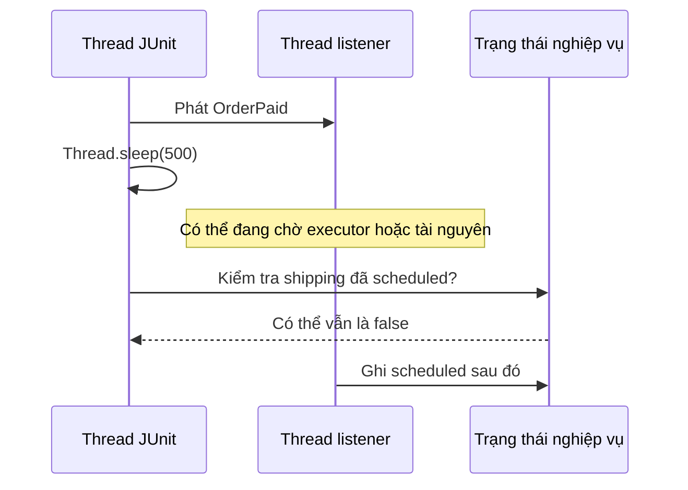
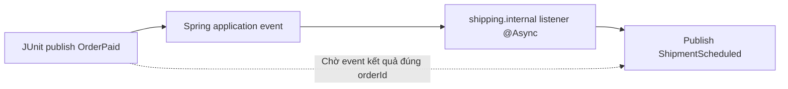
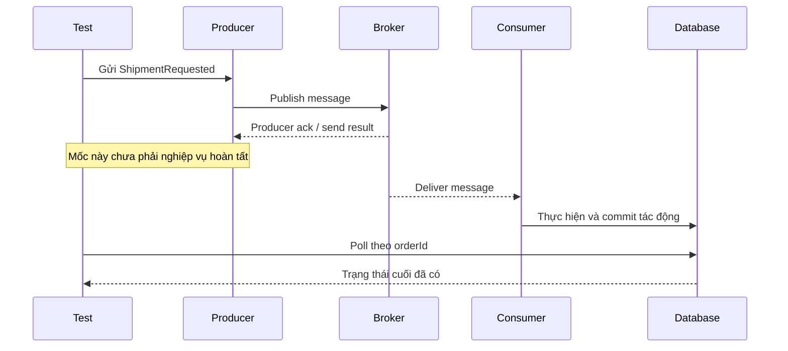
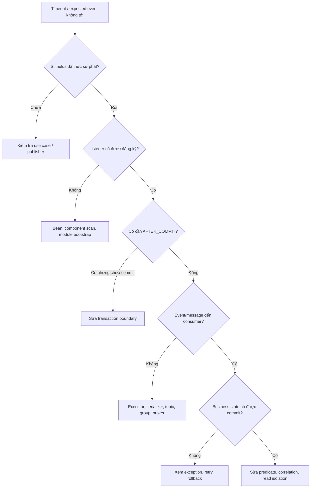
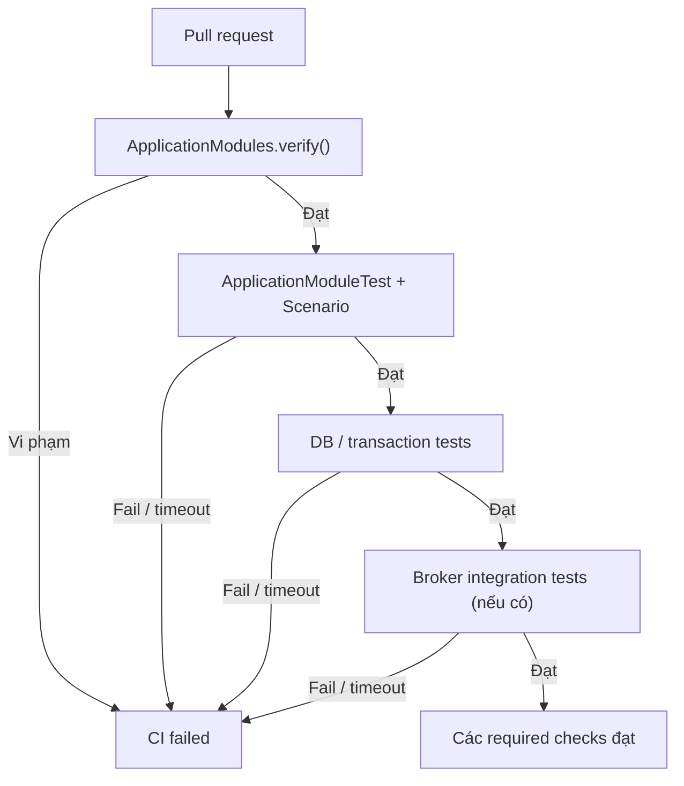

# Không dùng sleep cố định làm đồng bộ test trong Spring Modulith

## 1. Quy tắc cốt lõi: đợi điều kiện, không đoán thời gian

Trong chương **Messaging testing** của học phần `SPRING_MODULITH_VERIFICATION_TESTING`, nhiều bài kiểm thử có dạng: phát sự kiện ở module `ordering`, listener của module `shipping` nhận sự kiện, rồi cập nhật trạng thái hoặc phát một sự kiện khác. Khi xử lý bất đồng bộ, **thời điểm gọi `publishEvent(...)` xong không nhất thiết là thời điểm listener hoàn tất**.

Đoạn mã sau thường tạo ra bài test không ổn định:

```java
events.publishEvent(new OrderPaid(orderId));

Thread.sleep(500);

assertThat(shippingStatus.isScheduled(orderId)).isTrue();
```

`Thread.sleep(500)` chỉ yêu cầu **thread của test tạm dừng ít nhất một khoảng thời gian**, không yêu cầu thread listener phải chạy, không bảo đảm transaction đã commit và không truyền thông tin gì về trạng thái nghiệp vụ. Nếu listener xong sau 20 ms, test chờ dư; nếu CI bận hơn dự tính, test vẫn kiểm tra quá sớm.

**Nguyên tắc thay thế:** kích hoạt hành vi một lần, xác định **một kết quả có thể quan sát được**, rồi **chờ kết quả đó với deadline hữu hạn**. Khi điều kiện đạt, test kết thúc ngay; khi hết thời hạn, test thất bại và để lại thông tin chẩn đoán.

Mục tiêu của bài:

- Giải thích vì sao `sleep` không phải cơ chế đồng bộ (*synchronization*).
- Viết bài test sử dụng Awaitility, `Scenario`, `CompletableFuture` hoặc `CountDownLatch` đúng phạm vi.
- Phân biệt kết quả nghiệp vụ, trạng thái trung gian, việc nhận event và kết quả gửi broker.
- Tránh kiểm chứng xanh giả trong test âm tính và test chạy song song.
- Nhận diện vấn đề transaction, `@Async`, `@TransactionalEventListener`, Kafka/RabbitMQ.
- Đưa các bài kiểm tra vào CI cùng `ApplicationModules.verify()`, `@ApplicationModuleTest`, test event, database và tích hợp.

## 2. `Thread.sleep` không tạo quan hệ đồng bộ giữa hai luồng

Giả sử thread A của JUnit phát `OrderPaid`, còn thread B của listener xử lý và ghi yêu cầu vận chuyển.



Điều không được bảo đảm:

1. **Scheduling:** hệ điều hành hoặc executor không cam kết task listener sẽ được cấp CPU trong thời gian test ngủ.
2. **Hoàn tất:** listener có thể phải thực hiện nhiều thao tác, gọi service hoặc đợi transaction; ngủ không chứng minh việc đó đã xong.
3. **Memory visibility:** nếu kết quả được viết vào một biến chia sẻ không thread-safe, việc ngủ không tự thiết lập quan hệ *happens-before* để test nhìn thấy giá trị mới.
4. **Tính cô lập:** trong CI chạy song song, test khác có thể sử dụng executor, database hoặc consumer group.
5. **Tín hiệu lỗi:** nếu listener ném lỗi trong thread riêng, thread JUnit không nhất thiết nhận được ngoại lệ; nó chỉ thấy kết quả chưa xuất hiện.

Với thời gian xử lý ngẫu nhiên `T` và số milliseconds ngủ cố định `S`:

- Nếu `T < S`, test chờ không cần thiết.
- Nếu `T > S`, test có nguy cơ thất bại dù hành vi đúng nhưng chậm.
- Nếu listener không bao giờ chạy, test vẫn ngủ đúng `S` rồi mới phát hiện kết quả sai, nhưng không biết nguyên nhân.

**Sleep có thể phù hợp để cố tình mô phỏng độ trễ trong một bài thử hiệu năng/fault injection có kiểm soát. Nó không nên được dùng như lời khẳng định “thành phần kia đã xử lý xong”.**

## 3. Phân biệt chờ theo thời gian và chờ một tín hiệu thực

| Cơ chế | Điều kiện kết thúc | Có thực sự đồng bộ với tiến trình xử lý? | Phù hợp |
| --- | --- | --- | --- |
| `Thread.sleep(500)` | Hết 500 ms | **Không** | Mô phỏng một delay có chủ đích, không dùng để chờ business outcome |
| `Awaitility.until(...)` | Predicate đúng hoặc deadline hết | Chờ **điều kiện quan sát**; cần trạng thái thread-safe | Eventual state, DB hoặc API đọc |
| `Awaitility.untilAsserted(...)` | Bộ assertion đúng hoặc deadline hết | Chờ nhiều điều kiện kiểm chứng | Record, status, amount, correlation ID |
| `Scenario.publish(...).andWaitForEventOfType(...)` | Event kết quả phù hợp xuất hiện hoặc timeout | Gắn stimulus và expectation vào kịch bản Spring Modulith | Test listener bằng application event |
| `CompletableFuture.get(timeout, unit)` | Future hoàn tất hoặc timeout | Có tín hiệu completion của chính thao tác | API bất đồng bộ trả Future |
| `CountDownLatch.await(timeout, unit)` | Có đủ lần `countDown` hoặc timeout | Có tín hiệu rõ từ task/thread khác | Kiểm thử sự phối hợp thread cấp thấp |
| Test executor điều khiển thủ công | Test chủ động chạy task đã được xếp hàng | Kiểm soát scheduling, không cần thời gian thực | Unit test scheduling/dispatch |

**Sự phân biệt quan trọng:** Awaitility dùng polling để **quan sát**; `CompletableFuture` và latch có thể cung cấp **tín hiệu hoàn tất trực tiếp**. Chọn theo thứ bạn đang kiểm tra, không chỉ theo thư viện quen thuộc.

## 4. Mô hình ví dụ: `ordering` kích hoạt `shipping`

Ta có hai application module:

```text
com.example.shop
├── ShopApplication.java
├── ordering
│   └── OrderPaid.java
└── shipping
    ├── ShipmentScheduled.java
    └── internal
        ├── ShipmentOnOrderPaid.java
        └── AsyncListenerConfiguration.java
```

Hợp đồng event công khai:

```java
// src/main/java/com/example/shop/ordering/OrderPaid.java
package com.example.shop.ordering;

import java.util.UUID;

public record OrderPaid(UUID orderId) {
}
```

Và sự kiện kết quả do `shipping` phát:

```java
// src/main/java/com/example/shop/shipping/ShipmentScheduled.java
package com.example.shop.shipping;

import java.util.UUID;

public record ShipmentScheduled(UUID orderId) {
}
```

Listener nằm trong package nội bộ của `shipping`:

```java
// src/main/java/com/example/shop/shipping/internal/ShipmentOnOrderPaid.java
package com.example.shop.shipping.internal;

import com.example.shop.ordering.OrderPaid;
import com.example.shop.shipping.ShipmentScheduled;
import org.springframework.context.ApplicationEventPublisher;
import org.springframework.context.event.EventListener;
import org.springframework.scheduling.annotation.Async;
import org.springframework.stereotype.Component;

@Component
class ShipmentOnOrderPaid {

    private final ApplicationEventPublisher events;

    ShipmentOnOrderPaid(ApplicationEventPublisher events) {
        this.events = events;
    }

    @Async
    @EventListener
    public void on(OrderPaid event) {
        // Trong hệ thống thật: validation, use case và transaction.
        events.publishEvent(new ShipmentScheduled(event.orderId()));
    }
}
```

Để Spring thực hiện `@Async`, ứng dụng phải bật hỗ trợ async và có executor phù hợp:

```java
// src/main/java/com/example/shop/shipping/internal/AsyncListenerConfiguration.java
package com.example.shop.shipping.internal;

import org.springframework.context.annotation.Configuration;
import org.springframework.scheduling.annotation.EnableAsync;

@Configuration
@EnableAsync
class AsyncListenerConfiguration {
}
```

Ví dụ này minh họa **đường dispatch bất đồng bộ** mà không cần Kafka hay database. Nó không khẳng định `ShipmentScheduled` tương đương một bản ghi vận chuyển đã commit hoặc dịch vụ giao hàng ngoài đã chấp nhận yêu cầu.



## 5. Cách sai: ngủ rồi kiểm tra event hoặc trạng thái

Một test không nên phụ thuộc vào việc “listener chắc đã xong sau 300 ms”:

```java
@Test
void schedulesShipmentWithFixedSleep() throws InterruptedException {
    UUID orderId = UUID.randomUUID();

    events.publishEvent(new OrderPaid(orderId));
    Thread.sleep(300); // Không phải tín hiệu listener hoàn tất.

    assertThat(shipments.isScheduled(orderId)).isTrue();
}
```

Trong đoạn này, `shipments` là một API trạng thái giả định. Bài test còn thiếu cách bảo đảm Spring đã tạo bean listener, transaction đã commit hoặc view dữ liệu đã được cập nhật. Tăng lên 1.000 hay 5.000 ms **chỉ thay đổi xác suất đụng race condition** chứ không sửa bản chất.

Một lỗi tinh vi khác là kiểm tra một biến boolean chia sẻ bằng field thường:

```java
// Không nên dùng làm tín hiệu liên thread.
private boolean completed = false;
```

Nếu listener ghi `completed = true` ở thread khác, `Thread.sleep` trong thread test **không** bảo đảm việc ghi được nhìn thấy. Với test state in-memory, dùng `AtomicBoolean`, `CountDownLatch` hoặc cấu trúc dữ liệu thread-safe; với state nghiệp vụ, đọc qua API/repository phù hợp.

## 6. Cách đúng cho event: `Scenario` chờ event kết quả

Với Spring Modulith, có thể kiểm thử module `shipping` bằng `@ApplicationModuleTest` và `Scenario`. Test publish event đầu vào rồi **đợi event do listener tạo ra**:

```java
// src/test/java/com/example/shop/shipping/ShippingEventTests.java
package com.example.shop.shipping;

import com.example.shop.ordering.OrderPaid;
import java.util.UUID;
import org.junit.jupiter.api.Test;
import org.springframework.modulith.test.ApplicationModuleTest;
import org.springframework.modulith.test.Scenario;

@ApplicationModuleTest
class ShippingEventTests {

    @Test
    void orderPaidEventuallySchedulesShipment(Scenario scenario) {
        UUID orderId = UUID.randomUUID();

        scenario.publish(new OrderPaid(orderId))
                .andWaitForEventOfType(ShipmentScheduled.class)
                .matching(event -> event.orderId().equals(orderId))
                .toArrive();
    }
}
```

Vì sao tốt hơn sleep?

- **Stimulus rõ:** `Scenario.publish(...)` chuyển `OrderPaid` vào Spring application context.
- **Observable rõ:** đợi `ShipmentScheduled`, một event **khác** do listener phát.
- **Chống nhận nhầm:** `matching(...)` đối chiếu đúng `orderId` của test.
- **Deadline:** cơ chế chờ của `Scenario` có giới hạn và thất bại nếu event mong đợi không đến.
- **Tự kết thúc:** khi event phù hợp đến sớm, không có khoảng ngủ thừa.
- **Giữ encapsulation:** test không cần import hoặc gọi lớp `shipping.internal.ShipmentOnOrderPaid`.

**Lưu ý:** test giả định listener đã được Spring đăng ký trong module test và phiên bản Spring Modulith hỗ trợ chuỗi API `Scenario` được dùng. Cần cấu hình `spring-modulith-starter-test` cùng dependency tương thích, và dùng timeout theo API của phiên bản dự án khi cần.

### Đừng chờ lại chính event do test publish

Ví dụ này yếu:

```java
scenario.publish(new OrderPaid(orderId))
        .andWaitForEventOfType(OrderPaid.class)
        .toArrive();
```

Bài test có thể chỉ quan sát **OrderPaid do chính test phát**, mà không chứng minh `shipping` đã tạo `ShipmentScheduled`. Điều kiện chờ phải bám vào **phản ứng** của consumer hoặc trạng thái nghiệp vụ, không chỉ sự kiện đầu vào.

## 7. Cách đúng cho trạng thái: Awaitility với deadline

Không phải listener nào cũng publish event kết quả. Nhiều listener chỉ cập nhật database hoặc một projection có API đọc.

Giả sử `shipping` có hợp đồng truy vấn công khai:

```java
// src/main/java/com/example/shop/shipping/ShipmentStatusQuery.java
package com.example.shop.shipping;

import java.util.UUID;

public interface ShipmentStatusQuery {
    boolean isScheduled(UUID orderId);
}
```

Nếu test đã inject `ApplicationEventPublisher events` và `ShipmentStatusQuery shipments`, có thể chờ trạng thái:

```java
import static org.awaitility.Awaitility.await;
import java.time.Duration;

UUID orderId = UUID.randomUUID();

events.publishEvent(new OrderPaid(orderId));

await()
        .atMost(Duration.ofSeconds(5))
        .pollInterval(Duration.ofMillis(100))
        .until(() -> shipments.isScheduled(orderId));
```

Hoặc dùng nhiều assertion trong `untilAsserted(...)`:

```java
await()
        .atMost(Duration.ofSeconds(5))
        .pollInterval(Duration.ofMillis(100))
        .untilAsserted(() -> {
            var shipment = shipments.findByOrderId(orderId).orElseThrow();
            assertThat(shipment.orderId()).isEqualTo(orderId);
            assertThat(shipment.status()).isEqualTo("SCHEDULED");
        });
```

Ở đoạn thứ hai, `findByOrderId` và `ShipmentView` là **API minh họa khác** với interface một phương thức phía trên; muốn dùng, dự án cần công bố/thực thi API truy vấn tương ứng. Chúng không phải phương thức có sẵn của Spring Modulith.

**Quy tắc:** *một lần kích hoạt* `publishEvent`, *nhiều lần quan sát* trạng thái. Không được đặt chính hành động publish hoặc tạo shipment bên trong lambda polling; làm vậy có thể phát nhiều event và nhân đôi tác dụng nghiệp vụ.

## 8. Khi cần kiểm tra nhiều thuộc tính, dùng `untilAsserted(...)`

`until(...)` rất hợp lý với một predicate boolean. Nhưng nếu kết quả có ID, trạng thái, giá trị tiền, thời gian và số bản ghi, `untilAsserted(...)` giúp thông báo lỗi rõ hơn:

```java
await()
        .atMost(Duration.ofSeconds(8))
        .pollInterval(Duration.ofMillis(100))
        .untilAsserted(() -> {
            var result = shipmentQuery.findByOrderId(orderId)
                    .orElseThrow();

            assertThat(result.orderId()).isEqualTo(orderId);
            assertThat(result.status()).isEqualTo("SCHEDULED");
            assertThat(result.destination()).isEqualTo(expectedDestination);
        });
```

Trong ví dụ, `shipmentQuery` và `expectedDestination` là fixture/domain được cung cấp trong bài test thực tế. Awaitility lặp lại những assertion **chưa đạt** cho tới khi điều kiện hoàn tất hoặc deadline hết.

Một trường hợp cần chú ý là hệ thống chuyển qua nhiều trạng thái:

```text
NEW -> ACCEPTED -> PROCESSING -> SCHEDULED
```

Nếu test chỉ yêu cầu cuối cùng có `SCHEDULED`, hãy đợi `SCHEDULED`. Nếu cần chứng minh thứ tự chuyển trạng thái, phải có cơ chế ghi nhận các transition hoặc event sequence; **polling có thể bỏ lỡ trạng thái trung gian ngắn**, nên nó không tự chứng minh mọi bước chuyển.

### Cấu hình polling nên dựa vào bản chất tài nguyên

| Tài nguyên được đọc | Gợi ý thiết kế predicate | Rủi ro cần tránh |
| --- | --- | --- |
| `AtomicBoolean`/in-memory projection | Đọc trạng thái thread-safe, nhẹ | Biến thường thiếu memory visibility |
| Spring event kết quả | Dùng `Scenario` theo loại event và correlation ID | Chờ nhầm event do chính test phát |
| Database | Query theo index/correlation, transaction đọc phù hợp | Poll quá dày, đọc snapshot cũ |
| Broker consumer outcome | Query business state hoặc completion signal | Lẫn lộn producer ack với consumer hoàn tất |
| HTTP service ngoài | Poll endpoint có hợp đồng eventually consistent | Retry vô hạn, tạo thêm side effect |

Không có một `pollInterval` hoặc `atMost` chung cho mọi dự án. Điều quan trọng là **deadline hữu hạn, nguồn dữ liệu quan sát được và thông báo lỗi hữu ích**.

## 9. Khi API trả `CompletableFuture`: đợi Future, không sleep

Không phải mọi xử lý bất đồng bộ đều cần Awaitility. Nếu chính API mà test gọi trả về một `CompletableFuture` biểu thị **hoàn tất đúng công việc cần kiểm tra**, có thể đợi trực tiếp:

```java
CompletableFuture<ShipmentResult> result =
        shippingService.scheduleAsync(orderId);

ShipmentResult shipment = result.get(5, TimeUnit.SECONDS);

assertThat(shipment.orderId()).isEqualTo(orderId);
assertThat(shipment.status()).isEqualTo("SCHEDULED");
```

`ShipmentResult` và `scheduleAsync` là API miền minh họa; đoạn này dùng trong test của service có hợp đồng completion rõ ràng.

`get(timeout, unit)` có hai ưu điểm so với `sleep`:

- Nó chờ **future hoàn tất**, không chờ một thời lượng bất kỳ.
- Nếu task thất bại, future có thể truyền ngoại lệ ra thread test thay vì chỉ gây timeout không rõ nguyên nhân.

**Cẩn thận:** completion của một future phải được hiểu đúng. Nếu future chỉ đại diện cho việc **đã xếp hàng gửi message**, nó không chứng minh **message đã đến consumer hoặc dữ liệu đã commit**. Muốn kiểm tra consumer outcome, phải chờ observable ở phía consumer.

Với `KafkaTemplate.send(...)`, việc future hoàn tất thành công là thông tin phía producer/broker theo cấu hình ack, **không** thay thế phép kiểm tra hiệu ứng nghiệp vụ sau consumer.

## 10. Unit test quyết định được lịch chạy với executor điều khiển thủ công

Nếu bạn cần xác nhận “công việc được xếp hàng rồi mới thực hiện”, không phải test hiệu năng/thread thật, có thể **thay executor bằng executor kiểm soát từ test**.

Ví dụ lớp cần kiểm thử:

```java
// Ví dụ độc lập Spring, mô tả logic dispatch.
import java.util.UUID;
import java.util.concurrent.CompletableFuture;
import java.util.concurrent.Executor;

interface ShippingGateway {
    void send(UUID orderId);
}

class ShipmentDispatcher {

    private final Executor executor;
    private final ShippingGateway gateway;

    ShipmentDispatcher(Executor executor, ShippingGateway gateway) {
        this.executor = executor;
        this.gateway = gateway;
    }

    CompletableFuture<Void> dispatch(UUID orderId) {
        return CompletableFuture.runAsync(
                () -> gateway.send(orderId), executor
        );
    }
}
```

Một executor nhỏ dành cho test:

```java
import java.util.ArrayDeque;
import java.util.Queue;
import java.util.concurrent.Executor;

class ManualExecutor implements Executor {

    private final Queue<Runnable> tasks = new ArrayDeque<>();

    @Override
    public void execute(Runnable command) {
        tasks.add(command);
    }

    void runOne() {
        tasks.remove().run();
    }

    int pendingCount() {
        return tasks.size();
    }
}
```

Bài test JUnit:

```java
@Test
void dispatchRunsWhenExecutorIsAdvanced() {
    var executor = new ManualExecutor();
    var sent = new java.util.concurrent.atomic.AtomicInteger();
    ShippingGateway gateway = orderId -> sent.incrementAndGet();
    var dispatcher = new ShipmentDispatcher(executor, gateway);

    var future = dispatcher.dispatch(UUID.randomUUID());

    assertThat(executor.pendingCount()).isEqualTo(1);
    assertThat(sent.get()).isZero();
    assertThat(future).isNotDone();

    executor.runOne();

    assertThat(sent.get()).isEqualTo(1);
    assertThat(future).isDone();
}
```

Không cần `Thread.sleep` vì test **quyết định khi nào task được thực thi**. Đây là unit test có tính xác định cao cho dispatch logic.

**Giới hạn:** `runOne()` chạy task trong thread của chính test, do đó chưa chứng minh cấu hình `@Async`, thread pool thật, concurrency, deadlock hoặc Spring proxy hoạt động đúng. Bổ sung test Spring context cho các thuộc tính đó khi cần.

## 11. `CountDownLatch`: đồng bộ bằng tín hiệu thay vì thời gian

Với bài test concurrency cấp thấp, một latch có thể báo rằng worker **đã đi đến một điểm cụ thể**. Ví dụ hai latch: một cho “đã bắt đầu”, một cho “được phép hoàn tất”:

```java
@Test
void workerWaitsForReleaseSignal() throws Exception {
    var started = new java.util.concurrent.CountDownLatch(1);
    var release = new java.util.concurrent.CountDownLatch(1);
    var executor = java.util.concurrent.Executors.newSingleThreadExecutor();

    try {
        var future = executor.submit(() -> {
            started.countDown();
            if (!release.await(5, TimeUnit.SECONDS)) {
                throw new AssertionError("No release signal");
            }
            return "COMPLETED";
        });

        assertThat(started.await(2, TimeUnit.SECONDS)).isTrue();
        assertThat(future.isDone()).isFalse();

        release.countDown();

        assertThat(future.get(2, TimeUnit.SECONDS))
                .isEqualTo("COMPLETED");
    } finally {
        release.countDown();
        executor.shutdownNow();
    }
}
```

Khác với `Thread.sleep`, `started.await(...)` chỉ tiếp tục khi worker đã chủ động gọi `countDown()` hoặc timeout. `release` là **barrier do test kiểm soát** để xác nhận worker chưa thể hoàn tất trước tín hiệu. Các thao tác latch còn cung cấp bảo đảm đồng bộ bộ nhớ (*happens-before*) theo hợp đồng Java concurrency.

**Đừng đưa latch của test vào API public của domain chỉ để test dễ hơn.** Latch phù hợp khi bạn chủ ý kiểm tra coordination ở cấp thấp hoặc có một test seam rõ ràng. Với hành vi nghiệp vụ cấp module, nên ưu tiên **event kết quả và trạng thái công khai**.

### Không biến latch thành một “sleep mới”

`latch.await(2, TimeUnit.SECONDS)` vẫn có timeout, nhưng điểm khác là **latch chờ tín hiệu**, còn 2 giây chỉ là **giới hạn an toàn**. Đừng viết một latch không bao giờ được `countDown` rồi coi hết hạn chờ là đồng bộ thành công.

## 12. Test listener sau commit: không thể giải quyết bằng ngủ lâu hơn

Một listener có thể khai báo:

```java
import org.springframework.transaction.event.TransactionPhase;
import org.springframework.transaction.event.TransactionalEventListener;

@TransactionalEventListener(phase = TransactionPhase.AFTER_COMMIT)
void on(OrderPaid event) {
    // Xử lý sau khi transaction liên quan commit.
}
```

Đây là **minh họa một phương thức listener**, không phải annotation thứ hai cần gắn lên listener `@Async @EventListener` ở mục 4.

Theo cấu hình mặc định, `@TransactionalEventListener(AFTER_COMMIT)` cần có **transaction liên quan và commit thực sự**. Nếu test chỉ `publishEvent` bên ngoài transaction, listener có thể không chạy; nếu test có outer transaction bị rollback, pha sau commit có thể không được kích hoạt. **Ngủ 5 giây hoặc 50 giây không thể tạo ra commit còn thiếu.**

Trong test có `PlatformTransactionManager` và publisher được inject, có thể thiết lập stimulus:

```java
import org.springframework.transaction.support.TransactionTemplate;

var tx = new TransactionTemplate(transactionManager);

tx.executeWithoutResult(status -> {
    events.publishEvent(new OrderPaid(orderId));
});
// Callback hoàn tất bình thường => transaction do template sở hữu commit.

await()
        .atMost(Duration.ofSeconds(5))
        .untilAsserted(() ->
                assertThat(shippingQuery.isScheduled(orderId)).isTrue());
```

**Điều kiện:** template ở ví dụ phải thực sự sở hữu ranh giới transaction cần commit. Nếu test đang chạy trong `@Transactional` bên ngoài, propagation mặc định `REQUIRED` có thể khiến template **tham gia transaction bao ngoài**, chưa commit tại thời điểm callback xong. Khi cần cô lập commit, dùng cấu hình transaction riêng/phù hợp và kiểm tra transaction thực tế.

Test đúng nên có cả **ca commit kích hoạt listener** và **ca rollback không phát sinh tác động sau commit**, khi đó là quy tắc nghiệp vụ. Một phép chờ chỉ kiểm tra “không có tác động trong 100 ms” chưa đủ để chứng minh ca âm một cách tuyệt đối.

## 13. Database: chờ dữ liệu đã commit, không phải dữ liệu trong snapshot cũ

Khi listener bất đồng bộ ghi database, bài test có thể bắt đầu polling trước lúc transaction listener commit. Điều đó bình thường; Awaitility sẽ đọc lại.

Nhưng nếu mỗi lần đọc **vẫn nằm trong một transaction dài với isolation kiểu snapshot**, test có thể mãi nhìn thấy dữ liệu cũ dù thread listener đã commit. Tăng timeout không xử lý đúng nguyên nhân.

Quy trình nên áp dụng:

1. Publish event hoặc gọi use case trong transaction mong đợi.
2. Cho tác vụ listener có cơ hội xử lý; không tự đoán thời điểm hoàn tất.
3. Poll một **API truy vấn đọc trạng thái đã commit**, sử dụng transaction đọc phù hợp.
4. Lọc bằng `orderId` hoặc `eventId` riêng.
5. Khẳng định trạng thái cuối cùng và các invariant liên quan.

Ví dụ:

```java
await()
        .atMost(Duration.ofSeconds(10))
        .pollInterval(Duration.ofMillis(200))
        .untilAsserted(() -> {
            var shipment = shippingQueries.findByOrderId(orderId)
                    .orElseThrow();

            assertThat(shipment.status()).isEqualTo("SCHEDULED");
            assertThat(shipment.orderId()).isEqualTo(orderId);
        });
```

`shippingQueries` là API đọc giả định của ứng dụng. Nếu có nhiều database replica hoặc độ trễ replication, cần xác định **nguồn dữ liệu nào là observable đúng với SLA**. Không mặc định test trên replica phải thấy commit ngay tức thì.

## 14. Message broker: producer thành công chưa có nghĩa consumer hoàn tất

Với Kafka, RabbitMQ hoặc broker tương tự, cần phân biệt các mốc:



Ví dụ thân bài test tích hợp (giả định fixture Kafka/database đã thiết lập):

```java
var message = new ShipmentRequestedMessage(eventId, orderId);

kafka.send("shipments.requested.v1", orderId.toString(), message)
        .get(10, TimeUnit.SECONDS); // Chờ producer send result.

await()
        .atMost(Duration.ofSeconds(20))
        .pollInterval(Duration.ofMillis(200))
        .untilAsserted(() -> {
            var shipment = shippingQuery.findByOrderId(orderId)
                    .orElseThrow();

            assertThat(shipment.status()).isEqualTo("SCHEDULED");
        });
```

`ShipmentRequestedMessage` và `shippingQuery` ở đây là **fixture của ứng dụng minh họa**, không phải API mặc định của Spring Modulith. Test cần broker, serializer/deserializer, consumer group và database được cấu hình phù hợp.

Vì sao không dùng `Thread.sleep` sau `kafka.send(...)`?

- Consumer có thể chưa được assign partition hoặc đang retry.
- Message có thể lỗi schema/deserialization trước khi listener được gọi.
- Consumer xử lý xong nhưng transaction chưa commit.
- Một test khác cùng consumer group có thể lấy message.
- Nếu consumer chết, ngủ lâu hơn không giải thích lý do.

**Wait đúng điểm cuối:** kết quả nghiệp vụ của consumer hoặc completion signal do consumer công bố. Nếu chỉ cần test producer boundary, hãy quan sát bản ghi thực bằng test consumer riêng; không cần kiểm tra cả domain state.

## 15. Readiness không phải business completion

Nhiều test messaging thất bại vì **bắt đầu gửi trước khi hạ tầng sẵn sàng**, sau đó dùng `Thread.sleep(1000)` với hy vọng broker và consumer đã khởi động.

Phải tách hai điều:

- **Readiness:** broker/topic tồn tại, listener container đã khởi động, consumer được assign partition hoặc đã subscribe phù hợp.
- **Completion:** message đã được consumer xử lý và kết quả nghiệp vụ đã xuất hiện.

Một test producer-to-broker nên:

1. Khởi động broker container và đợi health/readiness theo cơ chế Testcontainers hoặc hạ tầng test.
2. Tạo topic/queue theo cấu hình test.
3. Tạo test consumer với **group ID riêng**.
4. Đợi partition assignment hoặc cấu hình offset phù hợp trước khi kích hoạt producer.
5. Chỉ sau đó publish message và poll record có đúng `eventId`.

Một test broker-to-consumer nên:

1. Bảo đảm listener container được khởi động và đã subscribe.
2. Gửi fixture message hợp lệ.
3. Chờ observable phía consumer, ví dụ database state.
4. Kiểm tra log/error handler nếu không đạt.

Đợi một khoảng thời gian cố định **không xác nhận readiness**. Khi framework có API `waitUntilAssignment`, readiness probe hoặc lifecycle signal phù hợp, ưu tiên dùng API đó thay vì ngủ trước khi gửi.

## 16. Correlation ID và dữ liệu thread-safe quyết định độ tin cậy

Một điều kiện như sau rất yếu:

```java
await().until(() -> shippingQuery.count() > 0);
```

Nó có thể đạt vì bản ghi cũ hoặc message từ test song song. Nên dùng:

```java
UUID orderId = UUID.randomUUID();

await()
        .atMost(Duration.ofSeconds(10))
        .until(() -> shippingQuery.existsByOrderId(orderId));
```

**Điều kiện phải chứng minh chính event của test đã gây ra kết quả**, không chỉ hệ thống có *bất kỳ* kết quả nào.

Với trạng thái in-memory, dùng thread-safe container hoặc `AtomicBoolean`. Với database, dùng transaction đọc đúng. Với consumer group, cô lập key/topic hoặc group tùy loại test.

| Rủi ro | Biện pháp |
| --- | --- |
| Dữ liệu còn từ test cũ | ID mới, fixture/cleanup có kiểm soát |
| Hai test cùng nhận event type | Predicate đối chiếu `eventId`/`orderId` |
| Consumer group dùng chung | Group riêng cho test observer, không tranh partition với consumer chính |
| Biến thường chia sẻ giữa threads | `AtomicBoolean`, `ConcurrentHashMap`, latch, future |
| State database không quan sát được | Transaction đọc mới/isolation phù hợp |
| Mỗi lần poll lại gây side effect | Chỉ đọc trạng thái, không publish lại |

## 17. Test âm tính: “không xảy ra” khó hơn “cuối cùng xảy ra”

Giả sử đơn chưa thanh toán thì **không được** tạo shipment. Một bài test kiểu này không đủ vững:

```java
events.publishEvent(new OrderCancelled(orderId));
Thread.sleep(200);
assertThat(shippingQuery.existsByOrderId(orderId)).isFalse();
```

Vì listener có thể chạy sau 201 ms, test sẽ xanh giả. **Không thấy hiệu ứng trong khoảng ngắn không chứng minh hiệu ứng sẽ không bao giờ xảy ra.**

Các hướng tốt hơn:

- **Unit test nhánh xử lý:** gọi listener với input không hợp lệ rồi `verifyNoInteractions(...)` đối với collaborator. Nếu logic đồng bộ và thuần, không cần chờ.
- **Mốc hoàn tất rõ ràng:** nếu hệ thống có ack/completion signal, đợi mốc đó rồi kiểm tra trạng thái.
- **Kiểm tra invariant ở database:** unique constraint, trạng thái không hợp lệ bị từ chối, transaction rollback.
- **Quan sát trong một cửa sổ xác định:** có thể dùng Awaitility `during(...)` để xác nhận trạng thái không đổi trong thời gian quan sát; đây là bằng chứng **hữu hạn**, không phải bảo đảm vĩnh viễn.

Ví dụ quan sát hữu hạn:

```java
await()
        .during(Duration.ofMillis(500))
        .atMost(Duration.ofSeconds(2))
        .until(() -> !shippingQuery.existsByOrderId(orderId));
```

Nếu yêu cầu là **idempotency** hoặc không tạo tác dụng phụ dưới concurrency, một bài test transaction/database có invariant rõ ràng quan trọng hơn việc chỉ chờ vài trăm mili giây.

## 18. Chờ điều kiện vẫn có thể flaky nếu điều kiện sai

Việc chuyển từ `Thread.sleep` sang Awaitility **không tự biến mọi bài test thành deterministic**.

| Sai lầm sau khi chuyển sang polling | Hậu quả | Cách sửa |
| --- | --- | --- |
| Chờ event do chính test publish | Xanh giả dù listener không chạy | Chờ event kết quả hoặc state |
| Predicate `count() > 0` | Nhận nhầm dữ liệu cũ | Correlation ID riêng |
| Poll liên tục mỗi 1 ms vào DB | Tạo tải, contention | Interval hợp lý và truy vấn nhẹ |
| Predicate có thao tác ghi | Gửi/lưu trùng qua nhiều poll | Chỉ dùng observable read-only |
| Đọc snapshot của transaction cũ | Hết hạn dù DB đã commit | Transaction đọc phù hợp |
| Bỏ qua mọi exception | Che lỗi cấu hình hoặc hạ tầng | Chỉ ignore ngoại lệ tạm thời có chủ đích |
| Deadline 5 phút cho test đơn giản | Che lỗi thật và làm CI chậm | Deadline dựa vào SLA test |
| Không xem lỗi trong background thread | Timeout khó hiểu | Thu thập logs, future/error handler |
| Chỉ so sánh một field không đủ | Test qua dù payload sai | `untilAsserted` đầy đủ thuộc tính |
| Đợi trạng thái trung gian thoáng qua | Poll có thể bỏ lỡ transition | Event log/trace hoặc xác nhận state cuối |

Nếu một test chỉ ổn khi tăng deadline liên tục, hãy phân tích lại **listener registration, transaction phase, broker readiness, query isolation và correlation**, thay vì xem timeout là “thuốc chữa”.

## 19. Chẩn đoán timeout theo từng lớp

Khi Awaitility ném `ConditionTimeoutException` hoặc `Scenario` hết thời hạn chờ event, hãy điều tra theo thứ tự có hệ thống:



Checklist để người review test dùng lại:

1. Bài JUnit **có được chạy** và không bị `@Disabled` hay skip không?
2. Stimulus gọi **use case thật** hay chỉ stub/mock?
3. Event gửi tới **đúng Spring context** và listener có `@Component`/`@EventListener`?
4. `@Async` có executor/proxy và các exception có được ghi nhận không?
5. `@TransactionalEventListener` có transaction commit thực sự không?
6. Nếu có broker, topic, serializer, consumer group, partition assignment đã đúng không?
7. Consumer có lỗi retry/deserialization hoặc bị chết trước khi ghi kết quả không?
8. Query phía test có lọc đúng ID và nhìn thấy dữ liệu đã commit không?
9. Assertion có so sánh đúng kiểu dữ liệu, trạng thái và ngữ nghĩa nghiệp vụ không?
10. Deadline có phù hợp sau khi mọi điều kiện khác được xác nhận không?

**Timeout chỉ nói điều kiện chưa đạt trong thời hạn đã đặt**. Nó không cho biết chính xác listener chưa chạy, transaction chưa commit, hay predicate bị sai. Log và dấu vết của các bước phải hỗ trợ chẩn đoán.

## 20. `ApplicationModules.verify()` và CI bảo vệ điều gì?

Kiểm thử messaging theo điều kiện là **kiểm thử hành vi runtime**. Nó khác `ApplicationModules.verify()`, vốn kiểm tra mô hình phụ thuộc tĩnh giữa các application module.

Trong ví dụ:

- `shipping.internal.ShipmentOnOrderPaid` dùng kiểu `ordering.OrderPaid`, tạo cạnh tĩnh **`shipping → ordering`**.
- `OrderPaid` nằm ở package API công khai của `ordering`, không phải `ordering.internal`.
- Nếu `shipping` khai báo `allowedDependencies`, cạnh `shipping → ordering` phải thuộc phạm vi cho phép.
- Không được tạo chu kỳ giữa các module theo luật kiểm chứng kiến trúc.
- `verify()` không kiểm tra listener async có chạy, event có được publish hoặc DB có commit không.

Bài JUnit kiến trúc:

```java
package com.example.shop;

import org.junit.jupiter.api.Test;
import org.springframework.modulith.core.ApplicationModules;

class ModuleArchitectureTests {

    @Test
    void modulesRespectBoundaries() {
        ApplicationModules.of(ShopApplication.class).verify();
    }
}
```

Đưa cả bài test kiến trúc lẫn test module/event/database vào quality gate:



Ví dụ lệnh chạy thông thường:

```bash
# Maven Wrapper
./mvnw test

# Gradle Wrapper
./gradlew test
```

Các test tích hợp broker có thể được cấu hình chạy trong tác vụ/lifecycle riêng. Cần xác nhận **test được khám phá và thực thi thật**, job dùng Docker/broker test khi cần, và failure/timeout làm check thất bại. Một test bị skip hoặc một CI step `continue-on-error: true` không tạo quality gate đáng tin.

## 21. Bài tập: chọn cách đồng bộ thay thế sleep

**Tình huống A:** `ordering` phát `OrderPaid`, `shipping` phát `ShipmentScheduled` khi xử lý thành công. Không cần database.

**Đáp án:** Dùng `@ApplicationModuleTest` với `Scenario.publish(OrderPaid)` và chờ `ShipmentScheduled` có đúng `orderId`. Không ngủ cố định và không chờ lại `OrderPaid` do test tự publish.

**Tình huống B:** Listener ghi `Shipment` vào database rồi kết thúc, không phát event kết quả.

**Đáp án:** Dùng Awaitility polling API truy vấn trạng thái **đã commit**, lọc theo `orderId`; xác nhận cả status và dữ liệu, không poll một câu lệnh ghi.

**Tình huống C:** Một service trả `CompletableFuture<ShipmentResult>` khi xử lý xong.

**Đáp án:** Dùng `future.get(timeout, unit)` hoặc cơ chế completion có deadline; không cần `sleep` nếu future thực sự đại diện cho kết quả cần assert.

**Tình huống D:** Cần unit test một task được xếp hàng nhưng chưa chạy.

**Đáp án:** Dùng executor điều khiển thủ công hoặc latch điều phối; test quyết định thời điểm chạy, không dựa vào may rủi của scheduler.

**Tình huống E:** Listener `AFTER_COMMIT` không chạy dù đã tăng `Thread.sleep` lên 5 giây.

**Đáp án:** Kiểm tra transaction thật sự commit; nếu publish ngoài transaction hoặc outer test transaction rollback thì thời gian chờ không giải quyết được nguyên nhân.

**Tình huống F:** Kafka producer send future thành công nhưng chưa thấy dòng dữ liệu của consumer.

**Đáp án:** Producer ack không tương đương consumer business completion. Chờ trạng thái do consumer tạo với Awaitility và kiểm tra broker/consumer log nếu timeout.

**Tình huống G:** Test âm tính không thấy event trong 200 ms nên coi như không bao giờ phát.

**Đáp án:** Không đủ chứng minh. Ưu tiên unit test nhánh, invariant hoặc tín hiệu hoàn tất đáng tin; `during(...)` chỉ cung cấp bằng chứng trong một cửa sổ quan sát.

**Tình huống H:** Awaitility chờ `repository.count() > 0` và test liên tục xanh dù listener đang lỗi.

**Đáp án:** Có thể database có dữ liệu cũ. Dùng `orderId`/`eventId` riêng và assert chính xác trạng thái của event đang kiểm tra.

**Tình huống I:** Một biến `boolean done` được listener ghi ở thread khác, test ngủ 1 giây rồi đọc.

**Đáp án:** Sleep không tạo happens-before. Dùng `AtomicBoolean`, latch, future hoặc thread-safe state phù hợp.

**Tình huống J:** Local qua nhưng CI timeout ngẫu nhiên, phải làm gì trước khi tăng timeout?

**Đáp án:** Kiểm tra test isolation, readiness, bean wiring, transaction, async exceptions, consumer group và correlation ID; sau đó mới điều chỉnh deadline theo đặc điểm hệ thống.

## 22. Checklist cuối cùng: xóa sleep như một cơ chế chờ

Trước khi merge bài test messaging:

- **Không dùng `Thread.sleep` để đoán listener/broker đã xong.**
- **Stimulus được kích hoạt một lần**; chờ bằng predicate/event/result, không kích hoạt lại trong polling.
- **Observable có ý nghĩa nghiệp vụ:** event đầu ra hoặc trạng thái đã commit, không chỉ event do test tự publish.
- **Deadline hữu hạn:** `atMost(...)`, `Future.get(timeout)`, `CountDownLatch.await(timeout)` hoặc cơ chế tương đương.
- **Tương quan chính xác:** dùng `orderId`, `eventId` và dữ liệu fixture riêng.
- **Thread safety:** trạng thái in-memory được truy cập an toàn; query database nhìn đúng transaction.
- **Lifecycle rõ ràng:** `@Async`, `@EventListener`, `@TransactionalEventListener` và readiness broker được hiểu đúng.
- **Test âm tính phù hợp:** không kết luận “không bao giờ” từ một khoảng đợi ngắn.
- **Lỗi có thể chẩn đoán:** timeout, exception background, log broker/DB không bị nuốt.
- **Kiến trúc được bảo vệ riêng:** giữ `ApplicationModules.verify()` bên cạnh `@ApplicationModuleTest` và integration tests.
- **CI thật sự bắt buộc:** test chạy, timeout làm job đỏ và các required checks ngăn merge.

**Ghi nhớ:** `Thread.sleep(...)` là một khoảng trễ, **không phải bằng chứng hoàn tất công việc**. Với Spring Modulith, dùng `Scenario` khi chờ event của module, Awaitility khi chờ trạng thái có thể quan sát, và future/latch/executor điều khiển khi cần đồng bộ ở cấp thấp. Thiết kế phép chờ theo **kết quả nghiệp vụ, deadline và correlation ID**, rồi kết hợp kiểm chứng ranh giới `ApplicationModules.verify()` cùng test module, event, dữ liệu, broker và quality gate CI để giảm flaky test mà vẫn bắt được lỗi thật.
