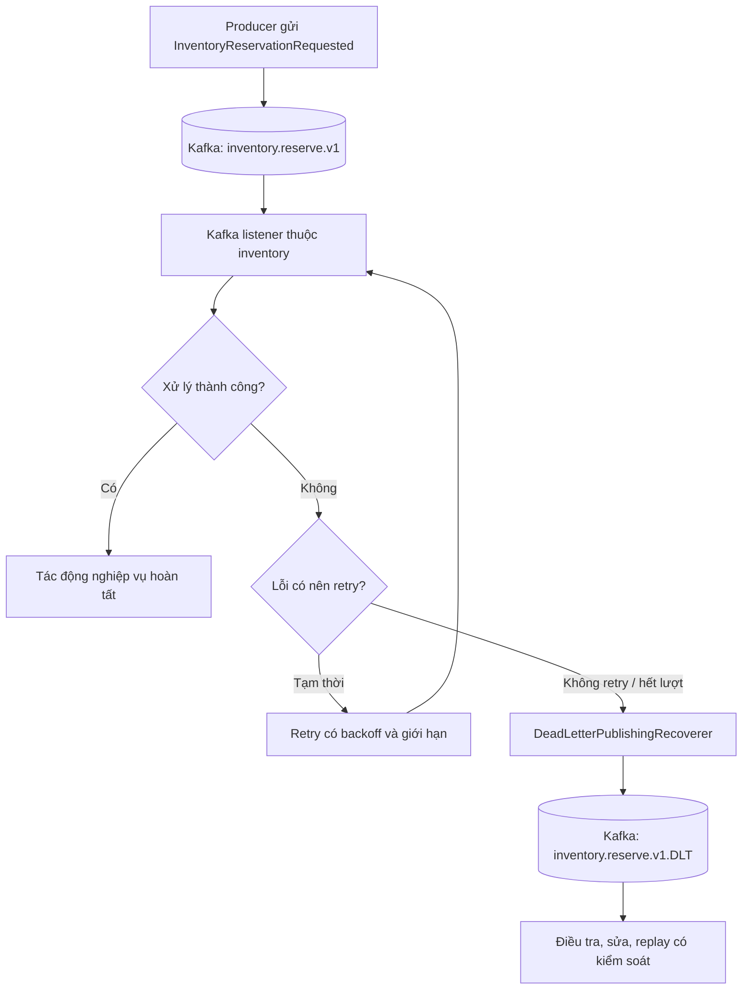
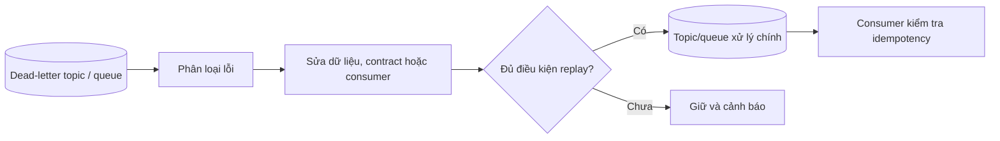
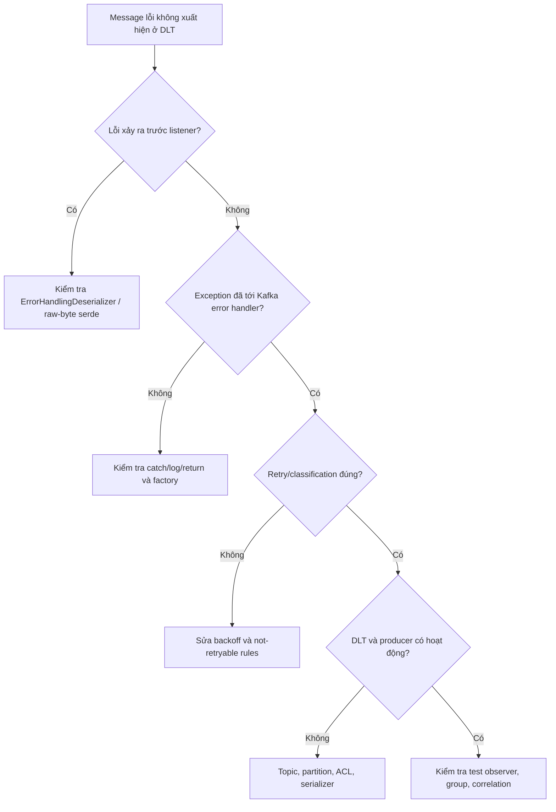
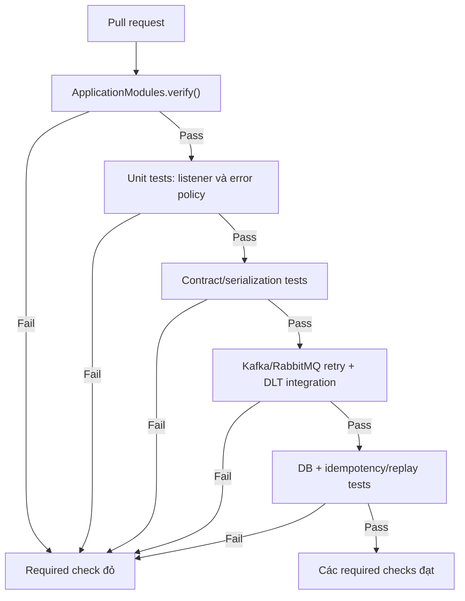

# Kiểm tra retry, error channel và dead letter trong Spring Modulith

## 1. Mục tiêu: kiểm chứng cả đường thành công lẫn đường lỗi của messaging

Trong chương **Messaging testing** của học phần `SPRING_MODULITH_VERIFICATION_TESTING`, một module có thể phát domain event, một adapter chuyển event sang Kafka hoặc RabbitMQ, rồi consumer của module khác xử lý message. Luồng bình thường có thể chạy đúng nhưng hệ thống vẫn mất dữ liệu, xử lý trùng hoặc mắc kẹt khi gặp một message lỗi.

Ví dụ: module `ordering` phát yêu cầu giữ tồn kho; module `inventory` nhận message và gọi `ReservationService`. Lúc database tạm không sẵn sàng, consumer cần thử lại theo chính sách. Nếu message chứa số lượng không hợp lệ, thử mãi cũng không có ích; message nên được từ chối và chuyển tới nơi có thể điều tra. Trong một hệ thống sử dụng Spring Integration, lỗi có thể còn được chuyển thành `ErrorMessage` trên một **error channel**.

**Câu hỏi cần trả lời bằng test không chỉ là “consumer nhận được message chưa?”, mà còn là:**

- Khi xử lý thất bại tạm thời, có thực sự **retry** đúng số lần/backoff không?
- Khi lỗi là vĩnh viễn, có tránh retry vô ích không?
- Khi không thể xử lý, message có tới **dead-letter destination** với dữ liệu và thông tin lỗi đủ để điều tra không?
- Khi một bước dùng **error channel**, lỗi có được định tuyến tới kênh đã khai báo, thay vì chỉ được ghi log?
- Sau retry hoặc redelivery, tác động nghiệp vụ có bị thực hiện **hai lần** không?
- Các bài test lỗi có chạy trong CI và làm required check thất bại khi hành vi sai không?

Bài này kết hợp kiểm chứng ranh giới tĩnh bằng `ApplicationModules.verify()`, kiểm thử module bằng `@ApplicationModuleTest`, kiểm thử sự kiện, database và tích hợp broker. **`verify()` bảo vệ kiến trúc; các test retry/error/dead letter bảo vệ hành vi lỗi tại runtime.**

## 2. Ba khái niệm phải phân biệt

| Cơ chế | Mục đích | Khi nào sử dụng | Điều cần assert |
| --- | --- | --- | --- |
| **Retry** | Thử xử lý lại sau lỗi có thể khắc phục | Database timeout, dịch vụ ngoài tạm lỗi, lock contention | Số lần thử, backoff, kết quả cuối, không gây tác dụng phụ trùng |
| **Error channel** | Chuyển lỗi thành một message theo kênh xử lý lỗi của integration flow | Spring Integration hoặc framework messaging có cơ chế error channel được cấu hình | `ErrorMessage` tới đúng channel/handler, giữ được nguyên nhân và context |
| **Dead letter (DLT/DLQ)** | Cô lập record không xử lý được để điều tra hoặc xử lý lại có kiểm soát | Dữ liệu vi phạm contract, lỗi vượt số lần retry, message độc hại | Record tới đúng dead-letter destination, payload/headers/correlation đúng |

Trong Spring Kafka, cơ chế thường dùng cho consumer lỗi là `DefaultErrorHandler` và `DeadLetterPublishingRecoverer`. **Điều đó không tự tạo một Spring Integration `errorChannel`**. Ngược lại, một `MessageChannel` nhận lỗi **không mặc nhiên làm Kafka record được publish sang DLT**.

**Dead-letter topic** (Kafka) và **dead-letter queue** (RabbitMQ) cùng phục vụ mục tiêu cô lập lỗi nhưng có semantics, cách định tuyến và cơ chế acknowledgment khác nhau. Không nên gọi tất cả là “error channel”.

## 3. Thiết kế luồng lỗi theo boundary

Giả sử ứng dụng có các module:

```text
com.acme.shop
├── ShopApplication.java
├── ordering
│   └── OrderConfirmed.java
├── messaging
│   └── InventoryReservationRequested.java
└── inventory
    └── internal
        ├── ReservationMessageConsumer.java
        ├── ReservationService.java
        ├── InvalidReservationMessageException.java
        └── ReservationKafkaErrorConfiguration.java
```

Một message đi từ Kafka vào module `inventory`:



Đây là một **chính sách mẫu**, không phải hành vi mặc định bất biến của mọi ứng dụng Spring Kafka. Một số cấu hình dùng retry topic riêng, retry trong container, retry tại use case hoặc kết hợp nhiều tầng. Phải xác định chính xác **ai retry, retry cái gì, và khi nào coi record đã được xử lý hoặc recover**.

### Phân biệt đường event nội bộ và đường broker

`ordering` có thể dùng `ApplicationEventPublisher` để phát `OrderConfirmed`. Adapter externalization đẩy một transport message lên Kafka. `@ApplicationModuleTest` và `Scenario` có thể kiểm tra event nội bộ, nhưng **không chứng minh Kafka consumer đã retry hoặc ghi DLT**. Những hành vi ấy đòi hỏi test đúng error handler/broker.

## 4. Định nghĩa hợp đồng message và lỗi nghiệp vụ

Ví dụ public transport contract trong `messaging`:

```java
// messaging/InventoryReservationRequested.java
package com.acme.shop.messaging;

import java.util.UUID;

public record InventoryReservationRequested(
        UUID eventId,
        UUID orderId,
        String sku,
        int quantity
) {
}
```

Mỗi event mang `eventId` riêng để hỗ trợ truy vết và idempotency. `orderId` liên kết message với đơn hàng; `sku` và `quantity` mô tả nghiệp vụ giữ tồn kho.

Lỗi đầu vào **không thể được sửa bằng retry**:

```java
// inventory/internal/InvalidReservationMessageException.java
package com.acme.shop.inventory.internal;

class InvalidReservationMessageException
        extends RuntimeException {

    InvalidReservationMessageException(String message) {
        super(message);
    }
}
```

Lỗi tạm thời, ví dụ kết nối database bị gián đoạn, nên được thể hiện bằng exception có semantics rõ hoặc được phân loại theo exception do driver/framework phát sinh. Trong ví dụ test, `IllegalStateException` dùng để mô phỏng lỗi tạm thời **chỉ vì error handler sẽ retry nhóm lỗi này**. Hệ thống thật nên dùng exception taxonomy có chủ đích thay vì coi mọi `IllegalStateException` đều transient.

### Hợp đồng nên nói rõ điều gì?

- Payload không chứa thông tin bí mật không cần thiết.
- `quantity` phải là số dương và `sku` không được rỗng.
- `eventId` phải ổn định khi **cùng sự kiện được retry/redeliver**.
- Retry không được tự sinh một payment hoặc reservation mới không tương ứng.
- Dead-letter record phải có đủ thông tin để xác định **message gốc và nguyên nhân lỗi**, không chỉ có một dòng log.

## 5. Consumer phân biệt message sai và lỗi xử lý tạm thời

Listener bên trong module `inventory`:

```java
// inventory/internal/ReservationMessageConsumer.java
package com.acme.shop.inventory.internal;

import com.acme.shop.messaging.InventoryReservationRequested;
import org.springframework.kafka.annotation.KafkaListener;
import org.springframework.stereotype.Component;

@Component
class ReservationMessageConsumer {

    private final ReservationService reservations;

    ReservationMessageConsumer(ReservationService reservations) {
        this.reservations = reservations;
    }

    @KafkaListener(
        topics = "inventory.reserve.v1",
        groupId = "shop-inventory"
    )
    void on(InventoryReservationRequested message) {
        if (message.eventId() == null
                || message.orderId() == null
                || message.sku() == null
                || message.sku().isBlank()
                || message.quantity() <= 0) {
            throw new InvalidReservationMessageException(
                    "Reservation request is invalid"
            );
        }

        reservations.reserve(
                message.eventId(),
                message.orderId(),
                message.sku(),
                message.quantity()
        );
    }
}
```

Use case thuộc cùng module:

```java
// inventory/internal/ReservationService.java
package com.acme.shop.inventory.internal;

import java.util.UUID;
import org.springframework.stereotype.Service;

@Service
class ReservationService {

    void reserve(UUID eventId, UUID orderId,
                 String sku, int quantity) {
        // Ví dụ rút gọn: kiểm tra duplicate eventId,
        // cập nhật tồn kho và commit transaction.
    }
}
```

**Lưu ý:** `ReservationService` ở trên là khung minh họa. Nó chưa thực sự ghi database hoặc chống trùng. Test Mockito với service bị mock chỉ chứng minh listener gọi đúng use case, không chứng minh reservation được lưu bền vững.

`@KafkaListener` nhận message **sau bước deserialize**. Nếu JSON/Avro bị hỏng trước khi tạo được `InventoryReservationRequested`, lỗi có thể phát sinh ngay tại tầng deserializer; cần cấu hình error handling thích hợp, không mong `on(...)` được gọi với object sai.

## 6. Cấu hình retry và DLT bằng Spring Kafka

Ví dụ policy: lỗi không được đánh dấu là permanent sẽ có **lần xử lý đầu tiên và tối đa hai lần retry**, cách nhau 200 ms theo fixed backoff. `InvalidReservationMessageException` không được retry mà chuyển sang recoverer.

```java
// inventory/internal/ReservationKafkaErrorConfiguration.java
package com.acme.shop.inventory.internal;

import org.apache.kafka.common.TopicPartition;
import org.springframework.context.annotation.Bean;
import org.springframework.context.annotation.Configuration;
import org.springframework.kafka.core.KafkaTemplate;
import org.springframework.kafka.listener.CommonErrorHandler;
import org.springframework.kafka.listener.DeadLetterPublishingRecoverer;
import org.springframework.kafka.listener.DefaultErrorHandler;
import org.springframework.util.backoff.FixedBackOff;

@Configuration
class ReservationKafkaErrorConfiguration {

    @Bean
    CommonErrorHandler reservationErrorHandler(
            KafkaTemplate<Object, Object> kafkaTemplate) {

        var recoverer = new DeadLetterPublishingRecoverer(
                kafkaTemplate,
                (record, error) -> new TopicPartition(
                        record.topic() + ".DLT",
                        record.partition()
                )
        );

        var handler = new DefaultErrorHandler(
                recoverer,
                new FixedBackOff(200L, 2L)
        );

        handler.addNotRetryableExceptions(
                InvalidReservationMessageException.class
        );

        return handler;
    }
}
```

Ở các cấu hình Spring Boot/Spring Kafka thông dụng, một bean `CommonErrorHandler` có thể được cấu hình vào listener container factory theo cơ chế auto-configuration. **Phải kiểm tra thực tế factory nào đang được `@KafkaListener` sử dụng**: nếu dự án tự khai báo nhiều `ConcurrentKafkaListenerContainerFactory`, cần gắn error handler vào **đúng factory**. Việc có bean nhưng không được factory dùng sẽ làm test không phản ánh policy mong muốn.

### Ý nghĩa `FixedBackOff(200L, 2L)`

- `200L`: độ trễ giữa các lần retry (ms) theo cấu hình backoff.
- `2L`: **hai lần retry sau lần thử đầu tiên** đối với record đủ điều kiện retry.
- Tối đa ba lần gọi listener trong kịch bản không có cơ chế khác thay đổi luồng.
- Nếu tất cả lần thử vẫn lỗi, recoverer cố gửi record tới DLT.

Không nên mô tả “2L nghĩa là chạy đúng hai lần tổng cộng”. Cũng không được coi việc gọi recoverer là bảo đảm DLT đã ghi thành công trong mọi trường hợp: producer DLT vẫn có thể lỗi, và hành vi retry/seek/ack sau recovery phụ thuộc cấu hình, phiên bản và container.

### Chuẩn bị dead-letter topic

Với naming ở trên, topic gốc là `inventory.reserve.v1`, DLT là `inventory.reserve.v1.DLT`. Recoverer dùng partition gốc, nên DLT phải có đủ partition tương ứng. Để ví dụ dễ kiểm chứng, cả hai topic có thể có **một partition** trong integration test.

```java
@Bean
NewTopic reservationTopic() {
    return TopicBuilder.name("inventory.reserve.v1")
            .partitions(1).replicas(1).build();
}

@Bean
NewTopic reservationDltTopic() {
    return TopicBuilder.name("inventory.reserve.v1.DLT")
            .partitions(1).replicas(1).build();
}
```

Đoạn minh họa trên cần imports `org.apache.kafka.clients.admin.NewTopic`, `org.springframework.kafka.config.TopicBuilder` và `org.springframework.context.annotation.Bean`; đặt trong một `@Configuration` hoặc `@TestConfiguration` phù hợp.

**Spring Kafka không mặc nhiên đảm bảo tự tạo DLT topic.** Việc provision topic/queue phải do ứng dụng, hạ tầng hoặc môi trường test chịu trách nhiệm rõ ràng.

## 7. Retry khác với redelivery, và không tự bảo đảm an toàn nghiệp vụ

Hai tình huống có thể khiến cùng một event được xử lý nhiều lần:

1. **Retry trong consumer error handler:** cùng record được thử xử lý lại sau exception theo backoff.
2. **Redelivery sau restart/rebalance/ack không hoàn tất:** broker đưa lại record dù tác động nghiệp vụ có thể đã được commit.

Từ góc nhìn nghiệp vụ, cả hai đều tạo khả năng **thực hiện tác dụng phụ nhiều lần**. Với việc giữ tồn kho hoặc thanh toán, chỉ kiểm tra số lần method được gọi không đủ.

| Mức kiểm tra | Assertion phù hợp | Giới hạn |
| --- | --- | --- |
| Listener unit test | Input được validate, chuyển đúng tham số vào use case | Không kiểm tra error handler |
| Retry integration | Lỗi tạm thời dẫn đến các lần gọi lại và cuối cùng thành công | Có thể mock persistence |
| Idempotency integration | Cùng `eventId` xuất hiện nhiều lần nhưng chỉ một tác động bền vững | Cần service/database thật |
| Recovery integration | Record lỗi đến DLT đúng định dạng và context | Không chứng minh đã replay an toàn |
| Operation/replay test | Sửa nguyên nhân rồi đưa record trở lại luồng xử lý thành công | Cần runbook và correlation ID |

Một consumer “retry thành công” vẫn có thể làm hệ thống sai nếu lần thử đầu tiên đã thực hiện nửa tác động bên ngoài rồi mới ném exception. Vì vậy cần xem ranh giới transaction và idempotency, không chỉ số lần retry.

## 8. Unit test consumer: kiểm chứng phân loại đầu vào

Unit test không chạy Kafka container hoặc error handler. Nó tập trung vào **quy tắc validation** bên trong listener:

```java
// src/test/java/com/acme/shop/inventory/internal/
// ReservationMessageConsumerUnitTests.java
package com.acme.shop.inventory.internal;

import static org.junit.jupiter.api.Assertions.assertThrows;
import static org.mockito.Mockito.mock;
import static org.mockito.Mockito.verify;
import static org.mockito.Mockito.verifyNoInteractions;

import com.acme.shop.messaging.InventoryReservationRequested;
import java.util.UUID;
import org.junit.jupiter.api.Test;

class ReservationMessageConsumerUnitTests {

    @Test
    void validMessageCallsUseCase() {
        ReservationService service = mock(ReservationService.class);
        var consumer = new ReservationMessageConsumer(service);
        UUID eventId = UUID.randomUUID();
        UUID orderId = UUID.randomUUID();

        consumer.on(new InventoryReservationRequested(
                eventId, orderId, "SKU-01", 2
        ));

        verify(service).reserve(eventId, orderId, "SKU-01", 2);
    }

    @Test
    void invalidQuantityFailsBeforeSideEffect() {
        ReservationService service = mock(ReservationService.class);
        var consumer = new ReservationMessageConsumer(service);

        assertThrows(InvalidReservationMessageException.class, () ->
                consumer.on(new InventoryReservationRequested(
                        UUID.randomUUID(),
                        UUID.randomUUID(),
                        "SKU-01",
                        0
                ))
        );

        verifyNoInteractions(service);
    }
}
```

Bài test chứng minh **message lỗi bị từ chối tại boundary và use case không bị gọi**. Nó **không** chứng minh Spring Kafka sẽ không retry exception này hoặc sẽ publish DLT. Đó là trách nhiệm của integration test sử dụng error handler thật.

Không nên viết unit test kiểu gọi `consumer.on(...)` ba lần rồi tuyên bố đã kiểm thử Kafka retry: đó chỉ là ba lần gọi method bằng tay, không kiểm tra backoff, acknowledge hoặc recoverer.

## 9. Integration test retry: lỗi tạm thời rồi phục hồi

Mục tiêu là kiểm chứng **container listener + error handler thật**. Dùng Kafka Testcontainers cho transport, nhưng mock `ReservationService` để kiểm soát chính xác lần thất bại.

Giả sử test đã cấu hình:

- Spring Boot/JUnit Jupiter với `@SpringBootTest`.
- Kafka Testcontainers, topic gốc và DLT.
- `KafkaTemplate<Object, Object>` có JSON serializer, consumer có JSON deserializer tương thích.
- `ReservationKafkaErrorConfiguration` được nạp và kết nối đúng `CommonErrorHandler`.
- Một `@MockitoBean ReservationService` để điều khiển lần gọi.
- Broker/consumer readiness phù hợp với môi trường test.

Bài test tập trung vào đường xử lý:

```java
@Test
void transientFailureIsRetriedThenSucceeds() throws Exception {
    UUID eventId = UUID.randomUUID();
    UUID orderId = UUID.randomUUID();

    doThrow(new IllegalStateException("temporary unavailable"))
            .doThrow(new IllegalStateException("temporary unavailable"))
            .doNothing()
            .when(reservations)
            .reserve(eventId, orderId, "SKU-01", 2);

    var request = new InventoryReservationRequested(
            eventId, orderId, "SKU-01", 2
    );

    kafka.send("inventory.reserve.v1",
            orderId.toString(), request)
            .get(10, TimeUnit.SECONDS);

    await().atMost(Duration.ofSeconds(15))
            .untilAsserted(() ->
                    verify(reservations, times(3))
                            .reserve(eventId, orderId, "SKU-01", 2));
}
```

Các import test liên quan:

```java
import static org.mockito.Mockito.doNothing;
import static org.mockito.Mockito.doThrow;
import static org.mockito.Mockito.times;
import static org.mockito.Mockito.verify;
import static org.awaitility.Awaitility.await;

import java.time.Duration;
import java.util.UUID;
import java.util.concurrent.TimeUnit;
```

Với `FixedBackOff(200L, 2L)` và exception được retry, ta kỳ vọng **lần đầu + hai retry**, lần thứ ba thành công. Hãy bảo đảm test không có một retry layer khác bên trong service làm số lần gọi thay đổi.

**Giới hạn quan trọng:** `verify(..., times(3))` giúp quan sát invocation, nhưng không kiểm tra database commit hay idempotency. Một test service/database thật cần khẳng định tác động nghiệp vụ cuối chỉ xảy ra một lần, đặc biệt khi lỗi được ném **sau** một phần tác động.

### Vì sao cần Awaitility?

Kafka consumer thực thi trong listener thread, không phải thread JUnit. Phương thức `kafka.send(...).get(...)` chờ kết quả producer, **chưa chờ consumer xử lý xong**. Awaitility chờ điều kiện quan sát được với deadline, thay vì dùng `Thread.sleep(...)` tùy tiện.

## 10. Integration test dead letter: record vi phạm contract

Với `InvalidReservationMessageException` được phân loại không retry, một message có `quantity = 0` nên được gửi sang DLT thay vì thử lại hai lần.

Cách kiểm chứng đáng tin:

1. Khởi động Kafka cùng **topic gốc và topic DLT**.
2. Dùng một producer test gửi message sai nhưng **vẫn deserialize được**.
3. Dùng consumer observer riêng subscribe `inventory.reserve.v1.DLT`.
4. Đợi record có đúng `eventId`/`orderId`.
5. Assert payload/headers và xác nhận service nghiệp vụ không bị gọi.
6. Đảm bảo message DLT không bị một test khác tiêu thụ trước khi observer đọc.

Ví dụ test body, giả định helper `dltProbe` đã subscribe DLT và có phương thức `awaitRecordFor(eventId)`:

```java
@Test
void permanentValidationFailureIsDeadLettered() throws Exception {
    UUID eventId = UUID.randomUUID();
    UUID orderId = UUID.randomUUID();
    var invalid = new InventoryReservationRequested(
            eventId, orderId, "SKU-01", 0
    );

    kafka.send("inventory.reserve.v1",
            orderId.toString(), invalid)
            .get(10, TimeUnit.SECONDS);

    var record = dltProbe.awaitRecordFor(eventId);

    assertThat(record.topic())
            .isEqualTo("inventory.reserve.v1.DLT");
    assertThat(record.value()).isEqualTo(invalid);
    verifyNoInteractions(reservations);
}
```

**`dltProbe.awaitRecordFor` là helper test minh họa, không phải API của Spring Kafka.** Có thể hiện thực bằng `KafkaConsumer.poll(Duration)` hoặc tiện ích test tương đương, với group riêng, timeout và cơ chế chờ partition assignment. Không được sao chép snippet rồi kỳ vọng helper tự tồn tại.

Bài test đủ sức xác nhận **broker thực sự chứa record DLT**, mạnh hơn kiểm tra mock `DeadLetterPublishingRecoverer.accept(...)` được gọi.

### Kiểm tra metadata DLT

Ngoài payload, nên kiểm tra các header phù hợp mà recoverer đã ghi, ví dụ:

- Topic và partition nguồn.
- Offset gốc nếu có.
- Loại exception và thông tin lỗi.
- Correlation/event ID ở payload hoặc header nghiệp vụ.
- Timestamp, trace ID, tenant nếu hệ thống dùng.

Tên và định dạng các header của Spring Kafka có thể phụ thuộc phiên bản/cấu hình. Ví dụ các hằng `KafkaHeaders.DLT_ORIGINAL_TOPIC` và `KafkaHeaders.DLT_EXCEPTION_FQCN` hữu ích khi framework có cung cấp; test nên đọc header thông qua API của phiên bản thực tế, thay vì so sánh nguyên một thông báo exception cố định.

## 11. Một khung integration test Kafka có thể tái sử dụng

Ví dụ khung class giúp gắn test retry và DLT vào hạ tầng:

```java
// src/test/java/com/acme/shop/inventory/internal/
// ReservationFailureKafkaIT.java
package com.acme.shop.inventory.internal;

import org.apache.kafka.clients.admin.NewTopic;
import org.springframework.beans.factory.annotation.Autowired;
import org.springframework.boot.test.context.SpringBootTest;
import org.springframework.context.annotation.Bean;
import org.springframework.boot.test.context.TestConfiguration;
import org.springframework.kafka.config.TopicBuilder;
import org.springframework.kafka.core.KafkaTemplate;
import org.springframework.test.context.DynamicPropertyRegistry;
import org.springframework.test.context.DynamicPropertySource;
import org.springframework.test.context.bean.override.mockito.MockitoBean;
import org.testcontainers.junit.jupiter.Container;
import org.testcontainers.junit.jupiter.Testcontainers;
import org.testcontainers.kafka.KafkaContainer;
import org.testcontainers.utility.DockerImageName;

@SpringBootTest
@Testcontainers
class ReservationFailureKafkaIT {

    @Container
    static final KafkaContainer KAFKA = new KafkaContainer(
            DockerImageName.parse("apache/kafka:3.8.0")
    );

    @DynamicPropertySource
    static void kafkaProps(DynamicPropertyRegistry registry) {
        registry.add("spring.kafka.bootstrap-servers",
                KAFKA::getBootstrapServers);
    }

    @Autowired
    KafkaTemplate<Object, Object> kafka;

    @MockitoBean
    ReservationService reservations;

    @TestConfiguration
    static class Topics {

        @Bean
        NewTopic input() {
            return TopicBuilder.name("inventory.reserve.v1")
                    .partitions(1).replicas(1).build();
        }

        @Bean
        NewTopic dlt() {
            return TopicBuilder.name("inventory.reserve.v1.DLT")
                    .partitions(1).replicas(1).build();
        }
    }

    // Đặt các phương thức @Test tại đây.
}
```

**Giới hạn của khung:**

- Cần Spring Kafka, Testcontainers, JUnit Jupiter và Kafka serializer/deserializer đã cấu hình; đoạn này không tự tạo đủ dependency hoặc JSON serde.
- `@MockitoBean` phù hợp với Spring Framework 6.2+; trên phiên bản cũ hơn, dùng cơ chế thay bean tương ứng.
- `KafkaContainer` trong package `org.testcontainers.kafka` thuộc các bản Testcontainers mới; cần đồng bộ version/image theo BOM dự án.
- Nếu test dùng tên hậu tố `IT`, Maven Surefire có thể **không** tự chạy; cấu hình Failsafe hoặc test runner tương ứng.
- DLT probe vẫn phải được khai báo riêng; chỉ tạo DLT topic **chưa đủ** để quan sát bản ghi.
- Trong bài test độc lập, cần chắc chắn `@TestConfiguration` thực sự được import/nạp; có thể dùng `@Import(ReservationFailureKafkaIT.Topics.class)` theo cấu trúc test của dự án.

Khi reviewer thấy một integration test, phải kiểm tra **nó chạy thật trong CI**, không chỉ biên dịch thành công hoặc nằm trong `src/test/java`.

## 12. Lỗi deserialization xảy ra trước listener

Một message JSON có format sai có thể không tạo được object `InventoryReservationRequested`. Do lỗi phát sinh trước khi listener method nhận payload, một unit test gọi `on(...)` với object không hợp lệ **không đủ**.

Trong Spring Kafka, có thể dùng `ErrorHandlingDeserializer` bọc deserializer thật để đưa thông tin lỗi qua cơ chế container:

```yaml
spring:
  kafka:
    consumer:
      key-deserializer: org.apache.kafka.common.serialization.StringDeserializer
      value-deserializer: org.springframework.kafka.support.serializer.ErrorHandlingDeserializer
      properties:
        spring.deserializer.value.delegate.class: org.springframework.kafka.support.serializer.JsonDeserializer
        spring.json.value.default.type: com.acme.shop.messaging.InventoryReservationRequested
        spring.json.trusted.packages: com.acme.shop.messaging
```

Đây là cấu hình minh họa dành cho consumer JSON; các option type header, trusted packages và serializer khác cần được thống nhất với producer thực tế.

**Không tự động suy ra message bytes hỏng sẽ tới DLT bằng cùng một `KafkaTemplate<Object,Object>` JSON serializer.** Recoverer có thể cần một Kafka producer hỗ trợ **raw byte[]** cho record lỗi deserialization, hoặc cấu hình phân nhánh serializer phù hợp. Cần integration test **gửi bytes sai thật** và assert DLT có payload/headers kỳ vọng.

### Một test nên bao phủ hai nhóm lỗi riêng

| Nhóm lỗi | Ví dụ | Vị trí lỗi | Điểm quan sát |
| --- | --- | --- | --- |
| Payload hợp lệ về JSON, sai nghiệp vụ | `quantity = 0` | Trong `ReservationMessageConsumer.on` | `InvalidReservationMessageException` → DLT, không retry |
| JSON/Avro hỏng | Bytes không đọc được thành contract | Tầng deserializer | Error handler/recoverer có thể xử lý qua `ErrorHandlingDeserializer` và serializer DLT tương ứng |

Đừng dùng kết quả test “quantity 0 đi DLT” để khẳng định “JSON bất kỳ bị hỏng đều đi DLT”. Hai nhánh hoạt động ở những lớp khác nhau.

## 13. Error channel trong Spring Integration là khái niệm khác

**Error channel** thường gặp trong Spring Integration là một `MessageChannel` nhận `ErrorMessage`. Khi một integration flow/gateway/endpoint được cấu hình định tuyến lỗi tới channel đó, handler có thể nhận thông tin exception và ngữ cảnh của message thất bại.

Ví dụ một channel và handler:

```java
import org.springframework.context.annotation.Bean;
import org.springframework.context.annotation.Configuration;
import org.springframework.integration.annotation.ServiceActivator;
import org.springframework.integration.channel.PublishSubscribeChannel;
import org.springframework.messaging.MessageChannel;
import org.springframework.messaging.support.ErrorMessage;
import org.springframework.stereotype.Component;

@Configuration
class IntegrationErrorChannels {

    @Bean(name = "reservationErrors")
    MessageChannel reservationErrors() {
        return new PublishSubscribeChannel();
    }
}

@Component
class ReservationErrorObserver {

    @ServiceActivator(inputChannel = "reservationErrors")
    public void observe(ErrorMessage error) {
        Throwable cause = error.getPayload();
        // Ví dụ: chuyển sang observability/recovery service.
        // Không chỉ log rồi giả định đã xử lý thành công.
    }
}
```

**Cảnh báo quan trọng:** khai báo bean tên `reservationErrors` **không tự buộc lỗi từ `@KafkaListener` xuất hiện ở đó**. Phải cấu hình **integration flow/gateway/endpoint** hoặc adapter tương ứng gửi lỗi tới channel này. `@KafkaListener` thuần túy thường sử dụng `CommonErrorHandler` và cơ chế recoverer của Spring Kafka.

### Kiểm thử error channel đúng hai mức

**Mức 1 — handler nhận được `ErrorMessage`:** gửi một `ErrorMessage` mẫu vào channel đã cấu hình và xác nhận side effect của `ReservationErrorObserver`. Mức này chứng minh **wiring/logic handler**, chưa chứng minh lỗi thật từ inbound adapter được định tuyến.

**Mức 2 — integration flow định tuyến lỗi thật:** kích hoạt một bước xử lý cố ý lỗi, kiểm tra:

1. Lỗi được biểu diễn bởi `ErrorMessage` trên **đúng channel**.
2. Cause và thông tin original message/correlation được giữ đủ.
3. Channel consumer/handler áp dụng chính sách quan sát hoặc recovery.
4. Lỗi không bị “xử lý” bằng cách im lặng nuốt đi, nếu contract yêu cầu caller/broker biết failure.

Spring Cloud Stream hoặc các binder khác có cơ chế error channel tương ứng theo phiên bản và cấu hình. Không nên đồng nhất semantics của các framework chỉ vì cùng có chữ `errorChannel`.

## 14. Unit test cho error channel: tránh nhầm “đã gửi lỗi” với “đã xử lý lỗi”

Một handler lỗi có thể ủy quyền sang một cổng giám sát:

```java
package com.acme.shop.messaging.internal;

import org.springframework.integration.annotation.ServiceActivator;
import org.springframework.messaging.support.ErrorMessage;
import org.springframework.stereotype.Component;

@Component
class IntegrationErrorHandler {

    private final ErrorNoticeSink notices;

    IntegrationErrorHandler(ErrorNoticeSink notices) {
        this.notices = notices;
    }

    @ServiceActivator(inputChannel = "reservationErrors")
    public void onError(ErrorMessage message) {
        notices.record(message.getPayload());
    }
}

interface ErrorNoticeSink {
    void record(Throwable cause);
}
```

Unit test thuần Java:

```java
@Test
void errorHandlerReportsCause() {
    ErrorNoticeSink notices = mock(ErrorNoticeSink.class);
    var handler = new IntegrationErrorHandler(notices);
    var cause = new IllegalStateException("integration failed");

    handler.onError(new ErrorMessage(cause));

    verify(notices).record(cause);
}
```

**Test này chỉ chứng minh logic của method**, không chứng minh channel route hoặc Kafka recovery. Một bài Spring Integration test phải có `reservationErrors` channel, cấu hình endpoint gửi lỗi đến channel, rồi quan sát invocation do **flow thật** tạo ra.

Cũng cần xác định gửi thông tin lỗi tới error channel có phải hành động cuối cùng không, hay cần **DLQ**, cảnh báo hoặc retry khác. Logging/capture lỗi không tự tạo một chính sách phục hồi.

## 15. Retry tại consumer khác retry tại producer

Hai phía có thể có retry riêng:

| Nơi phát sinh lỗi | Cơ chế liên quan | Test cần làm rõ |
| --- | --- | --- |
| Producer không gửi được do broker unavailable | Producer send future/callback, publication registry, outbox hoặc retry ở producer | Message cuối cùng được gửi hoặc lỗi được ghi nhận/khôi phục đúng |
| Broker đã có record, listener ném exception | `DefaultErrorHandler`/container retry, retry topic hoặc recoverer | Số lần listener thử, backoff, DLT |
| Consumer gọi HTTP/DB rồi timeout | Retry trong use case, circuit breaker hoặc retry ở listener | Không vô tình **nhân số retry** giữa các tầng |
| Listener trả về nhưng side effect chưa commit | Transaction/ack boundary | Offset/ack không được coi là hoàn tất sai |
| Consumer không thể deserialize | `ErrorHandlingDeserializer`/error handler | DLT hoặc nhánh recovery của bytes lỗi |

Một bẫy thường gặp là có **ba lần retry ở HTTP client** và **ba lần retry trong Kafka error handler**. Kết quả có thể thành nhiều lần gọi hạ tầng ngoài hơn dự tính, gây quá tải hoặc chi phí không mong muốn. Trong test hãy xác nhận **retry owner** và tổng số lần tác động thực sự.

`DefaultErrorHandler` xử lý thất bại của listener Kafka, **không xử lý trực tiếp một producer send future thất bại trước đó**. Đừng cố chứng minh producer recovery bằng bài test consumer retry.

## 16. Dead letter không phải thùng rác: cần quy trình xử lý lại

Đưa một record lỗi sang DLT/DLQ chỉ hoàn tất giai đoạn **cô lập**, chưa sửa nguyên nhân.

Một quy trình vận hành nên nêu:

1. **Nhận diện:** record nào ở DLT, từ topic/partition/offset nào và lỗi gì.
2. **Phân loại:** sai schema, dữ liệu nghiệp vụ không hợp lệ, dependency outage hay bug trong code.
3. **Khắc phục:** sửa dữ liệu, sửa consumer, cập nhật contract hoặc phục hồi dịch vụ.
4. **Replay có kiểm soát:** chỉ gửi lại khi nguyên nhân được xử lý; giữ `eventId` và correlation phù hợp.
5. **Idempotency:** record đã từng gây tác dụng phụ chưa? Replay có thể nhân đôi kết quả không?
6. **Quan sát:** có metric/cảnh báo DLT backlog, retry exhausted và recovery failures.
7. **Bảo mật:** retention, quyền đọc và dữ liệu nhạy cảm trong payload/error headers.



**Không nên auto-replay vô hạn** mọi record từ DLT về topic chính: message không hợp lệ có thể tạo một vòng lặp gây quá tải. Test replay nên xác nhận **chỉ message đã được khắc phục** được xử lý lại và không tạo tác động trùng.

## 17. Idempotency và ranh giới transaction khi retry

Giả sử consumer thực hiện:

1. Ghi giảm tồn kho.
2. Gọi một dịch vụ bên ngoài.
3. Ném exception do timeout trước khi acknowledgment.

Khi Kafka retry, consumer có thể chạy lại cả ba bước. **Có bao nhiêu lần gọi listener không trả lời được có bao nhiêu tác động cuối đã xảy ra.**

Một mô hình bảo vệ thường dùng:

```text
BEGIN TRANSACTION
  INSERT INTO processed_event(event_id) VALUES (...)  -- UNIQUE(event_id)
  UPDATE stock_reservation ...                        -- business effect
COMMIT
```

Đây là **pseudocode**, không phải SQL dùng nguyên xi cho mọi database. Việc ghi marker `processed_event` và business effect nên nằm trong cùng transaction khi phù hợp. Đối với tác động **bên ngoài transaction** như payment gateway, cần idempotency key/contract với đối tác và chính sách bù trừ nếu cần.

Những test cần có:

- **Retry lỗi trước commit:** kết quả sau cùng đúng.
- **Redelivery sau commit:** cùng `eventId` không tạo thêm reservation.
- **Hai consumer cạnh tranh:** ràng buộc unique/transaction bảo vệ khỏi xử lý trùng song song.
- **Lỗi ngay sau side effect ngoài:** retry không tạo thêm tác động không được phép.
- **DLT rồi replay:** sau khi sửa nguyên nhân, record được xử lý một cách idempotent.

`@ApplicationModuleTest` và `Scenario` hữu ích cho hành vi trong Spring context, nhưng các bảo đảm database/broker này cần integration test với hạ tầng phù hợp.

## 18. RabbitMQ: dead-letter queue và cơ chế nack khác Kafka

Trong RabbitMQ, message có thể được định tuyến từ queue chính sang **dead-letter exchange (DLX)** rồi tới **DLQ**, tùy queue arguments, policy và binding. Consumer có thể ack/nack/reject, chọn requeue hay không và dùng retry mechanism riêng.

| Khía cạnh | Kafka | RabbitMQ |
| --- | --- | --- |
| Destination xử lý chính | Topic/partition | Exchange → queue/binding |
| Cơ chế báo tiến độ | Offset/consumer group | Ack/nack/reject, queue delivery |
| Nhánh dead letter | Thường là DLT với recoverer theo cấu hình | DLX/DLQ qua policy hoặc queue arguments |
| Retry | Error handler/backoff, retry topics hoặc chiến lược khác | Requeue, retry queue/TTL hoặc advice/error handler |
| Điều cần test | Topic, partition, DLT headers, offset và side effect | Routing key/binding, ack/nack, DLX, side effect |
| Cảnh báo | DLT producer có thể thất bại | Requeue liên tục có thể tạo vòng lặp nóng |

Không áp dụng nguyên xi `DefaultErrorHandler` của Spring Kafka cho `@RabbitListener`. Để kiểm tra RabbitMQ, sử dụng cấu hình Spring AMQP phù hợp và broker integration test (chẳng hạn Testcontainers RabbitMQ), với test observer cho DLQ và assertion sau khi consumer xử lý.

**Một message xuất hiện trong DLQ chưa chắc đã được giải quyết**; cần chính sách triage/replay tương tự DLT.

## 19. Ma trận test cho toàn bộ đường lỗi

| Kịch bản | Unit test | Module/contract test | Broker/DB integration | Kết quả mong đợi |
| --- | --- | --- | --- | --- |
| Message hợp lệ | Listener mapping | Event/wire contract | Consumer + DB | Xử lý một lần theo nghiệp vụ |
| Input vĩnh viễn sai | Validation | Schema test | DLT/DLQ | Không retry vô ích; record được cô lập |
| DB timeout một lần | Service fault simulation | Có thể test collaborator | Error handler retry | Thử lại và cuối cùng thành công |
| DB timeout kéo dài | Service fault simulation | — | Retry exhausted → DLT | Không retry vô hạn |
| JSON không deserialize | — | Serializer/fixture test | Raw bytes + error handler | Recovery đúng, không làm container chết mãi |
| Lỗi trong Spring Integration flow | Handler unit | Error channel integration | Nếu flow nối broker thì thêm broker test | `ErrorMessage` tới đúng channel |
| DLT publish thất bại | Recoverer/error policy unit | — | Broker fault test | Không im lặng mất record |
| Message bị giao lại | Idempotency unit | — | DB + consumer duplicate test | Một business effect hữu hiệu |
| DLT replay | — | Contract sau sửa lỗi | Replay end-to-end | Không loop hoặc nhân đôi |
| Thay đổi ranh giới module | `ApplicationModules.verify()` | `@ApplicationModuleTest` | Regression tests | Không phụ thuộc nội bộ/chu kỳ |

Mỗi test phải xác định **điểm kích hoạt**, **tầng lỗi**, **observable** và **điều kiện kết thúc**. Nếu một bài test chỉ thấy exception trong mock nhưng không thấy record DLT, nó mới kiểm tra một phần của đường phục hồi.

## 20. Chẩn đoán khi retry hoặc DLT không hoạt động

Khi message lỗi không tới DLT, hãy kiểm tra có thứ tự:

1. **Message có đến Kafka listener không?** Topic, group, partition assignment, serializer và container startup.
2. **Exception xảy ra ở đâu?** Trước listener (deserialize), trong listener, trong service hay ở producer?
3. **Có đúng error handler không?** `CommonErrorHandler` đã gắn vào đúng listener container factory chưa?
4. **Exception có bị nuốt không?** Nếu listener bắt lỗi rồi log và return, container có thể coi record thành công.
5. **Classification đúng không?** Exception vĩnh viễn có được khai báo `notRetryable`? Lỗi transient có bị coi nhầm là permanent?
6. **Backoff đúng không?** Số lần retry có cộng với retry trong use case/HTTP client không?
7. **DLT tồn tại không?** Topic/partition và quyền publish của producer.
8. **DLT serializer đúng không?** Payload object hợp lệ khác với raw bytes lỗi deserialization.
9. **Có record thật trong DLT không?** Test observer dùng group riêng, có chờ assignment và correlation ID không?
10. **Recovery có hoàn tất không?** DLT producer có thể lỗi; xử lý offset/ack phụ thuộc policy.
11. **Test bị interference không?** Hai test cùng topic/group có thể chia partition và nhận nhầm record.
12. **Thông tin lỗi có đủ không?** Headers, trace ID, original topic, exception và metrics.



**Đừng sửa lỗi bằng cách chỉ tăng timeout hoặc retry count.** Một DLT topic chưa được provision hoặc deserializer sai sẽ không hoạt động chỉ vì đợi lâu hơn.

## 21. Kết hợp với kiểm chứng kiến trúc Spring Modulith

Trong ví dụ, consumer nội bộ của `inventory` sử dụng `messaging.InventoryReservationRequested`. Theo mô hình package mặc định, đó là cạnh tĩnh **`inventory → messaging`**.

Một JUnit test kiến trúc:

```java
// src/test/java/com/acme/shop/ModuleArchitectureTests.java
package com.acme.shop;

import org.junit.jupiter.api.Test;
import org.springframework.modulith.core.ApplicationModules;

class ModuleArchitectureTests {

    @Test
    void modulesRespectBoundaries() {
        ApplicationModules.of(ShopApplication.class).verify();
    }
}
```

`verify()` giúp phát hiện việc sử dụng package nội bộ của module khác, chu kỳ và phụ thuộc trái `allowedDependencies`. Nó **không** thực thi listener để chứng minh retry count, DLT, error channel hoặc idempotency. Đây là lý do cần giữ các test song song:

- `ApplicationModules.verify()`: cấu trúc phụ thuộc.
- `@ApplicationModuleTest` và `Scenario`: event/logic trong phạm vi module.
- Unit test listener/error policy: validation, mapping và phân loại lỗi.
- Broker integration test: error handler, DLT/DLQ, serializer, retry.
- Database integration test: transaction, duplicate, business effect.
- CI required checks: các bài kiểm chứng được thực thi và chặn hồi quy.

Một module test xanh không chứng minh DLT thật có record; một DLT integration test xanh không chứng minh hướng phụ thuộc giữa các module đã đúng.

## 22. Chất lượng CI: đừng để đường lỗi chỉ được test ở local

Ví dụ quy trình CI:



Lệnh build phụ thuộc cấu hình dự án:

```bash
# Unit/module tests thông dụng
./mvnw test
./gradlew test

# Maven lifecycle có thể chạy integration tests nếu đã cấu hình Failsafe
./mvnw verify

# Gradle check chạy các verification task mà project đã khai báo
./gradlew check
```

**Không được mặc định** `ReservationFailureKafkaIT` chạy trong `mvn test`: tên `*IT` thường thuộc cấu hình Maven Failsafe, không phải mẫu mặc định của Surefire. Nếu nhóm dùng một task Gradle integrationTest riêng, phải kiểm tra nó đã được liên kết với CI.

Hạ tầng Testcontainers cần runner có Docker và image truy cập được. Hãy cô lập topic/group test, dùng `eventId` riêng, chờ theo điều kiện với deadline và thu thập log/error handler khi test timeout.

**Tuyệt đối không biến lỗi thành build xanh bằng `@Disabled`, `-DskipTests`, `-x test`, `continue-on-error: true` hoặc `catch` rồi chỉ log.** Job test quan trọng phải nằm trong ruleset/branch protection như một required check.

## 23. Bài tập tự kiểm tra

**Câu 1.** Một listener nhận message sai và ném `InvalidReservationMessageException`. Unit test xác nhận exception. Có chứng minh record tới DLT chưa?

**Đáp án:** Chưa. Unit test không chạy Kafka error handler/recoverer. Cần broker integration test quan sát record thật trong DLT.

**Câu 2.** `FixedBackOff(200L, 2L)` thường cho phép bao nhiêu lần xử lý tổng cộng trước khi recover?

**Đáp án:** Một lần đầu và hai lần retry, tức tối đa **ba lần gọi listener** với lỗi retryable trong policy minh họa.

**Câu 3.** Vì sao một `ErrorMessage` xuất hiện trên Spring Integration error channel không đồng nghĩa một Kafka record đã được gửi DLT?

**Đáp án:** Đây là hai cơ chế thuộc hai luồng cấu hình khác nhau. Error channel là `MessageChannel` trong integration flow; Kafka DLT cần recoverer/producer và topic phù hợp.

**Câu 4.** Consumer bắt mọi exception, log rồi return. Error handler có biết phải retry không?

**Đáp án:** Thường không. Nếu listener return bình thường, container có thể coi processing thành công. Cần để exception phù hợp truyền tới error handler, hoặc thực hiện một protocol lỗi rõ ràng.

**Câu 5.** Message sai JSON gây lỗi trước khi listener nhận object. Test quantity bằng 0 đã chứng minh nhánh này chưa?

**Đáp án:** Chưa. Cần test raw bytes/deserialization và `ErrorHandlingDeserializer`/DLT serializer phù hợp.

**Câu 6.** Khi retry sau timeout, `ReservationService` bị gọi ba lần. Đã chứng minh tồn kho chỉ giảm một lần chưa?

**Đáp án:** Chưa. Cần integration test với service/database thật và cơ chế idempotency, nhất là khi exception có thể xảy ra sau một phần side effect.

**Câu 7.** Topic DLT có tên đúng nhưng thiếu partition tương ứng. Chỉ tăng Awaitility timeout có giúp không?

**Đáp án:** Không. Cần provision DLT và destination resolver/partition phù hợp; timeout không tạo partition.

**Câu 8.** Một message đã vào DLT được tự động replay vô hạn mà vẫn sai schema. Rủi ro?

**Đáp án:** Tạo vòng lặp xử lý lỗi, quá tải và làm khó quan sát. Cần triage, sửa nguyên nhân và replay có kiểm soát.

**Câu 9.** `ApplicationModules.verify()` đạt nhưng lỗi deserializer làm Kafka consumer không nhận được message. Có mâu thuẫn không?

**Đáp án:** Không. `verify()` kiểm tra quan hệ kiểu tĩnh; lỗi transport/runtime phải được phát hiện bằng contract và broker integration test.

**Câu 10.** Một bài test hậu tố `*IT` không có trong báo cáo CI, dù `mvn test` báo xanh. Cần làm gì?

**Đáp án:** Kiểm tra cấu hình Maven Failsafe/Surefire hoặc test runner thích hợp, bảo đảm integration test được chạy trong job bắt buộc và thất bại được phản ánh.

## 24. Checklist trước khi merge thay đổi liên quan retry/DLT

- **Phân loại lỗi:** transient và permanent được xác định theo semantics nghiệp vụ, không dựa ngẫu nhiên vào mọi exception.
- **Retry owner:** biết rõ tầng nào retry; không cộng dồn vô ý giữa Kafka, HTTP và service.
- **Backoff hữu hạn:** có giới hạn lần thử/thời gian, không kẹt vô hạn.
- **Error channel:** nếu dùng Spring Integration, flow thật sự route `ErrorMessage` tới channel được cấu hình.
- **DLT/DLQ:** destination đã provision, có thể publish/consume, lưu payload và metadata cần thiết.
- **Deserialize errors:** có test bytes lỗi trước listener và serializer DLT phù hợp.
- **Idempotency:** retry, restart và replay không tạo tác dụng phụ không được phép.
- **Transaction:** commit/ack và publication/recovery phản ánh đúng đơn vị công việc.
- **Test isolation:** có correlation/event ID riêng, group riêng và polling với deadline.
- **Architecture:** `ApplicationModules.verify()` vẫn bảo vệ public API, hướng phụ thuộc và không chu kỳ.
- **Module/integration:** `@ApplicationModuleTest`, event, database và broker tests có vai trò riêng.
- **CI:** test lỗi thực sự chạy, thất bại không bị nuốt và các job quan trọng là required checks.

**Ghi nhớ:** Retry xử lý lỗi có khả năng phục hồi, error channel chuyển thông tin lỗi trong một integration flow có cấu hình, còn dead letter cô lập những message chưa thể xử lý. Chỉ xác nhận listener ném exception hoặc ghi log **chưa đủ**: hãy kiểm thử đúng **đường retry, route lỗi, record DLT/DLQ và tác động nghiệp vụ sau recovery**. Kết hợp các bài test đó với `ApplicationModules.verify()`, `@ApplicationModuleTest`, kiểm thử database/integration và quality gate CI để giữ kiến trúc Spring Modulith đúng và hệ thống messaging an toàn khi gặp lỗi.
