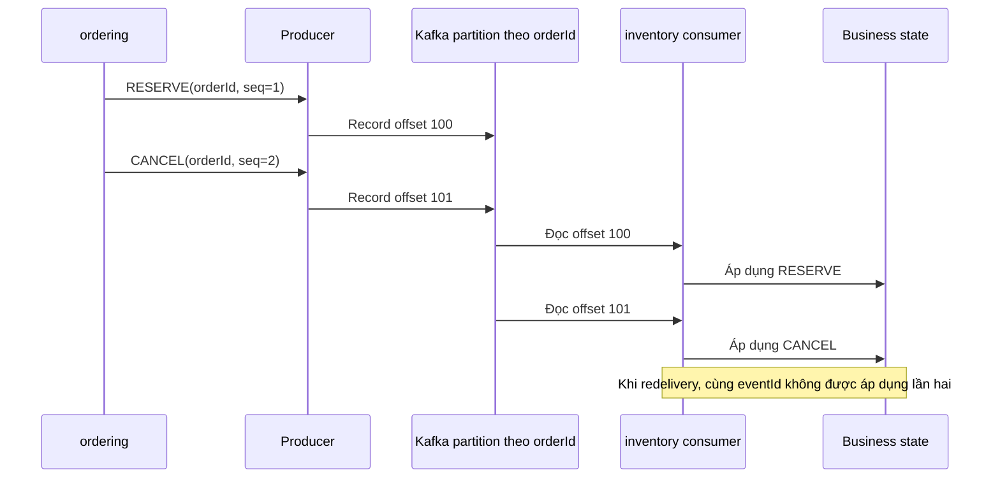
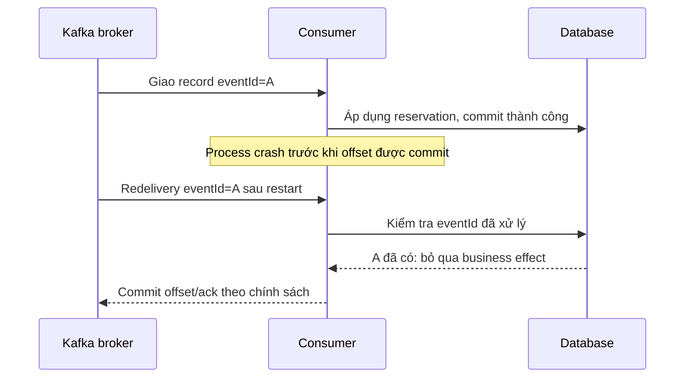
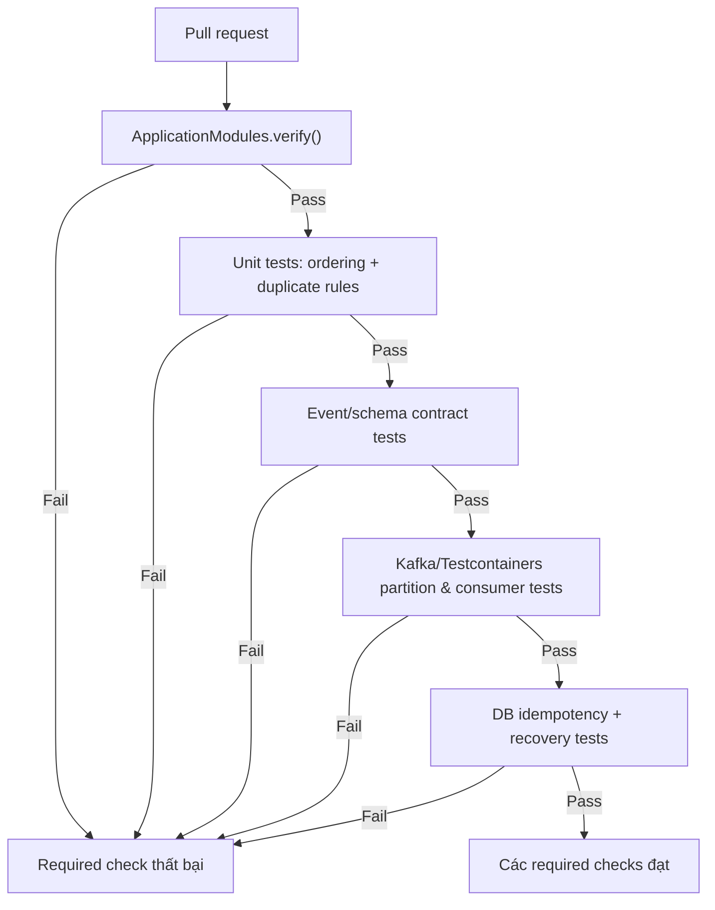
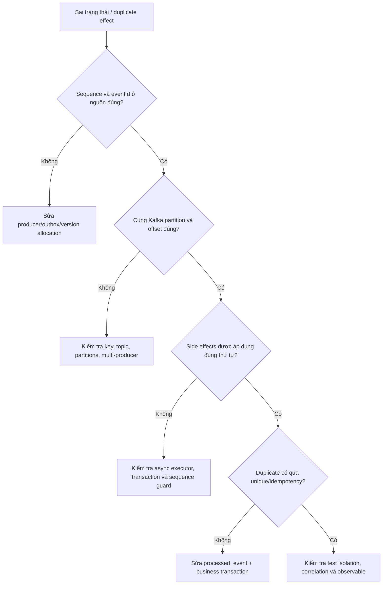

# Kiểm tra thứ tự và duplicate message trong Spring Modulith

## 1. Vì sao message đúng nội dung vẫn có thể gây sai nghiệp vụ?

Trong hệ thống Spring Modulith, module `ordering` phát yêu cầu **giữ hàng** sau khi đơn được xác nhận. Một sự kiện **hủy giữ hàng** có thể được phát sau đó. Cả hai được externalize qua Kafka và consumer của module `inventory` xử lý.

Giả sử hai message của cùng một đơn được phát theo thứ tự:

1. `RESERVE(orderId, sequence=1)` — giữ hàng.
2. `CANCEL(orderId, sequence=2)` — hủy giữ hàng.

Nếu consumer áp dụng **CANCEL trước RESERVE**, trạng thái cuối có thể sai. Nếu message `RESERVE` bị xử lý hai lần, tồn kho có thể bị trừ hai lần. Những lỗi này thường không xuất hiện trong bài test chỉ kiểm tra một message hợp lệ.

**Kiểm tra thứ tự và duplicate message** nghĩa là xác minh **luồng xử lý bảo toàn những bất biến nghiệp vụ nào** khi record đến đúng thứ tự, đến sai thứ tự hoặc được giao lại. Đây là chủ đề của chương **Messaging testing** trong học phần `SPRING_MODULITH_VERIFICATION_TESTING`. Bên cạnh kiểm chứng ranh giới tĩnh bằng `ApplicationModules.verify()`, học phần còn sử dụng `@ApplicationModuleTest`, kiểm thử sự kiện, database/tích hợp và quality gate CI để ngăn phụ thuộc sai và hồi quy.

Sau bài này, bạn sẽ:

- Nêu chính xác **phạm vi bảo đảm thứ tự của Kafka** và các giới hạn qua partition, topic, consumer, executor.
- Thiết kế message có `eventId`, `orderId` và `sequence` với vai trò riêng.
- Viết unit test cho quy tắc **áp dụng đúng thứ tự**, **bỏ qua duplicate** và **từ chối out-of-order**.
- Hiểu duplicate do retry, restart, offset/ack và replay.
- Xây dựng integration test producer/consumer với broker và database khi cần.
- Phân biệt **delivery exactly-once ở một số phạm vi Kafka** với **business effect exactly-once**.
- Tổ chức các phép kiểm chứng ở nhiều tầng trong CI.

## 2. Ba khái niệm khác nhau: order, duplicate và idempotency

| Khái niệm | Ý nghĩa | Ví dụ cần kiểm chứng |
| --- | --- | --- |
| **Message ordering** | Thứ tự record hoặc thứ tự tác động được áp dụng | `RESERVE(1)` phải được áp dụng trước `CANCEL(2)` cho cùng đơn |
| **Duplicate delivery** | Cùng một event/record được consumer nhìn thấy hoặc xử lý lại | `RESERVE(eventId=A)` đến hai lần |
| **Idempotency** | Xử lý lặp cùng yêu cầu không làm thay đổi kết quả quá một lần hữu hiệu | Chỉ một reservation được tạo/trừ tồn kho cho `eventId=A` |

**Thứ tự record không đồng nghĩa với thứ tự hoàn tất nghiệp vụ.** Kafka có thể cung cấp record theo offset, nhưng consumer đưa từng record vào các worker thread khác nhau khiến tác động hoàn tất đảo thứ tự.

**Duplicate không chỉ là hai message có payload giống nhau.** Trong phạm vi kiểm thử, thường dùng **cùng `eventId`** để mô phỏng *cùng event được redeliver*. Hai event có hai `eventId` khác nhau nhưng cùng `orderId` có thể là **hai hành động nghiệp vụ hợp lệ**, hoặc có thể là duplicate ở cấp nghiệp vụ nếu hệ thống phát sai hai yêu cầu.

**Idempotency không bắt buộc Kafka chỉ giao một record.** Consumer có thể nhận hai lần nhưng áp dụng tác động hữu hiệu đúng một lần. Đó là bất biến quan trọng hơn trong nghiệp vụ tồn kho, thanh toán và vận chuyển.

## 3. Một event flow có thứ tự theo từng đơn hàng

Giả sử ứng dụng có ba application module:

```text
com.acme.shop
├── ShopApplication.java
├── ordering
│   └── OrderApplicationService.java
├── messaging
│   ├── StockCommand.java
│   └── internal
│       └── StockCommandPublisher.java
└── inventory
    └── internal
        ├── StockCommandKafkaListener.java
        └── StockCommandProjector.java
```

Trong ví dụ này, **module `messaging` sở hữu hợp đồng `StockCommand` và outbound adapter `StockCommandPublisher`**, còn **module `inventory` sở hữu consumer và trạng thái nghiệp vụ**. Các adapter và class triển khai vẫn nằm ở package `internal` của module tương ứng, không cần công bố làm API để kiểm thử.



Sơ đồ mô tả **kịch bản lý tưởng với consumer xử lý tuần tự trong một partition**. Không nên suy ra Kafka cung cấp thứ tự chung giữa mọi partition, topic, process hoặc mọi lần xử lý async.

## 4. Kafka bảo đảm thứ tự đến mức nào?

Kafka lưu message thành log theo **offset tăng dần trong mỗi partition**. Một consumer đọc log của partition đó theo thứ tự offset. Tuy nhiên, bài kiểm thử phải hiểu **phạm vi** của bảo đảm này.

| Phạm vi | Điều có thể dựa vào | Điều không nên suy ra |
| --- | --- | --- |
| **Cùng partition, cùng topic** | Record có thứ tự offset xác định | Side effect của nhiều worker async luôn hoàn tất theo offset |
| **Hai partition khác nhau** | Mỗi partition có log riêng | Có một thứ tự toàn cục giữa hai partition |
| **Hai topic khác nhau** | Mỗi topic/partition có offset riêng | Message trên topic A luôn xử lý trước topic B |
| **Cùng key với partitioner nhất quán** | Thường được gán vào cùng partition khi số partition/cấu hình ổn định | Không cần kiểm tra key, không bao giờ remap khi partition count thay đổi |
| **Nhiều consumer trong cùng group** | Một partition thường do một member sở hữu tại một thời điểm | Mọi message của cả topic được một consumer duy nhất xử lý |
| **Retry hoặc async dispatch** | Record có offset rõ ràng để theo dõi | Thứ tự hoàn tất business transaction luôn giống offset |

Ví dụ publisher:

```java
kafka.send(
        "stock.commands.v1",
        orderId.toString(), // key: đưa event của cùng đơn vào một nhóm partition
        command
);
```

Nếu **một producer gửi các record cùng orderId theo thứ tự** và key được partitioner gán nhất quán vào cùng partition, broker có thể lưu chúng theo thứ tự tương ứng theo cấu hình producer/transport. Nhưng khi có **nhiều producer**, retry producer, thay partitioner hoặc thay số partition, cần đánh giá lại giả định về thứ tự. Dự án cần chọn cấu hình Kafka phù hợp với yêu cầu ordering và test trên configuration thực tế, không chỉ quan sát một lần local thành công.

**Không dùng duy nhất Kafka partition key làm bảo đảm nghiệp vụ.** Bổ sung `sequence` hoặc version theo aggregate khi thứ tự ảnh hưởng trạng thái quan trọng.

## 5. Thiết kế message với ba định danh riêng biệt

Ví dụ transport contract công khai thuộc module `messaging`:

```java
// src/main/java/com/acme/shop/messaging/StockCommand.java
package com.acme.shop.messaging;

import java.util.UUID;

public record StockCommand(
        UUID eventId,
        UUID orderId,
        long sequence,
        Action action,
        String sku,
        int quantity
) {
    public enum Action {
        RESERVE,
        CANCEL
    }
}
```

Ý nghĩa:

- `eventId`: định danh của **một event cụ thể**. Khi retry/replay cùng event, **giữ nguyên** `eventId`.
- `orderId`: aggregate/business key. Các event của cùng đơn có thể dùng làm Kafka key để ưu tiên chung partition.
- `sequence`: số thứ tự **tăng theo từng orderId** do bên sở hữu trạng thái phát hành. Ví dụ `1` rồi `2`.
- `action`: ý định nghiệp vụ; ở ví dụ này `RESERVE` và `CANCEL`.
- `sku`, `quantity`: dữ liệu cần thiết để áp dụng action.

**Không đánh đồng `sequence` với Kafka offset.** Offset thuộc log của một partition; sequence thuộc **domain/aggregate** và phải được tạo theo chính sách nhất quán khi có nhiều producer hoặc transaction cạnh tranh.

Ví dụ một dãy:

| Record | `eventId` | `orderId` | `sequence` | Action |
| --- | --- | --- | --- | --- |
| A | `a1` | `O-42` | 1 | `RESERVE` |
| B | `b1` | `O-42` | 2 | `CANCEL` |
| C | `a1` | `O-42` | 1 | `RESERVE` — duplicate của A |
| D | `d1` | `O-99` | 1 | `RESERVE` — đơn hàng khác |

Các ký hiệu `a1`, `b1`, `O-42` trong bảng là **nhãn minh họa**; khi dùng kiểu `UUID` trong Java, cần giá trị UUID thực.

Nếu A được áp dụng rồi B được áp dụng, việc nhận C sau đó **không được mở lại reservation**, dù C có sequence nhỏ hơn trạng thái hiện tại. Cần kiểm tra duplicate theo `eventId` trước khi xử lý logic thứ tự.

## 6. Hai nhóm lỗi thứ tự: đảo thứ tự và thiếu sequence

**Đảo thứ tự:** message `sequence=2` đến khi chưa thấy `sequence=1`. Nếu consumer xử lý ngay `CANCEL`, có thể tạo trạng thái không hợp lệ.

**Thiếu sequence:** consumer đã áp dụng sequence 4 nhưng nhận sequence 6, không thấy sequence 5. Nếu cứ tăng last sequence lên 6, một tác động quan trọng có thể bị bỏ qua.

Một chính sách **strict sequencing** đơn giản:

```text
Nếu eventId đã xử lý:
    bỏ qua như duplicate
Ngược lại:
    expected = lastAppliedSequence(orderId) + 1
    Nếu sequence != expected:
        từ chối hoặc đưa vào cơ chế xử lý out-of-order
    Nếu sequence == expected:
        áp dụng action và ghi dấu eventId + last sequence
```

Đó là **một lựa chọn chính sách**, không phải hành vi có sẵn của Kafka/Spring Modulith.

Có ít nhất ba cách thiết kế khi out-of-order:

1. **Reject/quarantine:** ghi nhận sai thứ tự và đưa message sang kênh lỗi/DLT để điều tra, reconciliation.
2. **Durable reorder buffer:** lưu message chờ tới khi thiếu event trước đó đến; cần TTL, giới hạn bộ nhớ/dung lượng và cơ chế replay.
3. **State reconciliation/version check:** đọc nguồn trạng thái có thẩm quyền hoặc chỉ chấp nhận trạng thái mới nhất theo version khi business semantics cho phép.

**Cảnh báo deadlock logic:** nếu message sequence 2 nằm **trước** sequence 1 trong **cùng partition**, consumer chặn ở record 2 và retry mãi tại head, record 1 nằm phía sau sẽ không được đọc. Vì vậy, “cứ retry đến khi thấy sequence 1” có thể **không bao giờ thành công**. Cần xác định nơi sequence 1 có thể xuất hiện và chính sách quarantine/reorder đúng.

## 7. Một state machine nhỏ để unit test nguyên tắc

Để minh họa dễ kiểm thử, ta dùng một class **in-memory** có trạng thái theo `orderId`. Nó không phải giải pháp production cho nhiều instance; phần transaction/database sẽ được bàn sau.

```java
// src/main/java/com/acme/shop/inventory/internal/StockCommandProjector.java
package com.acme.shop.inventory.internal;

import com.acme.shop.messaging.StockCommand;
import java.util.HashMap;
import java.util.HashSet;
import java.util.Map;
import java.util.Set;
import java.util.UUID;

class StockCommandProjector {

    enum Result { APPLIED, DUPLICATE }
    enum Status { RESERVED, CANCELLED }

    record State(long lastSequence, Status status) {}

    private final Map<UUID, State> states = new HashMap<>();
    private final Set<UUID> processedIds = new HashSet<>();

    synchronized Result apply(StockCommand command) {
        if (processedIds.contains(command.eventId())) {
            return Result.DUPLICATE;
        }

        State current = states.get(command.orderId());
        long expected = current == null ? 1 : current.lastSequence() + 1;

        if (command.sequence() != expected) {
            throw new IllegalStateException(
                    "Expected sequence " + expected
                            + " for order " + command.orderId()
            );
        }

        if (command.action() == StockCommand.Action.CANCEL
                && (current == null
                    || current.status() != Status.RESERVED)) {
            throw new IllegalStateException("No active reservation");
        }

        Status nextStatus = command.action() == StockCommand.Action.RESERVE
                ? Status.RESERVED
                : Status.CANCELLED;

        states.put(command.orderId(),
                new State(command.sequence(), nextStatus));
        processedIds.add(command.eventId());

        return Result.APPLIED;
    }

    synchronized State stateOf(UUID orderId) {
        return states.get(orderId);
    }
}
```

Một số đặc điểm chủ ý:

- `synchronized` giữ thứ tự cập nhật và khả năng nhìn thấy trạng thái giữa các thread **trong một instance JVM** của ví dụ.
- `processedIds` giúp bỏ qua **đúng cùng eventId**, kể cả sau khi sequence đã tiến.
- `lastSequence` bảo vệ thứ tự event trên từng đơn.
- Một event sai thứ tự ném exception, để tầng tiếp nhận có chính sách retry/quarantine.
- `State` chỉ diễn tả kết quả đơn giản, chưa kiểm tra tồn kho thực tế hoặc transaction.

Trong production, **map/set in-memory không bền vững**, không chia sẻ giữa nhiều instance và không bảo vệ chống crash. Cần đưa invariant vào database hoặc một state store có cơ chế transaction/concurrency phù hợp.

## 8. Unit test: đúng thứ tự phải cho đúng trạng thái cuối

JUnit test đặt cùng package `inventory.internal` để truy cập class package-private:

```java
// src/test/java/com/acme/shop/inventory/internal/
// StockCommandProjectorTests.java
package com.acme.shop.inventory.internal;

import static org.junit.jupiter.api.Assertions.assertEquals;

import com.acme.shop.messaging.StockCommand;
import java.util.UUID;
import org.junit.jupiter.api.Test;

class StockCommandProjectorTests {

    @Test
    void reserveThenCancelChangesStateInOrder() {
        var projector = new StockCommandProjector();
        UUID orderId = UUID.randomUUID();

        var reserve = new StockCommand(
                UUID.randomUUID(), orderId, 1,
                StockCommand.Action.RESERVE, "SKU-01", 2
        );
        var cancel = new StockCommand(
                UUID.randomUUID(), orderId, 2,
                StockCommand.Action.CANCEL, "SKU-01", 2
        );

        assertEquals(StockCommandProjector.Result.APPLIED,
                projector.apply(reserve));
        assertEquals(StockCommandProjector.Result.APPLIED,
                projector.apply(cancel));

        assertEquals(2L, projector.stateOf(orderId).lastSequence());
        assertEquals(StockCommandProjector.Status.CANCELLED,
                projector.stateOf(orderId).status());
    }
}
```

**Bảo đảm của test:** state machine áp dụng hai action theo đúng thứ tự, trạng thái cuối đúng, sequence không bị mất.

**Chưa bảo đảm:** Kafka gửi hai record cùng partition theo thứ tự, listener có được đăng ký không, hoặc database có commit. Unit test này tập trung vào **quy tắc nghiệp vụ sau khi đã có message hợp lệ**.

## 9. Unit test: duplicate không được áp dụng lần thứ hai

Một test riêng mô phỏng **cùng eventId và payload** được giao lại:

```java
@Test
void duplicateEventDoesNotReapplyReservation() {
    var projector = new StockCommandProjector();
    UUID orderId = UUID.randomUUID();
    UUID eventId = UUID.randomUUID();

    var reserve = new StockCommand(
            eventId, orderId, 1,
            StockCommand.Action.RESERVE, "SKU-01", 2
    );

    assertEquals(StockCommandProjector.Result.APPLIED,
            projector.apply(reserve));

    assertEquals(StockCommandProjector.Result.DUPLICATE,
            projector.apply(reserve));

    assertEquals(1L, projector.stateOf(orderId).lastSequence());
    assertEquals(StockCommandProjector.Status.RESERVED,
            projector.stateOf(orderId).status());
}
```

Bài test xác nhận duplicate không khiến state machine tiến thêm. Trong hệ thống thật, cần assert **số lượng tồn kho, reservation row hoặc số lần gọi payment gateway**, vì state sequence đúng **chưa tự chứng minh không có một side effect khác bị nhân đôi**.

### Duplicate đến sau event mới hơn

Trường hợp đáng kiểm tra:

```text
RESERVE(seq=1, eventId=A) -> APPLIED
CANCEL (seq=2, eventId=B) -> APPLIED
RESERVE(seq=1, eventId=A) -> DUPLICATE
Final status             -> CANCELLED
```

Nếu consumer chỉ so sánh `sequence < lastSequence` rồi bỏ qua, kết quả trông có vẻ đúng trong một số tình huống, nhưng **không phân biệt event được xử lý thật với event chưa từng được xử lý**. Một chính sách chấp nhận sequence cũ có thể cần audit/alert khi eventId lạ xuất hiện. Vì vậy, lưu `eventId` đã xử lý và sequence/domain version là hai biện pháp **bổ trợ**, không hoàn toàn thay nhau.

## 10. Unit test: sai thứ tự không được sửa state

Dùng `assertThrows` để xác nhận `CANCEL(seq=2)` không thể chạy trước `RESERVE(seq=1)`:

```java
import static org.junit.jupiter.api.Assertions.assertNull;
import static org.junit.jupiter.api.Assertions.assertThrows;

@Test
void cancelBeforeReserveIsRejected() {
    var projector = new StockCommandProjector();
    UUID orderId = UUID.randomUUID();

    var cancel = new StockCommand(
            UUID.randomUUID(), orderId, 2,
            StockCommand.Action.CANCEL, "SKU-01", 2
    );

    assertThrows(IllegalStateException.class,
            () -> projector.apply(cancel));

    assertNull(projector.stateOf(orderId));
}
```

Ca tiếp theo: đã nhận `RESERVE(seq=1)` nhưng nhận `CANCEL(seq=3)`, thiếu sequence 2. Kỳ vọng phải **từ chối sequence 3** chứ không tăng trạng thái từ 1 lên 3. Trong hệ thống thật, cần chọn nguyên nhân và chính sách rõ: gap có thể do thiếu publication, hai producer không nhất quán, sai key, message bị chuyển sang DLT hoặc một nghiệp vụ cố tình bỏ qua bước.

**Không nên dùng `Thread.sleep` để “đợi sequence trước đó” trong unit test.** State machine phải cho kết quả xác định dựa trên input đang có.

## 11. Producer test: xác nhận key và trình tự phát được yêu cầu

Một outbound adapter có thể nằm trong `messaging.internal`:

```java
// src/main/java/com/acme/shop/messaging/internal/StockCommandPublisher.java
package com.acme.shop.messaging.internal;

import com.acme.shop.messaging.StockCommand;
import org.springframework.kafka.core.KafkaTemplate;
import org.springframework.stereotype.Component;

@Component
class StockCommandPublisher {

    static final String TOPIC = "stock.commands.v1";

    private final KafkaTemplate<String, StockCommand> kafka;

    StockCommandPublisher(KafkaTemplate<String, StockCommand> kafka) {
        this.kafka = kafka;
    }

    void publish(StockCommand command) {
        kafka.send(TOPIC, command.orderId().toString(), command);
    }
}
```

Một test Mockito xác nhận **hai lời gọi được phát theo thứ tự** và cùng key:

```java
@Test
void sendsEventsForSameOrderWithSameKeyAndExpectedCallOrder() {
    @SuppressWarnings("unchecked")
    KafkaTemplate<String, StockCommand> kafka =
            mock(KafkaTemplate.class);

    var producer = new StockCommandPublisher(kafka);
    UUID orderId = UUID.randomUUID();
    var first = new StockCommand(UUID.randomUUID(), orderId, 1,
            StockCommand.Action.RESERVE, "SKU-01", 2);
    var second = new StockCommand(UUID.randomUUID(), orderId, 2,
            StockCommand.Action.CANCEL, "SKU-01", 2);

    producer.publish(first);
    producer.publish(second);

    InOrder calls = inOrder(kafka);
    calls.verify(kafka).send(
            "stock.commands.v1", orderId.toString(), first);
    calls.verify(kafka).send(
            "stock.commands.v1", orderId.toString(), second);
}
```

Imports trong test gồm `org.mockito.InOrder`, `static org.mockito.Mockito.inOrder` và `static org.mockito.Mockito.mock`; class test nên đặt trong `com.acme.shop.messaging.internal` vì adapter package-private.

**Đây chỉ là test thứ tự lời gọi Java**, không phải test Kafka đã lưu record theo offset. `KafkaTemplate.send` trả future bất đồng bộ, và việc gọi hai lần không tự chứng minh toàn bộ hành vi network, retry, partitioning hoặc consumer-side processing.

### Event được tạo bởi nhiều producer

Nếu hai service instance đều có thể xuất bản command của cùng `orderId`, cần một cơ chế **cấp sequence nhất quán** (transaction/version tại nguồn, outbox có thứ tự hoặc serialization theo aggregate). Kafka key **không tự sửa** race khi sequence được cấp sai ở nguồn.

## 12. Consumer Kafka và sự khác nhau giữa nhận record với áp dụng trạng thái

Một inbound adapter đơn giản:

```java
// src/main/java/com/acme/shop/inventory/internal/
// StockCommandKafkaListener.java
package com.acme.shop.inventory.internal;

import com.acme.shop.messaging.StockCommand;
import org.springframework.kafka.annotation.KafkaListener;
import org.springframework.stereotype.Component;

@Component
class StockCommandKafkaListener {

    private final StockCommandProjector projector;

    StockCommandKafkaListener(StockCommandProjector projector) {
        this.projector = projector;
    }

    @KafkaListener(
        topics = "stock.commands.v1",
        groupId = "shop-inventory"
    )
    void on(StockCommand command) {
        projector.apply(command);
    }
}
```

Để ví dụ có thể khởi tạo trong Spring context, `StockCommandProjector` ở mục 7 cần được đăng ký như một bean, chẳng hạn đặt `@Component` cho class hoặc khai báo `@Bean` trong module `inventory`. Phần minh họa này vẫn **chỉ dùng state in-memory**, phù hợp để học hành vi ordering/duplicate nhưng không đủ cho môi trường nhiều instance.

### Cẩn thận với xử lý song song bên trong consumer

Kafka có thể phân phối record của một partition cho listener theo thứ tự offset, nhưng nếu `on(...)` đưa từng command vào executor rồi return ngay:

```java
void on(StockCommand command) {
    executor.execute(() -> projector.apply(command));
}
```

thì completion của sequence 2 có thể xảy ra **trước** sequence 1. Ngoài ra, container có thể xem listener đã trả về trong khi tác động nghiệp vụ chưa commit, tùy ack mode và async handling. Đừng thêm async dispatch như trên rồi vẫn giả định ack/ordering là an toàn.

Nếu cần concurrency, chia theo aggregate key, sử dụng sequencer/actor/mailbox theo key, hoặc cho state store từ chối sai thứ tự và có cơ chế recovery phù hợp. Khi dùng `@KafkaListener(concurrency = ...)`, phải kiểm tra partition assignment và việc xử lý tuần tự trong từng partition theo cách listener được cấu hình.

## 13. Vì sao duplicate có thể xuất hiện dù producer không gửi hai lần?

Một kịch bản điển hình:



Consumer xử lý xong database nhưng chưa commit offset có thể nhìn thấy cùng record lần nữa khi khởi động lại, rebalance hoặc retry. Đây là một tình huống phổ biến của **at-least-once processing**.

Một số nguồn duplicate khác:

- Producer timeout sau khi broker đã nhận, ứng dụng thử gửi lại **cùng event**.
- Outbox/publication registry khôi phục và externalize lại một event chưa được đánh dấu hoàn tất.
- Error handler retry khi listener ném lỗi sau một phần side effect.
- Operator replay từ DLT/DLQ hoặc topic lưu trữ.
- Thay đổi deploy/rebalance gây redelivery khi offset chưa được xác nhận.

**Không dùng sự kiện có `UUID.randomUUID()` mới cho mỗi lần retry cùng một logical event.** Nếu mỗi lần gửi lại sinh eventId mới, cơ chế dedup theo eventId sẽ không nhận ra đó là cùng event.

## 14. Thiết kế idempotency bền vững bằng database

Trong production, cần kiểm tra duplicate qua nhiều JVM, restart và nhiều consumer instance. Một `HashSet<UUID>` trong bộ nhớ không đủ.

Một mô hình bảng đơn giản:

```sql
CREATE TABLE processed_message (
    event_id UUID PRIMARY KEY,
    order_id UUID NOT NULL,
    processed_at TIMESTAMP NOT NULL
);

CREATE TABLE stock_reservation (
    order_id UUID PRIMARY KEY,
    last_sequence BIGINT NOT NULL,
    status VARCHAR(32) NOT NULL
);
```

Đây là DDL **minh họa**, cú pháp cụ thể và kiểu timestamp tùy RDBMS. Nếu cần xử lý sequence/stock quantity/multi-SKU thật, schema và unique constraints phải phản ánh đúng aggregate và transactional boundaries.

Quy trình áp dụng message trong **một database transaction**:

```text
BEGIN TRANSACTION

1. Kiểm tra/đánh dấu eventId với UNIQUE(event_id).
2. Nếu eventId đã tồn tại:
      không áp dụng lại business effect;
      hoàn tất theo chính sách duplicate.
3. Nếu chưa tồn tại:
      lấy trạng thái orderId với lock/version phù hợp.
      expected = last_sequence + 1.
      nếu sequence sai -> rollback, đưa vào cơ chế xử lý out-of-order.
      nếu sequence đúng -> cập nhật reservation/stock và last_sequence.
4. Commit cả dấu vết eventId và business effect.

COMMIT
```

**Điểm tinh tế:** marker `processed_message` không được commit **trước** rồi business effect thất bại; nếu không, retry sẽ thấy marker và bỏ qua một message chưa từng được áp dụng thành công. Dấu vết và tác động cần được commit cùng đơn vị công việc khi khả thi.

Dưới concurrency, hai transaction có thể cùng nhận `eventId=A`. **Unique constraint ở DB**, locking/version và cách xử lý xung đột là yếu tố bảo vệ; chỉ làm `if (!exists(A)) insert(A)` mà không có constraint là race condition.

### Nếu cùng eventId nhưng payload khác nhau?

Một thông điệp `eventId=A, quantity=2` và thông điệp sau `eventId=A, quantity=99` không nên mặc nhiên coi là duplicate hợp lệ. Có thể lưu **payload hash/schema version** hoặc thông tin nghiệp vụ quan trọng cùng event ID để nhận diện **reuse ID sai hợp đồng** và cảnh báo.

### Duplicate theo event và duplicate theo ý định nghiệp vụ

- **Event-level duplicate:** cùng eventId gửi lại.
- **Business-level duplicate:** eventId khác nhưng hai request cùng ý định (ví dụ hai lần cùng xác nhận một payment). Cần **business idempotency key** và invariant riêng, không chỉ `processed_message(event_id)`.

## 15. Test database: duplicate không được làm thay đổi tồn kho lần hai

Mục tiêu của database integration test là kiểm chứng **tác động bền vững**, không chỉ việc method được gọi.

Ví dụ thân bài test (các API `stockService`/`stockQuery` là domain minh họa, cần implementation và transaction thật):

```java
UUID orderId = UUID.randomUUID();
UUID eventId = UUID.randomUUID();
var reserve = new StockCommand(
        eventId, orderId, 1,
        StockCommand.Action.RESERVE, "SKU-01", 2
);

int before = stockQuery.availableQuantity("SKU-01");

stockService.apply(reserve);
stockService.apply(reserve); // mô phỏng redelivery cùng event

int after = stockQuery.availableQuantity("SKU-01");

assertThat(after).isEqualTo(before - 2);
assertThat(stockQuery.reservationCount(orderId)).isEqualTo(1);
assertThat(stockQuery.lastSequence(orderId)).isEqualTo(1L);
```

Ở đây **không dùng mock service**; test phải dùng database đủ gần cơ chế production để kiểm tra unique constraint, locking, transaction và isolation.

Các ca nên bổ sung:

1. Hai thread cùng gửi `eventId=A` gần đồng thời.
2. Process khởi động lại rồi nhận lại `eventId=A`.
3. `CANCEL(seq=2)` sau `RESERVE(seq=1)` rồi duplicate RESERVE tới.
4. Lỗi xảy ra sau khi insert marker nhưng trước business effect; rollback phải bảo vệ.
5. Hai eventId khác nhau nhưng cùng ý định business cần được giới hạn bằng một invariant nếu nghiệp vụ yêu cầu.

**Kết quả mong muốn:** bản ghi/số lượng tồn kho phản ánh mỗi tác động hợp lệ đúng một lần hữu hiệu, bất kể số lần delivery.

## 16. Broker integration test: xác minh cùng key và offset tăng

Để kiểm tra Kafka thật, dùng Testcontainers hoặc broker test phù hợp. Một bài **producer-to-broker** nên có consumer observer riêng:

1. Khởi động Kafka test broker và topic `stock.commands.v1`.
2. Subscribe một **test consumer group riêng**, đợi assignment hoặc cấu hình offset thích hợp.
3. Publish hai command của cùng `orderId` theo thứ tự `sequence=1` rồi `sequence=2`.
4. Poll đủ hai record và lọc đúng `orderId`/`eventId`.
5. Assert **cùng topic, cùng partition, offset của record 1 nhỏ hơn offset record 2**, payload/key đúng.

Ví dụ assertion sau khi helper test đã lấy hai `ConsumerRecord` tương ứng:

```java
assertThat(first.topic()).isEqualTo("stock.commands.v1");
assertThat(second.topic()).isEqualTo(first.topic());

assertThat(first.key()).isEqualTo(orderId.toString());
assertThat(second.key()).isEqualTo(orderId.toString());

assertThat(first.partition()).isEqualTo(second.partition());
assertThat(first.offset()).isLessThan(second.offset());

assertThat(first.value().sequence()).isEqualTo(1L);
assertThat(second.value().sequence()).isEqualTo(2L);
```

**Đây là phần assertion minh họa, không phải một test class có đủ setup**. Các biến `first` và `second` phải đến từ **record thực đã đọc qua Kafka**, không phải hai object Java được tạo trong test trước khi gửi.

Để test có ý nghĩa, đừng tự gọi `kafka.send` hai lần rồi xác nhận lời gọi Mockito; cần xác nhận record thực từ broker. Đồng thời, **test broker record order không tự chứng minh thứ tự business effects** nếu consumer dispatch bất đồng bộ.

### Tránh kết luận quá mức từ một lần thử

Một test Kafka thành công chứng minh **kịch bản cấu hình đang test**. Nó không đảm bảo ứng dụng luôn đúng khi tăng partition count, có hai producer cùng aggregate, thay client config hoặc consumer xử lý song song. Những tình huống ảnh hưởng ordering phải có test riêng hoặc ràng buộc thiết kế rõ.

## 17. Broker-to-consumer test: xác nhận business state cuối

Một consumer integration test có thể gửi message **qua broker thật** và chờ state từ module `inventory`:

```java
UUID orderId = UUID.randomUUID();

var reserve = new StockCommand(UUID.randomUUID(), orderId, 1,
        StockCommand.Action.RESERVE, "SKU-01", 2);
var cancel = new StockCommand(UUID.randomUUID(), orderId, 2,
        StockCommand.Action.CANCEL, "SKU-01", 2);

kafka.send("stock.commands.v1",
        orderId.toString(), reserve).get(10, TimeUnit.SECONDS);
kafka.send("stock.commands.v1",
        orderId.toString(), cancel).get(10, TimeUnit.SECONDS);

await()
        .atMost(Duration.ofSeconds(15))
        .untilAsserted(() -> {
            var state = stockQuery.findByOrderId(orderId).orElseThrow();
            assertThat(state.status()).isEqualTo("CANCELLED");
            assertThat(state.lastSequence()).isEqualTo(2L);
        });
```

Đây là **thân bài integration test**; giả định đã có Kafka/Testcontainers, JSON serde, topic, consumer, database và `stockQuery` đủ để đọc trạng thái commit. `StockCommand` dùng đúng record ở mục 5.

Bài này kiểm tra **thứ tự tác động cuối** khi mọi thứ vận hành qua transport. Cần cô lập data với `orderId` mới, dùng điều kiện có deadline thay cho `Thread.sleep`, và xem logs/consumer errors khi timeout.

Với trạng thái hủy, nếu chỉ kiểm tra `CANCELLED` mà không kiểm tra `lastSequence` hoặc audit, một consumer sai có thể tình cờ tạo trạng thái cuối đúng dù bỏ qua bước reserve. Khi nghiệp vụ yêu cầu bước reserve thực sự xảy ra, bổ sung kiểm tra event log/transaction history tương ứng.

## 18. Test duplicate qua broker: gửi cùng event hai lần

Một bài khác gửi **cùng một message với cùng `eventId`** hai lần qua Kafka:

```java
UUID orderId = UUID.randomUUID();
UUID eventId = UUID.randomUUID();

var reserve = new StockCommand(
        eventId, orderId, 1,
        StockCommand.Action.RESERVE, "SKU-01", 2
);

kafka.send("stock.commands.v1",
        orderId.toString(), reserve).get(10, TimeUnit.SECONDS);
kafka.send("stock.commands.v1",
        orderId.toString(), reserve).get(10, TimeUnit.SECONDS);

await()
        .atMost(Duration.ofSeconds(15))
        .untilAsserted(() -> {
            assertThat(stockQuery.reservationCount(orderId))
                    .isEqualTo(1);
            assertThat(stockQuery.lastSequence(orderId))
                    .isEqualTo(1L);
        });
```

**Cần chú ý:** nếu assertion này được kiểm tra ngay sau khi **lần gửi thứ nhất** hoàn tất, bài test có thể xanh trước khi consumer nhìn thấy bản sao thứ hai. Để chứng minh duplicate đã được xử lý hoặc bỏ qua, nên có **tín hiệu quan sát rõ việc consumer đã đọc cả hai bản ghi**, ví dụ audit nhận message, metric có correlation ID, test probe hoặc ranh giới offset có thể xác nhận.

Chỉ việc `reservationCount == 1` trong một lần poll **không đủ** để bảo đảm không có tác động thứ hai xảy ra ngay sau khi test kết thúc. Khi dùng state cuối và cần kiểm tra tính ổn định, có thể chờ **mốc hoàn tất/reconciliation** rồi assert, hoặc dùng invariant/unique constraint trong database làm cơ chế bảo đảm lâu dài.

### Thử redelivery không chỉ là gửi hai record

Gửi hai record giống nhau là phép kiểm tra duplicate hữu ích. Nhưng **không hoàn toàn mô phỏng** một consumer crash sau DB commit trước offset commit. Muốn kiểm tra chính sách redelivery thực tế, cần fault test chủ động điều khiển transaction, acknowledgment và restart/rebalance consumer, sau đó xác nhận một business effect hữu hiệu.

## 19. Out-of-order qua broker: chọn chính sách và test đúng kịch bản

Trong test, có thể cố ý gửi:

```text
StockCommand(orderId=O, sequence=2, action=CANCEL)
StockCommand(orderId=O, sequence=1, action=RESERVE)
```

**Kết quả mong muốn phụ thuộc policy**, không có một đáp án chung:

| Chính sách | Kỳ vọng khi seq=2 đến trước seq=1 | Test cần assert |
| --- | --- | --- |
| Strict reject/quarantine | Không áp dụng seq=2; ghi lỗi/DLT để xử lý sau | State không bị cập nhật sai, record có trace |
| Durable reorder buffer | Lưu seq=2 vào buffer; xử lý sau seq=1 | Buffer bền vững, không leak, trạng thái cuối đúng |
| Reconcile theo version | Tìm trạng thái nguồn/đích hợp lệ rồi cập nhật | Không bỏ qua business invariant; version monotonic |
| Bỏ qua stale event có kiểm soát | Nếu event thực sự cũ so với state và có lý do được phép | Có audit/metric để phát hiện eventId lạ |

Nếu sử dụng **retry tại head của cùng partition** cho seq=2, seq=1 đang đứng phía sau có thể không được đọc. Một test timeout trong trường hợp này **không tự chứng minh Kafka sai**: có thể chính error/retry policy đang gây deadlock logic.

**Tuyệt đối không đổi policy thành “cứ áp dụng message mới nhất”** nếu nghiệp vụ bắt buộc các bước được thực hiện theo thứ tự. Ví dụ, không thể đơn giản áp dụng CANCEL rồi RESERVE trong mô hình cần ghi nhận trừ/trả tồn kho tương ứng.

## 20. Ordering với event-driven Spring Modulith và `@ApplicationModuleTest`

Không phải mọi luồng messaging đều đi qua Kafka. Một số module giao tiếp bằng **Spring application event** trong cùng process.

Ví dụ:

- `ordering` phát `OrderConfirmed`.
- Listener của `inventory` hoặc một module liên quan nhận event và xử lý.
- `Scenario.publish(...)` kích hoạt consumer trong bài test `@ApplicationModuleTest`.
- `Scenario.stimulate(...)` gọi hành vi đặt hàng thật và chờ event phát ra.

Một test module có thể xác nhận listener nhận đúng `orderId` và phát event kết quả, nhưng nó **không tự tái hiện** Kafka partition, offset, rebalance hoặc broker redelivery.

Dùng `Scenario` khi muốn kiểm thử **hành vi application event ở ranh giới module**, dùng broker integration test khi muốn kiểm thử **transport ordering/duplicate**. Nếu message được externalize qua Spring Modulith, kiểm tra cả **đường externalization** theo cấu hình tương ứng; không mặc định Spring application event và Kafka message là cùng một bảo đảm giao hàng.

### Không kiểm tra “thứ tự” bằng một bài test phát một event

Một test chỉ gửi `RESERVE(1)` và assert reservation tồn tại chưa bao phủ ordering. Cần có **tối thiểu hai event có quan hệ thứ tự** và một assertion có thể phát hiện khi đảo thứ tự hoặc thiếu event.

## 21. Spring Modulith `verify()` vẫn cần, nhưng kiểm tra một câu hỏi khác

Đây là test kiến trúc tĩnh:

```java
// src/test/java/com/acme/shop/ModuleArchitectureTests.java
package com.acme.shop;

import org.junit.jupiter.api.Test;
import org.springframework.modulith.core.ApplicationModules;

class ModuleArchitectureTests {

    @Test
    void moduleArchitectureIsValid() {
        ApplicationModules.of(ShopApplication.class).verify();
    }
}
```

`ApplicationModules.verify()` giúp chặn:

- Tham chiếu tới package nội bộ của module khác.
- Vòng phụ thuộc giữa application module.
- Phụ thuộc ngoài `allowedDependencies` nếu có khai báo.

Trong ví dụ, `inventory.internal.StockCommandKafkaListener` tham chiếu kiểu `messaging.StockCommand`, nên có cạnh phụ thuộc tĩnh **`inventory → messaging`**. Cạnh phải tuân thủ API module và luật phụ thuộc đã thiết kế.

**`verify()` không kiểm tra record Kafka có cùng partition, consumer có xử lý duplicate hay transaction có commit hai lần.** Ngược lại, một broker integration test đạt cũng không chứng minh module không có vòng phụ thuộc tĩnh. Hai lớp test phải bổ sung cho nhau.

## 22. Kafka “exactly-once” không thay thế idempotency nghiệp vụ

Kafka có các cơ chế producer idempotence và transaction/exactly-once semantics **trong một số phạm vi Kafka-to-Kafka được cấu hình phù hợp**. Nhưng một consumer ứng dụng ghi vào RDBMS, gọi payment gateway hoặc cập nhật một API ngoài Kafka **không tự có exactly-once business effect** chỉ vì broker/producer được cấu hình transactional.

Cần phân biệt:

| Phạm vi | Điều có thể được bảo vệ | Điều còn phải thiết kế |
| --- | --- | --- |
| Producer idempotence | Giảm rủi ro duplicate append từ retry của producer theo cơ chế Kafka | Event bị ứng dụng phát hai lần với logical ID khác |
| Kafka transaction | Atomically xử lý một số thao tác Kafka theo cơ chế được hỗ trợ | Tác động ở RDBMS hoặc API ngoài Kafka |
| Consumer offset commit | Ghi nhận tiến độ đọc partition | Tính nhất quán giữa offset và DB transaction |
| Unique `processed_message(event_id)` | Chống áp dụng lại cùng event ID ở database | Business duplicate với event ID khác |
| `last_sequence`/version | Chặn stale hoặc out-of-order theo aggregate | Cách khôi phục khi thiếu event và reordering |

**Không tuyên bố “exactly once” nếu chưa xác định phạm vi**: exactly-once record processing, database state transition, hay payment gateway charge là những bài toán khác nhau.

Đối với luồng quan trọng, test **crash after commit, redelivery, concurrent consumers và replay** thường cung cấp bằng chứng sát nghiệp vụ hơn so với chỉ đếm Kafka records.

## 23. Các lỗi phổ biến khiến test xanh giả

| Lỗi thiết kế test | Vì sao nguy hiểm | Cách sửa |
| --- | --- | --- |
| Chỉ kiểm tra producer `send` được gọi hai lần | Không chứng minh offset/partition | Dùng consumer observer đọc broker thật |
| Chỉ assert trạng thái cuối mà không biết hai message đã xử lý | Test có thể kết thúc trước duplicate | Có completion/audit signal và DB invariant |
| Dùng `Thread.sleep(500)` sau gửi | Không chứng minh consumer đã hoàn tất | Awaitility/chờ điều kiện có deadline |
| Dùng cùng `orderId` cho mọi test | Dữ liệu cũ hoặc test song song lẫn nhau | UUID mới, fixture cô lập |
| Dùng consumer observer cùng group với app | Các consumer chia partition, có thể nhận nhầm | Group riêng cho observer |
| Đếm `verify(mock).apply(times(2))` rồi coi đã idempotent | Mock không chứng minh DB chỉ áp dụng một lần | Dùng service thật và DB integration |
| Dùng `Set` in-memory làm dedup production | Restart/multi-instance mất dấu vết | Database/store bền vững + unique constraint |
| Bỏ qua cùng sequence nhưng eventId mới | Có thể che missing/corrupt message | Phân biệt stale, duplicate và contract violation |
| Chờ retry seq=2 trong cùng partition khi seq=1 đứng sau | Có thể kẹt mãi | Quarantine/reorder/reconcile rõ ràng |
| Dùng `@Disabled` hoặc skip broker tests ở CI | Mất quality gate | Bắt buộc chạy và xem báo cáo test |
| Bắt exception rồi chỉ log | Offset/ack có thể được coi như xử lý thành công | Error handling theo policy, không nuốt lỗi |

**Một test đáng tin phải kiểm tra thứ mà một implementation sai thực sự làm test thất bại.** Nếu đổi consumer thành “áp dụng duplicate hai lần” mà test vẫn xanh, assertion chưa bảo vệ đúng invariant.

## 24. Test matrix cho ordering và duplicate

| Kịch bản | Loại test tốt nhất | Observable bắt buộc |
| --- | --- | --- |
| `RESERVE(1) → CANCEL(2)` đúng thứ tự | Unit state machine + DB integration | Trạng thái và sequence cuối đúng |
| `CANCEL(2)` đến trước `RESERVE(1)` | Unit + error-path integration | Không có state sai; quarantine/reorder theo policy |
| Thiếu sequence 2, nhận sequence 3 | Unit + recovery test | Gap được phát hiện, không âm thầm nhảy version |
| Cùng eventId hai lần | Unit + DB integration | Một business effect hữu hiệu |
| Duplicate sau khi sequence đã tiến | Unit + DB integration | Event cũ không đảo trạng thái mới |
| Hai eventId cùng business intent | Domain integration | Unique business operation theo contract |
| Cùng key qua Kafka | Broker producer test | Same partition, offset tăng theo kịch bản |
| Consumer restart trước offset commit | Fault/rebalance test | Không nhân đôi tác động sau redelivery |
| Hai consumer instance cạnh tranh | DB concurrency test | Unique constraint/version bảo vệ |
| Producer đổi topic/partition strategy | Contract + broker integration | Giả định ordering vẫn đúng hoặc được cập nhật |
| Event type liên module | `ApplicationModules.verify()` | Không vi phạm ranh giới package/module |
| Pull request | CI required checks | Bài test quan trọng thật sự chạy và fail khi sai |

Không nhất thiết mọi kịch bản phải dùng broker thật ở mỗi lần chạy. Unit test kiểm tra logic nhanh; integration test dùng Kafka/Testcontainers và database kiểm tra giả định hạ tầng. Những trường hợp crash/rebalance có thể được thực hiện ở một job integration chuyên sâu tùy mức độ rủi ro.

## 25. Một pipeline CI bảo vệ cả kiến trúc lẫn message semantics



Lệnh build thông dụng:

```bash
# Maven
./mvnw test
./mvnw verify

# Gradle
./gradlew test
./gradlew check
```

**Không nhầm `mvn verify` với `ApplicationModules.verify()`.** Phương thức Java chỉ chạy khi có bài JUnit hoặc bước build gọi nó; các integration test có hậu tố `*IT` có thể cần Maven Failsafe hoặc task Gradle riêng. CI phải kiểm tra **test report** để biết unit, architecture và broker/database tests thực sự được thực thi.

Broker integration cần Docker/Testcontainers hoặc broker test thích hợp, topic và group cô lập, readiness/assignment, serializer tương thích, Awaitility hoặc tín hiệu hoàn tất. Không nên để `@Disabled`, `skipTests`, `-x test`, `continue-on-error` hoặc ngoại lệ bị nuốt biến check đỏ thành xanh.

### Kiểm tra trực tiếp hiệu lực quality gate

Trong nhánh thử nghiệm, có thể cố tình:

1. Sửa projector để **áp dụng lại duplicate**.
2. Bỏ kiểm tra `expected sequence`.
3. Sửa publisher dùng key ngẫu nhiên cho cùng `orderId`.
4. Vô hiệu hóa xử lý một message theo thứ tự cần có.

Mỗi thay đổi phải khiến **bài test tương ứng đỏ**. Hoàn nguyên các thay đổi thử nghiệm sau khi xác nhận. Đây là cách kiểm chứng rằng pipeline không chỉ chạy test mà còn phát hiện những lỗi nó được thiết kế để chặn.

## 26. Quy trình chẩn đoán khi trạng thái sai thứ tự

Khi một reservation bị mở lại sau khi hủy hoặc tồn kho bị trừ hai lần, truy vết theo các bước:

1. **Event ở nguồn:** `eventId` và `sequence` có được cấp nhất quán theo `orderId` không?
2. **Producer:** các event được gọi `send` theo thứ tự nào, key và topic có giống nhau không?
3. **Broker:** chúng có nằm cùng partition không, offsets được lưu theo thứ tự nào?
4. **Consumer:** listener có xử lý đồng bộ trong partition hay dispatch async ngoài thứ tự?
5. **Retry/redelivery:** record có được nhận lại sau commit/ack failure hoặc restart không?
6. **Database:** marker `processed_message` và business effect có cùng transaction không?
7. **Version guard:** `lastSequence` có được kiểm tra với locking/optimistic version dưới concurrency không?
8. **Error policy:** out-of-order bị reject, buffered hay replay? Có vòng retry gây kẹt không?
9. **Test:** assertion có đợi đủ message và kiểm tra đúng `orderId`/`eventId` không?
10. **CI:** test ordering/duplicate có thực sự chạy và thuộc required check không?



Không nên chỉ tăng timeout khi lỗi là **thiếu sequence** hoặc **unique constraint không bảo vệ**. Đợi lâu hơn không biến một transaction sai thành transaction đúng.

## 27. Bài tập tự kiểm tra

**Câu 1.** Kafka lưu `RESERVE(1)` và `CANCEL(2)` trong cùng partition với offset lần lượt 100 và 101. Listener dispatch vào hai thread, CANCEL hoàn tất trước. Kafka đã vi phạm ordering chưa?

**Đáp án:** Không nhất thiết. Kafka giữ thứ tự record trong partition; ứng dụng đã tạo thứ tự hoàn tất khác bằng async processing. Cần sequence guard hoặc cơ chế xử lý tuần tự theo key.

**Câu 2.** Cùng một `eventId` được giao lại sau khi DB commit nhưng trước khi consumer commit offset. Chỉ dựa vào Kafka đã bảo đảm không trừ tồn kho lần hai chưa?

**Đáp án:** Chưa. Consumer cần idempotency bền vững, ví dụ marker `eventId` và business effect trong cùng DB transaction với unique constraint.

**Câu 3.** Hai event có cùng `orderId` nhưng `eventId` khác nhau. Có thể tự động coi chúng là duplicate không?

**Đáp án:** Không. Có thể là hai hành động hợp lệ (reserve/cancel). Phải dùng `sequence`/`action` và business idempotency rule để phân biệt.

**Câu 4.** `RESERVE(seq=1)` đã được xử lý; `CANCEL(seq=3)` tới. Nếu policy strict, nên làm gì?

**Đáp án:** Phát hiện thiếu `sequence=2`, không âm thầm tăng version lên 3. Quarantine/reorder/reconcile theo chính sách đã xác định và có test.

**Câu 5.** Consumer retry mãi `CANCEL(seq=2)` trong khi `RESERVE(seq=1)` đứng phía sau cùng partition. Vì sao có thể kẹt?

**Đáp án:** Consumer bị giữ tại record lỗi ở head nên không tiến tới record seq=1. Cần cơ chế quarantine/reorder không chặn vô hạn.

**Câu 6.** Unit test dùng `Mockito.verify(kafka).send(...)` đúng key. Đã chứng minh hai record được Kafka lưu đúng offset chưa?

**Đáp án:** Chưa. Cần test producer-to-broker thật với consumer observer đọc cùng partition/offset.

**Câu 7.** Test gửi duplicate hai lần nhưng ngay lập tức thấy `reservationCount == 1` nên xanh. Điều gì còn thiếu?

**Đáp án:** Cần chứng minh consumer đã có cơ hội xử lý **cả hai lần**, hoặc dựa trên invariant/unique constraint và mốc hoàn tất quan sát được. Assert quá sớm có thể xanh giả.

**Câu 8.** `processed_message` đánh dấu đã xử lý rồi commit trước khi stock update. Khi stock update lỗi, retry bỏ qua. Sai ở đâu?

**Đáp án:** Marker và business effect không atomic. Chúng cần cùng transaction hoặc cơ chế consistency phù hợp để không đánh dấu event hoàn tất khi tác động chưa thành công.

**Câu 9.** `ApplicationModules.verify()` đạt nhưng duplicate tạo hai payment charges. Có mâu thuẫn không?

**Đáp án:** Không. `verify()` chỉ kiểm chứng phụ thuộc tĩnh, không kiểm tra delivery/idempotency hoặc external side effect.

**Câu 10.** Consumer group có nhiều partition. Có thứ tự toàn cục giữa event của hai orderId khác nhau không?

**Đáp án:** Không. Có thứ tự offset trong từng partition, không mặc nhiên có thứ tự toàn cục trên toàn bộ topic.

**Câu 11.** Cùng `eventId` xuất hiện với hai payload khác nhau. Có nên âm thầm bỏ message thứ hai?

**Đáp án:** Không nên mặc định như vậy. Đây có thể là lỗi contract hoặc reuse ID; cần policy xác minh payload hash/đối chiếu và cảnh báo.

**Câu 12.** Project có tên test `StockKafkaIT` nhưng `mvn test` vẫn xanh dù không thấy report. Có nên kết luận broker test đã qua?

**Đáp án:** Không. Kiểm tra Maven Failsafe/Surefire hoặc cấu hình runner; test `*IT` có thể không thuộc mẫu Surefire mặc định.

## 28. Checklist trước khi merge thay đổi liên quan ordering/duplicate

- **Ordering domain:** mọi aggregate quan trọng có cơ chế cấp `sequence`/version nhất quán.
- **Transport:** key/topic/partitioner và consumer concurrency phản ánh giả định về thứ tự.
- **Out-of-order:** xác định policy reject, buffer hoặc reconcile; tránh retry kẹt head của partition.
- **Duplicate:** cùng `eventId` được nhận diện dù redelivery, restart hoặc replay.
- **Business idempotency:** không chỉ dedup event ID mà còn bảo vệ invariant nghiệp vụ cần thiết.
- **Atomicity:** marker đã xử lý và business effect có transaction/locking phù hợp.
- **Source contract:** phân biệt `eventId`, `orderId`, `sequence`; không tái sinh eventId khi retry cùng event.
- **Unit tests:** ca đúng thứ tự, đảo thứ tự, gap, duplicate trước/sau event mới.
- **Broker tests:** kiểm tra same key/partition/offset, listener delivery và async state.
- **Database tests:** duplicate/restart/concurrent consumers không tạo side effect lặp.
- **Kiến trúc:** `ApplicationModules.verify()` bảo vệ ranh giới API và dependency.
- **Module tests:** `@ApplicationModuleTest` và `Scenario` bảo vệ interaction trong Spring context.
- **CI:** test quan trọng thực sự chạy, báo lỗi rõ và thuộc required checks.

**Ghi nhớ:** Kafka có thứ tự record **trong từng partition**, không bảo đảm toàn bộ tác động nghiệp vụ luôn đúng thứ tự hoặc không bị xử lý lại. Hãy thiết kế **key theo aggregate, sequence cho phiên bản hành động, eventId cho dedup và invariant bền vững tại database/use case**. Kiểm chứng ở nhiều tầng—unit, `@ApplicationModuleTest`, broker/database integration và `ApplicationModules.verify()`—để giữ cả ranh giới Spring Modulith lẫn ý nghĩa nghiệp vụ của mỗi message trong CI.
