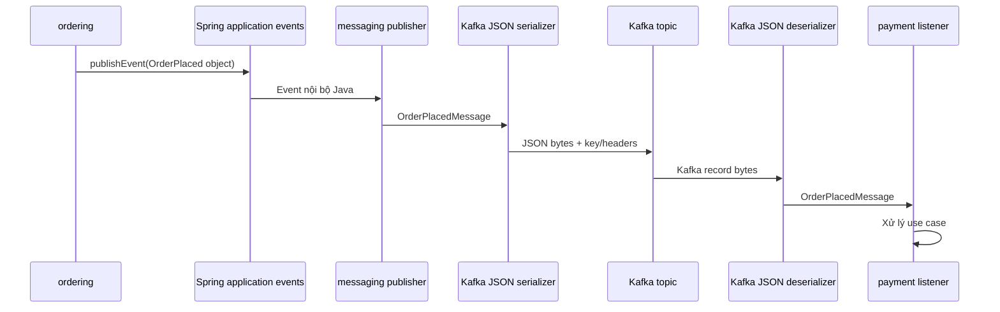
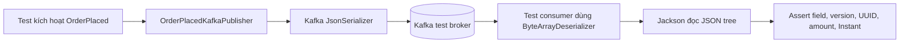
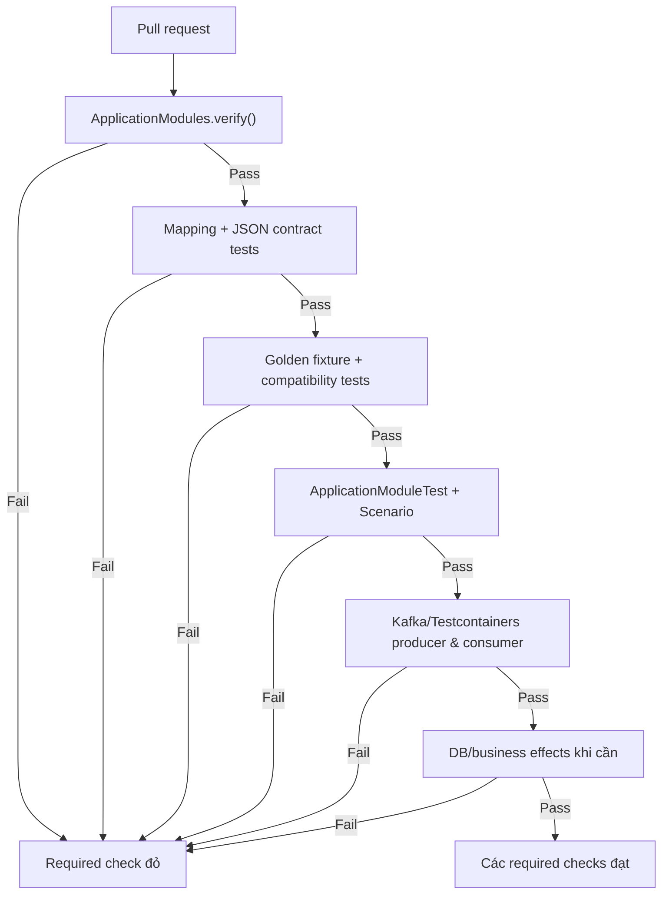
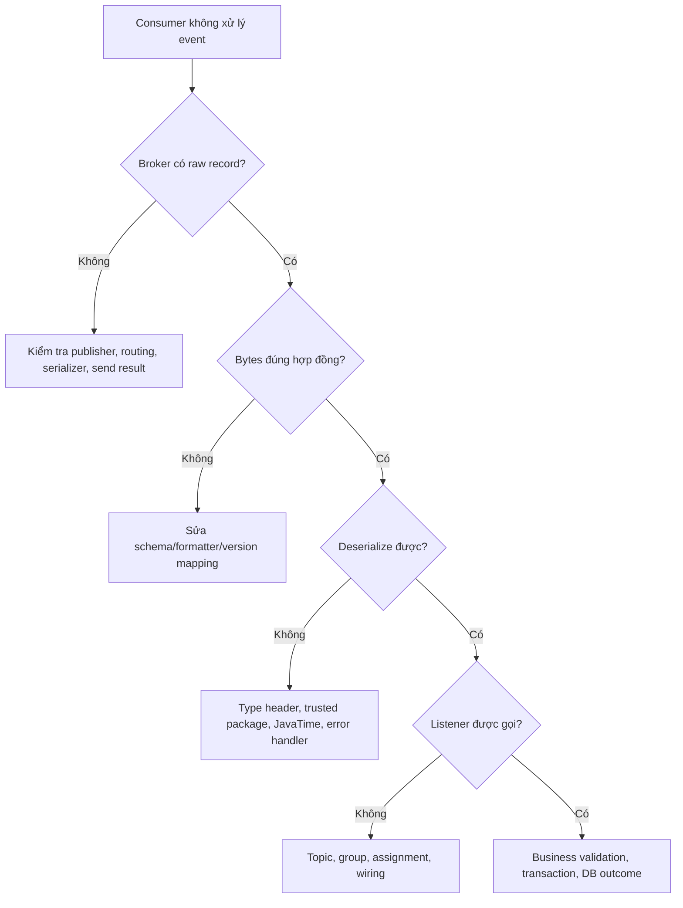

# Kiểm tra serialization của event payload trong Spring Modulith

## 1. Serialization là một ranh giới hợp đồng, không chỉ là chuyển object thành JSON

Trong ứng dụng Spring Modulith, module `ordering` có thể phát sự kiện `OrderPlaced` khi đơn hàng được xác nhận. Module `messaging` đưa sự kiện đó ra Kafka hoặc RabbitMQ để một consumer khác xử lý. Trong cùng một Spring application context, `ApplicationEventPublisher.publishEvent(...)` có thể chuyển trực tiếp **object Java** đến listener; nhưng khi event đi qua broker, hệ thống cần biến object thành **bytes** và giải mã bytes ở phía nhận.

Một bài `@ApplicationModuleTest` quan sát được `OrderPlaced` **không tự chứng minh** JSON gửi ra broker chứa tên trường, giá trị, định dạng ngày giờ và phiên bản schema phù hợp. Một producer unit test có thể xác nhận `KafkaTemplate.send(...)` được gọi với DTO đúng mà vẫn bỏ sót lỗi serializer. Tương tự, một consumer có thể được Spring tạo bean nhưng không bao giờ nhận được object vì message đã lỗi **trong bước deserialization trước listener**.

Vì vậy, **kiểm tra serialization của event payload** cần xác minh ba lớp:

1. **Domain → transport:** event nghiệp vụ được chuyển thành đúng hợp đồng message.
2. **Transport → bytes → transport:** định dạng trên dây (*wire format*) đúng, deserialize được và tương thích với các consumer được hỗ trợ.
3. **Broker → consumer:** serializer/deserializer trong ứng dụng thật hoạt động cùng topic, headers, trusted type và cách xử lý message lỗi.

Bài thuộc chương **Messaging testing** của học phần `SPRING_MODULITH_VERIFICATION_TESTING`. Mục tiêu chung là rèn kiểm chứng ranh giới bằng `ApplicationModules.verify()` và luật phụ thuộc, thực hành `@ApplicationModuleTest`, kiểm thử event, database, tích hợp và quality gate CI để tránh phụ thuộc sai cũng như hồi quy.

Sau bài học, bạn có thể:

- Phân biệt Spring application event nội bộ với payload được serialize qua broker.
- Thiết kế DTO message độc lập hợp lý với JPA entity và implementation detail.
- Test JSON contract của `UUID`, `BigDecimal`, `Instant`, enum, trường bắt buộc và version.
- Dùng **fixture/golden message cố định** thay vì chỉ dựa vào round-trip.
- Cấu hình JSON serializer/deserializer cho Spring Kafka theo hợp đồng.
- Viết unit/contract test và broker integration test cho cả producer lẫn consumer.
- Xác định xử lý message lỗi, schema evolution, dữ liệu nhạy cảm và các quality gate cần thiết.

## 2. Vị trí serialization trong đường đi của event

Ví dụ ứng dụng có ba application module:

```text
com.example.shop
├── ShopApplication.java
├── ordering
│   ├── OrderPlaced.java
│   └── OrderApplicationService.java
├── messaging
│   ├── OrderPlacedMessage.java
│   └── internal
│       └── OrderPlacedKafkaPublisher.java
└── payment
    └── internal
        ├── PaymentMessageListener.java
        └── PaymentService.java
```

Trong cấu trúc module mặc định, `ordering`, `messaging` và `payment` là các module. Các kiểu `OrderPlaced` và `OrderPlacedMessage` ở package gốc là API được xuất bản theo quy ước. Adapter và listener thuộc package `internal` của module sở hữu.



Ở đây có **hai ranh giới khác nhau**:

- Ranh giới **application module**: lớp nào được phép tham chiếu kiểu nào; `ApplicationModules.verify()` có thể kiểm tra qua bytecode/package.
- Ranh giới **wire contract**: bản ghi trên broker phải được consumer ở phiên bản phù hợp đọc đúng. Đây là nội dung chính của serialization test.

Một bài test nhận trực tiếp object `OrderPlaced` trong Spring event bus **không đi qua** `JsonSerializer` hoặc `JsonDeserializer` của Kafka. Đừng đánh đồng hai đường đi chỉ vì chúng cùng mang một “sự kiện đặt hàng”.

## 3. Tách domain event và transport message khi có consumer ngoài module

Domain event được module `ordering` công bố:

```java
// src/main/java/com/example/shop/ordering/OrderPlaced.java
package com.example.shop.ordering;

import java.math.BigDecimal;
import java.time.Instant;
import java.util.UUID;

public record OrderPlaced(
        UUID eventId,
        UUID orderId,
        BigDecimal amount,
        String currency,
        Instant occurredAt
) {
}
```

Transport DTO thuộc module `messaging`:

```java
// src/main/java/com/example/shop/messaging/OrderPlacedMessage.java
package com.example.shop.messaging;

import java.math.BigDecimal;
import java.time.Instant;
import java.util.Objects;
import java.util.UUID;

public record OrderPlacedMessage(
        int schemaVersion,
        UUID eventId,
        UUID orderId,
        String currency,
        BigDecimal amount,
        Instant occurredAt
) {
    public OrderPlacedMessage {
        if (schemaVersion != 1) {
            throw new IllegalArgumentException(
                    "Unsupported schema version: " + schemaVersion
            );
        }
        Objects.requireNonNull(eventId, "eventId");
        Objects.requireNonNull(orderId, "orderId");
        Objects.requireNonNull(occurredAt, "occurredAt");
        Objects.requireNonNull(amount, "amount");

        if (currency == null || currency.isBlank()) {
            throw new IllegalArgumentException("currency is required");
        }
        if (amount.signum() <= 0) {
            throw new IllegalArgumentException("amount must be positive");
        }
    }
}
```

Đây là **hợp đồng V1 minh họa**. Constructor kiểm tra dữ liệu để tránh tạo object không hợp lệ; nó không thay thế toàn bộ validation/bảo mật ở consumer. Trong hệ thống thật, cần thêm quy tắc mã tiền tệ, giới hạn amount, event ownership và xử lý version theo chính sách hỗ trợ.

**Vì sao tách hai kiểu?**

- Module `ordering` không phải phụ thuộc serializer hay tên topic Kafka.
- Wire contract có thể giữ ổn định khi mô hình domain/JPA thay đổi.
- Có chỗ xác định `schemaVersion`, field name và format thời gian rõ ràng.
- Consumer ngoài ứng dụng không cần biết package implementation của `ordering`.
- Contract test có đối tượng cần bảo vệ độc lập với event nội bộ.

Với ứng dụng rất nhỏ, dùng chung một record có thể chấp nhận được. Nhưng nếu message đi tới process khác, việc **xuất bản trực tiếp JPA entity** hoặc class `internal` thường tạo coupling và rủi ro khó kiểm soát.

## 4. Mapping domain event thành payload phải được kiểm tra

Ví dụ adapter nhận domain event rồi gửi Kafka:

```java
// src/main/java/com/example/shop/messaging/internal/
// OrderPlacedKafkaPublisher.java
package com.example.shop.messaging.internal;

import com.example.shop.messaging.OrderPlacedMessage;
import com.example.shop.ordering.OrderPlaced;
import org.springframework.context.event.EventListener;
import org.springframework.kafka.core.KafkaTemplate;
import org.springframework.stereotype.Component;

@Component
class OrderPlacedKafkaPublisher {

    static final String TOPIC = "orders.placed.v1";

    private final KafkaTemplate<String, OrderPlacedMessage> kafka;

    OrderPlacedKafkaPublisher(
            KafkaTemplate<String, OrderPlacedMessage> kafka) {
        this.kafka = kafka;
    }

    @EventListener
    void on(OrderPlaced event) {
        var message = new OrderPlacedMessage(
                1,
                event.eventId(),
                event.orderId(),
                event.currency(),
                event.amount(),
                event.occurredAt()
        );

        kafka.send(TOPIC, event.orderId().toString(), message);
    }
}
```

Trong ví dụ, `KafkaTemplate.send(...)` hoạt động bất đồng bộ và trả future. Việc `on(...)` hoàn tất **không chứng minh broker đã nhận bytes**, cũng không chứng minh consumer đã giải mã được payload. Production adapter cần chính sách báo lỗi, retry/publication recovery và transaction thích hợp.

Các điểm cần test khi mapping:

| Yếu tố | Source | Wire payload | Lỗi hay gặp |
| --- | --- | --- | --- |
| Event ID | `event.eventId()` | `eventId` | Tạo UUID mới mỗi lần retry nên mất khả năng dedup |
| Order ID | `event.orderId()` | `orderId` và Kafka key | Key lệch với payload khiến ordering/correlation sai |
| Số tiền | `event.amount()` | `amount` | Mất độ chính xác hoặc đổi đơn vị |
| Tiền tệ | `event.currency()` | `currency` | Thiếu currency khiến consumer hiểu sai |
| Thời điểm | `event.occurredAt()` | `occurredAt` ISO-8601 | Dùng thời gian máy gửi thay vì event time |
| Version | Policy wire contract | `schemaVersion=1` | Producer thay format nhưng không đổi/quản lý version |

**Mapping test** và **serialization test** là hai loại test khác nhau. Một DTO có field đúng vẫn có thể serialize sai khi serializer hoặc config JSON bị thay đổi.

## 5. Một golden payload JSON làm tiêu chuẩn đối chiếu

Giả sử hợp đồng V1 thống nhất dùng JSON object:

```json
{
  "schemaVersion": 1,
  "eventId": "11111111-1111-1111-1111-111111111111",
  "orderId": "22222222-2222-2222-2222-222222222222",
  "currency": "VND",
  "amount": 125000.00,
  "occurredAt": "2026-01-15T08:30:00Z"
}
```

Đây là **golden fixture**: một ví dụ hợp đồng được kiểm soát, dùng để phát hiện các thay đổi ngoài ý muốn.

Khi kiểm tra JSON, nên quan sát **ý nghĩa của các field** thay vì so sánh nguyên chuỗi JSON từng ký tự nếu hợp đồng không yêu cầu thứ tự key hoặc whitespace cố định. Hai JSON có thứ tự field khác nhau vẫn có thể biểu diễn cùng object.

Các điều cần quyết định rõ trước khi viết test:

- Tên field: `schemaVersion` hay `schema_version`?
- Định dạng `occurredAt`: chuỗi UTC ISO-8601 hay epoch milliseconds?
- `amount`: JSON number chính xác, decimal string hay integer minor units?
- `currency`: chuỗi ISO currency, enum hay mã riêng?
- Field nào bắt buộc, field nào có default?
- Khi có field mới, consumer cũ được phép bỏ qua hay phải từ chối?
- Schema version nằm trong payload, header hay registry?

Một schema hợp đồng rõ ràng giúp producer và consumer không vô tình “cùng sai theo cách giống nhau”.

## 6. Cấu hình Jackson cho `Instant`, `UUID` và `BigDecimal`

Trong các dự án dùng **Jackson 2**, một `ObjectMapper` test có thể khai báo module thời gian và định dạng ngày giờ dưới dạng ISO-8601:

```java
import com.fasterxml.jackson.databind.ObjectMapper;
import com.fasterxml.jackson.databind.SerializationFeature;
import com.fasterxml.jackson.datatype.jsr310.JavaTimeModule;

ObjectMapper json = new ObjectMapper()
        .registerModule(new JavaTimeModule())
        .disable(SerializationFeature.WRITE_DATES_AS_TIMESTAMPS);
```

- `UUID` thường được JSON hóa thành chuỗi.
- `BigDecimal` có thể được viết thành JSON number mà không chuyển qua `double` trong code Java.
- `Instant` cần module Java Time tương ứng ở cấu hình Jackson 2; tùy cấu hình, nó có thể được viết thành ISO-8601 string hoặc dạng timestamp.
- `WRITE_DATES_AS_TIMESTAMPS` được tắt trong ví dụ để `occurredAt` là chuỗi ISO-8601.

**Lưu ý phiên bản:** ví dụ Java/Jackson ở đây dùng package của Jackson 2 và giả định runtime tương thích. Một số thế hệ Spring Boot mới có thay đổi về Jackson/dependency; cần dùng API, module và dependency management đúng với phiên bản project. Khi test Spring Boot, nên ưu tiên **`ObjectMapper` được cấu hình từ application context** hoặc một codec test phản ánh chính xác cấu hình serializer đang triển khai.

Trong ứng dụng chạy Spring Boot, cấu hình JSON có thể chịu ảnh hưởng của property, module Jackson được tự động đăng ký hoặc customizer. **Đừng viết test với một `new ObjectMapper()` mặc định rồi mặc định nó tương đương serializer thực tế.**

## 7. Contract test: serialization phải tạo đúng field và format

Ví dụ JUnit không cần Kafka broker:

```java
// src/test/java/com/example/shop/messaging/
// OrderPlacedMessageJsonTests.java
package com.example.shop.messaging;

import static org.assertj.core.api.Assertions.assertThat;

import com.fasterxml.jackson.databind.ObjectMapper;
import com.fasterxml.jackson.databind.SerializationFeature;
import com.fasterxml.jackson.datatype.jsr310.JavaTimeModule;
import java.math.BigDecimal;
import java.time.Instant;
import java.util.UUID;
import org.junit.jupiter.api.Test;

class OrderPlacedMessageJsonTests {

    private final ObjectMapper json = new ObjectMapper()
            .registerModule(new JavaTimeModule())
            .disable(SerializationFeature.WRITE_DATES_AS_TIMESTAMPS);

    @Test
    void writesExpectedV1WireFields() throws Exception {
        var message = new OrderPlacedMessage(
                1,
                UUID.fromString("11111111-1111-1111-1111-111111111111"),
                UUID.fromString("22222222-2222-2222-2222-222222222222"),
                "VND",
                new BigDecimal("125000.00"),
                Instant.parse("2026-01-15T08:30:00Z")
        );

        byte[] bytes = json.writeValueAsBytes(message);
        var node = json.readTree(bytes);

        assertThat(node.path("schemaVersion").asInt()).isEqualTo(1);
        assertThat(node.path("eventId").asText())
                .isEqualTo("11111111-1111-1111-1111-111111111111");
        assertThat(node.path("orderId").asText())
                .isEqualTo("22222222-2222-2222-2222-222222222222");
        assertThat(node.path("currency").asText()).isEqualTo("VND");
        assertThat(node.path("amount").decimalValue())
                .isEqualByComparingTo("125000.00");
        assertThat(node.path("occurredAt").asText())
                .isEqualTo("2026-01-15T08:30:00Z");
    }
}
```

Test kiểm tra **shape và ngữ nghĩa dữ liệu** của JSON do codec tạo ra; thay tên `amount` thành `total` hoặc đổi timestamp sang epoch sẽ khiến test không đạt.

Tuy nhiên, đây vẫn là test với **ObjectMapper cấu hình trong chính bài test**, chưa xác nhận `KafkaTemplate` dùng đúng codec. Bài broker integration ở phần sau giải quyết ranh giới đó.

## 8. Round-trip hữu ích, nhưng không được dùng làm phép kiểm tra duy nhất

Một kiểm tra round-trip:

```java
@Test
void roundTripsMessage() throws Exception {
    var original = new OrderPlacedMessage(
            1,
            UUID.randomUUID(),
            UUID.randomUUID(),
            "VND",
            new BigDecimal("125000.00"),
            Instant.parse("2026-01-15T08:30:00Z")
    );

    byte[] bytes = json.writeValueAsBytes(original);
    var restored = json.readValue(bytes, OrderPlacedMessage.class);

    assertThat(restored.eventId()).isEqualTo(original.eventId());
    assertThat(restored.orderId()).isEqualTo(original.orderId());
    assertThat(restored.currency()).isEqualTo("VND");
    assertThat(restored.amount())
            .isEqualByComparingTo(original.amount());
    assertThat(restored.occurredAt())
            .isEqualTo(original.occurredAt());
}
```

Ở đây, test biết serializer và deserializer nội bộ của cùng phiên bản **có thể hiểu nhau**. Nhưng một hệ thống có thể đổi cả serializer lẫn deserializer sang một định dạng không tương thích với consumer đã triển khai; round-trip vẫn qua.

Ví dụ, nếu producer và consumer cùng đổi `occurredAt` từ chuỗi ISO-8601 sang số epoch, chúng vẫn có thể round-trip thành công. Consumer bên ngoài dùng phiên bản cũ lại không đọc được.

**Cần ít nhất một fixture độc lập hoặc consumer contract test** ngoài round-trip để bảo vệ định dạng đã công bố.

## 9. Golden fixture test: consumer phải đọc được payload đã công bố

Tạo một JSON fixture cố định trong source test (hoặc lưu trong test resources của dự án thực tế):

```java
@Test
void acceptsPublishedV1Fixture() throws Exception {
    String goldenV1 = """
            {
              "schemaVersion": 1,
              "eventId": "11111111-1111-1111-1111-111111111111",
              "orderId": "22222222-2222-2222-2222-222222222222",
              "currency": "VND",
              "amount": 125000.00,
              "occurredAt": "2026-01-15T08:30:00Z"
            }
            """;

    var message = json.readValue(
            goldenV1, OrderPlacedMessage.class
    );

    assertThat(message.schemaVersion()).isEqualTo(1);
    assertThat(message.currency()).isEqualTo("VND");
    assertThat(message.amount())
            .isEqualByComparingTo("125000.00");
    assertThat(message.occurredAt())
            .isEqualTo(Instant.parse("2026-01-15T08:30:00Z"));
}
```

Golden fixture nên được kiểm soát trong version control và thay đổi **có review hợp đồng**. Nếu luôn tạo “golden JSON” bằng chính serializer ở thời điểm chạy test, nó không còn độc lập và sẽ bỏ sót một số breaking change.

Với nhiều consumer hoặc nhiều phiên bản:

- Giữ fixture của các phiên bản **đang được hỗ trợ**.
- Test consumer mới đọc được fixture cũ khi chính sách yêu cầu backward compatibility.
- Test producer mới tạo payload được consumer cũ chấp nhận khi cần rolling deployment.
- Kiểm tra cả field optional, default và value lạ.
- Nếu dùng Avro/Protobuf, xác minh compatibility bằng schema/registry hoặc công cụ chuyên dụng, không chỉ bằng JSON round-trip.

## 10. `BigDecimal` và tiền tệ: tránh mất độ chính xác trong payload

Một bẫy phổ biến là đưa `BigDecimal` qua `double`:

```java
// Không nên dùng để bảo vệ độ chính xác tiền tệ.
double amount = new BigDecimal("0.1").doubleValue();
```

`double` dùng biểu diễn nhị phân dấu phẩy động, không biểu diễn chính xác mọi giá trị thập phân. Một đoạn code có thể nhìn đúng khi log nhưng sai khi cộng/trừ hoặc qua nhiều chuyển đổi.

Với message liên quan tiền tệ, nên thống nhất rõ:

| Lựa chọn wire format | Ví dụ | Lưu ý |
| --- | --- | --- |
| JSON number | `"amount": 125000.00` | Consumer phải parse bằng decimal chính xác, không làm mất precision |
| Decimal string | `"amount": "125000.00"` | Dễ giữ biểu diễn nhưng cần validation format |
| Integer minor units | `"amountMinor": 125000` | Cần xác định đơn vị nhỏ nhất theo currency |

**Không có một biểu diễn mặc định đúng cho mọi tiền tệ.** Phải xác định currency, đơn vị, giới hạn và quy tắc làm tròn.

Trong Java, `BigDecimal.equals(...)` còn xét `scale` (`1.0` và `1.00` không bằng nhau), còn `compareTo(...) == 0` xét giá trị số. Test nên chọn phép so sánh đúng ngữ nghĩa hợp đồng; nếu **scale cũng là điều kiện** (ví dụ bắt buộc 2 chữ số thập phân), cần assert `scale()` hoặc so sánh format riêng.

Đồng thời kiểm tra overflow/precision, giá trị âm, zero, trường `null` và amount ngoài giới hạn nghiệp vụ.

## 11. `Instant` và timezone: tránh biến đổi ngầm giữa các môi trường

Một `Instant` xác định **một thời điểm tuyệt đối**. Khi serialize, dạng chuỗi UTC ISO-8601 như `2026-01-15T08:30:00Z` giúp consumer hiểu rõ múi giờ.

Test nên đặt một thời điểm cố định, tránh:

```java
Instant.now(); // Làm fixture thay đổi theo thời gian chạy.
```

Đối với wire contract, cần trả lời:

- Có dùng UTC với hậu tố `Z` không?
- Có cho phép offset khác UTC, ví dụ `+07:00`, nhưng cùng instant không?
- Có giữ mili giây, micro giây hay nano giây không?
- Có cần backward compatibility với epoch millis?
- Consumer có dựa vào timezone hệ điều hành hoặc `LocalDateTime` không?

Nếu nghiệp vụ yêu cầu giữ **local date/time ở một timezone cụ thể**, chỉ dùng `Instant` có thể chưa đủ; cần đưa timezone hoặc offset vào contract tương ứng. Nhưng với **event timestamp**, một `Instant` UTC là lựa chọn thường dễ kiểm thử.

Một contract test tốt phải phát hiện khi ai đó đổi `WRITE_DATES_AS_TIMESTAMPS` hoặc thay kiểu `occurredAt` mà không cập nhật hợp đồng.

## 12. Trường thiếu, `null`, enum và dữ liệu không hợp lệ

Một JSON có thể **hợp lệ về cú pháp** nhưng sai hợp đồng:

```json
{
  "schemaVersion": 1,
  "eventId": "11111111-1111-1111-1111-111111111111",
  "orderId": "22222222-2222-2222-2222-222222222222",
  "currency": "",
  "amount": -10,
  "occurredAt": "2026-01-15T08:30:00Z"
}
```

Với constructor của `OrderPlacedMessage`, `currency` rỗng hoặc `amount` không dương sẽ bị từ chối. Trong Jackson, exception từ constructor có thể được bọc bởi exception mapping. Test nên kiểm tra **deserialization thất bại theo contract**, không gắn cứng vào nguyên văn một thông báo exception dễ đổi giữa phiên bản.

Ví dụ:

```java
@Test
void rejectsInvalidBusinessPayload() {
    String invalid = """
            {
              "schemaVersion": 1,
              "eventId": "11111111-1111-1111-1111-111111111111",
              "orderId": "22222222-2222-2222-2222-222222222222",
              "currency": "",
              "amount": -10,
              "occurredAt": "2026-01-15T08:30:00Z"
            }
            """;

    assertThatThrownBy(() ->
            json.readValue(invalid, OrderPlacedMessage.class))
            .isInstanceOf(
                    com.fasterxml.jackson.databind.JsonMappingException.class
            );
}
```

Trong file test, thêm import tĩnh `org.assertj.core.api.Assertions.assertThatThrownBy`.

**Các ca khác nên có:**

1. `eventId` không phải UUID hợp lệ.
2. Thiếu `orderId`, `occurredAt` hoặc `amount`.
3. Thiếu `schemaVersion`: với kiểu nguyên thủy `int`, Jackson có thể dùng giá trị mặc định `0`, nên validation cần từ chối.
4. `schemaVersion` lạ, ví dụ `99`.
5. `amount` quá lớn hoặc độ chính xác không hợp lệ với hợp đồng.
6. Trường mới chưa được consumer hỗ trợ.
7. Với enum, tên giá trị lạ hoặc thay đổi viết hoa/viết thường.

Nếu hợp đồng chứa enum, phải quyết định khi gặp giá trị mới nên **fail**, **map sang UNKNOWN** hay dùng một chiến lược version. Không nên bật một tùy chọn deserialize “mềm” mà không xem tác động nghiệp vụ.

### Cú pháp JSON hợp lệ không đủ

Kiểm tra parse chỉ xác nhận bytes có thể tạo object. Validation còn phải bảo vệ **ngữ nghĩa** (quantity dương, money currency hợp lệ, ID tồn tại nếu cần). Một vài quy tắc có thể được đặt trong DTO constructor, nhưng nhiều quy tắc cần use case hoặc cơ sở dữ liệu kiểm chứng.

## 13. Unknown fields và khả năng tiến hóa hợp đồng

Giả sử phiên bản mới thêm trường `salesChannel`:

```json
{
  "schemaVersion": 1,
  "eventId": "11111111-1111-1111-1111-111111111111",
  "orderId": "22222222-2222-2222-2222-222222222222",
  "currency": "VND",
  "amount": 125000.00,
  "occurredAt": "2026-01-15T08:30:00Z",
  "salesChannel": "MOBILE"
}
```

Một consumer cũ không biết `salesChannel` sẽ làm gì? Điều này phụ thuộc vào cấu hình Jackson và chính sách contract:

- **Strict:** từ chối field lạ để phát hiện thay đổi không được thống nhất.
- **Tolerant reader:** bỏ qua field lạ khi chính sách chấp nhận mở rộng additive.

Với Jackson 2, có thể cấu hình riêng ở test consumer:

```java
import com.fasterxml.jackson.databind.DeserializationFeature;

ObjectMapper tolerant = json.copy()
        .configure(
                DeserializationFeature.FAIL_ON_UNKNOWN_PROPERTIES,
                false
        );
```

**Không nên mặc định “bỏ qua field lạ luôn tốt”.** Nếu field mới thay đổi ý nghĩa thanh toán, consumer cũ bỏ qua có thể tạo quyết định sai. Cần xem hợp đồng nghiệp vụ, backward/forward compatibility và thứ tự triển khai các service.

Thêm một trường tùy chọn thường ít rủi ro hơn **đổi tên hoặc đổi ý nghĩa trường hiện có**. Nhưng ngay cả thêm trường cũng cần kiểm tra default, nullability và consumer cũ.

## 14. Quản lý `schemaVersion` và rolling deployment

Trong một hệ thống nhiều consumer, producer và consumer có thể chạy **khác phiên bản** trong lúc triển khai.

| Thay đổi | Rủi ro | Cách test |
| --- | --- | --- |
| Thêm field optional có default | Consumer cũ không hiểu field mới | Fixture payload mới trên consumer cũ, theo chính sách unknown field |
| Thay tên `amount` thành `totalAmount` | Consumer cũ thiếu field bắt buộc | Contract regression và migration test |
| Đổi `amount` từ number sang string | Consumer cũ có thể parse sai hoặc reject | Fixture trước/sau; test tương thích hai chiều khi cần |
| Đổi timezone/epoch của timestamp | Giá trị thời gian có thể bị hiểu sai | Golden timestamp fixture và semantic assertion |
| Thêm enum value | Consumer cũ không biết action mới | Consumer compatibility test |
| Bỏ field bắt buộc | Consumer khởi tạo object thiếu dữ liệu | Negative fixture/schema validation |
| Đổi schema V1 → V2 | Hai thế hệ cùng tồn tại trong triển khai | Test consumer đọc đúng các version đã cam kết |

Ví dụ DTO ở bài chỉ chấp nhận `schemaVersion == 1`. Đó là **chính sách strict V1** để minh họa. Nếu cần chấp nhận V1 và V2, nên có **decoder phân nhánh theo version**, DTO/adapter phù hợp cho từng version và test fixture tương ứng. Đừng âm thầm đổi ý nghĩa V1 nhưng vẫn ghi `schemaVersion: 1`.

**Schema version không tự làm contract tương thích.** Nó chỉ cung cấp tín hiệu để hệ thống quyết định parse/validate/migrate. Consumer vẫn phải có code và test cho những version cần hỗ trợ.

## 15. Spring Kafka JSON serializer/deserializer và type headers

Trong Spring Kafka, transport có thể dùng `JsonSerializer` và `JsonDeserializer`. Ví dụ cấu hình định hướng **payload JSON độc lập với tên Java class trong header**:

```yaml
spring:
  kafka:
    producer:
      key-serializer: org.apache.kafka.common.serialization.StringSerializer
      value-serializer: org.springframework.kafka.support.serializer.JsonSerializer
      properties:
        spring.json.add.type.headers: false
    consumer:
      key-deserializer: org.apache.kafka.common.serialization.StringDeserializer
      value-deserializer: org.springframework.kafka.support.serializer.JsonDeserializer
      auto-offset-reset: earliest
      properties:
        spring.json.use.type.headers: false
        spring.json.value.default.type: com.example.shop.messaging.OrderPlacedMessage
        spring.json.trusted.packages: com.example.shop.messaging
```

Ý nghĩa:

- Producer serialize value theo JSON và không chèn type header dựa vào tên Java class trong ví dụ.
- Consumer dùng **kiểu DTO đã cấu hình rõ** thay vì phụ thuộc vào type header do producer gửi.
- Chỉ trust package phù hợp, không mở `spring.json.trusted.packages: "*"` tùy tiện.
- Schema version và field names nằm trong **wire contract**, không nằm trong tên class Java.

**Cần phân biệt:** các key `spring.json.*` là thuộc tính của Spring Kafka; version có thể ảnh hưởng tùy chọn hỗ trợ và cách binding. Nếu dùng Spring Cloud Stream hoặc cơ chế externalization của Spring Modulith, cấu hình serializer/routing có thể thuộc binder hoặc extension tương ứng; hãy kiểm tra chính đường transport của ứng dụng.

Một số hệ thống Spring-to-Spring để type headers mặc định để consumer biết kiểu class. Cách này tiện nhưng có thể làm hai ứng dụng phụ thuộc vào **tên package/class Java**. Test phải xác định chiến lược được chọn, không ngầm vừa kỳ vọng có type headers vừa tắt chúng.

## 16. Unit test outbound adapter vẫn cần thiết

Kiểm tra mapper/routing trước khi xét bytes:

```java
// src/test/java/com/example/shop/messaging/internal/
// OrderPlacedKafkaPublisherTests.java
package com.example.shop.messaging.internal;

import static org.mockito.ArgumentMatchers.argThat;
import static org.mockito.ArgumentMatchers.eq;
import static org.mockito.Mockito.mock;
import static org.mockito.Mockito.verify;

import com.example.shop.messaging.OrderPlacedMessage;
import com.example.shop.ordering.OrderPlaced;
import java.math.BigDecimal;
import java.time.Instant;
import java.util.UUID;
import org.junit.jupiter.api.Test;
import org.springframework.kafka.core.KafkaTemplate;

class OrderPlacedKafkaPublisherTests {

    @Test
    void mapsDomainEventToTransportContract() {
        @SuppressWarnings("unchecked")
        KafkaTemplate<String, OrderPlacedMessage> kafka =
                mock(KafkaTemplate.class);

        var publisher = new OrderPlacedKafkaPublisher(kafka);
        UUID eventId = UUID.randomUUID();
        UUID orderId = UUID.randomUUID();
        var amount = new BigDecimal("125000.00");
        var time = Instant.parse("2026-01-15T08:30:00Z");

        publisher.on(new OrderPlaced(
                eventId, orderId, amount, "VND", time
        ));

        verify(kafka).send(
                eq("orders.placed.v1"),
                eq(orderId.toString()),
                argThat(message ->
                        message.schemaVersion() == 1
                                && message.eventId().equals(eventId)
                                && message.orderId().equals(orderId)
                                && message.currency().equals("VND")
                                && message.amount().compareTo(amount) == 0
                                && message.occurredAt().equals(time))
        );
    }
}
```

Đây là **unit test mapping và topic/key**, không đi qua Kafka serializer. Do đó, dù nó đạt, vẫn phải giữ JSON contract test và broker integration test.

**Lưu ý về event ID:** khi cùng domain event được retry, adapter nên **giữ nguyên `eventId`**. Nếu adapter tự sinh event ID mới mỗi lần gửi, consumer dedup theo `eventId` không nhận ra message được gửi lại.

## 17. Consumer test: phân biệt deserialize thành công và use case thành công

Consumer trong module `payment`:

```java
// src/main/java/com/example/shop/payment/internal/
// PaymentMessageListener.java
package com.example.shop.payment.internal;

import com.example.shop.messaging.OrderPlacedMessage;
import org.springframework.kafka.annotation.KafkaListener;
import org.springframework.stereotype.Component;

@Component
class PaymentMessageListener {

    private final PaymentService payments;

    PaymentMessageListener(PaymentService payments) {
        this.payments = payments;
    }

    @KafkaListener(
        topics = "orders.placed.v1",
        groupId = "shop-payment"
    )
    void on(OrderPlacedMessage message) {
        payments.requestPayment(
                message.eventId(),
                message.orderId(),
                message.currency(),
                message.amount()
        );
    }
}
```

Một service nội bộ minh họa:

```java
// src/main/java/com/example/shop/payment/internal/PaymentService.java
package com.example.shop.payment.internal;

import java.math.BigDecimal;
import java.util.UUID;
import org.springframework.stereotype.Service;

@Service
class PaymentService {

    void requestPayment(UUID eventId, UUID orderId,
                        String currency, BigDecimal amount) {
        // Trong production: idempotency, lưu trạng thái,
        // transaction và payment gateway.
    }
}
```

Nếu viết unit test gọi `new PaymentMessageListener(mockService).on(dto)`, bạn xác nhận **mapping DTO → use case**, không xác nhận broker đã deserialize bytes. Để kiểm tra consumer boundary thật, phải gửi **message qua serializer/broker/deserializer** hoặc test riêng đúng decoder đang dùng.

Với `@ApplicationModuleTest`, có thể kiểm tra bean wiring/event nội bộ, nhưng **`Scenario.publish(new OrderPlaced(...))` không tự đi qua `JsonDeserializer` của Kafka**. Cần dùng đúng lớp kiểm thử cho đúng ranh giới.

## 18. Broker integration: quan sát bytes producer thực sự gửi

Một producer-to-broker test nên đọc **raw bytes** bằng test consumer có **group riêng**, thay vì đọc lại bằng cùng `JsonDeserializer` của ứng dụng: nếu producer và consumer cùng sai, bài test typed round-trip có thể xanh.

Mô hình:



Trong integration test có Kafka Testcontainers, cần:

1. Khởi tạo topic `orders.placed.v1` (qua `NewTopic` bean hoặc provisioning test).
2. Khởi động test consumer riêng, dùng `ByteArrayDeserializer` cho value.
3. Đợi subscription/partition assignment; không dùng `Thread.sleep(...)` đoán readiness.
4. Publish **domain event từ ứng dụng**, không tự gọi `kafka.send` bằng một payload đã sẵn.
5. Poll raw bytes, chọn record có `eventId` đúng của test.
6. Kiểm tra key, JSON content, các header nếu hợp đồng yêu cầu.
7. Đặt timeout và dùng ID riêng để tránh nhận nhầm dữ liệu từ test khác.

Ví dụ **phần khởi tạo Kafka consumer observer** bên trong một `@SpringBootTest` có Kafka container:

```java
import java.util.Properties;
import java.util.UUID;
import org.apache.kafka.clients.consumer.ConsumerConfig;
import org.apache.kafka.clients.consumer.KafkaConsumer;
import org.apache.kafka.common.serialization.ByteArrayDeserializer;
import org.apache.kafka.common.serialization.StringDeserializer;

Properties config = new Properties();
config.put(ConsumerConfig.BOOTSTRAP_SERVERS_CONFIG,
        kafkaContainer.getBootstrapServers());
config.put(ConsumerConfig.GROUP_ID_CONFIG,
        "wire-probe-" + UUID.randomUUID());
config.put(ConsumerConfig.AUTO_OFFSET_RESET_CONFIG, "earliest");
config.put(ConsumerConfig.KEY_DESERIALIZER_CLASS_CONFIG,
        StringDeserializer.class);
config.put(ConsumerConfig.VALUE_DESERIALIZER_CLASS_CONFIG,
        ByteArrayDeserializer.class);

try (var probe = new KafkaConsumer<String, byte[]>(config)) {
    // Subscribe, poll cho đến khi được assignment, rồi publish event.
    // Poll record theo eventId và assert raw bytes qua ObjectMapper.
}
```

Đoạn này là **khung code**, chưa phải test hoàn chỉnh. `kafkaContainer` là Kafka Testcontainers đã được tạo; cần bảo đảm topic, listener và broker sẵn sàng. Tùy dự án, test consumer observer nên chạy trước khi kích hoạt event để tránh race về offset.

### Một helper poll phải làm gì?

Helper test không chỉ gọi `poll(Duration)` một lần rồi mong có record:

- Chờ assignment có deadline.
- Poll lặp lại nhưng có **thời hạn hữu hạn**.
- Duyệt record trong batch, tìm `eventId` đúng.
- Assert content sau khi tìm được record.
- Đóng consumer trong `try-with-resources`.
- Không dùng cùng consumer group của ứng dụng để tránh tranh partition.

Đây là lý do integration test thường nhiều setup hơn JSON unit test. Đổi lại, nó bảo vệ **đường truyền thực sự tới broker**.

## 19. Broker integration: gửi JSON thật để kiểm tra consumer

Chiều ngược lại là **broker → deserializer → consumer listener**. Một bài test có thể gửi fixture payload V1 lên Kafka rồi xác nhận `PaymentService` được gọi.

Ví dụ phác thảo test body với Kafka đã cấu hình, `KafkaTemplate<String, String> rawJsonKafka` dùng `StringSerializer` cho value, và `@MockitoBean PaymentService payments`:

```java
@Test
void jsonFixtureReachesPaymentUseCase() throws Exception {
    UUID eventId = UUID.randomUUID();
    UUID orderId = UUID.randomUUID();

    String fixture = """
            {
              "schemaVersion": 1,
              "eventId": "%s",
              "orderId": "%s",
              "currency": "VND",
              "amount": 125000.00,
              "occurredAt": "2026-01-15T08:30:00Z"
            }
            """.formatted(eventId, orderId);

    rawJsonKafka.send(
            "orders.placed.v1", orderId.toString(), fixture
    ).get(10, TimeUnit.SECONDS);

    verify(payments, timeout(15000)).requestPayment(
            eq(eventId),
            eq(orderId),
            eq("VND"),
            argThat(amount ->
                    amount.compareTo(new BigDecimal("125000.00")) == 0)
    );
}
```

Đây là **phần thân test minh họa**, không phải class hoàn chỉnh. Dự án phải cung cấp đúng `KafkaTemplate<String, String>` có `StringSerializer`, imports Mockito, `@SpringBootTest`, Kafka broker, topic, listener, JSON deserializer và mock bean phù hợp. `@MockitoBean` thuộc Spring Test hiện đại; dự án dùng phiên bản cũ cần cơ chế thay bean tương ứng.

**Điểm mạnh:** fixture **không được tạo từ `OrderPlacedMessage`** và đi qua broker/consumer JSON thật, nên có thể phát hiện một số lỗi deserialize, type mapping và listener registration.

**Giới hạn:** `PaymentService` bị mock; test không chứng minh database commit hay payment gateway thành công. Dùng integration test với service thật và transaction phù hợp cho các bất biến nghiệp vụ đó.

## 20. Kiểm thử invalid bytes và error handling trước listener

Bản ghi Kafka có thể chứa **JSON không hợp lệ**:

```text
{"schemaVersion":1,"eventId":
```

Lỗi này xảy ra **trước khi** Spring Kafka tạo được `OrderPlacedMessage` và gọi `PaymentMessageListener.on(...)`. Vì vậy:

- Unit test listener với DTO không hợp lệ **không kiểm tra deserializer**.
- Một bài JSON unit test dùng `readValue(...)` và assert exception kiểm tra codec, nhưng **không kiểm tra Kafka container/error handler**.
- Muốn kiểm tra đường phục hồi thực tế, cần gửi **raw bytes sai** qua broker và quan sát error handler/DLT hoặc chính sách recovery được cấu hình.

Với Spring Kafka, có thể dùng `ErrorHandlingDeserializer` để truyền thông tin lỗi deserialization tới cơ chế container:

```yaml
spring:
  kafka:
    consumer:
      key-deserializer: org.apache.kafka.common.serialization.StringDeserializer
      value-deserializer: org.springframework.kafka.support.serializer.ErrorHandlingDeserializer
      properties:
        spring.deserializer.value.delegate.class: org.springframework.kafka.support.serializer.JsonDeserializer
        spring.json.use.type.headers: false
        spring.json.value.default.type: com.example.shop.messaging.OrderPlacedMessage
        spring.json.trusted.packages: com.example.shop.messaging
```

**Không tự động suy ra dữ liệu hỏng sẽ được ghi DLT**: phải có error handler/recoverer, topic/queue và serializer dành cho record lỗi. Khi deserializer thất bại, recoverer có thể phải publish **raw byte[]** thay vì object DTO, nên Kafka producer gửi DLT cần cấu hình serializer phù hợp.

Test quan trọng:

| Input | Kỳ vọng | Phạm vi test |
| --- | --- | --- |
| Golden JSON V1 | Đọc thành `OrderPlacedMessage` đúng | Contract + broker consumer |
| UUID lỗi | Deserializer từ chối theo policy | Negative codec/broker |
| JSON truncated | Không gọi payment use case; lỗi được quan sát | Broker error handler/DLT |
| `amount` âm/zero | Constructor hoặc validation từ chối | Contract/consumer |
| Version không được hỗ trợ | Không xử lý sai ngữ nghĩa | Version compatibility/recovery |
| Java type header không hợp lệ | Không tin tưởng kiểu tùy ý | Security/serde config |
| Message có field ngoài hợp đồng | Strict/tolerant theo policy | Backward/forward compatibility |

**Một error handler “bắt và log” không phải tự động là chính sách recovery đầy đủ.** Cần phân biệt retry cho lỗi tạm thời với DLT/quarantine cho lỗi contract không thể tự sửa.

## 21. Sử dụng Spring Modulith event externalization đúng phạm vi

Spring Modulith hỗ trợ cơ chế **event externalization** với các transport và starter tương ứng. Tùy phiên bản/cấu hình, ứng dụng có thể khai báo event nào được externalize, cách routing và cách chuyển payload mà không cần tự viết toàn bộ Kafka adapter như mục 4.

Điều này **không làm mất nhu cầu serialization test**. Dù dùng adapter thủ công hay externalization do Spring Modulith cung cấp, vẫn cần chứng minh:

- Domain event nào được chọn để externalize?
- Đường routing tới topic/exchange nào?
- Payload được map thành hợp đồng V1/V2 nào?
- JSON serializer hoặc codec được dùng thực tế là gì?
- Headers, key và content type có đúng yêu cầu consumer?
- Nếu externalization thất bại, event publication/recovery được xử lý ra sao?

**Không bật cùng lúc hai cơ chế gửi cùng event** nếu không muốn record duplicate. Một integration test quan sát raw bytes có thể giúp phát hiện gửi trùng hoặc payload khác với hợp đồng.

`@ApplicationModuleTest` với `Scenario.stimulate(...)` giúp kiểm tra nghiệp vụ **thật sự phát domain event**. Một broker integration test tiếp theo kiểm tra **wire payload đã externalize**. Cần giữ ranh giới hai bài test rõ ràng.

## 22. Bảo vệ module boundary và data ownership

Các quan hệ kiểu Java trong ví dụ:

```mermaid
flowchart LR
    O["ordering.OrderPlaced (API)"] <--|"tham chiếu Java"| A["messaging.internal.OrderPlacedKafkaPublisher"]
    M["messaging.OrderPlacedMessage (API)"] <--|"tham chiếu Java"| C["payment.internal.PaymentMessageListener"]
    A --> K[("Kafka")]
    K --> C
    T["ApplicationModules.verify()"] -.->|"kiểm tra cạnh tĩnh"| A
    T -.->|"kiểm tra cạnh tĩnh"| C
```

Từ code:

- `messaging → ordering` vì adapter publisher dùng `ordering.OrderPlaced`.
- `payment → messaging` vì consumer dùng `messaging.OrderPlacedMessage`.
- Việc gửi message qua broker **không tự tạo cạnh kiểu trực tiếp** `ordering → payment`.
- Các kiểu thuộc package `internal` không nên được module khác import làm public contract.

Bài JUnit kiểm tra kiến trúc:

```java
// src/test/java/com/example/shop/ModuleArchitectureTests.java
package com.example.shop;

import org.junit.jupiter.api.Test;
import org.springframework.modulith.core.ApplicationModules;

class ModuleArchitectureTests {

    @Test
    void moduleBoundariesRemainValid() {
        ApplicationModules.of(ShopApplication.class).verify();
    }
}
```

**`ApplicationModules.verify()` không chứng minh JSON V1 hợp lệ, Kafka deserialize được hoặc số tiền không bị biến đổi.** Ngược lại, một payload đúng có thể vẫn được tạo bởi module đang truy cập repository nội bộ trái kiến trúc. Vì vậy cần **cả test tĩnh lẫn test contract/runtime**.

Ngoài wire contract, cần bảo vệ **data ownership**: đừng serialize JPA entity, lazy proxy hoặc toàn bộ cấu trúc dữ liệu nội bộ của module sang broker chỉ để tránh viết DTO. Điều đó làm rò rỉ schema database, gây lỗi lazy loading và tăng coupling.

## 23. Bảo mật và quyền riêng tư của event payload

Serialization test không chỉ kiểm tra “có đọc được không”, mà còn kiểm tra **không phát tán dữ liệu không nên xuất bản**.

Các nguyên tắc:

1. **Dữ liệu tối thiểu:** chỉ gửi các field consumer thực sự cần.
2. **Không gửi bí mật:** token, mật khẩu, thông tin thẻ hoặc secret không thuộc event contract.
3. **Không mở trust vô điều kiện:** tránh `trusted.packages=*` trừ khi có lý do/phòng vệ phù hợp.
4. **Không để tên implementation nội bộ trong wire format** khi consumer không cần biết Java class.
5. **Không log toàn bộ payload nhạy cảm** khi deserialization thất bại.
6. **Kiểm soát kích thước payload:** tránh message quá lớn hoặc object graph không giới hạn.
7. **Bảo vệ version/contract:** unknown field hoặc enum không được dẫn tới việc bỏ qua validation quan trọng.

Có thể viết một test **deny-list field** cho JSON tree:

```java
@Test
void payloadDoesNotExposeInternalFields() throws Exception {
    var message = new OrderPlacedMessage(
            1, UUID.randomUUID(), UUID.randomUUID(),
            "VND", new BigDecimal("125000"),
            Instant.parse("2026-01-15T08:30:00Z")
    );

    var tree = json.readTree(json.writeValueAsBytes(message));

    assertThat(tree.has("cardNumber")).isFalse();
    assertThat(tree.has("accessToken")).isFalse();
    assertThat(tree.has("jpaEntity")).isFalse();
}
```

Bài test này là **phòng vệ bổ sung**, không thay thế allow-list schema review, dữ liệu kiểm thử bảo mật hoặc chính sách phân quyền truy cập broker. Với hợp đồng quan trọng, nên kiểm tra **tập field được phép** hơn là chỉ ba tên bị cấm.

## 24. Chọn đúng loại test cho mỗi lỗi serialization

| Rủi ro | Loại test phù hợp | Assertion cần thiết |
| --- | --- | --- |
| Mapping domain → DTO sai | Unit test adapter | Event ID, key, amount, currency, time |
| `Instant` sai format | Jackson contract test | ISO string/epoch đúng hợp đồng |
| `BigDecimal` mất precision | Contract/fixture test | Giá trị chính xác, scale/unit theo quy ước |
| Tên field/schema bị đổi | Golden fixture + compatibility | Field/version bắt buộc vẫn đúng |
| Producer dùng serializer khác cấu hình test | Producer broker integration raw bytes | JSON bytes/headers thực sự được gửi |
| Consumer không đọc được fixture | Consumer broker integration | Listener nhận DTO và gọi đúng use case |
| JSON malformed | Codec negative + broker error handler | Không gọi use case; DLT/recovery theo policy |
| Type headers không tương thích | Spring Kafka serde integration | Consumer dùng đúng type strategy |
| Event nội bộ không được phát | `@ApplicationModuleTest` + `Scenario` | Stimulus thật tạo domain event |
| Vi phạm API/package module | `ApplicationModules.verify()` | Không ném lỗi kiến trúc |
| Consumer xử lý trùng | DB/business integration | Một tác động hữu hiệu theo event ID |
| Hồi quy trên pull request | CI required checks | Mọi test quan trọng thực sự chạy và fail khi sai |

Một test object round-trip **không** đủ để bảo vệ tất cả các rủi ro trong bảng. Chọn một **bộ test phân tầng** để vừa nhanh, vừa có bằng chứng chính xác về wire contract.

## 25. Kết hợp CI và test báo cáo lỗi rõ ràng

Một quality gate có thể được tổ chức theo thứ tự phản hồi nhanh:



Ví dụ lệnh build:

```bash
# Maven unit, module và những test được cấu hình trong pha test
./mvnw test

# Maven lifecycle đến verify; integration test cần Failsafe/cấu hình phù hợp
./mvnw verify

# Gradle test và các verification task đã khai báo
./gradlew test
./gradlew check
```

**Không mặc định `mvn verify` sẽ chạy mọi test có hậu tố `*IT`.** Nếu đặt broker test vào Failsafe/Gradle integrationTest task riêng, phải xác nhận task đã được liên kết với CI và báo cáo có tên test thực tế.

Với Testcontainers, CI runner cần Docker và khả năng tải image; có thể dùng topic/group riêng, ID mới và readiness/polling có deadline. **Không dùng `Thread.sleep(...)` như một bằng chứng broker/consumer đã sẵn sàng.**

Để gate có hiệu lực:

- Không đánh dấu test quan trọng `@Disabled` hoặc bỏ qua bằng `-DskipTests`/`-x test`.
- Không dùng `continue-on-error: true` hoặc bắt ngoại lệ rồi chỉ log.
- Cấu hình job thành **required status check** trong branch protection/ruleset.
- Khi thay đổi schema hoặc serializer, chạy **cả contract test lẫn broker integration**.
- Kiểm tra trên nhánh thử nghiệm: đổi tên `amount` hoặc format `occurredAt` có làm test đỏ không? Sau đó hoàn nguyên.

## 26. Quy trình chẩn đoán lỗi payload

Giả sử consumer `payment` không nhận được `OrderPlacedMessage`. Hãy khoanh vùng:

1. **Publisher:** domain event `OrderPlaced` có được phát từ use case thật không?
2. **Mapping:** adapter có tạo `OrderPlacedMessage` đủ field và đúng version không?
3. **Routing:** topic/key và broker bootstrap servers đúng không?
4. **Serializer:** producer dùng `JsonSerializer` hay một serializer khác? Có lỗi `Instant`/module Jackson không?
5. **Raw bytes:** test consumer độc lập có đọc được record không? Nội dung JSON thực tế là gì?
6. **Headers:** type headers có đang được bật/tắt thống nhất giữa producer/consumer không?
7. **Deserializer:** default type, trusted packages và schema có đúng không?
8. **Validation:** DTO constructor có từ chối null, amount hoặc version không hỗ trợ không?
9. **Listener:** bean `@KafkaListener` có được đăng ký, group/partition assignment đúng không?
10. **Error handler:** lỗi có xảy ra trước listener, được đưa tới DLT hay chỉ retry vô hạn?
11. **Use case:** listener nhận DTO rồi nhưng payment service/DB có lỗi không?
12. **Test:** có nhận nhầm record của test khác, bị skip hoặc dùng fixture tự tạo từ code hiện tại không?



Một `DeserializationException` chỉ ra lỗi trước listener; một `ConditionTimeoutException` khi chờ database có thể là lỗi listener, transaction hoặc predicate. **Đừng chỉ tăng timeout** mà chưa xác nhận record nào tồn tại và lỗi xảy ra ở tầng nào.

## 27. Bài tập tự kiểm tra

**Câu 1.** `@ApplicationModuleTest` publish `OrderPlaced` và listener nhận object thành công. Có chứng minh Kafka payload JSON đọc được chưa?

**Đáp án:** Không. Đây là đường event trong Spring context, chưa đi qua `JsonSerializer`/`JsonDeserializer` hay broker.

**Câu 2.** Test `mapper.readValue(mapper.writeValueAsBytes(message))` đạt. Có bảo đảm consumer phiên bản cũ đọc được message mới không?

**Đáp án:** Không. Producer và consumer cùng code có thể đổi format đồng thời và vẫn round-trip. Cần fixture/schema compatibility độc lập.

**Câu 3.** Consumer dùng `double` để đọc `amount`, producer gửi `BigDecimal`. Rủi ro?

**Đáp án:** Có nguy cơ mất độ chính xác thập phân hoặc làm tròn khi tính toán. Nên thống nhất decimal string, minor units hoặc numeric decoder giữ precision.

**Câu 4.** `Instant` được serialize thành epoch millis trong một build nhưng golden fixture yêu cầu ISO-8601 UTC. Test nào nên thất bại?

**Đáp án:** Jackson contract/golden fixture test so sánh field `occurredAt` với format đã công bố.

**Câu 5.** Producer tắt type header còn consumer vẫn phụ thuộc type header để chọn class. Điều gì có thể xảy ra?

**Đáp án:** Consumer không xác định được DTO hoặc deserialize sai. Cần chiến lược thống nhất, ví dụ fixed default type ở consumer và tắt type header ở cả hai phía theo hợp đồng.

**Câu 6.** JSON có `schemaVersion=1` nhưng `amount=-10`. Parse JSON thành công đã đồng nghĩa payload hợp lệ chưa?

**Đáp án:** Chưa. DTO/consumer cần kiểm tra ngữ nghĩa nghiệp vụ; constructor minh họa từ chối amount không dương.

**Câu 7.** Một message JSON bị cắt giữa chừng. Có thể kiểm thử bằng cách gọi trực tiếp `PaymentMessageListener.on(dto)` không?

**Đáp án:** Không. Lỗi xảy ra ở deserializer trước khi có DTO. Cần negative codec test và broker/error handler test với raw bytes lỗi.

**Câu 8.** Producer unit test Mockito xác nhận `KafkaTemplate.send` được gọi đúng DTO. Đã kiểm tra serializer thực tế của Kafka chưa?

**Đáp án:** Chưa. Cần broker producer integration test quan sát raw bytes, hoặc một test trực tiếp trên serializer được cấu hình thật.

**Câu 9.** Vì sao không nên công bố entity JPA của module `ordering.internal` làm wire payload?

**Đáp án:** Rò rỉ implementation/schema, tăng coupling, gặp vấn đề lazy loading hoặc serialize object graph và làm hỏng ranh giới module.

**Câu 10.** Thêm trường `salesChannel` vào JSON. Consumer cũ luôn tương thích không?

**Đáp án:** Không. Phụ thuộc cấu hình unknown-field, tính optional/default và ngữ nghĩa trường mới; cần compatibility test.

**Câu 11.** Đã có `ApplicationModules.verify()` xanh, có thể bỏ serialization test không?

**Đáp án:** Không. `verify()` kiểm tra quan hệ tĩnh, không kiểm tra bytes, date format, precision, schema và consumer runtime.

**Câu 12.** Muốn chắc chắn consumer business effect hoàn tất, chờ `kafka.send(...).get(...)` đã đủ chưa?

**Đáp án:** Chưa. Producer send result không phải tín hiệu payment service đã commit; phải quan sát event/state nghiệp vụ hoặc integration test với database.

## 28. Checklist trước khi merge thay đổi liên quan event serialization

- **Hợp đồng:** domain event và transport message có trách nhiệm rõ; không đưa entity/internal class ra broker.
- **Schema:** field names, type, required/default, version và compatibility được xác định.
- **Identity:** giữ nguyên `eventId` khi retry cùng event; `orderId` và key nhất quán.
- **Money:** dùng biểu diễn decimal chính xác, currency và quy tắc scale/rounding rõ ràng.
- **Time:** `Instant`/timestamp format và timezone được kiểm tra bằng fixture cố định.
- **Validation:** null, UUID hỏng, unsupported version, enum lạ, amount không hợp lệ có test.
- **Producer:** có unit mapping test và broker raw-byte test cho serializer/routing thật.
- **Consumer:** có fixture/golden test và broker integration cho deserialize/dispatch.
- **Error path:** malformed bytes, type header, DLT/recovery được kiểm chứng theo cấu hình.
- **Security:** payload tối thiểu; không trust wildcard hoặc phát tán dữ liệu nhạy cảm.
- **Kiến trúc:** `ApplicationModules.verify()` bảo vệ API module và hướng phụ thuộc.
- **Module testing:** `@ApplicationModuleTest`/`Scenario` bảo vệ hành vi phát/nhận event trong Spring context.
- **CI:** test contract, compatibility, broker và database quan trọng thực sự chạy, thất bại làm required check đỏ.

**Ghi nhớ:** Một event Java hợp lệ chưa chắc trở thành payload wire hợp lệ. Kiểm tra serialization cần **bảo vệ shape và ngữ nghĩa của bytes**, dùng golden fixture để tránh “producer và consumer cùng sai”, rồi kiểm chứng serializer/deserializer thực tế qua broker. Kết hợp các phép test đó với `ApplicationModules.verify()`, `@ApplicationModuleTest`, kiểm thử database/tích hợp và CI để bảo vệ cả ranh giới module lẫn hợp đồng messaging qua nhiều phiên bản.
