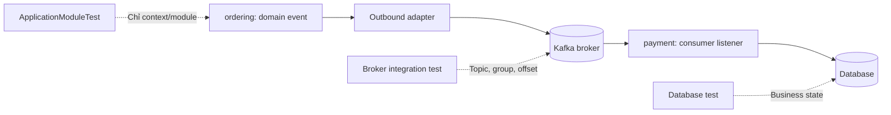
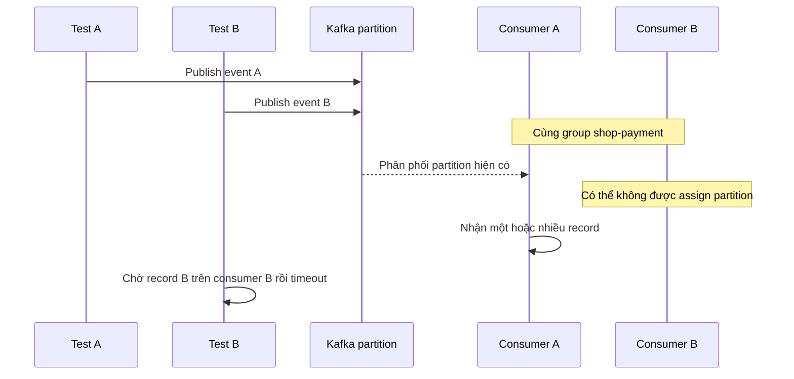
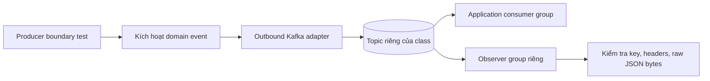
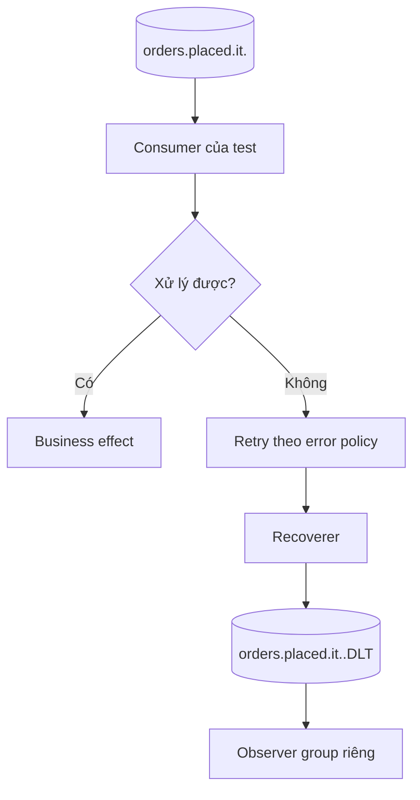
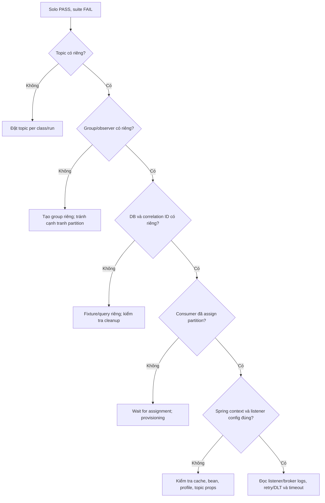
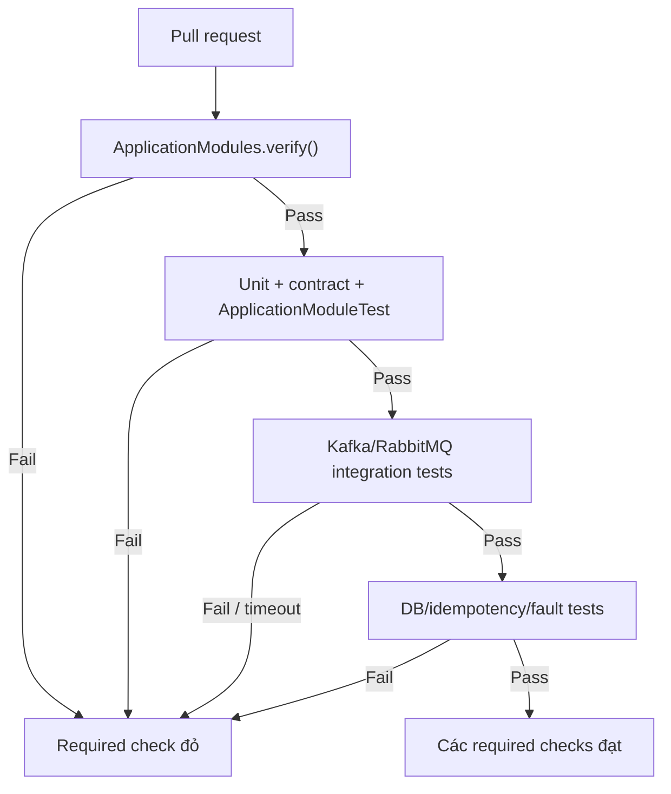

# Cô lập broker giữa các test trong Spring Modulith

## 1. Vì sao phải cô lập broker trong kiểm thử messaging?

Trong ứng dụng Spring Modulith, module `ordering` có thể công bố `OrderPlaced`, một adapter phát message qua Kafka, và listener của module `payment` tiếp nhận message để tạo yêu cầu thanh toán. Đường đi đó thường được kiểm thử bằng broker thật trong integration test.

Nếu nhiều bài test cùng sử dụng **topic, consumer group, offset hoặc dữ liệu của nhau**, kết quả dễ trở nên không ổn định: test A đọc message của B, listener nghiệp vụ lấy mất record mà test observer đang chờ, hoặc message từ một lần chạy trước khiến assertion xanh dù publisher đang lỗi.

Một triệu chứng quen thuộc:

- Chạy **một test riêng lẻ** thì đạt, chạy cả suite lại thất bại.
- Local thường đạt, nhưng CI chạy song song bị timeout ngẫu nhiên.
- Test consumer đợi một message rất lâu, trong khi test khác nhận được message đó.
- Test dùng `auto.offset.reset=earliest` rồi xử lý lại hàng loạt record cũ.
- Test DLT tìm thấy lỗi từ kịch bản khác và kết luận sai.
- Test dùng `@DirtiesContext` nhưng message cũ vẫn nằm trong broker.

Đây không nhất thiết là lỗi Kafka hoặc Spring Modulith. Phần lớn là **thiếu ranh giới sở hữu tài nguyên test**.

Bài thuộc chương **Messaging testing** của học phần `SPRING_MODULITH_VERIFICATION_TESTING`. Mục tiêu chung là kiểm chứng kiến trúc bằng `ApplicationModules.verify()` và các luật phụ thuộc, thực hành `@ApplicationModuleTest`, kiểm thử sự kiện, database và integration, rồi bảo vệ bằng quality gate trong CI. Riêng bài này tập trung vào **cô lập hạ tầng broker và dữ liệu giữa các bài test** để các kết luận kiểm thử đáng tin cậy.

Sau bài học, bạn có thể:

1. Nhận diện các chiều cô lập: broker, topic, group, offset, queue, key, dữ liệu, Spring context và CI job.
2. Chọn chiến lược **broker riêng** hoặc **broker dùng chung với namespace riêng** theo chi phí và rủi ro.
3. Cấu hình Kafka Testcontainers, topic và group riêng theo lớp test.
4. Thiết kế test producer/consumer không tranh nhau record.
5. Kiểm tra readiness, cleanup, DLT, retry, duplicate và transaction mà không dùng `Thread.sleep(...)`.
6. Phân biệt Kafka với RabbitMQ về đơn vị tài nguyên cần cô lập.
7. Tổ chức các test vào CI và phát hiện test “xanh giả” do rò rỉ trạng thái.

## 2. Phân biệt cô lập broker với cô lập application module

Spring Modulith cho phép kiểm tra từng application module qua `@ApplicationModuleTest`. Một module test có thể dùng `Scenario.publish(...)` để đưa **Spring application event** vào context và quan sát listener.

Nhưng một bài test dùng Kafka hoặc RabbitMQ có những tài nguyên **nằm ngoài Spring context**:



Nếu test tạo một Spring context mới, **Kafka topic cũ không tự biến mất**. Nếu test rollback một transaction JPA, **offset Kafka hoặc một message đã publish không rollback theo mặc định**. Nếu test đổi consumer group, **trạng thái database cũng không tự tách biệt**.

Vì vậy, thiết kế isolation tốt phải trả lời đồng thời:

- **Ai sở hữu broker?** Một test method, một lớp, một suite hay cả CI environment?
- **Ai sở hữu topic/queue?** Có tên riêng hay dùng namespace chung?
- **Ai sở hữu tiến độ tiêu thụ?** Group ID, offset hoặc ack state có riêng không?
- **Ai sở hữu kết quả?** Database record, correlation ID, external side effect có riêng không?
- **Ai dọn tài nguyên và khi nào?** Test framework, container lifecycle hay cleanup explicit?

`ApplicationModules.verify()` kiểm tra phụ thuộc tĩnh, không quản lý những tài nguyên runtime này. Các bài test phải bổ sung nhau, không thay thế nhau.

## 3. Những lớp isolation cần xét

| Lớp cô lập | Kafka | RabbitMQ | Khi bỏ qua sẽ xảy ra gì? |
| --- | --- | --- | --- |
| **Broker process** | Kafka container/cluster riêng | RabbitMQ container/node riêng | Dữ liệu, config và lỗi giữa suite ảnh hưởng nhau |
| **Namespace** | Topic riêng, prefix/suffix test | Virtual host, exchange/queue riêng | Message của test A lọt sang test B |
| **Consumer ownership** | Group ID riêng | Queue/binding hoặc consumer riêng | Test observer tranh record với consumer nghiệp vụ |
| **Progress state** | Committed offset theo group/topic/partition | Ack state và message đang chờ trong queue | Test đọc record cũ hoặc bỏ qua record cần kiểm tra |
| **Input identity** | `eventId`, `orderId`, Kafka key | Correlation/message ID, routing key | Assertion nhận nhầm kết quả của test khác |
| **Output state** | DB rows, cache, service state | DB rows, cache, service state | Test xanh giả vì kết quả có sẵn |
| **Failure path** | DLT, retry topic, backoff | DLX/DLQ, retry queue | Message lỗi cũ làm sai test recovery |
| **Runtime context** | Spring bean/listener factory/config | Spring bean/listener container/config | Bean hoặc subscription ngoài ý muốn vẫn hoạt động |
| **Execution scope** | JVM, parallel workers, CI job | JVM, parallel workers, CI job | Lock trong JVM không ngăn được job khác |

Cần phân biệt hai khái niệm:

- **Physical isolation:** tạo một broker/container riêng cho mỗi lớp hoặc nhóm test.
- **Logical isolation:** dùng broker chung nhưng tài nguyên bên trong có tên và tiến độ độc lập.

Không có một cách duy nhất tối ưu cho mọi suite. Lựa chọn phụ thuộc vào yêu cầu quan sát, số lượng bài test, chi phí khởi động hạ tầng, mức song song và khả năng gây thay đổi cấu hình broker.

## 4. Ví dụ: cùng topic, cùng group khiến test tranh nhau record

Giả sử cả hai test đều dùng topic `orders.placed.v1` và group `shop-payment`:



Trong Kafka, các consumer **cùng group** chia partition. Một partition thường được một consumer member của group sở hữu tại một thời điểm; các consumer khác không cùng nhận mọi record. Do đó, dùng cùng group để cho hai test observer quan sát cùng một topic có thể làm các test **tranh nhau message**.

Ngược lại, hai group **khác nhau** có thể cùng đọc log của topic đó một cách độc lập theo offset của từng group. Nhưng điều này chỉ cô lập tiến độ đọc, **không tự cô lập input**: cả hai group vẫn có thể nhìn thấy message của test khác nếu topic dùng chung.

Một bộ test đáng tin thường kết hợp:

- Topic riêng theo lớp test hoặc một nhóm test rõ ràng.
- Group riêng cho consumer nghiệp vụ của test.
- Group **khác nữa** cho test observer đọc bản ghi, không dùng group của listener nghiệp vụ.
- `eventId` và `orderId` mới ở mỗi test method.
- Truy vấn state lọc đúng các ID đó.

## 5. Chọn phạm vi sống của broker: method, class hay suite?

| Chiến lược | Ưu điểm | Đổi lại | Trường hợp nên dùng |
| --- | --- | --- | --- |
| Broker mới **mỗi test method** | Isolation rất mạnh, dễ reset config | Khởi động tốn thời gian, Docker nhiều tài nguyên | Test thay cấu hình broker, fault test khó cô lập bằng namespace |
| Broker mới **mỗi test class** | Cân bằng isolation và tốc độ | Các method trong class vẫn có thể chia sẻ state | Integration test cần Kafka thật, ít test/method |
| Broker dùng chung **một suite/JVM** | Tăng tốc nhiều test | Bắt buộc đặt topic/group/key riêng, cleanup có kỷ luật | Nhiều contract/integration test chạy song song |
| Broker dùng chung **CI environment** | Không khởi động container cho từng job | Nguy cơ cạnh tranh liên job, giữ data lâu | Chỉ khi có namespace/ACL/lifecycle và ownership chặt chẽ |

**Ưu tiên mặc định cho bài học:** Kafka Testcontainers **một container tĩnh theo lớp**, kèm topic/group **riêng cho lớp** và correlation key riêng cho method. Đây là điểm khởi đầu khá dễ đọc và giảm việc vô tình phụ thuộc vào môi trường bên ngoài.

Cần lưu ý: `static @Container` trong một lớp thường chạy trong lifecycle **của lớp** khi sử dụng JUnit Testcontainers extension, không có nghĩa toàn bộ suite dùng một instance. Nếu chọn shared singleton container theo thiết kế khác, phải quản lý lifecycle và namespace chủ động.

### Không tối ưu tốc độ quá sớm

Mở cùng một broker cho mọi test có thể giảm thời gian chạy nhưng **tăng chi phí điều tra flaky test**. Với các suite quan trọng như payment/inventory, nhiều khi một container riêng theo class là sự đánh đổi hợp lý. Khi chuyển sang reuse, nên chứng minh isolation bằng cách chạy song song và lặp lại suite.

## 6. Định nghĩa hợp đồng dùng chung trong ví dụ

Để thực hành, ta dùng message do module `messaging` công bố:

```java
// src/main/java/com/example/shop/messaging/OrderPlacedMessage.java
package com.example.shop.messaging;

import java.math.BigDecimal;
import java.util.UUID;

public record OrderPlacedMessage(
        UUID eventId,
        UUID orderId,
        BigDecimal total
) {
}
```

Consumer của `payment` nhận message và chuyển tới use case nội bộ:

```java
// src/main/java/com/example/shop/payment/internal/OrderPlacedConsumer.java
package com.example.shop.payment.internal;

import com.example.shop.messaging.OrderPlacedMessage;
import org.springframework.kafka.annotation.KafkaListener;
import org.springframework.stereotype.Component;

@Component
class OrderPlacedConsumer {

    private final PaymentRequestService payments;

    OrderPlacedConsumer(PaymentRequestService payments) {
        this.payments = payments;
    }

    @KafkaListener(
        id = "order-placed-listener",
        topics = "${app.messaging.order-topic}",
        groupId = "${app.messaging.order-group}"
    )
    void on(OrderPlacedMessage message) {
        payments.requestPayment(
                message.eventId(),
                message.orderId(),
                message.total()
        );
    }
}
```

Use case nội bộ:

```java
// src/main/java/com/example/shop/payment/internal/PaymentRequestService.java
package com.example.shop.payment.internal;

import java.math.BigDecimal;
import java.util.UUID;
import org.springframework.stereotype.Service;

@Service
class PaymentRequestService {

    void requestPayment(UUID eventId, UUID orderId,
                        BigDecimal total) {
        // Ứng dụng thật: validate, idempotency, transaction và persistence.
    }
}
```

Các placeholder `${app.messaging.order-topic}` và `${app.messaging.order-group}` nằm trong cấu hình annotation Java. Khi chạy ứng dụng thật, cần khai báo các property tương ứng, ví dụ trong cấu hình deployment:

```yaml
app:
  messaging:
    order-topic: orders.placed.v1
    order-group: shop-payment
```

**Đây là điểm thiết kế quan trọng cho testability:** không hardcode mọi listener vào cùng topic/group production. Một integration test có thể thay thế **cả hai property** bằng namespace test riêng, để những Spring context khác không vô tình dùng chung listener group.

**Lưu ý:** nếu còn một listener khác subscribe topic cố định trong cùng `@SpringBootTest`, chỉ thay property cho listener trên chưa cô lập toàn bộ context. Hãy kiểm tra tất cả consumer/producers/adapter được bootstrap trong bài test.

## 7. Kafka Testcontainers với topic và group riêng theo lớp test

Ví dụ Spring Boot integration test bên dưới tập trung vào **broker → consumer → lời gọi use case**. Dùng `@MockitoBean` để thay service thật nhằm kiểm tra wiring/transport, không kéo database vào bài test này.

```java
// src/test/java/com/example/shop/payment/internal/OrderBrokerIsolationTests.java
package com.example.shop.payment.internal;

import static org.mockito.Mockito.timeout;
import static org.mockito.Mockito.verify;

import com.example.shop.messaging.OrderPlacedMessage;
import java.math.BigDecimal;
import java.util.UUID;
import java.util.concurrent.TimeUnit;
import org.junit.jupiter.api.Test;
import org.springframework.beans.factory.annotation.Autowired;
import org.springframework.boot.test.context.SpringBootTest;
import org.springframework.context.annotation.Bean;
import org.springframework.boot.test.context.TestConfiguration;
import org.springframework.context.annotation.Import;
import org.springframework.kafka.config.TopicBuilder;
import org.springframework.kafka.core.KafkaTemplate;
import org.springframework.test.context.DynamicPropertyRegistry;
import org.springframework.test.context.DynamicPropertySource;
import org.springframework.test.context.bean.override.mockito.MockitoBean;
import org.apache.kafka.clients.admin.NewTopic;
import org.testcontainers.junit.jupiter.Container;
import org.testcontainers.junit.jupiter.Testcontainers;
import org.testcontainers.kafka.KafkaContainer;
import org.testcontainers.utility.DockerImageName;

@SpringBootTest
@Testcontainers
@Import(OrderBrokerIsolationTests.TestTopics.class)
class OrderBrokerIsolationTests {

    static final String TOPIC =
            "orders.placed.it." + UUID.randomUUID();
    static final String GROUP =
            "payment-it-" + UUID.randomUUID();

    @Container
    static final KafkaContainer KAFKA = new KafkaContainer(
            DockerImageName.parse("apache/kafka:3.8.0")
    );

    @DynamicPropertySource
    static void kafkaProperties(DynamicPropertyRegistry registry) {
        registry.add("spring.kafka.bootstrap-servers",
                KAFKA::getBootstrapServers);
        registry.add("app.messaging.order-topic", () -> TOPIC);
        registry.add("app.messaging.order-group", () -> GROUP);
    }

    @TestConfiguration
    static class TestTopics {
        @Bean
        NewTopic ordersTopic() {
            return TopicBuilder.name(TOPIC)
                    .partitions(1).replicas(1).build();
        }
    }

    @Autowired
    KafkaTemplate<String, OrderPlacedMessage> kafka;

    @MockitoBean
    PaymentRequestService payments;

    @Test
    void brokerEventReachesThisConsumer() throws Exception {
        UUID eventId = UUID.randomUUID();
        UUID orderId = UUID.randomUUID();
        var total = new BigDecimal("125000");
        var message = new OrderPlacedMessage(
                eventId, orderId, total
        );

        kafka.send(TOPIC, orderId.toString(), message)
                .get(10, TimeUnit.SECONDS);

        verify(payments, timeout(15000)).requestPayment(
                eventId, orderId, total
        );
    }
}
```

**Ý nghĩa của isolation:**

- `KAFKA` là một static container trong lifecycle class.
- `TOPIC` và `GROUP` là hai tên riêng, được tạo một lần khi class được nạp.
- `@DynamicPropertySource` đưa bootstrap servers, topic và group vào đúng Spring context.
- `NewTopic` tạo topic một partition cho kịch bản test khi Spring Kafka admin có cấu hình provisioning tương ứng.
- Mỗi method sinh `eventId` và `orderId` mới, tránh xác nhận nhầm lời gọi từ method khác.
- `@MockitoBean` làm test chỉ xác nhận listener chuyển message sang service; chưa kiểm tra dữ liệu được commit.

**Điều kiện để ví dụ chạy:** cần Spring Boot/JUnit Jupiter, Spring Kafka, Docker, Testcontainers Kafka/JUnit, cấu hình `JsonSerializer`/`JsonDeserializer` tương thích và property liên quan. `@MockitoBean` thuộc Spring Framework 6.2+; dự án ở phiên bản cũ dùng cơ chế mock bean tương ứng. `KafkaContainer` và image được minh họa theo họ Testcontainers mới; cần đồng bộ dependencies theo BOM.

Các listener khác do `@SpringBootTest` khởi tạo có thể vẫn đăng ký với topic production nếu chưa parameterize; lúc ấy test chưa thật sự cô lập toàn bộ ứng dụng. Cần rà soát bootstrap context khi áp dụng ví dụ.

## 8. Cấu hình serializer/deserializer cùng với isolation

Topic/group riêng không giúp gì nếu producer và consumer dùng serializer khác nhau. Ví dụ JSON ở môi trường test:

```yaml
spring:
  kafka:
    producer:
      key-serializer: org.apache.kafka.common.serialization.StringSerializer
      value-serializer: org.springframework.kafka.support.serializer.JsonSerializer
      properties:
        spring.json.add.type.headers: false
    consumer:
      key-deserializer: org.apache.kafka.common.serialization.StringDeserializer
      value-deserializer: org.springframework.kafka.support.serializer.JsonDeserializer
      auto-offset-reset: earliest
      properties:
        spring.json.use.type.headers: false
        spring.json.value.default.type: com.example.shop.messaging.OrderPlacedMessage
        spring.json.trusted.packages: com.example.shop.messaging
```

Đây là cấu hình **minh họa riêng cho kiểu `OrderPlacedMessage`**, không phải bộ cấu hình áp dụng cho mọi consumer trong một ứng dụng lớn.

Nếu một test khác dùng JSON schema, Avro hoặc deserializer khác, hãy đặt cấu hình rõ ràng theo test scope; không để một shared consumer factory ngầm dùng type cũ hoặc default type của bài khác.

**Cảnh báo:** `auto-offset-reset: earliest` chỉ quyết định điểm bắt đầu **khi consumer group chưa có offset được commit** cho partition liên quan. Nó **không** xóa offset cũ hoặc buộc group đang có offset quay về đầu log. Vì vậy, tạo group riêng thường đáng tin hơn việc cố chỉnh offset reset trên một group dùng chung.

Không mở `spring.json.trusted.packages: "*"` một cách tùy tiện trong dữ liệu không đáng tin; chỉ trust đúng kiểu/package cần thiết theo chiến lược serializer đã chọn.

## 9. Topic riêng giúp ngăn rò rỉ input giữa các test

Trong trường hợp dùng chung broker, đặt topic theo một quy tắc dễ truy vết:

```text
orders.placed.it.<test-run-id>.<test-class>
orders.placed.it.<test-run-id>.<another-class>
inventory.reserve.it.<test-run-id>.<another-class>
```

Kafka cho phép tên topic có ký tự hợp lệ theo quy tắc của broker; có thể dùng UUID dạng không có dấu `-` hoặc một chuỗi ngắn an toàn. Với bài test thật, cân nhắc giới hạn độ dài tên topic và quy ước tránh trùng.

Ví dụ Java:

```java
static final String RUN_ID =
        UUID.randomUUID().toString().replace("-", "");

static final String TOPIC =
        "orders.placed.it." + RUN_ID;
```

**Điểm mạnh:** record của test A không được ghi vào topic B nếu application config, adapter và listener đều dùng đúng property. Điều này mạnh hơn chỉ lọc `eventId` trên một topic dùng chung.

**Điểm cần làm:** tất cả thành phần liên quan phải cùng đọc **một giá trị topic**. Một publisher dùng `orders.placed.v1` hardcode trong code còn consumer được thay `orders.placed.it...` sẽ khiến test timeout, dù isolation ở listener có vẻ đúng.

### Nếu muốn topic riêng cho mỗi test method?

Listener của Spring thường xác định topic khi context và container khởi động. Đổi một static property giữa hai method **không tự khiến listener đăng ký lại topic mới**. Nếu cần topic per-method, hãy kiểm soát lifecycle context/container hoặc thiết kế dynamic listener/subscription chủ động.

Với chi phí thấp hơn, **topic riêng theo class + key/eventId riêng theo method** thường đủ, miễn là những method không chạy đồng thời trên cùng mutable state.

## 10. Consumer group riêng giải quyết một vấn đề khác topic riêng

Kafka group ID định danh **một tiến độ tiêu thụ độc lập**.

- Group `payment-it-A` có committed offsets riêng.
- Group `wire-probe-it-A` có committed offsets khác.
- Cả hai group có thể đọc **cùng topic**, vì không phải member của cùng group.
- Hai consumer cùng group có thể chia partition, nên **không nên dùng một group cho app listener và test observer**.

Ví dụ khi muốn kiểm tra producer bằng một test observer:

```java
String appGroup = "payment-it-" + runId;
String observerGroup = "wire-probe-" + runId;

// Observer group khác appGroup, dù cùng topic.
```

Nếu observer sử dụng `appGroup`, một partition chỉ có thể được assign cho một member trong group ở thời điểm nhất định; test có thể không thấy record vì consumer nghiệp vụ đã sở hữu partition.

Nếu observer dùng group riêng nhưng topic chung với test khác, nó có thể thấy **message không liên quan**. Khi đó phải lọc chính xác `eventId` hoặc dùng topic riêng.

**Đừng nhầm group ID với Kafka key**: key phục vụ partitioning/ordering; group phục vụ consumer coordination và offset ownership. Hai yếu tố này giải quyết những vấn đề isolation khác nhau.

## 11. Offset cũ, group cũ và nguy cơ đọc nhầm record

Một tình huống sai phổ biến:

```text
Test A chạy lần 1: group=payment-tests, topic=orders.placed.v1
Test B chạy sau đó: group=payment-tests, topic=orders.placed.v1
B kỳ vọng đọc toàn bộ từ đầu bằng auto.offset.reset=earliest
```

Nếu group `payment-tests` đã commit offset, `earliest` **không tự reset** vị trí đọc. Test B có thể không thấy record mà nó muốn, hoặc thấy một dữ liệu không liên quan tùy partition assignment và tiến độ.

Những cách xử lý có chủ đích:

1. **Ưu tiên:** group ID mới cho mỗi test suite/class; đọc trong topic riêng.
2. **Khi cần tái tạo lịch sử:** dùng consumer test group mới và `earliest` hoặc `seek` được kiểm soát.
3. **Khi phải dùng group cố định:** chủ động quản lý offset reset/deletion bằng Kafka admin dưới điều kiện consumer không hoạt động và có quyền, không tự động xóa group production.
4. **Khi test ordering:** theo dõi partition và offset của chính record được gửi, không chỉ dựa vào message count tổng.

Không nên tùy tiện gọi admin reset offset của một group đang được suite khác sử dụng. Điều đó thay đổi một tài nguyên chung và có thể tạo nhiều lỗi khó truy vết hơn.

## 12. Readiness: chờ subscription và assignment, không ngủ cố định

Ngay cả khi Kafka container đã được đánh dấu running, consumer listener có thể chưa được assign partition. Một bài test gửi message ngay rồi kiểm tra có thể vẫn ổn với `earliest` và group mới, nhưng những test phụ thuộc thời điểm subscribe thường cần một **readiness barrier** rõ ràng.

Với Spring Kafka Test hỗ trợ `ContainerTestUtils`, có thể đợi assignment của listener container:

```java
import static org.assertj.core.api.Assertions.assertThat;

import org.springframework.beans.factory.annotation.Autowired;
import org.springframework.kafka.config.KafkaListenerEndpointRegistry;
import org.springframework.kafka.test.utils.ContainerTestUtils;

@Autowired
KafkaListenerEndpointRegistry listenerRegistry;

// Trong test/setup sau khi Spring context đã khởi động:
var listener = listenerRegistry
        .getListenerContainer("order-placed-listener");

assertThat(listener).isNotNull();

ContainerTestUtils.waitForAssignment(listener, 1);
```

Bài test ở mục 7 đặt `id = "order-placed-listener"`, nên registry có thể tra container theo ID. Ví dụ giả định topic có **một partition** và framework/test dependency cung cấp API `waitForAssignment` tương ứng. Khi dùng nhiều partition, kỳ vọng assignment phải phản ánh số consumer/partition thực tế; không cố đợi một container được assign tất cả partition nếu group có nhiều member.

Với consumer test tự tạo bằng `KafkaConsumer`, có thể `subscribe(...)` rồi `poll(...)` cho tới khi `assignment()` không rỗng, với deadline hữu hạn.

**Không dùng `Thread.sleep(1000)` như bằng chứng consumer sẵn sàng.** Trên CI, container chạy nhưng networking/topic provisioning hoặc rebalance vẫn có thể chậm hơn.

## 13. Kiểm tra producer bằng observer riêng, không tranh consumer nghiệp vụ

Một test producer-to-broker cần quan sát **record thật** từ Kafka, nhưng không nên dùng listener nghiệp vụ làm công cụ duy nhất để kiểm tra wire payload.

Sơ đồ:



Test observer có thể dùng `KafkaConsumer<String, byte[]>` để đọc **raw bytes**, tránh việc producer và consumer cùng dùng một cấu hình JSON sai nhưng round-trip vẫn qua.

Cấu hình observer:

```java
import java.util.Properties;
import java.util.UUID;
import org.apache.kafka.clients.consumer.ConsumerConfig;
import org.apache.kafka.clients.consumer.KafkaConsumer;
import org.apache.kafka.common.serialization.StringDeserializer;
import org.apache.kafka.common.serialization.ByteArrayDeserializer;

Properties properties = new Properties();
properties.put(ConsumerConfig.BOOTSTRAP_SERVERS_CONFIG,
        KAFKA.getBootstrapServers());
properties.put(ConsumerConfig.GROUP_ID_CONFIG,
        "observer-" + UUID.randomUUID());
properties.put(ConsumerConfig.AUTO_OFFSET_RESET_CONFIG, "earliest");
properties.put(ConsumerConfig.KEY_DESERIALIZER_CLASS_CONFIG,
        StringDeserializer.class);
properties.put(ConsumerConfig.VALUE_DESERIALIZER_CLASS_CONFIG,
        ByteArrayDeserializer.class);

try (var observer = new KafkaConsumer<String, byte[]>(properties)) {
    observer.subscribe(java.util.List.of(TOPIC));

    // Poll đến khi được assignment (có timeout).
    // Kích hoạt publisher thực.
    // Poll record, lọc eventId và assert bytes/headers.
}
```

Đây là **khung cấu hình**, không phải một test hoàn chỉnh. Phần poll cần deadline, điều kiện match và exception khi không thấy record; test phải kích hoạt **publisher thật** (ví dụ gọi use case hoặc publish domain event vào Spring context), không chỉ tự gửi fixture qua `KafkaTemplate`.

### Lọc đúng record

Không kiểm tra “bản ghi đầu tiên” nếu có thể tồn tại record khác. Hãy chọn record đúng `eventId`, rồi xác nhận:

- Topic và key đúng.
- Payload có đúng eventId, orderId và số tiền.
- Headers hoặc schema version theo hợp đồng.
- Không có dữ liệu nhạy cảm không được phép.
- Nếu cần kiểm tra chỉ một lần externalize, quan sát số record có correlation ID đó trong một khoảng hoặc qua mốc hoàn tất cụ thể, không chỉ thấy record đầu tiên.

**Topic/group riêng giúp hạn chế nhiễu**, nhưng correlation ID vẫn cần để chứng minh record đến từ stimulus hiện tại.

## 14. Mỗi test method cần dữ liệu nghiệp vụ độc lập

Giả sử một lớp có ba bài:

- `publishesOrderEvent()`: phát event hợp lệ.
- `retriesTransientFailure()`: mock use case lỗi hai lần.
- `deadLettersInvalidMessage()`: gửi message không hợp lệ.

Dù cùng broker/topic class, mỗi bài nên tạo **eventId, orderId và fixture riêng**. Một test không được dựa vào dữ liệu do test khác tạo ra.

```java
@Test
void consumesItsOwnEvent() throws Exception {
    UUID eventId = UUID.randomUUID();
    UUID orderId = UUID.randomUUID();

    var message = new OrderPlacedMessage(
            eventId, orderId, new BigDecimal("125000")
    );

    kafka.send(TOPIC, orderId.toString(), message)
            .get(10, TimeUnit.SECONDS);

    verify(payments, timeout(15000)).requestPayment(
            eventId, orderId, new BigDecimal("125000")
    );
}
```

**Không chỉ assert `verify(payments).requestPayment(any(), any(), any())`.** Với listener bất đồng bộ hoặc context có nhiều message, một lời gọi từ test khác vẫn có thể làm assertion qua.

Khi kiểm tra database, sử dụng:

```java
await().atMost(Duration.ofSeconds(15))
        .untilAsserted(() ->
                assertThat(paymentQuery.existsByOrderId(orderId))
                        .isTrue());
```

Ở đây `paymentQuery` là API đọc do ứng dụng cung cấp. Điều kiện chờ phải lọc **orderId của test hiện tại**, không dùng `repository.count() > 0`.

### Cleanup giữa method vẫn có ý nghĩa

Các method trong cùng một class dùng chung topic và group, nên có thể tồn tại record cũ trong log. Với Kafka, **xóa bản ghi riêng lẻ không phải thao tác cleanup đơn giản**. Các chiến lược tốt hơn là topic riêng/class, group riêng, ID riêng và không phụ thuộc vào record count tổng.

Nếu một method thay mock/consumer state có thể ảnh hưởng method sau, test framework cần reset mock/context hoặc tránh chia sẻ mutable state. Đừng mặc định broker isolation tự xử lý cả Spring bean singleton hoặc database.

## 15. Cô lập retry, DLT và các nhánh lỗi

Khi listener lỗi, Spring Kafka có thể retry và gửi record sang dead-letter topic (DLT). Nếu các test dùng DLT chung, một test có thể đọc record lỗi còn lại từ test trước và **xanh giả**.

Ví dụ naming:

```text
orders.placed.it.<runId>
orders.placed.it.<runId>.DLT
orders.placed.it.<runId>.retry-0
```

Đây là **một quy ước ví dụ**: tên retry topic do framework/cấu hình cụ thể quyết định, không nhất thiết có hậu tố `.retry-0`. DLT thường được cấu hình explicit hoặc theo convention; phải xác minh **destination resolver thực tế**.

Cần đảm bảo:

1. Topic chính và DLT thuộc **cùng namespace test riêng**.
2. Recoverer dùng tên topic test, **không hardcode DLT production**.
3. DLT được provision với số partition phù hợp resolver.
4. DLT observer có **group ID riêng**.
5. Assertion lọc `eventId` và kiểm tra metadata lỗi.
6. Test sau khi hết retry phải đợi **record thực vào DLT**, không chỉ nhìn mock recoverer được gọi.



**Quan trọng:** nếu test dùng cùng `DefaultErrorHandler` và DLT thực tế của một application context rộng, hãy kiểm tra các listener khác trong context không gửi message vào cùng destination. Topic chính riêng **không đủ** nếu DLT resolver bị cấu hình cố định.

## 16. Test duplicate, replay và ordering vẫn cần isolation

Cô lập broker không có nghĩa bỏ các bài test đặc biệt của messaging. Với Kafka, bạn vẫn cần:

- **Ordering:** cùng key/orderId dẫn tới cùng partition theo cấu hình, offset tăng trong kịch bản test.
- **Duplicate delivery:** cùng `eventId` được gửi hai lần nhưng tác động nghiệp vụ hữu hiệu chỉ xảy ra một lần.
- **Replay:** một record được gửi lại từ DLT/topic lịch sử không phá trạng thái mới.
- **Consumer restart/rebalance:** dữ liệu đã commit không bị áp dụng lại ngoài ý muốn.

Isolation giúp loại bỏ **nhiễu bên ngoài kịch bản**, từ đó các thay đổi quan sát được có thể quy về chính test.

Một ví dụ tốt:

```text
Topic = stock.commands.it.<classRunId>
Group = inventory.it.<classRunId>
OrderId = UUID mới cho mỗi method

Test ordering:
    RESERVE(sequence=1), CANCEL(sequence=2)

Test duplicate:
    RESERVE(eventId=A) gửi 2 lần
    DB chỉ có 1 reservation hữu hiệu

Test replay:
    Cùng eventId=A được phát lại sau restart/recovery
    DB vẫn có 1 reservation hữu hiệu
```

**Bẫy quan trọng:** sau khi gửi duplicate thứ hai, test thấy `reservationCount == 1` và kết thúc ngay **chưa chắc** đã chứng minh consumer đã đọc duplicate. Cần có completion/audit signal, mốc offset phù hợp hoặc invariant bền vững, và kiểm tra sau khi xử lý cả hai delivery.

Không dùng một broker đầy record của các test khác để “tăng độ khó” cho ordering test. Muốn kiểm tra concurrency/ordering, hãy tạo **nhiễu có kiểm soát trong chính test**, giữ ranh giới nhân quả rõ ràng.

## 17. Spring context cache và `@DirtiesContext` không thay broker cleanup

Spring Test có thể cache `ApplicationContext` giữa các bài test để giảm thời gian khởi động. Điều này hữu ích, nhưng cần hiểu phạm vi:

- Spring context cache tái sử dụng bean, listener factory và một số property khi cấu hình được coi là tương đương.
- `@DirtiesContext` yêu cầu đóng/không tái sử dụng context theo quy tắc của Spring Test.
- Kafka topic, committed offsets và retained records **vẫn thuộc broker**; đóng context không xóa chúng.
- Container lifecycle do Testcontainers điều khiển, không phải `@DirtiesContext`.

Với `@DynamicPropertySource`, một vấn đề dễ gặp là class test con dùng property động khác trong khi context cũ được tái sử dụng. Nếu dùng inheritance hoặc chung cấu hình context phức tạp, cần bảo đảm context được phân biệt hoặc sử dụng `@DirtiesContext` theo trường hợp được tài liệu Spring Test mô tả.

**Đừng dùng `@DirtiesContext` cho mọi method chỉ để che việc shared topic/group không được cô lập**. Nó có thể làm suite chậm mà vẫn để record cũ trong Kafka.

### Listener được bootstrap có thể ngoài ý muốn

`@SpringBootTest` thường khởi động một ứng dụng rộng hơn một module test. Điều này có thể kích hoạt cả:

- Consumer `payment`.
- Consumer `inventory`.
- Adapter externalize event.
- Scheduler/recovery job.
- Listener trong một feature khác.

Nếu test chỉ định cô lập `payment`, hãy xem những bean nào thực sự được bootstrap. Có thể dùng test configuration, Spring profiles hoặc module-scope test phù hợp; nhưng không vô hiệu hóa một bean mà chính bài test đang cố chứng minh hoạt động.

## 18. Database isolation cần đi cùng broker isolation

Hãy xét hai test có Kafka topic riêng nhưng cùng database:

```text
Test A: topic-A -> Consumer A -> INSERT payment(orderId=42)
Test B: topic-B -> Consumer B -> SELECT payment(orderId=42)
```

Nếu cả hai dùng cùng `orderId` và cùng database, B có thể thấy dữ liệu của A. Khi đó topic riêng không ngăn **xanh giả ở database**.

Các lựa chọn:

| Chiến lược dữ liệu | Ưu điểm | Hạn chế |
| --- | --- | --- |
| Database container riêng theo class/suite | Cách ly mạnh, sạch | Tốn thời gian khởi động/tài nguyên |
| Schema/database riêng theo test | Cách ly logical rõ | Cần migration/config/cleanup phù hợp |
| ID ngẫu nhiên + query theo ID | Nhanh, dễ áp dụng | Không đủ nếu test thay dữ liệu global hoặc dùng unique key chung |
| Truncate/cleanup trước/sau test | Giữ dữ liệu nhỏ, ổn định | Nguy hiểm khi test chạy song song trên cùng schema |
| Transaction rollback trong thread test | Hữu ích với một số unit/integration setup | **Không tự rollback transaction của listener thread hay Kafka offsets** |

Khi listener xử lý trong một thread/transaction riêng, `@Transactional` trên method test không nhất thiết rollback những gì listener đã commit. Một test có thể phải dọn database thực sự hoặc dùng database/schema test riêng.

Để kiểm chứng nghiệp vụ sau broker, luôn quan sát **state đã commit** bằng `orderId`/`eventId` riêng. Nếu assertion dùng một transaction đọc có snapshot cũ, Awaitility polling vẫn có thể timeout dù listener đã commit.

## 19. Cô lập bằng correlation ID và assertion đúng đối tượng

Ngay cả với broker riêng, một class vẫn có nhiều event. Vì vậy, mọi assertion nên xác định **đúng event hiện tại**.

Không nên viết:

```java
// Assertion yếu: có thể khớp record từ test khác.
verify(payments, timeout(10000))
        .requestPayment(any(), any(), any());
```

Hoặc:

```java
// Assertion yếu nếu database có dữ liệu từ trước.
await().until(() -> paymentRepository.count() > 0);
```

Nên viết:

```java
UUID eventId = UUID.randomUUID();
UUID orderId = UUID.randomUUID();

await()
        .atMost(Duration.ofSeconds(10))
        .untilAsserted(() -> {
            var payment = paymentQuery.findByOrderId(orderId)
                    .orElseThrow();

            assertThat(payment.eventId()).isEqualTo(eventId);
            assertThat(payment.status()).isEqualTo("PENDING");
        });
```

Ở đây `paymentQuery` và `PaymentView` là API nghiệp vụ minh họa, không phải class mặc định của Spring Modulith. Muốn kiểm tra persistence, cần dùng implementation database thật và transaction đọc phù hợp.

**Nguyên tắc:** broker/topic/group isolation giảm **nhiễu đầu vào**; correlation và business assertions giảm **nguy cơ kết luận sai**.

## 20. RabbitMQ: cô lập vhost, exchange, queue và consumer

Với RabbitMQ, consumer không dùng Kafka group/offset. Message được route qua exchange/binding đến queue; các consumer cùng queue có thể **cạnh tranh delivery**, tùy cơ chế acknowledgment.

Các cấp isolation thích hợp:

| Lớp | Cách cô lập RabbitMQ | Điều cần kiểm tra |
| --- | --- | --- |
| Broker | `RabbitMQContainer` mới theo test class/suite | Hạ tầng độc lập |
| Namespace mạnh | Virtual host riêng (nếu quyền admin/setup cho phép) | Các exchange/queue không lẫn nhau |
| Routing | Exchange và routing key test riêng | Không route vào queue production/test khác |
| Delivery | Queue riêng và consumer ownership riêng | Không có competing consumer ngoài ý muốn |
| Error path | DLX/DLQ riêng với binding phù hợp | Message lỗi đúng queue và metadata |
| State | Message ID + DB fixture riêng | Không nhận nhầm effect của test khác |

Ví dụ quy ước:

```text
exchange = shop.orders.it.<runId>
queue    = shop.payment.it.<runId>
routing  = order.placed.it.<runId>
dlx      = shop.dlx.it.<runId>
dlq      = shop.payment.dlq.it.<runId>
```

**Không nên dựa vào một queue chung chỉ vì mỗi test có consumer riêng.** Trong RabbitMQ, nhiều consumer cùng queue thường là **competing consumers**: mỗi message được giao cho một consumer, không broadcast cho tất cả.

Muốn hai test đều nhận cùng publish, chúng có thể cần **hai queue riêng** cùng binding với exchange. Nếu dùng queue auto-delete/exclusive, phải hiểu lifecycle và connection ownership; không dùng auto-delete như một lời đảm bảo dọn sạch mọi dữ liệu trong mọi tình huống.

DLQ và retry queue cũng phải được định danh riêng. Nếu chỉ đổi queue chính mà DLX vẫn route về một DLQ cố định, các test lỗi vẫn ảnh hưởng nhau.

## 21. Testcontainers reuse: nhanh hơn nhưng dễ giữ trạng thái ngoài ý muốn

Testcontainers có các cơ chế dùng lại container hoặc chia sẻ singleton theo thiết kế. Việc này có thể giảm thời gian bootstrap, nhưng với message broker cần chú ý:

- Container có thể giữ topic, offset, dữ liệu và config từ lần chạy trước nếu broker không được reset.
- Topic/group tên cố định sẽ tái sử dụng tiến độ ngoài ý muốn.
- Parallel test class hoặc CI job có thể chia sẻ một broker khi cấu hình runtime cho phép.
- Test cleanup không tốt có thể làm suite chỉ qua khi chạy đúng thứ tự.

**Không mặc định bật container reuse cho required CI tests.** Nếu nhóm quyết định reuse, phải có chiến lược namespace per run, cleanup, health check, giới hạn dung lượng, phân quyền và một job kiểm thử isolation định kỳ.

Một hệ thống test dùng container riêng theo class có thể chậm hơn, nhưng thường dễ truy vết hơn. Nên đo tốc độ và độ ổn định trước khi tối ưu lifecycle.

### Docker image và cấu hình broker là một phần fixture

Dùng cùng một version image hoặc một phạm vi phiên bản đã pin theo chính sách test, để hai lần chạy không đổi hành vi ngẫu nhiên do image update. Cần bảo đảm Docker runtime sẵn sàng trong CI và broker có đủ tài nguyên.

Tuy nhiên, **pin image không thay thế isolation**: hai test dùng cùng Kafka version nhưng cùng group/topic vẫn có thể tranh nhau record.

## 22. Chạy song song: một lock không bảo vệ được mọi process

JUnit 5 có thể chạy test song song, và CI có thể tách suite thành nhiều job/process độc lập.

Nếu các lớp test chia sẻ broker và mutable namespace:

- Test A xóa topic đúng lúc B đang publish.
- Test B reset group offset của A.
- Listener A nhận message của B khi cùng group.
- Một test cleanup truncate database của test khác.
- Test DLT nhận record không thuộc case đang kiểm tra.

Có ba cách tiếp cận:

1. **Isolation theo tài nguyên:** topic, group, queue, schema và ID riêng; ưu tiên khi cần parallelism.
2. **Điều phối trong một JVM:** dùng `@ResourceLock` hoặc `@Execution(SAME_THREAD)` khi một tài nguyên thật sự cần serial execution.
3. **Cô lập theo CI job:** broker/container hoặc namespace riêng cho mỗi worker/job.

Ví dụ annotation JUnit (khi không thể bỏ shared resource):

```java
import org.junit.jupiter.api.parallel.ResourceLock;
import org.junit.jupiter.api.parallel.Execution;
import org.junit.jupiter.api.parallel.ExecutionMode;

@ResourceLock("shared-test-broker")
@Execution(ExecutionMode.SAME_THREAD)
class LegacySharedBrokerTests {
    // Các test dùng resource chung trong cùng JVM.
}
```

**Giới hạn:** resource lock của JUnit điều phối trong phạm vi engine/process nơi nó hoạt động; **không khóa** được test trong một JVM khác, một Docker container runner khác hoặc job CI độc lập. Nếu nhiều job dùng cùng broker bên ngoài, cần namespace riêng hoặc cơ chế điều phối liên process.

Chạy suite tuần tự có thể che lỗi sharing tạm thời; mục tiêu tốt hơn là **làm mỗi test không cần phụ thuộc thứ tự** khi có thể.

## 23. Cleanup: dọn đúng tài nguyên, đúng chủ sở hữu

Một test cần chịu trách nhiệm về tài nguyên mình tạo. Một chiến lược cleanup an toàn:

1. Gắn prefix/suffix để nhận diện **topic, queue, group, schema** do test sở hữu.
2. Đóng các **test consumer/producers** tạo thủ công trong `try-with-resources` hoặc lifecycle fixture.
3. Dừng listener context/container của test theo lifecycle framework.
4. Xóa topic/queue test nếu broker còn sống và cleanup được cấu hình, **không xóa tên production**.
5. Dọn database fixture chỉ trong schema/tenant/test ID tương ứng.
6. Nếu cleanup thất bại, giữ log và đánh dấu job fail hoặc đưa tài nguyên vào cơ chế TTL/reaper được quản lý.

Không chạy một lệnh “delete all Kafka topics matching orders” trên broker dùng chung. Trước khi xóa, phải xác định phạm vi chính xác thuộc **test run hiện tại**, đặc biệt trong CI parallel.

Trong Testcontainers per-class, việc dừng container có thể loại bỏ toàn bộ state broker cùng container khi không dùng reuse/persistent storage. Khi dùng shared broker, cleanup topic/group/queue phải được thiết kế chủ động.

**Đừng tạo cleanup gây interference:** ví dụ một `@AfterEach` xóa topic class khi method khác vẫn đang chạy song song. Với topic class-level, dọn sau class hoặc theo lifecycle phù hợp, không xóa giữa những method đồng thời.

## 24. Những sai lầm thường gặp và cách sửa

| Sai lầm | Dấu hiệu | Cách sửa |
| --- | --- | --- |
| Dùng topic `orders.placed.v1` cho mọi test | Test nhận record không liên quan | Topic riêng theo class/run |
| Observer dùng cùng group với app listener | Một consumer không nhận record | Group riêng cho observer |
| Group cố định qua nhiều lần chạy | Offset cũ làm test skip message | Group mới; kiểm soát offset khi cần |
| Chỉ đặt UUID cho event nhưng vẫn cùng mutable DB | Test xanh giả nhờ record cũ/global | DB isolation + query đúng ID |
| Cùng DLT cho mọi failure case | Test DLT thấy lỗi của case khác | DLT riêng hoặc correlation/probe isolation |
| Chỉ dùng `@DirtiesContext` | Kafka record cũ vẫn còn | Cô lập broker namespace/lifecycle |
| Dùng `Thread.sleep(...)` để đợi subscription | CI thỉnh thoảng timeout | Đợi assignment/readiness có điều kiện |
| Dùng `auto.offset.reset=earliest` với group cũ | Không replay như mong đợi | Tạo group mới hoặc seek/reset có kiểm soát |
| Test vừa publish vừa assert `count()>0` | Xanh khi publisher đã hỏng | Assert eventId/orderId và payload |
| Dùng `@Transactional` test rồi cho rằng Kafka rollback | Message vẫn tồn tại | Tách transaction test và broker cleanup |
| Dùng Kafka test broker chung với production | Rủi ro dữ liệu và quyền vận hành | Testcontainers/môi trường test cách ly |
| Reuse container nhưng không namespace | CI flakiness/retained offsets | Prefix theo run, cleanup, không reuse mặc định |
| JUnit `@ResourceLock` nhưng CI có nhiều job | Vẫn xảy ra race liên job | Namespace hoặc broker riêng per job |
| Tắt test flaky bằng `@Disabled` | Required CI xanh giả | Sửa isolation/readiness và chạy test thật |

Một bài test tốt phải **thất bại khi thành phần được kiểm thử có lỗi** và **không thất bại chỉ vì test không liên quan chạy đồng thời**.

## 25. Chẩn đoán test chỉ fail khi chạy cả suite

Nếu `OrderBrokerIsolationTests` đạt khi chạy riêng nhưng timeout trong suite:



Checklist điều tra:

1. Đăng log tên topic, group và `eventId` của **bài test đang thất bại**.
2. Kiểm tra broker/namespace nào thật sự được kết nối qua `bootstrap-servers`.
3. Kiểm tra topic có được tạo, partition count và listener assignment đúng không.
4. Kiểm tra có consumer test khác dùng cùng group không.
5. Kiểm tra offset: group mới hay group đã có committed offset?
6. Kiểm tra payload thực có đúng `eventId`, `orderId` và serializer không.
7. Kiểm tra Spring context có được cache và dùng property không mong đợi không.
8. Kiểm tra DB/cache/mock state có tồn tại từ method trước không.
9. Kiểm tra DLT, retry và exception background có tiêu thụ/làm trễ message không.
10. Kiểm tra hai bài test có chạy song song trong một JVM hoặc hai CI job riêng không.

**Chỉ tăng timeout không giải quyết việc observer ở sai consumer group.** Một test có thể đợi hàng phút nhưng vẫn không nhận record vì partition thuộc một member khác.

## 26. Phân tầng kiểm thử để không dùng broker thật ở mọi nơi

Cô lập tốt cũng có nghĩa **không đưa hạ tầng broker vào test vốn không cần nó**.

| Mục tiêu | Công cụ | Broker thật? | Isolation chính |
| --- | --- | --- | --- |
| Kiểm tra mapping domain event → DTO | JUnit/Mockito | Không | Object fixture mới |
| Kiểm tra JSON contract | Jackson/schema fixture | Không | Golden fixture độc lập |
| Kiểm tra listener xử lý event trong module | `@ApplicationModuleTest`/`Scenario` | Không bắt buộc | Spring context/ID/bean của module |
| Kiểm tra producer gửi đúng bytes | Kafka Testcontainers + observer | Có | Topic + observer group + eventId |
| Kiểm tra Kafka consumer wiring | Kafka Testcontainers + listener | Có | Topic + app group + mock/service state |
| Kiểm tra retry/DLT | Broker/error-handler integration | Có | Main/DLT topics + group + ID |
| Kiểm tra DB idempotency | Database integration | Có thể không cần Kafka | Schema/rows/transaction riêng |
| Kiểm tra end-to-end | Broker + DB + use case | Có | Broker, schema, consumer, ID và cleanup |
| Kiểm tra kiến trúc module | `ApplicationModules.verify()` | Không | Phân tích package/dependency tĩnh |

Unit/contract/module tests thường nên chạy nhanh. Broker integration nên kiểm tra **những thuộc tính chỉ broker mới xác nhận được**, tránh trùng lặp một số lượng lớn kịch bản thuần logic với chi phí Docker.

Tuy vậy, ít nhất những đường producer, consumer, serialization, retry và idempotency quan trọng cần có test end-to-end hoặc integration phù hợp theo rủi ro.

## 27. Giữ `ApplicationModules.verify()` cùng các bài broker test

Trong ví dụ:

- `payment.internal.OrderPlacedConsumer` phụ thuộc kiểu `messaging.OrderPlacedMessage`.
- Đó là cạnh tĩnh **`payment → messaging`**.
- `OrderPlacedMessage` thuộc public API mặc định của module `messaging`.
- `PaymentRequestService` vẫn là implementation nội bộ của `payment`.
- Kafka topic hoặc group name là **cấu hình runtime**, không tự tạo cạnh kiểu Java.

JUnit test kiến trúc:

```java
// src/test/java/com/example/shop/ModuleArchitectureTests.java
package com.example.shop;

import org.junit.jupiter.api.Test;
import org.springframework.modulith.core.ApplicationModules;

class ModuleArchitectureTests {

    @Test
    void modulesStayWithinBoundaries() {
        ApplicationModules.of(ShopApplication.class).verify();
    }
}
```

`ApplicationModules.verify()` kiểm tra vòng phụ thuộc, truy cập package nội bộ và ràng buộc `allowedDependencies` có khai báo. Nó **không** xác nhận topic/group riêng, offset, listener readiness hoặc broker cleanup.

Ngược lại, một suite broker integration đạt có thể vẫn sử dụng repository nội bộ của module khác trái thiết kế. Vì vậy cần architecture test độc lập.

`@ApplicationModuleTest` và `Scenario` tiếp tục hữu ích để kiểm thử hành vi event trong một module mà không phải luôn kéo broker vào. Khi bài test đòi broker thật, hãy tuyên bố rõ **isolation boundary** của hạ tầng và dữ liệu.

## 28. CI quality gate và broker isolation theo worker

Một pipeline có thể kiểm tra theo thứ tự:



Lệnh build ví dụ:

```bash
# Maven tests do Surefire cấu hình
./mvnw test

# Maven verify; chỉ chạy integration tests nếu Failsafe/plugin đã cấu hình
./mvnw verify

# Gradle verification tasks được project liên kết
./gradlew test
./gradlew check
```

**Cần kiểm tra discovery:** bài tên `*IT` có thể không thuộc mẫu mặc định của Maven Surefire; nếu dùng Maven Failsafe hoặc Gradle `integrationTest` task, hãy cấu hình job tương ứng và kiểm tra báo cáo test.

Với các CI worker song song:

- Nếu dùng Testcontainers per job/class, mỗi worker có broker/namespace riêng.
- Nếu dùng shared broker, dùng `RUN_ID` riêng theo job và test class.
- Group/queue/DB schema và DLT phải cùng namespace.
- Không chạy cleanup toàn cục giữa các job.
- Cung cấp Docker/CI resources đủ cho số container chạy đồng thời.
- Ghi log tên topic/group/run ID khi thất bại để điều tra.
- Cấu hình những job quan trọng làm **required status checks**.

Không đánh dấu integration test quan trọng `@Disabled`, không skip bằng `-DskipTests`/`-x test` và không bật `continue-on-error: true` cho required gate. Một pipeline xanh vì không hề chạy broker tests **không chứng minh isolation đã đạt**.

## 29. Bài tập tự kiểm tra

**Bài 1.** Test A và B dùng cùng topic, nhưng hai consumer observer có group ID khác nhau. Hai test đã hoàn toàn cô lập chưa?

**Đáp án:** Chưa. Offset/tiến độ đọc là riêng, nhưng cả hai group vẫn có thể thấy record của nhau trong cùng topic. Cần topic riêng hoặc lọc correlation rất rõ; với yêu cầu isolation mạnh, nên dùng cả hai.

**Bài 2.** Dùng `auto.offset.reset=earliest` với một group ID đã commit offset từ hôm qua. Consumer có chắc đọc lại từ đầu log không?

**Đáp án:** Không. `earliest` áp dụng khi group không có offset hợp lệ; muốn đọc lại cần group mới hoặc seek/reset offset có kiểm soát.

**Bài 3.** Một test dùng observer group `shop-payment`, trùng group của consumer ứng dụng. Vì sao thường xảy ra timeout?

**Đáp án:** Các consumer cùng group có thể chia partition, nên observer không nhất thiết được assign partition chứa record. Dùng group riêng cho observer.

**Bài 4.** `@DirtiesContext` làm Spring test tạo context mới. Kafka topic và record cũ có bị xóa không?

**Đáp án:** Không. Context là tài nguyên Spring; broker có lifecycle/storage độc lập.

**Bài 5.** Một static KafkaContainer được gắn `@Container` trong test class. Có nghĩa tất cả method độc lập hoàn toàn không?

**Đáp án:** Không. Các method cùng class chia sẻ broker, topic và group nếu không tạo isolation khác. Cần ID riêng và cleanup/mutable state control phù hợp.

**Bài 6.** Hai test method chạy song song, một method xóa topic của class ở `@AfterEach`. Điều gì có thể xảy ra?

**Đáp án:** Method khác có thể đang publish/consume và thất bại. Topic class-level phải được dọn ở lifecycle phù hợp hoặc dùng topic per-method với container/listener setup riêng.

**Bài 7.** Test DLT luôn đạt vì DLT topic đã có một record lỗi cũ. Cần sửa gì?

**Đáp án:** Đặt DLT riêng cho test và lọc `eventId`/payload metadata. Không dùng “DLT có ít nhất một record” làm assertion đủ.

**Bài 8.** CI sử dụng broker chung cho bốn job nhưng đặt `@ResourceLock("kafka")` trong JUnit. Đã đủ ngăn job cạnh tranh chưa?

**Đáp án:** Không. Resource lock chỉ điều phối trong phạm vi JUnit engine/process liên quan. Các job CI khác cần broker/namespace riêng hoặc cơ chế coordination liên process.

**Bài 9.** Test Kafka gửi message thành công, nhưng database assert xanh do đã có `orderId=42` từ test trước. Cần làm gì?

**Đáp án:** Tạo `orderId` mới, query theo đúng ID, sử dụng database fixture/namespace riêng hoặc cleanup có kiểm soát; topic riêng không giải quyết state DB dùng chung.

**Bài 10.** Test observer đọc bằng `JsonDeserializer` giống producer và round-trip đạt. Có bảo đảm wire contract không bị đổi ngoài ý muốn không?

**Đáp án:** Chưa. Nên kiểm tra raw bytes/golden fixture hoặc consumer contract độc lập, không chỉ để producer và consumer cùng một phiên bản tự xác nhận nhau.

**Bài 11.** Test có Kafka topic riêng nhưng một adapter vẫn hardcode tên production. Dấu hiệu?

**Đáp án:** Listener test timeout vì producer gửi vào topic khác, hoặc môi trường production/test chung bị ảnh hưởng. Cần parameterize mọi endpoint liên quan và assert topic thực.

**Bài 12.** Vì sao `ApplicationModules.verify()` đạt vẫn chưa chứng minh các broker test độc lập?

**Đáp án:** `verify()` kiểm tra phụ thuộc tĩnh, không quản lý Kafka topic, group, offset, Docker, DB hoặc tiến trình chạy song song.

## 30. Checklist áp dụng trước khi merge

- **Tài nguyên:** mỗi test class/suite biết rõ ai sở hữu Kafka/RabbitMQ broker và lúc nào tài nguyên được tạo/hủy.
- **Topic/queue:** các destination test có namespace riêng; producer và consumer cùng trỏ tới đúng tên.
- **Group/observer:** app consumer và test observer không dùng chung Kafka group.
- **Offset/ack:** không kỳ vọng `earliest` reset offset của group đã commit; xác định readiness và tiến độ đọc.
- **Correlation:** mỗi test method có `eventId`/`orderId` mới; mọi assertion lọc đúng dữ liệu.
- **Spring context:** biết bean/listener nào được bootstrap; `@DirtiesContext` không được coi là broker cleanup.
- **Database:** business state được cô lập bằng schema/container/fixture hoặc ID riêng và đọc sau commit.
- **Error path:** DLT/DLQ và retry resources không dùng chung sai phạm vi.
- **Parallel:** không dùng cleanup phá test khác; nếu dùng shared broker có namespace theo CI job.
- **Testcontainers:** Docker, image version, lifecycle và reuse policy được kiểm soát.
- **Readiness:** đợi topic/consumer assignment bằng điều kiện, không dùng `Thread.sleep(...)` cố định.
- **Kiến trúc:** `ApplicationModules.verify()` bảo vệ module boundaries và `allowedDependencies`.
- **Hành vi:** `@ApplicationModuleTest`/`Scenario` cùng broker/database integration bao phủ đúng phạm vi.
- **CI:** test thực sự được runner khám phá và chạy; thất bại/timeout làm required check đỏ.

**Ghi nhớ:** Cô lập broker giữa các test **không chỉ là tạo container mới**; nó là xác định quyền sở hữu của **broker, topic/queue, consumer group, offset/ack, DLT, dữ liệu và Spring context**. Với Testcontainers, hãy bắt đầu từ broker theo class, topic/group riêng, correlation key theo method và chờ readiness theo điều kiện. Khi phải chia sẻ broker hoặc chạy parallel CI, tăng cường namespace và cleanup có kiểm soát. Kết hợp cách làm này với `ApplicationModules.verify()`, `@ApplicationModuleTest`, kiểm thử database/tích hợp và quality gate để bài messaging test vừa ổn định vừa đủ sức phát hiện lỗi thật.
