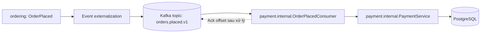
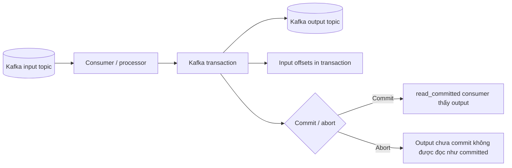
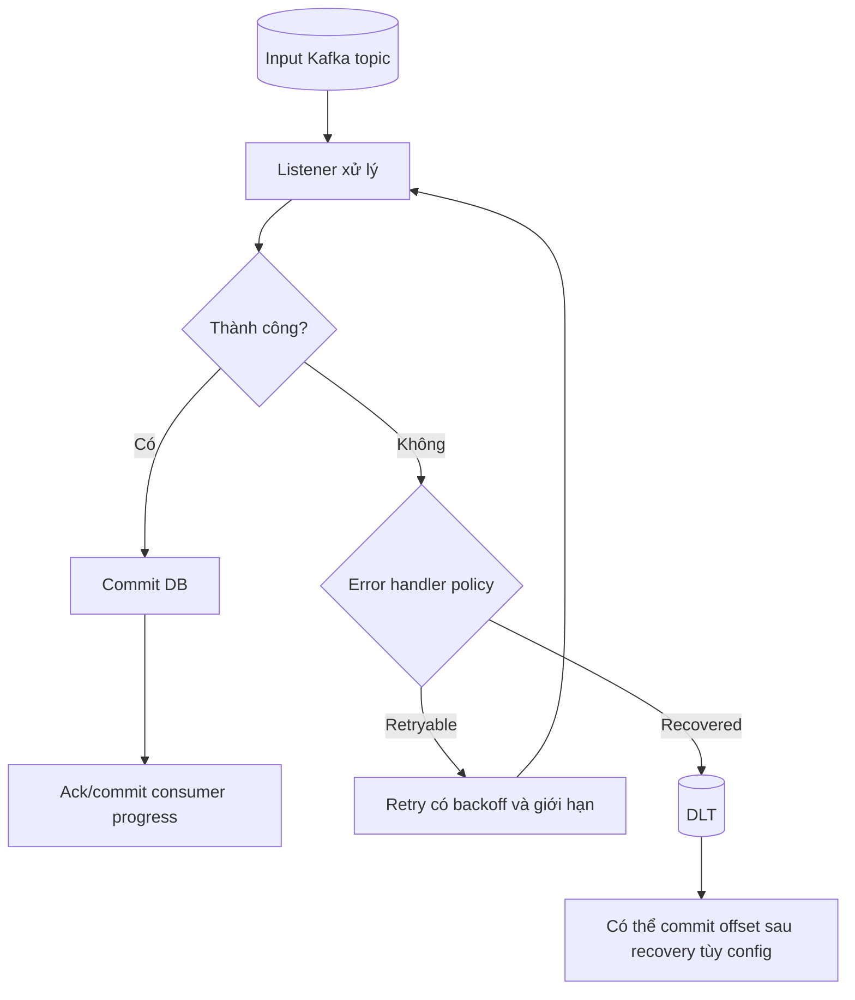
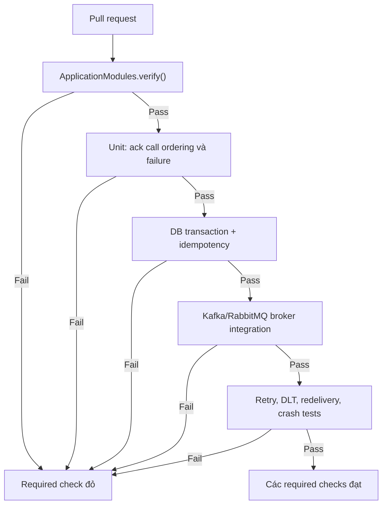
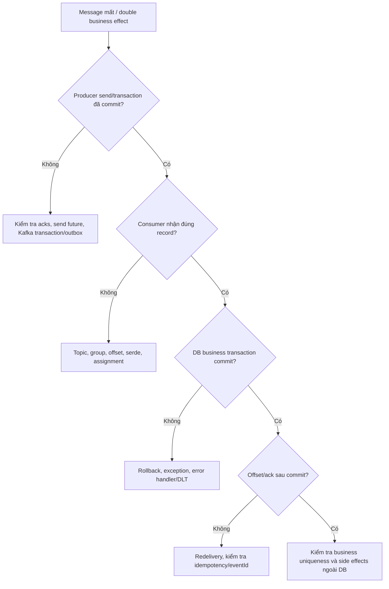

# Xác minh ack hoặc transaction của message trong Spring Modulith

## 1. Vì sao một message được nhận chưa có nghĩa đã xử lý thành công?

Trong ứng dụng Spring Modulith, module `ordering` xác nhận đơn và phát `OrderPlaced`. Một adapter đưa sự kiện ra Kafka, listener của module `payment` nhận message và ghi `PaymentRequest`. Bài test chỉ thấy listener được gọi vẫn có thể bỏ sót một lỗi nghiêm trọng: **tiến độ tiêu thụ đã được ghi nhận nhưng tác động nghiệp vụ chưa commit**.

Xét hai trường hợp:

- Consumer xác nhận tiến độ trước, database thất bại sau: message có thể **không được xử lý lại** dù chưa tạo yêu cầu thanh toán.
- Database commit trước, tiến độ tiêu thụ chưa kịp xác nhận thì process crash: message có thể **được giao lại**, nên consumer phải an toàn khi xử lý trùng.

Vì thế, chủ đề **“Xác minh ack hoặc transaction của message”** không chỉ là gọi một phương thức `acknowledge()`. Cần xác định **ack của ai**, **transaction nào**, **mốc hoàn tất nào được quan sát**, và **điều gì sẽ xảy ra nếu crash giữa hai mốc**.

Bài thuộc chương **Messaging testing** của học phần `SPRING_MODULITH_VERIFICATION_TESTING`. Phạm vi học phần là kiểm chứng ranh giới kiến trúc bằng `ApplicationModules.verify()` và quy tắc phụ thuộc, thực hành `@ApplicationModuleTest`, kiểm thử event, database và tích hợp, kết hợp quality gate trong CI để ngăn phụ thuộc sai và hồi quy.

Kết thúc bài, bạn có thể:

1. Phân biệt **producer acknowledgment**, **consumer offset commit/ack**, **business transaction** và **Kafka transaction**.
2. Đọc cấu hình ack mode của Spring Kafka mà không nhầm `MANUAL_IMMEDIATE` với bảo đảm exactly-once.
3. Kiểm tra consumer chỉ xác nhận sau khi một use case có transaction hoàn tất.
4. Thử ca rollback, retry, redelivery, crash window và idempotency.
5. Quan sát producer result, database state và committed consumer-group offset trong integration test.
6. So sánh Kafka offset commit với RabbitMQ `basicAck`, `basicNack` và `basicReject`.
7. Kết hợp kiểm thử runtime với ranh giới Spring Modulith và CI.

## 2. Bốn mốc thường bị gọi chung là “ack”

Cùng một từ *acknowledgment* có thể chỉ những cơ chế rất khác nhau.

| Mốc | Ai xác nhận? | Ý nghĩa | **Không** chứng minh |
| --- | --- | --- | --- |
| **Kafka producer ack** | Broker đáp ứng yêu cầu produce theo cấu hình `acks` | Producer nhận kết quả rằng record đã được chấp nhận theo điều kiện được cấu hình | Consumer đã xử lý, database đã commit |
| **Kafka consumer offset commit** | Consumer group cập nhật tiến độ vào Kafka | Group ghi nhận vị trí tiếp theo cần đọc cho topic-partition | Business effect đã commit, không bao giờ redeliver |
| **Database transaction commit** | Database transaction manager/RDBMS | Những thay đổi dữ liệu thuộc transaction đã commit | Kafka offset đã commit, message mới đã được externalize |
| **Kafka transaction commit** | Transactional Kafka producer/coordinator | Những thao tác Kafka được đưa vào cùng transaction đạt trạng thái commit theo cơ chế Kafka | Một transaction RDBMS hoặc API ngoài Kafka đã commit atomically |

RabbitMQ có **consumer delivery acknowledgment** riêng, ví dụ `basicAck`: broker được báo có thể coi delivery đó đã được xử lý ở cấp queue và không cần gửi lại vì delivery ấy nữa. Nó không phải Kafka offset commit và không mặc nhiên gắn với transaction database.

**Quy tắc đọc test:** mỗi assertion phải nói rõ nó xác minh **mốc nào**. Ví dụ, `kafka.send(...).get(...)` chỉ xác minh đường producer tới broker theo cấu hình send; nó không chờ consumer hoàn thành.

## 3. Timeline: vì sao thứ tự DB commit và ack quan trọng?

```mermaid
sequenceDiagram
    participant K as Kafka broker
    participant C as Payment consumer
    participant DB as Database
    K->>C: OrderPlaced(eventId=A)
    C->>DB: BEGIN; ghi PaymentRequest; COMMIT
    DB-->>C: Commit thành công
    C->>K: Acknowledge / commit offset
    Note over C,K: Nếu crash trước ack, Kafka có thể redeliver
    K->>C: Có thể giao lại eventId=A
    C->>DB: Kiểm tra eventId đã xử lý
    DB-->>C: Duplicate: không tạo side effect mới
    C->>K: Ack theo chính sách
```

Đây là **trình tự mong muốn** cho một consumer ghi database rồi xác nhận tiến độ. Ngay cả khi tuân thủ thứ tự này, vẫn có một **cửa sổ crash giữa DB commit và Kafka offset commit**. Vì Kafka và database thường không cùng một giao dịch XA, không thể biến hai thao tác thành atomic chỉ bằng cách đặt chúng cạnh nhau trong code.

Hai cách sắp xếp đối lập:

| Trình tự | Lỗi xảy ra ở đâu | Hệ quả có thể có |
| --- | --- | --- |
| **Ack → DB commit** | Process/DB lỗi sau ack | Tiến độ đã tăng nhưng business effect chưa có: nguy cơ mất xử lý |
| **DB commit → Ack** | Process lỗi trước ack | Business effect đã có, record có thể giao lại: cần idempotency |
| **DB rollback → Không ack** | Xử lý thất bại | Error handler quyết định retry, seek, recover hay DLT |
| **DB commit → Ack thành công** | Không lỗi trong đường đi | Kết quả cuối kỳ vọng; vẫn cần cân nhắc các tình huống failover/recovery |

**Lưu ý:** “không ack” trong method listener **không đủ để khẳng định offset sẽ không được commit**. Spring Kafka error handler có thể xử lý exception, recover record sang DLT hoặc thay đổi tiến độ tùy ack mode và chính sách được cấu hình. Test phải quan sát hành vi container thật.

## 4. Delivery semantics: at-most-once, at-least-once và phạm vi exactly-once

| Kiểu bảo đảm | Ý nghĩa thực tế | Vấn đề phải kiểm tra |
| --- | --- | --- |
| **At-most-once** | Có thể mất xử lý, ưu tiên tránh xử lý lại | Offset/ack quá sớm có bỏ record khi lỗi không? |
| **At-least-once** | Có thể giao lại, hướng tới không bỏ mất khi lỗi | Duplicate có gây tác động nghiệp vụ lặp không? |
| **Exactly-once trong phạm vi Kafka** | Kafka có cơ chế transaction/producer idempotence cho các thao tác được hỗ trợ | Transaction có commit/abort đúng, consumer dùng isolation phù hợp? |
| **Exactly-once business effect** | Một ý định nghiệp vụ chỉ tạo tác động hữu hiệu một lần | Database constraint, idempotency key, transaction, external API |

Không nên tuyên bố “Kafka đã bảo đảm exactly-once” nếu consumer còn gọi một API thanh toán hoặc cập nhật RDBMS **ngoài Kafka transaction**. Những tác động này cần hợp đồng idempotency hoặc cơ chế nhất quán riêng.

Đối với nghiệp vụ quan trọng, **at-least-once delivery + idempotent consumer + business invariants bền vững** thường là mô hình dễ giải thích và kiểm thử hơn việc giả định không bao giờ có duplicate.

## 5. Ví dụ ba module và hợp đồng message

Cấu trúc dự kiến:

```text
com.example.shop
├── ShopApplication.java
├── ordering
│   └── OrderPlaced.java
├── messaging
│   └── OrderPlacedMessage.java
└── payment
    └── internal
        ├── OrderPlacedConsumer.java
        ├── PaymentService.java
        └── PaymentKafkaConfiguration.java
```

`ordering` là chủ sở hữu domain event, `messaging` sở hữu transport contract, `payment` chứa listener và use case xử lý. Theo nhận diện mặc định, các package cấp một dưới `com.example.shop` là application module.

Transport contract:

```java
// src/main/java/com/example/shop/messaging/OrderPlacedMessage.java
package com.example.shop.messaging;

import java.math.BigDecimal;
import java.util.UUID;

public record OrderPlacedMessage(
        UUID eventId,
        UUID orderId,
        BigDecimal amount
) {
}
```

Ở đây:

- `eventId`: định danh của **một sự kiện duy nhất**, giữ nguyên khi retry/redelivery cùng event.
- `orderId`: business key, có thể dùng làm Kafka record key để nhóm theo đơn.
- `amount`: số tiền dùng `BigDecimal`, không qua `double` khi tính toán.

Hợp đồng này chỉ là ví dụ giáo dục. Production cần thêm validation, currency, schema version, retention và dữ liệu tối thiểu. Không dùng object JPA hoặc class `ordering.internal` làm wire contract chỉ để test thuận tiện.



Đường message qua Kafka là ranh giới runtime; cạnh Java `payment → messaging` mới là quan hệ phụ thuộc kiểu mà `ApplicationModules.verify()` thấy được.

## 6. Consumer với manual acknowledgment

Ví dụ listener nhận `Acknowledgment` do Spring Kafka cung cấp, gọi service trước rồi mới xác nhận:

```java
// src/main/java/com/example/shop/payment/internal/OrderPlacedConsumer.java
package com.example.shop.payment.internal;

import com.example.shop.messaging.OrderPlacedMessage;
import org.springframework.kafka.annotation.KafkaListener;
import org.springframework.kafka.support.Acknowledgment;
import org.springframework.stereotype.Component;

@Component
class OrderPlacedConsumer {

    private final PaymentService payments;

    OrderPlacedConsumer(PaymentService payments) {
        this.payments = payments;
    }

    @KafkaListener(
        id = "payment-order-listener",
        topics = "${app.messaging.order-topic}",
        groupId = "${app.messaging.payment-group}",
        containerFactory = "manualAckKafkaListenerFactory"
    )
    public void on(OrderPlacedMessage message, Acknowledgment ack) {
        payments.handle(message);  // Trả về sau transaction service.
        ack.acknowledge();          // Yêu cầu xác nhận tiến độ.
    }
}
```

**Điều kiện của ví dụ:** `payments.handle(...)` phải thực sự hoàn tất transaction nghiệp vụ hoặc trả ngoại lệ; listener không được tự gọi ack trước khi transaction phía dưới commit. Nếu `handle` chỉ đặt một task async vào queue rồi trả về, ack ở đây **quá sớm**.

`Acknowledgment.acknowledge()` là API của Spring Kafka, không có trong Spring application event thuần. Để method này nhận đối tượng `Acknowledgment` phù hợp, listener container phải dùng **manual ack mode**; không chỉ thêm tham số vào method mà bỏ qua cấu hình.

Trong các ví dụ tiếp theo, giả định `PaymentService.handle(...)` là phương thức đồng bộ trên một **Spring bean khác** với listener, được Spring quản lý transaction. Đây là ranh giới quan trọng đối với timing commit.

## 7. Cấu hình ack mode và commit behavior của Spring Kafka

Ví dụ khai báo listener container factory:

```java
// src/main/java/com/example/shop/payment/internal/
// PaymentKafkaConfiguration.java
package com.example.shop.payment.internal;

import com.example.shop.messaging.OrderPlacedMessage;
import org.springframework.context.annotation.Bean;
import org.springframework.context.annotation.Configuration;
import org.springframework.kafka.config.ConcurrentKafkaListenerContainerFactory;
import org.springframework.kafka.core.ConsumerFactory;
import org.springframework.kafka.listener.ContainerProperties;

@Configuration
class PaymentKafkaConfiguration {

    @Bean
    ConcurrentKafkaListenerContainerFactory<String, OrderPlacedMessage>
            manualAckKafkaListenerFactory(
                ConsumerFactory<String, OrderPlacedMessage> consumers) {

        var factory =
                new ConcurrentKafkaListenerContainerFactory<
                        String, OrderPlacedMessage>();
        factory.setConsumerFactory(consumers);

        factory.getContainerProperties().setAckMode(
                ContainerProperties.AckMode.MANUAL_IMMEDIATE
        );
        factory.getContainerProperties().setSyncCommits(true);

        return factory;
    }
}
```

Và consumer configuration (ví dụ JSON với Spring Kafka):

```yaml
spring:
  kafka:
    consumer:
      enable-auto-commit: false
      key-deserializer: org.apache.kafka.common.serialization.StringDeserializer
      value-deserializer: org.springframework.kafka.support.serializer.JsonDeserializer
      auto-offset-reset: earliest
      properties:
        spring.json.use.type.headers: false
        spring.json.value.default.type: com.example.shop.messaging.OrderPlacedMessage
        spring.json.trusted.packages: com.example.shop.messaging
    producer:
      key-serializer: org.apache.kafka.common.serialization.StringSerializer
      value-serializer: org.springframework.kafka.support.serializer.JsonSerializer
      properties:
        spring.json.add.type.headers: false
app:
  messaging:
    order-topic: orders.placed.v1
    payment-group: shop-payment
```

Trong ví dụ:

- `enable-auto-commit=false` tránh để Kafka client tự commit offset theo lịch độc lập với listener.
- `MANUAL_IMMEDIATE` cho phép manual ack được xử lý ngay theo semantics Spring Kafka **khi gọi từ thread consumer phù hợp**; không nên mặc định nó đồng nghĩa mỗi lời gọi đều đã commit thành công trong mọi lỗi/rebalance.
- `setSyncCommits(true)` yêu cầu đường commit đồng bộ theo cấu hình container; vẫn có thể gặp commit failure.
- `ConsumerFactory` phải dùng đúng deserializer và những thuộc tính trên.
- Nếu hệ thống có nhiều factory, `@KafkaListener(containerFactory=...)` phải tham chiếu đúng factory đã cấu hình.

**Không dùng `enable-auto-commit=true` cùng với kỳ vọng manual ack bảo đảm tiến độ**; hai chủ thể commit có thể làm giả định của test mất ý nghĩa.

### Một lưu ý về transaction container

Khi cấu hình **Kafka transaction manager** cho listener container, cách container gửi offset vào transaction và mối quan hệ với ack mode có thể khác. Không lấy ví dụ manual ack thuần ở trên làm công thức ghép tùy ý với mọi cấu hình Kafka transaction. Phải test đúng mode/container factory đang dùng.

## 8. Các ack mode chính và giới hạn của assertion

| Ack mode | Khái niệm | Điểm cần kiểm tra |
| --- | --- | --- |
| `RECORD` | Container xác nhận tiến độ sau từng record được listener xử lý theo điều kiện mode | Listener return bình thường, error handler và commit behavior |
| `BATCH` | Container xác nhận theo batch record đã được xử lý | Failure giữa batch, số record và khả năng replay |
| `MANUAL` | Listener gọi `acknowledge()`; việc commit thường được gom theo semantics batch/container | Đừng suy ra ack tức thì |
| `MANUAL_IMMEDIATE` | Manual ack được xử lý ngay khi thỏa điều kiện thread/container | Commit đồng bộ/bất đồng bộ, exceptions và error policy |
| Auto commit của Kafka client | Client tự commit theo lịch | Không phù hợp khi cần xác nhận chính xác sau business transaction |

Bảng mô tả ở mức khái niệm; thời điểm commit thực tế còn phụ thuộc Spring Kafka version, container props, poll cycle, transaction manager, error handler và cách listener sử dụng ack.

Một số bài test **không cần manual ack**. Nếu dùng `AckMode.RECORD` và listener đồng bộ gọi service có `@Transactional` rồi return sau khi service commit, container có thể xác nhận tiến độ sau return theo cấu hình. Manual ack hữu ích khi ứng dụng cần điều khiển quyết định xác nhận, nhưng **không phải điều kiện bắt buộc để có at-least-once**.

## 9. Unit test đường thành công: handle trước, ack sau

Unit test thuần Java giúp xác nhận **thứ tự lời gọi** mà không khởi động broker:

```java
// src/test/java/com/example/shop/payment/internal/
// OrderPlacedConsumerTests.java
package com.example.shop.payment.internal;

import static org.mockito.Mockito.inOrder;
import static org.mockito.Mockito.mock;

import com.example.shop.messaging.OrderPlacedMessage;
import java.math.BigDecimal;
import java.util.UUID;
import org.junit.jupiter.api.Test;
import org.mockito.InOrder;
import org.springframework.kafka.support.Acknowledgment;

class OrderPlacedConsumerTests {

    @Test
    void callsBusinessServiceBeforeAcknowledging() {
        PaymentService payments = mock(PaymentService.class);
        Acknowledgment acknowledgment = mock(Acknowledgment.class);
        var consumer = new OrderPlacedConsumer(payments);
        var message = new OrderPlacedMessage(
                UUID.randomUUID(), UUID.randomUUID(),
                new BigDecimal("125000")
        );

        consumer.on(message, acknowledgment);

        InOrder order = inOrder(payments, acknowledgment);
        order.verify(payments).handle(message);
        order.verify(acknowledgment).acknowledge();
        order.verifyNoMoreInteractions();
    }
}
```

**Test đã chứng minh:** với một lời gọi thành công, method listener gọi `payments.handle` trước `ack.acknowledge`.

**Test chưa chứng minh:** phương thức `handle` đã chạy trong transaction, DB đã commit, Kafka group offset đã commit hoặc consumer group có subscription đúng. Mockito chỉ xác nhận **thứ tự gọi Java**, không phải trạng thái broker/database.

Bài test unit nên đặt ở cùng package `payment.internal` để truy cập các class không công khai. Không cần mở class implementation thành public API của module chỉ để test.

## 10. Unit test đường lỗi: business failure không được ack sớm

Khi service ném lỗi, listener ở mục 6 phải **không gọi ack**:

```java
import static org.junit.jupiter.api.Assertions.assertThrows;
import static org.mockito.Mockito.doThrow;
import static org.mockito.Mockito.never;
import static org.mockito.Mockito.verify;

@Test
void doesNotAcknowledgeWhenBusinessServiceFails() {
    PaymentService payments = mock(PaymentService.class);
    Acknowledgment acknowledgment = mock(Acknowledgment.class);

    var consumer = new OrderPlacedConsumer(payments);
    var message = new OrderPlacedMessage(
            UUID.randomUUID(), UUID.randomUUID(),
            new BigDecimal("125000")
    );

    doThrow(new IllegalStateException("database unavailable"))
            .when(payments).handle(message);

    assertThrows(IllegalStateException.class,
            () -> consumer.on(message, acknowledgment));

    verify(payments).handle(message);
    verify(acknowledgment, never()).acknowledge();
}
```

**Test đã chứng minh:** đường code của listener không ack nếu collaborator ném exception trước khi trả về.

**Chưa chứng minh:** Kafka sẽ redeliver record, offset không tăng, hay DLT không nhận record. Spring Kafka error handler có thể xử lý lỗi bằng retry/recoverer rồi đánh dấu tiến độ theo chính sách. Những câu hỏi này chỉ được trả lời bằng integration test với **container và error handler thực**.

Một bài test phản chứng có ích: di chuyển `ack.acknowledge()` lên đầu method. Unit test `InOrder` phải đỏ. Tuy nhiên, đó vẫn chỉ là **một tầng** kiểm tra.

## 11. Vì sao `@Transactional` đặt sai vị trí có thể làm ack quá sớm?

Xét thiết kế dễ gây nhầm:

```java
@Transactional
@KafkaListener(...)
void on(OrderPlacedMessage message, Acknowledgment ack) {
    jdbc.update("INSERT INTO payment_request (...) VALUES (...)");
    ack.acknowledge();
} // Transaction interceptor có thể commit sau khi method body trả về.
```

Đây là **pseudocode minh họa rủi ro**, không phải đoạn listener đầy đủ. Nếu transaction bao quanh toàn bộ method listener, `ack.acknowledge()` được gọi **bên trong method body**, tức có thể **trước lúc transaction interceptor thực hiện commit**. Nếu DB commit sau đó thất bại, thứ tự “ack rồi commit” là nguy hiểm.

Một hướng đơn giản, rõ ràng hơn:

```text
Kafka listener (không bọc DB transaction ở chính body)
    |
    +---> PaymentService.handle(message)  [@Transactional]
              | INSERT / UPDATE
              | DB COMMIT do Spring transaction interceptor
              +---> trả về thành công
    |
    +---> acknowledgment.acknowledge()
```

Khi `PaymentService` là **Spring bean khác** và phương thức được gọi qua proxy transaction, việc trả về thành công có thể biểu thị giao dịch service đã hoàn tất. Nếu dùng self-invocation, gọi method không qua Spring proxy hoặc service dispatch async, giả định này **có thể sai**.

Ngoài ra, không được mặc định exception của một loại cụ thể luôn rollback; Spring transaction có rollback rules và application có thể cấu hình riêng. Test cần xác nhận commit/rollback thật với database.

## 12. Triển khai use case idempotent trong một DB transaction

Một ví dụ dùng **PostgreSQL + Spring JDBC** để biểu diễn invariant bền vững.

DDL minh họa:

```sql
CREATE TABLE processed_event (
    event_id UUID PRIMARY KEY,
    order_id UUID NOT NULL
);

CREATE TABLE payment_request (
    order_id UUID PRIMARY KEY,
    amount NUMERIC(19, 2) NOT NULL
);
```

Service:

```java
// src/main/java/com/example/shop/payment/internal/PaymentService.java
package com.example.shop.payment.internal;

import com.example.shop.messaging.OrderPlacedMessage;
import org.springframework.jdbc.core.JdbcTemplate;
import org.springframework.stereotype.Service;
import org.springframework.transaction.annotation.Transactional;

@Service
class PaymentService {

    private final JdbcTemplate jdbc;

    PaymentService(JdbcTemplate jdbc) {
        this.jdbc = jdbc;
    }

    @Transactional
    public void handle(OrderPlacedMessage message) {
        int inserted = jdbc.update(
                """
                INSERT INTO processed_event(event_id, order_id)
                VALUES (?, ?)
                ON CONFLICT (event_id) DO NOTHING
                """,
                message.eventId(), message.orderId()
        );

        if (inserted == 0) {
            return;  // EventId đã áp dụng: redelivery an toàn.
        }

        jdbc.update(
                """
                INSERT INTO payment_request(order_id, amount)
                VALUES (?, ?)
                ON CONFLICT (order_id) DO NOTHING
                """,
                message.orderId(), message.amount()
        );
    }
}
```

Đoạn code **minh họa cho PostgreSQL**, không phải implementation thanh toán production. `ON CONFLICT` và `NUMERIC(19,2)` là lựa chọn cụ thể của RDBMS; trong hệ thống thật còn cần validation, currency, business idempotency key, kiểm soát concurrency và quản lý trạng thái thanh toán.

Hai thao tác SQL nằm trong **cùng transaction do `@Transactional` quản lý**. Nếu thao tác thứ hai thất bại và transaction rollback, marker `processed_event` cũng phải rollback. Nếu listener được giao lại cùng `eventId` sau commit, `INSERT ... ON CONFLICT DO NOTHING` giúp không tạo thêm tác động hữu hiệu.

**Đây là nền tảng của kiểm thử ack:** sau khi `payments.handle` trả về thành công, database phải chứa kết quả đã commit; sau đó consumer mới gửi ack theo chính sách. Bài test đơn thuần đếm `verify(service, times(1))` không kiểm chứng được invariant này.

## 13. Integration test: dùng broker thật và database thật

Bài test broker + DB cần quan sát cả **business effect đã commit** lẫn **committed group offset**. Có thể sử dụng Kafka và PostgreSQL Testcontainers.

Ví dụ khung `@SpringBootTest` sau dùng một topic và group riêng theo lớp:

```java
// src/test/java/com/example/shop/payment/internal/
// PaymentAckKafkaIT.java
package com.example.shop.payment.internal;

import com.example.shop.messaging.OrderPlacedMessage;
import java.util.UUID;
import org.apache.kafka.clients.admin.NewTopic;
import org.springframework.beans.factory.annotation.Autowired;
import org.springframework.boot.test.context.SpringBootTest;
import org.springframework.context.annotation.Bean;
import org.springframework.boot.test.context.TestConfiguration;
import org.springframework.context.annotation.Import;
import org.springframework.jdbc.core.JdbcTemplate;
import org.springframework.kafka.config.TopicBuilder;
import org.springframework.kafka.core.KafkaTemplate;
import org.springframework.test.context.DynamicPropertyRegistry;
import org.springframework.test.context.DynamicPropertySource;
import org.testcontainers.containers.PostgreSQLContainer;
import org.testcontainers.junit.jupiter.Container;
import org.testcontainers.junit.jupiter.Testcontainers;
import org.testcontainers.kafka.KafkaContainer;
import org.testcontainers.utility.DockerImageName;

@SpringBootTest
@Testcontainers
@Import(PaymentAckKafkaIT.TestTopics.class)
class PaymentAckKafkaIT {

    static final String TOPIC =
            "orders.placed.it." + UUID.randomUUID();
    static final String GROUP =
            "payment-ack-it-" + UUID.randomUUID();

    @Container
    static final KafkaContainer KAFKA = new KafkaContainer(
            DockerImageName.parse("apache/kafka:3.8.0")
    );

    @Container
    static final PostgreSQLContainer<?> POSTGRES =
            new PostgreSQLContainer<>("postgres:16-alpine");

    @DynamicPropertySource
    static void configure(DynamicPropertyRegistry properties) {
        properties.add("spring.kafka.bootstrap-servers",
                KAFKA::getBootstrapServers);
        properties.add("spring.datasource.url", POSTGRES::getJdbcUrl);
        properties.add("spring.datasource.username", POSTGRES::getUsername);
        properties.add("spring.datasource.password", POSTGRES::getPassword);
        properties.add("app.messaging.order-topic", () -> TOPIC);
        properties.add("app.messaging.payment-group", () -> GROUP);
    }

    @TestConfiguration
    static class TestTopics {
        @Bean
        NewTopic testTopic() {
            return TopicBuilder.name(TOPIC)
                    .partitions(1).replicas(1).build();
        }
    }

    @Autowired
    KafkaTemplate<String, OrderPlacedMessage> kafka;

    @Autowired
    JdbcTemplate jdbc;

    // Phương thức @Test ở mục kế tiếp.
}
```

**Đây là khung minh họa, chưa phải project hoàn chỉnh.** Cần dependencies Spring Kafka/JDBC/PostgreSQL driver, Spring Boot Test, Testcontainers JUnit/Kafka/PostgreSQL, Awaitility và các cấu hình JSON serde ở mục 7. Bài test phải khởi tạo schema SQL (ví dụ Flyway/Liquibase hoặc setup fixture) trước khi chạy, và application context phải được cấu hình để listener sử dụng đúng topic/group/factory.

Không dùng `@MockitoBean PaymentService` cho bài này: muốn kiểm chứng commit phải chạy **service thật** với DB thật. Các bài test listener-only có thể dùng mock, nhưng không thay được DB integration.

## 14. Kiểm tra offset đã commit cùng với trạng thái database

Kafka lưu **committed offset** của consumer group. Với một record ở offset `N`, tiến độ tiếp theo thường là `N + 1` sau khi record được xác nhận và commit theo chính sách.

Phác thảo method test trong class `PaymentAckKafkaIT` ở mục 13 (imports được giải thích bên dưới):

```java
@Test
void commitsBusinessEffectAndConsumerOffset() throws Exception {
    UUID eventId = UUID.randomUUID();
    UUID orderId = UUID.randomUUID();
    var amount = new BigDecimal("125000");

    var message = new OrderPlacedMessage(eventId, orderId, amount);
    var sent = kafka.send(TOPIC, orderId.toString(), message)
            .get(10, TimeUnit.SECONDS);

    var metadata = sent.getRecordMetadata();
    TopicPartition partition = new TopicPartition(
            metadata.topic(), metadata.partition()
    );
    long expectedNextOffset = metadata.offset() + 1L;

    try (AdminClient admin = AdminClient.create(
            Map.of(AdminClientConfig.BOOTSTRAP_SERVERS_CONFIG,
                   KAFKA.getBootstrapServers()))) {

        await()
                .atMost(Duration.ofSeconds(20))
                .pollInterval(Duration.ofMillis(200))
                .untilAsserted(() -> {
                    Integer persisted = jdbc.queryForObject(
                            "SELECT COUNT(*) FROM payment_request WHERE order_id = ?",
                            Integer.class, orderId
                    );
                    assertThat(persisted).isEqualTo(1);

                    var offsets = admin
                            .listConsumerGroupOffsets(GROUP)
                            .partitionsToOffsetAndMetadata()
                            .get(5, TimeUnit.SECONDS);

                    assertThat(offsets).containsKey(partition);
                    assertThat(offsets.get(partition).offset())
                            .isGreaterThanOrEqualTo(expectedNextOffset);
                });
    }
}
```

Các import bổ sung gồm:

```java
import static org.assertj.core.api.Assertions.assertThat;
import static org.awaitility.Awaitility.await;
import java.math.BigDecimal;
import java.time.Duration;
import java.util.Map;
import java.util.concurrent.TimeUnit;
import org.apache.kafka.clients.admin.AdminClient;
import org.apache.kafka.clients.admin.AdminClientConfig;
import org.apache.kafka.common.TopicPartition;
import org.junit.jupiter.api.Test;
```

### Test đã chứng minh gì?

Khi chạy thật, nó có thể chứng minh:

- Producer gửi record tới topic của test và nhận metadata từ broker.
- Consumer group của ứng dụng đã tiến **qua offset** của record vừa gửi.
- `PaymentRequest` tương ứng `orderId` tồn tại trong database đã commit, theo truy vấn test.
- Listener, serializer, transaction và offset commit được cấu hình đủ để tạo được **kết quả cuối mong muốn**.

### Test **chưa** chứng minh gì?

Một lần thành công **không thể chứng minh không bao giờ có tình huống ack trước DB commit** dưới lỗi hiếm. Nó cũng không chứng minh atomic commit giữa RDBMS và Kafka. Cần thêm fault injection, kiểm tra unit order và các ca crash/restart.

Giá trị `offset >= N+1` phù hợp khi consumer đã xử lý ít nhất record đó trong **partition được quan sát**, nhưng nếu còn consumer hoặc record khác trong cùng group/partition thì offset có thể tiến xa hơn. Vì vậy test cần **topic và group cô lập**, không dựa vào một group chung đã có tiến độ cũ.

Cũng cần xác nhận `AdminClient`/client dependency có API phù hợp với phiên bản Kafka đang dùng và test được chạy thật trong CI.

## 15. Tại sao phải quan sát offset thật thay vì chỉ gọi mock ack?

Xét hai bài:

**Bài A — Mockito:**

```java
verify(acknowledgment).acknowledge();
```

**Bài B — Broker integration:**

```text
1. Publish record có eventId riêng vào topic test.
2. Đợi business state đã commit.
3. Đọc committed offset của đúng consumer group/topic/partition.
4. Xác minh tiến độ đã đi qua record gửi vào.
```

Bài A bảo vệ **logic điều khiển trong method listener**. Bài B quan sát **hành vi thực tại Kafka**. Cả hai đều có giá trị nhưng trả lời hai câu hỏi khác nhau.

Nếu Spring listener container chưa dùng đúng `MANUAL_IMMEDIATE` factory, unit test vẫn xanh nhưng integration test có thể không chạy hoặc có semantics khác. Nếu broker commit bị lỗi/rebalance, mock cũng không phát hiện.

Một test vững phải kiểm tra cả **cấu hình**, **method behavior** và **observable state** tương ứng với yêu cầu.

## 16. Failure matrix: kiểm chứng các “crash window”

| Tình huống | DB state kỳ vọng | Kafka offset kỳ vọng | Thiết kế test |
| --- | --- | --- | --- |
| Happy path | Payment request được commit | Group tiến qua record | Broker + DB integration |
| Service ném lỗi trước DB commit | Không có payment request | Không ack trong listener; offset phụ thuộc error handler | Mockito + DB rollback + error-handler integration |
| DB commit xong, process chết trước ack | Đã có payment request | Có thể chưa tiến qua record | Restart/redelivery + idempotency integration |
| Ack/offset commit thành công trước DB commit | Có nguy cơ thiếu payment request | Có thể đã tiến | Test phát hiện thứ tự sai, cấm ack sớm |
| Duplicate sau restart | Một tác động hữu hiệu | Offset sau redelivery cuối cùng có thể tiến | Gửi/replay cùng eventId, DB invariant |
| Error handler recover tới DLT | Có thể không có payment request | Offset có thể tiến sau recovery thành công | DLT + offset + payload/header test |
| Kafka transaction abort | Không có record committed nhìn thấy bằng `read_committed` | Không áp dụng trực tiếp cho DB | Transactional producer + broker observer |

**Không áp dụng một assertion “offset không tăng” cho mọi lỗi listener**. Trong một hệ thống có `DefaultErrorHandler` và DLT recoverer, framework có thể coi record **đã recover** sau khi đưa sang DLT và có thể commit tiến độ theo policy. Test phải nêu rõ loại lỗi và nơi record dự kiến đi tới.

Một bài fault test có giá trị là **làm DB commit thất bại** hoặc **làm process crash giữa commit và ack**, rồi quan sát state/offset sau restart. Đừng cố tạo bài crash chỉ bằng `Thread.sleep(...)` trong test.

## 17. Cách kiểm tra DB rollback và thứ tự ack khi có lỗi

Để kiểm tra đường rollback, dùng một failure seam có kiểm soát hoặc dữ liệu buộc vi phạm constraint.

Quy trình:

1. Chuẩn bị record `OrderPlaced(eventId=A)`.
2. Cấu hình `PaymentService` hoặc DB khiến transaction **fail trước commit**.
3. Quan sát không tồn tại `processed_event(A)` và `payment_request(orderId)` sau rollback.
4. Xác nhận method listener không gọi manual ack trước khi xử lý xong (unit test).
5. Ở tầng integration, xác nhận **error policy thực tế**: retry, pause, DLT hoặc seek/commit theo cấu hình.
6. Nếu khắc phục lỗi và replay record, business effect cuối cùng phải đúng và không tạo bản ghi trùng.

Chỉ kiểm tra `@Transactional` có mặt trong source code không đủ: cần thấy transaction thật rollback. Với service JPA, lưu ý flush/commit có thể ném exception **sau khi method body kết thúc** nhưng trước khi proxy trả về; đó là lý do ack phải được gọi **sau khi service proxy đã trả về thành công**.

Nếu muốn test trường hợp “DB đã commit nhưng ack chưa xảy ra”, có thể tạo một **test seam** chặn trước lời gọi ack hoặc chủ động dừng consumer ngay sau commit, sau đó khởi động consumer mới với group tương ứng. Nhưng một bài test không thể xác định chính xác điểm crash chỉ bằng scheduling ngẫu nhiên; nên dùng failpoint/latch được thiết kế riêng cho môi trường integration.

## 18. Producer ack: `acks=all` bảo đảm điều gì?

Ở phía producer, Kafka có cấu hình `acks`. Một cấu hình thường được chọn cho độ bền là:

```yaml
spring:
  kafka:
    producer:
      acks: all
      properties:
        enable.idempotence: true
```

Mục tiêu:

- `acks=all` yêu cầu broker đáp ứng theo các bản sao in-sync trong điều kiện cấu hình topic/cluster.
- `enable.idempotence=true` giúp Kafka producer hạn chế duplicate append từ một số retry theo cơ chế producer protocol.
- Producer có thể đợi kết quả send future để biết lời gửi thành công hoặc thất bại theo điều kiện producer/broker.

Ví dụ kiểm tra send result:

```java
var result = kafka.send(
        "orders.placed.v1",
        orderId.toString(),
        message
).get(10, TimeUnit.SECONDS);

assertThat(result.getRecordMetadata().topic())
        .isEqualTo("orders.placed.v1");
```

**Điều test này chưa chứng minh:** consumer đã nhận, processing đã commit hoặc payment request đã được tạo.

### `acks=all` không phải một SLA độc lập

Ý nghĩa độ bền phụ thuộc **replication factor**, `min.insync.replicas`, trạng thái ISR, producer retries/timeouts, broker version và cluster behavior. Kafka Testcontainers một broker với replication factor 1 **không thể mô phỏng đầy đủ mất node hay failover của một cluster nhiều replica**.

Muốn kiểm tra resilience dưới lỗi broker, cần môi trường/fault test phù hợp, không chỉ một unit test trả success.

## 19. Kafka producer transaction: commit/abort phải được kiểm tra riêng

Kafka cho phép transactional producer khi `ProducerFactory` được cấu hình transaction ID prefix và các thành phần tương thích.

Ý tưởng code:

```java
// KafkaTemplate đã được cấu hình transactional ProducerFactory.
kafkaTemplate.executeInTransaction(operations -> {
    operations.send("orders.placed.v1",
            orderId.toString(), message);
    return null;
});
// Callback thành công => Kafka transaction được commit theo API.
```

Nếu code trong callback ném exception, transaction có thể bị abort và các record chưa commit sẽ không được một consumer dùng `isolation.level=read_committed` nhìn thấy như record committed.

Cấu hình consumer observer:

```yaml
spring:
  kafka:
    consumer:
      properties:
        isolation.level: read_committed
```

**Quan trọng:**

- Transactional producer cần `transaction-id-prefix`/producer factory phù hợp; không thể dùng `executeInTransaction` với một `KafkaTemplate` không hỗ trợ transactions.
- `send(...)` hoàn tất trong một transaction **chưa đồng nghĩa transaction đã commit**.
- `read_committed` quy định visibility đối với Kafka transactional records, **không** đọc trạng thái DB đã commit.
- Một Kafka transaction không atomically commit RDBMS hoặc payment gateway.

### Test transaction abort đúng cách

Một broker test có thể:

1. Dùng producer transactional gửi một record đánh dấu `eventId=A` rồi cố ý **abort**.
2. Dùng một consumer group mới với `read_committed`.
3. Gửi một record **committed marker** sau đó qua một transaction thành công để có mốc quan sát.
4. Đọc đến marker và xác nhận **không có eventId=A** trong các record committed quan sát trước marker.
5. Kiểm tra thêm transaction commit của một record bình thường được consumer nhìn thấy.

Không nên chỉ đợi 100 ms rồi kết luận “abort thành công vì chưa thấy record”: **absence trong khoảng thời gian ngắn không chứng minh record không bao giờ xuất hiện**.

## 20. Kafka consume–process–produce trong một transaction: giới hạn cần hiểu

Một số luồng tiêu thụ Kafka rồi tạo record Kafka mới có thể sử dụng transaction để bao gồm:

- Output Kafka records.
- Tiến độ consumer offset được gửi vào Kafka transaction bằng cơ chế container/transaction manager phù hợp.



Với cấu hình đúng, mô hình này giúp kiểm soát tính nhất quán **trong phạm vi Kafka**. Tuy nhiên, khi processor đồng thời ghi:

```text
Kafka input → PostgreSQL payment_request → Kafka output
```

thì transaction của Kafka và transaction PostgreSQL **không tự trở thành một giao dịch phân tán atomic**. Nếu một bên commit còn bên kia thất bại, phải có idempotency, outbox, compensation hoặc recovery theo yêu cầu.

**Không tự trộn** `@Transactional` với Kafka/JPA transaction managers mà cho rằng thứ tự commit hai hệ thống luôn đúng. Các manager có thể được lồng hoặc phối hợp theo cấu hình cụ thể; đồng bộ transaction không đồng nghĩa XA và các failure window vẫn tồn tại.

Bài test phù hợp gồm cả Kafka-to-Kafka commit/abort và DB failure injection. Cần nêu rõ **phạm vi exactly-once** mà bài test được thiết kế để bảo vệ.

## 21. Spring Modulith event publication và transaction

Không phải mọi message trong Spring Modulith đều bắt đầu bằng Kafka. Một module có thể phát **Spring application event**:

```java
events.publishEvent(new OrderPlaced(eventId, orderId, amount));
```

Khi listener xử lý trong cùng process, **không có Kafka offset để ack**. Những mốc liên quan là:

- Sự kiện được publish vào Spring context.
- Listener đồng bộ hoặc bất đồng bộ xử lý.
- Transaction nghiệp vụ commit/rollback.
- Nếu dùng **event publication registry/externalization** của Spring Modulith, trạng thái publication/recovery theo cơ chế và cấu hình được chọn.
- Nếu event được externalize tới Kafka, có thêm producer acknowledgment và consumer offset/ack ở bên nhận.

`@TransactionalEventListener(phase = TransactionPhase.AFTER_COMMIT)` có thể trì hoãn listener tới sau commit liên quan:

```java
@TransactionalEventListener(
        phase = TransactionPhase.AFTER_COMMIT
)
void on(OrderPlaced event) {
    // Kích hoạt xử lý sau khi transaction publish event commit.
}
```

Nhưng **AFTER_COMMIT không làm DB và broker commit atomically**. Process có thể crash sau DB commit trước khi externalization hoàn tất. Một chiến lược như transactional outbox hoặc event publication registry/recovery (khi cấu hình phù hợp) giúp đóng khoảng trống theo cơ chế đã chọn; vẫn cần kiểm tra trường hợp gửi lại và idempotency consumer.

**Test nên phân tầng:**

1. `@ApplicationModuleTest`/`Scenario`: xác nhận hành vi event trong Spring context.
2. Transaction test: commit có dẫn tới publication đúng, rollback không externalize trái policy.
3. Broker integration: record có được publish/deserialize thật không?
4. Consumer ack/DB test: tác động nghiệp vụ và consumer progress đúng không?
5. Recovery/fault test: crash/retry có gây mất hoặc nhân đôi side effect không?

## 22. RabbitMQ consumer acknowledgment: khác Kafka offset commit

RabbitMQ có **ack/nack trên delivery**. Với manual ack, listener có thể điều khiển:

- `basicAck(deliveryTag, false)`: xác nhận delivery sau xử lý.
- `basicNack(deliveryTag, false, true)`: từ chối và yêu cầu requeue, nếu policy cho phép.
- `basicReject(deliveryTag, false)`: từ chối không requeue; có thể đưa tới DLX/DLQ **nếu queue được cấu hình phù hợp**.

Ví dụ với Spring AMQP:

```java
import com.rabbitmq.client.Channel;
import java.io.IOException;
import org.springframework.amqp.rabbit.annotation.RabbitListener;
import org.springframework.amqp.support.AmqpHeaders;
import org.springframework.messaging.handler.annotation.Header;

@RabbitListener(
    queues = "${app.messaging.payment-queue}",
    ackMode = "MANUAL"
)
public void on(
        OrderPlacedMessage message,
        Channel channel,
        @Header(AmqpHeaders.DELIVERY_TAG) long tag
) throws IOException {
    try {
        payments.handle(message); // Kết thúc DB transaction trước ack.
        channel.basicAck(tag, false);
    } catch (PermanentMessageException ex) {
        channel.basicReject(tag, false); // Không requeue; DLX tùy config.
    } catch (RuntimeException ex) {
        channel.basicNack(tag, false, true); // Requeue: cần giới hạn.
    }
}
```

**Đây là ví dụ phương thức minh họa**, giả định `payments` và `PermanentMessageException` có trong ứng dụng, queue/JSON converter/ack mode đã được cấu hình tương thích.

Cẩn thận:

- `multiple=false` chỉ xác nhận một delivery, không xác nhận hàng loạt delivery tag.
- `requeue=true` có thể gây **vòng redelivery nóng** nếu lỗi không bao giờ hết; cần retry/backoff/DLQ policy có giới hạn.
- `basicAck` là delivery acknowledgment, không phải PostgreSQL transaction commit.
- Nếu message đã được xử lý nhưng connection mất trước ack, RabbitMQ có thể redeliver khi channel/consumer bị đóng.
- Đừng vừa `basicNack` rồi ném exception mà không hiểu container/error handler, vì có thể phát sinh cơ chế xử lý lỗi chồng lấn.
- Exception của chính lệnh `basicAck`/`basicNack` phải được đưa vào chính sách hạ tầng và không được lặng lẽ nuốt mất.

Kafka và RabbitMQ đều cần **chứng minh business effect bền vững và xử lý redelivery an toàn**, nhưng các API ack và tiến độ giao message hoàn toàn khác nhau.

## 23. RabbitMQ test: xác minh delivery ack và redelivery

Một kế hoạch integration test với `RabbitMQContainer`:

1. Tạo broker test, exchange, queue và DLX/DLQ riêng theo lớp.
2. Bật manual ack cho listener nhận message.
3. Gửi một message có `eventId=A` và chờ DB commit.
4. Kiểm tra queue/consumer outcome sau khi ack, không chỉ mock `Channel.basicAck`.
5. Cố tình làm business service lỗi trước commit; xác định policy requeue hoặc DLQ thực tế.
6. Khắc phục lỗi và xác nhận redelivery không làm tăng business effect nhiều hơn một lần.
7. Với lỗi permanent, kiểm tra message thật trong DLQ và metadata theo chính sách.

Một unit test có thể dùng Mockito `InOrder` để xác nhận `payments.handle` trước `channel.basicAck`. Nhưng đó chỉ xác nhận **method call order**. Test RabbitMQ thật phải quan sát queue/redelivery/DLQ và DB, không thể suy ra trạng thái broker từ mock Channel.

Không áp dụng nguyên xi Kafka `AckMode.MANUAL_IMMEDIATE` cho RabbitMQ: Spring AMQP dùng listener container và acknowledgement semantics của RabbitMQ.

## 24. Error handler, retry và DLT ảnh hưởng đến ack như thế nào?

Giả sử listener Kafka ném exception vì dữ liệu sai. Có hai lựa chọn policy thường gặp:

**A. Retry trước khi thành công:** cùng record được xử lý lại; khi service thành công mới coi business effect hoàn tất.

**B. Recover sang dead-letter topic:** sau số lần retry hoặc khi exception không được retry, `DeadLetterPublishingRecoverer` gửi record lỗi sang DLT. Nếu recovery thành công, error handler/container **có thể cập nhật offset** để tránh kẹt mãi trên record lỗi theo cấu hình.



Điểm cần kiểm tra:

- Exception có tới error handler, hay listener đã bắt lỗi rồi return như thành công?
- Error handler dùng `DefaultErrorHandler`, retry topics hay chiến lược khác?
- Khi recoverer gửi DLT thất bại, record có bị coi là đã recover sai không?
- `ackAfterHandle`, `commitRecovered` và ack mode có tương thích với policy đang sử dụng không?
- Raw bytes lỗi deserialization có được recoverer/serializer xử lý đúng không?
- Sau recovery, committed offset được kỳ vọng ở đâu và record có còn cần replay không?

**Đừng dùng test “listener không gọi ack” để kết luận Kafka offset mãi không tăng.** Error handler có thể là **chủ thể quyết định tiến độ** khi method listener không hoàn tất bình thường.

## 25. Test âm tính: tránh kết luận từ “chưa nhìn thấy record”

Các assertion này không đủ để chứng minh transaction/ack đúng:

```java
// Không đủ: consumer có thể chưa được chạy.
Thread.sleep(200);
assertThat(paymentQuery.existsByOrderId(orderId)).isFalse();
```

Hoặc:

```java
// Không đủ: có thể vừa có commit offset chưa quan sát kịp.
assertThat(consumerOffset == oldOffset).isTrue();
```

Nếu muốn kiểm tra **không ack khi DB rollback**, hãy kết hợp:

1. Unit test nhánh lỗi, `verify(ack, never()).acknowledge()`.
2. DB test chứng minh transaction rollback, không để marker xử lý trùng.
3. Integration test với error handler được **cấu hình để không recover/commit** trong kịch bản được chọn, hoặc quan sát hành vi DLT nếu đó mới là policy.
4. Tín hiệu hoàn tất/failure có kiểm soát để biết hệ thống đã đi qua **điểm cần kiểm tra**.
5. Sau restart/rebalance có điều khiển, xác nhận redelivery theo tiến độ thực.

**Không thấy một kết quả trong 200 ms chỉ là một quan sát hữu hạn**, không phải chứng minh rằng kết quả không bao giờ xuất hiện. Khi cần fault injection, sử dụng failpoint/latch hoặc công cụ test concurrency, không tăng `Thread.sleep` không giới hạn.

## 26. Isolation cho test ack/transaction

Bài kiểm tra offset phụ thuộc rất mạnh vào tính cô lập.

| Tài nguyên | Cách cô lập | Vì sao cần |
| --- | --- | --- |
| Kafka topic | Topic riêng theo class/run | Không có record test khác làm offset tiến vượt kỳ vọng |
| Consumer group | Group riêng | Committed offsets không lẫn với suite khác |
| Topic partition | Theo dõi partition thật của record | Offset chỉ có nghĩa trong một partition |
| Database | Container/schema riêng hoặc ID riêng | Trạng thái đã tồn tại không tạo xanh giả |
| Event identity | UUID `eventId`, `orderId` riêng | Quan sát đúng business effect |
| Error/DLT | Destination riêng | Không nhầm record lỗi từ test khác |
| Listener context | Kiểm soát bean/properties được bootstrap | Không có consumer khác dùng chung group |
| CI worker | Broker/namespace riêng | Các job song song không reset offset của nhau |

Chỉ dùng `@DirtiesContext` không làm Kafka topic hoặc consumer-group offsets biến mất; chỉ rollback transaction của thread JUnit cũng không rollback DB transaction đã commit trong thread listener.

Trong integration test, đợi topic và consumer assignment bằng điều kiện (ví dụ `ContainerTestUtils.waitForAssignment(...)` khi phù hợp) trước các bài test yêu cầu subscription sẵn sàng. Không dùng `Thread.sleep` như bằng chứng readiness.

## 27. Kiểm chứng kiến trúc module vẫn là một gate khác

Trong ví dụ, `payment.internal.OrderPlacedConsumer` tham chiếu `messaging.OrderPlacedMessage`: đây là cạnh Java **`payment → messaging`**, với kiểu message nằm tại public API của module `messaging`.

Bài kiểm tra kiến trúc:

```java
// src/test/java/com/example/shop/ModuleArchitectureTests.java
package com.example.shop;

import org.junit.jupiter.api.Test;
import org.springframework.modulith.core.ApplicationModules;

class ModuleArchitectureTests {

    @Test
    void moduleBoundariesAreValid() {
        ApplicationModules.of(ShopApplication.class).verify();
    }
}
```

`ApplicationModules.verify()` có thể phát hiện chu kỳ module, truy cập implementation detail bên ngoài và phụ thuộc trái `allowedDependencies` theo mô hình nhận diện đã cấu hình.

Nhưng `verify()` **không chạy Kafka**, không biết consumer đã ack trước DB commit hoặc database có xử lý duplicate hai lần. Ngược lại, một broker integration test thành công không chứng minh các module không tham chiếu package nội bộ trái kiến trúc.

`@ApplicationModuleTest` và `Scenario` giúp kiểm tra hành vi event **trong Spring context của module**. Một test `Scenario.publish(new OrderPlaced(...))` không có `Acknowledgment` Kafka nên **không thể thay** integration test consumer-offset commit.

## 28. Đưa ack/transaction tests vào CI quality gate



Ví dụ command thường dùng:

```bash
# Maven unit/module/architecture tests
./mvnw test

# Maven verification, có thể gồm Failsafe nếu đã cấu hình
./mvnw verify

# Gradle với các verification task đã khai báo
./gradlew test
./gradlew check
```

Để test ack/transaction có giá trị:

- Bảo đảm Kafka/PostgreSQL/RabbitMQ Testcontainers **thực sự chạy** trên runner có Docker phù hợp.
- Nếu bài test tên `*IT`, kiểm tra Maven Failsafe hoặc Gradle integrationTest task đã được khai báo và chạy trong CI.
- Dùng topic, group, schema và ID riêng, tránh dùng production environment.
- Không đặt `@Disabled` hoặc skip test quan trọng vì flaky; sửa isolation/readiness/fault setup.
- Không dùng `continue-on-error: true` hoặc nuốt exception để biến job fail thành pass.
- Thu thập log listener, consumer group, offset, transaction, broker và DLT khi lỗi.
- Cấu hình các job bắt buộc thành **required checks**, thực sự chặn merge khi failure/timeout.

**Một bước build xanh mà không có báo cáo broker/DB test** không chứng minh ack và transaction đã được xác minh.

## 29. Chẩn đoán khi record mất hoặc bị xử lý hai lần

Khi business state thiếu hoặc duplicate, điều tra lần lượt:



Checklist chi tiết:

1. Message có đúng `eventId`, `orderId`, amount và schema không?
2. Producer trả send result hay chỉ gọi `send` rồi không kiểm tra future?
3. Kafka producer có transaction chưa commit/abort không?
4. Consumer group đang đọc topic/partition nào, offset đã commit là bao nhiêu?
5. Listener dùng đúng container factory và ack mode đã cấu hình chưa?
6. `payments.handle` có được gọi qua Spring transaction proxy và **commit trước khi trả về** không?
7. Exception có được error handler xử lý, retry, recover sang DLT hoặc nuốt sai không?
8. Database có marker `processed_event` và payment record commit cùng transaction không?
9. Có external side effect nào xảy ra giữa hai lần retry không?
10. Test có dùng group/topic, ID và DB state riêng, có đợi đủ thời gian theo điều kiện không?
11. Sau restart/rebalance, một duplicate có làm thay đổi business effect thêm lần nữa không?
12. CI có chạy test thực và làm check đỏ khi logic ack bị đảo thứ tự không?

Tăng timeout không sửa lỗi **ack trước commit** hay thiếu unique constraint. Cần sửa ranh giới transaction và chính sách recovery đúng tầng.

## 30. Bài tập và đáp án

**Câu 1.** `KafkaTemplate.send(...).get(...)` trả thành công. Có chứng minh consumer đã commit payment chưa?

**Đáp án:** Không. Đây là producer send result, không phải consumer offset commit hoặc DB transaction commit.

**Câu 2.** Listener gọi `ack.acknowledge()` trước `payments.handle(...)`. Có rủi ro gì?

**Đáp án:** Nếu offset được commit rồi DB thất bại, record có thể không được xử lý lại: nguy cơ mất business effect. Cần hoàn tất use case/commit trước ack.

**Câu 3.** Service có `@Transactional` nhưng listener gọi service rồi ack. Vì sao còn cần database integration test?

**Đáp án:** Annotation không tự chứng minh transaction proxy được áp dụng, rollback rules đúng và dữ liệu đã commit. Cần kiểm tra trạng thái DB thực dưới success/failure.

**Câu 4.** DB commit thành công, process crash trước Kafka offset commit. Điều gì có thể xảy ra?

**Đáp án:** Kafka có thể redeliver record. Consumer cần idempotency bền vững theo event/business key, không nhân đôi tác động.

**Câu 5.** Unit test xác nhận `ack.acknowledge()` không được gọi khi service ném lỗi. Offset có chắc không tăng không?

**Đáp án:** Chưa. Error handler có thể recover sang DLT và commit theo policy. Cần broker integration test với container/error handler thật.

**Câu 6.** Với `MANUAL_IMMEDIATE`, có thể kết luận gọi `acknowledge()` luôn tương đương DB commit thành công không?

**Đáp án:** Không. Ack mode chỉ điều khiển cách Spring Kafka commit consumer progress; DB là một transaction độc lập.

**Câu 7.** `enable-auto-commit=true` có thích hợp khi muốn chắc chắn DB commit trước offset commit không?

**Đáp án:** Thường không. Auto commit của Kafka client có thể cập nhật tiến độ theo lịch không gắn với business completion. Hãy cấu hình container-managed commit phù hợp.

**Câu 8.** Test đọc committed offset của topic nhưng không lọc partition. Tại sao assertion có thể sai?

**Đáp án:** Offset được định nghĩa theo **topic-partition**, không có một offset toàn cục cho cả topic. Phải đọc partition mà record của test thực sự được gửi tới.

**Câu 9.** Kafka transactional producer gửi record trong callback, nhưng transaction abort. Một consumer `read_committed` có nên coi record đó đã committed không?

**Đáp án:** Không. Test nên kiểm tra bằng một mốc committed marker và bảo đảm aborted record không được quan sát như committed.

**Câu 10.** Kafka transaction có atomically commit payment gateway hoặc PostgreSQL không?

**Đáp án:** Không tự động. Cần idempotency/outbox/recovery hoặc cơ chế phân tán được thiết kế rõ; không suy ra exactly-once business effect chỉ từ Kafka transaction.

**Câu 11.** RabbitMQ consumer gọi `basicNack(tag, false, true)` cho một message sai vĩnh viễn. Rủi ro?

**Đáp án:** Message có thể requeue vô hạn và tạo vòng lỗi nóng. Cần phân loại lỗi, retry giới hạn và DLX/DLQ khi phù hợp.

**Câu 12.** Vì sao không dùng `@ApplicationModuleTest` một mình để xác minh Kafka offset commit?

**Đáp án:** Module test với `Scenario` kiểm tra application event/runtime logic trong Spring context, không tự tạo Kafka group offset hoặc ack. Cần broker integration.

**Câu 13.** Sau khi gửi duplicate, test thấy payment count bằng 1 và kết thúc ngay. Đã chứng minh idempotency chưa?

**Đáp án:** Chưa chắc; có thể consumer chưa xử lý bản duplicate. Cần completion/replay signal hoặc kiểm chứng invariant bền vững sau khi cả hai delivery đã được xử lý.

**Câu 14.** Một test tên `PaymentAckKafkaIT` không xuất hiện trong báo cáo `mvn test`. Có thể coi quality gate đạt không?

**Đáp án:** Không. Kiểm tra test discovery/Failsafe và job CI; một test không chạy không chứng minh gì.

## 31. Checklist trước khi merge

- **Loại ack rõ ràng:** producer ack, consumer offset commit, RabbitMQ delivery ack hay Kafka transaction.
- **Business transaction:** use case đồng bộ hoàn tất commit trước khi listener xác nhận tiến độ, hoặc có chính sách khác được kiểm chứng rõ.
- **Kafka config:** `enable-auto-commit=false` khi dùng container-managed/manual ack; factory/ack mode đúng.
- **Ack unit test:** có ca thành công và lỗi, xác minh order và không ack quá sớm.
- **Database:** commit/rollback/unique constraint/idempotency được test với DB thật.
- **Offset:** broker integration quan sát committed group offset theo đúng topic-partition.
- **Retry/DLT:** biết error handler có thể quyết định tiến độ sau recovery; không suy ra mọi failure đều giữ nguyên offset.
- **Crash/restart:** redelivery sau DB commit không tạo side effect lặp.
- **Producer:** `acks`, send result và transactional producer được kiểm tra đúng phạm vi.
- **Kafka transaction:** commit/abort và `read_committed` có test, không nhầm với DB transaction.
- **RabbitMQ:** manual ack/nack, DLX và requeue policy được kiểm chứng khi sử dụng.
- **Spring Modulith:** `@ApplicationModuleTest`/`Scenario` cho internal event, `ApplicationModules.verify()` cho module dependency.
- **Isolation:** topic, group, database, DLT và eventId riêng giữa các test.
- **CI:** test thực sự chạy, failure/timeout làm required checks đỏ; không skip hoặc nuốt lỗi.

**Ghi nhớ:** Ack là **xác nhận tiến độ của một tầng**, không phải bằng chứng mọi tầng đã commit. Trong Spring Modulith, hãy phân biệt producer acknowledgment, Kafka consumer offset, transaction của database, Kafka transaction và RabbitMQ delivery acknowledgment. Kiểm chứng thứ tự **business commit → consumer ack** bằng unit test; kiểm chứng trạng thái DB và offset thật bằng integration test; bổ sung fault/restart và idempotency để xử lý cửa sổ crash. Giữ `ApplicationModules.verify()`, `@ApplicationModuleTest` và các quality gate CI để bảo vệ cả kiến trúc lẫn hành vi messaging khi có lỗi.
